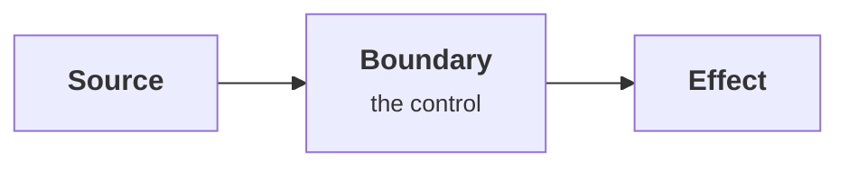

+++
# Sentence case. The lesson number (e.g. 2.c) is computed from the module and weight.
title = '{{ replace (replaceRE `^\d+-` "" .File.ContentBaseName) "-" " " | strings.FirstUpper }}'
# One sentence: the claim of the lesson, shown under the title.
description = ''
# The question this lesson answers, shown in the module's lesson list.
question = ''
# Order within the module (1, 2, 3, …). Match the file-name prefix.
weight = 1
# 1 (introductory) to 5 (expert).
difficulty = 2
# Site paths of lessons to read first, e.g. ['/notes/ai-security-engineering/threat-landscape/01-why-ai-security-is-different'].
prerequisites = []
date = {{ .Date | time.Format "2006-01-02" }}
lastmod = {{ .Date | time.Format "2006-01-02" }}
# Set only after the Python program(s) in this lesson have actually been run: verified = 2026-10-29
draft = true
+++

## The idea in one minute

State the claim in a short paragraph. End with the consequence an engineer must act on.

## A picture



Node classes: neutral, compute, memory, queue, io, warn, good.

## How it really works

### The mechanism

Explain precisely. Name real tools, versions, and specifications.

> [!NOTE]
> Callouts: NOTE, TIP, IMPORTANT (shown as "Key idea"), WARNING, CAUTION.

## Code

```python {title="example.py"}
"""example.py: what this program demonstrates. Standard library only; runs offline."""


def main() -> None:
    print("simulated, never a real system")


if __name__ == "__main__":
    main()
```

Run it with `python3 example.py`. Show the expected output:

```text
simulated, never a real system
```

## Where it breaks

The limits of the control, the failure case, and what the example does not prove.

## Remember this

- Four to six one-line takeaways.

## Try it

1. A hands-on task.

## Check yourself

1. A recall question.

   {{ "{{<" }} details summary="Show answer" {{ ">}}" }}
   The answer.
   {{ "{{<" }} /details {{ ">}}" }}

## Sources

- Author, [Title](https://example.com/), date.
