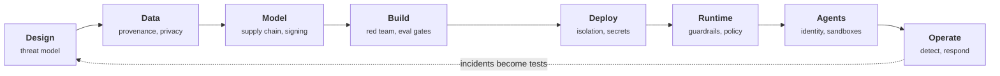

+++
title = 'AI security engineering'
description = 'How AI systems are attacked and how they are defended, from the first threat model to a running agent.'
weight = 1
tone = 'accent'
group = 'security'
status = 'Course'
course = true
+++

Securing an AI application is ordinary security engineering plus one new fact:
a language model cannot reliably tell the instructions it should follow from the
text it was merely asked to read. No patch fixes that. Everything distinctive in
this course follows from it, especially the working assumption that **the model
will sometimes be manipulated** and that the system around it must make that
survivable.

The course starts at "why is this different from web security?" and ends with a
complete security design for a multi-tenant agent platform. It assumes you can
read Python and know what an HTTP API and an access token are. It does **not** assume
a security background.

## The stages

Security work attaches to the stages of an application's life, and the course is
organized the same way: attacks first, then the controls for each stage.

## How each lesson works

Every lesson has the same shape, so you always know where to look:

1. **The idea in one minute.** The claim, before the detail.
2. **A picture** of the attack or the defense.
3. **How it really works.** The mechanism, precisely, with the tools named.
4. **Code**, where a mechanism is worth running: a small Python program using
   only the standard library. Attacks run against simulated models inside the
   program; nothing targets a real system.
5. **Where it breaks.** The limits of the control and what it does not prove.
6. **Remember this**, **Try it**, and **Check yourself**, with answers you can
   reveal after you have tried.

Attacks come before defenses, because a defense makes sense only once you can
see what it stops, and what it does not.

## What you need

- Python 3.10 or newer and a terminal. Every program runs offline.
- No GPU, no API key, no lab environment.

> [!CAUTION] Scope and ethics
> The course explains how attacks work so that you can build and test defenses
> for systems you are responsible for. The demonstrations are self-contained
> simulations. Test only systems you own or are authorized to test.

## Names, versions, and dates

Framework editions, incident references, specification versions, and legal
dates change. Lessons that depend on them list their sources and the date they
were checked. The principles underneath (untrusted input, least privilege,
isolation, defense in depth) are far older than any model and will outlast the
current ones.
