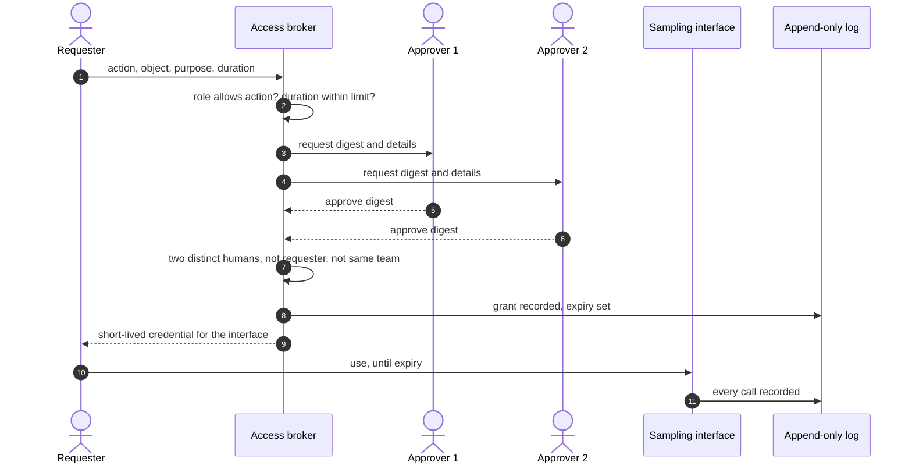

+++
title = 'Insider risk and model access'
description = 'No human needs standing access to frontier weights. Grant access per request, for a stated purpose and a short time, with two independent approvers, through an interface, into a log nobody can quietly edit.'
question = 'How do you let people work with a model without letting any one of them walk away with it?'
weight = 3
difficulty = 3
prerequisites = ['/notes/ai-security-engineering/frontier-model-security/02-research-and-training-infrastructure', '/notes/infrastructure-security/delivery-and-operations/03-audit-logs-and-detection']
date = 2026-10-30T06:15:00Z
lastmod = 2026-10-30T06:15:00Z
verified = 2026-10-30
+++

## The idea in one minute

An insider is anyone with authorized access: employees, contractors, vendors,
and, from the system's point of view, anyone who has stolen one of their
credentials. RAND places insider threats in the same capability band as
organized cybercrime (OC3), because legitimate access skips most of the work an
outside attacker has to do.

The design goal is that **no single person can cause a copy of the weights to
leave**. Five controls get you there:

1. **No standing access.** Nobody holds read access to weights by default.
2. **Just-in-time grants** tied to a specific action, object, purpose, and
   duration.
3. **Two independent approvers** for anything that touches weights or the
   controls around them.
4. **Interfaces instead of files**, so most grants never expose bytes.
5. **A tamper-evident record** of every request, decision, and use.

Two-person control does not stop two people acting together, or an attacker who
controls two accounts. It turns a one-person decision into a conspiracy, and
leaves a record of it.

## A picture



## How it really works

### Who counts as an insider

CISA defines insider threat as the potential for an insider to use their
authorized access or understanding of an organization to harm it. For model
weights, four kinds matter:

| Kind | Example | What stops it |
| --- | --- | --- |
| **Malicious** | An engineer copies a checkpoint before leaving for a competitor | No standing access; two-person grants; egress budgets |
| **Coerced or recruited** | A researcher is pressured or paid by a foreign intelligence service | The same, plus a personnel security program; no one person suffices |
| **Compromised** | An attacker phishes an engineer and uses their session | Phishing-resistant authentication; device posture; grants bound to a device; anomaly detection |
| **Negligent** | A checkpoint is copied to a personal bucket "to work over the weekend" | Interfaces that make the safe path easy; inventory; data-loss detection |

The compromised case is why insider controls are not only about trust in
people. Every control that limits what a malicious employee can do also limits
what an attacker holding that employee's credentials can do.

### Standing access is the problem

Start by counting. For each copy of the weights, list every principal that can
read it now, including through group membership, admin roles, and control-plane
permissions that let them grant themselves access. RAND's first SL3
recommendations are to centralize weights and reduce the number of people
authorized to access them. In practice that number should approach zero for
standing access: workloads read weights, people request access.

This is the **just-in-time** or **zero standing privilege** pattern from zero
trust architecture (NIST SP 800-207): access is decided per request, with the
request's context, and expires.

### Two-person control

The idea is old. Nuclear weapons handling and bank vaults use two-person
integrity: no single person can perform a critical operation. NIST SP 800-53
encodes it as **dual authorization** in several controls, including AC-3(2)
for access enforcement and CM-5(4) for changes to production systems, alongside
separation of duties (AC-5) and least privilege (AC-6).

At least one published frontier framework applies it directly: Anthropic's May
2025 report on its ASL-3 security standard lists two-party authorization for
model weight access, together with stricter change management.

A two-person rule is only as good as its details:

- **Approvals bind to the exact request.** The approver signs a digest of
  action, object, purpose, and duration. An approval for "sample from step
  120000 for 8 hours" cannot be reused for "export a shard".
- **Approvers are independent.** Not the requester, not the requester under a
  second account, not on the requester's team or reporting chain. The broker
  resolves accounts to humans before counting.
- **Approvers see what they approve.** The request shows the object, the
  purpose, and the history of similar requests. An approval prompt with no
  context trains people to click.
- **Some actions are not grantable.** "Copy the weights outside the enclave" is
  not a request type. If the business truly needs it (a new data center, a
  disaster-recovery copy), it is a separate, rare procedure with more than two
  people, planned in advance.
- **Grants expire.** Hours, not weeks. Renewal is a new request.

### Two-person control for changes, too

The controls themselves are a path to the weights. Whoever can change the
enclave's IAM policy, egress rules, KMS key policy, or the broker's own
configuration can grant themselves access without asking. Changes to those need
the same two-person approval, made through code review of infrastructure as
code, with the deployment pipeline as the only principal allowed to apply them.
[KMS and key hierarchies](/notes/infrastructure-security/secrets/03-kms-and-key-hierarchies/)
covers separating key administrators from key users.

### Interfaces instead of files

Most legitimate needs are met without bytes of weights leaving a server:
sampling, evaluation, fine-tuning inside the enclave, and interpretability tools
that run there. The broker grants a short-lived credential for the interface,
and the interface enforces its own limits (rate, output size, which fields it
returns). The [previous lesson](/notes/ai-security-engineering/frontier-model-security/02-research-and-training-infrastructure/)
describes the interfaces; this one controls who may use them.

### Administrators are insiders with more access

Platform engineers with root on serving hosts can read process memory, which
holds decrypted weights. Cloud administrators can change policies or attach a
disk to another machine. Three controls reduce what they can do alone:

- **Separate admin roles** for compute, storage, network, and identity, so no
  one role can both reach the weights and move them out.
- **Privileged sessions through a recorded gateway**, from managed devices,
  with the session tied to an approved change or incident.
- **Hardware protection against the host itself**, where the threat justifies
  it: [confidential inference](/notes/ai-security-engineering/frontier-model-security/06-confidential-inference/)
  keeps weights encrypted in memory even from the host's root user.

### A record nobody can quietly edit

Every request, approval, grant, use, and denial goes to a log that the people
it records cannot alter: written to a separate account, with each entry
committing to the previous one so that edits and deletions are detectable.
[Audit logs and detection](/notes/infrastructure-security/delivery-and-operations/03-audit-logs-and-detection/)
covers integrity and centralization.

Detections worth running on that log:

- grants used outside the requester's normal hours or from a new device;
- approvals given within seconds of the request, repeatedly (rubber-stamping);
- the same pair of requester and approver appearing far more often than chance
  (a possible collusion signal, or a process problem);
- many small grants that together cover a whole model;
- break-glass use of any kind, which pages someone immediately.

### The people side

Technical controls sit inside an insider risk program. CISA's Insider Threat
Mitigation Guide describes one as a cycle: define the program, detect and
identify concerning behavior, assess it, and manage it, with legal, HR, and
security working together. For weights, that includes background checks
appropriate to the role, prompt revocation of access at departure, and a way
for staff to report coercion attempts without penalty. The program also needs
limits: monitoring that is proportionate, disclosed, and reviewed, so that it
does not damage the trust it depends on.

## Code

The program is a small access broker. It enforces the role check, duration
limit, approval binding, and independence rules above, and keeps a hash-chained
log of every decision and use.

```python {title="two_person.py"}
"""two_person.py: a weight-access broker with role checks, two-person approval, and expiry.

Every request names an action on an object for a purpose and a duration. A grant
needs two approvers who hold the approver role, are distinct humans, are not the
requester, and are not in the requester's team. Approvals are bound to a digest
of the exact request, so they cannot be reused for a different one. Decisions are
appended to a hash-chained log. Identities and clocks are simulated.
"""
from __future__ import annotations

import hashlib
import json
from dataclasses import dataclass, field

PEOPLE = {  # account -> (human, team, roles)
    "alice":       ("h-alice", "pretrain", {"researcher"}),
    "bob":         ("h-bob",   "security", {"approver"}),
    "carol":       ("h-carol", "infra",    {"approver"}),
    "dave":        ("h-dave",  "pretrain", {"approver"}),
    "alice-admin": ("h-alice", "pretrain", {"approver"}),   # same human, second account
}
ACTIONS = {  # action -> roles that may request it, max duration in hours
    "read-weights-via-api": ({"researcher"}, 24),
    "copy-weights-out":     (set(), 0),          # nobody: not grantable
    "export-shard":         ({"researcher"}, 2),
}


@dataclass(frozen=True)
class Request:
    requester: str
    action: str
    obj: str
    purpose: str
    hours: int

    def digest(self) -> str:
        return hashlib.sha256(json.dumps(self.__dict__, sort_keys=True).encode()).hexdigest()[:12]


@dataclass
class Broker:
    now: int = 0                                   # hours since start
    log: list[dict] = field(default_factory=list)
    grants: dict[str, tuple[Request, int]] = field(default_factory=dict)

    def _record(self, event: dict) -> None:
        prev = self.log[-1]["hash"] if self.log else "0" * 12
        entry = {**event, "prev": prev, "t": self.now}
        body = json.dumps(entry, sort_keys=True)
        self.log.append({**entry, "hash": hashlib.sha256(body.encode()).hexdigest()[:12]})

    def decide(self, req: Request, approvals: list[tuple[str, str]]) -> str:
        reasons = self._reasons(req, approvals)
        verdict = "GRANT" if not reasons else "DENY"
        if not reasons:
            self.grants[req.digest()] = (req, self.now + req.hours)
        self._record({"req": req.digest(), "verdict": verdict, "why": reasons})
        return verdict + ("" if not reasons else ": " + "; ".join(reasons))

    def _reasons(self, req: Request, approvals: list[tuple[str, str]]) -> list[str]:
        human, team, roles = PEOPLE[req.requester]
        allowed_roles, max_h = ACTIONS[req.action]
        if not roles & allowed_roles:
            return [f"{req.action} is not grantable to {req.requester}"]
        out = []
        if req.hours > max_h:
            out.append(f"duration {req.hours} h > {max_h} h")
        valid: set[str] = set()
        for approver, signed_digest in approvals:
            a_human, a_team, a_roles = PEOPLE[approver]
            if signed_digest != req.digest():
                out.append(f"{approver}'s approval is for a different request")
            elif "approver" not in a_roles:
                out.append(f"{approver} is not an approver")
            elif a_human == human:
                out.append(f"{approver} is the requester under another account")
            elif a_team == team:
                out.append(f"{approver} is on the requester's team")
            else:
                valid.add(a_human)
        if len(valid) < 2:
            out.append(f"{len(valid)} independent approval(s), need 2")
        return out

    def use(self, req: Request) -> str:
        grant = self.grants.get(req.digest())
        ok = grant is not None and self.now < grant[1]
        self._record({"use": req.digest(), "ok": ok})
        return "allowed" if ok else "refused (no live grant)"

    def verify_log(self) -> bool:
        prev = "0" * 12
        for e in self.log:
            body = {k: v for k, v in e.items() if k != "hash"}
            if e["prev"] != prev or hashlib.sha256(json.dumps(body, sort_keys=True).encode()).hexdigest()[:12] != e["hash"]:
                return False
            prev = e["hash"]
        return True


if __name__ == "__main__":
    b = Broker()
    r1 = Request("alice", "read-weights-via-api", "run42/step-120000", "eval-debug", 8)
    d = r1.digest()
    cases = [
        ("self-approval via second account", r1, [("alice-admin", d), ("bob", d)]),
        ("same-team approver", r1, [("dave", d), ("bob", d)]),
        ("one approval", r1, [("bob", d)]),
        ("two independent approvers", r1, [("bob", d), ("carol", d)]),
        ("approval replayed for a bigger request",
         Request("alice", "export-shard", "run42/step-120000", "eval-debug", 2), [("bob", d), ("carol", d)]),
        ("bulk copy out", Request("alice", "copy-weights-out", "run42/step-120000", "backup", 1),
         [("bob", d), ("carol", d)]),
    ]
    for label, req, approvals in cases:
        print(f"{label:<40} {b.decide(req, approvals)}")

    for hour in (1, 9):
        b.now = hour
        print(f"use grant at hour {hour}: {b.use(r1)}")

    print(f"\nlog entries: {len(b.log)}, chain intact: {b.verify_log()}")
    b.log[3]["verdict"] = "DENY"          # someone edits the record of the grant
    print(f"after editing entry 3, chain intact: {b.verify_log()}")
```

Run it with `python3 two_person.py`:

```text
self-approval via second account         DENY: alice-admin is the requester under another account; 1 independent approval(s), need 2
same-team approver                       DENY: dave is on the requester's team; 1 independent approval(s), need 2
one approval                             DENY: 1 independent approval(s), need 2
two independent approvers                GRANT
approval replayed for a bigger request   DENY: bob's approval is for a different request; carol's approval is for a different request; 0 independent approval(s), need 2
bulk copy out                            DENY: copy-weights-out is not grantable to alice
use grant at hour 1: allowed
use grant at hour 9: refused (no live grant)

log entries: 8, chain intact: True
after editing entry 3, chain intact: False
```

The second account is caught because the broker counts humans, not accounts.
The replayed approvals fail because they sign a different digest. The bulk copy
is refused before approvals are even considered: it is not a grantable action.
The grant stops working after eight hours without anyone revoking it. Editing
one log entry breaks the chain from that point on.

## Where it breaks

- **Collusion.** Two independent approvers who agree to cooperate pass every
  check here. Two-person control raises the cost and leaves evidence; it does
  not make collusion impossible. Larger quorums for rarer actions, rotation of
  approvers, and detection of unusual pairs are the next layers.
- **Approver compromise.** An attacker who has phished two approvers, or one
  approver and the requester, is a colluding pair. Phishing-resistant
  authentication and managed devices for approvers matter as much as for
  requesters.
- **The broker is the new root.** Whoever administers the broker, its policy,
  or its identity mapping can approve anything. Its configuration needs
  two-person change control, and its admins should not also be approvers.
- **A hash chain detects edits only if someone checks.** The log must be
  verified regularly against a copy or a published head, from outside the
  environment the log describes. The program holds both in one process.
- **Interfaces can leak the capability.** A sampling grant with no output
  limits enables distillation. Access control decides who; the interface must
  still decide how much.
- **Break-glass becomes the normal path.** If emergency access is used weekly,
  the controls are too slow for the work. Measure break-glass use and fix the
  cause.

## Remember this

- Insiders include anyone holding an insider's credentials.
- Standing human access to weights should approach zero.
- Approvals bind to a request digest and count distinct, independent humans.
- Some actions are not grantable at all; bulk copy out is one.
- Two-person control applies to changing the controls, not only to reads.
- Collusion still passes; the goal is cost, evidence, and detection.

## Try it

1. Run `two_person.py`. Add a rule that the two approvers must also be on
   different teams from each other. Which existing case would that affect, and
   why might you want it?
2. Add a break-glass action that needs only one approver but writes a
   `PAGE` entry to the log and expires after one hour. What else should happen
   automatically after it is used?
3. Write the log-based detection for rubber-stamping: approvals in under 30
   seconds, more than five times in a week, by the same approver.
4. Count the principals that could grant themselves read access to one model's
   weights in your environment today, including through policy changes.

## Check yourself

1. Why does the broker resolve accounts to humans before counting approvals?

   
   Because one person can hold several accounts, such as a normal account and
   an admin account. Counting accounts would let that person approve their own
   request. The rule is about independent people, so the count has to be over
   people.
   

2. What does binding an approval to a request digest prevent?

   
   Reuse of an approval for a different action, object, purpose, or duration.
   Without it, approvals for a narrow, reasonable request could be presented
   with a broader one. With it, the approver's decision covers exactly what
   they saw.
   

3. An engineer with no weight access can edit the KMS key policy for the
   weights. Why is that a weight-access problem?

   
   Because they can grant themselves, or a principal they control, permission
   to decrypt the weights. Control over the controls is equivalent to access.
   Changes to key policies, IAM, egress, and the broker need the same
   two-person approval as access itself.
   

4. Name two things a two-person rule does not protect against, and a control
   for each.

   
   Collusion between two approvers: larger quorums for rare actions, approver
   rotation, and detection of unusual requester-approver pairs. Compromise of
   approver accounts: phishing-resistant authentication and managed devices
   for approvers. Others: broker administrators (separate them from approvers
   and put their changes under two-person control) and leaky interfaces
   (output limits).
   

## Sources

- CISA, [Insider Threat Mitigation Guide](https://www.cisa.gov/resources-tools/resources/insider-threat-mitigation-guide), November 2020.
- CISA, [Defining Insider Threats](https://www.cisa.gov/topics/physical-security/insider-threat-mitigation/defining-insider-threats).
- NIST, [SP 800-53 Rev. 5: Security and Privacy Controls for Information Systems and Organizations](https://csrc.nist.gov/pubs/sp/800/53/r5/upd1/final) (AC-3(2), AC-5, AC-6, CM-5(4)).
- NIST, [SP 800-207: Zero Trust Architecture](https://csrc.nist.gov/pubs/sp/800/207/final), August 2020.
- Nevo et al., [Securing AI Model Weights](https://www.rand.org/pubs/research_reports/RRA2849-1.html), RAND, 2024.
- Anthropic, [Activating AI Safety Level 3 protections](https://www.anthropic.com/news/activating-asl3-protections), May 2025.
