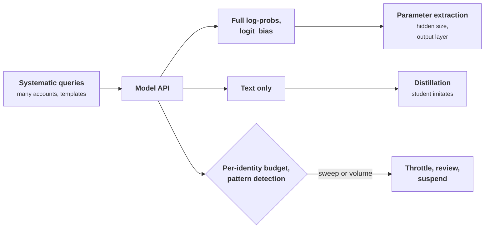

+++
title = 'Extraction and distillation'
description = 'A model API is a weight-access interface with very low bandwidth. Every extra field it returns lowers the cost of copying the model, and per-identity budgets and pattern detection are what keep that cost high.'
question = 'How much of a model can be copied through its own API, and what raises the cost?'
weight = 4
difficulty = 4
prerequisites = ['/notes/ai-security-engineering/how-attacks-work/04-abuse-and-resource-attacks', '/notes/ai-security-engineering/frontier-model-security/01-securing-model-weights']
date = 2026-10-30T06:20:00Z
lastmod = 2026-10-30T06:20:00Z
verified = 2026-10-30
+++

## The idea in one minute

Stealing the weights is not the only way to copy a model. An API that answers
queries leaks the model a little at a time, and there are two distinct ways to
use that leak:

- **Parameter extraction** recovers actual numbers. Carlini et al. (2024)
  showed that the log-probabilities returned by production APIs reveal a
  model's hidden dimension and its final projection layer, for less than $20 in
  queries on two older production models.
- **Distillation** copies behavior. Collect many prompt and response pairs, then
  train a cheaper student model to imitate them. It needs no special API
  features, only volume.

Neither can be prevented outright for a model people are allowed to use. The
defense is economic: **return only what the product needs**, especially no
full log-probabilities or unrestricted `logit_bias`; **budget queries per
identity**, and per organization behind the identities; and **detect
systematic querying** before the budget runs out. Watermarking and terms of
service add evidence after the fact.

## A picture



## How it really works

### A short history

Model stealing through prediction APIs is older than language models.
Tramèr et al. (2016) extracted logistic regression, neural network, and
decision tree models from commercial machine-learning APIs, often with a number
of queries close to the number of parameters, using the confidence values the
APIs returned. Orekondy et al. (2019) showed functional stealing of image
classifiers ("Knockoff Nets") by training on a black box's outputs over natural
images. For language models, the Stanford Alpaca project (2023) fine-tuned a 7B
open model on 52,000 instruction-following demonstrations generated from a
commercial model, reporting a generation cost under $500. That was a published
research project, not an attack, and it showed how cheap behavior distillation
is.

Distillation itself is a standard technique (Hinton et al., 2015): training a
student on a teacher's output distribution transfers more than training on
labels alone. That is exactly why full probability distributions are worth more
to a copier than sampled text.

### Why logits leak the shape of the model

A transformer's last step multiplies a hidden state `h` of dimension `d` by an
output projection `W` of shape `V × d`, where `V` is the vocabulary size:
`logits = W h`.

Every logit vector the API ever produces is a combination of the `d` columns of
`W`, so all of them lie in a `d`-dimensional subspace of a `V`-dimensional
space, and `V` is far larger than `d` (for example 128,000 against 8,192).
Collect a little more than `d` full vectors, stack them, and the rank of the
matrix is `d`: the hidden size. A singular value decomposition then recovers
`W` up to an unknown `d × d` linear transformation. Log-probabilities differ
from logits by a per-query constant, which centering removes.

Carlini et al. used this to recover the full projection matrix of two older
OpenAI models for under $20 in queries and the hidden dimension of
`gpt-3.5-turbo`, estimating that recovering its full projection matrix would
cost under $2,000. APIs that return only the top few log-probabilities are
still vulnerable when they also accept `logit_bias`: by biasing different
tokens into the top positions, an attacker reconstructs the full vector over
many queries. The authors disclosed the attack, and the affected providers
changed their APIs. Finlayson et al. (2024) independently showed the same
low-rank property can be used to identify which model is behind an API and to
detect when it changes.

The extracted layer is a small part of the model. Its value is what it reveals:
the hidden size (and so an estimate of parameter count), a fingerprint, and a
starting point for further attacks.

### What each API feature costs

| Feature | What it gives a copier | Default to choose |
| --- | --- | --- |
| Full log-probabilities over the vocabulary | One query yields a full vector for extraction; rich targets for distillation | Do not offer |
| Top-*k* log-probabilities | Partial distribution; with `logit_bias`, the full vector over about `V/k` queries | Small *k*, only where a product needs it |
| `logit_bias` over arbitrary tokens | Lets an attacker move any token into view | Limit the number of biased tokens per request and per day |
| Prompt log-probabilities (echo) | Scores for attacker-chosen text, no sampling noise | Do not offer |
| Deterministic outputs (temperature 0, seed) | Cleaner signal per query | Acceptable; note it in the threat model |
| Many samples per request (`n`) | Cheaper distribution estimates | Cap `n` |
| Text only | Distillation, at volume | The baseline you cannot remove |

### Budgets, and what they are budgets of

A budget only helps if it is counted per real entity. An attacker who needs
300 million queries will not use one account. Budgets work in layers:

- **Per API key**: requests and tokens per minute and per day, as for any abuse
  ([abuse and resource attacks](/notes/ai-security-engineering/how-attacks-work/04-abuse-and-resource-attacks/)).
- **Per organization, payment instrument, and verified identity**, so that new
  keys and accounts share the budget of what created them.
- **Per capability tier**: higher-risk features (larger *k*, wider
  `logit_bias`, fine-tuning, higher rate limits) require stronger identity
  verification and an agreement.

The program below makes the arithmetic concrete: under a simplified cost model,
the same extraction goal goes from under one account-day to tens of thousands
of account-days when full log-probabilities are replaced by top-5.

### Detecting systematic querying

Extraction and distillation traffic has a shape. Some signals:

- **`logit_bias` sweeps.** Normal applications bias a fixed handful of tokens
  (labels to allow, words to suppress). Extraction biases a large and growing
  fraction of the vocabulary.
- **Template structure.** Prompts generated from templates with systematic
  variation, high coverage of topics with little repetition, and no follow-up
  turns.
- **Query distribution.** PRADA (Juuti et al., 2019) detected model stealing of
  classifiers by testing whether the distances between successive queries
  follow the distribution natural use produces. The same idea, with embeddings,
  applies to prompt streams.
- **Account clusters.** Many accounts with similar prompts, timing, payment
  details, or network origins.

Detection leads to throttling, review, and suspension, not instant blocking:
evaluation companies and researchers legitimately send systematic queries.

### Watermarks and evidence

Watermarking does not prevent copying; it can make it provable. Kirchenbauer et
al. (2023) proposed biasing sampling toward a pseudorandom "green list" of
tokens that a detector can test for statistically. Google DeepMind's SynthID
Text, described in *Nature* in 2024, is a deployed scheme of this family.
Sander et al. (2024) showed that watermarked text is "radioactive": a model
fine-tuned on it carries a detectable trace, which can show that a student was
trained on a provider's outputs. Watermarks can be weakened by paraphrasing and
are evidence, not a barrier. Terms of service that prohibit using outputs to
train competing models turn that evidence into a contractual remedy.

### Training data is a separate leak

Extraction of memorized training data (Carlini et al., 2021; Nasr et al., 2023,
who extracted training data from a production chat model with a divergence
attack) is a privacy problem more than a model-theft problem. Its defenses,
deduplication and data minimization, are covered in
[data and training](/notes/ai-security-engineering/securing-each-stage/02-data-and-training/).

## Code

Part 1 builds a toy output layer (vocabulary 48, hidden size 6) behind an
"API" that returns full log-probabilities, and computes the rank of the
centered responses as queries accumulate. Part 2 estimates the cost of the same
goal under different exposures. Part 3 flags a `logit_bias` sweep.

```python {title="extraction_budget.py"}
"""extraction_budget.py: why exposed logits leak a model's shape, and what budgets buy.

Part 1 builds a toy language model head (vocab 48, hidden size 6) and shows that
full log-probability vectors from a few queries span only a 6-dimensional space,
which reveals the hidden size (the observation behind Carlini et al., 2024).
Part 2 estimates queries and account-days to collect enough vectors under
different API exposures, using a simplified cost model. Part 3 flags accounts
whose logit_bias usage sweeps the vocabulary. Everything is simulated.
"""
from __future__ import annotations

import math
import random

V, H = 48, 6
rng = random.Random(1)
W = [[rng.gauss(0, 1) for _ in range(H)] for _ in range(V)]   # secret output projection


def api_logprobs(prompt_seed: int) -> list[float]:
    """The 'model': a hidden state for the prompt, projected to logits, log-softmaxed."""
    r = random.Random(prompt_seed)
    x = [r.gauss(0, 1) for _ in range(H)]
    logits = [sum(w * xi for w, xi in zip(row, x)) for row in W]
    m = max(logits)
    lse = m + math.log(sum(math.exp(z - m) for z in logits))
    return [z - lse for z in logits]


def rank(rows: list[list[float]], tol: float = 1e-8) -> int:
    m = [r[:] for r in rows]
    rnk, col, ncols = 0, 0, len(m[0])
    while rnk < len(m) and col < ncols:
        piv = max(range(rnk, len(m)), key=lambda i: abs(m[i][col]))
        if abs(m[piv][col]) < tol:
            col += 1
            continue
        m[rnk], m[piv] = m[piv], m[rnk]
        for i in range(rnk + 1, len(m)):
            f = m[i][col] / m[rnk][col]
            m[i] = [a - f * b for a, b in zip(m[i], m[rnk])]
        rnk, col = rnk + 1, col + 1
    return rnk


def part1() -> None:
    print(f"part 1: toy head, vocab {V}, hidden size {H} (secret)")
    rows = []
    for n in range(1, 13):
        lp = api_logprobs(1000 + n)
        mean = sum(lp) / V
        rows.append([v - mean for v in lp])          # centering removes the softmax shift
        if n in (2, 4, 6, 7, 9, 12):
            print(f"  {n:>2} queries -> rank of centered log-prob matrix = {rank(rows)}")


def part2() -> None:
    vocab, hidden = 128_000, 8_192          # illustrative sizes for a large model
    vectors = hidden + 1_000                # some headroom for numerical stability
    per_vector = {
        "full log-probs": 1,
        "top-5 log-probs + logit_bias": math.ceil((vocab - 1) / 4),
        "top-1 log-prob + logit_bias": (vocab - 1) * 20,   # ~20 binary-search steps per token
        "text only, no logit_bias": None,
    }
    budget = 10_000                          # requests per account per day
    print(f"\npart 2: collect {vectors:,} full vectors from vocab {vocab:,} "
          f"(simplified cost model, {budget:,} requests/account/day)")
    print(f"  {'exposure':<30}{'queries':>18}{'account-days':>16}")
    for name, q in per_vector.items():
        if q is None:
            print(f"  {name:<30}{'not applicable':>18}{'-':>16}")
            continue
        total = q * vectors
        print(f"  {name:<30}{total:>18,}{total / budget:>16,.1f}")


def part3() -> None:
    print("\npart 3: distinct logit_bias token ids per account in one day")
    ban_list = random.Random(5).sample(range(128_000), 40)       # words an app always suppresses
    accounts = {
        "app-moderation": [ban_list] * 800,
        "app-classifier": [[17, 942, 3051]] * 5000,                 # constrain to three labels
        "acct-sweep": [list(range(i * 300, (i + 1) * 300)) for i in range(400)],
    }
    limit = 2_000
    for name, reqs in accounts.items():
        distinct = len({t for r in reqs for t in r})
        flag = "FLAG for review" if distinct > limit else "ok"
        print(f"  {name:<16} {len(reqs):>5} requests  {distinct:>7,} distinct ids  {flag}")


if __name__ == "__main__":
    part1()
    part2()
    part3()
```

Run it with `python3 extraction_budget.py`:

```text
part 1: toy head, vocab 48, hidden size 6 (secret)
   2 queries -> rank of centered log-prob matrix = 2
   4 queries -> rank of centered log-prob matrix = 4
   6 queries -> rank of centered log-prob matrix = 6
   7 queries -> rank of centered log-prob matrix = 6
   9 queries -> rank of centered log-prob matrix = 6
  12 queries -> rank of centered log-prob matrix = 6

part 2: collect 9,192 full vectors from vocab 128,000 (simplified cost model, 10,000 requests/account/day)
  exposure                                 queries    account-days
  full log-probs                             9,192             0.9
  top-5 log-probs + logit_bias         294,144,000        29,414.4
  top-1 log-prob + logit_bias       23,531,336,160     2,353,133.6
  text only, no logit_bias          not applicable               -

part 3: distinct logit_bias token ids per account in one day
  app-moderation     800 requests       40 distinct ids  ok
  app-classifier    5000 requests        3 distinct ids  ok
  acct-sweep         400 requests  120,000 distinct ids  FLAG for review
```

The rank stops at 6 no matter how many more queries arrive: the hidden size has
leaked in seven queries. Part 2's numbers come from a simplified model (one
query per vector with full log-probabilities, about `V/4` with top-5 and bias,
about 20 binary-search steps per token with top-1), not from the paper's exact
procedures; the point is the orders of magnitude between rows. In part 3, the
sweep account touches 120,000 distinct token ids in 400 requests, while real
applications touch a handful.

## Where it breaks

- **Distillation needs none of the features you removed.** Text-only answers at
  volume still transfer behavior. Budgets and detection slow it; nothing in the
  API stops a well-funded copier with many identities and patience.
- **Identity is the weak point of every budget.** Budgets count what you can
  link. Stolen accounts, resold API access, and intermediaries break the link.
- **Detection has real false positives.** Evaluation vendors, researchers, and
  batch customers look systematic. Route flags to review and offer a
  sanctioned path for legitimate bulk use.
- **The toy is exact; real attacks are noisy.** Real logits are rounded, APIs
  add sampling noise, and production attacks need more queries and careful
  numerics. The rank argument is the same.
- **Open weights end the question.** Once a model's weights are published,
  extraction is moot and only the original release decision mattered. That is
  the subject of the [next lesson](/notes/ai-security-engineering/frontier-model-security/05-capability-evaluations-and-release-gates/).

## Remember this

- An API is a weight-access interface with low bandwidth; it still leaks.
- Full logits lie in a `d`-dimensional subspace; their rank reveals the hidden
  size.
- `logit_bias` plus top-*k* log-probabilities can rebuild full vectors.
- Distillation needs only text and volume.
- Budget per real entity, not per key; detect sweeps and templates.
- Watermarks make copying provable, not impossible.

## Try it

1. Run `extraction_budget.py`. Change `H` to 10 and confirm the rank stops at
   10. Then round each log-probability to two decimals before centering. What
   tolerance does `rank` now need to report the right answer?
2. Add an API mode that returns only the top-5 log-probabilities. Show that the
   rank attack no longer works directly on those responses.
3. Write the per-organization budget: three keys under one organization share
   a daily total. Simulate an attacker creating a fourth key mid-day.
4. List every field your model API returns. Which does no product feature use?

## Check yourself

1. Why do full logit vectors reveal a model's hidden size?

   
   Logits are the output projection matrix (vocabulary by hidden size) times a
   hidden-size vector. Every logit vector is a combination of the matrix's
   columns, so all lie in a subspace whose dimension is the hidden size.
   Stacking slightly more vectors than that and computing the rank gives the
   hidden size; a singular value decomposition recovers the matrix up to a
   linear transformation.
   

2. An API returns only the top five log-probabilities. Why can that still be
   enough for extraction?

   
   If the API also accepts `logit_bias` on arbitrary tokens, the attacker can
   push chosen tokens into the top five and read their log-probabilities
   relative to a reference token. Repeating that across the vocabulary rebuilds
   the full vector, at a cost of many queries per vector instead of one.
   

3. Why do query budgets need to be counted per organization or payment
   instrument and not only per API key?

   
   Because an attacker who needs millions of queries creates more keys or
   accounts. A per-key budget multiplies by the number of keys. Linking keys to
   the entity that created them makes the budget apply to the attacker, not to
   one of their credentials.
   

4. What does output watermarking contribute against distillation?

   
   Evidence. A statistical watermark in generated text can be detected later,
   and research shows that models trained on watermarked text can carry a
   detectable trace. That supports enforcement of terms of service. It does
   not prevent collection or training, and paraphrasing weakens it.
   

## Sources

- Carlini et al., [Stealing Part of a Production Language Model](https://arxiv.org/abs/2403.06634), ICML 2024.
- Finlayson, Ren, and Swayamdipta, [Logits of API-Protected LLMs Leak Proprietary Information](https://arxiv.org/abs/2403.09539), 2024.
- Tramèr, Zhang, Juels, Reiter, and Ristenpart, [Stealing Machine Learning Models via Prediction APIs](https://www.usenix.org/conference/usenixsecurity16/technical-sessions/presentation/tramer), USENIX Security 2016.
- Orekondy, Schiele, and Fritz, [Knockoff Nets: Stealing Functionality of Black-Box Models](https://arxiv.org/abs/1812.02766), CVPR 2019.
- Juuti, Szyller, Marchal, and Asokan, [PRADA: Protecting against DNN Model Stealing Attacks](https://arxiv.org/abs/1805.02628), IEEE EuroS&P 2019.
- Hinton, Vinyals, and Dean, [Distilling the Knowledge in a Neural Network](https://arxiv.org/abs/1503.02531), 2015.
- Taori et al., [Alpaca: A Strong, Replicable Instruction-Following Model](https://crfm.stanford.edu/2023/03/13/alpaca.html), Stanford CRFM, March 2023.
- Kirchenbauer et al., [A Watermark for Large Language Models](https://arxiv.org/abs/2301.10226), ICML 2023.
- Dathathri et al., [Scalable watermarking for identifying large language model outputs](https://www.nature.com/articles/s41586-024-08025-4), *Nature*, October 2024.
- Sander, Fernandez, Durmus, Douze, and Furon, [Watermarking Makes Language Models Radioactive](https://arxiv.org/abs/2402.14904), 2024.
- Nasr et al., [Scalable Extraction of Training Data from (Production) Language Models](https://arxiv.org/abs/2311.17035), 2023.
