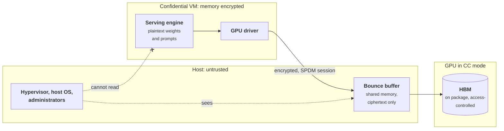

+++
title = 'Confidential inference'
description = 'Confidential computing keeps weights and prompts encrypted from the host that runs them, using a CPU trusted execution environment and a GPU in confidential mode. Attestation-gated key release is what makes it a control rather than a setting.'
question = 'How can a model run on hardware whose operator cannot read the weights or the prompts?'
weight = 6
difficulty = 4
prerequisites = ['/notes/ai-security-engineering/securing-each-stage/05-deployment-and-infrastructure', '/notes/infrastructure-security/workload-identity/02-attestation-and-spiffe']
date = 2026-10-30T06:30:00Z
lastmod = 2026-10-30T06:30:00Z
verified = 2026-10-30
+++

## The idea in one minute

Encryption at rest and in transit leaves one gap: while a model is running, its
weights and the user's prompts are plaintext in memory, readable by whoever
controls the host: a cloud operator, a compromised hypervisor, an administrator
with root. **Confidential computing** closes that gap with hardware. A
confidential VM on AMD SEV-SNP or Intel TDX encrypts the VM's memory with keys
the host never sees. An NVIDIA H100 or later GPU in confidential computing mode
extends the boundary to the accelerator and encrypts traffic between the VM and
the GPU.

Encryption is the means. **Attestation is the control.** The CPU and GPU each
produce a hardware-signed report of what is running; a verifier checks it
against approved values; and only then does a key broker release the model's
decryption key, wrapped to a key that exists only inside the attested
environment. It serves two parties: a model owner who does not want the
infrastructure operator to read the weights, and a user who does not want the
model operator to read their prompts.

## A picture



## How it really works

### The threat model

Confidential computing is for threats that come from the platform below the
workload:

| In scope | Out of scope |
| --- | --- |
| Host OS, hypervisor, and their administrators reading guest memory | Bugs in the code running inside the boundary |
| Other tenants on the host | What the model outputs, and who can call the API |
| DMA from devices that are not part of the trusted set | Denial of service: the operator can always stop the VM |
| Snooping of the PCIe bus between CPU and GPU | Many side channels (timing, access patterns), depending on the platform |
| A cloud insider swapping the image the workload boots | Physical attacks the vendor excludes, such as on GPU HBM |

The [serving engine](/notes/inference-engineering/serving-systems/01-anatomy-of-a-serving-engine/), framework, CUDA libraries, and driver all run inside the
boundary, so they are part of the trusted computing base. Attestation tells you
which code is running. It does not tell you that the code is correct.

### The CPU side

**AMD SEV-SNP** encrypts each VM's memory with a key held in the processor's
security processor and adds integrity protection through a reverse map table,
so the hypervisor cannot remap or replay guest pages. **Intel TDX** provides
the equivalent with trust domains. Both produce an **attestation report**: a
structure signed by a key rooted in the CPU vendor, containing a measurement of
the initial guest image and firmware, the platform's firmware versions (its
trusted computing base, or TCB), whether debug is enabled, and 64 bytes of
`report_data` chosen by the guest. That last field is what binds the report to
a session: the guest puts the hash of a fresh nonce and its own public key
there.

### The GPU side

NVIDIA introduced confidential computing with the Hopper H100. In CC mode, as
NVIDIA describes it:

- the driver inside the confidential VM and the GPU establish an authenticated
  session using the DMTF SPDM protocol, and the GPU proves its identity with a
  device key whose certificate chains to NVIDIA;
- the GPU blocks access to its memory from outside the confidential VM;
- data moving between the VM and the GPU passes through **bounce buffers** in
  shared system memory, encrypted with AES-GCM on one side and decrypted on the
  other, so the host only ever sees ciphertext;
- the GPU's HBM is not encrypted. It sits on the same package as the GPU, and
  its protection relies on that and on access control, not on cryptography;
- the GPU produces its own attestation report with measurements of its firmware
  and configuration, which a verifier compares with **reference integrity
  manifests** (RIMs) published by NVIDIA, either through NVIDIA's remote
  attestation service or a local verifier from the open-source `nvtrust`
  tools.

CC mode is a device setting that requires a GPU reset to change, and there is a
separate developer mode for debugging that is not secure. Multi-GPU support and
newer generations (Blackwell) extend the model; check NVIDIA's current
deployment guide for which topologies are supported in which mode.

### Attestation, in the IETF's vocabulary

RFC 9334, the IETF Remote ATtestation procedureS (RATS) architecture, names the
roles. The **attester** (the confidential VM with its GPU) produces
**evidence**. The **verifier** appraises it using **endorsements** from the
hardware vendors (certificates, RIMs) and **reference values** from the owner
(approved image measurements, minimum firmware versions). The **relying party**
(the key broker) acts on the verifier's result. Keeping the roles distinct
makes it clear what each one must be trusted for.

```mermaid {title="The model key moves only after the evidence checks out"}
sequenceDiagram
  autonumber
  participant W as Confidential VM + GPU
  participant V as Verifier and key broker
  participant K as KMS
  V->>W: fresh nonce
  W->>W: new key pair, report data binds nonce and public key
  W-->>V: CPU report, GPU report, public key
  V->>V: signatures chain to vendors?
  V->>V: nonce fresh, public key bound?
  V->>V: image, debug off, CC on, firmware at or above minimum
  alt All checks pass
    V->>K: unwrap model key
    K-->>V: model key
    V-->>W: model key wrapped to the VM's public key
    W->>W: decrypt weights inside the boundary
  else Any check fails
    V-->>W: refuse, weights stay encrypted
  end
```

The reference values are where your own pipeline comes in. The approved image
measurement should come from the same build that produced signed provenance for
the serving image
([CI/CD and build provenance](/notes/infrastructure-security/delivery-and-operations/01-ci-cd-and-build-provenance/)).
The minimum firmware version is how you revoke platforms with known
vulnerabilities: when a vendor publishes a fix, raise the minimum and old
platforms stop receiving keys.

### Key release in practice

The key broker can be a cloud service (several clouds offer key release
conditioned on attestation for their confidential VMs), the Trustee key broker
from the CNCF Confidential Containers project for Kubernetes, or your own
service in front of a KMS. Whichever you use, three properties matter:

- **The key is wrapped to a key generated inside the boundary**, whose public
  half is bound into the attestation report. Otherwise a host that relays a
  valid report can substitute its own key and receive the model key.
- **Freshness**: every request uses a new nonce, so a recorded report cannot be
  replayed.
- **Fail closed**: an unreachable verifier means no key, which means no
  serving. Plan capacity and caching of attestation results with that in mind.

### What it costs

Zhu et al. (2024) benchmarked LLM inference on H100 in CC mode and found the
overhead mostly in CPU-GPU transfers through encrypted bounce buffers: small for
typical inference with large models and long sequences, where computation
dominates, and larger when work is dominated by many small transfers. Model
loading moves every weight byte through the encrypted path once, so loading is
slower than in normal mode; measure it on your platform, because it sets how
fast you can scale out. The larger cost is operational: attestation
infrastructure, reference-value management, firmware tracking, and debugging
without host access.

### Protecting users, not only weights

The same mechanism protects prompts from the model operator. The design question
becomes how a user can know what code their request will reach. Apple's Private
Cloud Compute, described publicly in 2024, is one published example: clients
send requests only to nodes whose attested software appears in a public
transparency log that researchers can inspect. The general pattern is
**verifiable transparency**: attestation tells a client which image is running,
and publishing the images lets someone check what those images do.

## Code

The program simulates the key broker. A workload produces a CPU report bound to
a nonce and an ephemeral public key, and a GPU report with its mode and
measurements. The broker checks signatures, freshness, binding, image,
debug mode, firmware level, CC mode, and GPU measurements, then wraps the model
key to the workload's public key. It also tries a replay, a key substitution,
and interception of the wrapped key.

```python {title="key_release.py"}
"""key_release.py: release a model key only to an attested CPU TEE and confidential GPU.

The verifier issues a nonce. The workload returns a CPU report and a GPU report,
each signed by a (simulated) hardware root, plus an ephemeral public key whose
hash is bound into the CPU report. The verifier checks signatures, freshness,
measurements against reference values, debug and confidential-computing modes,
and firmware versions, then wraps the model key to that public key.
HMAC stands in for vendor signatures and a toy Diffie-Hellman group stands in
for real key agreement. Nothing here is real cryptographic strength.
"""
from __future__ import annotations

import hashlib
import hmac
import json
import random
import secrets
from dataclasses import dataclass, field

CPU_ROOT, GPU_ROOT = b"cpu-vendor-root", b"gpu-vendor-root"   # stand-ins for vendor cert chains


def is_probable_prime(n: int, rng: random.Random) -> bool:
    if n < 4:
        return n in (2, 3)
    d, r = n - 1, 0
    while d % 2 == 0:
        d, r = d // 2, r + 1
    for _ in range(24):
        x = pow(rng.randrange(2, n - 1), d, n)
        if x in (1, n - 1):
            continue
        for _ in range(r - 1):
            x = pow(x, 2, n)
            if x == n - 1:
                break
        else:
            return False
    return True


def toy_prime(bits: int = 256, seed: int = 9) -> int:
    rng = random.Random(seed)
    while True:
        c = rng.getrandbits(bits) | (1 << (bits - 1)) | 1
        if is_probable_prime(c, rng):
            return c


P, G = toy_prime(), 2


def sign(root: bytes, body: dict) -> str:
    return hmac.new(root, json.dumps(body, sort_keys=True).encode(), "sha256").hexdigest()


def h(*parts: object) -> str:
    return hashlib.sha256("|".join(map(str, parts)).encode()).hexdigest()


REFERENCE = {
    "cvm_measurement": h("serving-image", "v1.4.2"),
    "min_cpu_tcb": 7,
    "gpu_rims": {h("vbios", "96.00.9F.00.04"), h("driver", "550.90.07")},
}


@dataclass
class Workload:
    image: str = "v1.4.2"
    debug: bool = False
    cpu_tcb: int = 8
    gpu_cc: str = "on"
    driver: str = "550.90.07"
    priv: int = field(default_factory=lambda: secrets.randbelow(P - 3) + 2)

    @property
    def pub(self) -> int:
        return pow(G, self.priv, P)

    def evidence(self, nonce: str) -> dict:
        cpu = {"measurement": h("serving-image", self.image), "debug": self.debug,
               "tcb": self.cpu_tcb, "report_data": h(nonce, self.pub)}
        gpu = {"cc_mode": self.gpu_cc, "nonce": nonce,
               "measurements": [h("vbios", "96.00.9F.00.04"), h("driver", self.driver)]}
        return {"cpu": cpu, "cpu_sig": sign(CPU_ROOT, cpu),
                "gpu": gpu, "gpu_sig": sign(GPU_ROOT, gpu), "pub": self.pub}

    def unwrap(self, wrapped: dict) -> bytes:
        kek = hashlib.sha256(str(pow(wrapped["kbs_pub"], self.priv, P)).encode()).digest()
        return bytes(a ^ b for a, b in zip(bytes.fromhex(wrapped["ct"]), kek))


@dataclass
class KeyBroker:
    model_key: bytes = field(default_factory=lambda: secrets.token_bytes(32))
    issued: set[str] = field(default_factory=set)

    def nonce(self) -> str:
        n = secrets.token_hex(8)
        self.issued.add(n)
        return n

    def release(self, nonce: str, ev: dict) -> tuple[str, dict | None]:
        cpu, gpu = ev["cpu"], ev["gpu"]
        checks = [
            (nonce in self.issued, "nonce unknown or already used"),
            (hmac.compare_digest(sign(CPU_ROOT, cpu), ev["cpu_sig"]), "CPU report signature invalid"),
            (hmac.compare_digest(sign(GPU_ROOT, gpu), ev["gpu_sig"]), "GPU report signature invalid"),
            (gpu["nonce"] == nonce, "GPU report is not fresh"),
            (cpu["report_data"] == h(nonce, ev["pub"]), "public key not bound to this report"),
            (cpu["measurement"] == REFERENCE["cvm_measurement"], "CVM image not approved"),
            (not cpu["debug"], "TEE in debug mode"),
            (cpu["tcb"] >= REFERENCE["min_cpu_tcb"], "CPU firmware below minimum TCB"),
            (gpu["cc_mode"] == "on", f"GPU confidential computing mode is '{gpu['cc_mode']}'"),
            (set(gpu["measurements"]) <= REFERENCE["gpu_rims"], "GPU measurement not in reference manifest"),
        ]
        self.issued.discard(nonce)
        failed = [msg for ok, msg in checks if not ok]
        if failed:
            return "REFUSE: " + failed[0], None
        b = secrets.randbelow(P - 3) + 2
        kek = hashlib.sha256(str(pow(ev["pub"], b, P)).encode()).digest()
        ct = bytes(a ^ k for a, k in zip(self.model_key, kek)).hex()
        return "RELEASE", {"kbs_pub": pow(G, b, P), "ct": ct}


if __name__ == "__main__":
    kbs = KeyBroker()
    stale = kbs.nonce()
    stale_ev = Workload().evidence(stale)
    kbs.release(stale, stale_ev)                     # used once, legitimately

    cases = {
        "approved image, CC on": Workload(),
        "debug mode enabled": Workload(debug=True),
        "GPU CC mode off": Workload(gpu_cc="off"),
        "unlisted GPU driver": Workload(driver="535.54.03"),
        "old CPU firmware": Workload(cpu_tcb=5),
        "modified serving image": Workload(image="v1.4.2-patched"),
    }
    for label, w in cases.items():
        n = kbs.nonce()
        verdict, wrapped = kbs.release(n, w.evidence(n))
        extra = ""
        if wrapped:
            extra = f" (TEE unwraps correct key: {w.unwrap(wrapped) == kbs.model_key})"
        print(f"{label:<28} {verdict}{extra}")

    print(f"{'replayed old evidence':<28} {kbs.release(stale, stale_ev)[0]}")

    # A host that sees a valid report swaps in its own public key.
    n = kbs.nonce()
    ev = Workload().evidence(n)
    thief = Workload()
    ev["pub"] = thief.pub
    print(f"{'public key swapped by host':<28} {kbs.release(n, ev)[0]}")

    # Wrapped key intercepted in transit: useless without the TEE's private key.
    n = kbs.nonce()
    tee = Workload()
    _, wrapped = kbs.release(n, tee.evidence(n))
    print(f"{'intercepted wrapped key':<28} host unwraps correct key: {thief.unwrap(wrapped) == kbs.model_key}")
```

Run it with `python3 key_release.py`:

```text
approved image, CC on        RELEASE (TEE unwraps correct key: True)
debug mode enabled           REFUSE: TEE in debug mode
GPU CC mode off              REFUSE: GPU confidential computing mode is 'off'
unlisted GPU driver          REFUSE: GPU measurement not in reference manifest
old CPU firmware             REFUSE: CPU firmware below minimum TCB
modified serving image       REFUSE: CVM image not approved
replayed old evidence        REFUSE: nonce unknown or already used
public key swapped by host   REFUSE: public key not bound to this report
intercepted wrapped key      host unwraps correct key: False
```

Each refusal corresponds to one reference value or freshness rule. The swapped
public key fails because the CPU report commits to the original one. The
intercepted wrapped key is useless because only the private key generated
inside the attested environment can unwrap it.

## Where it breaks

- **The code inside is trusted, not verified.** A vulnerability in the serving
  engine, the framework, or a loaded model file (see
  [models and supply chain](/notes/ai-security-engineering/securing-each-stage/03-models-and-supply-chain/))
  runs inside the boundary with access to the plaintext. Keep the image minimal
  and patched; the measurement only names it.
- **Side channels remain.** Confidential VMs have a history of side-channel and
  interface attacks in research, and vendors respond with firmware updates. That
  is why the minimum TCB check exists and must be kept current.
- **The verifier is the new root.** Whoever controls reference values, the
  verifier, or the key broker's policy can approve a malicious image. Put those
  changes under two-person control
  ([insider risk](/notes/ai-security-engineering/frontier-model-security/03-insider-risk-and-model-access/)).
- **Outputs leave in plaintext to the caller.** Confidential inference does
  nothing about extraction through the API or misuse of answers.
- **Simulation, not cryptography.** HMAC stands in for vendor signatures and
  the Diffie-Hellman group is a toy. Real reports have specific formats and
  certificate chains, and real verifiers check revocation lists.
- **Physical attacks on HBM are excluded** by design on H100. If your threat
  model includes an attacker with lab equipment and physical access, this does
  not cover it.

## Remember this

- Confidential computing protects data in use from the host and its operators.
- CPU TEEs encrypt VM memory; GPUs in CC mode extend the boundary and encrypt
  CPU-GPU transfers.
- Attestation is the control: release keys only for approved, fresh, bound
  evidence.
- Bind the release to a key generated inside the boundary.
- Raising the minimum firmware version is how you revoke vulnerable platforms.
- The code inside the boundary is still your attack surface.

## Try it

1. Run `key_release.py`. Build evidence that pairs a fresh CPU report with a
   GPU report recorded earlier, when the GPU was in CC mode, from a GPU that is
   now in mode `off`. Which check refuses it? Remove that check and run again.
2. Add a "verifier unreachable" mode and decide: should the broker cache a
   recent successful attestation for the same VM? For how long, and what does
   that cost?
3. Raise `min_cpu_tcb` to 9 and rerun. What happens to the approved case, and
   what operational process does that imply when a firmware fix ships?
4. For a model you serve, write down who could read its weights in memory today.
   Which of them would confidential computing remove?

## Check yourself

1. What does attestation add that memory encryption alone does not?

   
   Knowledge of what is running. Memory encryption keeps the host from reading
   the VM, but without attestation you cannot tell whether the VM runs your
   approved image with debug off on patched firmware. Attestation gives
   hardware-signed evidence of that, and key release makes the secrets depend
   on it.
   

2. Why must the model key be wrapped to a public key that is bound into the
   attestation report?

   
   Otherwise the host can relay a genuine report from the real VM while
   supplying its own public key, and receive the model key itself. Binding the
   public key's hash into the signed `report_data` ties the key release to the
   environment that produced the evidence.
   

3. On an H100 in CC mode, where does plaintext data exist, and how is each
   place protected?

   
   Inside the confidential VM's memory, protected by CPU memory encryption, and
   in the GPU's HBM, protected by being on the GPU package and by access
   control (not encryption). Between them, data crosses shared memory as
   ciphertext in bounce buffers.
   

4. Name two threats confidential inference does not address.

   
   Vulnerabilities in the serving code inside the boundary, and extraction or
   misuse through the model's API. Others: denial of service by the operator,
   some side channels, and physical attacks the vendor excludes.
   

## Sources

- NVIDIA, [Confidential Computing on NVIDIA H100 GPUs for Secure and Trustworthy AI](https://developer.nvidia.com/blog/confidential-computing-on-h100-gpus-for-secure-and-trustworthy-ai/), August 2023.
- NVIDIA, [Confidential computing documentation and deployment guides](https://docs.nvidia.com/confidential-computing/).
- NVIDIA, [nvtrust: attestation SDK and verifiers](https://github.com/NVIDIA/nvtrust).
- AMD, [AMD SEV-SNP: Strengthening VM Isolation with Integrity Protection and More](https://www.amd.com/content/dam/amd/en/documents/epyc-business-docs/white-papers/SEV-SNP-strengthening-vm-isolation-with-integrity-protection-and-more.pdf), January 2020.
- Intel, [Intel Trust Domain Extensions](https://www.intel.com/content/www/us/en/developer/tools/trust-domain-extensions/overview.html).
- DMTF, [Security Protocol and Data Model (SPDM)](https://www.dmtf.org/standards/spdm).
- Birkholz et al., [RFC 9334: Remote ATtestation procedureS (RATS) Architecture](https://www.rfc-editor.org/rfc/rfc9334), January 2023.
- Zhu et al., [Confidential Computing on NVIDIA Hopper GPUs: A Performance Benchmark Study](https://arxiv.org/abs/2409.03992), 2024.
- [Confidential Containers](https://confidentialcontainers.org/), CNCF project, including the Trustee key broker.
- Apple Security Engineering and Architecture, [Private Cloud Compute: A new frontier for AI privacy in the cloud](https://security.apple.com/blog/private-cloud-compute/), June 2024.
- Nevo et al., [Securing AI Model Weights](https://www.rand.org/pubs/research_reports/RRA2849-1.html), RAND, 2024.
