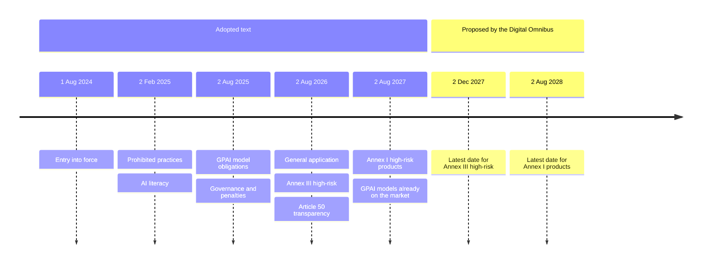
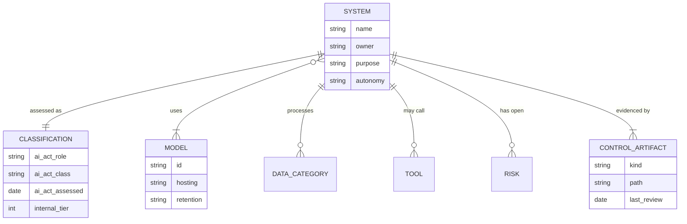
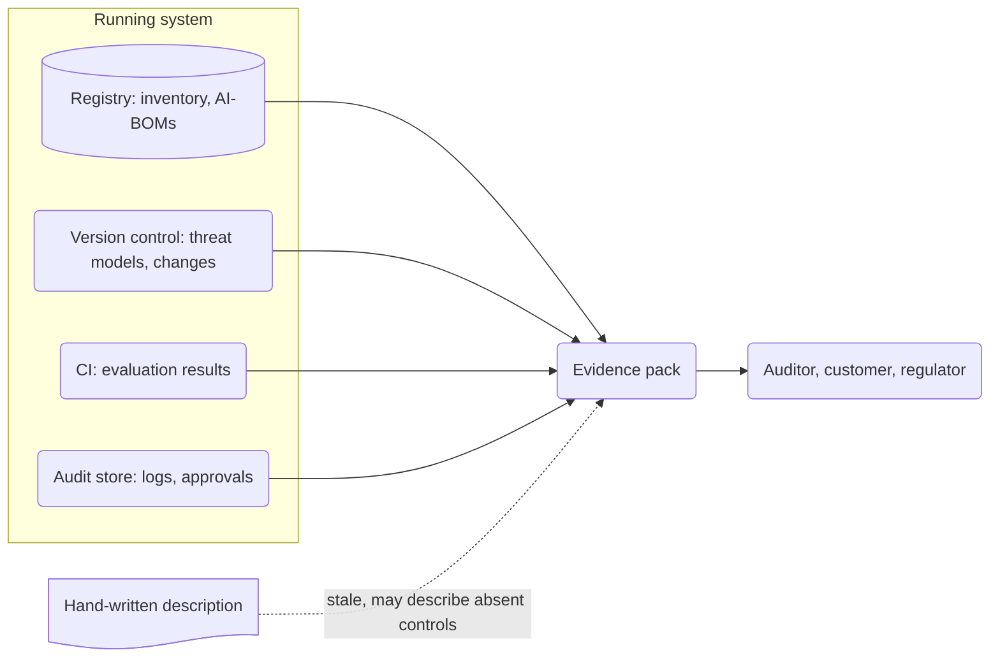

+++
title = 'Compliance and regulation'
description = 'The EU AI Act, NIST, and ISO ask an engineering team for the same five things. Most of the evidence should come out of the running system, not a document.'
question = 'What do the EU AI Act, NIST, and ISO actually ask of an engineering team?'
weight = 1
difficulty = 2
prerequisites = ['/notes/ai-security-engineering/threat-landscape/01-why-ai-security-is-different', '/notes/ai-security-engineering/threat-landscape/03-frameworks-and-maps']
date = 2026-05-09
lastmod = 2026-05-09
+++

## The idea in one minute

AI regulation and standards ask engineering teams for five things, in different
words:

1. **Know what you run**: an inventory, with a risk class for each system.
2. **Manage its risks**: a documented, repeated process, not a one-off review.
3. **Control its data**: governance, provenance, and privacy.
4. **Keep humans in charge**: oversight, the ability to stop, and transparency.
5. **Be able to prove it**: records, logs, and testing evidence.

Nearly all of that evidence is produced by controls this course already covers.
For how these frameworks relate to the attack catalogs, see
[Frameworks and maps](/notes/ai-security-engineering/threat-landscape/03-frameworks-and-maps/).
Done well, compliance is mostly collecting what a well-run system emits anyway.
Done badly, it is a pile of documents describing controls that do not exist.

> [!WARNING] Dates and legal status
> Regulatory facts below were checked against the official texts as of October
> 2026, and the EU AI Act timeline is under amendment (see below). This is
> engineering orientation, not legal advice. Confirm current dates with the
> Official Journal and your counsel before planning work around them.

## A picture

```mermaid {title="Many requirements, one control set, evidence from the system"}
flowchart LR
  subgraph REQ["What is asked"]
    direction TB
    R1["<b>EU AI Act</b><br/><small>law, by role and risk class</small>"]
    R2["<b>NIST AI RMF</b><br/><small>voluntary framework</small>"]
    R3["<b>ISO/IEC 42001</b><br/><small>certifiable management system</small>"]
    R4["<b>Privacy and sector law</b><br/><small>GDPR, health, finance</small>"]
    R5["<b>Customer assurance</b><br/><small>SOC 2, questionnaires</small>"]
  end
  REQ --> MAP["<b>One control set</b><br/><small>each control mapped<br/>to every requirement</small>"]
  MAP --> EVID
  subgraph EVID["Evidence the system produces"]
    direction TB
    E1["<b>AI inventory, AI-BOM</b>"]
    E2["<b>Evaluation and<br/>red-team results</b>"]
    E3["<b>Audit logs</b>"]
    E4["<b>Change history</b><br/><small>prompts, policies, models</small>"]
    E5["<b>Incident records</b>"]
  end
  class R1,R4 memory
  class R2,R3,R5 neutral
  class MAP good
  class E1,E2,E3,E4,E5 io
```

Map each control once to every framework you answer to, and wire each control
to the evidence it produces. A new framework then means a new mapping, not a new
program.

## How it really works

### The EU AI Act: find your role first

Regulation (EU) 2024/1689, the AI Act, regulates by **role** and by **risk
class**. Obligations attach to the role you play for a given system, so the
first question is which role that is.

| Role (Article 3) | You are this if |
| --- | --- |
| **Provider** | You develop an AI system or a general-purpose AI model, or have one developed, and place it on the market or put it into service under your own name or trademark, paid or free. |
| **Deployer** | You use an AI system under your authority, other than for personal, non-professional activity. |
| **Provider of a GPAI model** | You place a general-purpose AI model on the market. Obligations differ from those for AI systems. |
| **Importer, distributor** | You bring a system from outside the EU to its market, or make it available in the supply chain. |

Roles move. Under **Article 25**, a deployer, distributor, or importer becomes
the provider of a high-risk system, with the full provider obligations, if it:

- puts its name or trademark on a high-risk system already on the market;
- makes a **substantial modification** to a high-risk system; or
- changes the **intended purpose** of a system that was not high-risk, so that
  it becomes high-risk.

The third case catches teams by surprise. A company that takes a general
chatbot product and wires it into its hiring pipeline to rank applicants has
changed the intended purpose into an Annex III use, and is now a provider of a
high-risk system.

Follow the three arrows into the provider box: each is an Article 25 trigger,
and the red one is the repurposing case.

```mermaid {title="Three ways a deployer becomes the provider of a high-risk system"}
flowchart LR
  D("Deployer, importer, or distributor")
  T1["<b>Own name or trademark</b><br/><small>on a high-risk system</small>"]
  T2["<b>Substantial modification</b><br/><small>of a high-risk system</small>"]
  T3["<b>New intended purpose</b><br/><small>makes it high-risk, e.g.<br/>a chatbot ranks applicants</small>"]
  P("Provider: full high-risk obligations")
  D --> T1 --> P
  D --> T2 --> P
  D --> T3 --> P
  class T1,T2 neutral
  class T3 warn
```

For general-purpose models, modifying a model (for example by fine-tuning) can
make you the provider of the modified model. The Commission's July 2025
guidelines on general-purpose AI models give an indicative test based on how
much training compute the modification used, set at one third of the original
model's training compute. Read the guidelines before relying on that threshold.

### Then find the risk class

| Class | Examples | What applies |
| --- | --- | --- |
| **Prohibited** (Article 5) | Social scoring, manipulative or exploitative techniques that cause significant harm, untargeted scraping to build facial-recognition databases, emotion recognition at work or school, with narrow exceptions. | May not be placed on the market or used. |
| **High-risk** (Article 6, Annexes I and III) | Annex III: biometrics, critical infrastructure, education, employment, access to essential services such as credit scoring, law enforcement, migration, justice. Annex I: AI as a safety component of products such as machinery or medical devices. | The full set of requirements below, conformity assessment, and registration. |
| **Transparency obligations** (Article 50) | Systems that interact with people, generate synthetic content, recognize emotions, or produce deepfakes. | People must be told they are dealing with AI; generated content must be marked in a machine-readable way. These apply on top of any other class. |
| **Everything else** | Most business uses. | No specific obligations beyond AI literacy (Article 4) and existing law. |
| **GPAI models** (Articles 53 and 55) | Foundation models. | Technical documentation, information for downstream providers, a copyright policy, and a public summary of training content. Models with **systemic risk** (presumed above 10^25 FLOPs of training compute) also need model evaluation including adversarial testing, risk mitigation, serious-incident reporting, and adequate cybersecurity. |

"Limited risk" and "minimal risk" are labels from the Commission's explanatory
material, not legal categories. In the text, transparency duties are a separate
set of obligations that can attach to any system, including a high-risk one.

Being listed in Annex III is not quite the end of the question. **Article 6(3)**
lets a provider conclude that an Annex III system is not high-risk if it only
performs a narrow procedural task, improves a completed human activity, detects
patterns without replacing human assessment, or does preparatory work. A system
that profiles people is always high-risk. The provider must document that
assessment and still register the system, so this is a recorded decision, not
a quiet opt-out.

Read the questions top to bottom, in the order the Act applies them; the
transparency check at the bottom applies whatever the earlier answer was.

```mermaid {title="Classify in order: prohibited, high-risk, then transparency on top"}
flowchart TB
  S["<b>AI system</b>"]
  Q1@{ shape: diam, label: "Article 5 practice?" }
  PR["<b>Prohibited</b><br/><small>may not be marketed or used</small>"]
  QA@{ shape: diam, label: "Annex I safety component?" }
  QB@{ shape: diam, label: "Annex III use?" }
  OT["<b>No specific obligations</b><br/><small>AI literacy, existing law</small>"]
  Q3@{ shape: diam, label: "Profiles people?" }
  Q4@{ shape: diam, label: "Article 6(3) narrow task?" }
  HR["<b>High-risk</b><br/><small>requirements, conformity,<br/>registration</small>"]
  NH["<b>Not high-risk</b><br/><small>assessment documented,<br/>still registered</small>"]
  TR["<b>Article 50 check</b><br/><small>interacts with people or generates<br/>content: disclose and mark</small>"]
  S --> Q1
  Q1 -->|yes| PR
  Q1 -->|no| QA
  QA -->|yes| HR
  QA -->|no| QB
  QB -->|no| OT
  QB -->|yes| Q3
  Q3 -->|yes| HR
  Q3 -->|no| Q4
  Q4 -->|no| HR
  Q4 -->|"yes, recorded"| NH
  HR & NH & OT -.-> TR
  class PR warn
  class HR memory
  class NH,OT neutral
  class TR queue
```

### The schedule, and what is still moving

The Act entered into force on 1 August 2024. Article 113 of the adopted text
staggers application:

| Date | What starts to apply (adopted text) |
| --- | --- |
| 2 February 2025 | Prohibited practices (Article 5) and AI literacy (Article 4). |
| 2 August 2025 | Obligations for GPAI models; governance; penalty rules. GPAI models already on the market before this date have until 2 August 2027 (Article 111). |
| 2 August 2026 | The general date of application: transparency obligations (Article 50), Annex III high-risk obligations, and the Commission's power to fine GPAI providers. |
| 2 August 2027 | High-risk obligations for AI in products covered by Annex I (Article 6(1)). |

> [!CAUTION] The high-risk dates are under amendment
> In November 2025 the Commission proposed a "Digital Omnibus" amendment to the
> AI Act. Among other changes, it would tie the high-risk obligations to the
> availability of harmonized standards and support tools, with latest dates of
> **2 December 2027** for Annex III systems and **2 August 2028** for Annex I
> products. Agreement between the Parliament and the Council on these delays
> was reported during 2026. Treat the later dates as authoritative only once
> the amending regulation is published in the Official Journal, and read the
> final text: details in the proposal may have changed during negotiation.

The first section is the adopted text; the second holds only the proposed
latest dates, which are not law until published.



Plan engineering work against the earliest date that might apply to you. The
evidence a high-risk system needs takes longer to build than the gap between
two candidate deadlines.

Fines under Article 99 reach up to EUR 35 million or 7% of worldwide annual
turnover for prohibited practices, and up to EUR 15 million or 3% for most other
obligations, whichever is higher (for SMEs, whichever is lower).

### High-risk requirements, mapped to engineering

| The Act requires | What an engineering team shows |
| --- | --- |
| **Risk management system** (Art. 9), maintained over the lifecycle | The threat model, its review history, and the risk register. |
| **Data governance** (Art. 10): relevant, representative, examined for bias | Dataset manifests, provenance records, quality and bias analyses. |
| **Technical documentation** (Art. 11, Annex IV) | Architecture, model cards, the AI-BOM, evaluation methodology. |
| **Record-keeping** (Art. 12): automatic logging over the system's lifetime | The audit trail. Logs kept by providers and deployers for at least six months unless other law says otherwise (Arts. 19 and 26). |
| **Transparency to deployers** (Art. 13) | Instructions for use: capabilities, limits, required oversight, expected accuracy. |
| **Human oversight** (Art. 14): people can understand, override, and interrupt the system "through a 'stop' button or a similar procedure" | Approval gates, kill switches, autonomy levels by action class, and records of their tests. |
| **Accuracy, robustness, and cybersecurity** (Art. 15) | Evaluation results, the adversarial suite and its release gate, supply-chain controls, guardrails, incident response. |
| **Quality management system** (Art. 17) | The release process, change control, and responsibilities. |
| **Post-market monitoring and serious-incident reporting** (Arts. 72 and 73) | Production monitoring and an incident runbook with the reporting clock in it. |

Article 15(5) is worth reading in full. It requires measures against attacks
that try to manipulate the training data (**data poisoning**), pre-trained
components (**model poisoning**), inputs designed to cause errors
(**adversarial examples or model evasion**), and **confidentiality attacks**.
A system built to the earlier lessons of this course has the substance; the
remaining work is assembling the evidence.

Article 73 sets the reporting clock for serious incidents: providers report no
later than 15 days after becoming aware, with shorter limits for a death (10
days) and for widespread infringements or serious disruption of critical
infrastructure (2 days). Those numbers belong in the runbook, not in someone's
memory.

The bars are the maximum days after becoming aware; the more severe the
incident, the less time the runbook has.

```mermaid {title="Article 73: the worse the incident, the shorter the reporting clock"}
xychart-beta
  title "Maximum days to report after becoming aware"
  x-axis ["Serious incident", "Death", "Widespread or critical infra"]
  y-axis "Days" 0 --> 16
  bar [15, 10, 2]
```

Deployers of high-risk systems have their own list (Article 26): use the system
as instructed, assign competent people to oversee it, monitor it, keep its logs,
and inform affected workers and people. Some deployers, such as public bodies
and those scoring credit or pricing life and health insurance, must also carry
out a fundamental rights impact assessment (Article 27).

### NIST AI RMF, as a working structure

The NIST AI Risk Management Framework (AI RMF 1.0, NIST AI 100-1, January 2023)
is voluntary. Its value to an engineer is a vocabulary and a structure that many
organizations and customers have adopted. It has four functions:

| Function | In practice |
| --- | --- |
| **Govern** (cross-cutting) | An AI policy; named owners; an approval path for new AI uses, models, and tools; training. |
| **Map** | The inventory; for each system, its purpose, context, data, users, autonomy, and impact. |
| **Measure** | Evaluations, adversarial testing, and monitoring metrics, each with a threshold. |
| **Manage** | Prioritized treatment of risks; incident response; decommissioning. |

Three companion documents matter for security work:

- **NIST AI 600-1** (July 2024), the Generative AI Profile, lists twelve risks
  that generative AI creates or worsens, including information security,
  confabulation, data privacy, and value-chain and component integration, and
  suggests actions keyed to the RMF's subcategories.
- **NIST SP 800-218A** (July 2024) extends the Secure Software Development
  Framework with practices for generative AI and dual-use foundation models.
- **NIST AI 100-2 E2025** (March 2025) is a taxonomy of adversarial machine
  learning attacks and mitigations. Use its terms in findings and threat models
  so they map cleanly.

NIST also announced work, in August 2025, on **control overlays for securing AI
systems (COSAiS)**: tailorings of the SP 800-53 security controls for AI use
cases, including single-agent and multi-agent systems. Check the project page
for which overlays have been published; their status could not be confirmed for
this lesson. Organizations that already operate SP 800-53 or FedRAMP controls
should expect to extend those controls, not replace them.

### ISO/IEC 42001

ISO/IEC 42001:2023 specifies an **AI management system**. It shares the
harmonized structure of ISO/IEC 27001: context, leadership and policy, risk and
impact assessment, a statement of applicability against its Annex A controls,
operation, internal audit, and continual improvement, with an accredited
certificate at the end. ISO/IEC 23894:2023 gives guidance on AI risk management,
and ISO/IEC 42005:2025 on AI system impact assessment.

Customers increasingly ask for 42001 as evidence, in the way they ask for ISO
27001 or SOC 2. Know what it certifies: that you **have and follow a process**,
within a declared scope. It says nothing about whether a particular model is
safe, and a certificate whose scope excludes your riskiest system is worth
little for that system. It is also not, by itself, conformity with the AI Act;
harmonized standards for the Act are a separate set being developed by CEN and
CENELEC.

### Privacy law still applies

AI did not suspend data-protection law. Under the GDPR, the recurring
engineering issues are these:

| Obligation | AI-specific difficulty | Design answer |
| --- | --- | --- |
| **Lawful basis and purpose limitation** (Arts. 5, 6) | Reusing customer conversations for training. | Explicit, recorded basis; separate pipelines; opt-outs enforced in code. |
| **Data minimization** (Art. 5) | Contexts and logs full of personal data. | Redaction before the model, the index, and the log; retrieval scoped to need. |
| **Erasure and rectification** (Arts. 16, 17) | Data in indexes, memory, logs, and possibly model weights. | Source-to-chunk mapping; memory deletion; prefer retrieval over fine-tuning for personal data. |
| **International transfers** (Chapter V) | Hosted model APIs in other regions. | Regional routing at the gateway; contractual retention terms; self-hosting for strict cases. |
| **Automated decisions** (Art. 22) | Agents making significant decisions about people. | Meaningful human review; explanations; a record of the basis for each decision. |
| **Impact assessment** (Art. 35) | New high-risk processing. | A data-protection impact assessment alongside the threat model. |
| **Processors** (Art. 28) | Model providers and hosted MCP servers process personal data for you. | Contracts, sub-processor lists, retention terms. |

Erasure is the hard one. The European Data Protection Board's Opinion 28/2024
(December 2024) concluded that a model trained on personal data cannot always be
considered anonymous, because the data may be extractable from it. Removing
one person from trained weights has no reliable, cheap method today. Keeping
personal data in a retrieval index, where a row can be deleted, avoids the
problem by design.

Compare the two paths an erasure request can take: one ends in a delete, the
other in a dead end.

```mermaid {title="Erasure: delete rows from an index, not a person from the weights"}
flowchart LR
  U(["Erasure request"])
  subgraph RAG["Personal data kept in retrieval"]
    IX@{ shape: cyl, label: "Index with source-to-chunk map" }
    DEL["<b>Delete the rows</b><br/><small>cheap and verifiable</small>"]
  end
  subgraph FT["Personal data used in fine-tuning"]
    W("Model weights")
    NO["<b>No reliable, cheap removal</b><br/><small>data may be extractable</small>"]
  end
  U --> IX --> DEL
  U --> W --> NO
  class DEL good
  class NO warn
```

### The AI inventory

Everything else depends on knowing what exists. Keep one register, as data, in
version control:

```yaml {title="inventory/support-assistant.yaml"}
system:
  name: support-assistant
  owner: team-support-platform
  purpose: drafts replies to customer tickets for agent review
  users: internal support staff
classification:
  ai_act_role: deployer          # hosted model; we do not market the system
  ai_act_class: no-specific-obligations  # staff review every draft; no direct
                                         # interaction with customers (Art. 50 checked)
  ai_act_assessed: 2026-09-15            # which text and date the decision used
  internal_tier: 2
models:
  - id: hosted-model-x@2026-08   # provider, version, and terms reference
    hosting: provider-api
    retention: zero-retention contract
data:
  categories: [customer contact details, ticket text]
  personal_data: true
  residency: eu
  log_retention_days: 180
capabilities:
  tools: [ticket.read, reply.draft]   # no send; a human sends
  autonomy: draft-only
tenancy: per-customer session isolation
controls:
  threat_model: threat-models/support-assistant.md
  eval_suite: evals/support-assistant/
  runbook: runbooks/ai-incident.md
status:
  last_review: 2026-09-15
  last_red_team: 2026-07-02
  open_risks: [RISK-112]
```

The YAML is one record in a small data model: each system links to its
classification, models, data, tools, open risks, and the artifacts that prove
its controls.



**Shadow AI**, meaning tools and agents adopted without review, is the gap the
inventory closes. The practical mechanism is the paved path: when the governed
gateway is the easiest way to get a model key, most usage registers itself, and
anything that calls a model provider without going through it shows up in
egress logs.

### Evidence without ceremony

Auditors, customers, and regulators ask for the same artifacts. Produce them
from the running system, not by hand:

| Evidence | Source |
| --- | --- |
| Inventory and AI-BOMs | The registry and the model pipeline. |
| Risk assessments | Threat models in version control, with review history. |
| Testing | CI results of quality and adversarial evaluations, per release. |
| Change control | Version history and approvals for prompts, policies, tools, and models. |
| Access control | Policy definitions and token-service configuration. |
| Logging | The audit store, with its retention settings. |
| Oversight | Approval records; kill-switch test records. |
| Incidents | Post-incident reviews and the regression tests they produced. |
| Supplier management | The tool catalog; provider contracts and assessments. |

The solid arrows are evidence the system emits on its own; the dashed one is the
hand-written kind, which goes stale.



> [!IMPORTANT]
> A control that leaves no evidence will be treated as absent. Designing the
> evidence (a log line, a CI artifact, a signed record) is part of designing the
> control.

### A sensible order of work

1. Build the inventory and classify each system, including its AI Act role.
2. Stop anything prohibited. Put dates on everything high-risk.
3. Adopt one control set and map it once to each framework you answer to.
4. Wire the evidence sources so they produce artifacts automatically.
5. Close gaps in order of risk, not in the order of the standard's clauses.
6. Review on a schedule, and on every material change: a new model, tool, data
   source, or autonomy level.

## Where it breaks

- **Compliance is not security.** A complete evidence pack can describe a
  system whose controls are all probabilistic. No framework forces you to put a
  deterministic control behind the model; the threat model has to.
- **Classification is a judgment, and it drifts.** A system classified as
  "not high-risk" under Article 6(3) can become high-risk when a product team
  adds a scoring feature. Reclassify on every change of purpose, not once.
- **Scope games.** A management-system certificate or SOC 2 report whose scope
  omits the AI system answers a question nobody asked. Read the scope first.
- **Evidence nobody reads.** Logs that are retained but never reviewed satisfy
  a retention clause and detect nothing. Pair each evidence source with an owner
  and a review.
- **The dates move.** The AI Act timeline is under amendment, guidance and
  harmonized standards are still arriving, and other jurisdictions and sector
  regulators add their own rules. A lesson cannot track them; your inventory
  should record which version of which rule each assessment used.
- **This is not legal advice.** Role and class decisions with legal
  consequences need counsel. The engineering contribution is accurate facts
  about what the system does.

## Remember this

- Five asks in every framework: inventory, risk management, data control, human
  oversight, evidence.
- Under the AI Act, find your role and your risk class; repurposing a system can
  make you its provider.
- High-risk deadlines are being moved by amendment; confirm the published text
  before relying on later dates.
- Article 15 names data poisoning, model poisoning, adversarial examples, and
  confidentiality attacks explicitly.
- Privacy law applies in full; erasure is the hard one, so keep personal data
  out of weights.
- One control set, mapped to many frameworks, with evidence emitted by the
  system.

## Try it

1. Write the inventory entry for one AI system you know, using the fields above.
2. Decide its AI Act role and risk class, and justify each in two sentences.
   Then describe one product change that would make it high-risk.
3. For three controls you rely on, name the evidence each produces. Which
   produce none, and what log line or artifact would fix that?
4. Write the serious-incident reporting step of your runbook: who decides that
   an incident is reportable, and where the clock starts.

## Check yourself

1. What can turn a deployer into a provider under the AI Act?

   
   Article 25: putting your name or trademark on a high-risk system, making a
   substantial modification to a high-risk system, or changing the intended
   purpose of a system so that it becomes high-risk (for example, using a
   general chatbot to rank job applicants). For general-purpose models,
   modifying the model substantially, such as by fine-tuning, can make you the
   provider of the modified model.
   

2. Is ISO/IEC 42001 certification evidence that a model is safe?

   
   No. It certifies that an organization has and follows an AI management
   process within a declared scope. It says nothing about any particular
   model's behavior and is not, by itself, conformity with the AI Act. Check
   that the system you care about is inside the certificate's scope.
   

3. Which data-protection obligation is hardest to meet for fine-tuned models,
   and what design choice avoids the problem?

   
   Erasure. Personal data used in fine-tuning may be extractable from the
   weights, and there is no reliable, cheap way to remove one person from a
   trained model. Keeping personal data in a retrieval index, where records can
   be deleted and access filtered, avoids putting it in the weights at all.
   

4. Why should evidence be generated by the system rather than written
   afterwards?

   
   Generated evidence reflects what actually ran, is complete, and costs
   nothing to reproduce for the next audit. Hand-written evidence describes what
   someone believes happened, goes stale, and can describe controls that do not
   exist. A control with no evidence will be treated as absent.
   

5. Your team's planning assumes the Annex III high-risk obligations apply from
   December 2027. What should you check before relying on that date?

   
   That the amending regulation has been formally adopted and published in the
   Official Journal, and what its final text says. The adopted AI Act applies
   Annex III obligations from 2 August 2026; the later date comes from a
   proposed amendment. Until it is law, plan against the earlier date or record
   the assumption as a risk.
   

## Sources

- [Regulation (EU) 2024/1689 (Artificial Intelligence Act)](https://eur-lex.europa.eu/eli/reg/2024/1689/oj), Official Journal of the European Union, 12 July 2024. Articles 3, 4, 5, 6, 9–17, 25–27, 50, 51, 53, 55, 73, 99, 111, 113.
- European Commission, proposal for a regulation amending the AI Act (Digital Omnibus on AI), November 2025.
- European Commission, Guidelines on the scope of the obligations for providers of general-purpose AI models, July 2025.
- NIST, [Artificial Intelligence Risk Management Framework (AI RMF 1.0), NIST AI 100-1](https://doi.org/10.6028/NIST.AI.100-1), January 2023.
- NIST, [Artificial Intelligence Risk Management Framework: Generative Artificial Intelligence Profile, NIST AI 600-1](https://doi.org/10.6028/NIST.AI.600-1), July 2024.
- NIST, [Secure Software Development Practices for Generative AI and Dual-Use Foundation Models, SP 800-218A](https://doi.org/10.6028/NIST.SP.800-218A), July 2024.
- NIST, [Adversarial Machine Learning: A Taxonomy and Terminology of Attacks and Mitigations, NIST AI 100-2 E2025](https://doi.org/10.6028/NIST.AI.100-2e2025), March 2025.
- NIST, [Control Overlays for Securing AI Systems (COSAiS)](https://csrc.nist.gov/projects/cosais), project page.
- ISO/IEC, [ISO/IEC 42001:2023 Information technology — Artificial intelligence — Management system](https://www.iso.org/standard/81230.html), December 2023.
- [Regulation (EU) 2016/679 (General Data Protection Regulation)](https://eur-lex.europa.eu/eli/reg/2016/679/oj), 2016.
- European Data Protection Board, Opinion 28/2024 on certain data protection aspects related to the processing of personal data in the context of AI models, December 2024.
