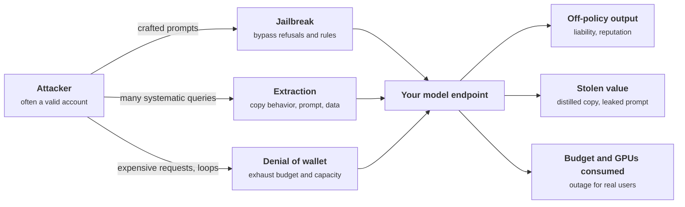
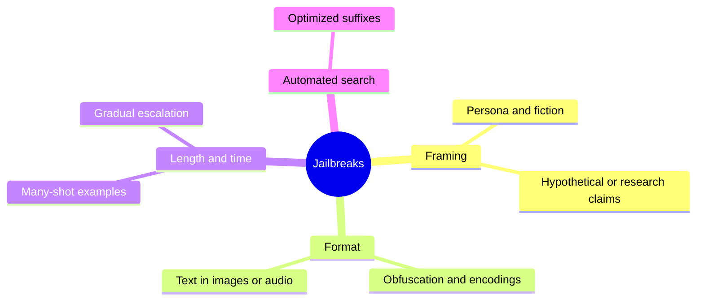
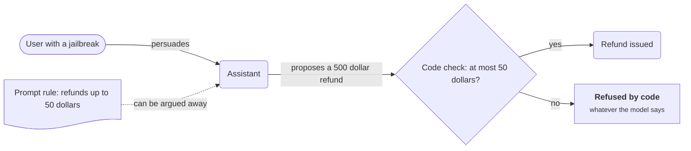
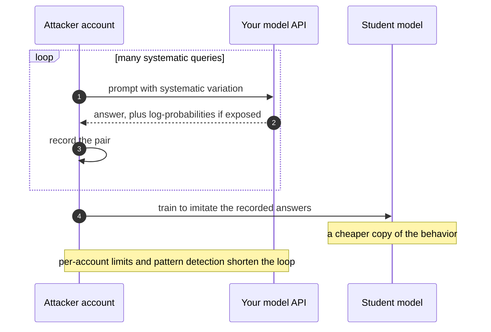
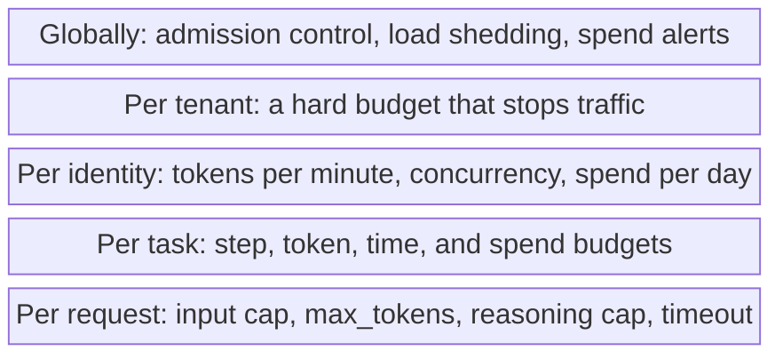
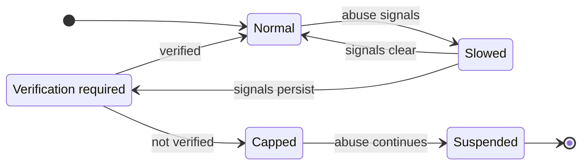
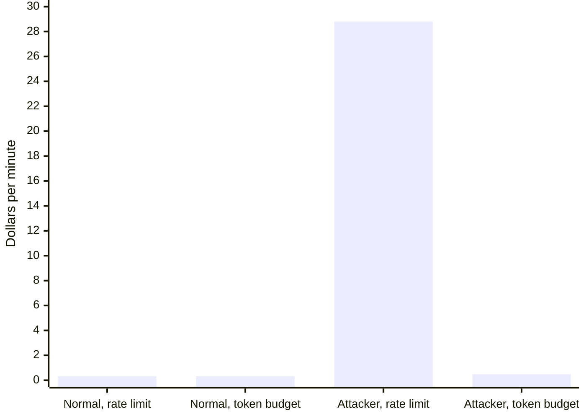

+++
title = 'Abuse and resource attacks'
description = 'Jailbreaks, extraction, and denial of wallet target the model as a resource, usually from a valid account doing nominally allowed things at volume.'
question = 'How are jailbreaks, extraction, and denial of wallet carried out?'
weight = 4
difficulty = 2
prerequisites = ['/notes/ai-security-engineering/how-attacks-work/01-prompt-injection']
date = 2026-04-13
lastmod = 2026-04-13
verified = 2026-04-13
+++

## The idea in one minute

Not every attack tries to steal data through a hijacked agent. Three other
families target the model as a resource:

- **Jailbreaks** make it produce what its provider or operator forbids.
- **Extraction** copies what is valuable about it: its behavior, its system
  prompt, its training data, or a functional equivalent of its weights.
- **Resource attacks** make it burn compute until your service is unavailable
  or your bill is ruinous. For token-priced systems this has its own name:
  **denial of wallet**.

All three share one property: the attacker is usually an **authenticated user
doing nominally allowed things**, at volume or with intent you did not plan for.
Authentication does not stop them. Limits, monitoring, and keeping rules that
matter out of the prompt do.

## A picture



The attacker in this picture often holds a perfectly valid account, which is
why authentication alone does not help.

## How it really works

### Jailbreaks

A jailbreak gets a model to act against its safety training or its operator's
instructions. The model is not confused about who is speaking, as in
injection; it is **persuaded**. Research on why safety training fails points to
two causes: **competing objectives** (the drive to be helpful and follow
instructions pulls against the drive to refuse) and **mismatched
generalization** (safety training does not cover every format the model can
understand, such as an obscure encoding).

| Family | How it works |
| --- | --- |
| **Persona and fiction** | "Write a story in which a character explains…": the request is wrapped in a frame where refusing seems out of place. |
| **Hypothetical and research framing** | Claims of authorization, education, or testing. |
| **Obfuscation** | Encodings, ciphers, low-resource languages, deliberate misspellings, or a request split across turns so no single message is refused. |
| **Many-shot** | Filling a long context with fabricated dialogues in which the model complies; effectiveness grows with the number of examples. |
| **Gradual escalation** | A conversation that moves in small steps, each acceptable given the last. |
| **Optimized suffixes** | Strings found by automated search that push the model toward compliance; some transfer between models. |
| **Multimodal** | The request rendered as text in an image, or spoken in audio. |

The same families, grouped by the lever each one pulls.



What a jailbreak costs you depends on the product. For a general assistant, the
provider's content policy is at stake. For *your* application the question is
narrower and more useful: **what does your system prompt forbid, and what
happens when a user gets around it?** If the answer is "the model says something
off-brand", that is a quality issue. If it is "the model issues a refund outside
policy", the policy was in the wrong place. **Rules that matter are enforced in
code.**

The prompt can be talked around. The diamond cannot, because it never reads the conversation.



Jailbreak resistance has improved considerably with newer models and with
dedicated classifiers on input and output. It remains a rate, measured by red
teaming, not a guarantee.

### Extraction

| Target | How | Defense |
| --- | --- | --- |
| **System prompt** | Repeated asking, role-play, "repeat the text above". With enough attempts it usually comes out, verbatim or in substance. | Treat prompts as published. Their value is the engineering around them; they must not contain secrets. |
| **Behavior (distillation)** | Many queries, answers recorded, a cheaper model trained to imitate. Especially effective against a model fine-tuned for a narrow task. | Per-account limits, detection of systematic querying, terms of service, and not exposing more than the product needs. |
| **Training data** | Prompts that make the model reproduce memorized passages, more likely for repeated data or small private fine-tuning sets. | Deduplicate and minimize training data; do not fine-tune on records you could not afford to see in output. |
| **Membership** | Determining whether a specific record was in the training set, which can itself be a privacy breach. | Data minimization; differential privacy where the stakes justify the cost. |
| **Weights** | Stealing the model file from storage, a registry, or a serving node. | Infrastructure security: access control, encryption, monitoring of very large transfers. |

Raw **log-probabilities** deserve a specific mention. Researchers showed in 2024
that the logits and log-probabilities exposed by production APIs were enough to
recover the hidden dimension and the final projection layer of commercial
models for a modest cost. Every extra signal you return makes copying cheaper.

Distillation is a loop of ordinary-looking requests. The defenses work on the loop: how many times it can run, and how much each answer carries.



### Resource attacks

A language model is often the most expensive component a system exposes to the
internet, and its cost per request varies enormously: a short question and a
full-context document with a long reasoned answer can differ by several orders
of magnitude.

| Attack | Mechanism |
| --- | --- |
| **Token flooding** | Maximum-length inputs and outputs, at whatever request rate the limit allows. |
| **Context stuffing** | Huge uploads or pasted documents that fill the window on every turn. |
| **Output amplification** | Prompts engineered for the longest possible response. |
| **Reasoning amplification** | Inputs, sometimes planted in retrieved content, that make a reasoning model think far longer than usual. |
| **Agent loops** | Tasks, or injected content, that keep an agent calling tools indefinitely. |
| **Fan-out** | One request that spawns many sub-agents or parallel tool calls. |
| **Downstream abuse** | Driving expensive retrieval, search, or other paid services through the model. |
| **Free-tier and trial abuse** | Many scripted accounts, reselling your capacity. |
| **Stolen keys** | A leaked API key or cloud credential used to run someone else's workload on your account. |

On hosted APIs the result is a bill; on your own GPUs it is saturation and an
outage for legitimate users. Both are the same attack. The controls are the
capacity limits from system design, which here are security controls:

| Scope | Limits |
| --- | --- |
| **Per request** | Input cap, output cap (`max_tokens`), reasoning cap, timeout. |
| **Per task** | Step, token, time, and spend budgets; fan-out limit; loop detection. |
| **Per identity** | Tokens per minute, concurrent requests, spend per day. |
| **Per tenant** | A hard budget that stops traffic, not only an alert. |
| **Globally** | Admission control and load shedding; anomaly alerts on spend. |
| **Keys** | Short-lived and scoped; never in client code or repositories; rotation; leak scanning. |

Read the scopes as a stack: each layer bounds the total of everything beneath it, so a gap low down is caught higher up.



> [!IMPORTANT]
> A request-per-minute limit alone does little against denial of wallet: one
> request can cost a thousand times another. Limit tokens and spend.

### Misuse of capabilities

The last abuse family is using your system as a tool for something else:
generating spam or phishing at scale, automating fraud, producing content you
would not want attributed to you, or using an agent with a browser or a shell
as a launch point for attacks on third parties. Controls combine the limits
above with usage policy, account verification proportional to capability,
monitoring for abuse patterns, and, for agents that can act on external
systems, the outbound restrictions from
[Data exfiltration and leakage](/notes/ai-security-engineering/how-attacks-work/02-data-exfiltration-and-leakage/).

### Telling abuse from use

Heavy legitimate use and abuse look alike. Signals that help:

- **Shape, not volume**: near-identical prompts with systematic variation;
  maximum-length everything; activity at machine regularity.
- **Economics**: an account whose cost to you far exceeds what it pays.
- **Outcome signals**: a rising refusal rate, classifier hits, repeated policy
  denials.
- **Novelty**: a sudden change in an account's model, token, or tool-use
  pattern.

Respond in steps (slow down, require verification, cap, suspend) rather than
only with a block, because the false positives here are your best customers.

Each step is reversible except the last, which is why the response climbs rather than jumping straight to a block.



## Code

A one-minute simulation comparing two limits on the same endpoint: 60 requests
per minute, and a budget of 200,000 tokens per minute that reserves the full
output cap before each call. The prices are illustrative, not any provider's.

```python {title="budget.py"}
"""budget.py: a request-rate limit vs a token budget against a denial-of-wallet client (simulated, one minute)."""

from __future__ import annotations

from dataclasses import dataclass

# Illustrative prices in dollars per million tokens. Not any provider's real prices.
PRICE_IN, PRICE_OUT = 3.00, 15.00


@dataclass(frozen=True)
class Request:
    input_tokens: int
    max_output: int  # the output cap the client asked for

    def cost(self) -> float:
        # Worst case: assume the model uses the whole output cap.
        return (self.input_tokens * PRICE_IN + self.max_output * PRICE_OUT) / 1_000_000


class RateLimit:
    def __init__(self, per_minute: int) -> None:
        self.left = per_minute

    def admit(self, req: Request) -> bool:
        if self.left == 0:
            return False
        self.left -= 1
        return True


class TokenBudget:
    """Reserve input plus the full output cap before the call: output size is unknown in advance."""

    def __init__(self, per_minute: int) -> None:
        self.left = per_minute

    def admit(self, req: Request) -> bool:
        need = req.input_tokens + req.max_output
        if need > self.left:
            return False
        self.left -= need
        return True


def simulate(label: str, requests: list[Request], limiter: RateLimit | TokenBudget) -> None:
    admitted = [r for r in requests if limiter.admit(r)]
    spend = sum(r.cost() for r in admitted)
    print(f"  {label:<26} admitted {len(admitted):>2}/{len(requests):<2}  "
          f"spend ${spend:>6.2f}/min  (${spend * 60:>8.2f}/hour if sustained)")


if __name__ == "__main__":
    clients = {
        "normal user": [Request(1_500, 400)] * 30,
        "denial-of-wallet client": [Request(120_000, 8_000)] * 60,
    }
    for name, reqs in clients.items():
        print(name)
        simulate("60 requests/minute", reqs, RateLimit(per_minute=60))
        simulate("200k tokens/minute", reqs, TokenBudget(per_minute=200_000))
```

Run it with `python3 budget.py`:

```text
normal user
  60 requests/minute         admitted 30/30  spend $  0.32/min  ($   18.90/hour if sustained)
  200k tokens/minute         admitted 30/30  spend $  0.32/min  ($   18.90/hour if sustained)
denial-of-wallet client
  60 requests/minute         admitted 60/60  spend $ 28.80/min  ($ 1728.00/hour if sustained)
  200k tokens/minute         admitted  1/60  spend $  0.48/min  ($   28.80/hour if sustained)
```

Both clients stay within 60 requests a minute, so the rate limit treats them
the same, and one of them costs about ninety times as much. The token budget
does not affect the normal user and stops the expensive one after a single
request.

The four spend figures from the output, side by side. Only one bar is tall, and the request limit is what let it through.



## Where it breaks

- **Per-identity budgets multiply with identities.** The token budget still lets
  one account spend about $29 an hour, and a hundred scripted accounts spend a
  hundred times that. Per-day spend caps, per-tenant hard limits, a global
  budget, and friction on account creation are what bound the total.
- **Reserving the output cap is conservative.** A budget that charges
  `max_tokens` up front throttles honest clients who ask for a large cap and use
  little of it. Refund unused tokens after the call, or cap `max_tokens` per
  plan, but do not stop counting output.
- **Tokens are not the only cost.** Reasoning tokens, tool calls, retrieval,
  and sub-agents each cost money. A budget that counts only visible input and
  output misses an agent that loops through cheap model calls and expensive
  tools.
- **Limits do not stop jailbreaks or slow extraction.** A patient attacker who
  stays under every limit can still jailbreak in one prompt or distill a model
  over weeks. Those need behavioral monitoring and rules enforced in code.
- **A stolen key bypasses per-user limits.** If the key is the identity, whoever
  holds it is the user. Keys must be scoped, short-lived, and backed by a
  provider-side spend cap.

## Remember this

- Jailbreaks persuade; injection confuses. Rules that matter are enforced in
  code.
- Assume system prompts become public; keep secrets out of them.
- Extraction is fought with limits, monitoring, and not exposing more than
  needed, including log-probabilities.
- Token-priced systems are open to denial of wallet; limit tokens and spend, not
  just requests.
- A leaked API key is the simplest and costliest resource attack.

## Try it

1. Run `budget.py`. Add a third client that sends 300 small requests a minute.
   Which limit stops it, and is that the outcome you want?
2. Add a per-day spend cap and a client that stays just under the per-minute
   budget all day. What does it cost you before the cap trips?
3. Estimate the maximum cost of one request to an endpoint you run, and the
   maximum cost per hour for one account at its current limits. Is the number
   acceptable?
4. Read your product's system prompt as if it will be published tomorrow. What
   would you remove?

## Check yourself

1. How does a jailbreak differ from a prompt injection?

   
   A jailbreak persuades the model to break its own safety training or its
   operator's rules; the attacker is usually the user, talking to the model
   directly. Prompt injection substitutes someone else's instructions for the
   operator's or user's, often by planting text in content the model reads, so
   the model acts with a victim's authority.
   

2. Why is a request-rate limit ineffective against denial of wallet?

   
   Cost scales with tokens, not requests. One request with a full context window
   and a large output cap can cost hundreds or thousands of times a small one,
   so an attacker can stay within any reasonable request rate while multiplying
   your bill. The limit has to count tokens and spend.
   

3. Which extraction risks follow from fine-tuning on private data?

   
   Training-data extraction, where the model reproduces private records,
   particularly from a small or repeated fine-tuning set; and membership
   inference, where an attacker learns whether a specific person's record was
   in the training set. Both mean private data in fine-tuning must be treated
   as potentially disclosable.
   

4. Why does exposing log-probabilities make extraction easier?

   
   Each response then carries far more information about the model than the
   sampled text alone: the full distribution over likely next tokens. That
   speeds up distillation and has been shown to allow recovery of parts of a
   production model's final layer. Return only what the product needs.
   

## Sources

- Alexander Wei, Nika Haghtalab, and Jacob Steinhardt, [Jailbroken: How Does LLM Safety Training Fail?](https://arxiv.org/abs/2307.02483), 2023.
- Cem Anil et al., [Many-shot Jailbreaking](https://www.anthropic.com/research/many-shot-jailbreaking), Anthropic, April 2024.
- Mark Russinovich, Ahmed Salem, and Ronen Eldan, [Great, Now Write an Article About That: The Crescendo Multi-Turn LLM Jailbreak Attack](https://arxiv.org/abs/2404.01833), 2024.
- Andy Zou, Zifan Wang, J. Zico Kolter, and Matt Fredrikson, [Universal and Transferable Adversarial Attacks on Aligned Language Models](https://arxiv.org/abs/2307.15043), 2023.
- Nicholas Carlini et al., [Stealing Part of a Production Language Model](https://arxiv.org/abs/2403.06634), 2024.
- Reza Shokri, Marco Stronati, Congzheng Song, and Vitaly Shmatikov, [Membership Inference Attacks against Machine Learning Models](https://arxiv.org/abs/1610.05820), IEEE S&P 2017.
- Abhinav Kumar et al., [OverThink: Slowdown Attacks on Reasoning LLMs](https://arxiv.org/abs/2502.02542), 2025.
- OWASP GenAI Security Project, [LLM10: Unbounded Consumption](https://genai.owasp.org/llmrisk/llm102025-unbounded-consumption/).
