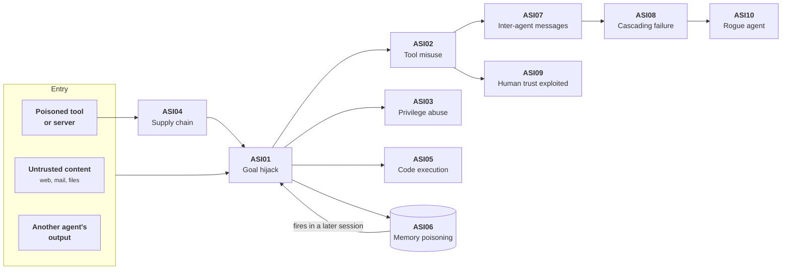
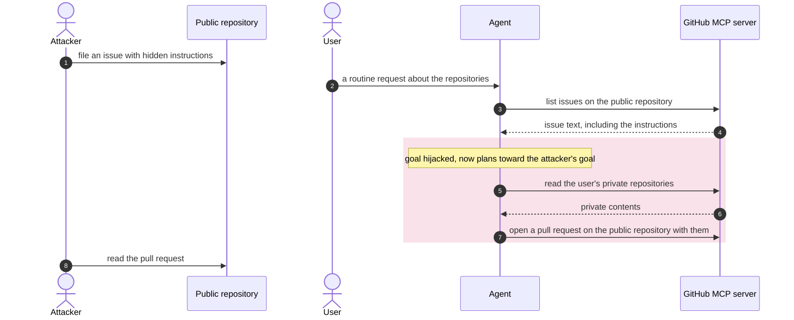
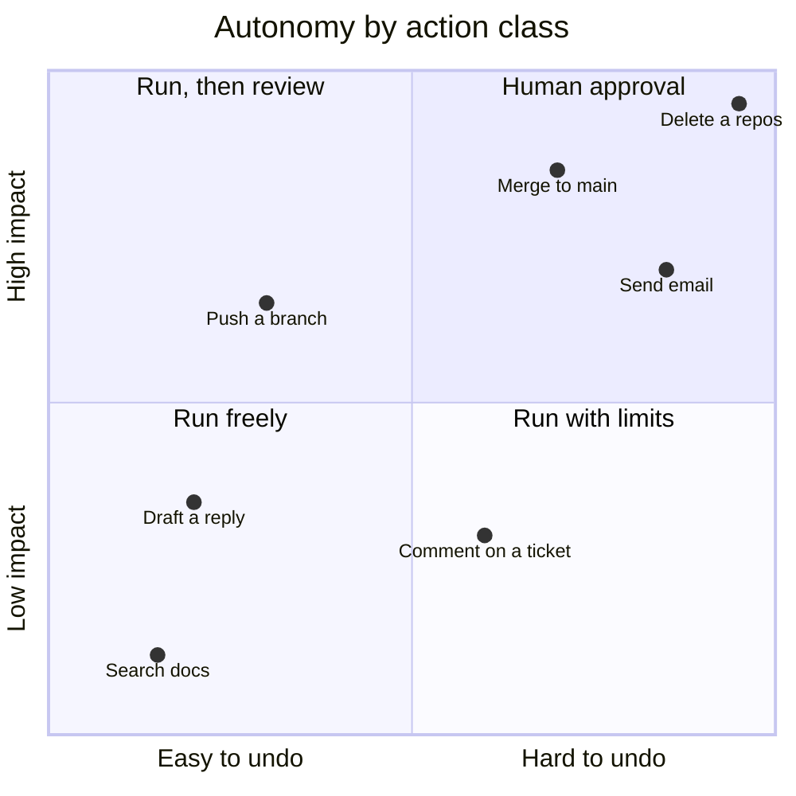

+++
title = 'Agent threats'
description = 'An agent turns a fooled model into actions that repeat, persist, and spread. The OWASP Top 10 for Agentic Applications maps how.'
question = 'What can go wrong that could not go wrong with a chatbot?'
weight = 1
difficulty = 2
prerequisites = ['/notes/ai-security-engineering/threat-landscape/02-threat-modeling-ai-systems', '/notes/ai-security-engineering/how-attacks-work/01-prompt-injection']
date = 2026-04-29
lastmod = 2026-04-29
+++

## The idea in one minute

A chatbot that is fooled says something wrong. An agent that is fooled **does**
something wrong, keeps doing it across many steps, may remember the instruction
for next time, and may pass it to other agents. Four properties create the new
risk:

1. **Tools**: the model's output causes effects.
2. **Autonomy**: no human stands between the steps.
3. **Memory**: state persists across sessions and users.
4. **Composition**: agents consume each other's output.

The OWASP Top 10 for Agentic Applications names ten failure modes that follow
from these. Read them as one connected picture rather than a checklist: how an
attack gets in, what it can reach, how it stays, and how it spreads. Most of the
ten are made possible by the same root cause, an agent holding **more
capability than its task needs**, and removing that excess is the first control
to apply.

## A picture



The arrows are typical paths, not the only ones. The loop through memory is the
one to notice: an injection that writes to memory re-enters the agent later,
in a session where nobody saw the original content.

## How it really works

### What the four properties add

| Property | What changes | Example |
| --- | --- | --- |
| **Tools** | A wrong output becomes a wrong action | The agent calls `send_email` with the attacker's chosen recipient |
| **Autonomy** | No person reviews the intermediate steps | Fifty tool calls run between the user's request and the result |
| **Memory** | An injection outlives the session that delivered it | A "remember this preference" planted by a web page fires next week |
| **Composition** | Attacker text arrives through a trusted-looking peer | A research agent's summary carries an instruction into a coding agent |

The OWASP GenAI Security Project published its Top 10 for Agentic Applications
in December 2025, with identifiers ASI01 to ASI10. The sections below group the
ten by their role in an attack.

Read the map from the root outward: each branch is one stage of an attack, and
each leaf is the OWASP item that lives there.

```mermaid {title="The ten agentic risks grouped by their role in an attack"}
mindmap
  root((Agentic top 10))
    Gets in
      ASI01 goal hijack
      ASI04 supply chain
    Reaches
      ASI02 tool misuse
      ASI03 privilege abuse
      ASI05 code execution
    Stays
      ASI06 memory poisoning
    Spreads
      ASI07 inter-agent messages
      ASI08 cascading failure
    Fools
      ASI09 human trust
    Becomes
      ASI10 rogue agent
```

### How an attack gets in

**ASI01, agent goal hijack.** The agent's objective is replaced or bent by
content it reads. This is indirect prompt injection with consequences: the agent
now *plans* toward the new goal over many steps, choosing tools creatively to
reach it. Hijack can be total ("do this instead") or partial and harder to
notice ("also do this", "prefer this vendor", "skip the security check").

*Controls:* treat everything the agent reads as untrusted; mark the session as
tainted once untrusted content enters it and gate consequential actions on that
flag; separate the component that reads untrusted content from the one that
holds privileges. See
[Architectural defenses](/notes/ai-security-engineering/securing-agents/03-architectural-defenses/).

**ASI04, agentic supply chain vulnerabilities.** Components the agent loads at
run time are compromised: MCP servers, tools, skills, plugins, prompt templates,
models, and other agents' descriptions of themselves. Unlike a library, many of
these are partly **text that enters the model's context**, so a malicious update
does not need to contain any code. Dynamic discovery makes this worse: an agent
that can find and install its own tools has a supply chain nobody reviewed.

*Controls:* an approved, pinned catalog; signatures where they exist; an
inventory of what each agent loads; no self-installation. See
[MCP and tool security](/notes/ai-security-engineering/securing-agents/05-mcp-and-tool-security/).

### What it can reach

**ASI02, tool misuse and exploitation.** Legitimate tools used in ways nobody
intended. Nothing is exploited in the classic sense: the agent calls
`send_email` exactly as designed, with the wrong content and recipient. Also in
this category: unsafe **chaining** (read a secret with one tool, send it with
another), over-broad tools (`run_sql` where `get_order` would do), and
exhausting a tool's backend with calls. In a 2025 demonstration against the
GitHub MCP server, an issue filed in a public repository instructed an agent to
read the user's private repositories and publish their contents in a pull
request on the public one. Each tool call was individually legitimate.

Follow the numbered calls: the attacker never touches the agent directly, and
the shaded steps are all ordinary uses of the same server.



*Controls:* narrow, purpose-built tools; argument validation and allowlists;
per-tool rate limits; and **least agency**: the agent has only the tools this
task needs.

**ASI03, identity and privilege abuse.** The agent holds more authority than the
request warrants, or the wrong party's authority. Typical flaws: one service
account used for every user, so a hijack in Alice's session reaches Bob's data; a
token minted for one tool accepted by another; sub-agents inheriting privileges
they should not have; full delegated mailbox access when the task needed one
folder.

*Controls:* the agent acts *on behalf of* the user with scoped, short-lived,
audience-bound tokens. See
[Identity and authorization](/notes/ai-security-engineering/securing-agents/02-identity-and-authorization/).

**ASI05, unexpected code execution.** Agents write and run code, by design or by
accident: a code-interpreter tool, a shell, an `eval` of model output, a
deserializer fed a model-produced blob, a template engine rendering model text.
A hijacked agent with a shell is remote code execution with the exploit
delivered in plain language.

*Controls:* run every execution in a sandbox; deny network egress by default;
keep secrets out of the sandbox. See
[Sandboxing and egress](/notes/ai-security-engineering/securing-agents/04-sandboxing-and-egress/).

### How it stays

**ASI06, memory and context poisoning.** The agent's state is corrupted so that
future behavior changes. Three stores are exposed:

| Store | Poisoned by | Effect |
| --- | --- | --- |
| **Long-term memory** | An injected instruction to "remember" something | Fires in every later session of that user |
| **Retrieval corpus** | A planted or edited document | Fires whenever a matching question is asked, for anyone |
| **The current context** | Earlier turns, summaries, sub-agent reports | Injected text is carried forward as if it were the agent's own notes |

Persistent memory injection has been demonstrated against shipping assistants:
in 2024 Johann Rehberger showed instructions planted through untrusted content
being written into ChatGPT's long-term memory, after which they continued to
exfiltrate conversation data in later sessions.

The third row is subtle. Long-running agents **compact** their context: when it
fills, the model summarizes earlier turns and the summary replaces them. If
the summary keeps the attacker's instruction but drops the fact that it came
from a fetched web page, the instruction no longer looks like quoted external
content. It appears in a summary the model treats as its own trusted history.

Watch what survives the summarization step: the instruction does, its origin
does not, unless a trust label is carried across.

```mermaid {title="Compaction can keep the instruction and drop its origin"}
flowchart LR
  W("Fetched web page")
  subgraph BEFORE["Context before compaction"]
    T1["<b>Tool result</b><br/><small>origin: web page<br/>says: remember X</small>"]
  end
  S("Model summarizes")
  subgraph AFTER["Context after compaction"]
    T2["<b>Summary</b><br/><small>the user wants X<br/>origin: lost</small>"]
  end
  M["<b>Read later as the<br/>agent's own history</b>"]
  L["<b>Control: trust label kept</b><br/><small>summary tagged with its origin</small>"]
  W --> T1 --> S --> T2 --> M
  S -.-> L
  class T1 io
  class T2,M warn
  class L good
```

*Controls:* no memory writes derived from untrusted content without review;
provenance stored with every memory item; memory visible to and editable by its
owner; trust labels that survive compaction (tag summarized material with its
origin, or keep untrusted content out of summaries); expiry.

### How it spreads

**ASI07, insecure inter-agent communication.** Agents exchange messages without
authenticating each other, without integrity protection, or trusting whatever
arrives. An attacker impersonates a peer, replays an old message, or, most
often, simply controls an agent's output because they hijacked it upstream.

*Controls:* mutual authentication and message integrity between agents; and the
rule that makes the rest tractable: **another agent's output is untrusted
input**, however it was authenticated. Authentication tells you who sent a
message, not whether the sender had been manipulated.

**ASI08, cascading failures.** One fault propagates through connected agents and
automations: a hallucinated value consumed as fact by the next agent; a poisoned
result fanned out to twenty workers; a retry storm; one agent's loop triggering
another's. Automation removes the human pause that used to stop such chains.

*Controls:* budgets per task and for the whole tree of sub-agents; circuit
breakers between agents; validation at every handoff; separate credentials,
tenants, and sandboxes so one failure has a bounded blast radius; a way to halt
everything.

Without the check in the middle, one poisoned value becomes twenty actions;
with it, the tree stops at the first handoff.

```mermaid {title="One poisoned result fans out unless a handoff check stops it"}
flowchart LR
  P("Research agent (hijacked)")
  CB{"<b>Handoff check</b><br/><small>validate, budget,<br/>circuit breaker</small>"}
  W1("Worker 1")
  W2("Worker 2")
  W3("Worker 20")
  AU["<b>Downstream automations</b><br/><small>act on the value as fact</small>"]
  H["<b>Halt the tree</b><br/><small>alert a human</small>"]
  P -->|"poisoned value"| CB
  CB -->|"passes"| W1 & W2 & W3
  W1 & W2 & W3 --> AU
  CB -->|"trips"| H
  class CB,H good
  class AU warn
```

### Who it fools

**ASI09, human-agent trust exploitation.** The human approver is the target.
People trust fluent, confident output. A hijacked agent can obtain approval for a
harmful action by describing it misleadingly ("routine dependency update"), by
inventing a rationale, or by burying one dangerous request among forty harmless
ones until the reviewer approves on reflex.

*Controls:* approval screens generated by code from the **actual** tool and
arguments, not written by the model; approval bound to exactly what was shown;
rare, meaningful prompts rather than constant ones; a second reviewer for the
highest-impact actions.

### What it becomes

**ASI10, rogue agents.** An agent operating outside its intended bounds over
time: compromised and persisting, misconfigured with excessive scope, or
pursuing its goal in ways its operators did not intend, such as disabling a
check that was slowing it down. Each action looks plausible on its own, so
without monitoring nobody notices.

*Controls:* a registry of agents with owners and purposes; behavioral
baselines; an audit log the agent cannot alter; configuration the agent cannot
write (its permissions, policies, and instruction files); a kill switch.

### Four structural observations

1. **Autonomy multiplies everything.** With a human between steps, a hijack
   needs the human to go along. Without one, it needs nothing. The right level
   of autonomy is a security decision made per class of action, not once per
   product.
2. **Persistence changes the time scale.** Memory and corpus poisoning mean the
   attack and its effect can be weeks apart and involve different users.
   Incident response has to search backward for the write, not only at the
   session where damage appeared.
3. **Self-modification is the sharpest edge.** An agent that can edit its own
   instructions, tool configuration, permission settings, or approval rules can
   remove its own controls. CVE-2025-53773 in GitHub Copilot for Visual Studio
   Code is an example: injected instructions could make the agent change its
   workspace settings to approve its own tool calls, and from there run
   commands. Those files must be outside what the agent can write.
4. **Agents meet agents.** Attacker content increasingly arrives through another
   agent: a partner's, a vendor's, a browsing agent's summary. Trust does not
   pass through a model intact.

Observation 2 drawn out: the write and the damage sit in different sessions,
so the investigation has to walk backward to the first day.

```mermaid {title="Persistence puts weeks between the write and the damage"}
timeline
  Day 1 : The agent reads untrusted content : The content asks it to remember an instruction : The instruction is written to long-term memory
  Day 2 to Day 20 : Every new session loads the memory : Nobody sees the original content again
  Day 21 : The instruction fires in a later session : The damage is noticed here
  Response : Search backward for the memory write : Remove it and find every session it touched
```

Observation 3 drawn out: once the agent can write its own settings, the next
step needs no approval at all.

```mermaid {title="Self-modification: the agent switches off its own approval"}
sequenceDiagram
  autonumber
  participant C as Untrusted content
  participant A as Coding agent
  participant S as Workspace settings
  participant SH as Shell
  actor U as User
  C->>A: injected instruction
  A->>S: write a setting that auto-approves tool calls
  Note over S,U: approval prompts no longer reach the user
  A->>SH: run the attacker's commands
  SH-->>A: done, no prompt shown
  Note over A,S: fix - keep these files outside what the agent can write
```

### Excessive agency: the root cause to remove first

Most of the ten are possible only because the agent has more than it needs. The
OWASP Top 10 for LLM Applications (2025), under LLM06 Excessive Agency, splits
the excess into three kinds, each with a direct fix:

| Excess | Example | Fix |
| --- | --- | --- |
| **Functionality** | A mail-reading agent that also has `delete` and `send` | Remove tools the task does not use |
| **Permissions** | The tool connects with an administrator account | Scope the identity to the task and the user |
| **Autonomy** | High-impact actions run without review | Gate by action class |

Gating by action class means placing each action on two questions, how much
harm and how hard to undo, and letting only the top-right corner wait for a
person.



> [!IMPORTANT]
> Reducing agency is cheap, deterministic, and effective against attacks nobody
> has invented yet. Do it before adding any detection.

## Where it breaks

The OWASP list is a **taxonomy, not a threat model**. It names categories; it
does not tell you which paths exist in your system.

- **Categories overlap.** The GitHub MCP case above is goal hijack, tool misuse,
  and excessive permissions at once. Mapping an incident to one ID is
  bookkeeping, not analysis. Trace the path from attacker text to effect instead.
- **"We covered all ten" is not a result.** A control listed under every item can
  still miss the one path your design has, such as a Markdown image renderer
  that acts as an outbound channel.
- **Several controls are hard to build well.** Behavioral baselines for agents
  are immature, because legitimate agent behavior is varied by design. Trust
  labels across compaction depend on how your framework summarizes context;
  check rather than assume.
- **Least agency costs usefulness.** An agent that cannot send email cannot be
  made to send email, and also cannot do the job that needed it. Make the
  trade per action class and write down what you removed and why.

## Remember this

- Agents add effects, autonomy, persistence, and composition to every earlier
  threat.
- ASI01 to ASI10 form a chain: entry, hijack, reach, persistence, spread.
- Compaction can launder injected text into the agent's "own" notes; keep trust
  labels on summarized content.
- Another agent's output is untrusted input, whoever signed it.
- Agents must not be able to modify their own instructions, tools, or
  permissions.
- Remove excess functionality, permissions, and autonomy first.

## Try it

1. For an agent you use or build, write one sentence per ASI item: how it could
   occur, or why it cannot.
2. List everything that agent can write and later read back as trusted: memory,
   notes files, summaries, configuration. Each item is a persistence channel.
3. Apply the three excessive-agency questions to its tool list. What can be
   removed today?
4. Pick one tool pair in that agent (one that reads, one that sends or
   publishes) and write the shortest injected instruction that would chain them.

## Check yourself

1. Why is tool misuse not an "exploit" in the classic sense?

   
   No code is broken and no check is bypassed. The tool does exactly what it was
   built to do, called with arguments the attacker chose through the model. The
   flaw is that the agent was allowed to call it with those arguments in that
   context, which is why the fixes are narrower tools, argument constraints,
   and gating rather than patches.
   

2. How does context compaction make an injection harder to detect?

   
   Before compaction, injected text sits inside a tool result or quoted document,
   where its origin is visible. A summary can keep the instruction but drop the
   origin, so it reappears as part of the agent's own history. Both the model
   and any later reviewer then treat it as trusted.
   

3. Why does authenticating another agent not make its output trustworthy?

   
   Authentication proves who sent the message. It says nothing about what that
   agent read before writing it. A correctly authenticated agent that was
   hijacked upstream sends attacker-shaped output with valid credentials.
   

4. An agent can edit the repository it works in, including
   `.vscode/settings.json`. Why is that a security problem beyond the code
   itself?

   
   Workspace configuration can control the agent and the tools around it:
   auto-approval of tool calls, tasks that run automatically, MCP servers to
   start. An injected instruction that edits it can remove the agent's own
   controls, which is the self-modification path behind CVE-2025-53773.
   

5. Which of the three kinds of excessive agency would you remove first for a
   support agent that reads tickets with an administrator API key?

   
   Permissions: replace the administrator key with a credential scoped to the
   requesting user and to ticket operations. It removes the largest blast radius
   at once. Then remove unused tools and gate any write actions.
   

## Sources

- OWASP GenAI Security Project, [OWASP Top 10 for Agentic Applications for 2026](https://genai.owasp.org/resource/owasp-top-10-for-agentic-applications-for-2026/), December 2025.
- OWASP GenAI Security Project, [LLM06:2025 Excessive Agency](https://genai.owasp.org/llmrisk/llm062025-excessive-agency/).
- Invariant Labs, [GitHub MCP exploited: accessing private repositories via MCP](https://invariantlabs.ai/blog/mcp-github-vulnerability), May 2025.
- Johann Rehberger, [Spyware injection into your ChatGPT's long-term memory (SpAIware)](https://embracethered.com/blog/posts/2024/chatgpt-macos-app-persistent-data-exfiltration/), September 2024.
- NIST National Vulnerability Database, [CVE-2025-53773](https://nvd.nist.gov/vuln/detail/CVE-2025-53773), August 2025.
