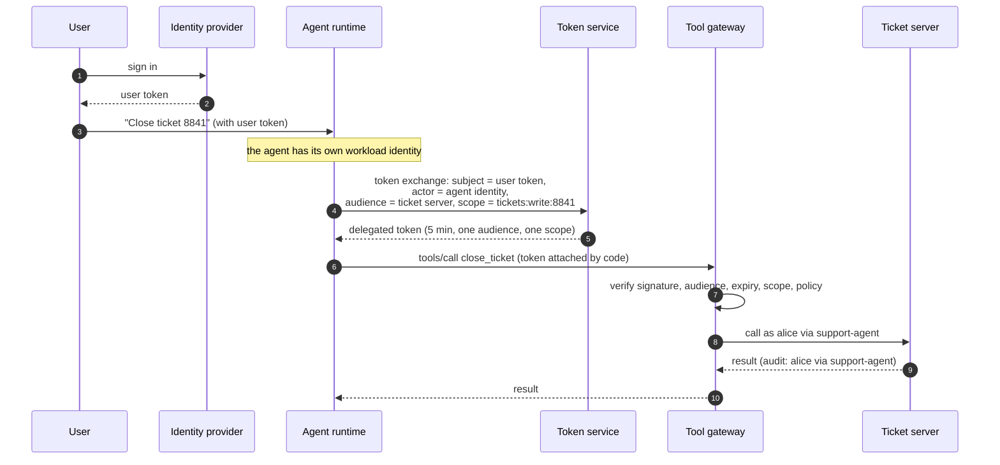
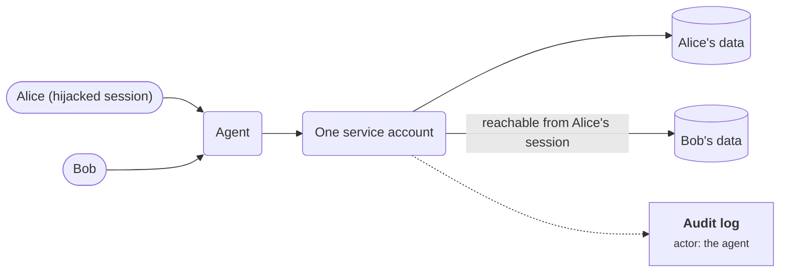
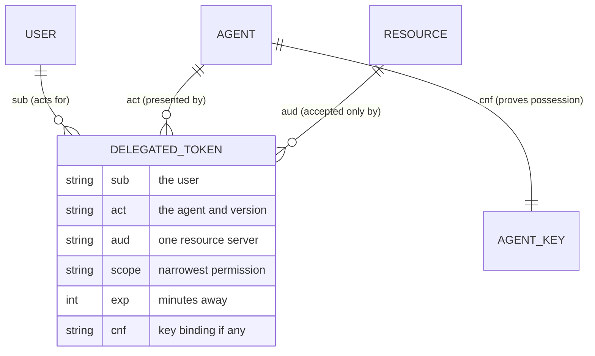
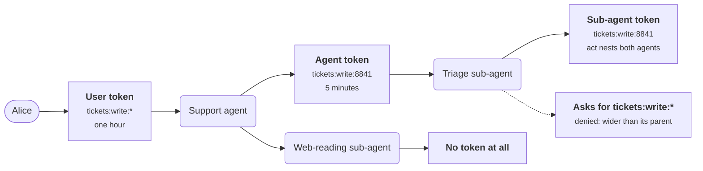
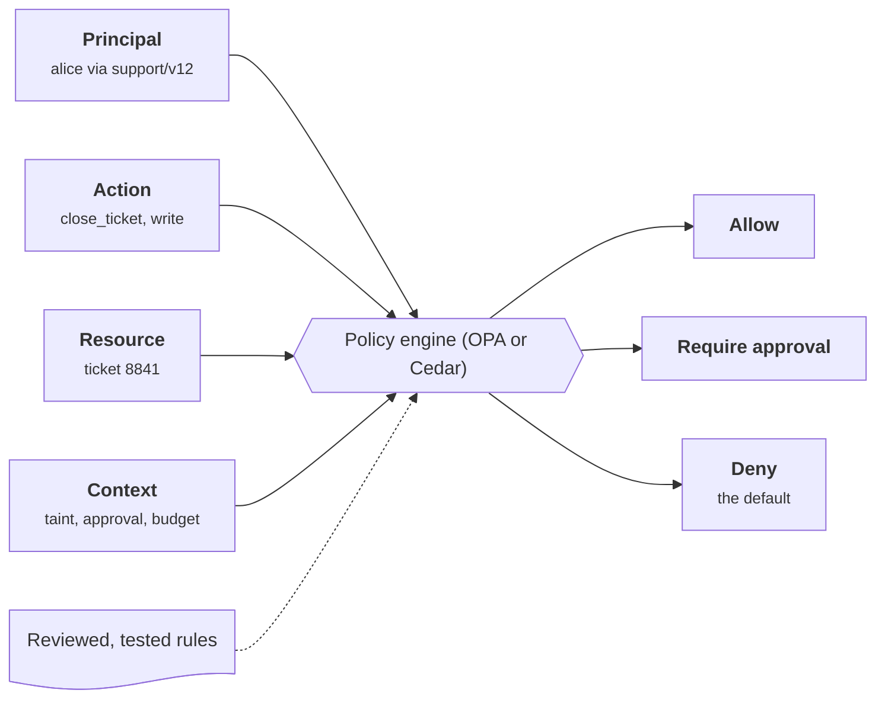

+++
title = 'Identity and authorization'
description = 'Every agent call involves three identities: the user, the agent, and the resource. A secure design keeps all three visible and lets authority only shrink.'
question = 'Who is an agent, whose authority does it carry, and how is that scoped?'
weight = 2
difficulty = 3
prerequisites = ['/notes/ai-security-engineering/threat-landscape/01-why-ai-security-is-different', '/notes/ai-security-engineering/securing-agents/01-agent-threats']
date = 2026-05-01
lastmod = 2026-10-30
verified = 2026-05-01
+++

## The idea in one minute

When an agent calls a tool, three identities are involved: the **user** who
asked, the **agent** doing the work, and the **resource** being reached. A
secure design keeps all three visible on every call. The agent does not use a
shared service account, and it does not hold the user's password or full token.
It presents a credential that says *"agent X, acting for user Y, may do Z on
resource R, for the next few minutes"*, and the resource checks every part of
that sentence.

None of this needs new cryptography. It is built from existing standards:
OAuth token exchange (RFC 8693), resource indicators (RFC 8707), workload
identity such as SPIFFE, and, for MCP, the protocol's own authorization model.
The consequence to act on: **authority can only shrink as it passes from user
to agent to sub-agent to tool**, and the model never holds the credential.

## A picture



The model plans the call; the runtime attaches the token. At no point does the
token pass through the model's context.

## How it really works

### The three anti-patterns

| Anti-pattern | Why it fails |
| --- | --- |
| **A shared service account**: one powerful key for all users | The agent can reach everything for everyone. A hijack in Alice's session exposes Bob's data. Audit logs show only "the agent". |
| **The user's full credential handed to the agent**: password, session cookie, or broad OAuth token | The agent can do anything the user can, for as long as the credential lives, and so can whoever hijacks it. |
| **Static API keys in tool configuration** | Long-lived, unscoped, copied into files and repositories, and impossible to attribute to a user or a task. |

Draw the first anti-pattern and the problem is plain: both users' sessions
funnel into one key, so a hijack in Alice's session reaches Bob's data, and
the log names only the agent.



### What a good agent credential contains

| Field | JWT claim | Defeats |
| --- | --- | --- |
| **Subject**: the user on whose behalf the action is taken | `sub` | Cross-user access: the resource applies *this* user's permissions |
| **Actor**: the agent, ideally with its version | `act` (RFC 8693) | An audit trail that cannot tell the user from the software acting for them |
| **Audience**: the one resource server that may accept it | `aud` | Replay: a token for the calendar server is useless at the payments server |
| **Scope**: the narrowest permission that does the job, ideally naming the object | `scope` | A hijacked agent reaching beyond the task |
| **Expiry**: minutes, not days | `exp` | A leaked token staying useful |
| **Binding**: proof that the presenter holds a key | `cnf` (RFC 7800; used by DPoP and mTLS-bound tokens) | A stolen token being usable without the agent's private key |

Most deployments today issue **bearer** tokens, which work for whoever holds
them. Binding is the field most often missing, and the one that turns a leaked
token from a breach into a non-event.

The same fields as a data model: one token ties together the three identities,
and the binding ties it to a key only the agent holds.



### How it is built

**1. Agents have their own identity.** Each agent workload gets a cryptographic
identity from the platform instead of a shared secret. SPIFFE defines the
standard form: an ID such as `spiffe://example.org/agents/support/v12`, carried
in a short-lived document called an SVID (an X.509 certificate or a JWT), issued
by an implementation such as SPIRE only after it has *attested* the workload,
that is, checked which node and process it is. Cloud providers' workload
identity services fill the same role. The identity says **which software** is
calling.

**2. Users delegate; agents do not impersonate.** The user authenticates to the
identity provider. The agent runtime then asks the token service for a
delegated token with an RFC 8693 token exchange (the form body is one line in
practice; it is split here for reading):

```http {title="token exchange request"}
POST /token HTTP/1.1
Host: sts.example.org
Content-Type: application/x-www-form-urlencoded

grant_type=urn:ietf:params:oauth:grant-type:token-exchange
&subject_token=<the user's access token>
&subject_token_type=urn:ietf:params:oauth:token-type:access_token
&actor_token=<the agent's JWT-SVID>
&actor_token_type=urn:ietf:params:oauth:token-type:jwt
&audience=ticket-server
&scope=tickets:write:8841
```

The token service checks both tokens, checks that this actor may act for this
subject, and issues a token that names both:

```json {title="claims of the delegated token"}
{
  "sub": "alice",
  "act": { "sub": "spiffe://example.org/agents/support/v12" },
  "aud": "ticket-server",
  "scope": "tickets:write:8841",
  "exp": 1790000300
}
```

**3. Scope down at every hop.** When the agent delegates to a sub-agent, or a
tool server calls another service, that hop exchanges the token it holds for a
narrower one. The previous actor is nested inside `act`, so the chain stays
visible. A sub-agent that only reads web pages gets no token at all.

Read each hop left to right: the scope and lifetime can stay the same or
narrow, and a request to widen is refused.



**4. The resource enforces.** The business system applies the *user's*
permissions, so the agent can never do more than its user. It may add a further
restriction for agent-mediated access, such as "agents may draft but not send".
The effective permission is the intersection of what the user may do, what the
token's scope allows, and what policy allows for this agent.

**5. Tokens stay out of the context.** The runtime attaches the token to the
outgoing call in code. The model never sees it, so it cannot be tricked into
printing it, writing it to a file, or sending it somewhere.

### MCP authorization

The MCP specification defines authorization for its HTTP transport, and the
section has been revised in each release since OAuth was added in the
2025-03-26 revision. As of the 2025-11-25 revision, the main requirements are:

- **The MCP server is an OAuth resource server.** It publishes Protected
  Resource Metadata (RFC 9728) naming its authorization server, so clients can
  discover where to get tokens.
- **OAuth 2.1 with PKCE.** OAuth 2.1 is still an IETF draft that consolidates
  OAuth 2.0 and its security best practices; MCP requires PKCE for the
  authorization code flow.
- **Resource indicators.** The client names the target server in the `resource`
  parameter (RFC 8707), and the server must reject tokens that were not issued
  for it. One server cannot reuse your token against another.
- **No token passthrough.** An MCP server must not forward the token it received
  to an upstream API. If it needs to call one, it obtains its own token for that
  audience.
- **Client identification.** Client ID Metadata Documents, where a client is
  identified by an HTTPS URL that hosts its metadata, are the recommended way to
  register with a server the client has never seen. Dynamic Client Registration
  (RFC 7591) remains as a fallback.

Put together, a call to a remote MCP server looks like this. Note the two
places a token is refused or replaced: the audience check, and the upstream
call that uses the server's own token.

```mermaid {title="MCP authorization: discover, get an audience-bound token, no passthrough"}
sequenceDiagram
  autonumber
  participant C as MCP client
  participant S as MCP server
  participant AS as Authorization server
  participant API as Upstream API
  C->>S: fetch Protected Resource Metadata
  S-->>C: my authorization server is AS
  C->>AS: authorization code flow with PKCE, resource = S
  AS-->>C: access token, audience S
  C->>S: tools/call with the token
  S->>S: reject unless the token was issued for S
  rect rgb(226, 239, 216)
    Note over S,API: no passthrough
    S->>API: call with its own token for the API audience
    API-->>S: result
  end
  S-->>C: result
```

The specification's security best practices also describe a **confused deputy**
specific to MCP proxy servers: a server that uses one static client ID at a
third-party authorization server can let an attacker reuse a user's earlier
consent. The fix is per-client consent at the proxy before forwarding to the
third party.

**Enterprise-Managed Authorization** is an optional MCP extension for
organizations. Instead of each user clicking through a consent screen per
server, the organization's identity provider decides. The client exchanges the
user's identity assertion at the identity provider for an **ID-JAG** (Identity
Assertion JWT Authorization Grant, an IETF OAuth working-group draft) aimed at
the MCP server's authorization server, which then issues the access token.
Access to each server becomes a policy in the identity provider, by group,
role, or device posture, and can be revoked centrally.

For local `stdio` servers there is no network authorization: the specification
says they should take credentials from their environment instead. They run with
the privileges of the process that launched them, which is why local servers
belong in a sandbox.

> [!NOTE]
> MCP authorization is time-sensitive. Check the revision you implement against
> the current specification; the requirements above are from the 2025-11-25
> revision.

### Agent to agent

Across an agent-to-agent boundary, such as one built on the A2A protocol:

- **Authenticate the peer.** Use mutual TLS or signed requests, and verify any
  signature on the peer's published Agent Card against its domain.
- **Present delegated authority scoped for that peer.** Exchange for a token
  whose audience is the peer. Never forward the user's token.
- **Trust the identity, not the content.** A correctly authenticated partner
  agent may itself have been hijacked. Its output goes through the same input
  checks and taint tracking as a web page.
- **Record the chain.** The audit trail shows user, agent, and partner agent,
  with the scope at each hop.

### Authorization policy

Authentication says who; policy says whether. Evaluate on every tool call:

| Input | Example |
| --- | --- |
| **Principal** | user `alice` (groups, tenant) via agent `support/v12` (risk tier) |
| **Action** | tool `close_ticket`, operation write |
| **Resource** | the specific object: ticket 8841, repository `acme/api`, mailbox folder "Invoices" |
| **Context** | task ID, session taint, time, approval present, budget remaining |
| **Decision** | allow, deny, or require approval |

A policy engine such as Open Policy Agent (Rego) or Cedar keeps these rules out
of prompt text and application code, where they can be reviewed and unit
tested. Three policies are worth having from the start:

- **Deny by default.** An agent has no tool until one is granted for its task
  type.
- **Read/write split.** Read scopes are granted widely; write scopes are narrow
  and often gated.
- **Taint-aware.** Outbound and irreversible actions are denied or require
  approval once untrusted content is in the session.

The four inputs from the table meet in one engine, outside the prompt, and
come out as one of three decisions.



### An inventory of non-human identities

Agents multiply identities: workloads, tokens, API keys, service accounts for
tools. Keep a registry of every agent with its owner, purpose, the tools and
scopes it may request, and when it was last reviewed. Unowned agents with
standing access are how the rogue agent of ASI10 comes about. Review grants as
you would for employees, and remove what is unused.

## Code

A token service that issues delegated, audience-bound, scoped, short-lived
tokens, and a resource server that checks every field. The `act` claim follows
RFC 8693, including a nested actor when a sub-agent re-exchanges the token.

```python {title="delegate.py"}
"""delegate.py: token exchange in miniature.

Delegated, audience-bound, scoped, short-lived tokens that name both the user
and the acting agent, in the shape of RFC 8693. Standard library only; offline.
HMAC stands in for a real asymmetric signature (JWS with EdDSA or ES256).
"""

from __future__ import annotations

import base64
import hashlib
import hmac
import json
from dataclasses import asdict, dataclass

STS_KEY = b"demo-key; a real token service signs with a private key held in a KMS"


class Denied(Exception):
    pass


@dataclass
class Claims:
    sub: str  # the user
    aud: str  # the one server that may accept the token
    scope: str  # what it permits; a trailing "*" is a prefix grant
    exp: int  # expiry, Unix seconds
    act: dict | None = None  # RFC 8693 "act": current actor, prior actors nested


def b64(data: bytes) -> str:
    return base64.urlsafe_b64encode(data).rstrip(b"=").decode()


def unb64(text: str) -> bytes:
    return base64.urlsafe_b64decode(text + "=" * (-len(text) % 4))


def sign(c: Claims) -> str:
    body = json.dumps(asdict(c), separators=(",", ":")).encode()
    mac = hmac.new(STS_KEY, body, hashlib.sha256).digest()
    return f"{b64(body)}.{b64(mac)}"


def parse(token: str, now: int) -> Claims:
    body64, _, mac64 = token.partition(".")
    try:
        body, mac = unb64(body64), unb64(mac64)
    except ValueError:
        raise Denied("malformed token") from None
    if not hmac.compare_digest(mac, hmac.new(STS_KEY, body, hashlib.sha256).digest()):
        raise Denied("bad signature")
    c = Claims(**json.loads(body))
    if now >= c.exp:
        raise Denied("token expired")
    return c


def covers(granted: str, want: str) -> bool:
    if granted.endswith("*"):
        return want.startswith(granted[:-1])
    return granted == want


def exchange(subject_token: str, actor: str, audience: str, scope: str, now: int) -> str:
    """The token service. The subject token caps what can be issued: authority
    can stay the same or shrink along a delegation chain, never grow."""
    subj = parse(subject_token, now)
    if not covers(subj.scope, scope):
        raise Denied(f"{subj.sub} holds {subj.scope!r}, cannot get {scope!r}")
    exp = min(now + 5 * 60, subj.exp)  # never outlive the subject token
    act = {"sub": actor}
    if subj.act:
        act["act"] = subj.act  # the previous actor, kept for the audit trail
    return sign(Claims(sub=subj.sub, aud=audience, scope=scope, exp=exp, act=act))


def verify(token: str, me: str, need: str, now: int) -> Claims:
    """What the resource server does on every call."""
    c = parse(token, now)
    if c.aud != me:
        raise Denied(f"token is for {c.aud}, not {me}")
    if not covers(c.scope, need):
        raise Denied(f"scope {c.scope} does not permit {need}")
    return c


def chain(act: dict | None) -> str:
    return f" via {act['sub']}{chain(act.get('act'))}" if act else ""


def attempt(label: str, action) -> None:
    try:
        result = action()
    except Denied as e:
        print(f"{label:<34} DENIED  {e}")
    else:
        if isinstance(result, Claims):
            print(f"{label:<34} allowed {result.sub}{chain(result.act)}")
        else:
            print(f"{label:<34} issued")


if __name__ == "__main__":
    now = 1_790_000_000
    # What the identity provider issued at sign-in: Alice may write any ticket.
    user = sign(Claims(sub="alice", aud="sts", scope="tickets:write:*", exp=now + 3600))
    agent = exchange(user, "support-agent@v12", "ticket-server", "tickets:write:8841", now)

    def at_tickets(token: str, scope: str, when: int = now) -> Claims:
        return verify(token, "ticket-server", scope, when)

    attempt("close ticket 8841", lambda: at_tickets(agent, "tickets:write:8841"))
    attempt("close a different ticket", lambda: at_tickets(agent, "tickets:write:9000"))
    attempt("replay to the payments server",
            lambda: verify(agent, "payments-server", "tickets:write:8841", now))
    attempt("use it ten minutes later",
            lambda: at_tickets(agent, "tickets:write:8841", now + 600))
    attempt("ask for a scope alice lacks",
            lambda: exchange(user, "support-agent@v12", "payments-server",
                             "payments:refund:8841", now))

    # A sub-agent re-exchanges the agent's token. It can narrow, never widen.
    attempt("sub-agent asks for all tickets",
            lambda: exchange(agent, "triage-subagent", "ticket-server", "tickets:write:*", now))
    sub = exchange(agent, "triage-subagent", "ticket-server", "tickets:write:8841", now)
    attempt("sub-agent closes ticket 8841", lambda: at_tickets(sub, "tickets:write:8841"))

    # A hijacked agent edits its own token to widen the scope, keeping the old MAC.
    body64, _, mac64 = agent.partition(".")
    body = unb64(body64).replace(b"tickets:write:8841", b"tickets:write:*")
    forged = f"{b64(body)}.{mac64}"
    attempt("edited token, close ticket 9000", lambda: at_tickets(forged, "tickets:write:9000"))
```

Run it with `python3 delegate.py`:

```text
close ticket 8841                  allowed alice via support-agent@v12
close a different ticket           DENIED  scope tickets:write:8841 does not permit tickets:write:9000
replay to the payments server      DENIED  token is for ticket-server, not payments-server
use it ten minutes later           DENIED  token expired
ask for a scope alice lacks        DENIED  alice holds 'tickets:write:*', cannot get 'payments:refund:8841'
sub-agent asks for all tickets     DENIED  alice holds 'tickets:write:8841', cannot get 'tickets:write:*'
sub-agent closes ticket 8841       allowed alice via triage-subagent via support-agent@v12
edited token, close ticket 9000    DENIED  bad signature
```

A hijacked agent holding this token can close ticket 8841 for the next five
minutes. That is the whole blast radius.

The program's checks run in this order. Each "no" edge is labeled with the test
case above that it stops.

```mermaid {title="What the resource server checks on every call in delegate.py"}
flowchart LR
  IN["<b>Token + needed scope</b>"] --> SIG{"Signature<br/>valid?"}
  SIG -->|"yes"| EXP{"Before<br/>exp?"}
  EXP -->|"yes"| AUD{"aud is<br/>this server?"}
  AUD -->|"yes"| SC{"Scope covers<br/>the action?"}
  SC -->|"yes"| OK["<b>Allowed</b><br/><small>alice via support-agent@v12</small>"]
  SIG -->|"no: edited token"| DN["<b>Denied</b>"]
  EXP -->|"no: ten minutes later"| DN
  AUD -->|"no: payments server"| DN
  SC -->|"no: ticket 9000"| DN
  class OK,DN good
```

## Where it breaks

- **A shared signing key.** HMAC means every resource that can verify a token can
  also mint one. Real token services sign with an asymmetric key, so resources
  hold only the public key.
- **Bearer tokens.** Nothing here binds the token to the agent. Anyone who copies
  it from a log or a crash dump can use it until it expires. DPoP (RFC 9449) or
  mTLS-bound tokens (RFC 8705) close that gap.

  The two branches below are the same stolen token; only the bound one is
  useless without the agent's private key.

  ```mermaid {title="A copied bearer token works, a bound token does not"}
  sequenceDiagram
    autonumber
    actor X as Attacker
    participant L as Log or crash dump
    participant R as Ticket server
    L-->>X: copied token
    alt bearer token
      X->>R: call with the token
      R-->>X: accepted until it expires
    else bound token, DPoP or mTLS
      X->>R: call with the token, no proof of the private key
      R-->>X: rejected, proof of possession missing
    end
  ```
- **The token service is too trusting.** This one accepts any token it signed as
  a subject token, from any actor. A real one checks that the subject token was
  meant for it, and that this actor is allowed to act for this subject (RFC 8693
  defines a `may_act` claim for that).
- **Nested actors are not for access control.** RFC 8693 states that only the
  current actor counts for policy decisions; prior actors in the chain are
  informational. A resource that grants access because a trusted agent appears
  somewhere in the chain has misread the standard.
- **Scope limits reach, not intent.** The token permits closing ticket 8841. If
  the user asked only for a comment, an injected instruction to close it still
  succeeds. Matching scopes to the request, and gating writes, is policy work the
  token cannot do.
- **Short-lived is not revoked.** Five minutes of a hijacked token is still five
  minutes. Pair short lifetimes with a way to stop the session.

## Remember this

- Three identities on every call: user, agent, resource.
- Never a shared service account; never the user's full credential.
- Token exchange yields a credential naming subject, actor, audience, scope, and a
  short expiry; add binding where you can.
- Authority only shrinks along a delegation chain; tokens never enter the
  model's context.
- MCP servers are OAuth resource servers: audience-bound tokens, no passthrough.
- Keep a registry of agents and review their grants.

## Try it

1. Run `delegate.py`. Change the expiry to one hour and argue for and against it.
2. Add a `may_act` check to `exchange`: only actors listed in the user's token
   may act for that user. What has to change for the sub-agent's exchange to
   keep working, and should it?
3. For an agent you know, write the credential it uses today in the six-field
   form. Which fields are missing or too broad?
4. Write three authorization policies for a code-review agent in the principal,
   action, resource, context form.

## Check yourself

1. What is wrong with an agent using one service account for all users?

   
   The agent's reach becomes the union of everything any user might need, so a
   hijack in one user's session can touch every other user's data. The resource
   cannot apply per-user permissions, and the audit log cannot say on whose
   behalf an action was taken.
   

2. What does the audience field prevent?

   
   Replay at a different service. A token minted for the ticket server is
   rejected by the payments server, so a server that receives your token, or an
   attacker who steals it, cannot use it elsewhere. MCP requires servers to
   reject tokens not issued for them for the same reason.
   

3. Why must authority shrink, never grow, along a delegation chain?

   
   Each hop is another place where a model may be manipulated. If a sub-agent
   could obtain more than its parent held, compromising the least trusted
   component would yield the most authority. Capping each exchange by the
   subject token bounds every hop by what the user originally granted.
   

4. Why does Enterprise-Managed Authorization improve on per-server consent
   screens?

   
   Access decisions move to the organization's identity provider, where they can
   follow group, role, and device policy, be reviewed, and be revoked centrally.
   Users are no longer asked to judge each server, which tends to produce
   reflexive approval.
   

5. Why should the runtime, not the model, attach the token to tool calls?

   
   Anything in the model's context can be repeated by the model. An injected
   instruction could make it print the token, write it to a file, or put it in
   a request to an attacker's server. Attached in code, the token is never text
   the model can reproduce.
   

## Sources

- M. Jones et al., [RFC 8693: OAuth 2.0 Token Exchange](https://www.rfc-editor.org/rfc/rfc8693), IETF, January 2020.
- B. Campbell, J. Bradley, H. Tschofenig, [RFC 8707: Resource Indicators for OAuth 2.0](https://www.rfc-editor.org/rfc/rfc8707), IETF, February 2020.
- M. Jones, P. Hunt, A. Parecki, [RFC 9728: OAuth 2.0 Protected Resource Metadata](https://www.rfc-editor.org/rfc/rfc9728), IETF, April 2025.
- D. Fett et al., [RFC 9449: OAuth 2.0 Demonstrating Proof of Possession (DPoP)](https://www.rfc-editor.org/rfc/rfc9449), IETF, September 2023.
- IETF OAuth Working Group, [The OAuth 2.1 Authorization Framework](https://datatracker.ietf.org/doc/draft-ietf-oauth-v2-1/), Internet-Draft.
- Model Context Protocol, [Specification 2025-11-25: Authorization](https://modelcontextprotocol.io/specification/2025-11-25/basic/authorization) and [Security best practices](https://modelcontextprotocol.io/specification/2025-11-25/basic/security_best_practices).
- Model Context Protocol, [Enterprise-Managed Authorization extension](https://modelcontextprotocol.io/extensions/auth/enterprise-managed-authorization).
- IETF OAuth Working Group, [Identity Assertion JWT Authorization Grant](https://datatracker.ietf.org/doc/draft-ietf-oauth-identity-assertion-authz-grant/), Internet-Draft.
- SPIFFE project, [SPIFFE concepts](https://spiffe.io/docs/latest/spiffe-about/spiffe-concepts/).
