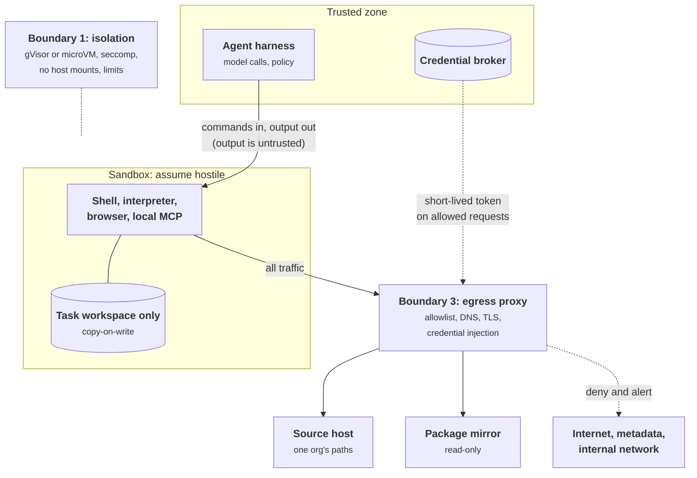
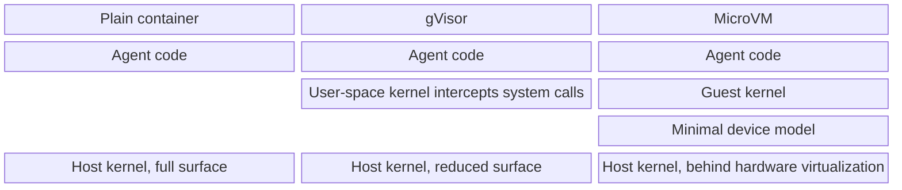
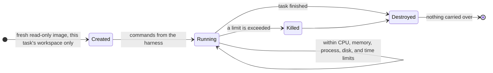
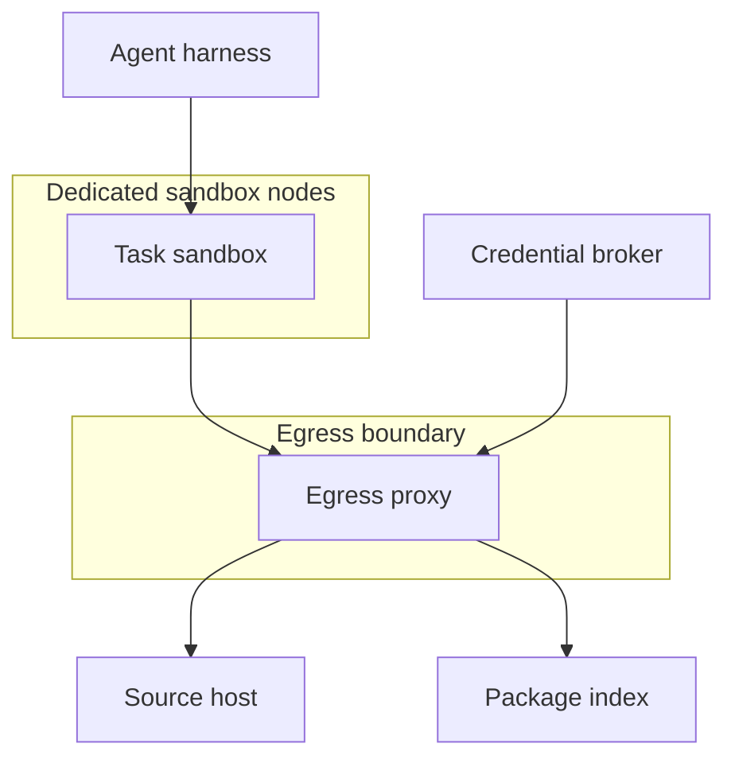
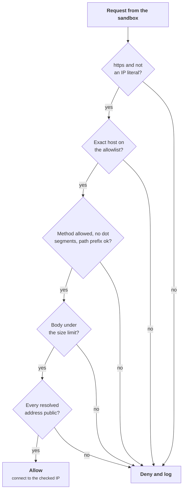
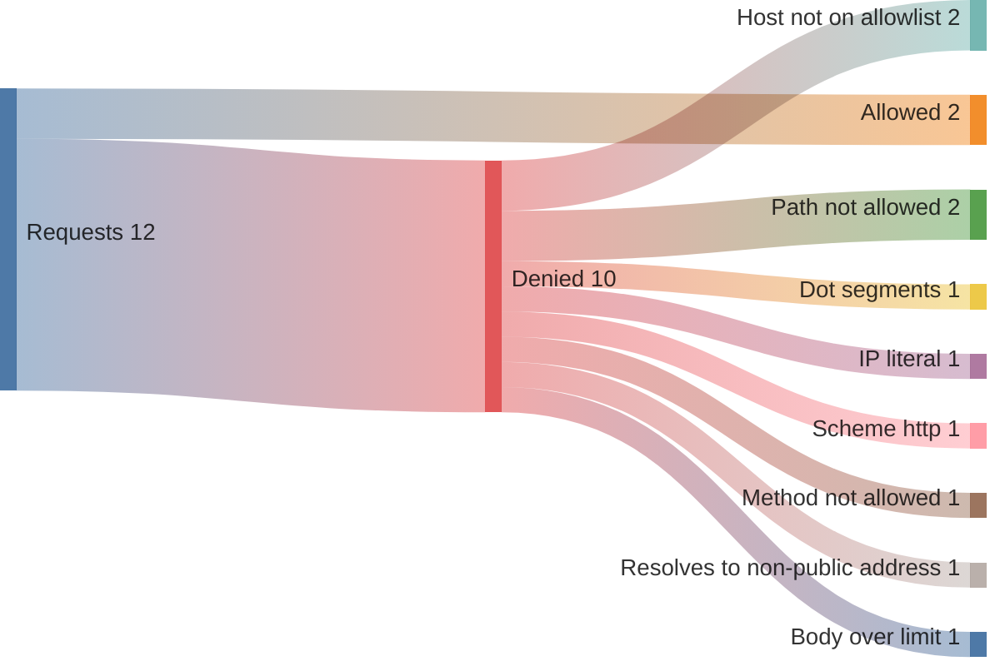

+++
title = 'Sandboxing and egress'
description = 'Treat code an agent runs as an attacker already inside. Contain it with three independent boundaries, and close the way out by default.'
question = 'How is model-written code contained, and how is the way out closed?'
weight = 4
difficulty = 3
prerequisites = ['/notes/ai-security-engineering/securing-agents/01-agent-threats', '/notes/ai-security-engineering/securing-agents/02-identity-and-authorization']
date = 2026-05-05
lastmod = 2026-05-05
verified = 2026-05-05
+++

## The idea in one minute

When an agent runs code or commands, treat it as an attacker's code already
running on your infrastructure, and ask what it can reach. The answer should be:
its own disposable workspace and a short list of network destinations. Nothing
else.

Getting there takes three boundaries, each of which must hold on its own:

1. an **isolation boundary** stronger than a plain container;
2. a **file and credential boundary** that leaves nothing worth stealing inside;
3. an **egress boundary** that denies by default.

Of the three, egress most often decides whether a successful hijack becomes a
data breach. Isolation without egress control protects your hosts; it does not
protect the data you put in the sandbox.

## A picture



Boundary 2 is the absence of things in the picture: no secrets in the sandbox,
no host paths, no other user's files.

## How it really works

### Boundary 1: isolation

A container shares the host's kernel. Hostile code then needs one kernel bug, or
one mistake in the container's configuration, to reach the host. For code a
model wrote under the influence of untrusted input, use a stronger boundary:

- **gVisor** runs the workload against a kernel implemented in user space, which
  intercepts its system calls, so the host kernel exposes a much smaller surface.
- **MicroVMs** such as Firecracker give each workload its own guest kernel behind
  hardware virtualization, with a minimal device model. Kata Containers packages
  the same idea behind a container interface.

Read each column from the top down: it is everything hostile code must get
through before it touches the host kernel. The plain container has nothing in
between.



| Setting | Why |
| --- | --- |
| **gVisor or a microVM**, not a plain container | A shared host kernel is too large an attack surface for hostile code |
| **One sandbox per task** | No state, process, or file survives from one user's task into another's |
| **Non-root user; no privileged mode; capabilities dropped** | Limits what a kernel bug can be reached with |
| **Seccomp profile** | Blocks system calls the workload never needs |
| **No host mounts, no container-runtime socket, no devices** | Each is a direct escape path; a mounted Docker socket is root on the host |
| **CPU, memory, process-count, disk, and time limits** | A fork bomb or a crypto-miner is contained and killed |
| **Read-only base image** | The sandbox cannot persist changes to its own tooling |
| **Dedicated nodes** | An escape lands somewhere with no credentials and no neighbors worth attacking |
| **Destroyed at the end** | Nothing to clean up, nothing carried over |

Several rows of the table are one lifecycle: a fresh sandbox per task, limits
while it runs, and destruction at the end either way.



### Boundary 2: files and credentials

- Mount **only this task's workspace**: one repository checkout, one upload set.
- **No secrets inside.** Not in environment variables, files, or the image. Any
  process can read them, and so can an injected instruction that tells the agent
  to run `env`.
- **Inject credentials at the proxy.** Code in the sandbox makes an
  unauthenticated request to an allowed host; the egress proxy adds the token on
  the way out. The sandbox never holds it. This is the delegated, scoped token of
  [Identity and authorization](/notes/ai-security-engineering/securing-agents/02-identity-and-authorization/),
  attached outside the hostile zone.
- Where a credential must exist inside, such as for a `git push`, scope it to one
  repository and one operation, and let it expire in minutes.
- **Treat workspace configuration as untrusted.** A cloned repository may contain
  agent instruction files, MCP configuration, editor tasks, git hooks, and CI
  definitions. Some tools execute these automatically. Do not auto-load them,
  make them read-only to the agent, and require review before anything in them
  runs.
- **Output is untrusted.** Whatever the sandbox prints goes back into the
  model's context and is subject to the same input checks and taint rules as a
  web page.

Credential injection, step by step. Follow the token: it appears at step 4
and never crosses back into the sandbox.

```mermaid {title="The proxy adds the credential, so the sandbox never holds it"}
sequenceDiagram
  autonumber
  participant SB as Sandbox code
  participant PX as Egress proxy
  participant BR as Credential broker
  participant GH as github.com
  SB->>PX: fetch acme/api, no credential
  PX->>PX: check host, method, and path against policy
  PX->>BR: token for this task and repository
  BR-->>PX: short-lived scoped token
  PX->>GH: same request plus the token
  GH-->>PX: response
  PX-->>SB: response only, token stripped
```

### Boundary 3: egress

Deny by default, and build the allowlist per task type.

| Rule | Detail |
| --- | --- |
| **Default deny, all protocols** | Including DNS, ICMP, UDP, and anything on non-standard ports |
| **Allowlist by host name, through a proxy** | IP allowlists are too coarse: CDNs and shared hosting put many unrelated sites behind one address |
| **No direct DNS from the sandbox** | A query for `<secret>.attacker.example` is exfiltration even if it is never answered |
| **Block metadata and internal ranges** | `169.254.169.254` and the rest of link-local, private ranges, the cluster's service network |
| **Restrict methods and paths where possible** | Reading a package index is `GET`, not `POST` |
| **Beware allowlisted hosts that accept uploads** | A code host, paste service, or storage bucket on the allowlist is itself an exfiltration channel. Scope to your organization's paths, or proxy through an internal mirror |
| **Inspect and log** | Every request and every denial is recorded with the task ID; denials alert |
| **Size and rate limits** | A large outbound body from a sandbox is unusual and worth stopping |

Three details decide whether these rules hold:

- **DNS through a resolver is not enough.** A recursive resolver that will look
  up any name still forwards `<secret>.attacker.example` to the attacker's name
  server. Either give the sandbox no DNS at all and let the proxy resolve, or run
  a resolver that answers only allowlisted names.
- **Host-name checks need TLS visibility.** An allowlist that reads only the TLS
  SNI field, without terminating TLS, can be bypassed on shared CDNs by *domain
  fronting*: an allowed name in SNI, a different site in the encrypted `Host`
  header. Terminate TLS at the proxy (the sandbox trusts the proxy's CA), or
  accept that weakness knowingly.
- **Check the address you connect to.** A name on the allowlist can be repointed
  at an internal address. Resolve, check the resulting IP, and connect to that
  IP, not to a second lookup an attacker can race (DNS rebinding).

The first detail drawn out: in the top branch the secret reaches the attacker
inside a lookup that never needs an answer.

```mermaid {title="A resolver that looks up any name forwards the secret for you"}
sequenceDiagram
  autonumber
  participant SB as Sandbox
  participant RR as Resolver
  participant NS as attacker.example name server
  alt resolver looks up any name
    SB->>RR: look up SECRET.attacker.example
    RR->>NS: look up SECRET.attacker.example
    Note over NS: the secret arrives in the query itself
  else resolver answers only allowlisted names
    SB->>RR: look up SECRET.attacker.example
    RR-->>SB: refused, and the denial alerts
  end
```

The same policy applies to the **agent runtime** itself. Fetch and search tools
called by the harness are egress too, and need a destination allowlist and the
taint rule.

Tooling, coarse to fine: Kubernetes NetworkPolicy works on IP addresses and
ports only; Cilium adds DNS-aware (`toFQDNs`) and identity-aware policy; an HTTP
egress proxy such as Envoy, or a purpose-built one, handles host and path
allowlists, TLS, and credential injection.

A deployment of the three boundaries looks like this: sandboxes on their own
nodes, one way out through the proxy, and the broker feeding the proxy rather
than the sandbox.



### Defense in depth inside the sandbox

A sandbox makes dangerous commands survivable, not harmless to the task. A
second layer of command policy still pays for itself:

- **Deny patterns** for commands with no legitimate use in the task: writing
  outside the workspace, touching credential paths, disabling tooling.
- **Approval** for commands with effects outside the sandbox: pushing,
  publishing, deploying.
- **Parse; do not match strings.** `rm -rf /` can be written a hundred ways, and
  shell quoting, variables, and encodings defeat naive filters. Treat command
  filters as a convenience and the sandbox as the control.

### Browsers and computer use

An agent driving a browser or a desktop has the largest attack surface of any
tool: every page is untrusted content, and the browser holds sessions.

- **A fresh browser profile per task**, with no saved passwords and no
  logged-in sessions, unless the task is specifically to act in one account.
- **Never the user's everyday profile**, which is logged into everything.
- **A navigation allowlist** when the task permits one.
- **Approval before** entering credentials, making purchases, submitting forms
  with personal data, or changing account settings.
- **Screenshots and page text are untrusted input.** Text in an image can carry
  instructions.
- **Downloads stay in the sandbox**, are not executed, and are scanned if they
  leave it.

A browser agent logged into the user's accounts holds all three legs of the
[lethal trifecta](/notes/ai-security-engineering/threat-landscape/01-why-ai-security-is-different/) at once. It is workable only with tight scoping and approval on
consequential actions.

### Local agents on developer machines

Coding agents on a laptop often cannot use a remote microVM. The same three
boundaries apply, built from the operating system's tools:

- OS-level sandboxing of the agent's commands, restricting writes to the project
  directory: on Linux, namespaces with seccomp and Landlock (tools such as
  bubblewrap wrap these); on macOS, Seatbelt sandbox profiles.
- A local proxy enforcing a network allowlist.
- No access to `~/.ssh`, cloud credential files, browser profiles, or password
  stores.
- Review before any project-supplied configuration, hook, or MCP server runs.
- Or a dev container or remote workspace, which turns the laptop into a thin
  client.

### Testing the sandbox

Assume it leaks until shown otherwise. A recurring job should try, from inside a
fresh sandbox:

| Try to | Targets |
| --- | --- |
| **Reach** | An arbitrary internet host by name and by IP; the cloud metadata endpoint; another sandbox, a cluster service, the node; DNS directly, bypassing the proxy |
| **Read** | Environment variables for anything secret; files outside the workspace |
| **Persist** | Write to the base image; survive a restart |
| **Exhaust** | CPU, memory, disk, the process table |

Every attempt should fail, and every failure should produce the expected alert.
Run the job after each change to the sandbox image, the runtime, or the network
policy.

## Code

The decision an egress proxy makes for each request: exact host match after
canonicalization, method and path rules, a size limit, and a check on the
resolved address. DNS is simulated so the program runs offline.

```python {title="egress.py"}
"""egress.py: the decision an egress proxy makes for each request out of a sandbox.

Standard library only; offline. DNS is simulated with a dictionary.
"""

from __future__ import annotations

import ipaddress
from dataclasses import dataclass
from urllib.parse import unquote, urlsplit

MAX_BODY = 1_000_000  # bytes; a large upload from a sandbox is worth stopping


@dataclass(frozen=True)
class Rule:
    methods: frozenset[str]
    paths: tuple[str, ...] = ("/",)  # allowed path prefixes, matched per segment

    def path_ok(self, path: str) -> bool:
        return any(p == "/" or path == p or path.startswith(p + "/") for p in self.paths)


# Allowlist for one task type: "work on the acme/api repository".
ALLOW = {
    "github.com": Rule(frozenset({"GET", "POST"}), ("/acme/api", "/acme/api.git")),
    "pypi.org": Rule(frozenset({"GET"}), ("/simple",)),  # read-only package index
    "files.pythonhosted.org": Rule(frozenset({"GET"}), ("/packages",)),
    "docs.partner.example": Rule(frozenset({"GET"})),
}

# Simulated DNS. Someone has repointed a name on the allowlist at loopback.
DNS = {
    "github.com": ["140.82.112.3"],
    "pypi.org": ["151.101.0.223"],
    "files.pythonhosted.org": ["151.101.1.63"],
    "docs.partner.example": ["127.0.0.1"],
    "evil.example": ["203.0.113.66"],
}


def decide(method: str, url: str, body_len: int = 0) -> tuple[bool, str, str]:
    """Return (allowed, reason, address to connect to)."""
    parts = urlsplit(url)
    if parts.scheme != "https":
        return False, f"scheme {parts.scheme!r} not allowed", ""
    host = (parts.hostname or "").rstrip(".")  # hostname is already lowercased
    try:
        ipaddress.ip_address(host)
        return False, "IP-literal destination", ""
    except ValueError:
        pass
    rule = ALLOW.get(host)  # exact match: no suffix or substring tricks
    if rule is None:
        return False, f"host {host!r} not on allowlist", ""
    if method not in rule.methods:
        return False, f"{method} not allowed to {host}", ""
    if {".", ".."} & set(unquote(parts.path).split("/")):
        return False, "dot segments in path", ""  # the server would resolve them
    if not rule.path_ok(parts.path):
        return False, f"path {parts.path!r} not allowed on {host}", ""
    if body_len > MAX_BODY:
        return False, f"body of {body_len} bytes over limit", ""
    addrs = DNS.get(host, [])
    if not addrs:
        return False, f"{host} does not resolve", ""
    for addr in addrs:
        ip = ipaddress.ip_address(addr)
        if not ip.is_global:  # private, loopback, link-local (incl. 169.254.169.254) ...
            return False, f"{host} resolves to non-public {ip}", ""
    # Connect to the address that was checked, not to a fresh lookup of the name.
    return True, "allowed", addrs[0]


if __name__ == "__main__":
    cases = [
        ("GET", "https://github.com/acme/api.git/info/refs"),
        ("GET", "https://GITHUB.COM./acme/api.git/info/refs"),
        ("POST", "https://github.com/someone-else/drop/issues"),
        ("GET", "https://github.com/acme/api-secrets-mirror"),
        ("POST", "https://github.com/acme/api/%2e%2e/%2e%2e/evil/drop"),
        ("GET", "https://github.com@evil.example/acme/api"),
        ("GET", "https://github.com.evil.example/acme/api"),
        ("GET", "https://169.254.169.254/latest/meta-data/"),
        ("GET", "http://pypi.org/simple/requests/"),
        ("POST", "https://pypi.org/simple/requests/"),
        ("GET", "https://docs.partner.example/guide"),
        ("POST", "https://github.com/acme/api.git/git-receive-pack", 5_000_000),
    ]
    for method, url, *size in cases:
        ok, reason, addr = decide(method, url, *size)
        verdict = f"ALLOW -> {addr}" if ok else f"DENY  {reason}"
        print(f"{method:<4} {url:<52} {verdict}")
```

Run it with `python3 egress.py`:

```text
GET  https://github.com/acme/api.git/info/refs            ALLOW -> 140.82.112.3
GET  https://GITHUB.COM./acme/api.git/info/refs           ALLOW -> 140.82.112.3
POST https://github.com/someone-else/drop/issues          DENY  path '/someone-else/drop/issues' not allowed on github.com
GET  https://github.com/acme/api-secrets-mirror           DENY  path '/acme/api-secrets-mirror' not allowed on github.com
POST https://github.com/acme/api/%2e%2e/%2e%2e/evil/drop  DENY  dot segments in path
GET  https://github.com@evil.example/acme/api             DENY  host 'evil.example' not on allowlist
GET  https://github.com.evil.example/acme/api             DENY  host 'github.com.evil.example' not on allowlist
GET  https://169.254.169.254/latest/meta-data/            DENY  IP-literal destination
GET  http://pypi.org/simple/requests/                     DENY  scheme 'http' not allowed
POST https://pypi.org/simple/requests/                    DENY  POST not allowed to pypi.org
GET  https://docs.partner.example/guide                   DENY  docs.partner.example resolves to non-public 127.0.0.1
POST https://github.com/acme/api.git/git-receive-pack     DENY  body of 5000000 bytes over limit
```

Each denial corresponds to a classic bypass: a lookalike path prefix
(`api-secrets-mirror`), encoded dot segments, credentials in the URL
(`github.com@evil.example`), a suffix trick (`github.com.evil.example`), an IP
literal for the metadata endpoint, and an allowlisted name pointing inward. A
substring check such as `"github.com" in url` would have allowed all six denied
requests that mention GitHub, including two that never go to GitHub at all.

The order of checks in `decide()`, drawn as a gate: a request must pass every
diamond, and any "no" ends in a logged denial.



The program's twelve test requests, split by the check that stopped them.
Notice that the two allowed requests are the only ones that stay on the
intended paths.



## Where it breaks

- **The allowlist is still a channel.** `POST` to `github.com/acme/api` is
  allowed, so a hijacked agent can push a secret into a branch, or into an
  issue if that path is allowed. If the repository is public, that is
  publication. Scope write access to what the task must change, and review
  pushes.
- **The program decides; it does not connect.** A real proxy must connect to the
  checked address, terminate TLS to see the real host and path, and enforce all
  of this for every protocol, not only HTTPS.
- **Path rules depend on the server.** Servers differ in how they decode and
  normalize paths. A proxy and an origin that disagree about what a path means
  is a bypass. Prefer a proxy that normalizes and rejects anything ambiguous.
- **Isolation can fail.** gVisor and microVMs reduce the attack surface; they do
  not remove it. Dedicated nodes with nothing worth stealing turn an escape into
  a contained incident.
- **Allowed is not the same as harmless.** A package index you allow can serve a
  malicious package. Egress control limits where data goes; dependency and
  supply-chain controls handle what comes in.

## Remember this

- Three independent boundaries: isolation, files and credentials, egress.
- Nothing worth stealing is inside the sandbox; credentials are injected at the
  proxy.
- Egress is deny by default, by exact host name, with no direct DNS and with
  metadata and internal ranges blocked.
- Allowlisted hosts that accept uploads are still exfiltration channels.
- Workspace configuration files are untrusted and must not run automatically.
- Test the sandbox from the inside, continuously.

## Try it

1. Run `egress.py`. The policy ignores parts of the URL. Find a request it
   allows that it should not (hint: look at the port), fix the policy, and
   decide whether query strings to allowed hosts are a risk for your task.
2. Write the egress allowlist for a coding agent working on one private
   repository. Which entries could be abused for exfiltration, and how would you
   narrow them?
3. List everything an agent on your laptop could read today. What would you move
   out of reach?
4. Add two checks specific to your environment to the sandbox test table.

## Check yourself

1. Why is isolation without egress control insufficient?

   
   Isolation protects the host and other tenants from the sandbox. The task's
   own data, such as the repository and the uploaded files, is inside the
   sandbox by design. Without egress control, a hijacked agent can send that data
   anywhere.
   

2. How can code call an authenticated API without holding the credential?

   
   The code sends an unauthenticated request to an allowed host through the
   egress proxy. The proxy, outside the sandbox, checks the request against
   policy and attaches a short-lived, scoped token from the credential broker.
   Nothing in the sandbox can read or copy the token.
   

3. Why are configuration files in a cloned repository a risk?

   
   They are written by whoever controls the repository, yet some tools load or
   execute them automatically: agent instructions, MCP server definitions, git
   hooks, editor tasks. Opening the repository can then run attacker commands or
   rewrite the agent's instructions without any injection reaching the model.
   

4. The sandbox can only use the proxy's DNS resolver. Why can a secret still
   leak through DNS?

   
   A recursive resolver that looks up any name forwards a query for
   `<secret>.attacker.example` to the attacker's authoritative name server. The
   data leaves in the query itself. The resolver must answer only allowlisted
   names, or the sandbox must have no DNS and let the proxy resolve.
   

## Sources

- gVisor project, [What is gVisor?](https://gvisor.dev/docs/)
- Alexandru Agache et al., [Firecracker: Lightweight Virtualization for Serverless Applications](https://www.usenix.org/conference/nsdi20/presentation/agache), USENIX NSDI, 2020.
- Linux kernel documentation, [Seccomp BPF](https://docs.kernel.org/userspace-api/seccomp_filter.html) and [Landlock: unprivileged access control](https://docs.kernel.org/userspace-api/landlock.html).
- Kubernetes documentation, [Network Policies](https://kubernetes.io/docs/concepts/services-networking/network-policies/).
- Cilium documentation, [Layer 7 and DNS-based policy](https://docs.cilium.io/en/stable/security/policy/language/).
- OWASP Cheat Sheet Series, [Server-Side Request Forgery Prevention](https://cheatsheetseries.owasp.org/cheatsheets/Server_Side_Request_Forgery_Prevention_Cheat_Sheet.html).
- Amazon Web Services, [Use the Instance Metadata Service to access instance metadata](https://docs.aws.amazon.com/AWSEC2/latest/UserGuide/configuring-instance-metadata-service.html).
