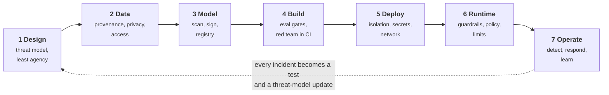
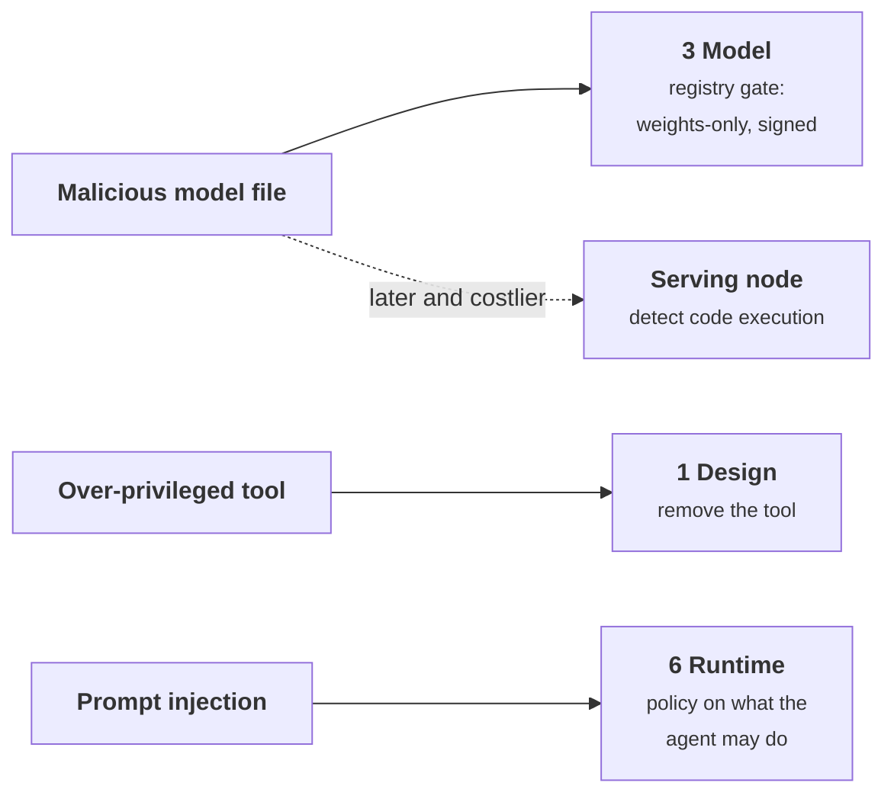
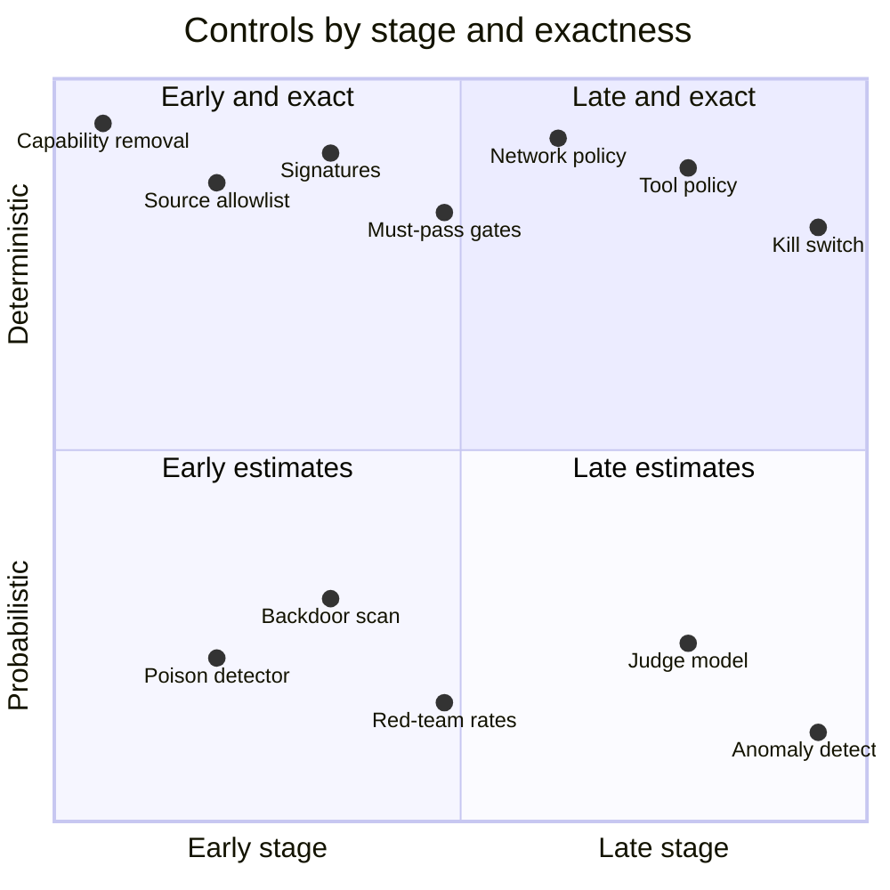
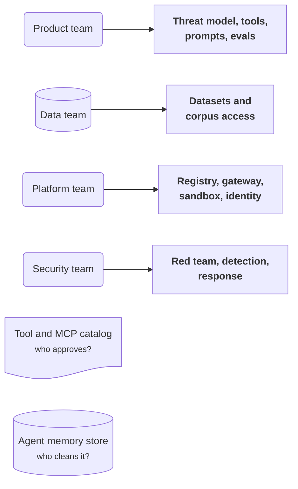
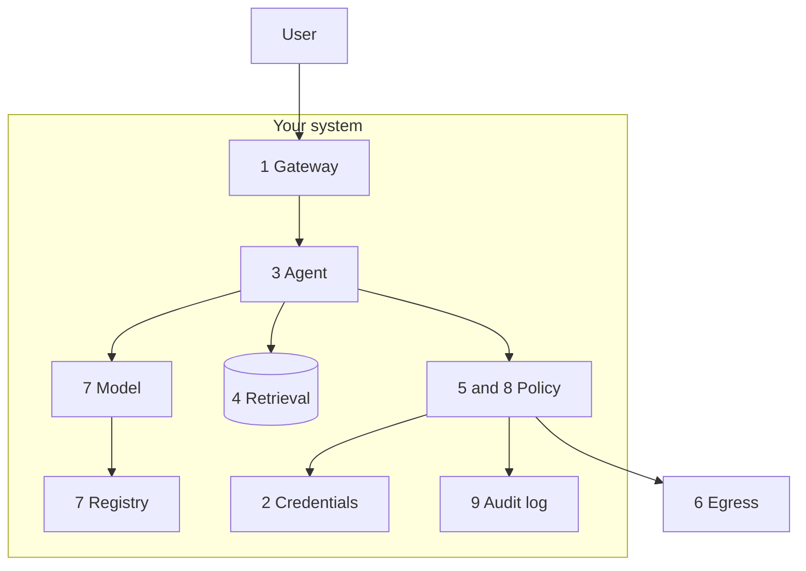
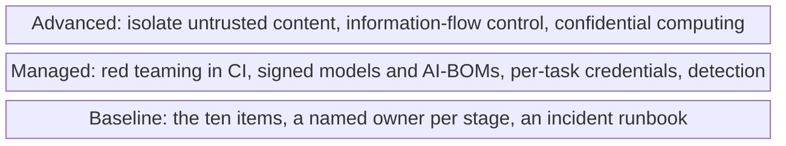
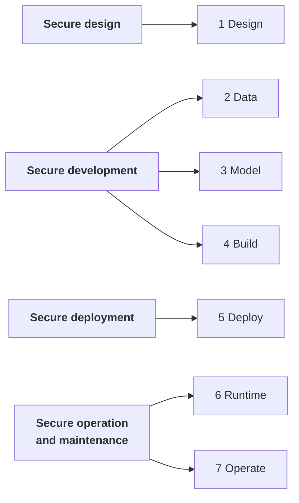
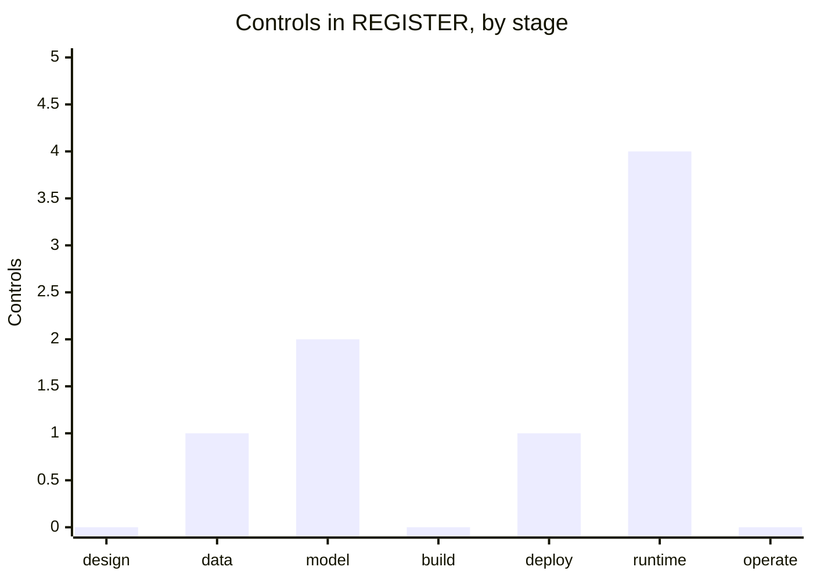

+++
title = 'The lifecycle map'
description = 'Security controls for an AI application attach to seven stages. Knowing which control belongs where, and who owns it, keeps runtime guardrails from carrying the whole load.'
question = 'Which control belongs at which stage, and who owns it?'
weight = 1
difficulty = 2
prerequisites = ['/notes/ai-security-engineering/threat-landscape/01-why-ai-security-is-different', '/notes/ai-security-engineering/threat-landscape/02-threat-modeling-ai-systems']
date = 2026-04-15
lastmod = 2026-10-30
verified = 2026-04-15
+++

## The idea in one minute

Security controls for an AI application attach to seven stages: **design, data,
model, build, deploy, runtime, and operate**. Most threats can be addressed at
more than one stage, but each has a stage where the control that bounds the
damage is cheapest. A malicious model file is cheapest to stop at the registry
gate. An over-privileged tool is cheapest to remove at design. The consequences
of a prompt injection are cheapest to contain with a runtime policy on what the
agent may do.

This lesson is the map: which control lives where, what evidence it leaves, and
who owns it. The six lessons that follow each take one stage.

The map also makes one thing visible: runtime guardrails, where most attention
goes, are **one column out of seven**.

## A picture



Design is drawn as the control that holds because it is the only stage where a
capability can be removed outright. Everything later limits a capability that
still exists.

## How it really works

### The map

| Stage | Main threats | Key controls | Evidence it leaves |
| --- | --- | --- | --- |
| **1 Design** | Excessive agency; the lethal trifecta; missing trust boundaries | Threat model; least-privilege tool set; chosen autonomy level; a diagram of what can influence the model and what it can influence | A reviewed threat model, updated with every new tool or data source |
| **2 Data** | Poisoning; privacy leakage; unauthorized use | Provenance records; access control on corpora; PII handling; ingestion scanning; dataset versioning | Dataset manifests, lineage, consent and license records |
| **3 Model** | Malicious model files; backdoors; tampering | Weights-only formats; scanning; signatures; internal registry; AI bill of materials | Signed artifacts, scan reports, AI-BOM |
| **4 Build** | Safety regressions; vulnerable dependencies; secrets in prompts | Prompts and policies as code; security evaluation suite; automated red teaming; dependency and secret scanning | CI results per commit; release-gate decisions |
| **5 Deploy** | Credential theft; cross-tenant leakage; exposed endpoints; lateral movement | Workload identity; secret management; network policy; sandboxing; cache and GPU isolation | Infrastructure as code; policy reports; attestation |
| **6 Runtime** | Injection; exfiltration; jailbreak; denial of wallet | Input and output screening; tool-call policy; output sanitizing; token and spend limits; approvals | A policy decision and guardrail verdict per request |
| **7 Operate** | Undetected compromise; slow response; repeat incidents | Audit trail; behavioral detection; kill switches; incident runbooks; post-incident tests | Alerts, incident records, new test cases |

The stages are not perfectly separate. Retrieval data enters at runtime but is
governed at the data stage; a fine-tuned model is both a data artifact and a
model artifact. Use the map to make sure each threat has an owner and a
control, not to argue about which box a control belongs in.

Follow three threats from the opening paragraph to the stage where each is
cheapest to bound.



### Shift left, and also right

"Shift left", catching problems early, holds here: removing a dangerous tool at
design costs a meeting, and discovering it in an incident costs a breach. AI
systems also need a strong **right** side, for two reasons:

- **The model's behavior cannot be fully verified before release.** Testing
  samples a space that cannot be enumerated, so some failures appear only in
  production.
- **The inputs change after release.** New documents enter the corpus, tools
  are updated, users find new phrasings, and the model provider ships a new
  version. A system that was safe at launch drifts.

So the lifecycle is a loop: what you learn while operating feeds the next design
review and the next build's test suite.

### Deterministic and probabilistic, by stage

| Stage | Deterministic controls | Probabilistic controls |
| --- | --- | --- |
| Design | Capability removal; privilege scoping | None |
| Data | Access control; allowlisted sources; hashes | Poison and PII detectors |
| Model | Format restrictions; signatures; registry policy | Malware and backdoor scanning; behavioral evaluation |
| Build | Gates on must-pass tests; secret scanning | Red-team success rates |
| Deploy | Network policy; isolation; identity | None |
| Runtime | Tool policy; limits; sanitizers; approvals | Classifiers; judge models |
| Operate | Kill switches; revocation | Anomaly detection |

A deterministic control enforces a rule exactly: the same input always gets the
same decision, and you can test it to 100%. A probabilistic control estimates,
and is sometimes wrong in both directions.

The same table as a map: read across for the stage, and up for how exactly
the control enforces its rule.



> [!IMPORTANT]
> The left column is what a security review can sign off. The right column
> makes attacks rarer and incidents more visible. A high-impact threat whose
> only controls are in the right column needs rework.

Some rows are less exact than they look. Secret scanning and model scanning are
pattern matches: deterministic in execution, but they only find what their
patterns describe. Treat a control as a guarantee only for the property it
actually checks.

### Who owns what

AI security falls between teams unless ownership is written down.

| Owner | Typically owns |
| --- | --- |
| **Product or application team** | Threat model, tool set, prompts, evaluation suite, approval design |
| **Data team** | Dataset provenance, corpus access control, PII handling |
| **ML or platform team** | Model registry, serving, gateway, sandbox and identity infrastructure |
| **Security team** | Standards, review, red teaming, detection, incident response |
| **Legal and compliance** | Regulatory classification, data-use terms, records |

Two assets most often have no owner: the **tool and MCP server catalog** (who
approves a new one?) and the **agent memory store** (who can inspect and clean
it?). Assign both explicitly.

Each team points at the assets it owns; the two red assets have no arrow.



### A minimum bar

If you can only do ten things, do these, roughly in this order:

1. Put every model call behind a gateway with authentication, token limits,
   and spend budgets.
2. Keep credentials out of prompts, code, and clients; issue short-lived,
   scoped ones.
3. Write the threat model, and remove tools the task does not need.
4. Enforce data permissions before content reaches the context: in retrieval
   and in tools.
5. Gate irreversible and outbound actions with policy in code, and with human
   approval where needed.
6. Sanitize rendered output, and restrict egress from anything that executes
   code or fetches URLs.
7. Load models only from your registry, in a weights-only format.
8. Approve and pin every tool and MCP server.
9. Log every action with user, agent, arguments, and the sources that were in
   the context.
10. Add adversarial cases to the evaluation suite and run them on every change.

Most of the ten sit on the path one request takes; the numbers on the
diagram match the list.



Guardrail classifiers are useful and are not on this list. They belong after the
controls that bound damage, because a classifier that misses lets the attack
through, while a policy that denies the action holds regardless of how the
attack was phrased.

### Maturity, in three steps

| Level | Looks like |
| --- | --- |
| **Baseline** | The ten items above; a named owner for each stage; an incident runbook |
| **Managed** | Automated red teaming in CI; signed models and AI-BOMs; per-task credentials; behavioral detection; regular exercises |
| **Advanced** | Architectural isolation of untrusted content; information-flow controls; confidential computing for sensitive tenants; continuous adversarial evaluation in production |

Each level is built on the one below it; skipping the baseline leaves the
advanced controls standing on nothing.



### How this lines up with published guidance

You do not need a new framework to use this map; it lines up with existing ones.

- The UK NCSC and US CISA **Guidelines for secure AI system development**
  (November 2023) use four phases: secure design, secure development, secure
  deployment, and secure operation and maintenance. Stages 2 to 4 here split
  their "development" phase into data, model, and build.
- NIST **SP 800-218A** (July 2024) extends the Secure Software Development
  Framework with practices for generative AI, including protecting training
  data and model weights as assets.
- The **OWASP Top 10 for LLM Applications** (2025 edition) is a list of risks,
  not stages. Mapping each of its entries to a row of the table above is a
  quick check that you have a control for each.

Here is how the four NCSC and CISA phases split into this lesson's seven
stages.



## Code

A threat register is only useful if someone reads it critically. This lint
applies the rules from this lesson mechanically: every high-impact threat needs
a deterministic control, every control needs an owner, and an empty stage is
worth a second look.

```python {title="register.py"}
"""register.py: lint a threat register against the lifecycle map.

Rule 1: every high-impact threat has at least one deterministic control.
Rule 2: every control has a named owner.
Rule 3: report lifecycle stages that hold no controls at all.
"""
from collections import Counter
from dataclasses import dataclass, field

STAGES = ["design", "data", "model", "build", "deploy", "runtime", "operate"]


@dataclass
class Control:
    stage: str
    name: str
    kind: str  # "deterministic" or "probabilistic"
    owner: str = ""


@dataclass
class Threat:
    name: str
    impact: str  # "high" or "low"
    controls: list[Control] = field(default_factory=list)


REGISTER = [
    Threat("Injected email makes the agent send mail", "high", [
        Control("runtime", "injection classifier on inbound mail", "probabilistic", "security"),
        Control("runtime", "send_email denied after untrusted content", "deterministic", "app team"),
    ]),
    Threat("Malicious pickle in a downloaded model", "high", [
        Control("model", "pickle scanner in the intake pipeline", "probabilistic", "platform"),
        Control("model", "registry admits safetensors only", "deterministic", "platform"),
    ]),
    Threat("Poisoned wiki page in the retrieval corpus", "high", [
        Control("data", "anomaly detector on new chunks", "probabilistic", "data team"),
        Control("runtime", "judge model checks grounding", "probabilistic", "app team"),
    ]),
    Threat("Cross-tenant leak through the vector index", "high", [
        Control("deploy", "tenant filter in the service layer, tested", "deterministic"),
    ]),
    Threat("System prompt disclosed to a curious user", "low", [
        Control("runtime", "output leak detector", "probabilistic", "app team"),
    ]),
]


def lint(register: list[Threat]) -> list[str]:
    findings: list[str] = []
    used: Counter[str] = Counter()
    for threat in register:
        for c in threat.controls:
            used[c.stage] += 1
            if not c.owner:
                findings.append(f"NO OWNER  {c.name!r} ({c.stage}) for: {threat.name}")
        deterministic = any(c.kind == "deterministic" for c in threat.controls)
        if threat.impact == "high" and not deterministic:
            findings.append(f"REWORK    high impact, probabilistic controls only: {threat.name}")
    findings += [f"EMPTY     no controls at the {s} stage" for s in STAGES if used[s] == 0]
    return findings


if __name__ == "__main__":
    findings = lint(REGISTER)
    for line in findings:
        print(line)
    print(f"{len(REGISTER)} threats, {len(findings)} findings")
```

Run it with `python3 register.py`:

```text
REWORK    high impact, probabilistic controls only: Poisoned wiki page in the retrieval corpus
NO OWNER  'tenant filter in the service layer, tested' (deploy) for: Cross-tenant leak through the vector index
EMPTY     no controls at the design stage
EMPTY     no controls at the build stage
EMPTY     no controls at the operate stage
5 threats, 5 findings
```

The poisoned-wiki threat is the classic gap: two detectors, no guarantee. A
deterministic fix might be a source allowlist with reviewed writers at the data
stage, or a rule that answers built on that wiki cannot trigger tools. The
empty design, build, and operate stages say the register describes only
preventive runtime and storage controls; nobody has written down how a
regression would be caught or an incident detected.

Counting the sample register's controls by stage shows the same skew the
lint reports: runtime is crowded and three stages are empty.



## Where it breaks

- **A map is not coverage.** Filling every cell with a control name proves
  nothing about whether the control works. The lint checks labels. Only tests
  ([Build and test](/notes/ai-security-engineering/securing-each-stage/04-build-and-test/))
  and exercises ([Monitoring and response](/notes/ai-security-engineering/securing-each-stage/07-monitoring-and-response/))
  show that the tenant filter filters and the kill switch kills.
- **"Deterministic" can be misconfigured.** An allowlist with a wildcard, or a
  network policy that was never applied to the namespace, is exact and wrong.
  Deterministic controls need their own unit tests and drift detection.
- **The cheapest stage changes.** If you buy a hosted model, the model stage is
  mostly your vendor's, and your controls move to contract review, gateway
  policy, and evaluation. Redraw the map for what you actually own.
- **Ownership decays.** Teams reorganize; a named owner who left is no owner.
  Review the owner column whenever the threat model is reviewed.

## Remember this

- Seven stages: design, data, model, build, deploy, runtime, operate.
- Each threat has a stage where the bounding control is cheapest; runtime
  guardrails are one stage of seven.
- The lifecycle is a loop, because behavior cannot be fully verified before
  release and inputs change after it.
- Sign off on deterministic controls; use probabilistic ones to lower rates and
  raise visibility.
- Assign owners, especially for the tool catalog and the memory store.

## Try it

1. Run `register.py`. Add a deterministic control for the poisoned-wiki threat
   and an owner for the tenant filter, and run it again.
2. Score a system you know against the ten-item minimum bar.
3. For the three highest threats in your threat model, name the stage where each
   is cheapest to stop and the control you would place there.
4. Write down who owns tool approval and memory hygiene in your organization. If
   the answer is "nobody", propose an owner.

## Check yourself

1. Why does an AI system need strong controls on the "right" side of the
   lifecycle as well as the left?

   
   Because its behavior cannot be fully verified before release (tests sample
   an input space that cannot be enumerated), and because its inputs change
   after release: new documents, new tools, new user phrasings, new model
   versions. Some failures will first appear in production, so you need
   detection, containment, and a path from each incident back into tests and
   the threat model.
   

2. Which stage stops a malicious model file most cheaply, and with what
   control?

   
   The model stage, at the gate into the internal registry: accept only
   weights-only formats such as safetensors, verify digests and signatures,
   and let production load only from that registry. Catching it later means
   detecting code execution on a serving node, which is far more expensive.
   

3. Why are guardrail classifiers not in the ten-item minimum bar?

   
   They are probabilistic and can be bypassed by an attacker who adapts. The
   minimum bar lists controls that bound damage whatever the model is tricked
   into: gateways and budgets, scoped credentials, permission checks, action
   policy, egress limits. Classifiers are a useful extra layer once those
   exist.
   

4. A threat has a high impact and is covered by an injection classifier and a
   judge model. What is wrong, and how do you fix it?

   
   Both controls are probabilistic, so nothing guarantees the outcome. Add a
   deterministic control at the cheapest stage: remove or scope the capability
   at design, restrict who can write the data source, or deny the dangerous
   action in a runtime policy when untrusted content is in the context.
   

## Sources

- UK National Cyber Security Centre and US CISA, [Guidelines for secure AI system development](https://www.ncsc.gov.uk/collection/guidelines-secure-ai-system-development), November 2023.
- NIST, [SP 800-218A: Secure Software Development Practices for Generative AI and Dual-Use Foundation Models](https://csrc.nist.gov/pubs/sp/800/218/a/final), July 2024.
- NIST, [Artificial Intelligence Risk Management Framework (AI RMF 1.0), NIST AI 100-1](https://doi.org/10.6028/NIST.AI.100-1), January 2023.
- OWASP GenAI Security Project, [Top 10 for LLM Applications](https://genai.owasp.org/llm-top-10/), 2025 edition.
