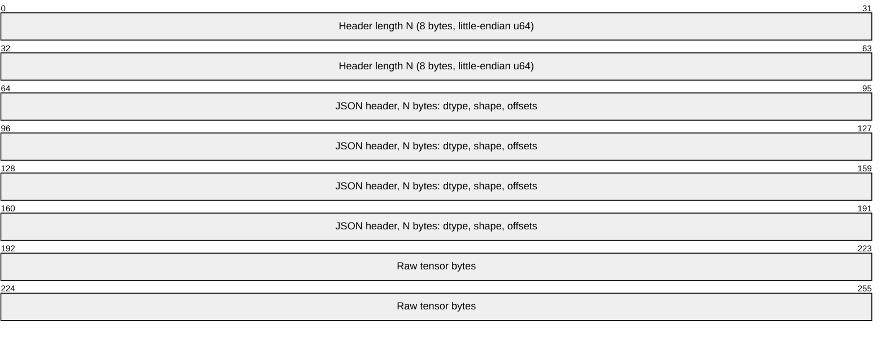
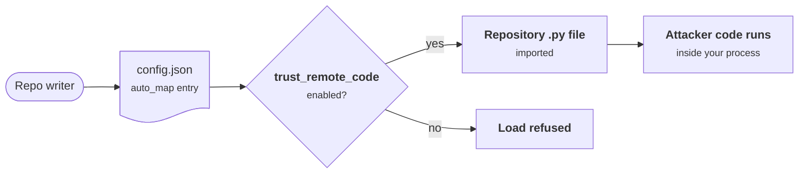
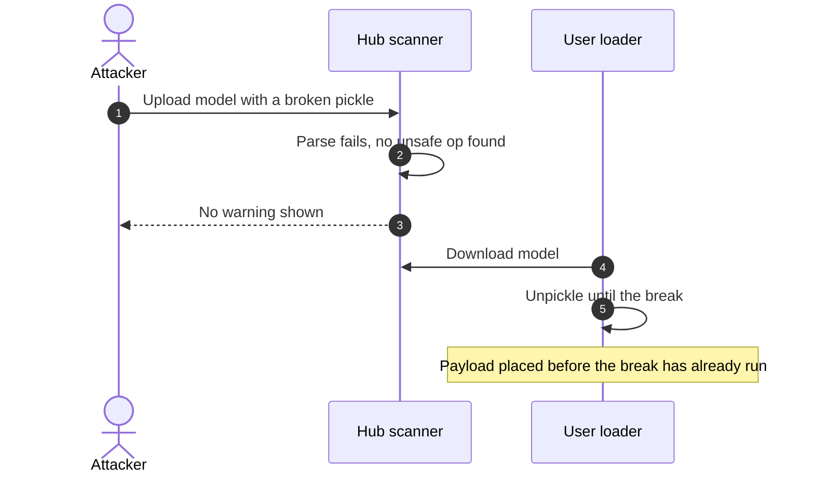
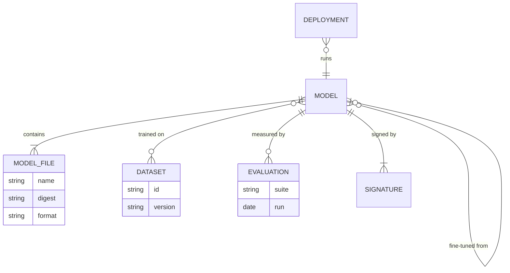
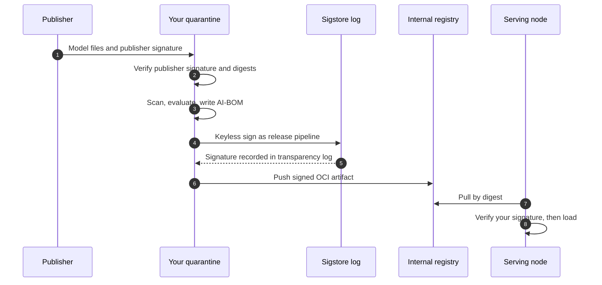
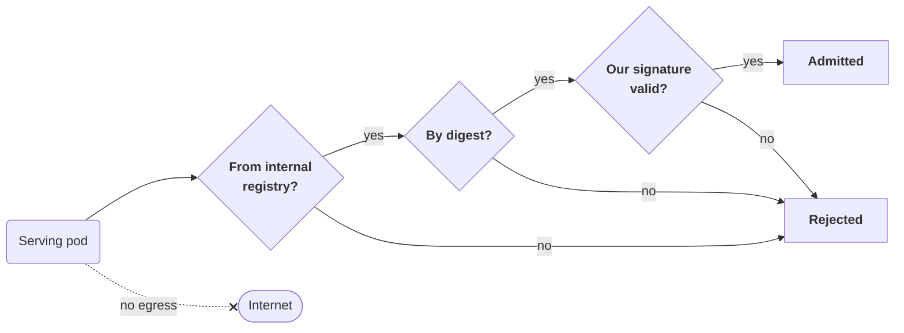

+++
title = 'Models and supply chain'
description = 'A model is a dependency that can carry executable code and whose behavior cannot be read from its contents. Acquire, verify, scan, record, sign, and load it only from your own registry.'
question = 'How do I know a model file is what it claims and safe to load?'
weight = 3
difficulty = 3
prerequisites = ['/notes/ai-security-engineering/securing-each-stage/02-data-and-training', '/notes/ai-security-engineering/how-attacks-work/03-poisoning-and-supply-chain']
date = 2026-04-19
lastmod = 2026-10-30
verified = 2026-04-19
+++

## The idea in one minute

A model is a dependency that runs with access to your data and your GPUs, so it
gets the treatment any dependency gets, and a little more: some model formats
can execute code when loaded, and a model's behavior cannot be read from its
contents.

The controls form a pipeline. **Acquire** from a known publisher, **verify** the
digest and signature, **scan** for unsafe content, **evaluate** behavior,
**record** what it is in an AI bill of materials, **sign** it yourself, and
**promote** it to an internal registry. Production loads only from that
registry, only by digest, only with your signature.

The same pipeline applies to every other AI-specific dependency: adapters,
tokenizers, prompts, skills, and tools.

## A picture

```mermaid {title="From public hub to production"}
flowchart LR
  HUB["<b>Public hub or vendor</b>"] --> Q["<b>Quarantine</b><br/><small>isolated, no credentials</small>"]
  Q --> V["<b>Verify</b><br/><small>publisher signature, digest</small>"]
  V --> SC["<b>Scan</b><br/><small>format, unsafe ops,<br/>license</small>"]
  SC --> EV["<b>Evaluate</b><br/><small>quality and safety probes</small>"]
  EV --> BOM["<b>AI-BOM</b><br/><small>model, data, lineage</small>"]
  BOM --> SIGN["<b>Sign</b><br/><small>your identity</small>"]
  SIGN --> REG[("<b>Internal registry</b><br/><small>OCI artifact, by digest</small>")]
  REG --> ADM["<b>Admission policy</b><br/><small>signed and from<br/>registry only</small>"]
  ADM --> SRV["<b>Serving</b>"]
  SC -.->|"fails"| REJ["<b>Reject</b>"]
  class HUB warn
  class Q,V,SC queue
  class EV compute
  class BOM io
  class SIGN,ADM good
  class REG memory
  class SRV compute
  class REJ neutral
```



## How it really works

### Step 1: acquire deliberately

- Choose models from **identified publishers**; check the organization, not
  only the model name. Lookalike repository names are a known trick.
- **Pin a revision**, a commit hash or digest, never a floating name like
  `main` or `latest`.
- Check the **license** and usage terms; some forbid commercial use or specific
  applications.
- Download into a **quarantine** environment: isolated, with no cloud
  credentials and no route to production.

### Step 2: prefer formats that cannot execute

Python's `pickle` format can encode arbitrary function calls that run when the
file is loaded. The Python documentation is blunt: "The pickle module is not
secure. Only unpickle data you trust." Many model formats are pickle underneath.

| Format | Can run code on load? | Guidance |
| --- | --- | --- |
| `safetensors` | No: a JSON header plus raw tensor bytes | The default; require it where available |
| GGUF | No code by design; native parsers have had memory-safety bugs | Acceptable; keep loaders patched |
| ONNX | A graph of known operators; custom operators load native code | Acceptable with an operator allowlist |
| `pickle` and formats built on it (`.pkl`, `.pt`, `.pth`, `.bin`, `.joblib`) | **Yes** | Avoid; if unavoidable, scan, and load only in a sandbox |
| Repositories that need "trust remote code" | **Yes**, by design | Review the code like any dependency, or do not use |

PyTorch has made this safer: since version 2.6, `torch.load` defaults to
`weights_only=True`, which uses a restricted unpickler that only reconstructs
tensors and a small allowlist of types. That is a real improvement and still a
pickle parser with an allowlist; `safetensors` removes the question entirely.

Converting a model to `safetensors` once, in quarantine, removes the largest
class of malicious-model risk for everyone downstream.

Why `safetensors` cannot run code: the file is a length, a JSON description,
and raw numbers. Nothing in it is an instruction to the loader.



The "trust remote code" row deserves attention. In the Hugging Face
`transformers` library, a model's `config.json` can contain an `auto_map` entry
pointing at Python files in the repository; with `trust_remote_code=True`, those
files are imported and run. A one-line change to a configuration file is
therefore a code change.

Follow one edited line in `config.json` to code running on your machine.



### Step 3: scan

Scanners inspect model files for unsafe serialization operations, suspicious
imports, embedded payloads, and known-bad hashes. Major hubs scan uploads, and
open-source scanners such as `picklescan` and `modelscan` can run in your own
pipeline.

Scanning has two limits:

- **It is a pattern match.** Researchers reported in early 2025 that malicious
  models on Hugging Face had evaded the hub's pickle scanning by using a broken
  or unusually compressed pickle that the scanner failed on but the loader
  still partly executed. Treat a clean scan as evidence, not proof.

The 2025 evasion, step by step: the scanner and the loader read the same file
differently.


- **It finds code, not behavior.** A **behavioral backdoor** lives in the
  weights, which are ordinary numbers. No file scan can find it.

For backdoors the measures are weaker and layered: a publisher you have reason
to trust, a documented training process, behavioral evaluation including probes
for trigger patterns, comparison with a reference model, and, the one that
actually bounds the damage, runtime controls that limit what any model's output
can cause.

### Step 4: record the AI bill of materials

An **AI-BOM** (or ML-BOM) describes a model the way an SBOM describes software:

```text
model         name, version, digest of every file, format, architecture
origin        publisher, source URL, revision
lineage       base model; fine-tuning runs; adapters
data          dataset identifiers and versions used for training and evaluation
software      framework and library versions needed to run it
license       model and data licenses
evaluation    results of quality and safety evaluations, with dates
signatures    who signed it
```

Two standards cover it: **CycloneDX**, which added ML-BOM support in version 1.5
(2023), and **SPDX 3.0** (2024), with its AI and Dataset profiles. The BOM
answers incident questions quickly: "which deployments contain this base
model?", "which models were trained on that dataset?"

The BOM as a data model: each relationship is one of those incident questions
answered by a join.



### Step 5: sign and verify

A hash proves a file has not changed; a **signature** proves who vouched for it.
The **OpenSSF Model Signing (OMS)** specification defines a detached signature
over a manifest listing the digest of every file in a model (weights,
configuration, tokenizer), so the whole directory is verified as one unit. It
supports ordinary keys, certificate chains, and keyless signing through
Sigstore, where the signature is bound to a person or workload identity and
recorded in a public transparency log.

Two signatures matter:

- the **publisher's**, verified when you acquire the model;
- **yours**, applied after your own scanning and evaluation, and the only one
  production trusts.

The two signatures in order: the publisher's is checked once at intake; yours
is checked on every load.



> [!WARNING]
> A signature says the artifact is intact and names who signed it. It says
> nothing about whether the model is safe or how it was trained. Integrity is
> not provenance, and neither is behavior.

### Step 6: registry and admission

Store approved models as **OCI artifacts** in an internal registry, the same way
container images are stored: content-addressed, access-controlled, cacheable on
nodes, replicated between regions. Then enforce, at deployment time, a policy
with three clauses:

```text
a model may be loaded in production only if
  1  it is pulled from the internal registry       (not from the internet at start-up)
  2  it is referenced by digest                    (not by a mutable tag)
  3  it carries a valid signature from our signing identity
```

On Kubernetes this is an admission policy (Kyverno, OPA Gatekeeper, or a
built-in ValidatingAdmissionPolicy) plus **no internet egress from serving
pods**, so that a misconfiguration cannot quietly download weights from
somewhere else.

The three clauses as a decision path at admission time, with the internet
route closed off separately.



### The same pipeline for everything else

| Component | Acquire | Verify and scan | Pin | Store |
| --- | --- | --- | --- | --- |
| **Adapters, tokenizers, configs** | As for models | Same formats and scanners | Digest | With the model |
| **Datasets** | Recorded provenance | Hash manifest; content scans | Version | Dataset store |
| **Prompts, policies, routing rules** | Written in-house | Code review; evaluation gate | Git commit | Version control |
| **Skills, rules files, prompt packs** | Known author | Read them: they are instructions | Commit or digest | Internal catalog |
| **MCP servers and tools** | Known publisher | Code and description review; sandboxed trial | Version and description hash | Approved catalog behind a tool gateway |
| **Frameworks and SDKs** | Package registry | Dependency scanning; lockfiles; provenance attestations | Lockfile | Internal mirror |
| **Container images** | Trusted base | Image scanning; signatures | Digest | Internal registry |

For build integrity overall, **SLSA** build levels describe how much assurance a
pipeline provides: at Build L1 provenance exists, at L2 a hosted build platform
signs it, and at L3 the platform is hardened so that builds are isolated and
the provenance cannot be forged by the build itself. The same idea extends to
training runs: a signed record of the code, data, and base model that produced
these weights.

Each SLSA build level adds assurance on top of the one below.

```mermaid {title="Each SLSA build level adds a guarantee to the one below"}
block-beta
  columns 1
  L3["Build L3: hardened, isolated builds, provenance the build cannot forge"]
  L2["Build L2: a hosted build platform signs the provenance"]
  L1["Build L1: provenance exists"]
```

### Tooling examples

| Need | Examples |
| --- | --- |
| Model scanning | `picklescan`, `modelscan`; hub-side scanning; commercial model-security products |
| Signing | OpenSSF `model-signing` tooling; Sigstore `cosign` for OCI artifacts |
| AI-BOM | CycloneDX and SPDX 3 generators |
| Registry | Harbor or a cloud OCI registry; MLflow or a model catalog for metadata |
| Admission | Kyverno, OPA Gatekeeper, ValidatingAdmissionPolicy |

## Code

Verify a model directory against a signed manifest before loading it: first the
manifest's signature, then every file (none extra, none missing, every hash
matching, no format that runs code). The third scenario shows why the manifest
itself must be signed.

```python {title="verify.py"}
"""verify.py: refuse to load a model unless its files match a signed manifest.

Checks, in order: the manifest's signature, then every file on disk against it
(no extra files, none missing, every hash matching, no format that runs code).
HMAC stands in for a real asymmetric signature (OMS, Sigstore), which the
standard library does not provide.
"""
import hashlib
import hmac
import json
from pathlib import PurePosixPath

FORBIDDEN = {".pkl", ".pickle", ".pt", ".pth", ".bin", ".joblib"}  # pickle-based
SIGNING_KEY = b"held-by-the-release-pipeline-only"


def sha256(data: bytes) -> str:
    return hashlib.sha256(data).hexdigest()


def make_manifest(files: dict[str, bytes]) -> str:
    return "\n".join(f"{sha256(b)}  {name}" for name, b in sorted(files.items()))


def sign(manifest: str) -> str:
    return hmac.new(SIGNING_KEY, manifest.encode(), "sha256").hexdigest()


def verify(manifest: str, signature: str, on_disk: dict[str, bytes]) -> list[str]:
    if not hmac.compare_digest(sign(manifest), signature):
        return ["manifest: signature invalid, nothing in it can be trusted"]
    approved = {name: h for h, name in (line.split("  ", 1) for line in manifest.splitlines())}
    problems = []
    for name, data in sorted(on_disk.items()):
        if PurePosixPath(name).suffix in FORBIDDEN:
            problems.append(f"{name}: format can execute code on load")
        elif name not in approved:
            problems.append(f"{name}: not in the approved manifest")
        elif sha256(data) != approved[name]:
            problems.append(f"{name}: content differs from the approved version")
    problems += [f"{name}: missing" for name in sorted(approved) if name not in on_disk]
    return problems


def report(label: str, problems: list[str]) -> None:
    print(f"{label}: " + ("verified, safe to load" if not problems else "REFUSING TO LOAD"))
    for p in problems:
        print("  -", p)


if __name__ == "__main__":
    approved_files = {
        "model.safetensors": b"weights-v1",
        "config.json": json.dumps({"num_layers": 32}).encode(),
        "tokenizer.json": json.dumps({"vocab_size": 50000}).encode(),
    }
    manifest = make_manifest(approved_files)
    signature = sign(manifest)

    report("1 untouched", verify(manifest, signature, dict(approved_files)))

    # Someone with write access to model storage changes the files...
    tampered = dict(approved_files)
    tampered["config.json"] = json.dumps(
        {"num_layers": 32, "auto_map": {"AutoModel": "custom_code.Model"}}).encode()
    tampered["extra_weights.bin"] = b"?"
    del tampered["tokenizer.json"]
    report("2 files tampered", verify(manifest, signature, tampered))

    # ...and, to cover their tracks, regenerates the manifest to match.
    forged = make_manifest(tampered)
    report("3 manifest forged", verify(forged, signature, tampered))
```

Run it with `python3 verify.py`:

```text
1 untouched: verified, safe to load
2 files tampered: REFUSING TO LOAD
  - config.json: content differs from the approved version
  - extra_weights.bin: format can execute code on load
  - tokenizer.json: missing
3 manifest forged: REFUSING TO LOAD
  - manifest: signature invalid, nothing in it can be trusted
```

The changed `config.json` is the dangerous one: the added `auto_map` would make
a loader with remote code enabled import attacker-supplied Python. Without the
signature check, scenario 3 would pass, because a hash list is only as
trustworthy as whoever last wrote it.

## Where it breaks

- **HMAC is not a signature.** The verifier here holds the same key as the
  signer, so anything that can verify can also forge. Real model signing uses
  asymmetric keys or Sigstore identities, so serving nodes can verify without
  being able to sign. The program shows the check's shape, not its
  cryptography.
- **Extension checks are naming checks.** A pickle renamed to
  `model.safetensors` passes a suffix test. At intake, enforce the format by
  parsing the file (a `safetensors` file starts with an 8-byte header length
  and a JSON header) and convert untrusted formats in quarantine.
- **A valid signature on a backdoored model is still valid.** If the backdoor
  was in the weights you evaluated and signed, every check here passes. Only
  behavioral evaluation and runtime limits on what the model can cause address
  that.
- **Your signing identity becomes a crown jewel.** Whoever can sign as the
  release pipeline can ship anything. Restrict it to the pipeline, log every
  signature, and prefer short-lived keyless signing over a long-lived key on
  a laptop.
- **Admission policy only covers what it sees.** A serving process that
  downloads weights at start-up from inside the container bypasses a policy
  that checks only image references. That is why serving pods also lose
  internet egress.

## Remember this

- A model is a dependency with code-execution potential and unreadable behavior.
- Quarantine, verify, scan, evaluate, record, sign, promote; then load only
  from your registry, by digest, with your signature.
- Prefer `safetensors`; `pickle`-based formats run code on load.
- A signature proves integrity and signer, not safety. Scanning finds code,
  not backdoors.
- A configuration file that can point to remote code is code.
- The same pipeline covers adapters, datasets, prompts, skills, tools, and
  packages.

## Try it

1. Run `verify.py`. Remove `extra_weights.bin` from `tampered` and run it again.
   What remains, and why is the changed `config.json` alone worth blocking on?
2. Add a check that reads the first 8 bytes of each `.safetensors` entry as a
   little-endian header length and rejects the file if what follows is not
   JSON. Feed it a fake pickle named `model.safetensors`.
3. List the model files a service of yours loads at start-up. Where do they come
   from, and are they referenced by digest?
4. Draft the AI-BOM fields for one model you run. Which can you not fill in?

## Check yourself

1. What does scanning a model file catch, and what can it not catch?

   
   It catches code and known-bad content in the file: unsafe pickle opcodes,
   suspicious imports, embedded payloads, known malicious hashes, and it can
   be evaded by unusual encodings. It cannot catch a behavioral backdoor,
   because that is encoded in the weight values, which look like any other
   numbers.
   

2. What does a valid signature on a model tell you, and what does it not?

   
   It tells you the files are exactly those the signer signed and who the
   signer was. It does not tell you the model is safe, free of backdoors, or
   trained the way its documentation claims. It moves trust to the signer's
   process; it does not create trust.
   

3. Why should serving pods have no internet egress?

   
   So that weights can only come from the internal registry, where admission
   policy checks digest and signature. With egress, a misconfiguration or a
   compromised process can download unvetted weights or remote code at
   start-up, bypassing every intake check. It also removes an exfiltration
   path for the weights themselves.
   

4. Why is `torch.load(..., weights_only=True)` better than the old default, and
   why is `safetensors` still preferred?

   
   `weights_only=True` restricts the unpickler to tensors and an allowlist of
   types, blocking the arbitrary function calls that make pickle dangerous.
   It is still a complex parser enforcing an allowlist, and allowlists have
   gaps. `safetensors` contains no code-capable constructs at all, so there is
   nothing to restrict.
   

## Sources

- Python Software Foundation, [pickle: Python object serialization](https://docs.python.org/3/library/pickle.html) (security warning).
- PyTorch, [torch.load documentation](https://pytorch.org/docs/stable/generated/torch.load.html) (`weights_only` default since 2.6).
- Hugging Face, [safetensors](https://github.com/huggingface/safetensors) and [Pickle scanning](https://huggingface.co/docs/hub/security-pickle).
- OpenSSF, [An introduction to the OpenSSF Model Signing (OMS) specification](https://openssf.org/blog/2025/06/25/an-introduction-to-the-openssf-model-signing-oms-specification/), June 2025, and the [model signing specification](https://github.com/ossf/model-signing-spec).
- ReversingLabs, [Malicious ML models discovered on Hugging Face platform](https://www.reversinglabs.com/blog/rl-identifies-malware-ml-model-hosted-on-hugging-face), February 2025.
- CycloneDX, [Machine Learning Bill of Materials (ML-BOM)](https://cyclonedx.org/capabilities/mlbom/).
- SPDX, [SPDX 3.0 specification](https://spdx.github.io/spdx-spec/v3.0.1/), 2024.
- SLSA, [Security levels, version 1.0](https://slsa.dev/spec/v1.0/levels).
- Kubernetes, [Validating Admission Policy](https://kubernetes.io/docs/reference/access-authn-authz/validating-admission-policy/).
- OWASP GenAI Security Project, [LLM03:2025 Supply Chain](https://genai.owasp.org/llmrisk/llm032025-supply-chain/).
