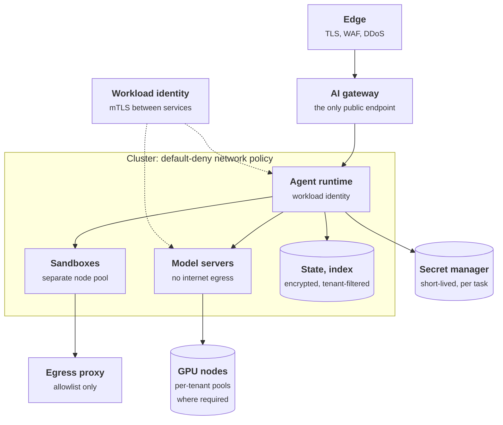
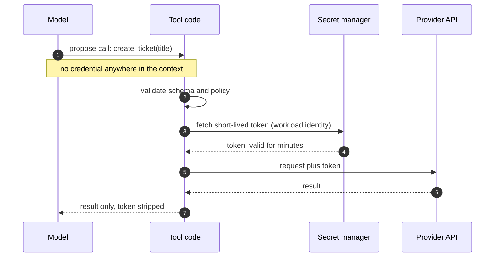
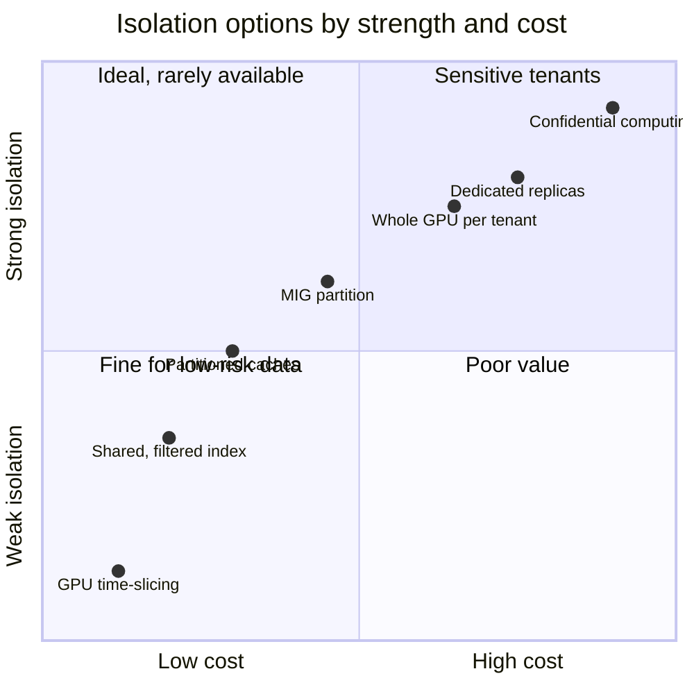

+++
title = 'Deployment and infrastructure'
description = 'Deployment security for AI is cloud and Kubernetes hardening applied to an unusual workload: valuable weights, shared GPUs, new kinds of state, and outbound requests chosen by a model.'
question = 'How do I isolate, harden, and protect the serving environment?'
weight = 5
difficulty = 3
prerequisites = ['/notes/ai-security-engineering/securing-each-stage/03-models-and-supply-chain', '/notes/ai-security-engineering/how-attacks-work/02-data-exfiltration-and-leakage']
date = 2026-04-23
lastmod = 2026-04-23
verified = 2026-04-23
+++

## The idea in one minute

Deployment security for AI is ordinary cloud and Kubernetes hardening applied to
an unusual workload. It holds very valuable assets (weights, prompts, customer
context). It runs on scarce, shared hardware (GPUs). It keeps state in places
classic services do not (KV caches, vector indexes). And when it is an agent,
it makes outbound connections that a model chose.

Four things need designing: **identity and secrets**, **network boundaries**,
**isolation between tenants**, and **protection of models and data in use**.
Almost every control at this stage is deterministic, which makes deployment the
most reliable place to bound the damage of a manipulated model.

## A picture



Sandboxes are marked as dangerous because they run code a model chose. The
gateway and the egress proxy are the two choke points everything else depends
on.

## How it really works

### Identity and secrets

**No long-lived keys.** Leaked credentials remain one of the most common ways AI
services are abused: a model API key in a repository, a notebook, a client-side
bundle, or an agent's configuration file, found and used to run up a bill or
read data.

| Rule | How |
| --- | --- |
| Provider keys exist only in the gateway | Applications receive gateway keys scoped to a project and a budget |
| Workloads authenticate as themselves | Workload identity (SPIFFE/SPIRE, cloud workload identity) instead of shared secrets; mutual TLS between services |
| Secrets are fetched at run time | From a secret manager; never baked into images, prompts, or committed environment files |
| Credentials are short-lived | Minutes to hours; rotation is automatic |
| Nothing secret enters a model context | Tools attach credentials in code, after the model has proposed the call |
| Leaks are assumed | Secret scanning in repositories and logs; provider-side spend limits; a practiced revocation procedure |

> [!IMPORTANT]
> The fifth rule is specific to AI and absolute: a credential in the context can
> be printed, sent, or logged by a manipulated model. The model names the
> action; code adds the authority.

Follow where the credential appears: only in the tool code's request, never in
anything the model reads or writes.



### Network boundaries

Start from deny-all and open only what is needed.

| Component | Inbound | Outbound |
| --- | --- | --- |
| **AI gateway** | The internet, through the edge | Model providers; internal model servers |
| **Agent runtime** | The gateway only | Gateway (for model calls), tool gateway, state stores |
| **Model servers** | Gateway and router only | **None.** Weights come from the internal registry |
| **Sandboxes** | Their controller only | An allowlist, through a proxy; never the cluster network or cloud metadata |
| **MCP servers** | The tool gateway only | The one system each fronts |
| **Data stores** | Named services only | None |
| **Training jobs** | None | Dataset and artifact stores |

The same table as a deployment: every arrow is an allowed connection, and
anything not drawn is denied.

```mermaid {title="Only drawn connections exist: everything else is default-deny"}
flowchart TB
  n_user["User"]
  n_provider["Model provider"]
  n_internet["Allowlisted sites"]
  subgraph g_cluster["Cluster"]
    n_gw["AI gateway"]
    n_agent["Agent runtime"]
    n_srv["Model servers"]
    n_tgw["Tool gateway"]
    n_db[("State stores")]
    n_sb["Sandbox"]
    n_proxy["Egress proxy"]
  end
  n_user --> n_gw
  n_gw --> n_provider
  n_gw --> n_srv
  n_agent --> n_gw
  n_agent --> n_tgw
  n_agent --> n_db
  n_agent --> n_sb
  n_sb --> n_proxy
  n_proxy --> n_internet
```

Three specifics deserve emphasis:

- **Block the cloud metadata endpoint** (169.254.169.254 on the major clouds, and
  `fd00:ec2::254` for IPv6 on AWS) from anything that runs model-chosen code or
  fetches model-chosen URLs. It hands out the node's cloud credentials. Where
  the cloud offers it, require the hardened version (AWS IMDSv2 needs a session
  token obtained with a PUT request, which most server-side request forgery
  cannot send) and set the response hop limit so containers cannot reach it.
- **Keep admin and debug interfaces private.** Inference servers, vector
  databases, notebooks, and cluster dashboards exposed to the internet are
  found by scanners quickly. Ray's job-submission API, which has no
  authentication by design, was exploited on internet-exposed clusters
  (tracked as CVE-2023-48022, which the vendor disputes as a vulnerability
  because exposure is a deployment choice).
- **Put inference engines behind the gateway.** Many engines have
  authentication off by default, or support only a single static API key.
  Their own HTTP port should never be reachable from outside the cluster.

### Isolation between tenants

A shared AI platform has more places for one tenant's data to meet another's
than a classic web service.

| Shared resource | Leak path | Isolation |
| --- | --- | --- |
| **Vector index** | A missing filter returns another tenant's chunks | Mandatory tenant filter enforced in the service layer and tested; separate collections for strict tenants |
| **Prompt (KV prefix) cache** | Faster responses reveal that someone else recently sent the same prefix | Per-tenant cache partitioning or salting |
| **Semantic or response cache** | One tenant receives another's answer | Never shared across tenants |
| **Batching in the engine** | Sequences from different tenants share a batch: isolated in principle, exposed by engine bugs | Dedicated replicas for tenants that require it |
| **GPU memory** | Residual data between workloads; side channels on shared devices | Whole-GPU allocation per tenant, or hardware partitioning (MIG) rather than time-slicing |
| **Sandboxes** | Kernel escape; shared file systems | One sandbox per task; gVisor or a microVM; separate node pool |
| **Logs and traces** | Engineers reading another tenant's prompts | Content logging off by default; per-tenant access control |
| **Fine-tuned adapters** | One tenant's adapter served to another | Adapter access bound to tenant identity at the router |

Two of these are documented, not hypothetical:

- **Prompt caching.** Gu et al. (2025) audited commercial LLM APIs with timing
  measurements and found several providers whose prompt cache was shared
  across users, so one user could detect another's recent prompt prefix.

  The timing side channel works in two requests; watch the response times.

  ```mermaid {title="A shared prefix cache answers faster for prefixes someone else sent"}
  sequenceDiagram
    autonumber
    participant V as Victim tenant
    participant C as Shared prefix cache
    participant A as Attacker tenant
    V->>C: prompt starting with a confidential prefix
    Note over C: prefix now cached
    A->>C: guess 1, a different prefix
    C-->>A: slow response (cache miss)
    A->>C: guess 2, the victim's prefix
    C-->>A: fast response (cache hit)
    Note over A: fast means someone recently sent this prefix
    opt Per-tenant partitioning or salting
      A->>C: guess 2 again
      C-->>A: slow, the attacker never shares the victim's cache
    end
  ```

- **GPU memory.** The LeftoverLocals vulnerability (Trail of Bits, January 2024,
  CVE-2023-4969) let a process on some Apple, AMD, and Qualcomm GPUs read
  another process's GPU local memory; the researchers used it to reconstruct
  an LLM's responses from a co-located process.

On NVIDIA data-center GPUs, **Multi-Instance GPU (MIG)** partitions a GPU into
instances with separate memory and compute, while **time-slicing** shares the
whole device between workloads with no memory isolation. For sensitive
tenants, use whole GPUs or MIG.

Decide tenancy tiers explicitly: **shared** (logical isolation, filters,
partitioned caches), **dedicated** (own replicas and node pools), and
**confidential** (hardware-enforced, below).

Placing the options on two axes shows why the choice is per tenant class: each
step up in isolation is also a step up in cost. Positions are qualitative.



### Protecting models and data in use

Encryption at rest and in transit is the baseline. Data **in use**, meaning
prompts and weights in memory during inference, is exposed to whoever controls
the host: the cloud operator, a compromised hypervisor, an administrator.

**Confidential computing** closes that gap with hardware:

- A **trusted execution environment**, such as a confidential VM on AMD SEV-SNP
  or Intel TDX, encrypts memory so the host cannot read it.
- **Confidential GPUs** extend this to the accelerator. NVIDIA introduced
  confidential computing with the Hopper (H100) generation: the GPU runs in a
  protected mode and transfers between CPU and GPU are encrypted.
- **Attestation** is what makes it useful. The hardware signs a measurement of
  what was loaded (firmware, kernel, container image, GPU state), and a
  key-release service hands over the model decryption key or the tenant's data
  key only if the measurement matches an approved value.
- **Confidential Containers**, a CNCF project, brings the pattern to Kubernetes
  pods.

Attestation-gated key release, step by step: the key moves only after the
measurement checks out.

```mermaid {title="The model key is released only to an attested environment"}
sequenceDiagram
  autonumber
  participant HW as TEE and confidential GPU
  participant W as Serving workload
  participant KRS as Key-release service
  participant KMS as KMS
  W->>HW: request attestation report
  HW-->>W: signed measurement (firmware, kernel, image, GPU state)
  W->>KRS: report plus key request
  KRS->>KRS: verify signature, compare with approved values
  alt Measurement matches
    KRS->>KMS: unwrap model key
    KMS-->>KRS: key
    KRS-->>W: key, sent into encrypted memory only
    W->>W: decrypt weights inside the TEE
  else Mismatch (modified image or debug mode)
    KRS-->>W: refuse, weights stay encrypted
  end
```

Published benchmarks of H100 confidential mode report modest overhead for
typical LLM inference, mostly from encrypting CPU-to-GPU transfers; the larger
cost is operational complexity. Use it where the threat model includes the
infrastructure operator: regulated data, a customer who will not trust your
cloud, or weights valuable enough to protect from your own administrators.

### Hardening the workloads

The Kubernetes basics apply and matter more than usual:

- **Pod security**: run as non-root with a read-only root file system, dropped
  capabilities, and no privileged containers (the Kubernetes "restricted" Pod
  Security Standard). GPU device access needs careful, minimal grants.
- **Admission policy**: only signed images and models from the internal
  registry; no `latest` tags; resource limits required.
- **Separate node pools** for sandboxes, serving, data, and system workloads,
  so a sandbox escape lands on a node with nothing valuable.
- **Patch the GPU stack.** Drivers, container toolkits, and inference engines
  run with high privilege and have had serious vulnerabilities. The NVIDIA
  Container Toolkit, for example, has had container-escape flaws
  (CVE-2024-0132 in 2024 and CVE-2025-23266 in 2025) that let a crafted
  container image gain access to the host.
- **Runtime detection**: eBPF-based tools such as Falco and Tetragon alert on
  unexpected processes, file access, or network connections in serving and
  agent pods. A model server that starts a shell is an incident.
- **Infrastructure as code**, reviewed, with drift detection.

### Protecting the weights

For proprietary or fine-tuned models, the weights are the crown jewels, and they
are simply large files. RAND's 2024 study of securing model weights catalogs
dozens of attack vectors, from stolen credentials to insider access to supply
chain compromise; most are ordinary infrastructure attacks.

- Encrypt at rest with keys in a KMS; restrict who and what can read the
  registry.
- Serving pods mount weights read-only and have no route out of the cluster.
- Alert on unusually large reads or transfers from model storage.
- Limit what the API exposes. Carlini et al. (2024) recovered the final
  projection layer of production models through an API that returned
  log-probabilities and accepted logit bias; full log-probabilities and
  unlimited query volume make extraction and distillation easier.
- For the highest sensitivity: attestation-gated key release, so weights
  decrypt only inside an approved environment.

### A deployment checklist

- One public endpoint: the gateway. Engines, vector stores, and admin UIs are
  private.
- No provider keys outside the gateway; no secrets in prompts, images, or
  repositories.
- Workload identity and mutual TLS between services.
- Default-deny network policy; model servers and data stores have no internet
  egress.
- Sandboxes on their own nodes, with allowlisted egress and no metadata access.
- Tenant isolation defined per shared resource, including caches.
- Only signed images and models from the internal registry, by digest.
- Drivers, engines, and toolkits on a patch schedule.
- Runtime detection on serving, agent, and sandbox pods.
- Weights encrypted, access-logged, with transfer alerts.

## Code

When an agent fetches URLs, the decision must be made on the **address actually
connected to**, not on the URL text. This program checks the same requests two
ways: a naive string blocklist, and a guard that resolves the host and checks
every resulting IP before connecting. The network is a simulated table, so
nothing leaves the machine; name resolution uses the local resolver, which
turns IP literals and `localhost` into addresses without any DNS traffic.

```python {title="egress.py"}
"""egress.py: decide on the address actually being connected to, not the URL text.

A manipulated agent asks for URLs. Each is checked twice: by a naive string
blocklist, and by a guard that resolves the host and checks every resulting IP
before connecting. The "network" is a simulated table of services, so nothing
leaves this machine; name resolution uses the local resolver, which turns IP
literals and "localhost" into addresses without any DNS traffic.
"""
import ipaddress
import socket
from urllib.parse import urlsplit

# Simulated services reachable from the agent's pod: (ip, port) -> response.
NETWORK = {
    ("127.0.0.1", 3128): "egress proxy: request forwarded",
    ("127.0.0.1", 8080): "internal admin: here are the secrets",
    ("169.254.169.254", 80): "metadata: temporary cloud credentials",
}
ALLOWED = {("127.0.0.1", 3128)}  # the only approved destination


class Blocked(Exception):
    pass


def block_reason(ip: str, port: int) -> str | None:
    """Return why this destination is blocked, or None if it is approved."""
    addr = ipaddress.ip_address(ip)
    if isinstance(addr, ipaddress.IPv6Address) and addr.ipv4_mapped:
        addr = addr.ipv4_mapped  # ::ffff:a.b.c.d is really a.b.c.d
    if (str(addr), port) in ALLOWED:
        return None
    if addr.is_link_local:
        return "link-local (cloud metadata)"
    if addr.is_loopback:
        return "loopback"
    if addr.is_private:
        return "private"
    return "not on the egress allowlist"


def connect(ip: str, port: int) -> str:
    """Stand-in for opening a socket to an already-checked address."""
    addr = ipaddress.ip_address(ip)
    if isinstance(addr, ipaddress.IPv6Address) and addr.ipv4_mapped:
        ip = str(addr.ipv4_mapped)
    return NETWORK.get((ip, port), "connection refused")


def guarded_get(url: str) -> str:
    parts = urlsplit(url)
    port = parts.port or 80
    infos = socket.getaddrinfo(parts.hostname, port, type=socket.SOCK_STREAM)
    for *_, sockaddr in infos:  # every address the name resolves to must pass
        if reason := block_reason(sockaddr[0], port):
            raise Blocked(f"{sockaddr[0]} is {reason}")
    return connect(infos[0][4][0], port)  # use the checked address, no second lookup


def naive_blocks(url: str) -> bool:
    return any(s in url for s in ("169.254.169.254", "localhost", "127.0.0.1:8080"))


if __name__ == "__main__":
    requests = [
        ("approved proxy", "http://127.0.0.1:3128/"),
        ("internal admin", "http://127.0.0.1:8080/admin"),
        ("internal admin, by name", "http://localhost:8080/admin"),
        ("internal admin, 127.1", "http://127.1:8080/admin"),
        ("metadata", "http://169.254.169.254/latest/meta-data/"),
        ("metadata, decimal", "http://2852039166/latest/meta-data/"),
        ("metadata, hex", "http://0xA9FEA9FE/latest/meta-data/"),
        ("metadata, IPv4-mapped", "http://[::ffff:169.254.169.254]/latest/"),
        ("metadata, IPv6 address", "http://[fd00:ec2::254]/latest/"),
    ]
    for label, url in requests:
        naive = "block" if naive_blocks(url) else "allow"
        try:
            result = "allowed -> " + guarded_get(url)
        except Blocked as e:
            result = f"BLOCKED: {e}"
        print(f"{label:<24} naive: {naive:<5}  guard: {result}")
```

Run it with `python3 egress.py` (output from macOS; the address `localhost`
resolves to first can differ by platform):

```text
approved proxy           naive: allow  guard: allowed -> egress proxy: request forwarded
internal admin           naive: block  guard: BLOCKED: 127.0.0.1 is loopback
internal admin, by name  naive: block  guard: BLOCKED: ::1 is loopback
internal admin, 127.1    naive: allow  guard: BLOCKED: 127.0.0.1 is loopback
metadata                 naive: block  guard: BLOCKED: 169.254.169.254 is link-local (cloud metadata)
metadata, decimal        naive: allow  guard: BLOCKED: 169.254.169.254 is link-local (cloud metadata)
metadata, hex            naive: allow  guard: BLOCKED: 169.254.169.254 is link-local (cloud metadata)
metadata, IPv4-mapped    naive: block  guard: BLOCKED: ::ffff:169.254.169.254 is link-local (cloud metadata)
metadata, IPv6 address   naive: allow  guard: BLOCKED: fd00:ec2::254 is private
```

The naive blocklist lets four of the eight bad requests through. `2852039166`
and `0xA9FEA9FE` are the metadata address written as one decimal and one
hexadecimal number, which common resolvers accept. The guard catches all of
them because it never looks at the spelling, only at the resolved address, and
it connects to the address it checked rather than resolving the name again
(which would let a DNS server answer differently the second time, a **DNS
rebinding** attack).

The two checks side by side: the naive one reads the spelling, the guard reads
the address it will actually use.

```mermaid {title="Check the resolved address, then connect to that same address"}
flowchart LR
  U("URL from the model")
  N@{ shape: diam, label: "Naive: blocked<br/>string in URL?" }
  NA["<b>Allowed</b><br/><small>4 of 8 bad requests</small>"]
  R["<b>Resolve host</b><br/><small>getaddrinfo, once</small>"]
  C@{ shape: diam, label: "Every IP<br/>allowed?" }
  B["<b>Blocked</b><br/><small>loopback, private,<br/>link-local</small>"]
  K["<b>Connect to the<br/>checked IP</b><br/><small>no second lookup</small>"]
  U --> N
  N -->|"no match"| NA
  U --> R --> C
  C -->|"no"| B
  C -->|"yes"| K
  class NA warn
  class R,C,K,B good
```

## Where it breaks

- **This belongs in the network, not only in the app.** A guard inside the
  agent's process protects only the code paths that call it. A subprocess, a
  library with its own HTTP client, or code the model writes in a sandbox
  bypasses it. Enforce the same rule in a network policy and an egress proxy
  (Stripe's open-source Smokescreen is one proxy built for this), and use the
  in-process check as a second layer.
  [Sandboxing and egress](/notes/ai-security-engineering/securing-agents/04-sandboxing-and-egress/) covers
  the agent side in depth.
- **Proxies change what "the address" is.** A client configured with an HTTP
  proxy connects to the proxy, so a connection-time check sees only the proxy's
  address. The proxy must then apply the destination rules itself.
- **Connecting to a raw IP breaks HTTPS.** Real clients need the hostname for
  SNI and certificate validation. Production code pins the checked address in
  a custom resolver or dial hook while keeping the hostname for TLS, which is
  more involved than this sketch.
- **Redirects restart the problem.** An allowed host can redirect to a blocked
  one. Every hop must pass the same check, or redirects must be disabled.

  Drawn out, the redirect bypass looks like this:

  ```mermaid {title="A redirect skips a check that ran only on the first hop"}
  sequenceDiagram
    autonumber
    participant A as Agent fetch
    participant G as Egress guard
    participant S as Allowed host
    participant MD as Metadata endpoint
    A->>G: GET allowed host
    G->>G: resolved address passes
    G->>S: connect
    S-->>A: 302 to 169.254.169.254
    alt Client follows redirects itself
      A->>MD: GET, no check on this hop
      MD-->>A: cloud credentials
    else Every hop goes back through the guard
      A->>G: GET 169.254.169.254
      G-->>A: blocked, link-local
    end
  ```
- **Isolation tiers cost money.** Dedicated GPUs and confidential computing are
  real expenses. The decision should be written down per tenant class, with
  the threat it addresses, rather than defaulted either way.

## Remember this

- Credentials are short-lived, scoped, and never in a model's context.
- Default-deny networking; model servers need no internet, sandboxes need an
  allowlist.
- Block cloud metadata from anything that runs model-chosen code or requests,
  and decide on the resolved address.
- Caches, indexes, and GPU memory are tenant-isolation boundaries, not just
  performance features.
- Confidential computing protects data in use, and depends on attestation.
- Inference engines and GPU tooling are privileged software: keep them private
  and patched.

## Try it

1. Run `egress.py`. Add `http://[::1]:8080/admin` and `http://0177.0.0.1:8080/`.
   What does each resolve to on your machine? Some resolvers read `0177` as
   octal (127) and others as decimal (177). Why does connecting to the checked
   address make that disagreement harmless here, and dangerous in a guard that
   checks one way and lets a different HTTP library connect?
2. Draw the network table for a system you run. Which component has egress it
   does not need?
3. List every cache in your stack and state its tenant scope.
4. Decide which, if any, of your tenants or datasets justify dedicated or
   confidential tiers, and why.

## Check yourself

1. Why must credentials never appear in a model's context?

   
   Anything in the context can be repeated, encoded, or sent out by a model
   that has been manipulated, and it ends up in logs and traces. Tools should
   attach credentials in code after the model proposes a call, so the model
   chooses the action but never holds the authority.
   

2. How can a shared prefix cache leak information between tenants?

   
   A cached prefix is served faster than an uncached one. If the cache is
   shared, an attacker can send candidate prefixes and measure response time:
   a fast response means someone else recently sent that prefix. Partitioning
   or salting the cache per tenant removes the signal.
   

3. What does attestation add to memory encryption?

   
   Memory encryption keeps the host from reading the workload, but on its own
   you cannot know what is running inside. Attestation is a hardware-signed
   measurement of the loaded firmware, kernel, image, and GPU state. Keys for
   the model or the tenant's data are released only when that measurement
   matches an approved value, so secrets reach only the environment you
   intended.
   

4. Why does the guard in `egress.py` connect to the address it checked instead
   of passing the hostname to the HTTP client?

   
   If the client resolved the name again, a malicious DNS server could return
   a safe address for the check and an internal one for the connection (DNS
   rebinding). Using the checked address closes that gap between the time of
   check and the time of use.
   

## Sources

- Amazon Web Services, [Add defense in depth against open firewalls, reverse proxies, and SSRF vulnerabilities with enhancements to the EC2 Instance Metadata Service](https://aws.amazon.com/blogs/security/defense-in-depth-open-firewalls-reverse-proxies-ssrf-vulnerabilities-ec2-instance-metadata-service/), November 2019.
- Gu et al., [Auditing Prompt Caching in Language Model APIs](https://arxiv.org/abs/2502.07776), 2025.
- Trail of Bits, [LeftoverLocals: Listening to LLM responses through leaked GPU local memory](https://blog.trailofbits.com/2024/01/16/leftoverlocals-listening-to-llm-responses-through-leaked-gpu-local-memory/), January 2024.
- NVIDIA, [Multi-Instance GPU user guide](https://docs.nvidia.com/datacenter/tesla/mig-user-guide/).
- NIST National Vulnerability Database: [CVE-2024-0132](https://nvd.nist.gov/vuln/detail/CVE-2024-0132), [CVE-2025-23266](https://nvd.nist.gov/vuln/detail/CVE-2025-23266), [CVE-2023-48022](https://nvd.nist.gov/vuln/detail/CVE-2023-48022).
- Zhu et al., [Confidential Computing on NVIDIA Hopper GPUs: A Performance Benchmark Study](https://arxiv.org/abs/2409.03992), 2024.
- [Confidential Containers](https://confidentialcontainers.org/), CNCF project.
- Kubernetes, [Pod Security Standards](https://kubernetes.io/docs/concepts/security/pod-security-standards/).
- Nevo et al., [Securing AI Model Weights: Preventing Theft and Misuse of Frontier Models](https://www.rand.org/pubs/research_reports/RRA2849-1.html), RAND, 2024.
- Carlini et al., [Stealing Part of a Production Language Model](https://arxiv.org/abs/2403.06634), ICML, 2024.
- [SPIFFE](https://spiffe.io/) and [Smokescreen](https://github.com/stripe/smokescreen).
