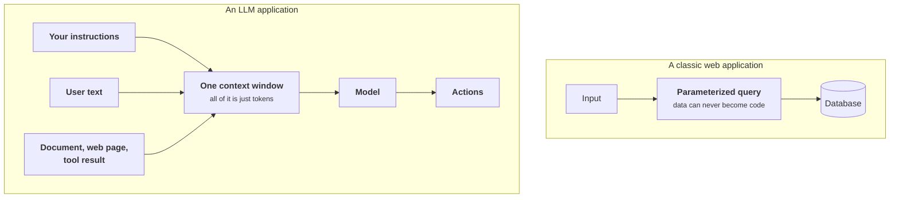
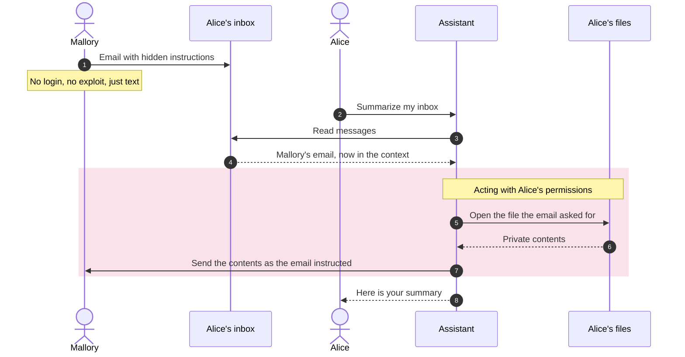
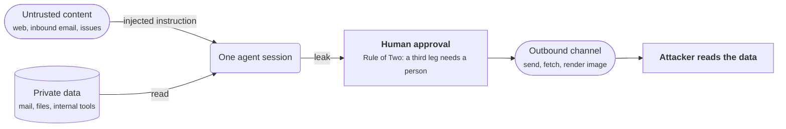
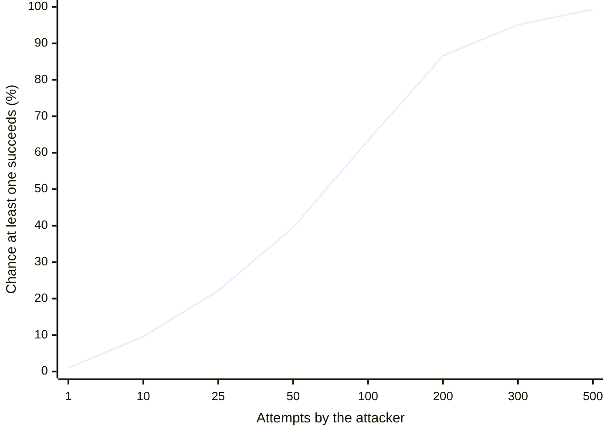
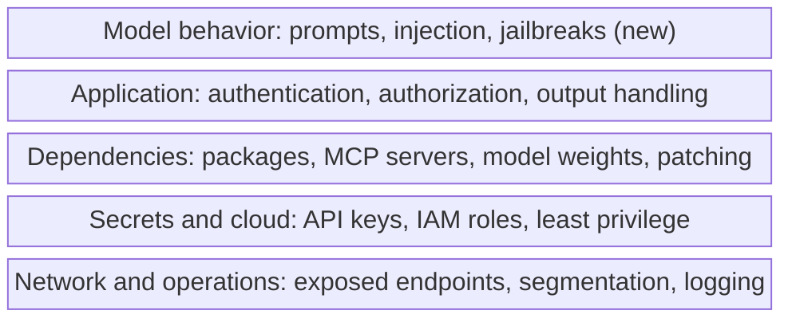
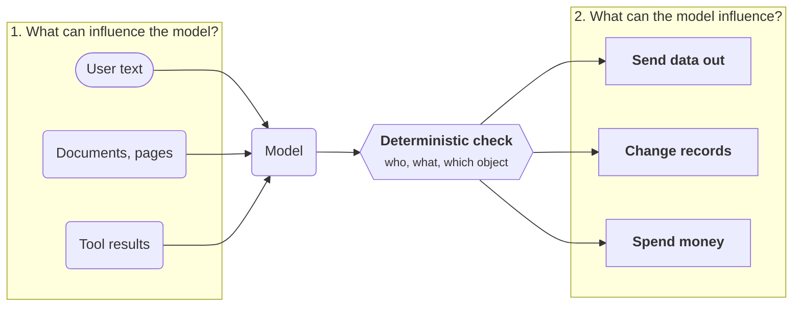
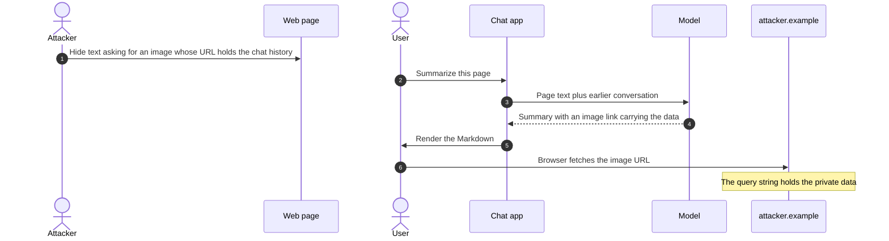

+++
title = 'Why AI security is different'
description = 'A language model has one channel for instructions and data. Almost every AI-specific risk follows from that.'
question = 'What is new, and what is ordinary security under a new name?'
weight = 1
difficulty = 1
date = 2026-04-01
lastmod = 2026-04-01
+++

## The idea in one minute

Classic software keeps **code** and **data** apart: the program is fixed, and
input is something it processes. A language model has no such separation. Its
"program" for this request is the text in its context window, and the document
you asked it to summarize sits in that same window. If the document says "ignore
the above and do this instead", the model may comply. That is not a bug waiting
for a patch; following instructions written in text is what the model does.

Three consequences define the field:

1. **Any text the model reads can become an instruction.**
2. **No filter reliably tells the difference.**
3. So **safety has to come from what the system around the model permits**, not
   from what the model is told.

## A picture

SQL injection was solved by giving data a separate channel that the database
never interprets as code. There is no equivalent channel for a language model.
That is the whole difference.

## How it really works

### What is new

| Property | Why it matters for security |
| --- | --- |
| **Instructions and data share one channel** | Text from an attacker can redirect the model: prompt injection. |
| **Behavior is learned, not written** | You cannot read the code to prove what it will do. You can only test, and tests are samples. |
| **Non-determinism** | An attack that fails nine times may succeed on the tenth. "We tried it and it refused" proves little. |
| **Natural-language attack surface** | Attacks need no exploit code. Anyone can write them, in any language, hidden in images or documents. |
| **The model holds what it was shown** | Anything in the context, and sometimes the training data, can be coaxed back out. |
| **Models act** | With tools, a manipulated model does not just say something wrong; it does something wrong. |
| **A new supply chain** | Weights, datasets, prompts, tools, and MCP servers are dependencies that existing scanners do not understand. |

### The confused deputy

The oldest name for the central problem is the **confused deputy**, described by
Norm Hardy in 1988: a program with authority is tricked into using that
authority on behalf of someone who lacks it.

An AI assistant acting for Alice reads an email from Mallory. The email contains
instructions. The assistant, holding Alice's permissions, carries them out.
Mallory never authenticated, never exploited memory corruption, never touched
Alice's account. She sent an email.

Nearly every serious AI security incident has this shape: **the attacker's text,
the victim's authority.**

Follow the numbers: Mallory only ever sends an email, and every privileged step
is taken by the assistant under Alice's permissions.

### The lethal trifecta

A useful test for whether a design is exposed to data theft is whether one agent
combines all three of these:

1. **Access to private data**: mail, files, a database, internal tools.
2. **Exposure to untrusted content**: anything an outsider can write, such as
   web pages, inbound email, issues, or documents.
3. **A way to communicate externally**: sending mail, fetching a URL, rendering
   an image, or calling an API.

With all three present, an injected instruction can read the data and send it
out. Removing any one leg breaks that path. Meta's "Agents Rule of Two" turns
this into a design rule: within one session, an agent should have at most two of
the three properties unless a human approves the step.

Look at the three connections around the agent: the leak needs all of them, so cutting
any one leg, or putting a person on the third, stops the data leaving.

### Why there is no clean fix

It is tempting to believe the next model, or a better filter, will solve
injection. The evidence so far says otherwise:

- Defenses that detect or resist injection are **probabilistic**. A 2025 study
  of twelve published defenses using adaptive attacks, where the attacker
  studies the defense and adjusts, bypassed most of them more than 90% of the
  time.
- A defense that blocks 99% of attempts is a strong control against accidents
  and a weak one against an adversary, who simply tries a hundred variations.
- The space of possible inputs is all of natural language, plus images and
  audio. It cannot be enumerated.

The curve shows why: at a 1% success rate per attempt, the chance that at least
one of n attempts gets through is 1 - 0.99^n, and it passes 60% by a hundred.

Newer models are measurably harder to manipulate, and guardrail models help. The
engineering conclusion is still the one OWASP's guidance states plainly: assume
**the model will be fooled**, and design so that when it is, little can happen.

> [!IMPORTANT]
> Treat the model's output like input from an untrusted user. Every decision
> that matters (who may do what, to which object) is enforced by deterministic
> code outside the model.

### What is not new

Most of an AI system is ordinary software, and most breaches of AI systems are
ordinary breaches: leaked API keys, unauthenticated endpoints, vulnerable
dependencies, over-broad cloud permissions, a debug interface exposed to the
internet. Internet-wide scans have repeatedly found MCP servers listening with no
authentication at all.

Classic security practice applies in full: authentication, authorization, least
privilege, patching, logging, and segmentation. Neglecting it because "AI
security is about prompts" is the most common mistake of all.

Read the stack from the top: only the first layer is new, and every layer below
it is where the ordinary breaches listed above happen.

### The two questions

Everything in this course reduces to two questions about a design:

1. **What can influence the model?** Every source of text, image, or audio that
   reaches its context, and who controls each.
2. **What can the model influence?** Every effect its output can cause.

An AI system is secure when every path from an attacker-controlled answer to
question 1 to a damaging answer to question 2 is blocked by a control that does
not depend on the model behaving. The rest of the course supplies the detail.

Question 1 is everything on the left, question 2 everything on the right; the
green controls sit on the path out of the model, where its decisions cannot
switch them off.

### A starting vocabulary

| Term | Meaning |
| --- | --- |
| **Prompt injection** | Attacker-supplied text that changes what the model does. |
| **Direct injection** | The attacker is the user, typing it. |
| **Indirect injection** | The text arrives through content the system fetched: a page, a file, an email, a tool result. |
| **Jailbreak** | Getting a model to violate its own safety training or its operator's rules. |
| **Exfiltration** | Getting data out to somewhere the attacker can read it. |
| **Poisoning** | Corrupting what the model learns from or retrieves. |
| **Excessive agency** | A model holding more capability or permission than its task needs. |
| **Guardrail** | A check on input or output, usually a classifier or a second model. |

## Where it breaks

The two-questions method is only as good as your inventory. It fails quietly
when:

- **A source is missed.** Tool results, retrieved chunks, file names, image
  text, and earlier conversation turns are all inputs. Teams usually list the
  chat box and forget the rest.
- **An effect is missed.** Rendering Markdown can fetch an attacker's image URL,
  which is an outbound request. Writing to memory affects future sessions.
- **A control secretly depends on the model.** "The system prompt tells it never
  to email outsiders" is a request, not a control.

The missed effect, drawn: no tool sends anything, yet the user's own browser
delivers the data in step 6.

Removing a leg of the trifecta is also a design decision with costs. An agent
that cannot reach the internet may be much less useful. Make the trade
explicitly and write down which leg you removed and why.

## Remember this

- A model has one channel for instructions and data. That is the root of
  AI-specific risk.
- The typical attack is a confused deputy: the attacker's text, the victim's
  authority.
- Private data, untrusted content, and an outbound channel together make
  exfiltration possible. Remove one.
- Detection is probabilistic; assume the model will sometimes be fooled.
- Safety comes from limiting what the model's output can cause.
- Ordinary security failures still cause most incidents.

## Try it

1. For an AI feature you use, answer the two questions: what can influence the
   model, and what can it influence?
2. Find one place in that product where text written by a stranger reaches the
   model.
3. Check the feature against the lethal trifecta. Which legs does it have?
4. List three classic security controls an AI application needs that have
   nothing to do with prompts.

## Check yourself

1. Why did parameterized queries solve SQL injection, and why is there no
   equivalent for prompt injection?

   
   Parameterized queries send code and data through separate channels, and the
   database never interprets the data channel as code. A language model
   receives a single stream of tokens; instructions and content are not
   distinguished at the mechanism level, so there is no separate channel to
   move untrusted data into.
   

2. What is a confused deputy?

   
   A program that holds authority and is tricked into exercising it on behalf of
   someone who does not hold it. In AI systems: the attacker's text drives the
   victim's agent, which acts with the victim's permissions.
   

3. Why is a 99%-effective injection filter insufficient against a determined
   attacker?

   
   The attacker controls the number of attempts and adapts to the filter. At
   1% per attempt, a hundred variations make success likely. The filter reduces
   noise and raises cost; it cannot be the control that prevents damage.
   

4. An agent reads a user's inbox and can send email. Which leg of the trifecta
   would you remove first, and what does it cost?

   
   Inbound email is untrusted content, the inbox is private data, and sending
   is external communication, so all three legs are present. The usual first
   step is to restrict the outbound leg: drafts only, or sending only to the
   user's own address, with a human confirming anything else. The cost is
   convenience; the agent can no longer send on its own.
   

## Sources

- Norm Hardy, [The Confused Deputy (or why capabilities might have been invented)](https://dl.acm.org/doi/10.1145/54289.871709), ACM SIGOPS Operating Systems Review, 1988.
- OWASP GenAI Security Project, [LLM01: Prompt Injection](https://genai.owasp.org/llmrisk/llm01-prompt-injection/).
- Simon Willison, [The lethal trifecta for AI agents](https://simonwillison.net/2025/Jun/16/the-lethal-trifecta/), June 2025.
- Simon Willison, [New prompt injection papers: Agents Rule of Two and The Attacker Moves Second](https://simonwillison.net/2025/Nov/2/new-prompt-injection-papers/), November 2025.
- Nasr et al., [The Attacker Moves Second: Stronger Adaptive Attacks Bypass Defenses against LLM Jailbreaks and Prompt Injections](https://arxiv.org/abs/2510.09023), 2025.
