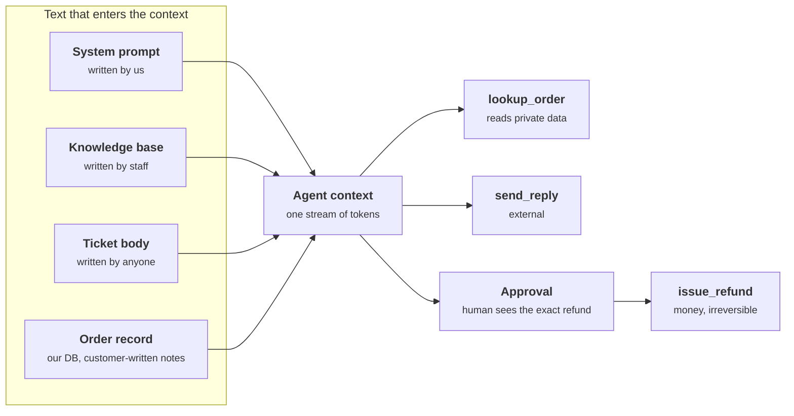
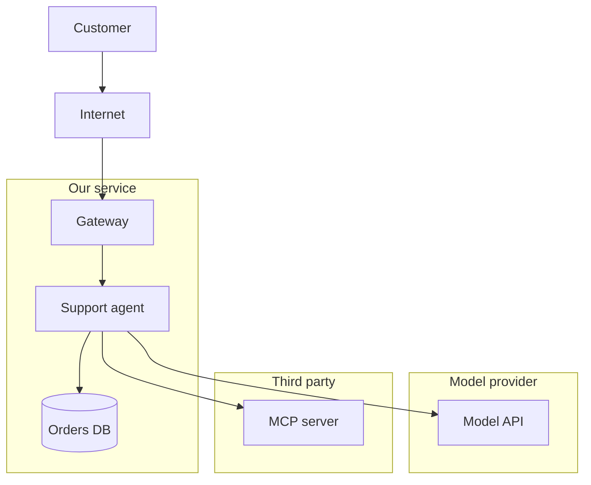
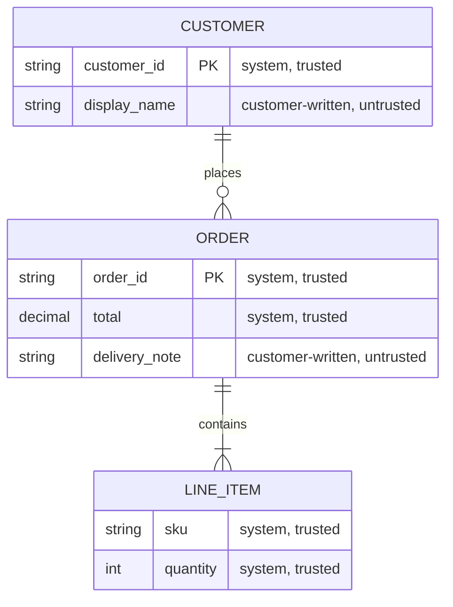
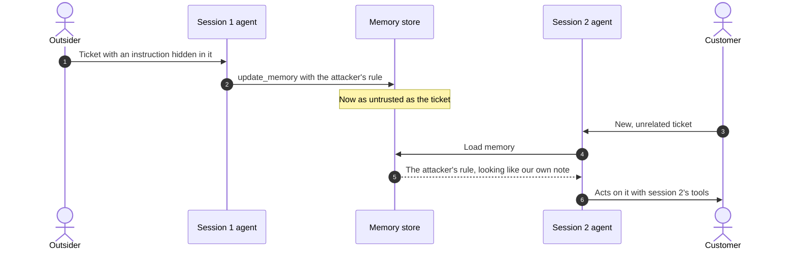
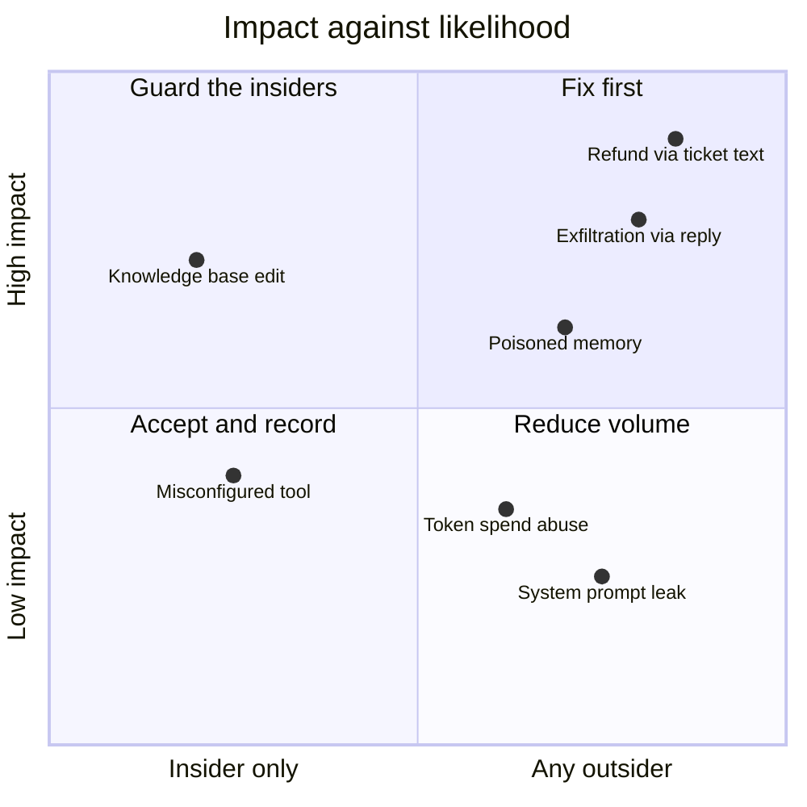

+++
title = 'Threat modeling an AI system'
description = 'Classic threat models follow data. For an AI system you also follow influence: which text can steer which model, and what that model can then do.'
question = 'How do I find what can go wrong in a specific design?'
weight = 2
difficulty = 2
prerequisites = ['/notes/ai-security-engineering/threat-landscape/01-why-ai-security-is-different']
date = 2026-04-03
lastmod = 2026-04-03
verified = 2026-04-03
+++

## The idea in one minute

A threat model is a structured answer to four questions: **what are we working
on, what can go wrong, what are we going to do about it, and did we do a good
enough job?** That method carries over to AI systems with one adaptation.
Classic models follow **data flows**. For an AI system you must also follow
**influence flows**: which text can steer which model, and what that model can
then cause.

The procedure is mechanical. Draw the system. For every model context, list
each source of text and who controls it. List every effect the model can cause.
Then connect them: **every path from text an attacker controls to an effect that
matters is a threat.** The fix for each one is architectural, not a better
prompt.

## A picture



Every line from a red source to an effect is a candidate threat. The approval
gate is the only box on the refund path that does not depend on the model
behaving.

## How it really works

### Step 1: draw the system

Draw one diagram with every component that touches a model: where prompts are
assembled, each model call, each tool, each store (documents, vectors, memory,
logs), and each external service. Then draw **trust boundaries**, the lines
where control changes hands:

- the internet to your gateway,
- your service to a third-party model API,
- your agent to a third-party MCP server or plugin,
- one tenant's data to another's,
- one agent to another, when one agent's output becomes another's input.

Mark each **model context** separately. Two calls to the same model with
different inputs and tools are two contexts with two different risk profiles.

Each group below is a trust boundary; every edge that crosses one is a place
where control changes hands and deserves a line in the threat model.



### Step 2: list the assets

| Asset | Examples |
| --- | --- |
| **Data** | Customer records, source code, documents in the retrieval corpus, conversation history. |
| **Credentials** | Model API keys, tool tokens, cloud roles reachable from the agent's runtime. |
| **Actions** | Anything a tool can do that costs money, sends information, or cannot be undone. |
| **Compute** | GPU time and API spend an attacker can consume. |
| **The model itself** | Proprietary weights, system prompts, and the trust users place in its output. |
| **Availability** | The service staying up and affordable. |

### Step 3: list the actors

| Actor | Can do | Typical goal |
| --- | --- | --- |
| **Malicious user** | Type anything; upload files. | Jailbreak, extract the system prompt, abuse free compute, reach other users' data. |
| **Outsider with no account** | Publish a web page, send an email, open a ticket, file a pull request. | Indirect injection: act with a victim's authority. |
| **Supplier** | Publish a model, dataset, package, or MCP server that you install. | Backdoor, credential theft, persistence. |
| **Insider** | Edit prompts, corpora, training data, configuration. | Sabotage, data theft. |
| **Another tenant** | Share your infrastructure, caches, or indexes. | Cross-tenant leakage. |
| **Honest mistake** | Ask for the wrong thing; misconfigure a tool. | No goal, but a frequent cause of damage when an agent holds too much authority. |

The outsider row is the one classic models miss. **They never log in, yet their
text reaches your model.** In a data-flow diagram, an inbound email is "data
from the mail server". In an influence diagram, it is "instructions from
whoever sent it".

Notice which arrows pass through the login box and which go around it: the
outsider's path never touches authentication at all.

```mermaid {title="Every actor reaches the model context, only some through login"}
flowchart LR
  MU(["Malicious user"])
  OUT(["Outsider, no account"])
  SUP("Supplier")
  INS(["Insider"])
  TEN("Another tenant")
  LOGIN["<b>Login</b><br/><small>authenticated session</small>"]
  CTX["<b>Model context</b>"]
  MU --> LOGIN --> CTX
  OUT -->|"email, ticket, web page"| CTX
  SUP -->|"model, package, MCP server"| CTX
  INS -->|"prompts, corpus, config"| CTX
  TEN -->|"shared cache or index"| CTX
  class LOGIN good
  class CTX compute
```

### Step 4: trace influence

For each model context, fill in a table of sources and effects. Here is the
support agent from the picture:

| Text source | Controlled by | Trust |
| --- | --- | --- |
| System prompt | Us | Trusted |
| Ticket body | Whoever opened the ticket | **Untrusted** |
| Order record | Our database, but the delivery note is customer-written | **Untrusted** |
| Knowledge base | Support staff | Trusted, if you have checked who can edit it |
| Memory | Earlier sessions | As trusted as anything that could write to it |

| Effect | Class |
| --- | --- |
| `lookup_order` | Read: private data |
| `send_reply` | Send: external |
| `issue_refund` | Write: irreversible, money |
| `update_memory` | Write: persists into later sessions |

Two rules make this table honest:

- **Trust is per field, not per system.** A record from your own database is
  untrusted if any field in it was typed by a customer.
- **Trust propagates through stores.** Memory, caches, and the retrieval index
  are only as trustworthy as the least trusted thing that can write to them.

Per field, drawn as a data model: the order lives in our database, but the
comment on each attribute says who actually wrote it.



Propagation over time: the injected text is gone after session 1, but what it
wrote to memory is read as context by session 2.



Then ask, for every untrusted source and every effect: **can this text cause
that effect?** In the example, customer-written text shares a context with
`issue_refund` and `send_reply`. The combination of untrusted text, private
data, and an external send is the exfiltration pattern from
[Why AI security is different](/notes/ai-security-engineering/threat-landscape/01-why-ai-security-is-different/).
Those paths are the threats to mitigate first.

### Step 5: enumerate what can go wrong

**STRIDE**, the checklist Loren Kohnfelder and Praerit Garg introduced at
Microsoft in 1999, still works when each letter is read with the model in mind:

| STRIDE | In an AI system |
| --- | --- |
| **Spoofing** | An agent or MCP server claiming an identity it does not have; text inside the context impersonating the system or the user. |
| **Tampering** | Poisoned training data, corpus, memory, or tool descriptions; modified weights. |
| **Repudiation** | No record of which agent did what for whom, or of what was in its context at the time. |
| **Information disclosure** | Exfiltration through tool calls or rendered links; system-prompt and cross-tenant leakage; training-data extraction. |
| **Denial of service** | Unbounded token consumption; agent loops; denial of wallet. |
| **Elevation of privilege** | Injection that makes the model use its authority for the attacker; excessive agency. |

Use STRIDE to make sure you asked every kind of question, then go back to the
influence table to find where each answer applies.

### Step 6: rate and decide

Rate each threat on **impact** (what is lost) and **likelihood** (who can
trigger it: any anonymous outsider, or only an authenticated insider?).

Plotting the support agent's threats this way puts everything an anonymous
outsider can reach on the right; the top-right corner is the work to do first.



For AI threats, add a third question that changes priorities sharply:

> [!IMPORTANT]
> Is the mitigation **deterministic** or **probabilistic**? A high-impact threat
> mitigated only by "the model was told not to" or "a classifier usually catches
> it" is not mitigated.

A high-impact threat needs at least one control from this list, each of which
works no matter what the model decides:

| Control | Example |
| --- | --- |
| **Remove the capability** | The agent has no refund tool; refunds go to a staff queue. |
| **Remove the data** | The lookup returns only the requester's own orders. |
| **Remove the path** | The context that reads tickets is not the context that can send email. |
| **Bound it** | Scoped, short-lived credentials; refund ceiling; sandbox; egress allowlist. |
| **Gate it** | A human approves the exact action, with the exact arguments shown. |
| **Make it reversible** | Drafts instead of sends, branches instead of merges, soft delete. |

Probabilistic controls (classifiers, judge models, prompt hardening) still have
a place. They cut volume and catch the unsophisticated, but they sit in front
of a deterministic control, not instead of one.

### Step 7: write it down and keep it alive

A threat model is a short document: the diagram, one influence table per
context, the ranked threats with the control for each, and the accepted
residual risks, each with a named owner. Revisit it whenever the system changes
in one of these ways:

- a **new tool** or MCP server,
- a **new source** of context text,
- a **new store** the model can write,
- a change in **whose authority** the agent acts with,
- a move toward **more autonomy** (fewer approvals, longer unattended runs).

Adding a tool is the most common way a safe system becomes an unsafe one. A
harmless summarizer plus a helpful "send this to a colleague" button is a
data-exfiltration path.

The model is only "current" between changes: any of the five triggers above
moves it to stale until the influence tables are redone.

```mermaid {title="Step 7: a threat model's lifecycle follows the change process"}
stateDiagram-v2
  [*] --> Drafted: diagram and influence tables
  Drafted --> Reviewed: threats ranked, controls named
  Reviewed --> Current: residual risks have owners
  Current --> Stale: new tool, source, store, authority, or autonomy
  Stale --> Drafted: redo the affected contexts
  Current --> Retired: system decommissioned
  Retired --> [*]
```

## Code

Influence tracing is mechanical enough to automate. This program takes each
context's sources and effects, with the deterministic control (if any) on each
effect, and reports the dangerous paths.

```python {title="influence.py"}
"""influence.py: trace which attacker-controlled text can reach which effect in each model context."""

from __future__ import annotations

from dataclasses import dataclass, field
from enum import Enum, auto


class EffectClass(Enum):
    READ_PRIVATE = auto()  # brings private data into the context
    SEND_EXTERNAL = auto()  # carries data to someone outside
    WRITE_IRREVERSIBLE = auto()  # money, deletion, deployment
    WRITE_PERSISTENT = auto()  # memory or files read by later sessions


@dataclass(frozen=True)
class Source:
    name: str
    untrusted: bool  # can someone outside our control write any part of it?


@dataclass(frozen=True)
class Effect:
    name: str
    kind: EffectClass
    control: str = ""  # deterministic control on this effect; "" means none


@dataclass
class AgentContext:
    name: str
    sources: list[Source]
    effects: list[Effect] = field(default_factory=list)

    def open(self, kind: EffectClass) -> list[str]:
        """Effects of one class that no deterministic control covers."""
        return [e.name for e in self.effects if e.kind is kind and not e.control]

    def analyze(self) -> None:
        untrusted = [s.name for s in self.sources if s.untrusted]
        private = self.open(EffectClass.READ_PRIVATE)
        outbound = self.open(EffectClass.SEND_EXTERNAL)
        irreversible = self.open(EffectClass.WRITE_IRREVERSIBLE)
        persistent = self.open(EffectClass.WRITE_PERSISTENT)

        def yes(items: list[str]) -> str:
            return "yes" if items else "no"

        print(self.name)
        print(f"  legs: untrusted={yes(untrusted)} private={yes(private)} outbound={yes(outbound)}")

        findings: list[str] = []
        if untrusted:
            if private and outbound:
                findings.append(
                    f"EXFILTRATION  {', '.join(untrusted)} -> {', '.join(private)} -> {', '.join(outbound)}"
                )
            findings += [f"ACTION        attacker text can trigger {e}" for e in irreversible]
            findings += [f"PERSISTENCE   attacker text can write {e} for later sessions" for e in persistent]
        for line in findings or ["no path from attacker text to a damaging effect"]:
            print(f"  {line}")
        for e in self.effects:
            if e.control:
                print(f"  closed        {e.name} ({e.control})")


def main() -> None:
    support_sources = [
        Source("system prompt", untrusted=False),
        Source("ticket body", untrusted=True),
        Source("order record", untrusted=True),  # our database, but the delivery note is customer-written
        Source("knowledge base", untrusted=False),
    ]
    contexts = [
        AgentContext(
            "web summarizer",
            [Source("system prompt", untrusted=False), Source("web page", untrusted=True)],
        ),
        AgentContext(
            "support agent",
            support_sources,
            [
                Effect("lookup_order", EffectClass.READ_PRIVATE),
                Effect("send_reply", EffectClass.SEND_EXTERNAL),
                Effect("issue_refund", EffectClass.WRITE_IRREVERSIBLE),
                Effect("update_memory", EffectClass.WRITE_PERSISTENT),
            ],
        ),
        AgentContext(
            "support agent, controlled",
            support_sources,
            [
                Effect("lookup_order", EffectClass.READ_PRIVATE, "scoped to the requester's own orders"),
                Effect("send_reply", EffectClass.SEND_EXTERNAL),
                Effect("issue_refund", EffectClass.WRITE_IRREVERSIBLE, "human approval of the exact refund"),
                Effect("update_memory", EffectClass.WRITE_PERSISTENT, "removed from this context"),
            ],
        ),
    ]
    for ctx in contexts:
        ctx.analyze()


if __name__ == "__main__":
    main()
```

Run it with `python3 influence.py`:

```text
web summarizer
  legs: untrusted=yes private=no outbound=no
  no path from attacker text to a damaging effect
support agent
  legs: untrusted=yes private=yes outbound=yes
  EXFILTRATION  ticket body, order record -> lookup_order -> send_reply
  ACTION        attacker text can trigger issue_refund
  PERSISTENCE   attacker text can write update_memory for later sessions
support agent, controlled
  legs: untrusted=yes private=no outbound=yes
  no path from attacker text to a damaging effect
  closed        lookup_order (scoped to the requester's own orders)
  closed        issue_refund (human approval of the exact refund)
  closed        update_memory (removed from this context)
```

The second and third agents read exactly the same untrusted text. One is
unsafe and the other acceptable purely because of which effects carry a
deterministic control. No prompt was changed.

## Where it breaks

- **The model is only as good as the inventory.** A source you did not list
  (file names, image text, a tool result field, an earlier turn) is a path you
  did not check. The program above can only report on what it was told.
- **Contexts are not islands.** In a multi-agent system, one context's output
  is another's input. If the first context read untrusted text, its output is
  untrusted too, and the second context inherits the taint. Trace influence
  across hops, not just within one call.

  The taint follows the arrows: the second agent never saw the web page, yet
  it acts on the attacker's words.

  ```mermaid {title="Taint crosses agent hops"}
  flowchart LR
    W(["Attacker's web page"])
    R("Research agent<br/><small>read-only tools</small>")
    S@{ shape: doc, label: "<b>Summary</b><br/><small>tainted output</small>" }
    A("Action agent<br/><small>can send email</small>")
    E(["send_email"])
    W -->|"untrusted text"| R
    R --> S
    S -->|"inherits the taint"| A
    A --> E
    class S warn
  ```
- **Controls carry assumptions.** "Scoped to the requester's own orders" holds
  only if the requester's identity comes from the authenticated session, not
  from a customer ID the model read in the ticket. Write the assumption next to
  the control.
- **Approval is a control only if it is meaningful.** A human who sees "Agent
  wants to call `issue_refund`. Allow?" fifty times a day will click yes. The
  approval must show the exact arguments and be rare enough to be read.
- **Likelihood is hard to estimate.** Attacks on models are cheap to try and
  adapt quickly, so "unlikely" ages badly. When in doubt, rate an
  outsider-reachable path as likely.
- **A threat model is a snapshot.** It is wrong the day someone adds a tool
  without updating it. Tie the review to the change process, not the calendar.

## Remember this

- Follow influence, not just data: which text can steer which model, and what
  that model can do.
- Trust is per field and propagates through stores; a trusted database with a
  customer-written field is an untrusted source.
- The outsider who never logs in is the actor classic models miss.
- A threat mitigated only by instructions or a classifier is not mitigated.
- The fixes are architectural: remove the capability, data, or path; bound;
  gate; make reversible.
- Redo the model whenever a tool, a source, a writable store, or the agent's
  authority changes.

## Try it

1. Run `influence.py`. Add a context for a coding agent that reads a public
   repository's issues, can run code in a sandbox with no network, and can push
   to a branch. What does it report? Which single change (one new effect, or one
   removed control) would make it unsafe?
2. Build the source and effect tables for one model context in a system you
   know. Mark every field a stranger could have written.
3. Take one threat from your table and choose a deterministic control for it
   from the Step 6 list. Write down the assumption that control depends on.
4. Extend the program so that a context's output can be a source for another
   context, and taint propagates from one to the next.

## Check yourself

1. What is an influence flow, and how does it differ from a data flow?

   
   A data flow records where bytes move. An influence flow records which text
   can steer which model and therefore which effects that text can cause. An
   inbound email is data moving from a mail server in a data-flow diagram; in
   an influence diagram it is a set of instructions from whoever sent it,
   reaching every effect available to the model that reads it.
   

2. Why is a record from your own database sometimes an untrusted source?

   
   Trust depends on who wrote the text, not where it is stored. If any field
   (a delivery note, a display name, a review) was entered by a customer, that
   field can carry instructions, and the whole record must be treated as
   untrusted when it enters a model context.
   

3. Why does adding a tool require revisiting the threat model?

   
   A new tool adds an effect, and every untrusted source already in that
   context can now reach it. A context that was safe because it had no outbound
   channel or no irreversible action becomes unsafe the moment one is added,
   without any change to the prompt or the inputs.
   

4. Give an example of each kind of deterministic mitigation.

   
   Remove the capability: no refund tool in the agent. Remove the data: order
   lookups limited to the authenticated requester. Remove the path: the context
   that reads tickets cannot send email. Bound it: a refund ceiling and a
   short-lived, scoped token. Gate it: a human approves the exact refund amount
   and recipient. Make it reversible: replies saved as drafts for review.
   

5. A team says a threat is mitigated because "the system prompt tells the model
   to ignore instructions in tickets". How do you rate that?

   
   As unmitigated for any high-impact effect. The instruction is probabilistic:
   the model weighs it against the injected text and sometimes loses. It can
   stay as a layer that reduces volume, but the effect still needs a control
   that works when the model is fooled.
   

## Sources

- Zoe Braiterman, Adam Shostack, et al., [Threat Modeling Manifesto](https://www.threatmodelingmanifesto.org/), 2020. Source of the four questions.
- Adam Shostack, *Threat Modeling: Designing for Security*, Wiley, 2014.
- Loren Kohnfelder and Praerit Garg, "The threats to our products", Microsoft internal paper, 1999. The origin of STRIDE.
- OWASP GenAI Security Project, [LLM06: Excessive Agency](https://genai.owasp.org/llmrisk/llm062025-excessive-agency/).
- Simon Willison, [The lethal trifecta for AI agents](https://simonwillison.net/2025/Jun/16/the-lethal-trifecta/), June 2025.
