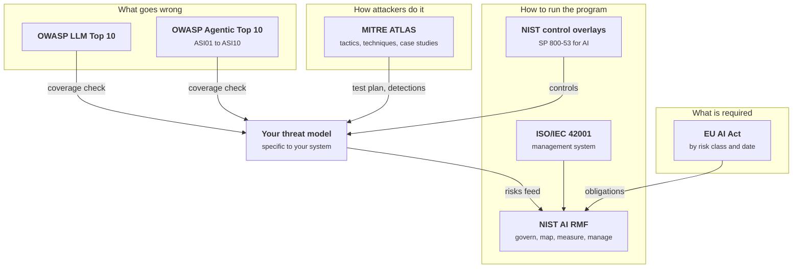
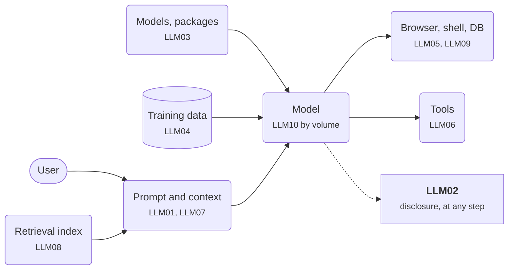
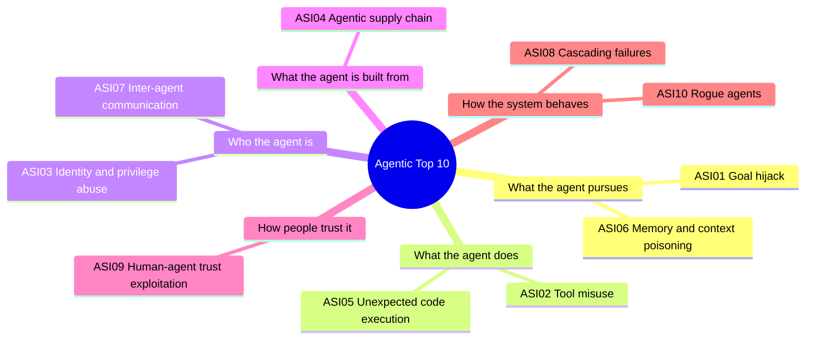
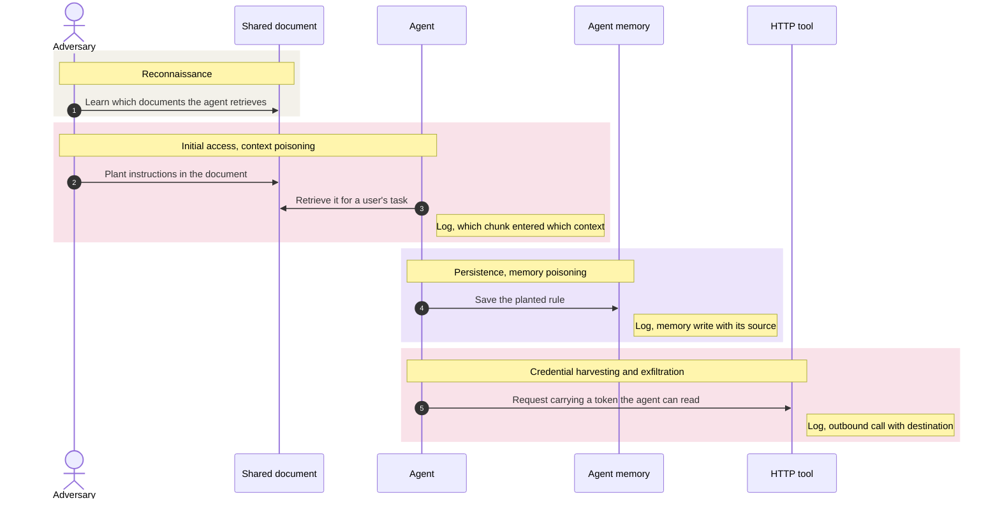
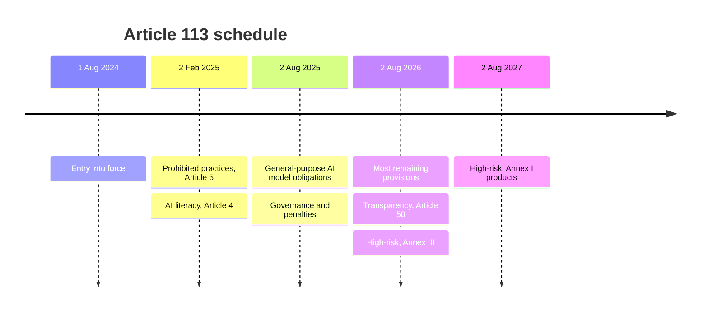

+++
title = 'Frameworks and maps'
description = 'OWASP lists what goes wrong, MITRE ATLAS shows how attackers do it, NIST and ISO describe how to run a program, and the EU AI Act sets legal duties. None replaces your own threat model.'
question = 'What do OWASP, MITRE ATLAS, NIST, and the EU AI Act each give me?'
weight = 3
difficulty = 1
prerequisites = ['/notes/ai-security-engineering/threat-landscape/02-threat-modeling-ai-systems']
date = 2026-04-05
lastmod = 2026-04-05
+++

## The idea in one minute

A handful of public frameworks cover AI security, and they answer different
questions:

| Framework | The question it answers |
| --- | --- |
| **OWASP Top 10 for LLM Applications** and **Top 10 for Agentic Applications** | What goes wrong most often? |
| **MITRE ATLAS** | How do attackers actually do it, step by step? |
| **NIST AI RMF**, its profiles, and **ISO/IEC 42001** | How do we run a risk program around AI? |
| **EU AI Act** | What does the law require, and from when? |

Use the OWASP lists as design checklists, ATLAS for red teaming and detection,
NIST and ISO for governance, and the AI Act for obligations. **None of them
knows your system.** They check the coverage of a threat model; they do not
replace one.

Editions, dates, and legal status here are as of October 2026 and change often.
Check the primary source before you cite an ID or a deadline.

## A picture



The threat model sits in the middle. Lists and techniques flow in as checks;
risks flow out into the governance program, which the law constrains.

## How it really works

### OWASP Top 10 for LLM Applications

The OWASP GenAI Security Project publishes a ranked list of the most common
risks in applications built on language models. The 2025 edition, released in
November 2024, is:

| ID | Risk | In one line |
| --- | --- | --- |
| LLM01 | **Prompt injection** | Text that changes the model's behavior, typed directly or planted in content it reads. |
| LLM02 | **Sensitive information disclosure** | The system reveals private data, secrets, or proprietary content. |
| LLM03 | **Supply chain** | Compromised models, datasets, packages, or tools. |
| LLM04 | **Data and model poisoning** | Corrupted training, fine-tuning, or embedding data. |
| LLM05 | **Improper output handling** | Model output passed unvalidated to a browser, shell, database, or API. |
| LLM06 | **Excessive agency** | The model has more tools, permissions, or autonomy than its task needs. |
| LLM07 | **System prompt leakage** | Prompts treated as secret, or holding secrets, are extracted. |
| LLM08 | **Vector and embedding weaknesses** | Attacks on retrieval: poisoned chunks, cross-tenant leaks, embedding inversion. |
| LLM09 | **Misinformation** | Confident wrong output that people or systems act on. |
| LLM10 | **Unbounded consumption** | Resource exhaustion, denial of wallet, model extraction by volume. |

OWASP revises the list periodically, and coverage in 2026 reported a revised
edition with a reordered ranking. Confirm the current edition and its numbering
on the project site before you put an ID in a report. The categories are more
stable than the ranks.

Most entries are easier to remember by where they strike. Find each ID on the
component it attacks; LLM02 and LLM10 are outcomes that can arise anywhere on
the path.



> [!NOTE]
> Several entries are ordinary security problems in new places. Improper output
> handling is cross-site scripting or command injection where the attacker's
> payload passes through a model. Unbounded consumption is denial of service
> with a per-token bill attached.

### OWASP Top 10 for Agentic Applications

Released by the same project in December 2025 for systems where models plan,
call tools, keep memory, and work with other agents:

| ID | Risk | Primary defense |
| --- | --- | --- |
| ASI01 | **Agent goal hijack** | Treat all retrieved content as untrusted; constrain what the agent may pursue. |
| ASI02 | **Tool misuse and exploitation** | Least-agency tool scoping; validate arguments in code. |
| ASI03 | **Identity and privilege abuse** | Per-agent identity; short-lived, scoped credentials. |
| ASI04 | **Agentic supply chain vulnerabilities** | Signed and pinned components; provenance; an inventory of what is loaded. |
| ASI05 | **Unexpected code execution** | Sandboxed execution; deny-by-default egress. |
| ASI06 | **Memory and context poisoning** | Validate memory writes; record where each entry came from. |
| ASI07 | **Insecure inter-agent communication** | Mutual authentication; signed messages. |
| ASI08 | **Cascading failures** | Blast-radius isolation; circuit breakers; budgets. |
| ASI09 | **Human-agent trust exploitation** | Meaningful confirmation of sensitive actions, showing what will actually happen. |
| ASI10 | **Rogue agents** | Behavioral monitoring; kill switches. |

The same ten items, grouped by the part of an agent they target, so you can
walk your design one part at a time:



Use both lists the same way: for each item, your design names the control, or
states why the risk does not apply. An item with neither is a gap. The later
modules of this course cover each of these controls in depth.

### MITRE ATLAS

**ATLAS** (Adversarial Threat Landscape for Artificial-Intelligence Systems) is
to AI what ATT&CK is to enterprise networks. It grew out of the Adversarial ML
Threat Matrix that MITRE and Microsoft published in 2020. It is a matrix of
adversary **tactics** (the goal of a step: reconnaissance, initial access,
persistence, exfiltration) and the **techniques** that achieve each, with
mitigations and case studies drawn from real incidents and red-team exercises.

Since 2025 it has added techniques specific to agents, covering poisoning of an
agent's context or memory, abuse of its tool invocations, and harvesting of
credentials from data an agent can retrieve. Where it earns its place:

- **Red teaming.** A list of techniques is a test plan, and the case studies
  show what a realistic chain looks like.
- **Detection engineering.** Each technique suggests what a log entry should
  show if it happened.
- **Incident write-ups.** A shared vocabulary for what the attacker did, step by
  step, that other teams already understand.

An ATLAS-style chain reads left to right as tactics, each step achieved by a
technique; the notes are the log entries a detection engineer would want.



### NIST

- The **AI Risk Management Framework** (AI RMF 1.0, NIST AI 100-1, January
  2023) organizes work into four functions: **Govern** (policies, roles,
  accountability), **Map** (context and risks), **Measure** (test and monitor),
  and **Manage** (prioritize and respond). Govern runs across the other three.
  It is voluntary and widely used as the backbone of an AI governance program.
  The **Generative AI Profile** (NIST AI 600-1, July 2024) adds risks and
  actions specific to generative models.

  Govern is drawn as the box around the cycle because it applies to all three
  of the other functions.

  ```mermaid {title="NIST AI RMF: three functions in a loop, Govern around them"}
  flowchart LR
    subgraph GOV["Govern: policies, roles, accountability"]
      direction LR
      MAP["<b>Map</b><br/><small>context and risks</small>"]
      MEA["<b>Measure</b><br/><small>test and monitor</small>"]
      MAN["<b>Manage</b><br/><small>prioritize and respond</small>"]
      MAP --> MEA --> MAN
      MAN -->|"iterate"| MAP
    end
    TM["<b>Your threat model</b>"] --> MAP
    class MAP,MEA,MAN queue
    class TM good
  ```
- **Adversarial Machine Learning: A Taxonomy and Terminology** (NIST AI 100-2)
  is the most precise vocabulary for attacks: evasion, poisoning, privacy, and
  abuse, for predictive and generative systems. The 2025 edition covers prompt
  injection and agents.
- **Control Overlays for Securing AI Systems** (COSAiS) is a NIST project to
  adapt the SP 800-53 control catalog to AI use cases, including generative AI,
  predictive AI, and single-agent and multi-agent systems. NIST announced it
  in August 2025 with a concept paper; check the project page for which
  overlays have been published and which are final.

If your organization already runs on SP 800-53 or ISO/IEC 27001, the overlays
are how AI gets folded into the existing control set rather than treated as a
separate universe. **ISO/IEC 42001:2023** plays a similar role as a certifiable
management-system standard for AI.

### The EU AI Act, by date

Regulation (EU) 2024/1689 entered into force on 1 August 2024. It classifies
systems by risk and applies obligations in stages under Article 113:

| Date | What applies, as adopted in 2024 |
| --- | --- |
| 2 February 2025 | Prohibited practices (Article 5); AI-literacy duty (Article 4). |
| 2 August 2025 | Obligations for providers of general-purpose AI models; governance and penalties. |
| 2 August 2026 | Most remaining provisions, including transparency duties (Article 50) and high-risk obligations for Annex III systems. |
| 2 August 2027 | High-risk obligations for AI that is a safety component of products under Annex I legislation. |

The same schedule as a timeline, so the three-year spread from entry into force
to the last high-risk duty is visible:



> [!WARNING] The high-risk dates are moving
> In November 2025 the European Commission proposed a "Digital Omnibus" that
> would tie the high-risk obligations to the availability of standards and
> support tools, with latest dates of 2 December 2027 for Annex III systems and
> 2 August 2028 for Annex I products. Check the Official Journal for whether,
> and in what form, the amendment has been adopted before relying on either
> set of dates. A deferral is not an exemption.

The bars compare the two schedules for the high-risk duties; each bar ends on
the date the obligation would apply under that schedule.

```mermaid {title="High-risk dates: as adopted against the proposed omnibus"}
gantt
  dateFormat YYYY-MM-DD
  axisFormat %b %Y
  section Annex III systems
  As adopted 2024        :a1, 2024-08-01, 2026-08-02
  Omnibus latest date    :crit, a2, 2024-08-01, 2027-12-02
  section Annex I products
  As adopted 2024        :b1, 2024-08-01, 2027-08-02
  Omnibus latest date    :crit, b2, 2024-08-01, 2028-08-02
```

For engineers, the high-risk requirements read like a security and quality
checklist: risk management, data governance, logging, human oversight,
accuracy, robustness, and cybersecurity. Article 15 is explicit that
cybersecurity measures should address AI-specific attacks, naming data
poisoning, model poisoning, adversarial examples, and confidentiality attacks.
A later module maps these requirements to controls.

### Which to reach for

| You need to | Use |
| --- | --- |
| Check a design for common gaps | OWASP LLM Top 10 and Agentic Top 10 |
| Plan a red-team exercise | MITRE ATLAS techniques and case studies |
| Decide what to log and alert on | MITRE ATLAS, technique by technique |
| Agree on precise attack terminology | NIST AI 100-2 |
| Stand up or audit an AI governance program | NIST AI RMF; ISO/IEC 42001 |
| Fold AI into existing security controls | NIST control overlays on SP 800-53 |
| Know your legal duties in the EU | The AI Act, by risk class and date |
| Find what is wrong with *your* system | Your own threat model |

## Where it breaks

- **A checklist covers categories, not combinations.** Every OWASP item can be
  "addressed" while the one context that reads untrusted email still holds a
  send tool. The dangerous paths come from the influence tracing in
  [Threat modeling an AI system](/notes/ai-security-engineering/threat-landscape/02-threat-modeling-ai-systems/),
  not from a list.
- **Mapping is not mitigating.** A spreadsheet that maps each control to an
  OWASP ID or an ATLAS technique proves you thought about the category. It does
  not prove the control works. Test it.
- **Rankings describe the population, not you.** A risk ranked tenth may be
  your biggest one. A model-hosting company and a chat widget have different
  top risks.
- **Frameworks lag attacks.** Lists are revised every year or two; new
  techniques appear in weeks. ATLAS case studies and vendor advisories are
  closer to current than any top 10.
- **Compliance is a floor.** Meeting the AI Act's requirements, or holding an
  ISO/IEC 42001 certificate, says a process exists. It does not say a
  particular agent cannot be hijacked.

## Remember this

- OWASP lists say what goes wrong; ATLAS says how; NIST and ISO say how to
  manage it; the AI Act says what is required.
- The Agentic Top 10 (ASI01 to ASI10) is the checklist for anything with tools
  and memory.
- Use lists as coverage checks: each item gets a named control or a reason it
  does not apply.
- Confirm editions, IDs, and legal dates at the source; they change.
- Frameworks check coverage. They do not replace a threat model.

## Try it

1. Take the Agentic Top 10 and, for a system you know, write one line per item:
   the control, or why it does not apply. Mark any item where your answer is a
   prompt instruction.
2. Pick one ATLAS technique relevant to that system and describe the log entry
   that would reveal it. Does your system write that entry today?
3. Decide which AI Act risk class a product of yours would fall into, which
   dates apply under the original schedule, and what changes if the omnibus
   deferral is adopted.
4. Find one risk in your threat model that no framework item describes well.

## Check yourself

1. What is ATLAS for that a top 10 list is not?

   
   A top 10 list names categories of weakness to check a design against. ATLAS
   describes adversary behavior: the tactics and techniques of an attack, step
   by step, with case studies. That makes it a source for red-team test plans,
   detection rules, and incident write-ups rather than a design checklist.
   

2. Which NIST AI RMF function covers testing and monitoring, and which runs
   across the other three?

   
   Measure covers testing and monitoring. Govern (policies, roles, and
   accountability) is cross-cutting and applies throughout Map, Measure, and
   Manage.
   

3. Why should you cite AI Act high-risk dates with care in October 2026?

   
   The dates set in 2024 (2 August 2026 for Annex III and 2 August 2027 for
   Annex I) are the subject of the Commission's November 2025 omnibus proposal,
   which would defer them to as late as 2 December 2027 and 2 August 2028. Which
   schedule applies depends on whether and how the amendment is adopted, so the
   Official Journal is the authority.
   

4. Why can no framework substitute for a system-specific threat model?

   
   Frameworks describe categories across many systems. The actual risk lives
   in specific combinations in your design: which untrusted source shares a
   context with which tool, under whose authority. Only tracing your own
   sources and effects finds those paths, and a design can tick every framework
   item while still containing one.
   

## Sources

- OWASP GenAI Security Project, [Top 10 for LLM Applications 2025](https://genai.owasp.org/llm-top-10/), November 2024.
- OWASP GenAI Security Project, [Top 10 for Agentic Applications](https://genai.owasp.org/resource/owasp-top-10-for-agentic-applications-for-2026/), December 2025.
- MITRE, [ATLAS: Adversarial Threat Landscape for Artificial-Intelligence Systems](https://atlas.mitre.org/).
- NIST, [Artificial Intelligence Risk Management Framework (AI RMF 1.0), NIST AI 100-1](https://doi.org/10.6028/NIST.AI.100-1), January 2023.
- NIST, [Generative Artificial Intelligence Profile, NIST AI 600-1](https://doi.org/10.6028/NIST.AI.600-1), July 2024.
- NIST, [Adversarial Machine Learning: A Taxonomy and Terminology of Attacks and Mitigations, NIST AI 100-2 E2025](https://doi.org/10.6028/NIST.AI.100-2e2025), March 2025.
- NIST, [Control Overlays for Securing AI Systems (COSAiS)](https://csrc.nist.gov/projects/cosais).
- ISO/IEC 42001:2023, [Information technology: Artificial intelligence: Management system](https://www.iso.org/standard/81230.html), December 2023.
- [Regulation (EU) 2024/1689 (Artificial Intelligence Act)](https://eur-lex.europa.eu/eli/reg/2024/1689/oj), Official Journal of the European Union, July 2024.
- European Commission, proposal for a regulation amending the AI Act (Digital Omnibus on AI), November 2025.
