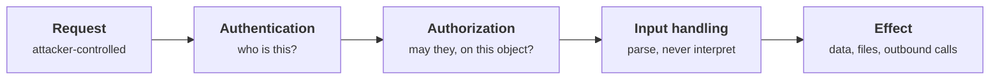

+++
title = 'Application security'
description = 'Identity, permissions, untrusted input, and the mistakes that turn an API into an attack surface.'
weight = 2
tone = 'rose'
group = 'security'
status = 'Course'
course = true
+++

The application decides who can act, on what, and under which conditions. Every
request carries claims (a session, a token, an object ID, a URL to fetch) and
the application has to decide which of them to believe. **Most serious
application vulnerabilities are a belief the code should not have held.**

The course follows those decisions through a request: how identity is
established, how authorization is enforced object by object and tenant by
tenant, what happens when input is interpreted rather than merely stored, and
how a team builds software where the secure path is the default one. It assumes
you can read Python and know HTTP. It does **not** assume a security background.

## The path

## How each lesson works

1. **The idea in one minute.** The claim, before the detail.
2. **A picture** of the attack or the defense.
3. **How it really works**, precisely, with standards and tools named.
4. **Code**: a small Python program using only the standard library. Vulnerable
   and fixed versions run against simulated applications inside the program.
5. **Where it breaks.** The limits of the control.
6. **Remember this**, **Try it**, and **Check yourself**.

## What you need

- Python 3.10 or newer and a terminal. Every program runs offline.

> [!CAUTION] Scope and ethics
> Attacks are explained so that you can build and test defenses for systems you
> are responsible for. Test only systems you own or are authorized to test.
