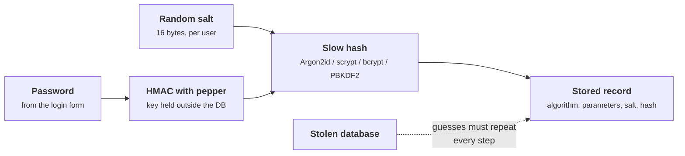
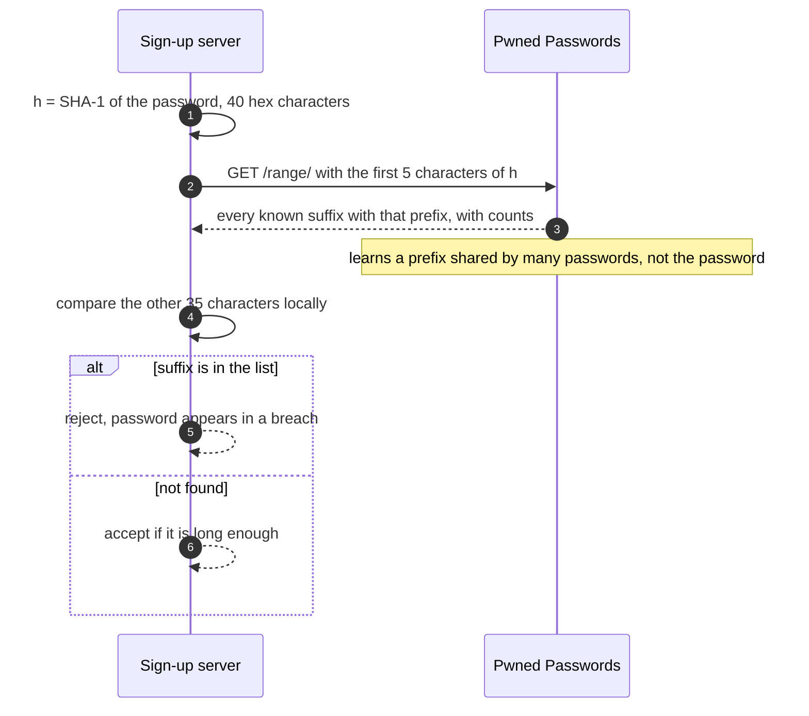
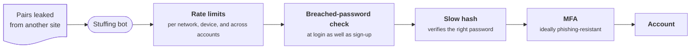

+++
title = 'Storing credentials'
description = 'A password database will eventually be stolen. Store each password with a unique salt and a deliberately slow, memory-hard hash so that theft does not become mass account takeover.'
question = 'How should an application store passwords so that a stolen database is not a list of passwords?'
weight = 1
difficulty = 2
prerequisites = ['/notes/application-security/foundations/01-the-request-is-a-trust-boundary']
date = 2026-05-21
lastmod = 2026-05-21
verified = 2026-05-21
+++

## The idea in one minute

Plan for the day the user table leaks: a backup left readable, a SQL injection,
a misconfigured replica. On that day the question is how many passwords the
attacker can recover, and how fast. A plain hash such as SHA-256 answers
"almost all of the common ones, today": it was designed to be fast, and fast is
exactly what an attacker with GPUs wants.

Password storage therefore uses a **password hashing function**: Argon2id,
scrypt, bcrypt, or PBKDF2. Each one takes a per-user random **salt**, so equal
passwords produce different records and every account must be attacked
separately, and a tunable **cost**, so every guess is expensive. A **pepper**, a
secret key kept outside the database, can make a stolen table useless on its
own. The other half of the job happens at sign-up and sign-in: reject passwords
that are already on attackers' lists, and assume that reused passwords from
other breaches will be tried against you (**credential stuffing**).

The consequence to act on: **never store anything a GPU can test billions of
times per second, and never accept a password the attacker already has.**

## A picture



The record carries its own algorithm and parameters, so the cost can be raised
later and old records upgraded when their owners next sign in.

## How it really works

### Why a fast hash fails

A cryptographic hash such as SHA-256 is preimage resistant: given a digest of a
*random* 256-bit value, nobody can find the input. Passwords are not random
256-bit values. They come from a distribution an attacker can enumerate in
order of likelihood: leaked password lists, dictionary words with common
mutations, keyboard walks. The attacker does not invert the hash; they guess and
compare. Against SHA-256, commodity GPUs compute billions of guesses per second,
so the strength of a stored password is set almost entirely by how early it
appears in the attacker's guess order. (The properties hashes do and do not
give you are covered in
[hash functions](/notes/cryptography/foundations/03-hash-functions/).)

Without a salt it is worse. Every user who chose `letmein` has the same digest,
so one pass over a wordlist cracks all of them at once, and precomputed tables
work across every site that made the same mistake.

Look at how one precomputed entry matches every account that chose the same password.

```mermaid {title="Without a salt, one guess cracks every matching account"}
flowchart LR
  M(["Attacker"])
  W@{ shape: doc, label: "Wordlist" }
  T["<b>SHA-256 table</b><br/><small>one hash per guess, computed once</small>"]
  DB@{ shape: cyl, label: "Stolen user table" }
  A["alice: sha256(letmein)"]
  B["bob: sha256(letmein)"]
  C["carol: sha256(letmein)"]
  M --> W --> T
  DB --- A & B & C
  T -->|"one lookup each"| A & B & C
  class T,A,B,C warn
```

### Salts, cost, and memory hardness

A **salt** is a random value, unique per password, stored in the clear next to
the hash. It does not need to be secret. Its job is to make each record a
separate problem: the attacker must hash every guess once *per account*, and
precomputed tables are useless. NIST SP 800-63B requires a salt of at least 32
bits; 16 random bytes is the common choice and costs nothing.

A **cost factor** makes each guess slow. PBKDF2 repeats HMAC a configurable
number of times. bcrypt has a logarithmic work factor. scrypt and Argon2 add
**memory hardness**: each guess must fill and read a large block of memory.
That matters because the attacker's advantage comes from parallel hardware.
GPUs and ASICs have far more arithmetic units than fast memory per unit, so a
function that needs 64 MiB per guess limits how many guesses run side by side,
while a pure iteration count is something a GPU can parallelize freely.

| Function | Specification | Cost knobs | Notes |
| --- | --- | --- | --- |
| **Argon2id** | RFC 9106 (2021); winner of the Password Hashing Competition | memory `m`, iterations `t`, parallelism `p` | The first choice. The `id` variant mixes side-channel resistance (Argon2i) with GPU resistance (Argon2d). |
| **scrypt** | RFC 7914 (2016) | CPU/memory cost `N`, block size `r`, parallelism `p` | Memory hard. Memory used is about 128 × `N` × `r` bytes. In Python's `hashlib`. |
| **bcrypt** | Provos and Mazières, USENIX 1999 | work factor (log2 of rounds) | Uses only 4 KiB of state. Most implementations use only the first 72 bytes of input. |
| **PBKDF2** | RFC 8018; NIST SP 800-132 | iteration count, underlying HMAC | Not memory hard. The option when FIPS 140 validation is required. In Python's `hashlib`. |

### The parameters to use

As of October 2026, the OWASP Password Storage Cheat Sheet gives these
minimums. Each row of a family is equivalent; pick the one that fits your
memory budget, then raise it as far as your login latency allows.

| Function | OWASP minimum configurations |
| --- | --- |
| Argon2id | m = 19 MiB, t = 2, p = 1 (or m = 46 MiB, t = 1; m = 12 MiB, t = 3; m = 9 MiB, t = 4; m = 7 MiB, t = 5) |
| scrypt | N = 2^17, r = 8, p = 1 (128 MiB); or N = 2^16, r = 8, p = 2; down to N = 2^13, r = 8, p = 10 |
| bcrypt | work factor 10 or more; passwords limited to 72 bytes |
| PBKDF2 | HMAC-SHA-256: 600,000 iterations; HMAC-SHA-512: 210,000; HMAC-SHA-1: 1,300,000 |

The iteration counts differ by hash because the attacker's cost per HMAC call
differs: SHA-512 works on 64-bit words, which GPUs handle less efficiently, so
fewer iterations buy similar resistance. Two practical rules follow from the
table. First, **store the parameters with the hash** (the `$scrypt$ln=17,...`
and PHC string formats do this) so you can raise them without a flag day.
Second, **rehash on login**: when a user signs in successfully you briefly hold
the plaintext, so that is the moment to upgrade a record created under weaker
parameters or an older algorithm.

Follow one record through that rule: it can only move when its owner signs in, because only then is the plaintext available.

```mermaid {title="A stored record is upgraded only at a successful login"}
stateDiagram-v2
  [*] --> Current: sign-up under today's policy
  [*] --> Legacy: migrated PBKDF2 record
  Legacy --> Legacy: failed login, nothing to rehash
  Legacy --> Current: successful login, rehash with scrypt
  Current --> Stale: policy raises ln or memory
  Stale --> Current: successful login, rehash
  Current --> [*]: account deleted
```

> [!WARNING] Truncation and pre-hashing in bcrypt
> Because bcrypt ignores input beyond 72 bytes, two long passphrases that share
> a prefix can verify as each other. Pre-hashing to fit the limit has its own
> trap: if you feed `bcrypt(sha256(password))`, an attacker holding unsalted
> SHA-256 hashes from another breach can test those digests directly against
> your records ("password shucking"). If you pre-hash at all, use an HMAC with a
> pepper and encode the result (for example in base64) so it contains no NUL
> bytes. Better still, use Argon2id or scrypt, which have no such limit.

### Peppers

A salt defends against precomputation, not against an attacker who has your
whole database. A **pepper** is a secret key, the same for all users, that is
stored somewhere else: a secrets manager, an HSM, or at minimum the application's
configuration rather than the database. Two constructions are common: HMAC the
password with the pepper before the slow hash, or encrypt the finished hash
with the pepper as the key. Either way, a database dump alone no longer lets
the attacker test a single guess.

The pepper and the hashes live in different places, so a stolen backup holds only half of what a guess needs.

```mermaid {title="A database-only breach gets the hashes but not the pepper"}
flowchart TB
  subgraph g_app["Application tier"]
    n_web["Login service"]
  end
  subgraph g_data["Database tier"]
    n_db[("Salted hashes")]
    n_bak["Backup copy"]
  end
  n_sm["Pepper"]
  n_thief["Attacker"]
  n_sm --> n_web
  n_web --> n_db
  n_db --> n_bak
  n_thief --> n_bak
```

A pepper is defense in depth, not a replacement for a slow hash. Attacks that
reach the application server (remote code execution, a leaked environment
file) usually get the pepper too. It also makes rotation harder: you cannot
re-pepper a hash without the plaintext, so plan for a pepper version stored
with each record. The encrypt-the-hash construction rotates more easily,
because you can decrypt with the old key and re-encrypt with the new one.

### What NIST says about the password itself

NIST SP 800-63B, revision 4 (finalized in 2025), rewrote the familiar rules.
In summary:

| Requirement | SP 800-63B-4 |
| --- | --- |
| Minimum length | 15 characters when the password is the only factor; 8 when it is part of multi-factor authentication |
| Maximum length | Verifiers should accept at least 64 characters |
| Character set | All printing ASCII characters and the space should be accepted; Unicode should be accepted |
| Composition rules | Shall not be imposed ("one digit, one symbol...") |
| Periodic changes | Shall not be required; force a change only on evidence of compromise |
| Blocklist | Shall check new passwords against a list of commonly used, expected, or compromised values |
| Hints and security questions | Shall not be used |
| Failed attempts | Rate limiting is required (no more than 100 consecutive failures on one account) |

The reasoning is empirical. Composition rules push users toward predictable
patterns (`Password1!`), and forced rotation pushes them toward
`Spring2026!` → `Summer2026!`. Length and a blocklist do more for less
annoyance. The blocklist is where breach data helps the defender: a password
that appeared in a public breach is in every attacker's wordlist, so it should
be rejected regardless of how complex it looks. Services such as Have I Been
Pwned's Pwned Passwords offer a **k-anonymity** range query: the client sends
only the first five hex characters of the password's SHA-1 hash and compares
the returned suffixes locally, so the service never learns the password or its
full hash. You can also host the list yourself.

In the range query, only five hex characters leave your server and the match happens locally.



### Credential stuffing

Most account takeover against consumer services does not involve cracking
anything. Attackers take username and password pairs leaked from *other*
sites and replay them, at scale, against your login endpoint, relying on
reuse. Perfect hashing on your side does nothing about this, because the
attacker already has the plaintext.

Trace a replayed pair through the login path: the slow hash happily verifies it, so the stopping power has to come from the other layers.



The defenses are layered:

- **Breached-password checks at login as well as sign-up**, so a credential that
  appears in a new breach is caught before an attacker tries it.
- **Multi-factor authentication**, ideally phishing-resistant (see
  [MFA and passkeys](/notes/application-security/authentication/05-mfa-and-passkeys/)).
- **Rate limiting and anomaly detection** keyed on more than the account: source
  network, device signals, and failure rate across many accounts, since stuffing
  spreads few attempts over many usernames. The mechanics of a fair limiter are
  in [a rate limiter](/notes/systems-design/worked-designs/01-a-rate-limiter/).
- **No account enumeration.** The same message, status code, and roughly the same
  time for "no such user" and "wrong password". If the user does not exist, run
  the hash against a dummy record anyway, or the response time reveals which
  usernames are real.

### Comparing in constant time

When a login compares the computed hash with the stored one, an ordinary `==`
on bytes may stop at the first differing byte. For password hashes the leak is
of limited use, because the attacker does not control the hash input, but the
same code pattern is dangerous for MACs and tokens, and there is no reason to
write it. Use `hmac.compare_digest`, whose running time does not depend on
where the inputs differ. The broader topic is in
[side channels and constant time](/notes/cryptography/applied-cryptography/02-side-channels-and-constant-time/).

## Code

The first program stores passwords with scrypt at the OWASP parameters and with
PBKDF2-HMAC-SHA256 at 600,000 iterations, peppers both, verifies in constant
time, and flags records that need an upgrade. Python's standard library has no
Argon2id or bcrypt; in production you would use a maintained library for those
(for example `argon2-cffi` or `bcrypt`).

```python {title="store.py"}
"""store.py: salted, slow, peppered password hashing with constant-time checks.

scrypt and PBKDF2 from hashlib, with the OWASP Password Storage Cheat Sheet
parameters. Standard library only; runs offline against a simulated user table.
"""

from __future__ import annotations

import base64
import hashlib
import hmac
import secrets

# OWASP minimums: scrypt N=2^17, r=8, p=1; PBKDF2-HMAC-SHA256 600,000 iterations.
SCRYPT_LOG_N, SCRYPT_R, SCRYPT_P = 17, 8, 1
PBKDF2_ITERATIONS = 600_000
# A pepper lives outside the database (a secrets manager or HSM), never next to the hashes.
PEPPER = b"demo-pepper; load from a secrets manager in real code"


def b64(data: bytes) -> str:
    return base64.b64encode(data).rstrip(b"=").decode()


def unb64(text: str) -> bytes:
    return base64.b64decode(text + "=" * (-len(text) % 4))


def peppered(password: str) -> bytes:
    """HMAC the password with the pepper before the slow hash."""
    return hmac.new(PEPPER, password.encode("utf-8"), hashlib.sha256).digest()


def scrypt_hash(password: str, salt: bytes | None = None) -> str:
    salt = salt if salt is not None else secrets.token_bytes(16)
    n = 1 << SCRYPT_LOG_N
    key = hashlib.scrypt(peppered(password), salt=salt, n=n, r=SCRYPT_R, p=SCRYPT_P,
                         maxmem=256 * 1024 * 1024, dklen=32)
    # Store the parameters with the hash so they can be raised later.
    return f"$scrypt$ln={SCRYPT_LOG_N},r={SCRYPT_R},p={SCRYPT_P}${b64(salt)}${b64(key)}"


def scrypt_verify(password: str, stored: str) -> bool:
    _, _, params, salt64, key64 = stored.split("$")
    p = dict(kv.split("=") for kv in params.split(","))
    key = hashlib.scrypt(peppered(password), salt=unb64(salt64), n=1 << int(p["ln"]),
                         r=int(p["r"]), p=int(p["p"]), maxmem=256 * 1024 * 1024, dklen=32)
    return hmac.compare_digest(key, unb64(key64))  # no early exit on the first wrong byte


def pbkdf2_hash(password: str, salt: bytes) -> str:
    key = hashlib.pbkdf2_hmac("sha256", peppered(password), salt, PBKDF2_ITERATIONS)
    return f"$pbkdf2-sha256${PBKDF2_ITERATIONS}${b64(salt)}${b64(key)}"


def pbkdf2_verify(password: str, stored: str) -> bool:
    _, _, iters, salt64, key64 = stored.split("$")
    key = hashlib.pbkdf2_hmac("sha256", peppered(password), unb64(salt64), int(iters))
    return hmac.compare_digest(key, unb64(key64))


def needs_rehash(stored: str) -> bool:
    """True when a stored hash uses weaker parameters than current policy."""
    if stored.startswith("$scrypt$"):
        return f"ln={SCRYPT_LOG_N}," not in stored
    return True  # anything else is migrated to scrypt on the next login


if __name__ == "__main__":
    # Fixed salts so the output is reproducible; real code uses secrets.token_bytes(16).
    alice = scrypt_hash("correct horse battery staple", salt=b"A" * 16)
    bob = scrypt_hash("correct horse battery staple", salt=b"B" * 16)
    print("alice:", alice)
    print("bob:  ", bob)
    print("same password, same stored value?", alice == bob)
    print("alice, right password:", scrypt_verify("correct horse battery staple", alice))
    print("alice, wrong password:", scrypt_verify("correct horse battery stapler", alice))

    legacy = pbkdf2_hash("hunter2-but-longer-now", salt=b"C" * 16)
    print("carol:", legacy)
    print("carol verifies:", pbkdf2_verify("hunter2-but-longer-now", legacy))
    print("carol needs rehash:", needs_rehash(legacy), "| alice needs rehash:", needs_rehash(alice))

    # A stolen database without the pepper: the attacker's guesses go through
    # the same scrypt call but without the HMAC step, so even the right password fails.
    _, _, _, salt64, key64 = alice.split("$")
    guess = hashlib.scrypt(b"correct horse battery staple", salt=unb64(salt64), n=1 << 17,
                           r=8, p=1, maxmem=256 * 1024 * 1024, dklen=32)
    print("right password, no pepper, matches:", hmac.compare_digest(guess, unb64(key64)))
```

Run it with `python3 store.py`:

```text
alice: $scrypt$ln=17,r=8,p=1$QUFBQUFBQUFBQUFBQUFBQQ$yib1O7NuJDd4F5heiwDL1hwg5DHSgAlS3Fixm+CsMCU
bob:   $scrypt$ln=17,r=8,p=1$QkJCQkJCQkJCQkJCQkJCQg$dNg11WDUEcxVyDdlE15yIo9bLcDkGN83j0yVjKqsU8M
same password, same stored value? False
alice, right password: True
alice, wrong password: False
carol: $pbkdf2-sha256$600000$Q0NDQ0NDQ0NDQ0NDQ0NDQw$I8pEGDThcwpbWqkXrdHZy1GFzUOoGcmwRP+4gJ9KGn8
carol verifies: True
carol needs rehash: True | alice needs rehash: False
right password, no pepper, matches: False
```

The same password gives two unrelated records because the salts differ. Carol's
PBKDF2 record still verifies, and `needs_rehash` marks it for migration to
scrypt on her next successful login. The last line is the pepper doing its job:
an attacker with only the database, guessing the right password, still gets no
match.

The second program shows why salts and cost matter, counting work instead of
seconds, because work is what the attacker pays for and seconds depend on
their hardware. It simulates a breach of 1,000 accounts, 30% of which use a
password from the attacker's wordlist, then applies NIST-style checks at sign-up.

```python {title="crack.py"}
"""crack.py: why salts and cost factors matter, counted in work rather than seconds.

A simulated breach of 1,000 accounts. The attacker has a wordlist of common
passwords. We count hash computations, the quantity that hardware buys down.
Standard library only; offline; seeded so the output is reproducible.
"""

from __future__ import annotations

import hashlib
import random
from dataclasses import dataclass

WORDLIST = [f"common{i:04d}" for i in range(5_000)] + ["password1", "letmein", "passwordpassword"]


@dataclass
class Account:
    user: str
    salt: bytes
    unsalted: str  # sha256(password): what not to store
    salted: str    # sha256(salt + password): salted but still fast


def make_breach(rng: random.Random) -> list[Account]:
    accounts = []
    for i in range(1_000):
        if rng.random() < 0.3:  # 30% chose a password that is on the wordlist
            pw = rng.choice(WORDLIST)
        else:
            pw = "".join(rng.choice("abcdefghijkmnpqrstuvwxyz23456789") for _ in range(20))
        salt = rng.randbytes(16)
        accounts.append(Account(f"user{i}", salt, hashlib.sha256(pw.encode()).hexdigest(),
                                hashlib.sha256(salt + pw.encode()).hexdigest()))
    return accounts


def crack_unsalted(accounts: list[Account]) -> tuple[int, int]:
    """One pass over the wordlist cracks every account at once."""
    table = {hashlib.sha256(w.encode()).hexdigest(): w for w in WORDLIST}
    cracked = sum(1 for a in accounts if a.unsalted in table)
    return cracked, len(WORDLIST)


def crack_salted(accounts: list[Account]) -> tuple[int, int]:
    """Each salt forces a separate pass: work grows with the number of accounts."""
    work = cracked = 0
    for a in accounts:
        for w in WORDLIST:
            work += 1
            if hashlib.sha256(a.salt + w.encode()).hexdigest() == a.salted:
                cracked += 1
                break
    return cracked, work


if __name__ == "__main__":
    accounts = make_breach(random.Random(2026))
    c1, w1 = crack_unsalted(accounts)
    c2, w2 = crack_salted(accounts)
    print(f"unsalted SHA-256: cracked {c1:>4} accounts with {w1:>12,} hash calls")
    print(f"salted SHA-256:   cracked {c2:>4} accounts with {w2:>12,} hash calls")
    print()
    print("the same salted attack, priced in the work each scheme demands per guess:")
    per_guess = [
        ("SHA-256, salted", "1 hash", 1),
        ("PBKDF2-HMAC-SHA256", "600,000 HMAC calls", 600_000),
        ("PBKDF2-HMAC-SHA512", "210,000 HMAC calls", 210_000),
    ]
    for name, unit, cost in per_guess:
        print(f"  {name:<20} {unit:<20} total {w2 * cost:>18,} calls")
    print("  scrypt N=2^17,r=8   each guess also fills 128 MiB of memory")
    print()
    # The other side: NIST SP 800-63B-4 style checks at sign-up. Length and a
    # blocklist, no composition rules (15 characters when it is the only factor).
    blocked = set(WORDLIST)
    for candidate in ["letmein", "Tr0ub4dor&3", "passwordpassword", "violet-lantern-quarry-sixteen"]:
        if len(candidate) < 15:
            verdict = "rejected (shorter than 15)"
        elif candidate in blocked:
            verdict = "rejected (on blocklist)"
        else:
            verdict = "accepted"
        print(f"sign-up with {candidate!r:<32} {verdict}")
```

Run it with `python3 crack.py`:

```text
unsalted SHA-256: cracked  324 accounts with        5,003 hash calls
salted SHA-256:   cracked  324 accounts with    4,142,926 hash calls

the same salted attack, priced in the work each scheme demands per guess:
  SHA-256, salted      1 hash               total          4,142,926 calls
  PBKDF2-HMAC-SHA256   600,000 HMAC calls   total  2,485,755,600,000 calls
  PBKDF2-HMAC-SHA512   210,000 HMAC calls   total    870,014,460,000 calls
  scrypt N=2^17,r=8   each guess also fills 128 MiB of memory

sign-up with 'letmein'                        rejected (shorter than 15)
sign-up with 'Tr0ub4dor&3'                    rejected (shorter than 15)
sign-up with 'passwordpassword'               rejected (on blocklist)
sign-up with 'violet-lantern-quarry-sixteen'  accepted
```

Salting does not stop the weak passwords from falling; it multiplies the work
by roughly the number of accounts. The cost factor multiplies it again, by
hundreds of thousands. Neither helps the 324 users whose passwords were on the
list; the blocklist at sign-up is what would have stopped them choosing those
passwords. Note that `Tr0ub4dor&3`, which satisfies every classic composition
rule, is rejected while a long lowercase passphrase is accepted.

On a log scale, each step multiplies the attacker's bill for the same 324 cracked accounts.

```mermaid {title="Hash calls to crack the same accounts grow by orders of magnitude"}
xychart-beta
  x-axis ["Unsalted SHA-256", "Salted SHA-256", "PBKDF2-SHA512", "PBKDF2-SHA256"]
  y-axis "log10 of hash or HMAC calls" 0 --> 13
  bar [3.70, 6.62, 11.94, 12.40]
```

## Where it breaks

- **Weak passwords stay weak.** A slow hash raises the cost per guess; it does
  not change the guess order. `password123` falls within the first few guesses
  whatever the cost. Only the blocklist and MFA address that.
- **Cost is a denial-of-service lever.** A 128 MiB hash per login attempt means a
  flood of login requests can exhaust server memory. Rate limit before hashing,
  cap concurrent hash operations, and size the parameters against your peak
  login rate, not a single benchmark.
- **The pepper shares the server's fate.** An attacker who can read the
  application's memory or configuration gets the pepper. The pepper defends
  against database-only compromise: SQL injection, stolen backups, a leaked
  replica.
- **Hashing is not the only copy.** Passwords leak through request logs, error
  trackers, analytics on the login form, and debug dumps. Audit where the
  plaintext travels before the hash function sees it.
- **Breach lists lag.** A blocklist only knows yesterday's breaches. It reduces
  credential stuffing; it does not end it.
- **The simulation is a toy.** The cracking program uses a synthetic wordlist and
  counts calls; real attackers use rule-based mutations, Markov models, and
  hardware where the relative cost of each scheme differs from a call count.

## Remember this

- Use Argon2id (m ≥ 19 MiB, t ≥ 2) or scrypt (N ≥ 2^17, r = 8); PBKDF2 at 600,000
  iterations with SHA-256 when FIPS requires it.
- A unique random salt per password; store the algorithm and parameters with
  the hash, and rehash on login when they are weaker than policy.
- A pepper kept outside the database turns a stolen table into noise, but only
  if the attacker did not also reach the server.
- Length of at least 15 and a breached-password blocklist; no composition rules,
  no forced rotation.
- Credential stuffing uses passwords you never stored; answer it with breach
  checks, rate limiting, and MFA.

## Try it

1. Run `store.py` and change `SCRYPT_LOG_N` to 18. Which existing records does
   `needs_rehash` now flag, and when would they actually be upgraded?
2. Add an Argon2-style parameter check to `needs_rehash` that also triggers when
   `r` or `p` change, not only `ln`.
3. In `crack.py`, raise the share of users on the wordlist from 30% to 60%. How
   does the salted attacker's work change, and why does it go *down* per
   cracked account?
4. Implement a k-anonymity lookup against a local dictionary: compute the SHA-1
   of a password, "send" the first five hex characters, receive all suffixes
   with that prefix, and decide locally.
5. Write the login function so that "unknown user" and "wrong password" take the
   same code path, including a dummy hash.

## Check yourself

1. What does a salt protect against, and what does it not?

   
   It makes each record a separate problem: precomputed tables stop working and
   one pass over a wordlist no longer cracks every user who chose the same
   password. It does not make any single weak password harder to guess; an
   attacker targeting one account pays the same as without a salt.
   

2. Why is memory hardness valuable against a GPU attacker?

   
   The attacker's advantage is running many guesses in parallel. GPUs and ASICs
   have abundant arithmetic but limited fast memory per core. A function that
   needs tens or hundreds of MiB per guess caps how many guesses can run at
   once, whereas an iteration count alone parallelizes freely.
   

3. Where should a pepper be stored, and what attack does it defeat?

   
   Outside the database: a secrets manager, an HSM, or at least application
   configuration that is not in the same backups. It defeats attacks that obtain
   only the database (SQL injection, stolen backups), because without the key no
   guess can be tested. It does not help if the application server is
   compromised.
   

4. Why does SP 800-63B-4 forbid composition rules and forced periodic changes?

   
   Both push users toward predictable transformations (`Password1!`, incrementing
   a season or number) that attackers model directly, while adding friction.
   Length and a blocklist of compromised and common passwords improve real
   resistance more.
   

5. Your password hashing is excellent. Why can credential stuffing still
   succeed, and what stops it?

   
   The attacker is not cracking your hashes; they replay plaintext pairs leaked
   elsewhere, counting on reuse. Breached-password checks at login and sign-up,
   rate limiting across accounts and networks, and multi-factor authentication
   are the controls.
   

## Sources

- OWASP, [Password Storage Cheat Sheet](https://cheatsheetseries.owasp.org/cheatsheets/Password_Storage_Cheat_Sheet.html), accessed October 2026.
- OWASP, [Credential Stuffing Prevention Cheat Sheet](https://cheatsheetseries.owasp.org/cheatsheets/Credential_Stuffing_Prevention_Cheat_Sheet.html), accessed October 2026.
- NIST, [SP 800-63B-4: Digital Identity Guidelines, Authentication and Authenticator Management](https://csrc.nist.gov/pubs/sp/800/63/b/4/final), 2025.
- A. Biryukov, D. Dinu, D. Khovratovich, S. Josefsson, [RFC 9106: Argon2 Memory-Hard Function for Password Hashing and Proof-of-Work Applications](https://www.rfc-editor.org/rfc/rfc9106), IETF, September 2021.
- C. Percival, S. Josefsson, [RFC 7914: The scrypt Password-Based Key Derivation Function](https://www.rfc-editor.org/rfc/rfc7914), IETF, August 2016.
- K. Moriarty, B. Kaliski, A. Rusch, [RFC 8018: PKCS #5: Password-Based Cryptography Specification Version 2.1](https://www.rfc-editor.org/rfc/rfc8018), IETF, January 2017.
- N. Provos, D. Mazières, [A Future-Adaptable Password Scheme](https://www.usenix.org/legacy/events/usenix99/provos.html), USENIX Annual Technical Conference, 1999.
- Python Software Foundation, [hashlib: scrypt and pbkdf2_hmac](https://docs.python.org/3/library/hashlib.html#key-derivation) and [hmac.compare_digest](https://docs.python.org/3/library/hmac.html#hmac.compare_digest).
- Have I Been Pwned, [Pwned Passwords API: searching by range](https://haveibeenpwned.com/API/v3#SearchingPwnedPasswordsByRange).
