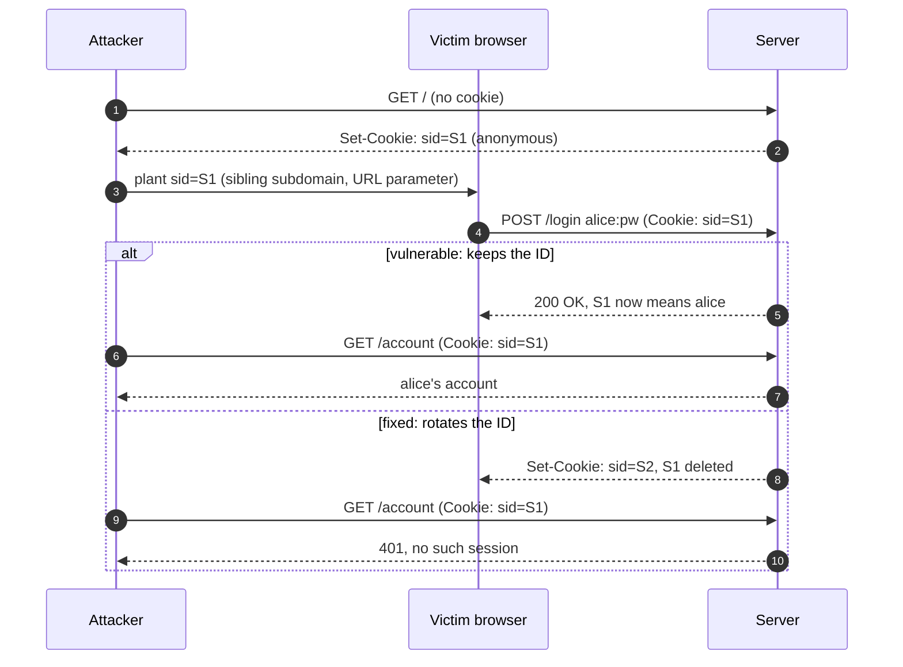
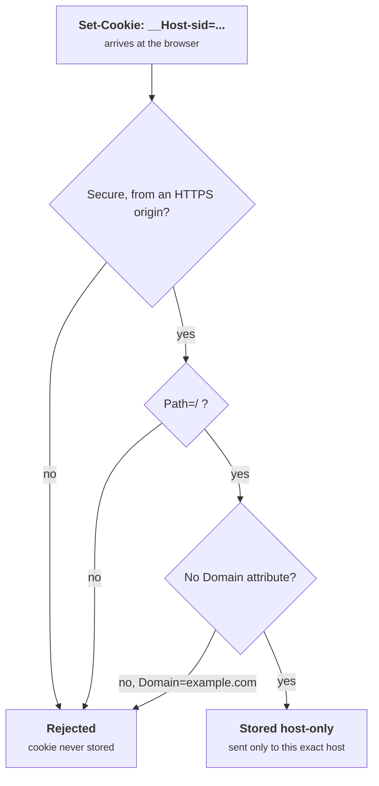
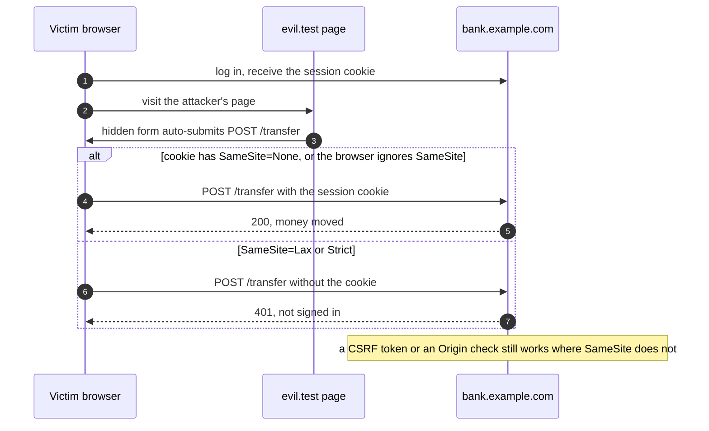
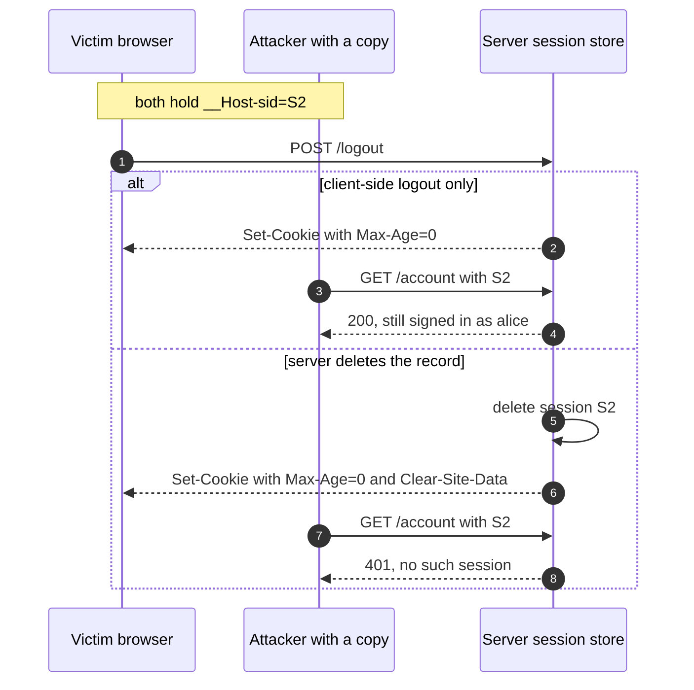

+++
title = 'Sessions and cookies'
description = 'After login, the session ID is the credential. Generate it randomly, rotate it at every privilege change, lock the cookie down with Secure, HttpOnly, SameSite and the __Host- prefix, and end it on the server.'
question = 'How does a server remember who you are between requests, and how do attackers steal, plant, or ride that memory?'
weight = 2
difficulty = 2
prerequisites = ['/notes/application-security/authentication/01-storing-credentials']
date = 2026-05-23
lastmod = 2026-10-30
verified = 2026-05-23
+++

## The idea in one minute

HTTP is stateless, so after a user proves who they are, the server hands the
browser a **session identifier** in a cookie, and every later request carries
it. From that point on the session ID *is* the credential: whoever presents it
is the user, no password needed. Everything in this lesson follows from that.

The ID must be unguessable, so it comes from a CSPRNG. It must not be chosen by
the attacker, so the server issues a **new** ID at login and at every change of
privilege; failing to do so is **session fixation**. It must not leak, so the
cookie is `Secure` (HTTPS only), `HttpOnly` (invisible to JavaScript), scoped
to one host with the `__Host-` prefix, and `SameSite` to limit when other sites
can make the browser send it. And it must die when the user logs out, which
means deleting it on the server, not just asking the browser to forget it.

The consequence to act on: **treat the session cookie with the same care as the
password, and keep the authoritative session state on the server.**

## A picture



The attacker never learns the password or steals a cookie. They choose the
session ID in advance and wait for the victim to authenticate it.

## How it really works

### What a session ID must be

A session ID is a bearer secret, so the requirements are those of any random
key:

- **Unpredictable.** Generate it from the operating system's CSPRNG (in Python,
  `secrets.token_urlsafe(32)` gives 256 bits). The OWASP Session Management Cheat
  Sheet asks for at least 64 bits of entropy; there is no reason to stop near
  the minimum. Never derive it from a user ID, a timestamp, or a counter.
- **Meaningless.** The ID is a lookup key into server-side state. Anything the
  client can read and change (a role, a user ID) must not be in it unless it is
  signed, and even then server-side state is easier to revoke. Signed,
  self-contained session tokens are the subject of
  [tokens and JWT pitfalls](/notes/application-security/authentication/04-tokens-and-jwt-pitfalls/).
- **Server-issued only.** A server that adopts any ID the client sends ("I don't
  know `abc123`, but I'll create a session for it") gives attackers fixation for
  free. Unknown IDs should be discarded and replaced.
- **Bounded in time.** An idle timeout and an absolute timeout, both enforced on the
  server. The cookie's `Max-Age` is only a request to the browser.

Every arrow that changes privilege issues a new ID, and every way out deletes the server-side record.

```mermaid {title="The life of a session, with an ID rotation at each privilege change"}
stateDiagram-v2
  [*] --> Anonymous: first visit, server issues ID 1
  Anonymous --> Authenticated: login, new ID 2
  Authenticated --> Elevated: step-up or admin role, new ID 3
  Elevated --> Authenticated: leave admin mode, new ID
  Authenticated --> Ended: logout, idle or absolute timeout
  Elevated --> Ended: logout or timeout
  Authenticated --> Ended: password changed in another session
  Ended --> [*]: server record deleted
```

### Cookie attributes

Cookies are specified by RFC 6265 (2011). Its revision, usually called RFC
6265bis, is an IETF HTTP working group draft that documents what browsers
actually do today, including `SameSite` and cookie prefixes. As of October 2026
it is still a draft, but the behavior it describes is implemented by the major
browsers.

A session cookie for a new application should look like this:

```http {title="a hardened session cookie"}
Set-Cookie: __Host-sid=<43 random characters>; Path=/; Secure; HttpOnly; SameSite=Lax
```

| Attribute | Effect | Attack it limits |
| --- | --- | --- |
| `Secure` | Sent only over HTTPS; under 6265bis, a non-secure origin also cannot set or overwrite it | Network eavesdropping; downgrade to HTTP |
| `HttpOnly` | Not readable by `document.cookie` | Cookie theft by injected script. It does **not** stop that script from sending requests in the user's session. |
| `SameSite=Lax` or `Strict` | Withheld on some cross-site requests (below) | Cross-site request forgery, some cross-site leaks |
| No `Domain` | Host-only: sent to exactly the host that set it | A sibling subdomain receiving the cookie |
| `Path=/` | Sent for all paths | Path is not a security boundary; do not rely on it |
| `Max-Age` / `Expires` | Persistent cookie; without them it is a "session cookie" for the browser's lifetime | Long-lived theft value, but browsers' session restore may keep "session cookies" alive anyway |

**Prefixes** turn some of these from conventions into browser-enforced rules.
A cookie whose name starts with `__Secure-` is accepted only if set with
`Secure` from a secure origin. A cookie whose name starts with `__Host-` is
additionally accepted only with `Path=/` and **no `Domain` attribute**. That
last rule is the important one: it means a cookie named `__Host-sid` can only
have been set by the exact host that receives it. A compromised or
user-controlled sibling such as `blog.example.com` can set `sid` for
`Domain=example.com`, which `app.example.com` will receive; it cannot set
`__Host-sid` at all.

These are the checks a browser applies before it stores a `__Host-` cookie; the last one is what shuts out a sibling subdomain.



### Session fixation

Session fixation, described by Mitja Kolšek in 2002, works whenever the session
ID survives authentication. The attacker obtains or invents an ID, gets it into
the victim's browser, and waits. Planting routes include an ID accepted from a
URL parameter, a cookie written by a sibling subdomain for the parent domain, a
cookie injected over plain HTTP on a site without HSTS, and a shared computer.

The fix is a single rule: **issue a fresh session ID whenever the privilege
level changes**: at login, at step-up authentication, when switching to an
administrative role, and at logout. Copy whatever state should survive into the
new session, then delete the old record. Most frameworks provide this
(`session.regenerate`, `cycle_key`, `changeSessionId`), but it is often opt-in,
and custom login code routinely skips it. The `__Host-` prefix closes the
cookie-injection route as a second layer; rotation is still required.

### Cross-site request forgery and the limits of SameSite

A browser attaches cookies to requests based on the *target*, not on who caused
the request. A page on `evil.test` can submit a form to
`bank.example.com/transfer`, and without further controls the bank's cookie
goes along. That is **cross-site request forgery** (CSRF).

Here is the forgery over time, and what `SameSite` changes about the one request that matters.



`SameSite` lets the server say when the cookie should be withheld:

| Value | Cookie sent on |
| --- | --- |
| `Strict` | Same-site requests only. Even following a link from email or another site arrives without the cookie, so users look logged out on arrival. |
| `Lax` | Same-site requests, plus cross-site **top-level navigations** with a safe method (`GET`, `HEAD`): clicking a link works, a cross-site form `POST`, image, or `fetch` does not get the cookie. |
| `None` | All requests, as before `SameSite` existed. Browsers require `Secure` with it. |

Chrome began treating cookies with no `SameSite` attribute as `Lax` in 2020,
with a short-lived exception for top-level `POST` requests made just after the
cookie was set. Not every browser does this, so set the attribute explicitly.

`SameSite` is valuable defense in depth, but it is not a complete CSRF
defense, for reasons the second program below makes concrete:

1. **"Site" is not "origin".** A site is the scheme plus the *registrable
   domain* (one label above a public suffix, per the Public Suffix List). Every
   subdomain of `example.com` is the same site as every other. A forgotten
   subdomain taken over by an attacker, or a subdomain that hosts user content,
   is inside your `SameSite` boundary.
2. **State-changing `GET` requests.** `Lax` sends the cookie on top-level `GET`
   navigations. If `GET /transfer?to=mallory` moves money, `Lax` does nothing.
3. **Clients that are not browsers**, older browsers, and embedded web views may
   not implement it, or may implement it differently.

Draw the boundary the browser actually uses: every subdomain of the registrable domain sits inside it.

```mermaid {title="Same site is a whole registrable domain, not one origin"}
flowchart LR
  subgraph SITE["Same site: https + example.com"]
    APP("bank.example.com")
    BLOG("blog.example.com, taken over")
  end
  subgraph OTHER["Cross site"]
    EVIL("evil.test")
  end
  BLOG -->|"POST: cookie sent, even with Strict"| APP
  EVIL -->|"POST: withheld by Lax and Strict"| APP
  EVIL -.->|"top-level GET link: Lax sends it"| APP
```

The primary defenses are, per the OWASP CSRF Prevention Cheat Sheet: a
**synchronizer token** (an unpredictable per-session value in each form,
checked on the server) or a signed double-submit cookie; verifying the
`Origin` header, or the `Sec-Fetch-Site` Fetch Metadata header, on
state-changing requests; and never changing state on `GET`.

### Logout and invalidation

Logout has two halves, and only one of them is security. Sending
`Set-Cookie: __Host-sid=; Max-Age=0` asks the browser to forget the cookie,
which is polite but proves nothing: anyone who already copied the value (from
a shared machine, a proxy log, malware) can keep using it. **Delete the session
record on the server.** Then, optionally, send `Clear-Site-Data: "cookies"` to
clear the browser side as well.

Compare the two logouts from the point of view of someone who copied the cookie earlier.



Related events should end sessions too: a password change should invalidate
every *other* session of that user; an administrator disabling an account
should kill all of its sessions at once. Both require that you can enumerate
sessions by user, which is a reason to keep session state in a store you can
query rather than in self-contained cookies.

> [!IMPORTANT]
> Session cookies are now a primary target in their own right. Malware that
> copies cookies from the browser's storage bypasses passwords and MFA alike,
> because the stolen session was already authenticated. Short idle timeouts,
> re-authentication for sensitive actions, and server-side anomaly checks limit
> what a stolen cookie is worth.

## Code

The first program simulates a cookie jar with RFC 6265 domain matching and the
`__Host-` rules, an attacker who controls a sibling subdomain, and three
versions of an application. Each scenario plants a cookie, lets the victim log
in, has the attacker replay the planted ID, then logs the victim out and
replays a copy of the cookie taken before logout.

```python {title="session.py"}
"""session.py: session fixation, the rotation fix, prefixes, and real logout.

A simulated browser cookie jar, a sibling subdomain controlled by an attacker,
and two versions of the same application. Standard library only; offline.
Session IDs are random; the output prints only whether each request succeeds.
"""

from __future__ import annotations

import secrets
from dataclasses import dataclass, field


@dataclass
class Jar:
    """A tiny browser cookie jar with RFC 6265 domain matching and prefix rules."""
    cookies: dict[tuple[str, str], str] = field(default_factory=dict)  # (scope, name) -> value

    def set(self, origin_host: str, name: str, value: str, domain: str | None = None,
            secure: bool = True, path: str = "/") -> str:
        if name.startswith("__Host-") and (domain or not secure or path != "/"):
            return "rejected by browser (__Host- needs Secure, Path=/, no Domain)"
        if domain and not (origin_host == domain or origin_host.endswith("." + domain)):
            return "rejected by browser (domain does not match origin)"
        scope = "." + domain if domain else origin_host  # leading dot: domain cookie
        self.cookies[(scope, name)] = value
        return "stored"

    def send(self, host: str, name: str) -> str | None:
        exact = self.cookies.get((host, name))  # host-only cookies win in this toy
        if exact:
            return exact
        for (scope, n), v in self.cookies.items():
            if n == name and scope.startswith(".") and (host == scope[1:] or host.endswith(scope)):
                return v
        return None


class App:
    def __init__(self, rotate_on_login: bool, cookie_name: str, server_logout: bool):
        self.sessions: dict[str, str | None] = {}  # session ID -> user (None = anonymous)
        self.rotate, self.cookie, self.server_logout = rotate_on_login, cookie_name, server_logout

    def visit(self) -> str:
        sid = secrets.token_urlsafe(32)  # 256 bits from the OS CSPRNG
        self.sessions[sid] = None
        return sid

    def login(self, sid: str | None, user: str) -> str:
        if sid not in self.sessions:
            sid = self.visit()
        if self.rotate:
            del self.sessions[sid]      # the pre-login ID dies here
            sid = secrets.token_urlsafe(32)
        self.sessions[sid] = user
        return sid                      # sent back in Set-Cookie

    def whoami(self, sid: str | None) -> str:
        if sid not in self.sessions:
            return "no session"
        return self.sessions[sid] or "anonymous"

    def logout(self, sid: str) -> None:
        if self.server_logout:
            self.sessions.pop(sid, None)  # otherwise only the browser's cookie is cleared


def scenario(label: str, app: App) -> None:
    print(f"--- {label} (cookie {app.cookie})")
    jar = Jar()
    planted = app.visit()  # 1. the attacker gets a valid anonymous session
    # 2. from evil.example.com, the attacker writes it into the victim's browser
    print("  plant cookie from sibling: ", jar.set("evil.example.com", app.cookie, planted,
                                                   domain="example.com"))
    # 3. the victim signs in at app.example.com with whatever cookie the browser sends
    sid = app.login(jar.send("app.example.com", app.cookie), "alice")
    jar.set("app.example.com", app.cookie, sid)
    print("  victim sees:               ", app.whoami(jar.send("app.example.com", app.cookie)))
    print("  attacker replays planted:  ", app.whoami(planted))
    # 4. the victim logs out; someone who copied the cookie earlier replays it
    stolen = jar.send("app.example.com", app.cookie)
    app.logout(stolen)
    jar.cookies.clear()
    print("  stolen cookie after logout:", app.whoami(stolen))


if __name__ == "__main__":
    scenario("vulnerable: no rotation, client-side logout",
             App(rotate_on_login=False, cookie_name="sid", server_logout=False))
    scenario("rotation on login, server-side logout",
             App(rotate_on_login=True, cookie_name="sid", server_logout=True))
    scenario("rotation, server-side logout, __Host- prefix",
             App(rotate_on_login=True, cookie_name="__Host-sid", server_logout=True))
```

Run it with `python3 session.py`:

```text
--- vulnerable: no rotation, client-side logout (cookie sid)
  plant cookie from sibling:  stored
  victim sees:                alice
  attacker replays planted:   alice
  stolen cookie after logout: alice
--- rotation on login, server-side logout (cookie sid)
  plant cookie from sibling:  stored
  victim sees:                alice
  attacker replays planted:   no session
  stolen cookie after logout: no session
--- rotation, server-side logout, __Host- prefix (cookie __Host-sid)
  plant cookie from sibling:  rejected by browser (__Host- needs Secure, Path=/, no Domain)
  victim sees:                alice
  attacker replays planted:   anonymous
  stolen cookie after logout: no session
```

In the first scenario the attacker is logged in as Alice without ever seeing
her password or cookie, and logging out does not help. Rotation kills the
planted ID; server-side logout kills the copied cookie. With the `__Host-`
prefix the browser refuses the planted cookie outright, so the attacker's ID
remains an unused anonymous session.

The second program computes which requests carry a cookie under each
`SameSite` value. It uses the schemeful definition of "site" from RFC 6265bis.

```python {title="samesite.py"}
"""samesite.py: which requests carry a SameSite cookie, and where "site" misleads.

Implements the RFC 6265bis notion of a schemeful site (scheme plus registrable
domain) with a tiny public suffix list. Standard library only; offline.
"""

from __future__ import annotations

from dataclasses import dataclass
from urllib.parse import urlsplit

PUBLIC_SUFFIXES = {"com", "test", "io", "github.io"}  # a real browser uses the full PSL


def site(url: str) -> tuple[str, str]:
    parts = urlsplit(url)
    labels = parts.hostname.split(".")
    for i in range(len(labels)):  # the longest public suffix wins
        if ".".join(labels[i:]) in PUBLIC_SUFFIXES:
            return parts.scheme, ".".join(labels[max(i - 1, 0):])
    return parts.scheme, parts.hostname


@dataclass
class Request:
    label: str
    initiator: str
    target: str
    method: str
    top_level: bool  # a navigation of the whole window, not an image, fetch, or iframe


def sends(policy: str, r: Request) -> bool:
    same_site = site(r.initiator) == site(r.target)
    if policy == "Strict":
        return same_site
    if policy == "Lax":
        return same_site or (r.top_level and r.method in {"GET", "HEAD"})
    return True  # None (browsers also require Secure)


REQUESTS = [
    Request("own form posts to itself", "https://bank.example.com/", "https://bank.example.com/transfer", "POST", True),
    Request("evil.test auto-submits a POST form", "https://evil.test/", "https://bank.example.com/transfer", "POST", True),
    Request("evil.test links to a GET transfer", "https://evil.test/", "https://bank.example.com/transfer?to=m", "GET", True),
    Request("evil.test loads it as an image", "https://evil.test/", "https://bank.example.com/transfer?to=m", "GET", False),
    Request("sibling blog.example.com POSTs", "https://blog.example.com/", "https://bank.example.com/transfer", "POST", True),
    Request("mallory.github.io POSTs to bank.github.io", "https://mallory.github.io/", "https://bank.github.io/transfer", "POST", True),
    Request("plain http page on the same host", "http://bank.example.com/", "https://bank.example.com/transfer", "POST", True),
]

if __name__ == "__main__":
    print(f"{'request':<44}{'same-site':<11}{'Strict':<8}{'Lax':<6}None")
    for r in REQUESTS:
        same = "yes" if site(r.initiator) == site(r.target) else "no"
        cols = ["sent" if sends(p, r) else "-" for p in ("Strict", "Lax", "None")]
        print(f"{r.label:<44}{same:<11}{cols[0]:<8}{cols[1]:<6}{cols[2]}")
```

Run it with `python3 samesite.py`:

```text
request                                     same-site  Strict  Lax   None
own form posts to itself                    yes        sent    sent  sent
evil.test auto-submits a POST form          no         -       -     sent
evil.test links to a GET transfer           no         -       sent  sent
evil.test loads it as an image              no         -       -     sent
sibling blog.example.com POSTs              yes        sent    sent  sent
mallory.github.io POSTs to bank.github.io   no         -       -     sent
plain http page on the same host            no         -       -     sent
```

Three rows are worth reading twice. The link to a `GET` transfer carries the
`Lax` cookie, so a state-changing `GET` defeats `Lax`. The sibling
`blog.example.com` is same-site, so even `Strict` sends the cookie. And
`github.io` is on the Public Suffix List, so two users' pages there are
different sites, which is exactly why shared hosting domains register as
public suffixes.

## Where it breaks

- **Rotation does not stop theft after login.** It defeats an ID chosen in
  advance. A cookie stolen afterwards (by malware, a malicious extension, or an
  XSS payload making requests) is still valid until it expires or is revoked.
- **HttpOnly is not an XSS defense.** Injected script cannot read the cookie,
  but it runs in the page with the cookie attached to every request it makes.
  Treat XSS as full session compromise.
- **The simulation simplifies browsers.** The toy jar ignores paths, expiry,
  cookie ordering, and the Public Suffix List. Real browsers also apply
  `SameSite` across redirects and to the initiator of a navigation chain in
  ways the program does not model.
- **Subdomains share more than SameSite.** Even with `__Host-` cookies, a
  compromised sibling can still be same-site for CSRF and may be trusted by
  CORS rules or content security policies. Keep untrusted content on a separate
  registrable domain.
- **Stateless sessions cannot be logged out.** A signed cookie that contains the
  whole session is valid until it expires unless the server keeps a revocation
  list, at which point it has server-side state again.
- **Timeouts are policy.** The right idle and absolute lifetimes depend on the
  application's risk; a banking app and a forum should not share them.

The HttpOnly point above, drawn: the script cannot read the cookie, and does not need to.

```mermaid {title="HttpOnly hides the cookie from script but not from the requests script makes"}
flowchart LR
  subgraph TAB["Browser tab on bank.example.com"]
    X("Injected script")
    DC["<b>document.cookie</b><br/><small>HttpOnly: sid is invisible</small>"]
    FE["<b>fetch POST /transfer</b><br/><small>browser attaches sid</small>"]
  end
  S@{ shape: cyl, label: "Bank session store" }
  X -.->|"read blocked"| DC
  X --> FE -->|"valid session"| S
  class DC good
  class FE warn
```

## Remember this

- After login, the session ID is the credential: 128 or more random bits from a
  CSPRNG, meaningless, server-issued only.
- Rotate the ID at login and every privilege change; delete the old record.
- `__Host-` prefix, `Secure`, `HttpOnly`, explicit `SameSite`; no `Domain`.
- `SameSite` is site-wide, not origin-wide, and `Lax` allows top-level `GET`;
  keep CSRF tokens or Origin checks, and never change state on `GET`.
- Logout and password changes must delete sessions on the server.

## Try it

1. In `session.py`, make `App.login` adopt unknown client-supplied IDs instead
   of replacing them (`self.sessions[sid] = None` when missing). In the first
   scenario, which step can the attacker now skip? Does rotation still protect
   the other two?
2. Add an idle timeout to `App`: store the last-seen time with each session and
   reject requests after 15 simulated minutes. Pass time in explicitly so the
   output stays deterministic.
3. Add `invalidate_all(user)` and call it on a simulated password change. What
   data structure lets you find a user's sessions efficiently?
4. In `samesite.py`, add a `Sec-Fetch-Site` check: compute `same-origin`,
   `same-site`, or `cross-site` for each request and reject state-changing
   requests that are not `same-origin`. Which row does this fix that `Strict`
   could not?
5. Look at the `Set-Cookie` headers of an application you run. Which attributes
   are missing, and would the `__Host-` prefix break anything?

## Check yourself

1. Why must the session ID change at login?

   
   Otherwise an attacker who placed a known ID in the victim's browser before
   login (session fixation) holds an authenticated session as soon as the victim
   signs in. Issuing a new ID and deleting the old record makes the planted
   value worthless.
   

2. What exactly does the `__Host-` prefix guarantee?

   
   The browser accepts the cookie only if it was set with `Secure`, from a
   secure origin, with `Path=/` and no `Domain` attribute. So it is host-only:
   it can only have been set by the host that receives it, and a sibling
   subdomain cannot inject or overwrite it.
   

3. Give two ways CSRF can succeed against a `SameSite=Lax` session cookie.

   
   A state-changing `GET` endpoint, reachable by a top-level link from another
   site, receives the cookie. And any request from a same-site origin, such as
   a compromised or user-content subdomain of the same registrable domain, is
   treated as same-site and carries the cookie, even under `Strict`.
   

4. Why is clearing the cookie in the browser not a real logout?

   
   It only removes the browser's copy. The server-side session is still valid,
   so anyone who obtained the value earlier can keep using it. Logout must
   delete or mark the session invalid on the server.
   

5. What does `HttpOnly` protect against, and what does it not?

   
   It prevents script from reading the cookie value, so XSS cannot exfiltrate
   it for use elsewhere. It does not stop injected script from making requests
   from the victim's page, with the cookie attached automatically.
   

## Sources

- A. Barth, [RFC 6265: HTTP State Management Mechanism](https://www.rfc-editor.org/rfc/rfc6265), IETF, April 2011.
- IETF HTTP Working Group, [Cookies: HTTP State Management Mechanism (RFC 6265bis)](https://datatracker.ietf.org/doc/draft-ietf-httpbis-rfc6265bis/), Internet-Draft, accessed October 2026.
- M. Kolšek, *Session Fixation Vulnerability in Web-based Applications*, ACROS Security, 2002.
- OWASP, [Session Management Cheat Sheet](https://cheatsheetseries.owasp.org/cheatsheets/Session_Management_Cheat_Sheet.html), accessed October 2026.
- OWASP, [Cross-Site Request Forgery Prevention Cheat Sheet](https://cheatsheetseries.owasp.org/cheatsheets/Cross-Site_Request_Forgery_Prevention_Cheat_Sheet.html), accessed October 2026.
- W3C, [Fetch Metadata Request Headers](https://www.w3.org/TR/fetch-metadata/), Working Draft.
- W3C, [Clear Site Data](https://www.w3.org/TR/clear-site-data/), Working Draft.
- Mozilla, [Public Suffix List](https://publicsuffix.org/).
