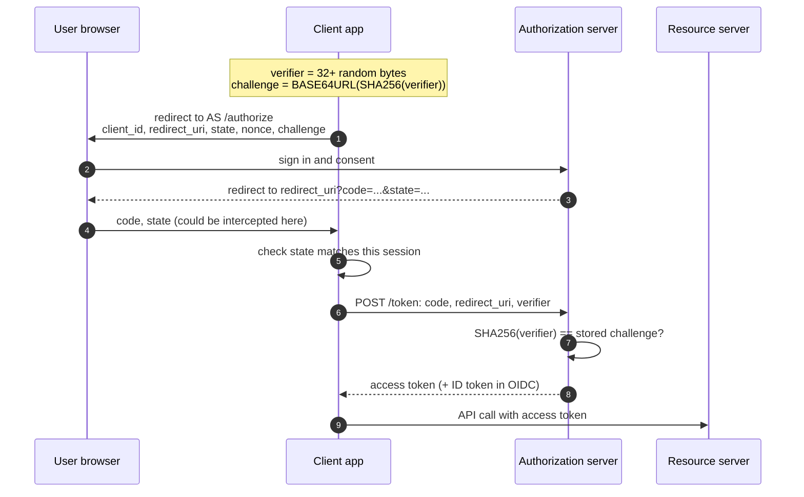
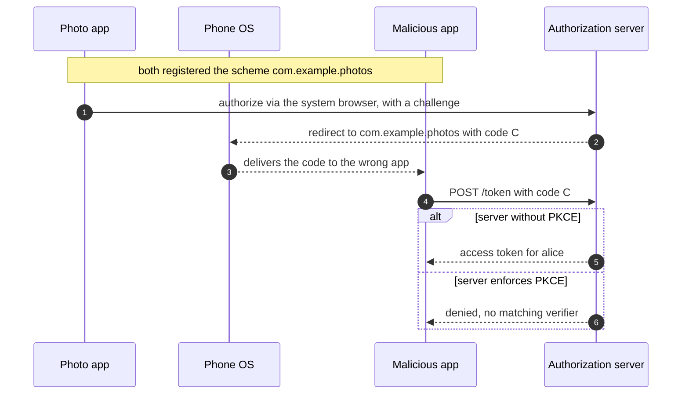
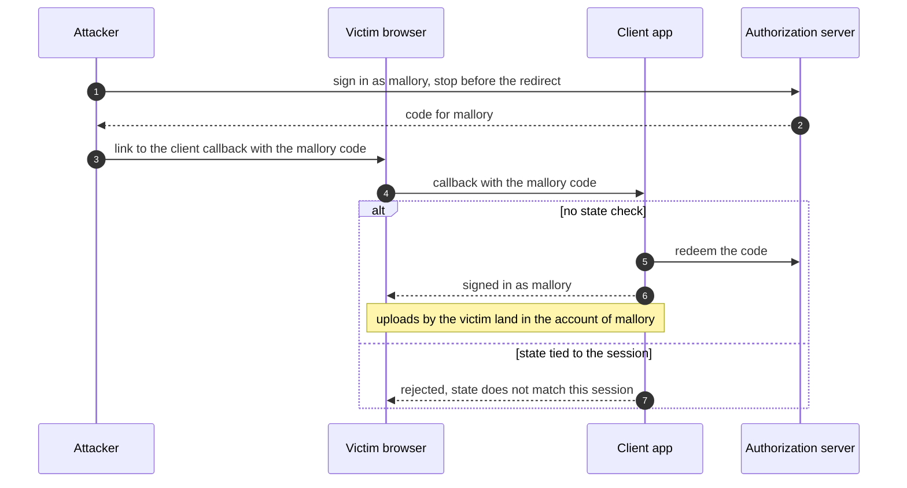
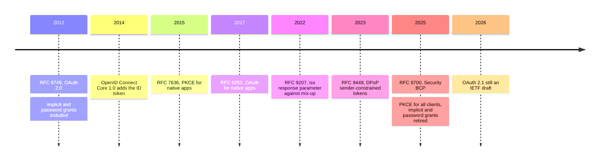

+++
title = 'OAuth and OpenID Connect'
description = 'OAuth delegates access and OpenID Connect adds sign-in. Both are safe only with the authorization code flow, PKCE, exact redirect URI matching, and a client that validates what it receives.'
question = 'How does "Sign in with..." work, and which checks stop a stolen authorization code or a forged redirect from becoming account takeover?'
weight = 3
difficulty = 3
prerequisites = ['/notes/application-security/authentication/02-sessions-and-cookies']
date = 2026-05-25
lastmod = 2026-10-30
verified = 2026-05-25
+++

## The idea in one minute

**OAuth 2.0** (RFC 6749) lets a user grant an application limited access to
their data at another service without giving it their password. The user
signs in at the **authorization server**, approves the request, and the
application receives an **access token** for a **resource server**.
**OpenID Connect** (OIDC) is a layer on top that adds identity: alongside the
access token, the application receives a signed **ID token** saying who the
user is. That is what powers "Sign in with...".

The flow is a series of redirects through the user's browser, and every hop is
a place to steal or inject something. The modern answer, consolidated in the
OAuth 2.0 Security Best Current Practice (RFC 9700, January 2025), is short:
use the **authorization code flow with PKCE** for every client; match redirect
URIs **exactly**; bind the response to the request with `state` or PKCE and,
in OIDC, `nonce`; never use the implicit or password grants; and validate the
ID token's issuer, audience, expiry, and nonce before trusting it.

The consequence to act on: **an authorization code is a bearer secret on its
way through a hostile channel. PKCE makes it useless to anyone but the client
that started the flow.**

## A picture



The code travels through the browser, where other apps, logs, and referrers can
see it. The verifier travels only on the direct, TLS-protected call from client
to authorization server.

## How it really works

### The four roles

| Role | Example | Holds |
| --- | --- | --- |
| **Resource owner** | Alice | Her credentials at the authorization server |
| **Client** | A photo-printing app | A `client_id`, and a client secret only if it is *confidential* (runs on a server) |
| **Authorization server** | The identity provider | User accounts, consent records, signing keys |
| **Resource server** | The photo storage API | Alice's data; trusts tokens from the authorization server |

A **public client** cannot keep a secret: a mobile app, a desktop app, or a
single-page application, whose code anyone can unpack. Anything shipped inside
it, including a "client secret", is known to attackers. That single fact
drives most of the design below.

The roles talk over two channels: the front channel runs through the browser, where others on the device can see it, and the back channel is a direct TLS call.

```mermaid {title="The four OAuth roles and the two channels between them"}
flowchart LR
  U(["Resource owner"])
  BR("Browser")
  subgraph PUB["Public client, no secret"]
    C("Photo app")
  end
  AS("Authorization server")
  RS("Resource server")
  U --> BR
  C <-->|"front channel: redirects"| BR
  BR <-->|"front channel: sign-in, code"| AS
  C -->|"back channel: code + verifier"| AS
  C -->|"access token"| RS
  RS -.->|"trusts tokens from"| AS
```

### The authorization code flow and why the code is not enough

The client redirects the user to the authorization server's `/authorize`
endpoint with its `client_id`, a `redirect_uri`, the requested `scope`, and a
`state` value. After sign-in and consent, the server redirects back to the
`redirect_uri` with a short-lived, single-use **authorization code**. The client
then exchanges the code for tokens in a direct back-channel call to the `/token`
endpoint.

For a confidential client, the token call is authenticated with the client's
secret or, better, a private key (`private_key_jwt`) or mutual TLS, so a stolen
code is useless without that credential. A public client has no such
credential. On a phone, the redirect to a custom URI scheme such as
`com.example.photos:/cb` may be delivered to **any** app that registered the
same scheme. RFC 7636 was written for exactly this: an authorization code
interception attack where a malicious app on the same device receives the code
and redeems it first.

Watch the code leave through a URI scheme that two apps claimed, and what PKCE leaves the thief holding.



### PKCE

**Proof Key for Code Exchange** (RFC 7636, 2015) adds a per-flow secret:

1. The client generates a random **code verifier**: 43 to 128 characters from
   the unreserved URL alphabet, with at least 256 bits of entropy recommended.
2. It sends the **code challenge**, `BASE64URL(SHA256(verifier))`, with
   `code_challenge_method=S256` in the authorization request. The server stores
   it with the code.
3. At the token endpoint, the client sends the verifier. The server hashes it
   and compares with the stored challenge.

An attacker who intercepts the code saw only the challenge, if that, and cannot
invert SHA-256 to get the verifier. The `plain` method, where challenge equals
verifier, exists for constrained clients but protects only against attackers
who see the response and not the request; use `S256`.

PKCE was introduced for native apps, but RFC 9700 extends it: **public clients
must use PKCE, and it is recommended for confidential clients too**, because
it also defeats **authorization code injection**, in which an attacker who
obtained a code from one session submits it into another (their own browser
session with the legitimate client) to log in as the victim. Authorization
servers must support PKCE and must reject a token request without a verifier
when the authorization request carried a challenge, which closes a downgrade
where the attacker simply omits the verifier.

### Redirect URIs: exact string matching

The redirect URI is where the authorization server sends the code. If an
attacker can change it to a URI they control, they receive the code directly,
and **PKCE does not help**, because the attacker can start the flow with a
challenge whose verifier they know. The victim only has to click a link and
approve a consent screen that shows the legitimate app's name.

RFC 9700 therefore requires **exact string matching** of redirect URIs against
pre-registered values (with one exception: the port of a `localhost` loopback
redirect for native apps, per RFC 8252). Prefix matching, wildcard subdomains,
and path patterns have each produced real account-takeover bugs, because URL
parsers disagree and because any open redirector on an allowed host becomes a
relay. The same BCP asks clients and authorization servers to avoid open
redirectors altogether.

Run the lookalike URI from the program below through both matching rules.

```mermaid {title="A lookalike redirect URI against prefix and exact matching"}
flowchart LR
  M(["Attacker link"])
  R["<b>redirect_uri</b><br/><small>https://app.example.com.attacker.test/cb</small>"]
  P@{ shape: diam, label: "Prefix match on https://app.example.com" }
  E@{ shape: diam, label: "Exact match on https://app.example.com/cb" }
  L["<b>Code sent to the attacker</b><br/><small>PKCE passes: they hold the verifier</small>"]
  D["<b>Request refused</b>"]
  M --> R
  R --> P -->|"starts with it"| L
  R --> E -->|"differs"| D
  class M,R,L warn
  class E,D good
```

### state and nonce

**`state`** binds the redirect back to the browser session that started the
flow. Without it, an attacker can complete a flow with *their own* account and
feed the resulting code to the victim's browser, logging the victim into the
attacker's account (login CSRF): anything the victim then uploads lands in the
attacker's account. RFC 9700 allows clients that have confirmed the server
enforces PKCE to rely on PKCE for this protection; a random `state` tied to the
session costs nothing and is still the common practice.

In login CSRF the attacker gives away their own code; `state` is what lets the client notice it was not asked for.



**`nonce`** is the OIDC counterpart: the client sends a random value in the
authorization request, and the authorization server copies it into the ID
token. The client rejects an ID token whose `nonce` does not match the value
stored in this session, which stops an ID token from one session being replayed
into another.

### ID token versus access token

| | ID token | Access token |
| --- | --- | --- |
| Defined by | OpenID Connect Core 1.0 | OAuth 2.0 (format unspecified; often a JWT per RFC 9068, or opaque) |
| Audience | **The client** (`aud` = `client_id`) | **The resource server** |
| Purpose | Tells the client who signed in, when, and how | Authorizes API calls |
| Who validates it | The client | The resource server |
| Must not be | Sent to APIs as a bearer token | Treated by the client as proof of who the user is |

The second row is the source of a classic flaw. An app that "logs in" by
accepting any valid access token and calling the user-info endpoint can be
fooled by a token that was issued to a *different* client: a malicious app the
user once signed into obtains an access token and presents it to your app.
The ID token prevents this because its `aud` names your client. Validate, per
OIDC Core section 3.1.3.7: the signature with the provider's published key
and an expected algorithm, `iss` equal to the expected issuer, `aud` containing
your `client_id`, `exp` in the future, and `nonce` equal to the one you sent.
The mechanics of verifying a JWT safely are in
[tokens and JWT pitfalls](/notes/application-security/authentication/04-tokens-and-jwt-pitfalls/).

Follow the substituted token: it is perfectly valid, just not issued to you.

```mermaid {title="Token substitution, and the ID token check that stops it"}
flowchart LR
  AS("Authorization server")
  EVIL("Malicious client")
  YOU["<b>Your client</b>"]
  Q@{ shape: diam, label: "Sign-in decided by?" }
  BAD["<b>Signed in as the victim</b>"]
  OK["<b>Rejected</b><br/><small>aud is not your client_id</small>"]
  AS -->|"victim used it once, access token"| EVIL
  EVIL -->|"presents that token"| YOU
  YOU --> Q
  Q -->|"any valid access token + userinfo"| BAD
  Q -->|"ID token: iss, aud, exp, nonce"| OK
  class EVIL,BAD warn
  class OK good
```

### What RFC 9700 retires

| Practice | Status in RFC 9700 | Why |
| --- | --- | --- |
| Implicit grant (`response_type=token`) | Should not be used | Tokens in the URL fragment leak through history, referrers, and logs, and cannot be sender-constrained |
| Resource owner password credentials grant | Must not be used | The client handles the user's password, which defeats the point of OAuth and blocks MFA |
| Redirect URI patterns | Exact matching required | Pattern matching repeatedly led to code theft |
| Long-lived bearer refresh tokens for public clients | Must be sender-constrained or rotated | Rotation with reuse detection, or DPoP (RFC 9449) or mTLS (RFC 8705) binding |
| Access tokens usable anywhere | Should be audience-restricted | A token for one API should be rejected by another |
| Clients that talk to several authorization servers | Must defend against mix-up attacks | Use the `iss` response parameter (RFC 9207) or a distinct redirect URI per server |

OAuth 2.1, an IETF draft as of October 2026, folds these rules into the core
specification so that new implementations start from them.

Read the history as a sequence of patches to the 2012 framework.



> [!TIP] Native and browser apps
> Native apps should open the system browser (not an embedded web view, which
> lets the app read the user's password) and receive the redirect through a
> claimed HTTPS link, a loopback address, or a private-use scheme, per RFC 8252.
> For single-page applications, the safest pattern keeps tokens out of the
> browser entirely: a small backend ("backend for frontend") runs the OAuth flow
> and gives the browser an ordinary session cookie.

## Code

The program simulates an authorization server for a public client and runs the
legitimate flow, a code replay, an interception attack against servers with and
without PKCE, a lookalike redirect URI against prefix and exact matching, and a
downgrade to the `plain` method. It first checks the `S256` computation against
the test vector in RFC 7636 Appendix B.

```python {title="pkce.py"}
"""pkce.py: the authorization code flow with PKCE (RFC 7636), and two attacks.

A simulated authorization server for a public client (a mobile app with no
secret). A malicious app intercepts the redirect; a lax server prefix-matches
redirect URIs. Standard library only; offline; secrets are never printed.
"""

from __future__ import annotations

import base64
import hashlib
import secrets
from dataclasses import dataclass


class Denied(Exception):
    pass


def b64url(data: bytes) -> str:
    return base64.urlsafe_b64encode(data).rstrip(b"=").decode()


def s256(verifier: str) -> str:
    """code_challenge = BASE64URL(SHA256(ASCII(code_verifier))), RFC 7636 section 4.2."""
    return b64url(hashlib.sha256(verifier.encode("ascii")).digest())


@dataclass
class Grant:
    client_id: str
    redirect_uri: str
    user: str
    challenge: str | None
    used: bool = False


class AuthServer:
    def __init__(self, require_pkce: bool, exact_redirect: bool):
        self.clients = {"photo-app": "https://app.example.com/cb"}
        self.require_pkce, self.exact = require_pkce, exact_redirect
        self.grants: dict[str, Grant] = {}

    def redirect_ok(self, client_id: str, uri: str) -> bool:
        registered = self.clients[client_id]
        return uri == registered if self.exact else uri.startswith(registered.rsplit("/", 1)[0])

    def authorize(self, client_id: str, redirect_uri: str, user: str,
                  challenge: str | None, method: str = "S256") -> str:
        """The user has signed in and consented; return the code sent to redirect_uri."""
        if not self.redirect_ok(client_id, redirect_uri):
            raise Denied("redirect_uri does not exactly match the registered value")
        if self.require_pkce and (challenge is None or method != "S256"):
            raise Denied("PKCE with S256 is required")
        code = secrets.token_urlsafe(32)
        self.grants[code] = Grant(client_id, redirect_uri, user, challenge)
        return code

    def token(self, client_id: str, code: str, redirect_uri: str, verifier: str | None) -> str:
        g = self.grants.get(code)
        if g is None:
            raise Denied("unknown code")
        if g.used:
            raise Denied("code already used (revoke what it issued)")
        g.used = True  # single use, checked before anything else can fail
        if g.client_id != client_id or g.redirect_uri != redirect_uri:
            raise Denied("code was issued to a different client or redirect_uri")
        if g.challenge is not None and (verifier is None or s256(verifier) != g.challenge):
            raise Denied("PKCE verification failed")
        return f"access token for {g.user}"


def attempt(label: str, action) -> None:
    try:
        print(f"{label:<46} {action()}")
    except Denied as e:
        print(f"{label:<46} DENIED: {e}")


if __name__ == "__main__":
    # RFC 7636 Appendix B test vector.
    rfc = s256("dBjftJeZ4CVP-mB92K27uhbUJU1p1r_wW1gFWFOEjXk")
    print("RFC 7636 appendix B:", rfc, rfc == "E9Melhoa2OwvFrEMTJguCHaoeK1t8URWbuGJSstw-cM")
    cb = "https://app.example.com/cb"

    # 1. The legitimate app. The verifier never leaves the device until the token call.
    strict = AuthServer(require_pkce=True, exact_redirect=True)
    verifier = secrets.token_urlsafe(48)  # 64 characters, within RFC 7636's 43-128
    code = strict.authorize("photo-app", cb, "alice", s256(verifier))
    attempt("legit app redeems its code", lambda: strict.token("photo-app", code, cb, verifier))
    attempt("anyone replays the same code", lambda: strict.token("photo-app", code, cb, verifier))

    # 2. A malicious app on the same phone receives the redirect and its code.
    for server, label in [(AuthServer(False, True), "no PKCE"), (strict, "PKCE")]:
        v = secrets.token_urlsafe(48)
        stolen = server.authorize("photo-app", cb, "alice", s256(v) if label == "PKCE" else None)
        # The interceptor knows the public client_id and the redirect URI, not v.
        attempt(f"interceptor redeems stolen code ({label})",
                lambda: server.token("photo-app", stolen, cb, None))

    # 3. The attacker builds the authorization link with their own PKCE pair and
    #    a lookalike redirect URI, then gets alice to click it and consent.
    evil_uri = "https://app.example.com.attacker.test/cb"
    for server, label in [(AuthServer(True, False), "prefix match"), (strict, "exact match")]:
        mine = secrets.token_urlsafe(48)

        def run(server=server, mine=mine) -> str:
            c = server.authorize("photo-app", evil_uri, "alice", s256(mine))
            return server.token("photo-app", c, evil_uri, mine)
        attempt(f"lookalike redirect_uri ({label})", run)

    attempt("downgrade to the plain method",
            lambda: strict.authorize("photo-app", cb, "alice", "x" * 43, method="plain"))
```

Run it with `python3 pkce.py`:

```text
RFC 7636 appendix B: E9Melhoa2OwvFrEMTJguCHaoeK1t8URWbuGJSstw-cM True
legit app redeems its code                     access token for alice
anyone replays the same code                   DENIED: code already used (revoke what it issued)
interceptor redeems stolen code (no PKCE)      access token for alice
interceptor redeems stolen code (PKCE)         DENIED: PKCE verification failed
lookalike redirect_uri (prefix match)          access token for alice
lookalike redirect_uri (exact match)           DENIED: redirect_uri does not exactly match the registered value
downgrade to the plain method                  DENIED: PKCE with S256 is required
```

The interceptor holds everything a public client has (the `client_id`, the
redirect URI, the code) and still fails against PKCE, because the one value it
lacks never crossed the browser. The lookalike redirect URI succeeds against the
prefix-matching server *even though PKCE is enforced*: the attacker started the
flow, so they hold the verifier. Only exact redirect matching stops that row.

## Where it breaks

- **PKCE protects the code, not the token.** Once an access token or refresh
  token is issued, PKCE has no further role. A token leaked from logs or
  browser storage is a bearer credential unless it is sender-constrained with
  DPoP or mTLS.
- **The device can be fully compromised.** PKCE assumes the attacker sees the
  redirect but not the client's memory. Malware with access to the legitimate
  app's process reads the verifier, or simply the tokens.
- **Consent screens are a social surface.** An attacker can register their own
  client with a convincing name and ask for broad scopes ("consent phishing").
  No protocol check stops a user granting access to a malicious but correctly
  registered app; admin consent policies and scope review do.
- **The client is still responsible for validation.** A perfect authorization
  server cannot help a client that skips the `state`, `nonce`, `iss`, or `aud`
  checks, or that accepts tokens issued to other clients.
- **The simulation leaves out a lot.** There is no TLS, no client
  authentication for confidential clients, no token signing, and no expiry on
  codes. RFC 6749 recommends code lifetimes of at most ten minutes; production
  servers typically use far less.
- **Account linking.** Many takeovers in "Sign in with..." come from merging
  accounts by an email address the provider never verified. Use the `sub` and
  `iss` pair as the stable identifier, and only treat `email` as verified when
  the provider says so (`email_verified`) and you trust that provider for it.

## Remember this

- Authorization code flow with PKCE (`S256`) for every client; no implicit, no
  password grant.
- Redirect URIs are matched exactly; PKCE does not save you from a redirect to
  the attacker.
- `state` binds the response to the session; `nonce` binds the ID token to it.
- ID tokens are for the client, access tokens are for APIs; never swap them.
- Validate ID tokens: signature, `iss`, `aud`, `exp`, `nonce`. Identify users by
  `iss` and `sub`, not email.
- RFC 9700 (January 2025) is the checklist; OAuth 2.1 is the draft that adopts it.

## Try it

1. In `pkce.py`, make the strict server accept a token request with no verifier
   when one was expected (skip the check if `verifier is None`). Which attack
   comes back, and what RFC 9700 requirement did you just break?
2. Add a `state` check: the client stores a random value before redirecting
   and rejects a callback whose `state` differs. Simulate login CSRF by
   delivering the attacker's own code and state to the victim's client.
3. Add an expiry to `Grant` (pass the current time explicitly) and reject codes
   older than 60 seconds.
4. Write a function that validates a simulated ID token as a dict: `iss`, `aud`
   (string or list), `exp`, and `nonce`. Test it with a token whose `aud` is a
   different client.
5. For an application you use, find its OAuth configuration. Are redirect URIs
   exact? Is PKCE required for all clients, or only public ones?

## Check yourself

1. What attack does PKCE prevent, and how?

   
   Authorization code interception (and code injection). The client sends only
   the SHA-256 hash of a random verifier in the authorization request and the
   verifier itself in the token request. Someone who steals the code from the
   redirect cannot produce the verifier, so the token endpoint refuses to
   redeem it.
   

2. Why does PKCE not stop an attacker who can change the redirect URI?

   
   The attacker starts the flow themselves with a challenge whose verifier they
   know, and sends the victim the link. The code goes to the attacker's URI, and
   the attacker completes the token request with their own verifier. Exact
   redirect URI matching is the control.
   

3. What is the difference in audience between an ID token and an access token,
   and why does it matter?

   
   The ID token's audience is the client (`aud` = `client_id`); the access token's
   is the resource server. A client that authenticates users from access tokens
   can be given a token issued to another client and log the wrong person in.
   Checking `aud` on the ID token rules that out.
   

4. What does `nonce` protect against in OIDC?

   
   Replay of an ID token into a different session. The client generates a random
   value per authorization request, stores it in the session, and accepts only an
   ID token containing that exact value.
   

5. Why does RFC 9700 say the implicit grant should not be used?

   
   It returns the access token in the redirect URL's fragment, where it can leak
   through browser history, referrer headers, logs, and malicious scripts, and
   there is no way to sender-constrain it. The code flow with PKCE gives the same
   browser-based clients a safer option.
   

## Sources

- T. Lodderstedt, J. Bradley, A. Labunets, D. Fett, [RFC 9700: Best Current Practice for OAuth 2.0 Security](https://www.rfc-editor.org/rfc/rfc9700), IETF, January 2025.
- N. Sakimura, J. Bradley, N. Agarwal, [RFC 7636: Proof Key for Code Exchange by OAuth Public Clients](https://www.rfc-editor.org/rfc/rfc7636), IETF, September 2015.
- D. Hardt (ed.), [RFC 6749: The OAuth 2.0 Authorization Framework](https://www.rfc-editor.org/rfc/rfc6749), IETF, October 2012.
- W. Denniss, J. Bradley, [RFC 8252: OAuth 2.0 for Native Apps](https://www.rfc-editor.org/rfc/rfc8252), IETF, October 2017.
- K. Meyer zu Selhausen, D. Fett, [RFC 9207: OAuth 2.0 Authorization Server Issuer Identification](https://www.rfc-editor.org/rfc/rfc9207), IETF, March 2022.
- N. Sakimura et al., [OpenID Connect Core 1.0 incorporating errata set 2](https://openid.net/specs/openid-connect-core-1_0.html), OpenID Foundation, December 2023.
- V. Bertocci, [RFC 9068: JSON Web Token (JWT) Profile for OAuth 2.0 Access Tokens](https://www.rfc-editor.org/rfc/rfc9068), IETF, October 2021.
- IETF OAuth Working Group, [The OAuth 2.1 Authorization Framework](https://datatracker.ietf.org/doc/draft-ietf-oauth-v2-1/), Internet-Draft, accessed October 2026.
- IETF OAuth Working Group, [OAuth 2.0 for Browser-Based Applications](https://datatracker.ietf.org/doc/draft-ietf-oauth-browser-based-apps/), Internet-Draft, accessed October 2026.
