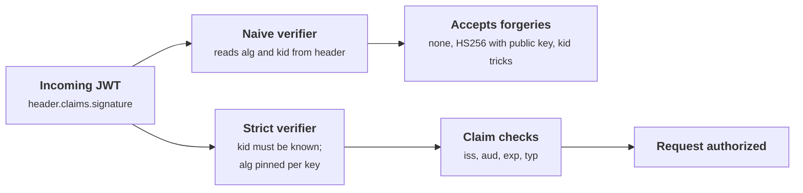
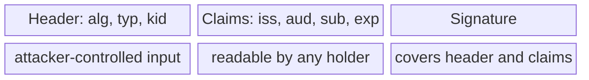
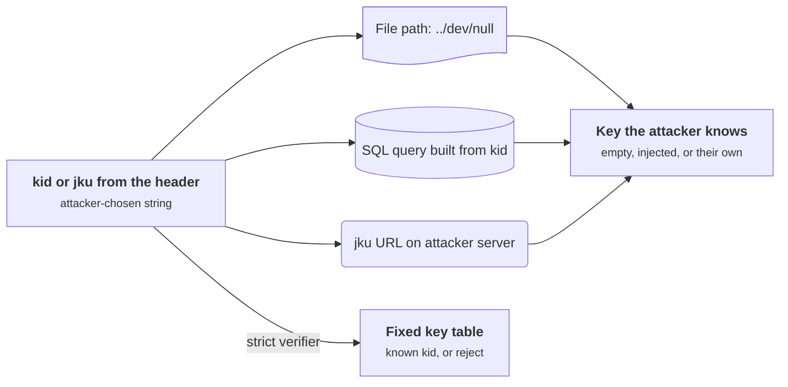
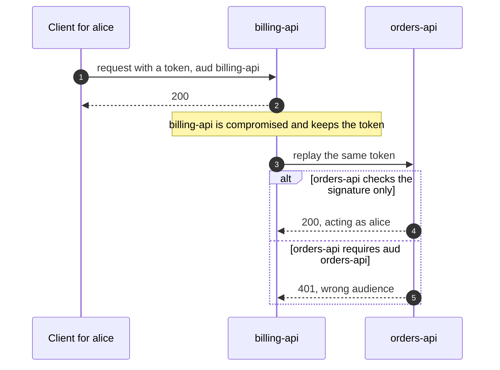

+++
title = 'Tokens and JWT pitfalls'
description = 'A JWT is a signed claim that anyone can read and the verifier must check completely. Most JWT vulnerabilities come from letting the token choose how it is verified.'
question = 'What can go wrong when a server verifies a JSON Web Token, and when should it use an opaque token instead?'
weight = 4
difficulty = 3
prerequisites = ['/notes/application-security/authentication/03-oauth-and-openid-connect']
date = 2026-05-27
lastmod = 2026-05-27
verified = 2026-05-27
+++

## The idea in one minute

A **JSON Web Token** (RFC 7519) is a set of claims, such as "subject alice,
audience orders-api, expires at 12:05", encoded as JSON and signed. Any service
that holds the right key can check it without calling the issuer. That is the
appeal: no session lookup, no shared database. It is also the hazard, because
the verifier must now do everything a session store used to do for it, and the
token arrives carrying instructions about how to verify it.

The classic JWT vulnerabilities all follow from obeying those instructions:
accepting `alg: none`, letting the header switch an RSA key into an HMAC
secret, resolving a `kid` into a file path or a database query, or checking the
signature and forgetting the audience, issuer, and expiry. The JWT Best Current
Practices (RFC 8725) answer is simple to state: **the verifier decides the
algorithm, the key, and the expected claims in advance, and the token can only
match them or fail.**

The consequence to act on: **pin the algorithm to the key, validate `iss`,
`aud`, and `exp` on every token, and choose an opaque token when you need to
revoke.**

## A picture



The header is attacker-controlled input like any other. The strict verifier
uses it only to *select* among choices the server already made.

## How it really works

### What a JWT is

The common form is a JWS in compact serialization (RFC 7515): three base64url
segments separated by dots.

```text {title="a JWT, decoded"}
header:    {"alg": "RS256", "typ": "JWT", "kid": "rs-2026"}
claims:    {"iss": "https://id.example.com", "aud": "orders-api",
            "sub": "alice", "exp": 1790000300, "iat": 1790000000}
signature: RSASSA-PKCS1-v1_5 over BASE64URL(header) + "." + BASE64URL(claims)
```

Picture the three segments by who controls them: the first two are readable by anyone, and only the third needs a key.



Three facts matter for security:

1. **It is signed, not encrypted.** Anyone holding the token can decode the
   claims. Do not put secrets or personal data in them that the bearer, or
   whoever finds the token in a log, should not read. Encrypted JWTs (JWE) exist
   but are rarely what you need.
2. **The header names the algorithm.** RFC 7518 defines `HS256` (HMAC-SHA256
   with a shared secret), `RS256` and `PS256` (RSA signatures), `ES256` and
   `EdDSA` (elliptic curve signatures), and `none` (an unsecured JWS with an
   empty signature).
3. **The registered claims are optional in the format but mandatory in
   practice.** `iss` (issuer), `sub` (subject), `aud` (audience), `exp`
   (expiry), `nbf` (not before), `iat` (issued at), and `jti` (unique ID) are
   defined by RFC 7519, which leaves it to the application to require them.

### Attack 1: alg=none

If the verifier lets the header choose the algorithm and its library supports
`none`, an attacker removes the signature, sets `"alg": "none"`, and edits the
claims at will. In 2015 Tim McLean showed that several popular JWT libraries
did exactly this through their default verification functions. Most libraries
have since changed their defaults, but the pattern recurs in hand-written
verifiers and in configuration that enables `none` "for testing". RFC 8725
requires libraries to let callers specify the accepted algorithms and requires
applications to reject everything else.

### Attack 2: algorithm confusion (RS256 to HS256)

Suppose an API verifies RS256 tokens with the issuer's **public** key, and its
library's interface is `verify(token, key)`, picking the algorithm from the
header. The attacker writes a token with `"alg": "HS256"` and computes an
HMAC over it using the public key's bytes as the secret. The library sees
HS256, uses the "key" it was given (the public key) as the HMAC secret, and
the MAC matches. The public key is, by design, public: often served from the
issuer's JWKS endpoint. The attacker can now mint any token.

The same public-key bytes play two roles here: a verification key for RS256 and an HMAC secret for HS256.

```mermaid {title="Algorithm confusion turns a public key into a signing secret"}
flowchart LR
  J("Issuer public key on JWKS")
  M(["Attacker"])
  T["<b>Forged token</b><br/><small>alg HS256, role admin</small>"]
  V["<b>verify(token, public_key)</b><br/><small>alg taken from the header</small>"]
  A["<b>Accepted as admin</b>"]
  P["<b>kid table: rs-2026 is RS256 only</b>"]
  R["<b>Rejected</b>"]
  J -->|"public by design"| M
  M -->|"HMAC with the key bytes"| T
  T --> V --> A
  T -.->|"strict verifier"| P --> R
  class M,T,V,A warn
  class P,R good
```

The root cause is that one key value was usable by two algorithms. The fix is
to bind each key to exactly one algorithm (a JWK's `alg` field, or a
`kid → (alg, key)` table in your code) and to reject a token whose header
disagrees.

### Attack 3: kid injection and other header lookups

`kid` (key ID) tells the verifier which key to use, which is necessary for key
rotation. It is also an attacker-chosen string. Verifiers have used it as:

- **a file path**, so `"kid": "../dev/null"` loads an empty file, and an HMAC
  with an empty key is something the attacker can compute;
- **part of a SQL query**, so `kid` becomes an injection point that can return a
  key value the attacker picked;
- **a URL**, via the related `jku` and `x5u` headers, telling the verifier to
  fetch the key set from an attacker's server.

RFC 8725 section 3.10 says it directly: do not trust received claims, including
these header parameters. Look `kid` up in a fixed set of keys you already hold,
and never fetch keys from a URL named in the token.

Every unsafe use of `kid` ends at the same place: a key the attacker knows.



### The claim checks a signature does not do

A valid signature proves the issuer created the token. It does not prove the
token was created **for you**, **now**, or **for this purpose**.

| Check | Without it |
| --- | --- |
| `iss` equals the issuer you trust for this key | Tokens from another tenant or environment that shares a key or a key server are accepted |
| `aud` contains your service's identifier | A token issued for the billing API works at the orders API; any service that receives tokens can replay them at its neighbors |
| `exp` (and `nbf`) against your clock with a small leeway | A token captured last month still works |
| `typ`, or another rule that distinguishes token kinds | An ID token, a refresh token, or an email-verification token is accepted as an access token |
| A required set of claims | A token that simply omits `exp` or `aud` slips past checks written as "if present, verify" |

The `typ` row is RFC 8725's "explicit typing": access tokens per RFC 9068 carry
`"typ": "at+jwt"`, so a resource server can reject any other JWT type even if
the same issuer signed it. The general principle, "use mutually exclusive
validation rules for different kinds of JWTs", stops one token kind from being
replayed as another.

The audience row of the table, over time: a correctly signed token travels one hop further than it should.



### Keys and cryptographic checks

- **HMAC secrets need full entropy.** An HS256 key should be at least 256 random
  bits (RFC 7518 asks for a key at least as long as the hash output). A short or
  human-chosen secret can be brute-forced offline from a single token, because
  the attacker can test guesses against the signature without talking to you.
- **Prefer asymmetric signatures when more than one service verifies.** With
  HS256, every verifier can also mint tokens. With ES256 or EdDSA, only the
  issuer holds the private key.
- **Validate the cryptography itself.** Libraries have had signature bugs of
  their own; in 2022 Java's ECDSA implementation was found to accept an all-zero
  signature for any message (CVE-2022-21449). Keep libraries current and test
  that tampered and malformed tokens are rejected.

### Opaque versus self-contained tokens

| | Self-contained (JWT) | Opaque (reference) |
| --- | --- | --- |
| What the token is | The claims plus a signature | A random string that names a server-side record |
| Validation | Local, with the issuer's key | A lookup, or a call to the issuer's introspection endpoint (RFC 7662) |
| Revocation | Hard: valid until `exp` unless every verifier checks a deny list | Immediate: delete the record |
| Information exposure | Claims are readable by anyone who holds it | Nothing to read |
| Cost | No per-request call to the issuer | A lookup per request (cacheable) |

Revocation is the real decision. A self-contained token cannot be withdrawn
once issued, so systems that use JWT access tokens keep them short-lived
(minutes) and pair them with refresh tokens that *are* checked at the issuer,
where a session can be ended. When you need instant logout, account suspension,
or "sign out everywhere", an opaque token or a server-side session is simpler
and more honest than a JWT plus a deny list that every service must consult.

Here is the revocation gap: the issuer has ended the session, but the API checks the access token locally until it expires.

```mermaid {title="Revoking a session that uses short JWTs and a refresh token"}
sequenceDiagram
  autonumber
  participant C as Client
  participant API as Resource server
  participant AS as Issuer
  C->>API: JWT access token, a few minutes left
  API-->>C: 200, checked locally
  Note over AS: admin suspends alice, session ended at the issuer
  C->>API: the same JWT, before exp
  API-->>C: 200, the gap a self-contained token cannot close
  C->>AS: refresh token, after exp
  AS-->>C: denied, session revoked
  C->>API: expired JWT
  API-->>C: 401
```

> [!IMPORTANT]
> "Stateless authentication" is a property of the verifier, not of the system.
> Someone still has to answer "is this user still allowed in?", and with
> self-contained tokens the answer is delayed until the token expires.

Place the options on the two axes that usually decide it: how fast you must revoke, and how many services verify.


## Code

The program implements HS256 signing and verification with `hmac`, plus a
deliberately tiny textbook RSA so it can show algorithm confusion without a
third-party library. A naive verifier trusts the header; a strict verifier
pins each `kid` to one algorithm and key and checks issuer, audience, and
expiry. Both see the same six tokens.

```python {title="jwt_verify.py"}
"""jwt_verify.py: a naive JWT verifier, five forged or misused tokens, and a strict one.

HS256 is real (HMAC-SHA256, RFC 7518). RS256 is replaced by textbook RSA with a
tiny modulus so the program stays standard-library only: it shows the shape of
algorithm confusion, not real RSA. Offline; fixed clock; deterministic output.
"""

from __future__ import annotations

import base64
import hashlib
import hmac
import json
import posixpath

NOW = 1_790_000_000
P, Q, E = 2**61 - 1, 2**89 - 1, 65537          # toy primes; real keys are 2048+ bits
N, D = P * Q, pow(E, -1, (P - 1) * (Q - 1))
PUBLIC_KEY = f"toy-rsa n={N} e={E}".encode()  # published at the issuer's JWKS URL
HS_SECRET = b"32 random bytes from a CSPRNG..."

# What a lazy key loader can reach: kid becomes a file path.
FILES = {"keys/rs-2026": PUBLIC_KEY, "keys/hs-2026": HS_SECRET, "dev/null": b""}


class Invalid(Exception):
    pass


def b64e(data: bytes) -> str:
    return base64.urlsafe_b64encode(data).rstrip(b"=").decode()


def b64d(text: str) -> bytes:
    return base64.urlsafe_b64decode(text + "=" * (-len(text) % 4))


def rsa_sign(msg: bytes) -> bytes:
    h = int.from_bytes(hashlib.sha256(msg).digest(), "big") % N
    return pow(h, D, N).to_bytes(19, "big")


def rsa_ok(msg: bytes, sig: bytes) -> bool:
    h = int.from_bytes(hashlib.sha256(msg).digest(), "big") % N
    return pow(int.from_bytes(sig, "big"), E, N) == h


def make(header: dict, claims: dict, key: bytes | None = None) -> str:
    signing_input = f"{b64e(json.dumps(header).encode())}.{b64e(json.dumps(claims).encode())}"
    alg = header["alg"]
    sig = (b"" if alg == "none" else rsa_sign(signing_input.encode()) if alg == "RS256"
           else hmac.new(key, signing_input.encode(), hashlib.sha256).digest())
    return f"{signing_input}.{b64e(sig)}"


def split(token: str) -> tuple[dict, dict, bytes, bytes]:
    h64, c64, s64 = token.split(".")
    return json.loads(b64d(h64)), json.loads(b64d(c64)), f"{h64}.{c64}".encode(), b64d(s64)


def naive_verify(token: str) -> dict:
    """Trusts the header: alg chooses the algorithm, kid chooses a file."""
    header, claims, signing_input, sig = split(token)
    if header["alg"] == "none":
        return claims
    path = posixpath.normpath("keys/" + header.get("kid", ""))
    if path not in FILES:
        raise Invalid("no such key file")
    key = FILES[path]
    if header["alg"] == "HS256":
        ok = hmac.compare_digest(sig, hmac.new(key, signing_input, hashlib.sha256).digest())
    else:
        ok = rsa_ok(signing_input, sig)
    if not ok:
        raise Invalid("bad signature")
    return claims


# The strict verifier's registry: each kid is pinned to one algorithm and key.
KEYS = {"rs-2026": ("RS256", PUBLIC_KEY), "hs-2026": ("HS256", HS_SECRET)}


def strict_verify(token: str, issuer: str, audience: str, leeway: int = 30) -> dict:
    header, claims, signing_input, sig = split(token)
    if header.get("kid") not in KEYS:
        raise Invalid("unknown kid")
    alg, key = KEYS[header["kid"]]
    if header.get("alg") != alg:
        raise Invalid(f"alg {header.get('alg')} not allowed for this key")
    ok = (rsa_ok(signing_input, sig) if alg == "RS256"
          else hmac.compare_digest(sig, hmac.new(key, signing_input, hashlib.sha256).digest()))
    if not ok:
        raise Invalid("bad signature")
    if claims.get("iss") != issuer:
        raise Invalid("wrong issuer")
    aud = claims.get("aud")
    if audience not in (aud if isinstance(aud, list) else [aud]):
        raise Invalid("wrong audience")
    if not isinstance(claims.get("exp"), int) or NOW > claims["exp"] + leeway:
        raise Invalid("expired or no exp")
    return claims


if __name__ == "__main__":
    good = {"iss": "https://id.example.com", "aud": "orders-api", "sub": "alice",
            "role": "user", "exp": NOW + 300}
    evil = dict(good, role="admin")
    rs = {"alg": "RS256", "typ": "JWT", "kid": "rs-2026"}
    cases = [
        ("legitimate RS256 token", make(rs, good)),
        ("alg=none, role=admin", make({"alg": "none", "kid": "rs-2026"}, evil)),
        ("RS256 key used as HS256 secret", make({"alg": "HS256", "kid": "rs-2026"}, evil, PUBLIC_KEY)),
        ("kid=../dev/null, empty key", make({"alg": "HS256", "kid": "../dev/null"}, evil, b"")),
        ("valid token for billing-api", make(rs, dict(good, aud="billing-api"))),
        ("valid token, expired an hour ago", make(rs, dict(good, exp=NOW - 3600))),
    ]
    print(f"{'token':<34} {'naive':<20} strict")
    for label, token in cases:
        row = []
        for verify in (naive_verify, lambda t: strict_verify(t, "https://id.example.com", "orders-api")):
            try:
                row.append(f"accepted ({verify(token)['role']})")
            except Invalid as e:
                row.append(f"rejected: {e}")
        print(f"{label:<34} {row[0]:<20} {row[1]}")
```

Run it with `python3 jwt_verify.py`:

```text
token                              naive                strict
legitimate RS256 token             accepted (user)      accepted (user)
alg=none, role=admin               accepted (admin)     rejected: alg none not allowed for this key
RS256 key used as HS256 secret     accepted (admin)     rejected: alg HS256 not allowed for this key
kid=../dev/null, empty key         accepted (admin)     rejected: unknown kid
valid token for billing-api        accepted (user)      rejected: wrong audience
valid token, expired an hour ago   accepted (user)      rejected: expired or no exp
```

Every forgery succeeds against the naive verifier, and each one escalates to
`admin`. Each fails against the strict one for a specific reason: `none` and
`HS256` are not the algorithms registered for `rs-2026`, and `../dev/null` is
not a key ID the server knows. The last two rows are not forgeries at all:
correctly signed tokens used in the wrong place or at the wrong time. Only the
claim checks catch them.

## Where it breaks

- **A correct verifier does not make tokens revocable.** The strict verifier
  still accepts a stolen but unexpired token for the right audience. Short
  lifetimes and sender-constrained tokens (DPoP, RFC 9449; mTLS, RFC 8705)
  limit that; only a server-side check removes it.
- **The toy RSA is not RSA.** A 150-bit modulus can be factored instantly, and
  textbook RSA without padding is insecure. It is here only to show that a
  public key used as an HMAC secret lets anyone sign. Use a vetted JOSE library
  in production and configure its algorithm allowlist.
- **Allowlists can still be too wide.** Allowing `["RS256", "HS256"]` globally
  reintroduces confusion unless each key is pinned to one of them.
- **Clock skew.** A leeway of seconds to a minute absorbs skew; a leeway of hours
  quietly extends every token's life.
- **Libraries differ in defaults.** Some validate `exp` automatically but not
  `aud`; some validate `aud` only when you pass one. Write tests that present a
  wrong-audience and an expired token and expect rejection.
- **Where tokens are stored matters.** A token in `localStorage` is readable by
  any script that runs in the page; a token in an `HttpOnly` cookie brings back
  the CSRF concerns from
  [sessions and cookies](/notes/application-security/authentication/02-sessions-and-cookies/).

## Remember this

- A JWT is readable by anyone; its signature proves origin, not intended use.
- The server chooses the algorithm and key; `kid` only selects among known
  keys, each pinned to one algorithm.
- Reject `none`; never fetch keys from `jku` or `x5u` in a token.
- Require and check `iss`, `aud`, `exp`, and the token type on every token.
- HS256 keys need 256 random bits; prefer asymmetric signatures across services.
- Need revocation? Use opaque tokens or short-lived JWTs with checked refresh.

## Try it

1. Add `nbf` (not before) support to `strict_verify` and a test token that is
   not yet valid.
2. Add a `typ` check that requires `at+jwt`, and mint an ID-token-shaped JWT
   (`typ` `JWT`, `aud` set to a client ID) that the access-token verifier must
   reject.
3. Write a revocation check: keep a set of revoked `jti` values and reject
   tokens on it. What does every verifier now need access to, and how fresh must
   that list be?
4. Generate an HS256 token with the secret `password` and write a loop that
   recovers the secret from a small wordlist using only the token. Then explain
   why `secrets.token_bytes(32)` makes that loop hopeless.
5. Read the documentation of the JWT library your team uses. Which claims does it
   check by default, and how do you pin algorithms per key?

## Check yourself

1. Why does a verifier that accepts `alg: none` accept arbitrary claims?

   
   An unsecured JWS has an empty signature. If the verifier lets the token's
   header pick the algorithm and `none` is permitted, there is nothing to check,
   so the attacker can write any claims they like.
   

2. Explain the RS256 to HS256 confusion attack and its fix.

   
   The verifier is configured with the issuer's RSA public key and lets the
   header choose the algorithm. The attacker sets `alg` to HS256 and signs with
   the public key bytes as the HMAC secret; the verifier recomputes the HMAC with
   the same bytes and accepts. Fix: each key is bound to one algorithm and the
   verifier rejects tokens whose header names any other.
   

3. A token has a valid signature from your identity provider. Name three
   reasons to still reject it.

   
   Its `aud` names a different service; it has expired (or is not yet valid);
   its `iss` is not the expected issuer for that key; it is a different kind of
   token, such as an ID token or refresh token presented as an access token;
   or it lacks a claim you require.
   

4. Why is `kid` dangerous, and how should it be used?

   
   It is attacker-controlled, so using it as a file path, query fragment, or URL
   lets the attacker choose the key or inject into the lookup. It should only be
   used as a key into a fixed set of keys the server already holds.
   

5. When would you choose an opaque token over a JWT?

   
   When you need immediate revocation (logout, account suspension, "sign out
   everywhere"), when the claims should not be visible to the client, or when
   one service validates the token anyway and a lookup is cheap. JWTs fit when
   many services must validate locally and short lifetimes are acceptable.
   

## Sources

- M. Jones, J. Bradley, N. Sakimura, [RFC 7519: JSON Web Token (JWT)](https://www.rfc-editor.org/rfc/rfc7519), IETF, May 2015.
- Y. Sheffer, D. Hardt, M. Jones, [RFC 8725: JSON Web Token Best Current Practices](https://www.rfc-editor.org/rfc/rfc8725), IETF, February 2020.
- M. Jones, J. Bradley, N. Sakimura, [RFC 7515: JSON Web Signature (JWS)](https://www.rfc-editor.org/rfc/rfc7515), IETF, May 2015.
- M. Jones, [RFC 7518: JSON Web Algorithms (JWA)](https://www.rfc-editor.org/rfc/rfc7518), IETF, May 2015.
- V. Bertocci, [RFC 9068: JSON Web Token (JWT) Profile for OAuth 2.0 Access Tokens](https://www.rfc-editor.org/rfc/rfc9068), IETF, October 2021.
- J. Richer (ed.), [RFC 7662: OAuth 2.0 Token Introspection](https://www.rfc-editor.org/rfc/rfc7662), IETF, October 2015.
- T. McLean, [Critical vulnerabilities in JSON Web Token libraries](https://auth0.com/blog/critical-vulnerabilities-in-json-web-token-libraries/), March 2015.
- NIST National Vulnerability Database, [CVE-2022-21449](https://nvd.nist.gov/vuln/detail/CVE-2022-21449), April 2022.
