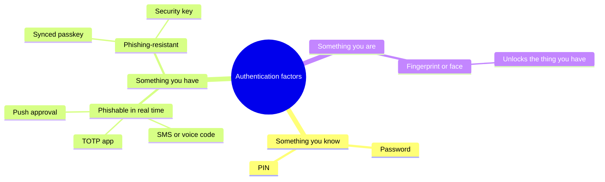
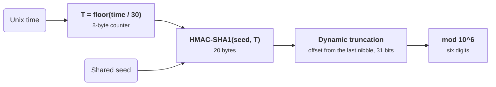
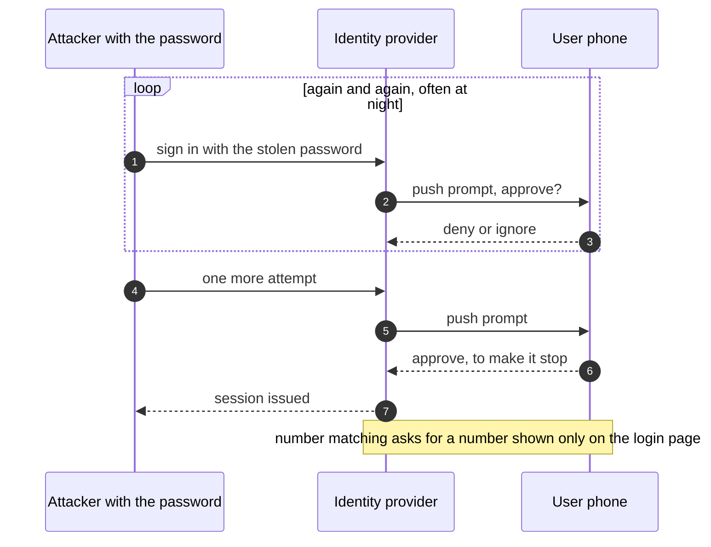
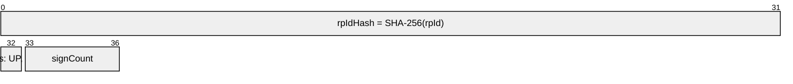
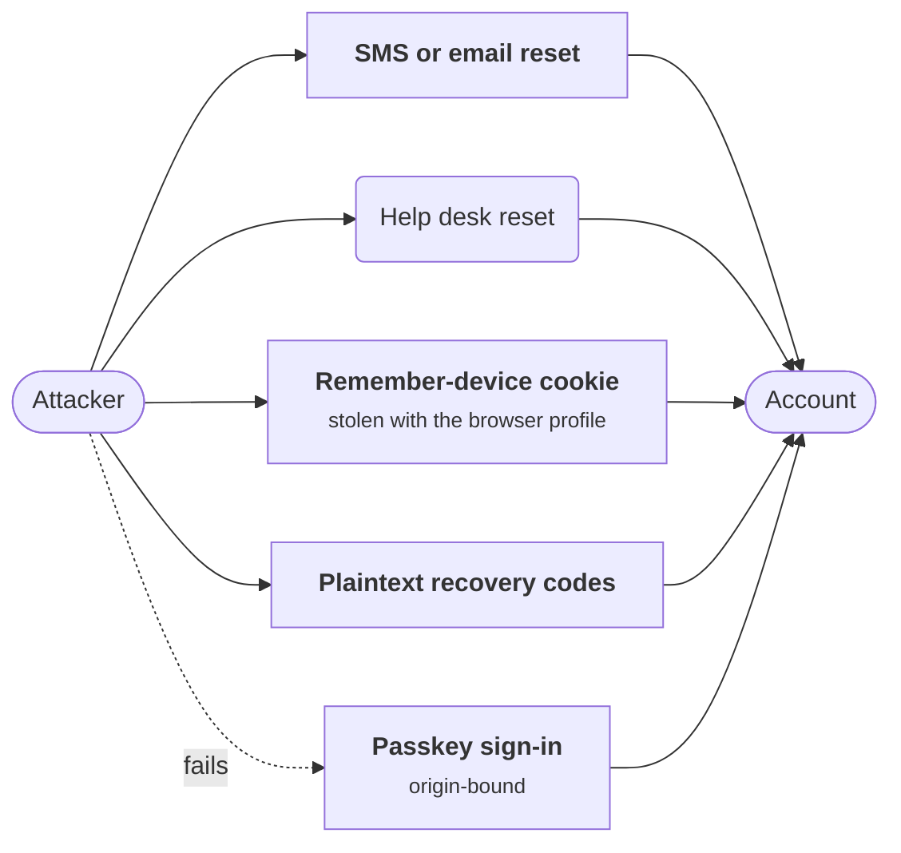
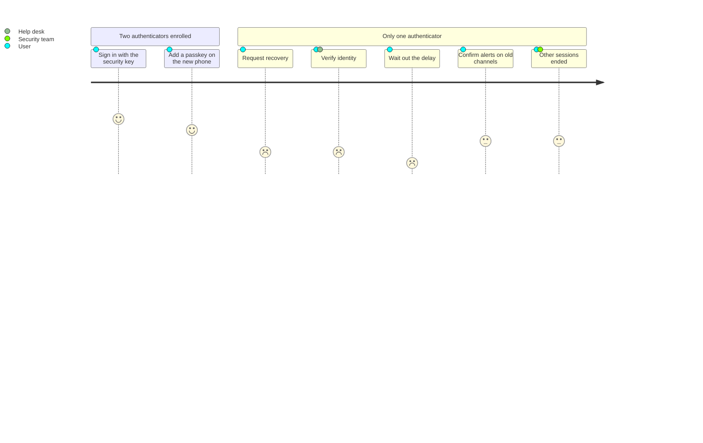

+++
title = 'MFA and passkeys'
description = 'A second factor stops password reuse, but codes and push prompts can still be phished or fatigued. Passkeys bind each login to the real origin, and account recovery becomes the part attackers aim for.'
question = 'Which second factors actually stop phishing, why do passkeys succeed where one-time codes fail, and where does the attacker go next?'
weight = 5
difficulty = 3
prerequisites = ['/notes/application-security/authentication/01-storing-credentials', '/notes/application-security/authentication/02-sessions-and-cookies']
date = 2026-05-29
lastmod = 2026-05-29
verified = 2026-05-29
+++

## The idea in one minute

Multi-factor authentication asks for proof from more than one category:
something you know (a password), something you have (a phone, a security key),
something you are (a fingerprint, usually used to unlock the thing you have).
It ends the easy attacks: a password from another site's breach is no longer
enough to sign in.

It does not end phishing. A **one-time code** (TOTP, SMS) is a short secret the
user types, and a user can type it into a fake page as easily as the real one;
the attacker's proxy forwards it within seconds. A **push prompt** asks the user
to approve, and a user woken at 2 a.m. by the twentieth prompt may approve to
make it stop. **Passkeys** (WebAuthn credentials) are different in kind: the
browser writes the page's origin into what the authenticator signs, and the
authenticator only has a key for the real site, so there is nothing a fake site
can collect and replay.

Once login is phishing-resistant, attackers go around it: to the **account
recovery** flow, the help desk, or the session cookie issued after login. The
consequence to act on: **deploy phishing-resistant authentication, then make
recovery at least as strong as the login it replaces.**

## A picture

```mermaid {title="A phishing proxy against a one-time code and against a passkey"}
sequenceDiagram
  participant U as User
  participant P as Phishing proxy<br/>(examp1e.com)
  participant S as Real site<br/>(example.com)
  U->>P: password + 6-digit code
  P->>S: same password + code, seconds later
  S-->>P: session cookie (attacker is in)
  Note over U,S: with a passkey instead
  P->>S: start sign-in
  S-->>P: WebAuthn challenge
  P->>U: relay challenge, rpId example.com
  U--xP: browser refuses: rpId does not match examp1e.com
  Note over P: no signature to relay, an assertion made<br/>for examp1e.com would carry the wrong origin
```

The code carries no information about where it was typed. The passkey's
signature covers the origin and the site identity, so it is only valid at the
site that asked.

## How it really works

### Factors and assurance levels

NIST SP 800-63B defines **authenticator assurance levels**. In revision 4
(2025), AAL1 allows a single factor; AAL2 requires two factors, and the verifier
must offer at least one phishing-resistant option; AAL3 requires a
phishing-resistant authenticator whose key is held in hardware and cannot be
exported. NIST treats one-time codes over SMS or voice as a **restricted**
authenticator: usable, but with extra obligations (such as telling users about
the risk and offering an alternative) because of SIM swaps, number porting, and
interception.

| Method | Phishable in real time | Other main weakness |
| --- | --- | --- |
| SMS or voice code | Yes | SIM swap, number port-out, interception |
| TOTP app (RFC 6238) | Yes | Shared seed stored on the server; seed copied at enrollment |
| Push approval | Yes, and fatigue | Users approve prompts they did not start |
| Push with number matching | Reduced; still relayable | The user can be talked into typing the number |
| Passkey, synced (WebAuthn) | **No** | Security of the sync account (cloud keychain) |
| Passkey, device-bound / security key | **No** | Loss of the device; recovery |

Sort the methods in the table by factor, then by whether they survive a real-time phishing proxy.



### TOTP, precisely

TOTP (RFC 6238) is HOTP (RFC 4226) with time as the counter. Server and
authenticator app share a secret key, usually delivered as a QR code at
enrollment. Every 30 seconds both compute:

1. `T = floor(unix_time / 30)`, the time step, as an 8-byte big-endian integer.
2. `HMAC-SHA1(key, T)`: 20 bytes. (SHA-256 and SHA-512 are also defined.)
3. **Dynamic truncation**: take the low four bits of the last byte as an offset,
   read four bytes from there, clear the top bit.
4. Reduce modulo 10^6 for a six-digit code.

Both sides run the same pipeline, and none of its inputs says which site the code is for.



A verifier accepts a small window around the current step to absorb clock
drift and typing time (RFC 6238 recommends allowing at most one step back for
network delay), must **not accept the same code twice** once it has been used
successfully, and must rate-limit attempts: six digits is only a million
possibilities.

Two properties of TOTP shape its risk. The server must store the seed in a
form it can use, so seeds are encrypted, not hashed, and a database breach that
includes the encryption key exposes every user's second factor. And the code
says nothing about the site it was typed into. A real-time phishing proxy
(adversary-in-the-middle) sits between the user and the real site, passes the
password and code through, and keeps the resulting session cookie. Phishing
toolkits that do this are widely available, which is why replay protection
does not help: the attacker's proxy is the first to submit the code.

### Push fatigue

Push approval removes typing but keeps the human decision. Attackers who hold a
password trigger login after login until the user taps "approve". Uber's
September 2022 security update described this pattern: an attacker with a
contractor's password sent repeated approval requests until one was accepted.

The attack needs only patience: every denied prompt costs the attacker nothing.


Mitigations, roughly in order of strength:

- **Number matching**: the login page shows a number that the user must type into
  the app, so a prompt the user did not initiate cannot be approved blindly. CISA
  published guidance recommending it in 2022.
- **Rate limits and lockouts** on prompts, plus alerts to the security team when
  many are denied.
- **Context in the prompt**: application, location, device.
- Replacing push with a phishing-resistant method for high-value accounts.

Number matching still relays: a phisher can show the user the number on the
fake page. It defeats fatigue, not a proxy.

### WebAuthn and passkeys

**WebAuthn** is the W3C API (Level 2 is a W3C Recommendation from April 2021;
Level 3 is the in-progress revision) through which a web page asks an
authenticator to create or use a public-key credential. Together with CTAP,
the protocol between the browser and an external authenticator, it forms
**FIDO2**. A **passkey** is the FIDO Alliance's name for such a credential that
the user can sign in with directly, usually without a password; it may be
synced between devices by a platform keychain or bound to one device such as a
security key.

At registration, the authenticator generates a key pair for this site and
returns the public key; the server stores it. Nothing secret is stored at the
server, so a database breach yields no usable credential. At sign-in, three
bindings make the result unphishable:

1. **The browser enforces the RP ID.** The page asks for credentials for a
   relying party ID such as `example.com`. The browser allows this only if the
   RP ID is the page's own domain or a registrable parent of it.
   `examp1e.com` cannot ask for `example.com` credentials.
2. **The authenticator scopes keys to the RP ID.** It only uses a credential
   for the RP ID it was created for, and puts `SHA-256(rpId)` in the
   `authenticatorData` it signs.
3. **The browser writes the origin.** `clientDataJSON` contains the type, the
   server's challenge, and the **origin of the calling page**, filled in by the
   browser, not the page. The authenticator signs `authenticatorData` together
   with the hash of `clientDataJSON`.

The fixed start of `authenticatorData` (positions here are bytes) shows binding 2: the RP ID hash is inside what gets signed.



The server then verifies the signature with the stored public key, that the
challenge is the one it issued and has not been used, that the origin is its
own, that the `rpIdHash` matches, and that the user-presence (and, if required,
user-verification) flags are set. A proxy on another origin gets either
nothing (steps 1 and 2) or an assertion that names the wrong origin (step 3).

Cross-device sign-in, where a phone authenticates a login on a laptop by
scanning a QR code, uses a Bluetooth proximity check, so a phisher cannot
simply send the QR code to a victim far away.

### Recovery is the weak point

Every account needs a way back in when the phone is lost. Whatever that way is
becomes the real strength of the account, because an attacker will choose it
over a passkey. Common weaknesses:

- **Fallback to SMS or email** that resets every other factor.
- **Help desk resets** that rely on facts an attacker can find or social
  engineer, such as an employee ID or a manager's name.
- **"Remember this device"** cookies that live for months and are stolen with
  the rest of the browser profile.
- **Recovery codes** stored in plaintext by the server, or never shown to the
  user again after enrollment.

An attacker facing a passkey picks the cheapest door into the same account.



Stronger patterns: encourage enrolling **two** phishing-resistant
authenticators (for example a synced passkey and a security key) so that loss
of one is not a recovery event; store recovery codes like passwords (salted,
slow hash, single use); require identity verification with a waiting period
and notifications to every existing channel for high-value recoveries; and
treat a recovery as a security event that ends other sessions and is reviewed.

Compare the two experiences of losing a phone: the friction lands on users who enrolled only one authenticator.



> [!WARNING]
> MFA protects the login, not the session it produces. Malware that steals
> session cookies, or a proxy that captures them, bypasses every factor. Pair
> strong login with short sessions for sensitive actions and step-up
> authentication, as in
> [sessions and cookies](/notes/application-security/authentication/02-sessions-and-cookies/).

## Code

The first program implements HOTP and TOTP from the RFCs and checks every test
vector in RFC 6238 Appendix B, for SHA-1, SHA-256, and SHA-512. It then runs a
verifier with a one-step window and replay protection, and a real-time phishing
relay.

```python {title="totp.py"}
"""totp.py: TOTP from RFC 6238 (on HOTP, RFC 4226), checked against the RFC test vectors.

Also a verifier with a drift window and replay protection. Standard library only;
offline; the clock is passed in explicitly so the output is deterministic.
"""

from __future__ import annotations

import hashlib
import hmac
import struct

# RFC 6238 Appendix B: the seeds are ASCII "1234567890" repeated to the hash's size.
SEEDS = {
    "SHA1": b"12345678901234567890",
    "SHA256": b"12345678901234567890123456789012",
    "SHA512": b"1234567890" * 6 + b"1234",
}
VECTORS = [  # (Unix time, SHA1, SHA256, SHA512), 8 digits, 30-second steps
    (59, "94287082", "46119246", "90693936"),
    (1111111109, "07081804", "68084774", "25091201"),
    (1111111111, "14050471", "67062674", "99943326"),
    (1234567890, "89005924", "91819424", "93441116"),
    (2000000000, "69279037", "90698825", "38618901"),
    (20000000000, "65353130", "77737706", "47863826"),
]


def hotp(key: bytes, counter: int, digits: int = 6, algo: str = "SHA1") -> str:
    mac = hmac.new(key, struct.pack(">Q", counter), getattr(hashlib, algo.lower())).digest()
    offset = mac[-1] & 0x0F                                  # dynamic truncation, RFC 4226 5.3
    code = struct.unpack(">I", mac[offset:offset + 4])[0] & 0x7FFFFFFF
    return str(code % 10**digits).zfill(digits)


def totp(key: bytes, unix_time: int, digits: int = 6, algo: str = "SHA1", step: int = 30) -> str:
    return hotp(key, unix_time // step, digits, algo)       # T = floor((now - T0) / X), T0 = 0


class Verifier:
    """Accepts the current step plus or minus one, and never the same step twice."""

    def __init__(self, key: bytes, window: int = 1):
        self.key, self.window, self.last_step = key, window, -1

    def check(self, code: str, unix_time: int) -> str:
        now_step = unix_time // 30
        for step in range(now_step - self.window, now_step + self.window + 1):
            if hmac.compare_digest(hotp(self.key, step), code):
                if step <= self.last_step:
                    return "rejected (replay of a used code)"
                self.last_step = step
                return f"accepted (step offset {step - now_step:+d})"
        return "rejected (no match in window)"


if __name__ == "__main__":
    failures = 0
    for t, *expected in VECTORS:
        got = [totp(SEEDS[a], t, 8, a) for a in ("SHA1", "SHA256", "SHA512")]
        failures += got != expected
        print(f"T={t:<12} {' '.join(got)}  {'ok' if got == expected else 'MISMATCH'}")
    print("all RFC 6238 vectors match" if failures == 0 else f"{failures} rows differ")
    print()

    key, t = SEEDS["SHA1"], 1_790_000_000
    code = totp(key, t)
    site = Verifier(key)
    print(f"{'user types code at the real site':<36}", site.check(code, t + 5))
    print(f"{'someone replays it later':<36}", site.check(code, t + 9))
    print(f"{'next code, phone clock 30s slow':<36}", site.check(totp(key, t + 30), t + 65))
    print(f"{'code from five minutes ago':<36}", site.check(totp(key, t - 300), t + 65))
    # Real-time phishing: the user types the code into a lookalike page, and the
    # attacker's proxy submits it to the real site first. Nothing in it says where it was typed.
    phished = Verifier(key)
    print(f"{'proxy relays the code it phished':<36}", phished.check(code, t + 7))
```

Run it with `python3 totp.py`:

```text
T=59           94287082 46119246 90693936  ok
T=1111111109   07081804 68084774 25091201  ok
T=1111111111   14050471 67062674 99943326  ok
T=1234567890   89005924 91819424 93441116  ok
T=2000000000   69279037 90698825 38618901  ok
T=20000000000  65353130 77737706 47863826  ok
all RFC 6238 vectors match

user types code at the real site     accepted (step offset +0)
someone replays it later             rejected (replay of a used code)
next code, phone clock 30s slow      accepted (step offset -1)
code from five minutes ago           rejected (no match in window)
proxy relays the code it phished     accepted (step offset +0)
```

The verifier does its job: it rejects a replayed code and a stale one and
tolerates a slow clock. It still accepts the phished code, because a proxy that
forwards within seconds is indistinguishable from the user.

The second program follows the WebAuthn data flow with a toy browser,
authenticator, and relying party, then tries the attacks a phishing proxy
would.

```python {title="origin_binding.py"}
"""origin_binding.py: why a passkey assertion cannot be phished, in miniature.

A toy browser, authenticator, and relying party following the WebAuthn data
flow: the browser writes the origin into clientDataJSON, the authenticator
scopes credentials to an RP ID and signs its hash, and the server checks both.
HMAC stands in for the authenticator's private-key signature (ES256 or EdDSA
in real WebAuthn), so this shows the binding, not the cryptography.
Standard library only; offline.
"""

from __future__ import annotations

import hashlib
import hmac
import json
import secrets
from urllib.parse import urlsplit

def sha256(data: bytes) -> bytes:
    return hashlib.sha256(data).digest()


class Refused(Exception):
    pass


class Authenticator:
    """Holds one credential per RP ID. Never sees the page, only what the browser sends."""

    def __init__(self) -> None:
        self.creds: dict[str, bytes] = {}
        self.counter = 0

    def register(self, rp_id: str) -> bytes:
        self.creds[rp_id] = secrets.token_bytes(32)
        return self.creds[rp_id]  # real WebAuthn returns a public key instead

    def get_assertion(self, rp_id: str, client_data_hash: bytes) -> tuple[bytes, bytes]:
        if rp_id not in self.creds:
            raise Refused(f"authenticator has no credential for {rp_id}")
        self.counter += 1
        auth_data = sha256(rp_id.encode()) + b"\x05" + self.counter.to_bytes(4, "big")  # UP+UV
        return auth_data, hmac.new(self.creds[rp_id], auth_data + client_data_hash,
                                   hashlib.sha256).digest()


def browser_get(page_origin: str, rp_id: str, challenge: str, auth: Authenticator) -> dict:
    """navigator.credentials.get(): the page chooses rp_id and challenge, never the origin."""
    host = urlsplit(page_origin).hostname
    if urlsplit(page_origin).scheme != "https" or not (host == rp_id or host.endswith("." + rp_id)):
        raise Refused(f"browser: rpId {rp_id} is not valid for origin {page_origin}")
    client_data = json.dumps({"type": "webauthn.get", "challenge": challenge,
                              "origin": page_origin}).encode()
    auth_data, sig = auth.get_assertion(rp_id, sha256(client_data))
    return {"clientDataJSON": client_data, "authenticatorData": auth_data, "signature": sig}


class RelyingParty:
    def __init__(self, rp_id: str, origin: str) -> None:
        self.rp_id, self.origin = rp_id, origin
        self.key: bytes = b""
        self.challenges: set[str] = set()

    def challenge(self) -> str:
        c = secrets.token_urlsafe(32)
        self.challenges.add(c)
        return c

    def verify(self, a: dict) -> str:
        cd = json.loads(a["clientDataJSON"])
        if cd["type"] != "webauthn.get" or cd["challenge"] not in self.challenges:
            return "rejected: unknown or reused challenge"
        self.challenges.discard(cd["challenge"])  # single use
        if cd["origin"] != self.origin:
            return f"rejected: origin {cd['origin']}"
        ad = a["authenticatorData"]
        if ad[:32] != sha256(self.rp_id.encode()) or not ad[32] & 0x01:
            return "rejected: rpIdHash or user-presence flag"
        expected = hmac.new(self.key, ad + sha256(a["clientDataJSON"]), hashlib.sha256).digest()
        if not hmac.compare_digest(expected, a["signature"]):
            return "rejected: bad signature"
        return "accepted"


def attempt(label: str, action) -> None:
    try:
        print(f"{label:<38} {action()}")
    except Refused as e:
        print(f"{label:<38} {e}")


if __name__ == "__main__":
    rp, phone = RelyingParty("example.com", "https://example.com"), Authenticator()
    rp.key = phone.register("example.com")

    attempt("sign in at https://example.com",
            lambda: rp.verify(browser_get("https://example.com", "example.com", rp.challenge(), phone)))
    attempt("phish page asks for rpId example.com",
            lambda: browser_get("https://examp1e.com", "example.com", rp.challenge(), phone))
    attempt("phish page asks for its own rpId",
            lambda: browser_get("https://examp1e.com", "examp1e.com", rp.challenge(), phone))

    # Suppose a broken client let the page pick any rpId: the origin still betrays it.
    def broken_client() -> str:
        cd = json.dumps({"type": "webauthn.get", "challenge": rp.challenge(),
                         "origin": "https://examp1e.com"}).encode()
        ad, sig = phone.get_assertion("example.com", sha256(cd))
        return rp.verify({"clientDataJSON": cd, "authenticatorData": ad, "signature": sig})
    attempt("broken client, relayed to example.com", broken_client)

    captured = browser_get("https://example.com", "example.com", rp.challenge(), phone)
    rp.verify(captured)
    attempt("replay a captured assertion", lambda: rp.verify(captured))
```

Run it with `python3 origin_binding.py`:

```text
sign in at https://example.com         accepted
phish page asks for rpId example.com   browser: rpId example.com is not valid for origin https://examp1e.com
phish page asks for its own rpId       authenticator has no credential for examp1e.com
broken client, relayed to example.com  rejected: origin https://examp1e.com
replay a captured assertion            rejected: unknown or reused challenge
```

The phishing page fails at the browser if it asks for the real RP ID, and at
the authenticator if it asks for its own. Even a hypothetical broken client
that let the page choose the RP ID produces an assertion stamped with the
phishing origin, which the server rejects. The final row shows that captured
assertions are single use because the challenge is.

## Where it breaks

- **The toy uses HMAC.** Real authenticators sign with a private key and the
  server stores only the public key, which is what makes a server breach
  harmless. The program shows the origin and RP ID bindings, not the key
  handling, attestation, or the CBOR encodings of real WebAuthn.
- **Origin binding trusts the browser.** Malware on the user's machine, a
  malicious browser extension with broad permissions, or a compromised browser
  can drive the authenticator or steal the session afterwards. Passkeys stop
  remote phishing, not a compromised endpoint.
- **Synced passkeys move trust to the sync account.** If the cloud account that
  syncs them is taken over, so are the passkeys. That is a reasonable trade for
  most users, and AAL3-style requirements call for device-bound keys instead.
- **Fallbacks undo the gain.** A site that offers passkeys but still accepts a
  password plus SMS code is as phishable as before for any user an attacker can
  steer to the fallback.
- **TOTP windows trade usability for exposure.** A wider window accepts more
  drift and gives a relayed or shoulder-surfed code longer to live. Replay
  protection needs state per user, which multi-region deployments must share.
- **Recovery is policy and people.** No protocol makes a help desk resistant to
  a convincing caller; process, verification, and delay do.

## Remember this

- MFA defeats password reuse; codes and push prompts are still phishable in
  real time.
- TOTP is HMAC over a time step with dynamic truncation; verifiers need a small
  window, replay rejection, and rate limits.
- Number matching defeats push fatigue, not a phishing proxy.
- Passkeys are unphishable because the browser stamps the origin and the
  authenticator scopes keys to the RP ID.
- Recovery and long-lived sessions are where attackers go next; make them as
  strong as login.

## Try it

1. In `totp.py`, add a rate limit: after five wrong codes in a row, reject
   everything for the next ten steps. Pass time explicitly.
2. Change `Verifier` to a window of 0. What fraction of users with a clock 20
   seconds slow will now fail, and how would you measure that in production?
3. In `origin_binding.py`, remove the RP ID suffix check from `browser_get`,
   then pass the phishing page's assertion to `rp.verify`. Which server check
   rejects it?
4. Add a `register` flow that issues a challenge and checks the origin, so that a
   phishing page cannot enroll its own credential on the victim's account.
5. Write down your organization's account-recovery path for a user who lost
   their only authenticator. Which step would an attacker target?

## Check yourself

1. Why does replay protection in a TOTP verifier not stop real-time phishing?

   
   Replay protection rejects a code used a second time. A phishing proxy forwards
   the victim's code to the real site immediately, so its use is the first one,
   and it is accepted. The victim's own attempt never reaches the site.
   

2. What three bindings make a WebAuthn assertion useless to a phishing site?

   
   The browser only allows an RP ID that matches the page's domain; the
   authenticator only uses a credential for the RP ID it was created for and
   signs its hash; and the browser writes the real calling origin into the
   signed client data, which the server checks.
   

3. What does number matching solve, and what does it not?

   
   It stops users approving a prompt they did not initiate, which defeats push
   fatigue. It does not stop a phishing page that shows the user the number and
   relays the login, because the user believes they started that login.
   

4. Why is a TOTP seed stored differently from a password, and what follows?

   
   The server needs the seed itself to compute expected codes, so it can only be
   encrypted, not hashed. A breach that includes the encryption key exposes every
   user's second factor, unlike WebAuthn, where the server stores only public
   keys.
   

5. Why is account recovery called the weak point of MFA?

   
   Recovery replaces the factors, so the account is only as strong as the weakest
   accepted recovery path. If a phishing-resistant login can be bypassed by an
   SMS reset or a help desk call, attackers will use that path instead.
   

## Sources

- D. M'Raihi, S. Machani, M. Pei, J. Rydell, [RFC 6238: TOTP: Time-Based One-Time Password Algorithm](https://www.rfc-editor.org/rfc/rfc6238), IETF, May 2011.
- D. M'Raihi et al., [RFC 4226: HOTP: An HMAC-Based One-Time Password Algorithm](https://www.rfc-editor.org/rfc/rfc4226), IETF, December 2005.
- W3C, [Web Authentication: An API for accessing Public Key Credentials, Level 2](https://www.w3.org/TR/webauthn-2/), W3C Recommendation, April 2021.
- W3C, [Web Authentication, Level 3](https://www.w3.org/TR/webauthn-3/), accessed October 2026.
- NIST, [SP 800-63B-4: Digital Identity Guidelines, Authentication and Authenticator Management](https://csrc.nist.gov/pubs/sp/800/63/b/4/final), 2025.
- CISA, [Implementing Phishing-Resistant MFA](https://www.cisa.gov/sites/default/files/publications/fact-sheet-implementing-phishing-resistant-mfa-508c.pdf) and [Implementing Number Matching in MFA Applications](https://www.cisa.gov/sites/default/files/publications/fact-sheet-implement-number-matching-in-mfa-applications-508c.pdf), October 2022.
- Uber, [Security update](https://www.uber.com/newsroom/security-update/), September 2022.
- FIDO Alliance, [Passkeys](https://fidoalliance.org/passkeys/).
