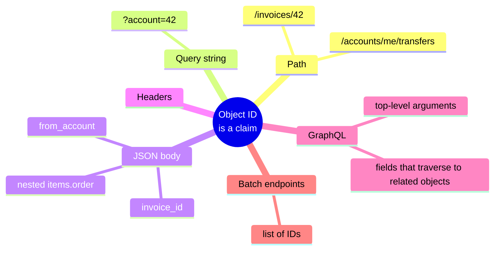
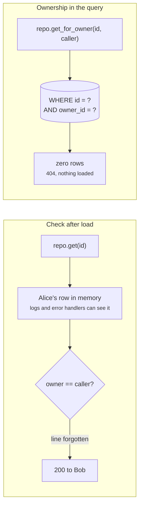
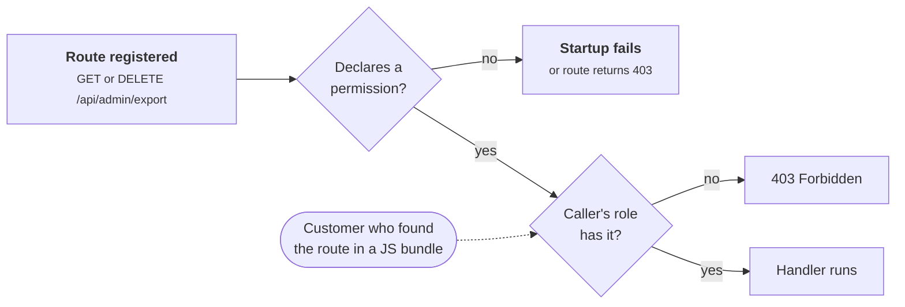
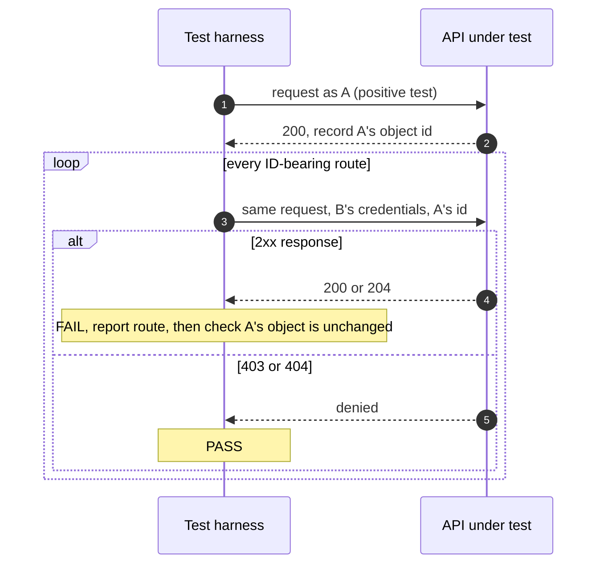

+++
title = 'Broken object level authorization'
description = "An authenticated user who changes an ID in a request should get nothing. When they get someone else's record instead, the handler checked who the caller is and never asked whether this caller may touch this object."
question = "Why does changing an ID in a request so often return someone else's data, and how do you prove it cannot?"
weight = 1
difficulty = 2
prerequisites = ['/notes/application-security/foundations/01-the-request-is-a-trust-boundary', '/notes/application-security/foundations/03-the-vulnerability-classes-that-matter']
date = 2026-05-31
lastmod = 2026-10-30
verified = 2026-05-31
+++

## The idea in one minute

A user logs in, opens one of their invoices, and sees
`GET /api/invoices/7f3a...` in the browser's network tab. They change the ID to
another value, perhaps one they found in a shared link, a log line or an email,
and the server returns another customer's invoice. Nobody broke authentication.
The caller is exactly who they claim to be. The server simply never asked
whether **this caller may act on this object**.

This is **broken object level authorization** (BOLA), called **insecure direct
object reference** (IDOR) in older literature. It is the first entry in the
OWASP API Security Top 10 (2023), and its sibling, **broken function level
authorization**, is the fifth: a caller reaches an operation, typically an
administrative one, that their role should not allow. Both are absences, not
mistakes in clever code, which is why scanners rarely find them and why they
survive code review: there is no bad line to point at, only a missing condition.

The consequence to act on: **every handler that takes an object identifier
must bind that identifier to the caller in the data access itself**, and the
test suite must contain requests from a second, ordinary user that are
expected to fail.

## A picture

```mermaid {title="The same request against a vulnerable and a fixed handler"}
sequenceDiagram
  autonumber
  participant B as Bob (logged in)
  participant API as Invoice API
  participant DB as Database
  B->>API: GET /invoices/{alice's id}<br/>Authorization: Bob's token
  Note over API: authenticated: yes, it is Bob
  alt vulnerable handler
    API->>DB: SELECT ... WHERE id = ?
    DB-->>API: alice's row
    API-->>B: 200, alice's invoice
  else fixed handler
    API->>DB: SELECT ... WHERE id = ? AND owner_id = 'bob'
    DB-->>API: no rows
    API-->>B: 404 Not Found
  end
```

Both handlers authenticate Bob correctly. Only the second one makes the
ownership part of the question it asks the database.

## How it really works

### Authentication answers a different question

Authentication establishes a principal: this request comes from Bob. Most web
frameworks make this step hard to forget, because a middleware rejects requests
without a valid session or token before any handler runs. Authorization has no
equivalent default. Whether Bob may read invoice `7f3a...` depends on data, the
invoice's owner, that only exists once the handler has loaded the object. So
the check has to live inside or next to every handler, and **anything that has
to be remembered in every handler will eventually be forgotten in one**.

Follow Bob's request: the framework guards the front door for every route, but
the ownership question can only be asked inside the handler, after the ID is known.

```mermaid {title="Authentication is enforced once, authorization in every handler"}
flowchart LR
  U(["Bob"])
  MW["<b>Auth middleware</b><br/><small>valid token? same for every route</small>"]
  H["<b>Invoice handler</b><br/><small>receives id from the request</small>"]
  X@{ shape: diam, label: "Bob may act<br/>on this id?" }
  DB@{ shape: cyl, label: "Invoices" }
  U --> MW --> H --> X
  X -->|"check present"| DB
  X -.->|"check forgotten"| LEAK["<b>Alice's invoice</b><br/><small>returned to Bob</small>"]
  class MW good
  class H compute
  class X neutral
  class DB memory
  class LEAK warn
```

The OWASP API Security Top 10 splits the failure into three entries that are
worth keeping apart, because they need different fixes:

| Entry (2023) | What is missing | Typical request |
| --- | --- | --- |
| **API1 Broken object level authorization** | The check that the caller may act on this specific object | `GET /invoices/{someone else's id}` |
| **API3 Broken object property level authorization** | The check on which fields the caller may read or write | `PATCH /users/me` with `{"role": "admin"}` (mass assignment) |
| **API5 Broken function level authorization** | The check that the caller's role may invoke this operation at all | `GET /admin/export` from a customer account |

The matching weakness entries in MITRE's CWE list are CWE-639
(*Authorization bypass through user-controlled key*) for BOLA and CWE-862
(*Missing authorization*) for the general case. Broken access control, the
umbrella category, ranked first in the OWASP Top 10 for web applications in its
2021 edition.

### Where the identifier comes from does not matter

Object IDs reach the server in path segments (`/invoices/42`), query strings
(`?account=42`), JSON bodies (`{"invoice_id": 42}`), headers, GraphQL arguments,
and IDs nested inside other objects (`{"items": [{"order": 42}]}`). The server
must treat all of them the same way: as a claim by the client about which
object it wants, never as evidence that it is allowed to have it. A common
failure is an endpoint that checks the ID in the path but then acts on a
different ID from the body, as in `PUT /accounts/me/transfers` with
`{"from_account": 42}`.

Each branch below is a separate place an ID can arrive, and each needs its own
binding to the caller.



Batch and nested endpoints deserve particular attention. An endpoint that
accepts a list of IDs is often checked by sampling the first element, or
checked per request rather than per object. GraphQL resolvers make it easy to
authorize the top-level query and forget the fields that traverse to related
objects.

### Why UUIDs are not authorization

A common response to an IDOR report is to replace sequential integers with
random UUIDs. This removes **enumeration**: an attacker can no longer try
`41, 42, 43`. It does not add **authorization**, for three reasons.

1. **Identifiers leak.** They appear in URLs, which end up in browser history,
   proxy logs, `Referer` headers, analytics tools and screenshots. They appear
   in API responses that list related objects, in emails, in exported files and
   in support tickets. An ID is designed to be shared; a secret is not.
2. **Not every UUID is random.** Version 1 and version 6 UUIDs contain a
   timestamp and a node identifier; version 7 begins with a millisecond
   timestamp. They are unique, not unpredictable. The UUID specification itself
   (RFC 4122, and RFC 9562 which replaced it in 2024) warns implementers not to
   assume UUIDs are hard to guess and not to use them as capabilities, meaning
   identifiers whose possession alone grants access.

   The layout of a version 7 UUID shows why: the first 48 bits are a clock,
   readable by anyone who sees the ID.

   ```mermaid {title="A UUIDv7 starts with a timestamp, not with randomness"}
   packet-beta
     0-47: "unix_ts_ms: milliseconds since 1970 (predictable)"
     48-51: "ver (7)"
     52-63: "rand_a"
     64-65: "var"
     66-127: "rand_b (random)"
   ```
3. **Revocation is impossible.** If knowing the ID is the permission, removing
   Bob from a project cannot remove his access to documents whose IDs he has
   already seen.

Random IDs are still worth using, as defense in depth and to stop competitors
counting your orders. If you genuinely want possession-based access, such as an
"anyone with the link" sharing feature, issue a separate, high-entropy,
revocable, expiring token for that purpose and keep it out of the object ID.

> [!IMPORTANT]
> An unguessable identifier reduces the chance of finding an object. Only an
> authorization check reduces what happens once it is found.

### Enforce ownership in the query

There are two ways to write the check. The first loads the object and then
compares:

```python {title="check after load"}
invoice = repo.get(invoice_id)
if invoice is None or invoice.owner_id != caller.user_id:
    raise NotFound()
```

This works, but every handler must remember the second line, and the object has
already been loaded into memory, where a logging statement or an error handler
can expose it. The second way makes ownership part of the lookup:

```python {title="ownership in the query"}
invoice = repo.get_for_owner(invoice_id, owner_id=caller.user_id)
if invoice is None:
    raise NotFound()
```

The SQL behind it is `WHERE id = ? AND owner_id = ?`. Updates and deletes get
the same predicate, so a forged ID simply affects zero rows. The stronger form
is a repository or query builder that requires a principal in its constructor,
so there is no method that loads an invoice by ID alone. When ownership is not
a single column (shared documents, delegated access, organization roles), the
predicate becomes a join or a call to an authorization service, but the
principle holds: **the caller's identity is an input to the data access, not a
check performed afterwards**.

Compare where the forbidden row ends up in each version: in memory, or nowhere.



### Function-level authorization

API5 is the same mistake one level up. Administrative endpoints are often
protected only by obscurity: the customer UI never links to
`/api/admin/export`, so nobody wrote a role check. Attackers find these routes
in JavaScript bundles, mobile app binaries, API documentation and by guessing
from naming conventions (`/api/users` suggests `/api/admin/users`). A different
HTTP method on the same path is another variant: `GET /users/42` is checked,
`DELETE /users/42` was added later and is not.

The fix is to deny by default at the routing layer. Every route declares the
permission it needs, and a route that declares nothing fails to register or
returns 403. That turns a forgotten check into a failing startup or a failing
test rather than an open endpoint.

The router below makes the missing declaration the thing that fails, before any
request arrives.



### 403 or 404?

When Bob asks for Alice's invoice, the server can say "forbidden" or "not
found". HTTP semantics (RFC 9110) explicitly allow a server that wants to hide
the existence of a forbidden resource to answer 404. For object-level checks
that is usually the right choice: a 403 confirms that the ID is valid, which
helps an attacker who is enumerating. For function-level checks, where the
existence of the admin route is not secret, 403 is clearer. Pick one rule per
case, document it, and make the response identical in body and timing whether
the object is missing or merely not yours.

### Negative tests

Most test suites test what users *should* be able to do. BOLA lives entirely in
what they should *not* be able to do, so it needs **negative tests**: requests
that are expected to fail. The minimal pattern needs two ordinary users and,
for each endpoint that takes an ID:

| Test | Expected |
| --- | --- |
| User A reads A's object | 200 |
| User B reads A's object | 404 (or 403) |
| User B updates or deletes A's object | 404 (or 403), and A's object unchanged |
| A customer calls each admin route | 403 |
| An administrator calls each admin route | 200 |

The positive case matters too. Without it, a handler that denies everything
would pass the suite. The "object unchanged" assertion matters because some
vulnerable handlers return an error *after* performing the write.

These tests can be generated. Given the route table and two fixture users, a
test harness can replay every ID-bearing request with the other user's
credentials and flag any 2xx response. That is how authorization testing
tools in web proxies work, and it is cheap enough to run in CI.

The generated replay is a loop over the route table: record a request as user A,
resend it as user B, and treat any success as a finding.



## Code

A simulated invoice API on an in-memory SQLite database. The vulnerable
handlers authenticate the caller and then trust the ID; the fixed handlers put
the owner in the `WHERE` clause and check the role on the admin route. The same
negative test suite runs against both.

```python {title="bola.py"}
"""bola.py: broken object level authorization in a simulated invoice API.

A vulnerable and a fixed set of handlers share one in-memory SQLite database.
A negative test suite (requests that MUST fail) runs against both. Standard
library only; offline; deterministic.
"""

from __future__ import annotations

import random
import sqlite3
import uuid
from dataclasses import dataclass
from typing import Callable


@dataclass(frozen=True)
class Principal:
    user_id: str
    roles: frozenset[str]


@dataclass(frozen=True)
class Response:
    status: int
    body: str = ""


def make_db() -> tuple[sqlite3.Connection, dict[str, str]]:
    rng = random.Random(7)  # seeded so the "unguessable" IDs are reproducible
    db = sqlite3.connect(":memory:")
    db.execute("CREATE TABLE invoices (id TEXT PRIMARY KEY, owner_id TEXT, amount INTEGER)")
    ids = {}
    for owner, amount in [("alice", 1200), ("bob", 90)]:
        inv_id = str(uuid.UUID(int=rng.getrandbits(128), version=4))
        db.execute("INSERT INTO invoices VALUES (?, ?, ?)", (inv_id, owner, amount))
        ids[owner] = inv_id
    return db, ids


class VulnerableAPI:
    """Authenticates the caller, then trusts whatever ID the caller sends."""

    def __init__(self, db: sqlite3.Connection) -> None:
        self.db = db

    def get_invoice(self, who: Principal, inv_id: str) -> Response:
        row = self.db.execute("SELECT owner_id, amount FROM invoices WHERE id = ?",
                              (inv_id,)).fetchone()
        return Response(200, f"{row[0]}:{row[1]}") if row else Response(404)

    def update_amount(self, who: Principal, inv_id: str, amount: int) -> Response:
        cur = self.db.execute("UPDATE invoices SET amount = ? WHERE id = ?", (amount, inv_id))
        return Response(204) if cur.rowcount else Response(404)

    def export_all(self, who: Principal) -> Response:
        # "Hidden" admin endpoint: no link in the UI, so no check in the code (API5).
        n = self.db.execute("SELECT COUNT(*) FROM invoices").fetchone()[0]
        return Response(200, f"{n} invoices")


class FixedAPI(VulnerableAPI):
    """Ownership is part of the query; function-level checks are explicit."""

    def get_invoice(self, who: Principal, inv_id: str) -> Response:
        row = self.db.execute(
            "SELECT owner_id, amount FROM invoices WHERE id = ? AND owner_id = ?",
            (inv_id, who.user_id)).fetchone()
        return Response(200, f"{row[0]}:{row[1]}") if row else Response(404)

    def update_amount(self, who: Principal, inv_id: str, amount: int) -> Response:
        cur = self.db.execute(
            "UPDATE invoices SET amount = ? WHERE id = ? AND owner_id = ?",
            (amount, inv_id, who.user_id))
        return Response(204) if cur.rowcount else Response(404)

    def export_all(self, who: Principal) -> Response:
        if "billing-admin" not in who.roles:
            return Response(403)
        return super().export_all(who)


ALICE = Principal("alice", frozenset({"customer"}))
BOB = Principal("bob", frozenset({"customer"}))
ADMIN = Principal("carol", frozenset({"billing-admin"}))


def suite(ids: dict[str, str]) -> list[tuple[str, Callable[[VulnerableAPI], Response], set[int]]]:
    a, b = ids["alice"], ids["bob"]
    return [
        # One positive test so a handler that denies everything cannot pass.
        ("alice reads her own invoice", lambda api: api.get_invoice(ALICE, a), {200}),
        # Negative tests: the second user, the other object, the wrong role.
        ("bob reads alice's invoice", lambda api: api.get_invoice(BOB, a), {403, 404}),
        ("bob edits alice's invoice", lambda api: api.update_amount(BOB, a, 1), {403, 404}),
        ("alice reads bob's invoice", lambda api: api.get_invoice(ALICE, b), {403, 404}),
        ("customer calls admin export", lambda api: api.export_all(BOB), {403}),
        ("admin calls admin export", lambda api: api.export_all(ADMIN), {200}),
    ]


def run(label: str, api_cls: type[VulnerableAPI]) -> None:
    db, ids = make_db()
    api = api_cls(db)
    print(f"--- {label}")
    failures = 0
    for name, call, allowed in suite(ids):
        resp = call(api)
        ok = resp.status in allowed
        failures += not ok
        detail = f" body={resp.body}" if resp.body and not ok else ""
        print(f"  {'PASS' if ok else 'FAIL'}  {name:<30} -> {resp.status}{detail}")
    amount = db.execute("SELECT amount FROM invoices WHERE owner_id = 'alice'").fetchone()[0]
    print(f"  alice's invoice amount afterwards: {amount}; failures: {failures}")


if __name__ == "__main__":
    _, ids = make_db()
    print(f"alice's invoice id: {ids['alice']} (random, and still not a secret)")
    run("vulnerable handlers", VulnerableAPI)
    run("fixed handlers", FixedAPI)
```

Run it with `python3 bola.py`:

```text
alice's invoice id: 6513270e-269e-4d37-b2a7-4de452e6b438 (random, and still not a secret)
--- vulnerable handlers
  PASS  alice reads her own invoice    -> 200
  FAIL  bob reads alice's invoice      -> 200 body=alice:1200
  FAIL  bob edits alice's invoice      -> 204
  FAIL  alice reads bob's invoice      -> 200 body=bob:90
  FAIL  customer calls admin export    -> 200 body=2 invoices
  PASS  admin calls admin export       -> 200
  alice's invoice amount afterwards: 1; failures: 4
--- fixed handlers
  PASS  alice reads her own invoice    -> 200
  PASS  bob reads alice's invoice      -> 404
  PASS  bob edits alice's invoice      -> 404
  PASS  alice reads bob's invoice      -> 404
  PASS  customer calls admin export    -> 403
  PASS  admin calls admin export       -> 200
  alice's invoice amount afterwards: 1200; failures: 0
```

The random UUID did not help the vulnerable handlers: once Bob had the ID, he
could read the invoice and change its amount to 1. The negative suite catches
all four bugs, and the fixed handlers pass it without the test code changing.

## Where it breaks

- **The predicate is only as good as the ownership model.** `owner_id = ?`
  covers single-owner objects. Shared folders, team accounts and delegated
  access need a richer model, which is the subject of the next lesson. Code
  that bolts exceptions onto a single-owner predicate tends to reintroduce the
  bug.
- **Raw queries and side channels.** A repository that enforces ownership does
  nothing for the report job that writes its own SQL, the search index that
  returns snippets of every document, or the export that reads the table
  directly. Each needs the same predicate.

  Only the path through the repository carries the owner predicate; every
  dashed path reaches the same table without it.

  ```mermaid {title="Paths to the data that skip the scoped repository"}
  flowchart LR
    API["API handlers"] --> REPO["<b>Scoped repository</b><br/><small>owner_id = ?</small>"]
    REPO --> T@{ shape: cyl, label: "invoices" }
    RPT["Report job<br/><small>its own SQL</small>"] -.-> T
    EXP["Export<br/><small>reads the table</small>"] -.-> T
    IDX("Search index")
    T -.->|"every document indexed"| IDX
    IDX -.->|"snippets to anyone"| API
    class REPO good
    class RPT,EXP warn
    class T memory
  ```
- **Indirect references.** File downloads, presigned storage URLs, webhook
  payloads and WebSocket subscriptions all carry object identifiers. A
  presigned URL is a possession-based capability by design, so its lifetime and
  scope are its only protection.
- **The negative suite only covers what it enumerates.** It proves the absence
  of the bug for the routes and users it knows about. A new endpoint without a
  test is untested, which is why generating the cross-user replay from the
  route table beats hand-writing it.
- **Property-level checks are separate.** An endpoint can pass every test above
  and still let a user set `role` or `owner_id` on their own object through mass
  assignment. Bind request fields to an explicit allowlist.
- **404 hides existence only if everything else matches.** Different response
  sizes, error messages or timing for "missing" and "not yours" still reveal
  which IDs are valid.

## Remember this

- Authentication says who is calling; authorization says whether they may touch
  this object. BOLA is the second check missing.
- Every identifier in a request is a claim, wherever it appears.
- Random IDs prevent enumeration; they are not permission and cannot be revoked.
- Put the caller in the query (`WHERE id = ? AND owner_id = ?`) and in every
  update and delete.
- Deny by default at the router so a missing function-level check fails loudly.
- Test with a second ordinary user: negative tests prove the check exists.

## Try it

1. Run `bola.py`. Add a `delete_invoice` handler to `VulnerableAPI` that
   forgets the owner check, and add the negative test that catches it.
2. Add a batch endpoint `get_invoices(who, ids)` to `FixedAPI`. Write it so that
   a list mixing Alice's and Bob's IDs returns only the caller's invoices, and
   add a test for the mixed list.
3. Write a function that takes the list of handler methods and two principals
   and generates the "user B replays user A's request" tests automatically.
4. Pick an API you work on. List every place an object ID enters (path, query,
   body, headers, nested objects) for three endpoints, and find the line where
   each one is bound to the caller.

## Check yourself

1. A team fixes an IDOR report by switching from integer IDs to UUIDv4. What
   have they fixed, and what have they not?

   
   They have stopped enumeration: an attacker can no longer walk through
   sequential IDs. They have not added authorization. Any ID that leaks through
   a URL, a log, a shared link or another API response still grants access, and
   access cannot be revoked from someone who already knows the ID. The fix is a
   check that binds the object to the caller.
   

2. Why is putting `owner_id = ?` in the query stronger than checking ownership
   after loading the object?

   
   The check cannot be forgotten in a separate step, the forbidden object is
   never loaded into memory where logs or error handlers could expose it, and
   updates and deletes with a forged ID affect zero rows instead of succeeding
   before a later check fails. A repository that requires a principal makes the
   unscoped lookup impossible to write.
   

3. What is the difference between API1 and API5 in the OWASP API Security
   Top 10?

   
   API1 (BOLA) is a missing check on a specific object: Bob reads Alice's
   invoice through an endpoint he is allowed to use. API5 (broken function
   level authorization) is a missing check on the operation itself: a customer
   calls an administrative endpoint that their role should never reach.
   

4. Why does a negative test suite need a positive test in it?

   
   A handler that denies every request passes every negative test. The positive
   test (the owner can read their own object) proves the handler works at all,
   so that the negative results mean "denied for the right reason".
   

5. When should a server answer 404 rather than 403 to an unauthorized object
   request?

   
   When the existence of the object is itself information the caller should not
   get, which is usually the case for object-level checks. RFC 9110 allows a
   404 for this purpose. The 404 must be indistinguishable from a genuinely
   missing object in body and timing, or it hides nothing.
   

## Sources

- OWASP, [API Security Top 10 2023: API1 Broken Object Level Authorization](https://owasp.org/API-Security/editions/2023/en/0xa1-broken-object-level-authorization/), 2023.
- OWASP, [API Security Top 10 2023: API3 Broken Object Property Level Authorization](https://owasp.org/API-Security/editions/2023/en/0xa3-broken-object-property-level-authorization/), 2023.
- OWASP, [API Security Top 10 2023: API5 Broken Function Level Authorization](https://owasp.org/API-Security/editions/2023/en/0xa5-broken-function-level-authorization/), 2023.
- OWASP, [Top 10 2021: A01 Broken Access Control](https://owasp.org/Top10/A01_2021-Broken_Access_Control/), 2021.
- MITRE, [CWE-639: Authorization Bypass Through User-Controlled Key](https://cwe.mitre.org/data/definitions/639.html) and [CWE-862: Missing Authorization](https://cwe.mitre.org/data/definitions/862.html).
- K. Davis, B. Peabody, P. Leach, [RFC 9562: Universally Unique IDentifiers (UUIDs)](https://www.rfc-editor.org/rfc/rfc9562), IETF, May 2024.
- R. Fielding, M. Nottingham, J. Reschke (eds.), [RFC 9110: HTTP Semantics](https://www.rfc-editor.org/rfc/rfc9110), section 15.5.4 (403 Forbidden), IETF, June 2022.
- OWASP Cheat Sheet Series, [Authorization Cheat Sheet](https://cheatsheetseries.owasp.org/cheatsheets/Authorization_Cheat_Sheet.html) and [Insecure Direct Object Reference Prevention Cheat Sheet](https://cheatsheetseries.owasp.org/cheatsheets/Insecure_Direct_Object_Reference_Prevention_Cheat_Sheet.html).
