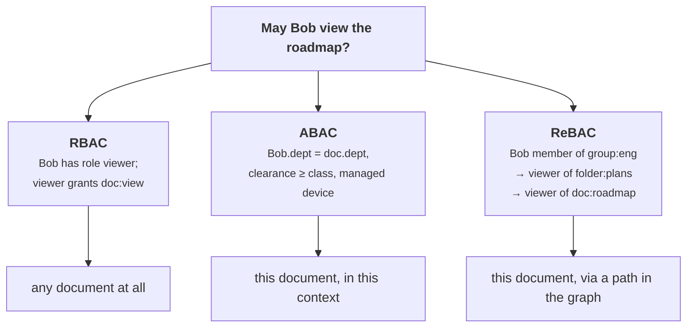
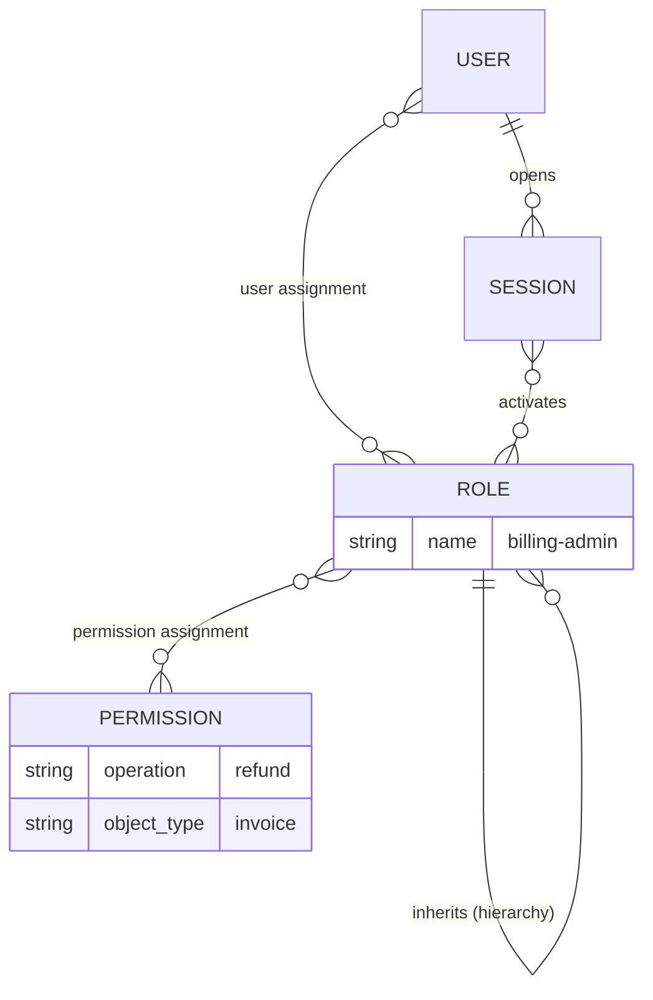
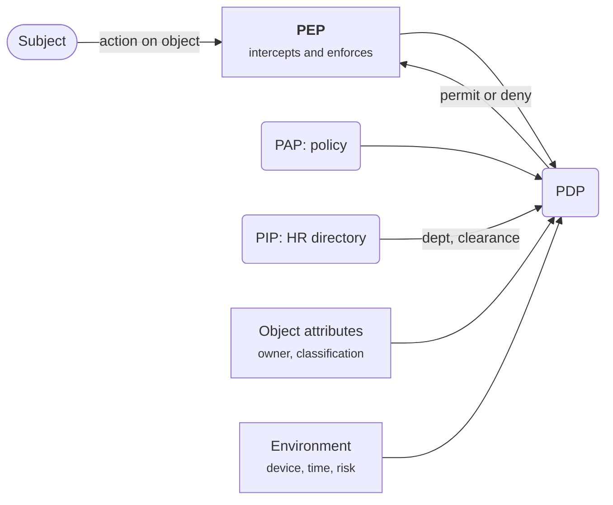
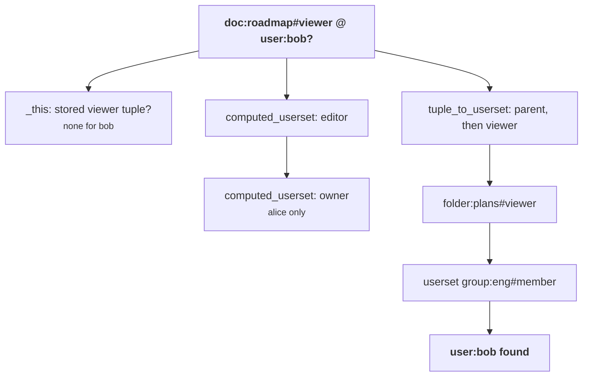
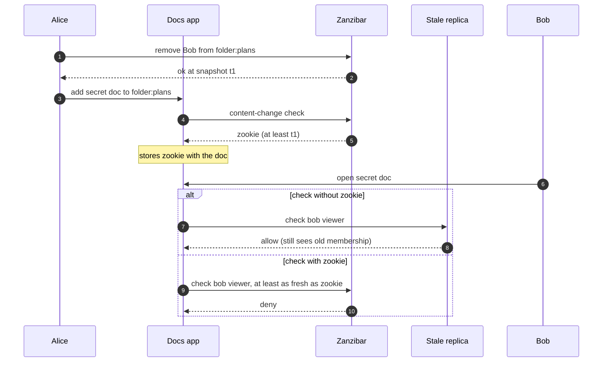

+++
title = 'RBAC, ABAC and relationships'
description = 'Roles, attributes and relationships are three ways to write down who may do what. Each answers some questions cheaply and others not at all, and most real systems end up combining them.'
question = 'Should permissions be expressed as roles, as attributes, or as relationships between users and objects?'
weight = 2
difficulty = 3
prerequisites = ['/notes/application-security/authorization/01-broken-object-level-authorization']
date = 2026-06-02
lastmod = 2026-06-02
verified = 2026-06-02
+++

## The idea in one minute

The previous lesson fixed authorization for objects with a single owner: put
`owner_id = ?` in the query. Real applications outgrow that quickly. Documents
are shared with teams, folders pass access to their contents, support staff may
view but not edit, contractors lose access when their contract ends, and some
records may only be opened from a managed laptop. You need a **model**: a way
to write down who may do what, which the code can evaluate and a human can
review.

Three models dominate. **Role-based access control** (RBAC) grants
permissions to roles and roles to users. **Attribute-based access control**
(ABAC) evaluates a policy over attributes of the user, the object, the action
and the environment. **Relationship-based access control** (ReBAC) derives
permissions from a graph of relationships such as "Bob is a member of eng,
which can view the folder that contains this document", and Google's Zanzibar
paper made it practical at scale. None is strictly better. RBAC is easy to
audit and blind to individual objects; ABAC is expressive and hard to
enumerate; ReBAC models sharing naturally and requires you to keep a graph
correct and consistent.

The consequence to act on: **choose the model by the questions you must
answer**, including "who can access this object?" and "what can this user
access?", not only "may this request proceed?".

## A picture



RBAC answers the question without looking at the object, which is both its
strength and its blind spot.

## How it really works

### RBAC: roles as the unit of administration

RBAC was formalized in the 1990s. Sandhu, Coyne, Feinstein and Youman's 1996
paper defined a family of models (core roles, role hierarchies, constraints,
and their combination), and the NIST model published by Sandhu, Ferraiolo and
Kuhn in 2000 became the basis of the ANSI INCITS 359 standard. Its components:

| Component | Meaning | Example |
| --- | --- | --- |
| **Users and roles** | Users are assigned to roles (user assignment) | Alice → `billing-admin` |
| **Permissions** | An operation on an object type, assigned to roles | `billing-admin` → `invoice:refund` |
| **Sessions** | A user activates a subset of their roles | Alice works as `analyst` today |
| **Role hierarchy** | Senior roles inherit junior roles' permissions | `editor` inherits `viewer` |
| **Separation of duty** | Constraints on role combinations, static (cannot hold both) or dynamic (cannot activate both in one session) | Nobody both creates and approves a payment |

Read the model as data: notice that nothing in it points at a specific object,
only at an operation on an object type.



RBAC's virtue is administration. Access reviews become "who holds
`billing-admin`?", onboarding becomes "assign the role for the job", and
permissions change in one place. It fits function-level authorization (the
API5 problem from the previous lesson) very well: "only `billing-admin` may
call refund" is a pure RBAC rule.

Its weakness is that a classic role is global. "Editor" means editor of
*everything* the permission covers. As soon as access depends on which object,
which customer, which region or which project, teams start minting roles such
as `editor-project-apollo-emea`. This is **role explosion**: the number of
roles grows with the product of the dimensions they encode, until there are
more roles than people, nobody can say what a role means, and access reviews
become rubber stamps. Scoped roles (a role held *on* a resource, such as
"editor of project Apollo") push RBAC much further and are how most cloud IAM
systems work, but a scoped role is already a relationship between a user and
an object.

The growth is multiplicative. In this illustration three job functions are
crossed with three regions, so every new project adds nine roles.

```mermaid {title="Role explosion: roles grow with the product of dimensions (illustrative)"}
xychart-beta
  title "3 job functions x 3 regions x N projects"
  x-axis "Projects" [1, 2, 4, 8, 16]
  y-axis "Roles to manage" 0 --> 150
  bar [9, 18, 36, 72, 144]
  line [9, 18, 36, 72, 144]
```

### ABAC: policies over attributes

NIST SP 800-162 (2014) defines ABAC as access control where a decision is
computed from **attributes of the subject** (department, clearance, employment
type), **attributes of the object** (owner, classification, tenant),
**the operation**, and **environment conditions** (time, device posture,
network, risk score), evaluated against policy. It also names the functional
pieces that the rest of this module uses:

| Point | Role |
| --- | --- |
| **PEP**, policy enforcement point | Intercepts the request and enforces the decision |
| **PDP**, policy decision point | Evaluates policy and returns permit or deny |
| **PIP**, policy information point | Supplies attribute values the PDP needs |
| **PAP**, policy administration point | Where policies are written and managed |

Follow one ABAC request: the PEP asks, the PDP gathers the four kinds of input,
and only then decides.



ABAC removes role explosion by expressing the dimensions directly:
`subject.dept == resource.dept and subject.clearance >= resource.classification`
replaces one role per department and level. It is the only model of the three
that naturally handles context: "only from a managed device", "only during an
active on-call shift", "deny if the risk score is high".

The costs are less visible. **Attributes become security-critical data**: if
anyone can edit their own `dept` in the HR system, they can edit their access.
Attribute freshness matters too, because a PDP that reads a cached `employed:
true` keeps a departed contractor in. And ABAC is hard to **enumerate**: "who
can read this document?" means evaluating the policy against every user, and
"what can this user read?" against every object. Auditors ask exactly those
questions.

### ReBAC and Zanzibar

ReBAC treats permissions as paths in a graph. Google's 2019 USENIX ATC paper
*Zanzibar: Google's Consistent, Global Authorization System* describes the
system Google uses for authorization across many of its products, and its data
model has become the template for open-source systems such as SpiceDB and
OpenFGA. The paper reports that Zanzibar scales to trillions of access control
lists and millions of authorization requests per second.

The data is a set of **relation tuples**, written `object#relation@user`:

```text
doc:roadmap#owner@user:alice
doc:roadmap#parent@folder:plans
folder:plans#viewer@group:eng#member
group:eng#member@user:bob
```

The user side may be a **userset**, `group:eng#member`, meaning "everyone who
has the `member` relation on `group:eng`". That one indirection lets groups
nest and lets access flow through containers.

Drawn as a graph, the four tuples give Bob a path to the roadmap even though no
tuple mentions both Bob and the roadmap.

```mermaid {title="The relation tuples as a graph: Bob reaches the roadmap through two hops"}
flowchart LR
  bob(["user:bob"])
  alice(["user:alice"])
  G["<b>group:eng</b>"]
  F@{ shape: doc, label: "folder:plans" }
  D@{ shape: doc, label: "doc:roadmap" }
  bob -->|member| G
  G -->|"#35;member is viewer"| F
  D -->|parent| F
  alice -->|owner| D
  class G compute
  class F,D memory
```

Stored tuples alone would force you to write a viewer tuple for every editor
and every document in every folder. Zanzibar's **userset rewrite rules**,
declared per object type in a namespace configuration, derive relations
instead:

| Rule | Meaning | Example |
| --- | --- | --- |
| `_this` | Users with a stored tuple for this relation | `doc:roadmap#viewer@user:erin` |
| `computed_userset` | Another relation on the same object | every `editor` is a `viewer`; every `owner` is an `editor` |
| `tuple_to_userset` | Follow a relation to another object, then take a relation there | viewers of the doc include viewers of its `parent` folder |

Rules combine with union, intersection and exclusion. A **check** walks the
graph from the object and relation to the user, expanding rewrites as it goes.

Here is the check "is Bob a viewer of the roadmap?" unfolded rule by rule;
the first branch that reaches Bob answers yes.



Because the graph is explicit, the reverse questions are answerable: the paper
describes an Expand API that returns the effective userset tree for an object
and relation, and descendants of Zanzibar offer "list objects this user can
reach" queries.

Zanzibar also had to solve a consistency problem the paper calls the **new
enemy problem**: if Alice removes Bob from a folder and then adds a secret
document to it, a stale replica must not evaluate the new document against the
old membership. Its answer is a consistency token, the *zookie*, which the
client stores with the content and presents on later checks, so a check is
evaluated at a snapshot at least as fresh as the last permission change that
mattered. Any ReBAC deployment with caches or replicas inherits this problem.

The sequence below shows the race and where the zookie closes it.



### Choosing a model

| Question | RBAC | ABAC | ReBAC |
| --- | --- | --- | --- |
| "May this role call this operation?" | Natural | Possible | Possible |
| "May this user act on this object?" | Only with scoped roles | Natural | Natural |
| Context (device, time, risk) | No | Natural | Needs ABAC-style conditions |
| "Who can access this object?" | Easy | Hard | Natural |
| "What can this user access?" | Easy | Hard | Supported with indexing |
| Sharing, nesting, inheritance | Poor | Awkward | Natural |
| What you must keep correct | Role assignments | Attribute sources | The relationship graph and its consistency |

Placed on two axes taken from the table, the models sit in different corners;
positions are qualitative.

```mermaid {title="Per-object expressiveness against ease of answering reverse questions"}
quadrantChart
  title Choosing an authorization model
  x-axis "Object-blind" --> "Per-object and contextual"
  y-axis "Reverse questions hard" --> "Reverse questions easy"
  quadrant-1 "Expressive and auditable"
  quadrant-2 "Auditable, coarse"
  quadrant-3 "Neither"
  quadrant-4 "Expressive, hard to enumerate"
  "Classic RBAC": [0.15, 0.85]
  "Scoped roles": [0.45, 0.7]
  "ReBAC": [0.7, 0.75]
  "ABAC": [0.88, 0.2]
```

In practice, systems layer them. RBAC handles coarse function-level gates
(customers cannot reach admin routes). ReBAC or ownership predicates handle
object access (Bob can view this document because it sits in a folder shared
with his group). ABAC conditions handle context on top (but not from an
unmanaged device, and never for records under legal hold). The engines in the
fourth lesson are built to express this mix: Cedar has principals, actions,
resources and conditions; OPA's Rego can evaluate any of the three over data
you supply.

> [!TIP]
> Before choosing, write down the five authorization questions your product
> must answer, including at least one reverse question an auditor or a
> "shared with" screen will ask. The model that answers all five with stored
> data, not by brute force, is the right starting point.

## Code

The same eight questions answered three ways. RBAC uses a role table, ABAC a
policy over attributes and a device flag, and ReBAC a small relation-tuple
checker with the three rewrite rules from the Zanzibar paper.

```python {title="models.py"}
"""models.py: one permission question answered by RBAC, ABAC and ReBAC.

The question: may a user edit (or view) a document? RBAC looks at roles, ABAC
evaluates attributes, and the ReBAC checker follows Zanzibar-style relation
tuples with userset rewrite rules. Standard library only; offline.
"""

from __future__ import annotations

from dataclasses import dataclass

# ---- RBAC: users get roles, roles get permissions. Nothing about the object.
ROLE_PERMS = {"viewer": {"doc:view"}, "editor": {"doc:view", "doc:edit"}}
USER_ROLES = {"alice": {"editor"}, "bob": {"viewer"}, "dana": {"editor"}, "erin": set()}


def rbac(user: str, action: str, doc: str) -> bool:
    return any(f"doc:{action}" in ROLE_PERMS[r] for r in USER_ROLES[user])


# ---- ABAC: a policy over subject, object, action and environment attributes.
SUBJECTS = {"alice": {"dept": "eng", "clearance": 2}, "bob": {"dept": "eng", "clearance": 1},
            "dana": {"dept": "sales", "clearance": 2}, "erin": {"dept": "eng", "clearance": 1}}
DOCS = {"roadmap": {"dept": "eng", "classification": 1, "owner": "alice"}}


def abac(user: str, action: str, doc: str, env: dict) -> bool:
    s, o = SUBJECTS[user], DOCS[doc]
    if s["clearance"] < o["classification"] or not env["managed_device"]:
        return False
    if action == "view":
        return s["dept"] == o["dept"]
    return action == "edit" and o["owner"] == user


# ---- ReBAC: relation tuples plus a namespace config with userset rewrites.
@dataclass(frozen=True)
class Tuple:
    obj: str       # "doc:roadmap"
    relation: str  # "owner"
    user: str      # "user:alice" or a userset such as "group:eng#member"


TUPLES = {
    Tuple("doc:roadmap", "owner", "user:alice"),
    Tuple("doc:roadmap", "parent", "folder:plans"),
    Tuple("folder:plans", "viewer", "group:eng#member"),
    Tuple("group:eng", "member", "user:bob"),
    Tuple("group:eng", "member", "user:erin"),
}

# Each rule is a union of: ("this",), ("computed", rel), ("tuple_to_userset", tupleset, rel)
REWRITES = {
    "doc": {
        "owner": [("this",)],
        "editor": [("this",), ("computed", "owner")],
        "viewer": [("this",), ("computed", "editor"), ("tuple_to_userset", "parent", "viewer")],
        "parent": [("this",)],
    },
    "folder": {"viewer": [("this",)]},
    "group": {"member": [("this",)]},
}


def check(obj: str, relation: str, user: str, depth: int = 0) -> bool:
    if depth > 10:
        return False  # a cycle or a pathological graph: fail closed
    for rule in REWRITES[obj.split(":")[0]][relation]:
        if rule[0] == "this":
            for t in TUPLES:
                if (t.obj, t.relation) != (obj, relation):
                    continue
                if t.user == user:
                    return True
                if "#" in t.user:  # a userset: is the user in group:eng#member?
                    sub_obj, sub_rel = t.user.split("#")
                    if check(sub_obj, sub_rel, user, depth + 1):
                        return True
        elif rule[0] == "computed" and check(obj, rule[1], user, depth + 1):
            return True
        elif rule[0] == "tuple_to_userset":
            for t in TUPLES:
                if (t.obj, t.relation) == (obj, rule[1]) and check(t.user, rule[2], user, depth + 1):
                    return True
    return False


def rebac(user: str, action: str, doc: str) -> bool:
    return check(f"doc:{doc}", {"edit": "editor", "view": "viewer"}[action], f"user:{user}")


if __name__ == "__main__":
    env = {"managed_device": True}
    print(f"{'question':<26}{'RBAC':<7}{'ABAC':<7}ReBAC")
    for user in ["alice", "bob", "dana", "erin"]:
        for action in ["view", "edit"]:
            answers = [rbac(user, action, "roadmap"), abac(user, action, "roadmap", env),
                       rebac(user, action, "roadmap")]
            row = "".join(f"{'yes' if a else 'no':<7}" for a in answers).rstrip()
            print(f"{user + ' ' + action + ' roadmap':<26}{row}")

    print("\nerin views roadmap from an unmanaged laptop, ABAC:",
          abac("erin", "view", "roadmap", {"managed_device": False}))
    TUPLES.add(Tuple("group:eng", "member", "user:frank"))
    print("frank joins group:eng, ReBAC view:", rebac("frank", "view", "roadmap"))
    TUPLES.discard(Tuple("doc:roadmap", "parent", "folder:plans"))
    print("roadmap moved out of folder:plans, ReBAC bob view:", rebac("bob", "view", "roadmap"))
```

Run it with `python3 models.py`:

```text
question                  RBAC   ABAC   ReBAC
alice view roadmap        yes    yes    yes
alice edit roadmap        yes    yes    yes
bob view roadmap          yes    yes    yes
bob edit roadmap          no     no     no
dana view roadmap         yes    no     no
dana edit roadmap         yes    no     no
erin view roadmap         no     yes    yes
erin edit roadmap         no     no     no

erin views roadmap from an unmanaged laptop, ABAC: False
frank joins group:eng, ReBAC view: True
roadmap moved out of folder:plans, ReBAC bob view: False
```

Read the table by row. Dana holds the global `editor` role, so RBAC lets her
edit an engineering roadmap she has nothing to do with: that is the
object-blindness of classic roles. Erin has no role at all, so RBAC denies her,
yet she is in the engineering group the folder is shared with, and both ABAC and
ReBAC allow her to view it. Only ABAC reacts to the unmanaged laptop. Only
ReBAC reacts to moving the document out of the folder: no attribute changed,
but the path from Bob to the document disappeared.

## Where it breaks

- **Roles drift.** RBAC is only as good as the assignment process. Users
  accumulate roles as they change jobs, and roles accumulate permissions as
  features ship. Without periodic access reviews and role mining, a tidy role
  model decays into "everyone is an editor".
- **Attributes are an attack surface.** ABAC moves trust into whatever system
  supplies the attributes. A writable profile field, a self-asserted claim in
  a token, or a stale cache becomes an authorization bypass.
- **The graph is data, and data has bugs.** In ReBAC a mistaken tuple, such as
  sharing a folder with `group:everyone#member`, grants access silently and
  broadly. Tuple writes need the same review and audit as code changes.
- **Recursion needs limits.** Nested groups and parent chains can form cycles
  or very deep paths. The checker above stops at depth 10 and fails closed;
  real systems bound depth and fan-out and still need to be load tested.
- **Consistency is not free.** A check against a stale replica can grant access
  that was revoked a moment ago. The example has a single in-memory set and
  therefore hides the new enemy problem entirely.
- **The model does not enforce itself.** Every model here only answers a
  question. If a handler never asks, or asks about the wrong object, the model
  is irrelevant; that is still the BOLA bug from the previous lesson.

## Remember this

- RBAC grants permissions to roles; it is easy to audit and blind to individual
  objects.
- Role explosion is the sign that access depends on dimensions roles cannot
  express.
- ABAC (NIST SP 800-162) evaluates subject, object, action and environment
  attributes; protect the attribute sources as carefully as the policy.
- ReBAC derives access from relation tuples and rewrite rules, as in Zanzibar,
  and answers "who can see this?" naturally.
- Pick the model by the questions you must answer, including the reverse ones;
  most systems layer all three.

## Try it

1. Run `models.py`. Add an `intersection` rule type to the checker and redefine
   `editor` as "owner, or a member of eng who is also in `group:approvers`".
2. Add an exclusion rule so that `doc:roadmap#banned@user:erin` removes Erin's
   view access even though the folder grants it.
3. Write an `expand(obj, relation)` function that returns every user who holds
   the relation, and use it to print who can view the roadmap. Then try to
   write the same function for the ABAC policy, and note what you needed.
4. Model your own product's sharing feature as relation tuples and rewrite
   rules. How many tuple types and relations does it need?

## Check yourself

1. What is role explosion, and what does it indicate?

   
   The number of roles grows far beyond the number of real job functions
   because roles encode extra dimensions such as project, region or customer
   (`editor-apollo-emea`). It indicates that access depends on attributes of
   the object or the relationship, which classic global roles cannot express.
   Scoped roles, ABAC conditions or ReBAC are the usual remedies.
   

2. Name the four kinds of input to an ABAC decision in NIST SP 800-162.

   
   Subject attributes, object attributes, the requested operation, and
   environment conditions. The policy decision point evaluates policy over
   them, with attribute values supplied by policy information points.
   

3. In Zanzibar terms, what does `tuple_to_userset` do?

   
   It follows a relation from the current object to another object and then
   takes a relation on that object. "Viewers of a document include the viewers
   of its parent folder" reads the document's `parent` tuples and checks
   `viewer` on each folder they point to.
   

4. What is the new enemy problem?

   
   An authorization check evaluated against stale data applies old permissions
   to new content. If Bob is removed from a folder and a sensitive document is
   then added, a replica that has not yet seen the removal would let Bob read
   it. Zanzibar's zookies ensure a check is evaluated at a snapshot at least as
   fresh as the content's last relevant change.
   

5. Why is "who can access this document?" hard in ABAC and easy in ReBAC?

   
   ABAC policies are functions over attributes, so answering requires
   evaluating the policy for every possible subject (and every possible
   environment). ReBAC stores the relationships explicitly, so the answer is a
   traversal of the graph from the document outward.
   

## Sources

- R. Sandhu, E. Coyne, H. Feinstein, C. Youman, [Role-Based Access Control Models](https://doi.org/10.1109/2.485845), IEEE Computer 29(2), February 1996.
- R. Sandhu, D. Ferraiolo, R. Kuhn, [The NIST Model for Role-Based Access Control: Towards a Unified Standard](https://csrc.nist.gov/projects/role-based-access-control), 5th ACM Workshop on Role-Based Access Control, July 2000 (NIST RBAC project page).
- V. Hu et al., [NIST SP 800-162: Guide to Attribute Based Access Control (ABAC) Definition and Considerations](https://doi.org/10.6028/NIST.SP.800-162), NIST, January 2014 (updated 2019).
- R. Pang et al., [Zanzibar: Google's Consistent, Global Authorization System](https://www.usenix.org/conference/atc19/presentation/pang), USENIX Annual Technical Conference, July 2019.
- OpenFGA, [Concepts](https://openfga.dev/docs/concepts), and AuthZed, [SpiceDB documentation](https://authzed.com/docs), for Zanzibar-style systems in open source.
