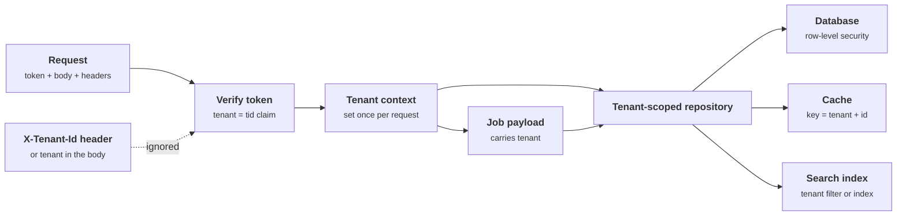
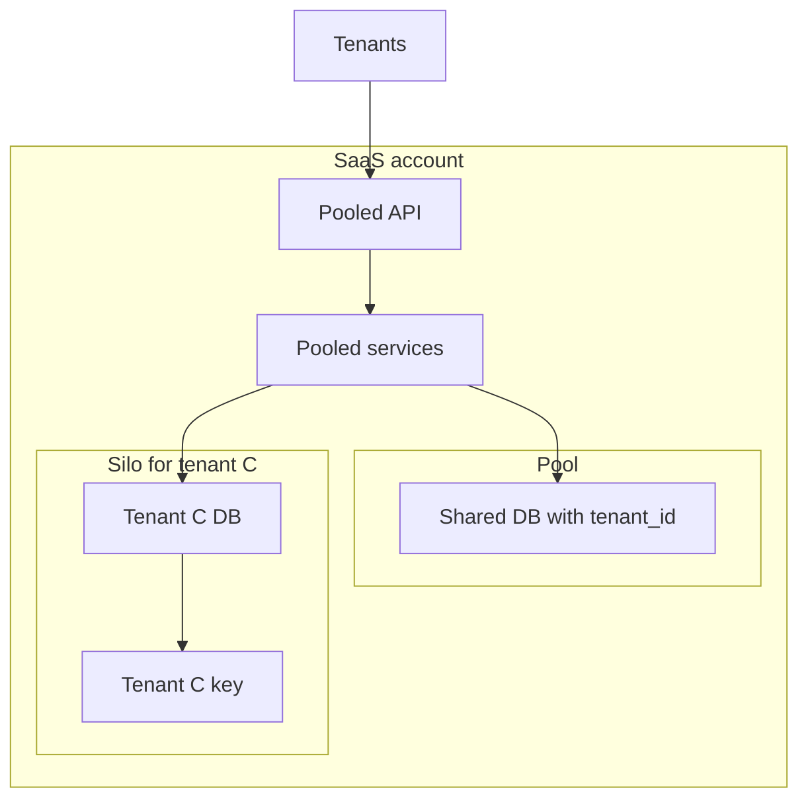

+++
title = 'Tenant isolation'
description = 'In a multi-tenant system every tenant shares code, and often databases, caches and queues, with every other. Isolation holds only if the tenant comes from the verified identity and reaches every store, every cache key and every background job.'
question = "How do you keep one customer from ever seeing another customer's data in a shared system?"
weight = 3
difficulty = 3
prerequisites = ['/notes/application-security/authorization/01-broken-object-level-authorization', '/notes/application-security/authentication/04-tokens-and-jwt-pitfalls']
date = 2026-06-04
lastmod = 2026-06-04
verified = 2026-06-04
+++

## The idea in one minute

A software-as-a-service product serves many customer organizations, called
**tenants**, from one codebase and usually from shared infrastructure. The
worst bug such a product can have is not a single user reading another user's
record; it is one customer seeing another customer's data. That breaks a
contract, often a regulation, and the trust every other tenant placed in the
shared system.

Tenant isolation is BOLA at a larger scale, with more places to go wrong. The
database query may filter by tenant correctly while the cache in front of it
does not. The web request may carry the tenant faithfully while the background
job it enqueues forgets it. The search index may hold every tenant's documents
in one place. **The tenant has to be established once, from the verified
identity, and then carried, not re-derived, into every store, key and job.**

The consequence to act on: make the tenant a required input to every data
access path, enforce it in the database as well as in the application, and
treat any code path that can run without a tenant as a bug that should fail
closed.

## A picture



Every arrow out of the tenant context is a place where a real system has lost
the tenant.

## How it really works

### Silo, pool and bridge

AWS's SaaS guidance names three deployment patterns, and the vocabulary has
become common well beyond AWS:

| Pattern | What tenants share | Isolation comes from | Trade-off |
| --- | --- | --- | --- |
| **Silo** | Little or nothing: a database, or a whole stack, per tenant | Infrastructure boundaries: separate databases, accounts, networks, keys | Strongest isolation, simplest reasoning; highest cost and most operational work per tenant |
| **Pool** | Everything: one database, one cache, one set of services | Application code and database policies filtering by tenant | Cheapest and easiest to operate; every query, cache key and job must be correct |
| **Bridge** | A mix: shared services, per-tenant schemas or databases, or silo for some tiers | A combination, chosen per layer | Common in practice; you must know, for each store, which model applies |

A bridge deployment in one picture: pooled stateless services in front, one
pooled database for small tenants, and a siloed database for the regulated one.



The choice is rarely all-or-nothing. A typical product pools its smaller
customers, gives its largest or most regulated customers a silo, and pools
stateless services while siloing storage. That is fine, provided the code does
not assume one model where another applies. Silos also need a mapping from
tenant to resource (which database, which key), and that mapping is itself a
place where the tenant must come from the verified identity.

### The tenant comes from the token, never the request

The first rule of tenant isolation is the
[request-is-a-trust-boundary](/notes/application-security/foundations/01-the-request-is-a-trust-boundary/)
rule applied to one field. Clients send tenant identifiers in many places:
subdomains (`acme.example.com`), path segments (`/tenants/acme/invoices`),
headers (`X-Tenant-Id`), and JSON bodies. All of them are claims, and any of
them can be changed by the caller.

The authoritative tenant is the one bound to the authenticated identity: a
claim in a verified token (Microsoft Entra ID, for example, puts the tenant in
a `tid` claim), or a lookup from the verified user to their organization
membership. If the URL also names a tenant, the server should compare it with
the verified one and reject mismatches, not prefer it. Users who belong to
several tenants need an explicit "switch organization" step that checks
membership and issues a session or token for the chosen tenant, rather than a
header that anyone can set.

The server's job with a request-supplied tenant is to compare it, never to use it.

```mermaid {title="A tenant named in the request is compared with the token, not preferred"}
sequenceDiagram
  autonumber
  participant G as Gus (globex user)
  participant API as API
  participant V as Token verifier
  G->>API: GET /tenants/acme/invoices/2, X-Tenant-Id acme, token
  API->>V: verify signature, audience, expiry
  V-->>API: claims sub gus, tid globex
  Note over API: authoritative tenant = globex
  alt request tenant differs from tid
    API-->>G: 403 or 404, mismatch logged
  else request tenant matches or is absent
    API->>API: set tenant context = globex
  end
```

For users in several organizations, switching is an authenticated step that
issues a new token, not a header edit.

```mermaid {title="Switching organization re-issues the session instead of trusting a header"}
stateDiagram-v2
  [*] --> SignedIn_acme: login, membership lookup
  SignedIn_acme --> MembershipCheck: switch to globex
  MembershipCheck --> SignedIn_globex: member, new token with tid globex
  MembershipCheck --> SignedIn_acme: not a member, refused
  SignedIn_globex --> MembershipCheck: switch to acme
  SignedIn_acme --> [*]: logout
  SignedIn_globex --> [*]: logout
```

Service-to-service calls deserve the same care. An internal service that
accepts `tenant_id` as a plain parameter from any caller has moved the trust
boundary to its network perimeter. Propagating a token, or a signed internal
context, that carries the tenant keeps the claim verifiable at every hop.

### Row-level security as a second wall

In the pool model, every query needs `WHERE tenant_id = ?`. The tenant-scoped
repository from the code below makes that hard to forget in application code,
but a database-level control catches what the application misses: the
hand-written report query, the new microservice, the analyst's ad hoc script.

PostgreSQL's **row-level security** (RLS) attaches a predicate to a table that
the database adds to every query:

```sql {title="tenant isolation with PostgreSQL row-level security"}
ALTER TABLE invoices ENABLE ROW LEVEL SECURITY;
ALTER TABLE invoices FORCE ROW LEVEL SECURITY;  -- apply to the table owner too

CREATE POLICY tenant_isolation ON invoices
  USING      (tenant_id = current_setting('app.tenant_id', true)::uuid)
  WITH CHECK (tenant_id = current_setting('app.tenant_id', true)::uuid);

-- per transaction, from the verified token:
BEGIN;
SET LOCAL app.tenant_id = '0b6f...';
SELECT * FROM invoices WHERE invoice_no = 1;  -- only this tenant's rows
COMMIT;
```

The details matter, and they are all in the PostgreSQL documentation:

- **`USING` filters reads; `WITH CHECK` constrains writes.** Without the check
  clause on a policy for inserts and updates, a tenant could write a row
  labeled with another tenant's ID. (For a policy covering all commands,
  PostgreSQL reuses `USING` as the check when `WITH CHECK` is omitted; being
  explicit costs nothing.)
- **Who bypasses it.** Superusers and roles with the `BYPASSRLS` attribute
  always bypass RLS, and the table's owner bypasses it unless the table has
  `FORCE ROW LEVEL SECURITY`. The application should connect as a role that
  owns nothing and has neither attribute.
- **Default deny.** If RLS is enabled and no policy applies, no rows are
  visible. `current_setting(..., true)` returns null when the setting is
  missing, so a request that never set the tenant sees nothing rather than
  everything.
- **Connection pools.** `SET LOCAL` lasts until the end of the transaction. A
  plain `SET` lasts for the session, and with a connection pool the next
  request, possibly another tenant's, inherits it. Use `SET LOCAL` (or
  `set_config(..., true)`) inside a transaction for every request.
- **Views.** By default a view accesses tables with its owner's privileges, so
  a view owned by the table owner can bypass the caller's RLS policies.
  PostgreSQL 15 added the `security_invoker` view option to evaluate the
  underlying tables as the calling user.

The application role goes through the policy; the dashed roles walk around it,
which is why the application must not connect as any of them.

```mermaid {title="Who passes through row-level security and who bypasses it"}
flowchart LR
  APP("App role<br/>owns nothing")
  POL["<b>RLS policy</b><br/><small>tenant_id = app.tenant_id</small>"]
  T[("invoices")]
  SU["Superuser"]
  BR["Role with BYPASSRLS"]
  OW["Table owner<br/><small>without FORCE</small>"]
  APP --> POL --> T
  SU -.-> T
  BR -.-> T
  OW -.-> T
  class POL good
  class SU,BR,OW warn
```

The connection-pool pitfall is a matter of timing: a session-level `SET`
outlives the request that made it.

```mermaid {title="A plain SET leaks the tenant to the next request on a pooled connection"}
sequenceDiagram
  autonumber
  participant A as Request for acme
  participant P as Pooled connection
  participant B as Request for globex
  A->>P: SET app.tenant_id = acme
  A->>P: SELECT invoices
  P-->>A: acme rows
  Note over P: returned to pool, setting still acme
  B->>P: SELECT invoices (forgot to set tenant)
  P-->>B: acme rows, cross-tenant leak
  rect rgb(226, 239, 216)
    Note over A,B: with BEGIN, SET LOCAL ..., COMMIT the setting ends at commit
    B->>P: SELECT invoices with no tenant set
    P-->>B: no rows, default deny
  end
```

Other databases have equivalents, such as SQL Server's row-level security
predicates. In the silo model the database boundary does the same job, as long
as connection routing picks the database from the verified tenant.

### Caches and search indexes

Caches and indexes are where pooled systems most often leak, because they are
added later, for performance, by someone thinking about speed rather than
isolation, and because their keys are usually built from whatever identifier
the handler happens to have.

- **Cache keys.** A key such as `invoice-summary:1` is correct in a single-tenant
  system and wrong in a pooled one, because every tenant has an invoice 1. The
  database query behind it can filter by tenant perfectly; the first tenant to
  fill the cache decides what everyone else sees. The tenant belongs in every
  key, ideally added by a cache wrapper that takes the tenant from context so
  individual call sites cannot omit it. The same applies to HTTP caches and
  CDNs: a response that depends on the tenant must not be cacheable under a
  URL that does not.

  This is the exact sequence the vulnerable service in the code below runs:
  the database answers correctly and the cache answers wrongly.

  ```mermaid {title="The first tenant to fill an untenanted cache key decides what everyone sees"}
  sequenceDiagram
    autonumber
    participant Ann as Ann (acme)
    participant Gus as Gus (globex)
    participant C as Cache
    participant DB as Database
    Ann->>C: get summary:1
    C-->>Ann: miss
    Ann->>DB: invoice 1 WHERE tenant = acme
    DB-->>Ann: Northwind Ltd 4100
    Ann->>C: put summary:1
    Gus->>C: get summary:1
    C-->>Gus: hit, acme Northwind Ltd 4100
    Note over Gus,DB: the globex query is never run
  ```
- **Memoization and in-process caches.** A function decorated with an
  in-memory cache, keyed by its arguments, leaks in exactly the same way if
  the tenant is not an argument.
- **Search indexes.** A shared index needs a tenant filter on every query,
  enforced by the search layer (filtered aliases, per-tenant indexes, or a
  query builder that refuses unfiltered queries), not by each caller.
  Autocomplete, "did you mean" suggestions and aggregations are easy to forget:
  a facet count can reveal that another tenant has documents matching a term.
- **Embeddings and retrieval.** Vector stores used for retrieval-augmented
  generation are search indexes with the same requirement; the AI security
  course covers this case in more depth.

### Background jobs and asynchronous work

A web request has a tenant because it has a token. A job pulled from a queue
has whatever was put into its payload. Two failure patterns recur:

1. **The tenant is dropped.** The handler enqueues `{"invoice_no": 1}` and the
   worker looks up invoice 1 in whatever tenant context it happens to have,
   which may be none, or the previous job's.
2. **"No tenant" means "all tenants".** Query helpers written as
   `if tenant: query = query.filter(tenant=tenant)` turn a missing tenant into
   an unfiltered query. This is the most dangerous line in a multi-tenant
   codebase.

The fix has three parts. Put the tenant in every job payload, and ideally sign
the payload or carry a short-lived token so a worker can verify it. Have the
worker set the tenant context from the payload before doing anything else, and
clear it afterwards (Python's `contextvars` does the scoping). And make every
data access path **fail closed** when there is no tenant: raising an error is
always better than returning everyone's data. Legitimate cross-tenant jobs,
such as billing roll-ups, should run under an explicit, separately authorized
"system" context that is easy to find in code review, not as a side effect of
a missing value.

The worker path below has exactly one way through to the data, and a missing
tenant ends at an error rather than an unfiltered query.

```mermaid {title="A worker sets the tenant from the payload and fails closed without one"}
flowchart LR
  Q("Job queue")
  W["<b>Worker</b><br/><small>reads payload</small>"]
  X@{ shape: diam, label: "tenant in<br/>payload?" }
  CTX["Set contextvar<br/><small>reset in finally</small>"]
  REPO["<b>TenantRepository</b>"]
  ERR["PermissionError<br/><small>refusing to query</small>"]
  BAD["if tenant: filter<br/><small>else all tenants</small>"]
  Q --> W --> X
  X -->|yes| CTX --> REPO
  X -->|no| ERR
  X -.->|"vulnerable helper"| BAD
  class REPO,CTX,ERR good
  class BAD warn
  class W compute
```

> [!WARNING]
> Search for every place where a missing tenant widens a query. Each one turns
> a forgotten context, which should be a crash, into a data breach.

## Code

Two tenants both number their invoices from 1. The vulnerable service filters
the database query correctly but caches by invoice number alone, lets a header
override the token, and runs a job whose query has no tenant. The fixed
service reads the tenant from the verified token only and routes everything
through a repository that cannot be constructed without one.

```python {title="tenants.py"}
"""tenants.py: a cross-tenant leak through a cache key, and the fix.

Two tenants number their invoices from 1. The vulnerable service checks the
tenant correctly in the database query but caches by invoice number alone. The
fixed service takes the tenant from the verified token only and routes every
read, cache key and background job through a tenant-scoped repository.
Standard library only; offline; deterministic.
"""

from __future__ import annotations

import contextvars
from dataclasses import dataclass

ROWS = [  # (tenant_id, invoice_no, customer, total)
    ("acme", 1, "Northwind Ltd", 4100),
    ("acme", 2, "Harbor Cafe", 30),
    ("globex", 1, "Cypress Labs", 99000),
]
# Stands in for signature verification: token -> verified claims.
TOKENS = {"tok-acme-ann": {"sub": "ann", "tid": "acme"},
          "tok-globex-gus": {"sub": "gus", "tid": "globex"}}

current_tenant: contextvars.ContextVar[str | None] = contextvars.ContextVar("tenant", default=None)


@dataclass
class Request:
    token: str
    invoice_no: int
    headers: dict[str, str]


def query(tenant: str | None, invoice_no: int) -> list[tuple]:
    return [r for r in ROWS if r[1] == invoice_no and (tenant is None or r[0] == tenant)]


class VulnerableService:
    def __init__(self) -> None:
        self.cache: dict[str, tuple] = {}

    def summary(self, req: Request) -> str:
        claims = TOKENS[req.token]
        tenant = req.headers.get("X-Tenant-Id", claims["tid"])  # bug 1: request wins
        key = f"summary:{req.invoice_no}"  # bug 2: no tenant in the key
        if key not in self.cache:
            self.cache[key] = query(tenant, req.invoice_no)[0]
        return "{0} #{1} {2} ${3}".format(*self.cache[key])

    def nightly_job(self, invoice_no: int) -> int:
        # bug 3: the worker has no tenant, and "no tenant" means "no filter"
        return len(query(current_tenant.get(), invoice_no))


class TenantRepository:
    """The only way to reach invoice data. It cannot be built without a tenant."""

    def __init__(self, tenant: str | None, cache: dict[tuple, tuple]) -> None:
        if not tenant:
            raise PermissionError("no tenant in context: refusing to query")
        self.tenant, self.cache = tenant, cache

    def invoice(self, invoice_no: int) -> tuple:
        key = (self.tenant, "summary", invoice_no)  # tenant is part of every key
        if key not in self.cache:
            rows = query(self.tenant, invoice_no)
            if not rows:
                raise LookupError("not found")
            self.cache[key] = rows[0]
        return self.cache[key]


class FixedService:
    def __init__(self) -> None:
        self.cache: dict[tuple, tuple] = {}

    def summary(self, req: Request) -> str:
        tenant = TOKENS[req.token]["tid"]  # only the verified claim; headers ignored
        token = current_tenant.set(tenant)
        try:
            row = TenantRepository(current_tenant.get(), self.cache).invoice(req.invoice_no)
        except LookupError:
            return "404"
        finally:
            current_tenant.reset(token)
        return "{0} #{1} {2} ${3}".format(*row)

    def nightly_job(self, job: dict) -> int:
        token = current_tenant.set(job.get("tenant"))  # tenant travels in the payload
        try:
            TenantRepository(current_tenant.get(), self.cache).invoice(job["invoice_no"])
            return 1
        finally:
            current_tenant.reset(token)


def scenario(svc) -> None:
    ann = Request("tok-acme-ann", 1, {})
    gus = Request("tok-globex-gus", 1, {})
    gus_spoof = Request("tok-globex-gus", 2, {"X-Tenant-Id": "acme"})
    print(f"  ann (acme) asks for #1:    {svc.summary(ann)}")
    print(f"  gus (globex) asks for #1:  {svc.summary(gus)}")
    print(f"  gus sends X-Tenant-Id:acme {svc.summary(gus_spoof)}")


if __name__ == "__main__":
    print("--- vulnerable")
    v = VulnerableService()
    scenario(v)
    print(f"  cache keys: {sorted(v.cache)}")
    print(f"  nightly job for #1 touched {v.nightly_job(1)} rows across tenants")

    print("--- fixed")
    f = FixedService()
    scenario(f)
    print(f"  cache keys: {sorted(f.cache)}")
    print(f"  job with tenant: touched {f.nightly_job({'tenant': 'acme', 'invoice_no': 1})} row")
    try:
        f.nightly_job({"invoice_no": 1})
    except PermissionError as e:
        print(f"  job without tenant: {e}")
```

Run it with `python3 tenants.py`:

```text
--- vulnerable
  ann (acme) asks for #1:    acme #1 Northwind Ltd $4100
  gus (globex) asks for #1:  acme #1 Northwind Ltd $4100
  gus sends X-Tenant-Id:acme acme #2 Harbor Cafe $30
  cache keys: ['summary:1', 'summary:2']
  nightly job for #1 touched 2 rows across tenants
--- fixed
  ann (acme) asks for #1:    acme #1 Northwind Ltd $4100
  gus (globex) asks for #1:  globex #1 Cypress Labs $99000
  gus sends X-Tenant-Id:acme 404
  cache keys: [('acme', 'summary', 1), ('globex', 'summary', 1)]
  job with tenant: touched 1 row
  job without tenant: no tenant in context: refusing to query
```

Gus is authenticated correctly as a globex user, and the database query in the
vulnerable service filters by tenant correctly; he still receives acme's
invoice, because acme's request filled the cache first. The header bug lets him
reach acme's invoice 2 directly. The fixed service keys the cache by tenant,
ignores the header (so invoice 2 does not exist for globex), and refuses to run
a job that arrives without a tenant.

## Where it breaks

- **Shared infrastructure is still shared.** Application-level and RLS
  isolation do nothing against a database engine bug, a compromised
  application credential that can `SET` any tenant, or a noisy neighbor
  exhausting shared capacity (the
  [multi-tenant inference gateway](/notes/systems-design/worked-designs/04-a-multi-tenant-inference-gateway/)
  design deals with fairness). Those are reasons some tenants pay for a silo.
- **RLS has exits.** Superusers, `BYPASSRLS` roles, table owners without
  `FORCE`, and definer-rights views and functions all sit outside the
  policy. Migrations and admin tooling often connect with
  exactly those roles.
- **Logs, metrics and exports leak too.** Error messages that include query
  results, traces with request bodies, and analytics pipelines that join
  across tenants are data stores without a tenant filter.
- **Tenant context can be wrong rather than missing.** A thread pool or async
  task that reuses a context from the previous request carries the wrong tenant
  with full confidence. `contextvars` scoping and resetting in a `finally`
  block are what prevent that in the example; a global variable would not.
- **The example's token table is not verification.** Real code verifies a
  signature, audience and expiry before trusting `tid`, as covered in
  [tokens and JWT pitfalls](/notes/application-security/authentication/04-tokens-and-jwt-pitfalls/).
- **Per-tenant encryption keys**, usually built with
  [envelope encryption](/notes/cryptography/key-management/02-envelope-encryption-and-kms/),
  limit the damage of a leak at the storage
  layer and allow a tenant's data to be destroyed by destroying its key, but
  they do not stop the application, which holds the keys, from fetching the
  wrong tenant's data.

## Remember this

- Tenant isolation is object-level authorization at the scale of whole
  customers.
- Take the tenant from the verified identity; compare, never prefer, any tenant
  named in the request.
- Enforce in the database as well: PostgreSQL RLS with `FORCE`, `SET LOCAL`,
  and an application role that cannot bypass it.
- Put the tenant in every cache key, search filter and job payload.
- A missing tenant must fail closed; "no tenant means no filter" is the most
  dangerous line in a pooled system.

## Try it

1. Run `tenants.py`. Add a memoized helper with `functools.lru_cache` that
   formats an invoice summary from `(invoice_no,)` and show that it leaks
   across tenants; then fix it.
2. Make `nightly_job` in the fixed service verify an HMAC over the job payload
   (tenant and invoice number) before setting the context, and show that a
   payload whose tenant was edited is rejected.
3. If you have PostgreSQL available, create the `invoices` table and policy
   above, connect as the table owner without `FORCE ROW LEVEL SECURITY`, and
   observe that the policy does not apply. Then add `FORCE` and repeat.
4. List every store in a system you know (database, cache, search, object
   storage, queues, logs, analytics) and write down how each one is
   partitioned by tenant.

## Check yourself

1. The database query filters by `tenant_id`, yet tenant B sees tenant A's
   invoice. Name a likely cause.

   
   A cache in front of the query whose key does not include the tenant, such as
   `summary:{invoice_no}`. Whichever tenant fills the entry first decides what
   every tenant with the same invoice number receives. Search indexes, HTTP
   caches and in-process memoization fail the same way.
   

2. Why should the server ignore an `X-Tenant-Id` header even when it matches
   the token most of the time?

   
   Because the caller controls it. The server's correctness then depends on the
   client choosing to send the right value. The verified token or a membership
   lookup is the only authoritative source; if the request names a tenant at
   all, the server compares it with the verified one and rejects a mismatch.
   

3. Your application connects to PostgreSQL as the owner of the `invoices`
   table, which has RLS enabled and a tenant policy. Is it protected?

   
   No. Table owners bypass row-level security unless the table is altered with
   `FORCE ROW LEVEL SECURITY`. Superusers and `BYPASSRLS` roles always bypass
   it. The application should use a role that does not own the table and has
   neither attribute.
   

4. Why is `SET app.tenant_id = ...` dangerous with a connection pool, and what
   should be used instead?

   
   `SET` persists for the database session, and a pooled connection is reused
   by later requests, possibly for another tenant, which would inherit the
   setting. `SET LOCAL` (or `set_config` with `is_local = true`) inside a
   transaction resets automatically at commit or rollback.
   

5. What should a data access helper do when it is called with no tenant?

   
   Raise an error. Treating a missing tenant as "no filter" turns a lost
   context into a cross-tenant read or write. Genuine cross-tenant work should
   use a separate, explicitly authorized system context.
   

## Sources

- PostgreSQL Global Development Group, [Row Security Policies](https://www.postgresql.org/docs/current/ddl-rowsecurity.html) and [CREATE POLICY](https://www.postgresql.org/docs/current/sql-createpolicy.html), PostgreSQL documentation (current version).
- PostgreSQL Global Development Group, [CREATE VIEW: security_invoker](https://www.postgresql.org/docs/current/sql-createview.html), PostgreSQL documentation.
- Amazon Web Services, [SaaS Tenant Isolation Strategies: Isolating Resources in a Multi-Tenant Environment](https://docs.aws.amazon.com/whitepapers/latest/saas-tenant-isolation-strategies/saas-tenant-isolation-strategies.html), AWS whitepaper, 2020.
- Amazon Web Services, [SaaS Lens: AWS Well-Architected Framework](https://docs.aws.amazon.com/wellarchitected/latest/saas-lens/saas-lens.html), silo, pool and bridge models.
- Microsoft, [Microsoft identity platform access token claims reference](https://learn.microsoft.com/en-us/entra/identity-platform/access-token-claims-reference), the `tid` claim.
- Python Software Foundation, [contextvars: Context Variables](https://docs.python.org/3/library/contextvars.html), Python documentation.
