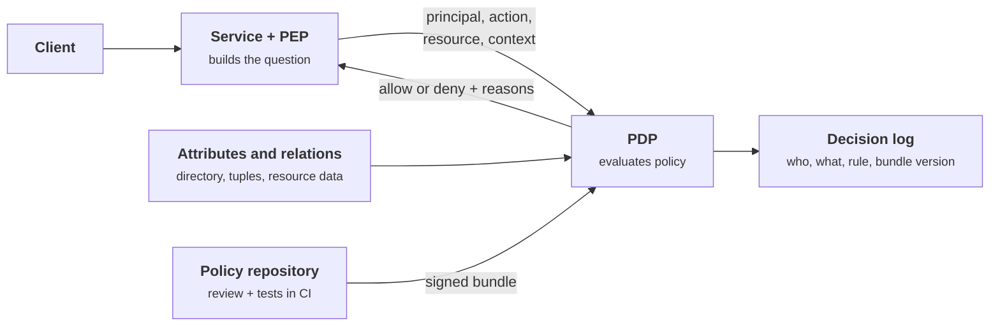
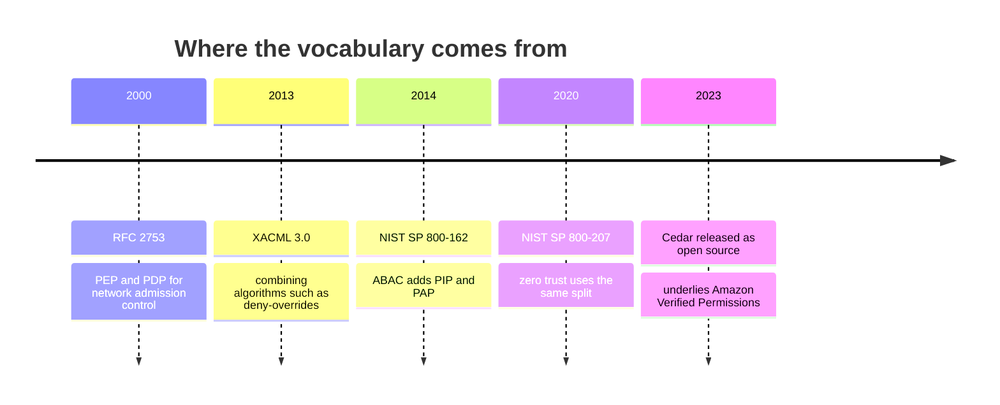
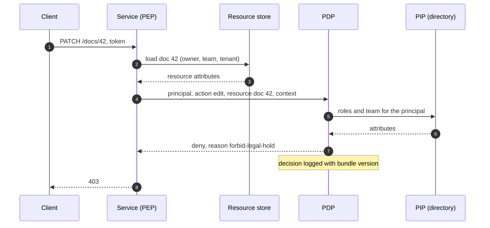
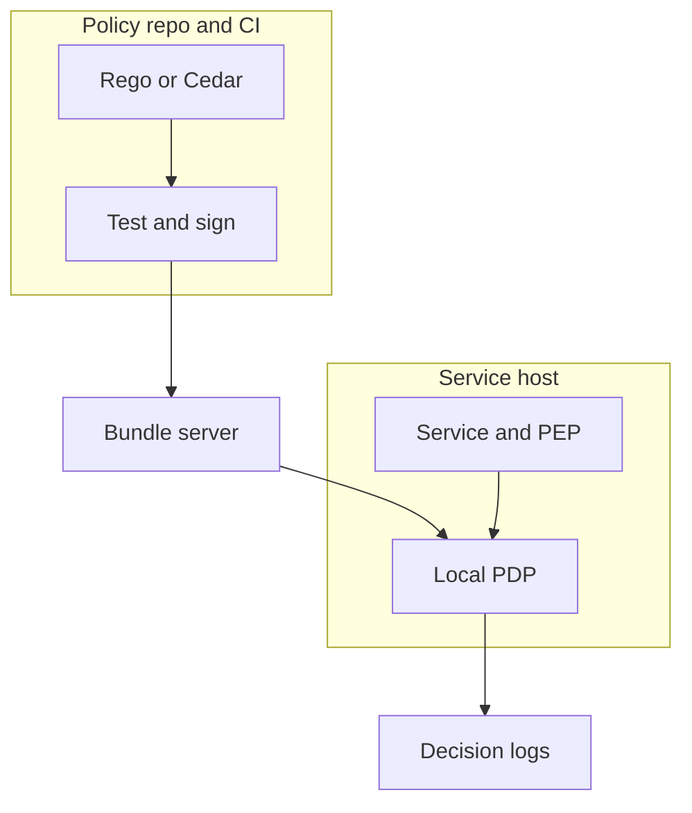
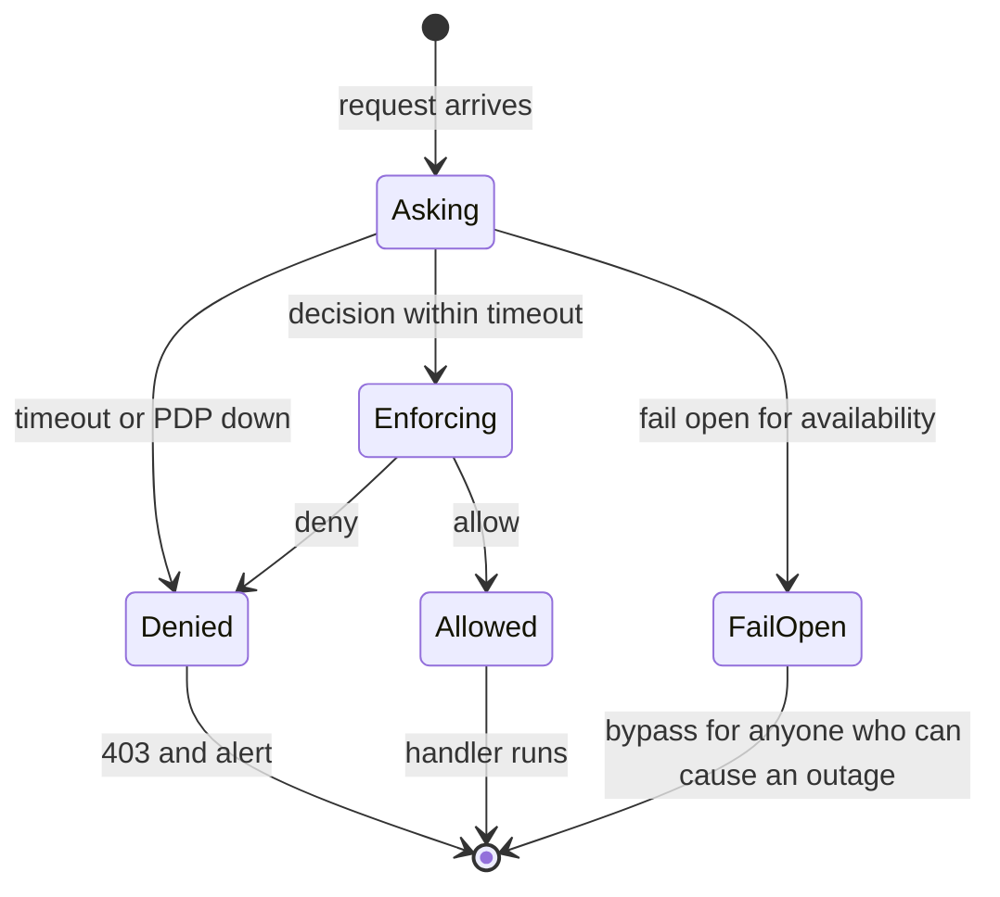
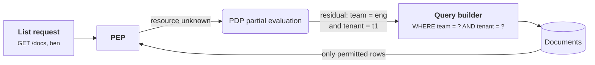

+++
title = 'Centralizing policy'
description = 'When authorization logic is scattered across handlers, nobody can say what the rules are. Separating the decision from its enforcement turns the rules into code that can be reviewed, tested, versioned and logged.'
question = 'Why move authorization decisions out of application code, and what does it cost?'
weight = 4
difficulty = 3
prerequisites = ['/notes/application-security/authorization/02-rbac-abac-and-relationships']
date = 2026-06-06
lastmod = 2026-06-06
verified = 2026-06-06
+++

## The idea in one minute

In most applications, authorization is a few hundred `if` statements spread
across handlers, decorators, SQL fragments and front-end code. Each was
reasonable when written. Together they are a policy that nobody wrote down:
no one can answer "who may refund an invoice?" without reading the code, a
change to a rule means finding every copy of it, and an auditor's question
becomes a research project.

**Centralizing policy** means separating two jobs. A **policy enforcement point**
(PEP) sits where the request is handled and asks a question. A **policy
decision point** (PDP) holds the rules and answers it. The rules live in one
place, written in a policy language such as Open Policy Agent's Rego or AWS's
Cedar, versioned and tested like code. Every decision can be logged with the
inputs and the rule that produced it.

This is not free. The PDP becomes a dependency on the hot path of every
request, the policy language becomes something the team must learn, and the
enforcement points still have to ask the right question. The consequence to act
on: **centralize the decision, keep enforcement everywhere, deny by default,
and test the policy with the same negative cases you would write for a
handler**.

## A picture



The service never decides; it asks, then enforces the answer. The rules arrive
at the PDP through the same review and test pipeline as application code.

## How it really works

### PDP and PEP

The vocabulary is older than most of the tools. RFC 2753 (2000) used policy
enforcement and decision points for network admission control; the OASIS
XACML standard and NIST SP 800-162 used them for attribute-based access
control, adding the policy information point (PIP) that supplies attributes
and the policy administration point (PAP) where policy is managed. NIST SP
800-207 on zero trust architecture uses the same split. The idea is constant:

| Component | Responsibility | Must not |
| --- | --- | --- |
| **PEP** | Authenticate, identify the resource and action, ask the PDP, enforce the answer, fail closed | Contain business rules about who may do what |
| **PDP** | Evaluate policy over the inputs, return a decision and its reasons | Trust inputs it did not verify, or have side effects |
| **PIP** | Provide attributes or relationships the PDP needs | Be writable by the subjects it describes |
| **PAP** | Author, review, version and distribute policy | Bypass review or tests |

Read the dates left to right: the names stayed the same while the use moved from
networks to attributes to zero trust and application permissions.



The PEP still does important work. It decides **what question to ask**: which
resource the request really targets (after loading it, so that its owner and
tenant are known), which action this endpoint represents, and what context is
relevant. A PEP that asks "may Bob view document 42?" when the handler then
returns document 43 has reintroduced BOLA, no matter how good the policy is.

Step 2 is the PEP's real work: it loads the resource first, so the question it
sends carries the owner and tenant from the database, not from the request.



### Policy as code: Rego and Cedar

Two engines dominate general-purpose policy as of October 2026.

**Open Policy Agent** (OPA) is a graduated Cloud Native Computing Foundation
project. Policies are written in **Rego**, a declarative language inspired by
Datalog, over arbitrary JSON input and data. OPA is deliberately general: the
same engine evaluates API authorization, Kubernetes admission (through
Gatekeeper), Envoy external authorization and infrastructure configuration
checks. A minimal API policy looks like this:

```rego {title="authz.rego"}
package httpapi.authz

import rego.v1

default allow := false

allow if {
    input.action == "view"
    input.resource.team == input.principal.team
    not legal_hold_blocks
}

legal_hold_blocks if {
    input.action in {"edit", "delete"}
    input.resource.legal_hold
}
```

Because OPA does not prescribe a combining rule, the policy author writes one,
here by making `allow` depend on the absence of the blocking condition.

**Cedar** was released by AWS as an open-source language in 2023 and underlies
Amazon Verified Permissions. It is narrower and more opinionated: every policy
is a `permit` or a `forbid` over a principal, an action and a resource, with
optional `when` and `unless` conditions, and the evaluation rules are fixed.

```cedar {title="policies.cedar"}
permit (principal, action == Action::"view", resource)
when { resource.team == principal.team };

forbid (principal, action in [Action::"edit", Action::"delete"], resource)
when { resource.legal_hold };
```

Cedar's authorizer **denies by default** and lets **any applicable forbid
override every permit**. Its schema lets a validator reject policies that
reference attributes or entity types that do not exist, and its designers
built the language so that policies can be analyzed automatically, for example
to ask whether a change permits any request the old policy set denied. One
semantic detail matters for safety: when a Cedar policy raises an evaluation
error, the policy is skipped and the error is reported, so a forbid that
errors does not forbid. The validator exists largely to prevent those errors
before deployment.

| | OPA / Rego | Cedar |
| --- | --- | --- |
| Model | General: any JSON in, any JSON out | Authorization only: principal, action, resource, context |
| Combining | Written by the policy author | Fixed: default deny, forbid overrides permit |
| Typing | Optional schemas | Schema-based validation |
| Typical use | Platform-wide policy, Kubernetes, service mesh, APIs | Application permissions, fine-grained resource access |

Relationship-based systems such as SpiceDB and OpenFGA, from the previous
lesson, are PDPs too, specialized for graph checks. Many architectures pair a
relationship store with a policy engine: the graph answers "is Bob a viewer of
this folder?", and the policy adds context such as legal holds and device
posture.

### Deny by default and deny-overrides

Two rules make a policy set robust to mistakes.

**Deny by default.** If no rule permits a request, it is denied. A new action,
a typo in an action name, or a resource type nobody has written policy for
yields "no", not "yes". That turns forgotten policy into a visible bug report
instead of a silent hole.

**Deny-overrides.** XACML 3.0 defines several combining algorithms, among them
deny-overrides, permit-overrides and first-applicable. With
**deny-overrides**, a single applicable deny wins against any number of
permits. Forbids become guardrails that hold regardless of what permits are
added later: "nothing crosses tenants", "nothing edits a record under legal
hold", "suspended accounts can do nothing". Someone writing a generous new
permit for support staff cannot accidentally override them.

Errors need an explicit rule as well. If a forbid cannot be evaluated because
an attribute is missing, the safe outcome is to treat it as applicable, or to
deny the whole request. The engine in the code below does the former and
records the error, so the log shows both the decision and why it was made on
incomplete data.

This is the decision procedure of the engine in the code, with the error branch
drawn explicitly: every path that is not a clean permit ends in deny.

```mermaid {title="Deny by default, deny-overrides, and an unevaluable forbid"}
flowchart TB
  IN["<b>Request</b><br/><small>principal, action, resource</small>"] --> EV["Evaluate every policy"]
  EV --> ERR@{ shape: diam, label: "Forbid raised<br/>an error?" }
  ERR -->|"yes: treat as hit, log error"| DENY1["<b>deny</b>"]
  ERR -->|no| F@{ shape: diam, label: "Any forbid<br/>matched?" }
  F -->|yes| DENY2["<b>deny</b><br/><small>deny-overrides</small>"]
  F -->|no| P@{ shape: diam, label: "Any permit<br/>matched?" }
  P -->|no| DENY3["<b>deny</b><br/><small>default</small>"]
  P -->|yes| ALLOW["<b>allow</b>"]
  class IN io
  class EV compute
  class DENY1,DENY2,DENY3 good
  class ALLOW neutral
```

### Decision logs

A PDP is the natural place to record **every authorization decision**: who
asked, for what action on which resource, the decision, the rules that
determined it, and the version of the policy bundle that was loaded. OPA has
built-in decision logging that can ship these records to a remote service,
with a masking policy to remove sensitive input fields first.

Decision logs answer questions that application logs cannot:

- **Incident response.** Which resources did this compromised account access,
  and which rule allowed each one?
- **Regression detection.** After deploying bundle `6ac53a92`, did the deny
  rate for `edit` change?
- **Audit.** Show every access to this patient's record and the policy that
  permitted it.
- **Policy development.** Replay last week's real decisions against a proposed
  bundle and diff the results before shipping it.

Log decisions with stable identifiers and the bundle version, keep the
request inputs needed to replay, and treat the log as sensitive data, because
it is a map of who can do what.

### Testing policies

A policy repository should have tests in the same commit as the rules. Both
engines support this directly: OPA runs any rule named `test_*` with
`opa test` and can report coverage; Cedar ships a CLI that validates policies
against a schema and evaluates requests. The test cases mirror the negative
suite from the first lesson:

1. **Positive cases** for each permit, so a policy that denies everything fails.
2. **Negative cases** for every boundary: the teammate who must not edit, the
   support agent from another tenant, the owner of a record under legal hold.
3. **Guardrail tests** that assert the forbids still win when a broad permit
   is added.
4. **Unknowns**: an unknown action, a missing attribute, an empty principal.

The history below is the code example's two bundles: the simplified branch
passes every positive test, and only the negative tests keep it from shipping.

```mermaid {title="Policy changes go through the same branch, test and release flow as code"}
gitGraph
  commit id: "permits + forbids"
  commit id: "7 policy tests"
  commit id: "CI 7/7 pass" tag: "bundle 5000e080"
  branch simplify-forbids
  checkout simplify-forbids
  commit id: "drop forbids"
  commit id: "CI 5/7 FAIL" type: REVERSE tag: "bundle 6ac53a92"
  checkout main
  commit id: "signed bundle published"
```

Beyond unit tests, two practices catch what tests miss. **Shadow evaluation**
runs a candidate bundle alongside the live one and logs differences without
enforcing them. **Replay** runs logged production requests through the
candidate. Both are only possible because the decision is centralized and
logged.

### Latency and availability

Moving the decision out of the process puts a network call on every request,
and an outage of the PDP becomes an outage of everything that asks it.

| Deployment | Latency | Failure mode |
| --- | --- | --- |
| **Library in the process** (OPA as a Go library or Wasm, Cedar as a Rust or Java library) | Microseconds | Policy updates require distributing bundles to every process |
| **Sidecar or local daemon** | A local hop, typically sub-millisecond | Fails with the host; bundles pulled from a central server |
| **Central PDP service** | A network round trip, plus queuing | A shared dependency; needs replicas, timeouts and capacity planning |

Most production designs evaluate locally and distribute policy centrally:
bundles are built and tested in CI, signed, and pulled by every PDP instance,
which keeps serving the last good bundle if the distribution server is down.
Attribute and relationship data is the harder part to keep local, which is why
dedicated ReBAC services exist.

In this layout the decision stays on the host, next to the PEP, and only the
policy travels: from review and tests in CI to a bundle server every PDP pulls from.




When the PDP cannot answer, the PEP must **fail closed**: deny, return a clear
error, and alert. Failing open for availability turns a PDP outage, or an
attacker who can cause one, into an authorization bypass. Caching decisions
reduces load but delays revocation: a cached allow keeps working after the
grant is removed. Cache only with short lifetimes, and key the cache by
everything the decision depended on.

Both choices a PEP can make when the PDP does not answer are drawn below; only one is safe.



List endpoints are the other performance trap: calling the PDP once per row
for a page of ten thousand records is too slow. The answer is to turn policy
into a query filter. OPA's partial evaluation and Cedar's partial evaluation
can reduce a policy with unknown resource attributes to residual conditions
that the application translates into a `WHERE` clause, which is the
ownership-in-the-query principle from the first lesson applied to centralized
policy.

Partial evaluation turns one PDP call per row into one call per page.



## Code

A miniature PDP. Policies are data with an ID, an effect and a condition. The
engine denies by default, applies deny-overrides, treats an unevaluable forbid
as a deny, and logs every decision with the bundle version. A table of policy
unit tests runs against the real bundle and against a "simplified" one with the
forbids removed. The PEP fails closed when the PDP is unavailable.

```python {title="pdp.py"}
"""pdp.py: a tiny policy decision point with deny-overrides and decision logs.

Policies are data with an ID, an effect and a condition. The engine denies by
default, lets any matching forbid override every permit, treats a forbid that
fails to evaluate as a deny, and logs every decision. A table of policy unit
tests runs against the policy set, then against a broken edit of it.
Standard library only; offline; deterministic.
"""

from __future__ import annotations

import hashlib
import json
from dataclasses import dataclass
from typing import Callable

Req = dict  # {"principal": {...}, "action": str, "resource": {...}}


@dataclass(frozen=True)
class Policy:
    id: str
    effect: str  # "permit" or "forbid"
    when: Callable[[dict, str, dict], bool]


POLICIES = [
    Policy("permit-owner", "permit", lambda p, a, r: a in {"view", "edit"} and r["owner"] == p["id"]),
    Policy("permit-team-view", "permit", lambda p, a, r: a == "view" and r["team"] == p["team"]),
    Policy("permit-support-view", "permit", lambda p, a, r: a == "view" and "support" in p["roles"]),
    Policy("forbid-cross-tenant", "forbid", lambda p, a, r: p["tenant"] != r["tenant"]),
    Policy("forbid-legal-hold", "forbid", lambda p, a, r: a in {"edit", "delete"} and r["legal_hold"]),
]


class PDP:
    def __init__(self, policies: list[Policy]) -> None:
        self.policies = policies
        ids = ",".join(p.id for p in policies).encode()
        self.version = hashlib.sha256(ids).hexdigest()[:8]  # which bundle decided
        self.log: list[dict] = []

    def decide(self, req: Req) -> str:
        permits, forbids, errors = [], [], []
        for pol in self.policies:
            try:
                hit = pol.when(req["principal"], req["action"], req["resource"])
            except KeyError as missing:
                errors.append(f"{pol.id}: missing {missing}")
                hit = pol.effect == "forbid"  # an unevaluable forbid still forbids
            if hit:
                (forbids if pol.effect == "forbid" else permits).append(pol.id)
        decision = "deny" if forbids or not permits else "allow"  # deny-overrides
        self.log.append({
            "id": f"d-{len(self.log) + 1:04d}", "bundle": self.version,
            "principal": req["principal"].get("id"), "action": req["action"],
            "resource": req["resource"].get("id"), "decision": decision,
            "reasons": forbids or permits or ["no permit matched"], "errors": errors,
        })
        return decision


def enforce(pdp: PDP | None, req: Req) -> bool:
    """The policy enforcement point. Fails closed if the PDP cannot answer."""
    if pdp is None:
        return False
    return pdp.decide(req) == "allow"


def mk(pid: str, action: str, rid: str = "doc-1", **over) -> Req:
    users = {"ana": {"id": "ana", "team": "eng", "tenant": "t1", "roles": []},
             "ben": {"id": "ben", "team": "eng", "tenant": "t1", "roles": []},
             "sol": {"id": "sol", "team": "help", "tenant": "t1", "roles": ["support"]},
             "xi": {"id": "xi", "team": "eng", "tenant": "t2", "roles": ["support"]}}
    res = {"id": rid, "owner": "ana", "team": "eng", "tenant": "t1", "legal_hold": False}
    res.update(over)
    return {"principal": users[pid], "action": action, "resource": res}


TESTS = [  # (name, request, expected): the negative cases are the important ones
    ("owner edits own doc", mk("ana", "edit"), "allow"),
    ("teammate views", mk("ben", "view"), "allow"),
    ("teammate cannot edit", mk("ben", "edit"), "deny"),
    ("support views any doc in tenant", mk("sol", "view"), "allow"),
    ("support cannot cross tenants", mk("xi", "view"), "deny"),
    ("legal hold beats ownership", mk("ana", "edit", legal_hold=True), "deny"),
    ("unknown action is denied", mk("ana", "share"), "deny"),
]


def run_tests(pdp: PDP) -> int:
    failed = 0
    for name, req, want in TESTS:
        got = pdp.decide(req)
        failed += got != want
        if got != want:
            print(f"  FAIL  {name}: expected {want}, got {got}")
    print(f"  {len(TESTS) - failed}/{len(TESTS)} policy tests pass (bundle {pdp.version})")
    return failed


if __name__ == "__main__":
    print("--- policy tests, current bundle")
    run_tests(PDP(POLICIES))

    print("--- policy tests, after someone 'simplifies' the forbids away")
    run_tests(PDP([p for p in POLICIES if p.effect == "permit"]))

    print("--- decision log")
    pdp = PDP(POLICIES)
    enforce(pdp, mk("ana", "edit", legal_hold=True))
    enforce(pdp, mk("sol", "view"))
    broken = mk("ben", "view")
    del broken["resource"]["tenant"]  # a resource loaded without its tenant attribute
    enforce(pdp, broken)
    for entry in pdp.log:
        print(" ", json.dumps(entry))

    print("--- PDP unreachable")
    print("  sol views doc-1:", "allow" if enforce(None, mk("sol", "view")) else "deny")
```

Run it with `python3 pdp.py`:

```text
--- policy tests, current bundle
  7/7 policy tests pass (bundle 5000e080)
--- policy tests, after someone 'simplifies' the forbids away
  FAIL  support cannot cross tenants: expected deny, got allow
  FAIL  legal hold beats ownership: expected deny, got allow
  5/7 policy tests pass (bundle 6ac53a92)
--- decision log
  {"id": "d-0001", "bundle": "5000e080", "principal": "ana", "action": "edit", "resource": "doc-1", "decision": "deny", "reasons": ["forbid-legal-hold"], "errors": []}
  {"id": "d-0002", "bundle": "5000e080", "principal": "sol", "action": "view", "resource": "doc-1", "decision": "allow", "reasons": ["permit-support-view"], "errors": []}
  {"id": "d-0003", "bundle": "5000e080", "principal": "ben", "action": "view", "resource": "doc-1", "decision": "deny", "reasons": ["forbid-cross-tenant"], "errors": ["forbid-cross-tenant: missing 'tenant'"]}
--- PDP unreachable
  sol views doc-1: deny
```

The simplified bundle still passes every positive test; only the negative
tests notice that the support agent from tenant `t2` can now read tenant
`t1`'s document and that legal hold no longer protects anything. The third log
entry shows a resource loaded without its tenant attribute: the cross-tenant
forbid could not be evaluated, so it applied, and the log records why.

## Where it breaks

- **The PEP asks the wrong question.** A perfect policy evaluated against the
  wrong resource ID, a missing action mapping, or an endpoint that never calls
  the PDP enforces nothing. Enforcement coverage needs its own tests, such as a
  check that every route is wrapped by the PEP.
- **Garbage attributes in, garbage decisions out.** The PDP trusts the
  principal and resource attributes it receives. If the PEP builds them from
  request fields instead of verified tokens and loaded records, the policy is
  evaluating the attacker's claims.
- **Policy languages have their own semantics.** Rego rules that silently fail
  to match on a missing field, or Cedar policies skipped on error, can turn an
  intended deny into "not applicable". Schemas, validation and negative tests
  are the defense.
- **Central does not mean consistent.** Distributed PDP instances may run
  different bundle versions for a while, and attribute caches go stale.
  Decision logs that record the bundle version make this visible; they do not
  prevent it.
- **The example is a toy.** Its policies are Python lambdas, it has no schema,
  no partial evaluation, no signed bundles, and its "PDP unreachable" case is a
  `None`. It demonstrates the combining logic and the logging, not a
  production engine.
- **Logs are sensitive.** A decision log is a detailed record of who accessed
  what. It needs access control, retention limits and masking of personal data
  in inputs.

## Remember this

- Separate the decision (PDP) from enforcement (PEP); the PEP still chooses the
  question.
- Write policy as code in Rego or Cedar, reviewed and tested in CI.
- Deny by default; let forbids override permits so guardrails survive new
  permits.
- Log every decision with its reasons and the policy bundle version.
- Test the negative cases, including unknown actions and missing attributes.
- Evaluate locally, distribute policy centrally, and fail closed when the PDP
  cannot answer.

## Try it

1. Run `pdp.py`. Add a forbid for suspended principals
   (`p.get("suspended")`) and a test showing it beats ownership.
2. Implement a `permit-overrides` combining mode and show which tests fail.
   When, if ever, would you choose it?
3. Add a `shadow(old, new, requests)` function that evaluates both bundles and
   prints only the requests whose decision differs.
4. Rewrite the five policies from `pdp.py` in Rego or Cedar. If you have the
   OPA or Cedar CLI installed, write the seven test cases in its test format
   and run them.

## Check yourself

1. What is the division of labor between a PEP and a PDP?

   
   The PEP sits in the request path: it authenticates, identifies the action
   and the real resource, asks the PDP, enforces the answer and fails closed.
   The PDP evaluates policy over those inputs and returns a decision with
   reasons. Business rules live only in the PDP's policy.
   

2. Why is deny-overrides a good default combining algorithm for security
   policy?

   
   A single applicable deny wins against any number of permits, so guardrails
   such as tenant isolation or legal holds keep holding when someone later adds
   a broad permit. Under permit-overrides, one over-generous permit would
   defeat every forbid.
   

3. Why should a PEP deny when the PDP is unreachable?

   
   Failing open would make an outage, or an attacker who can cause one, into a
   complete authorization bypass. Denying turns the outage into an availability
   problem, which is visible and recoverable, rather than a silent data
   exposure.
   

4. What should a decision log record, and why the bundle version?

   
   A decision ID, the principal, action and resource (and enough input to
   replay), the decision, the rules that determined it, and the policy bundle
   version. The version ties each decision to the exact rules that produced it,
   which is what lets you find regressions after a deploy and explain a past
   decision during an incident.
   

5. How do you authorize a list endpoint that returns thousands of rows without
   calling the PDP once per row?

   
   Use partial evaluation: evaluate the policy with the resource attributes
   unknown, get back residual conditions, and translate them into a database
   filter. The database then returns only rows the policy would permit, which
   is ownership-in-the-query driven by central policy.
   

## Sources

- R. Yavatkar, D. Pendarakis, R. Guerin, [RFC 2753: A Framework for Policy-based Admission Control](https://www.rfc-editor.org/rfc/rfc2753), IETF, January 2000.
- OASIS, [eXtensible Access Control Markup Language (XACML) Version 3.0](https://docs.oasis-open.org/xacml/3.0/xacml-3.0-core-spec-os-en.html), OASIS Standard, January 2013.
- V. Hu et al., [NIST SP 800-162: Guide to Attribute Based Access Control (ABAC) Definition and Considerations](https://doi.org/10.6028/NIST.SP.800-162), NIST, January 2014.
- S. Rose, O. Borchert, S. Mitchell, S. Connelly, [NIST SP 800-207: Zero Trust Architecture](https://doi.org/10.6028/NIST.SP.800-207), NIST, August 2020.
- Open Policy Agent, [OPA documentation](https://www.openpolicyagent.org/docs/): Policy Language, Policy Testing, Decision Logs and Partial Evaluation sections.
- Cedar, [Cedar Policy Language Reference Guide](https://docs.cedarpolicy.com/), including authorization semantics and validation.
- J. Cutler et al., *Cedar: A New Language for Expressive, Fast, Safe, and Analyzable Authorization*, Proceedings of the ACM on Programming Languages 8 (OOPSLA1), 2024.
