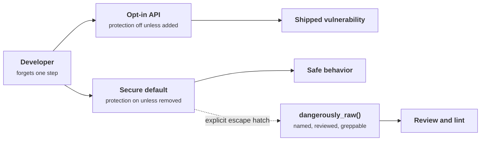
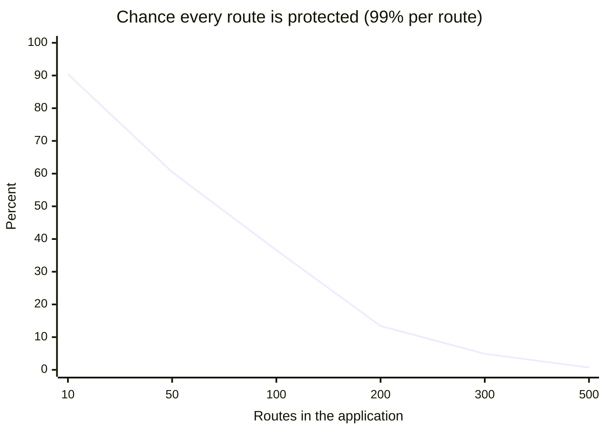
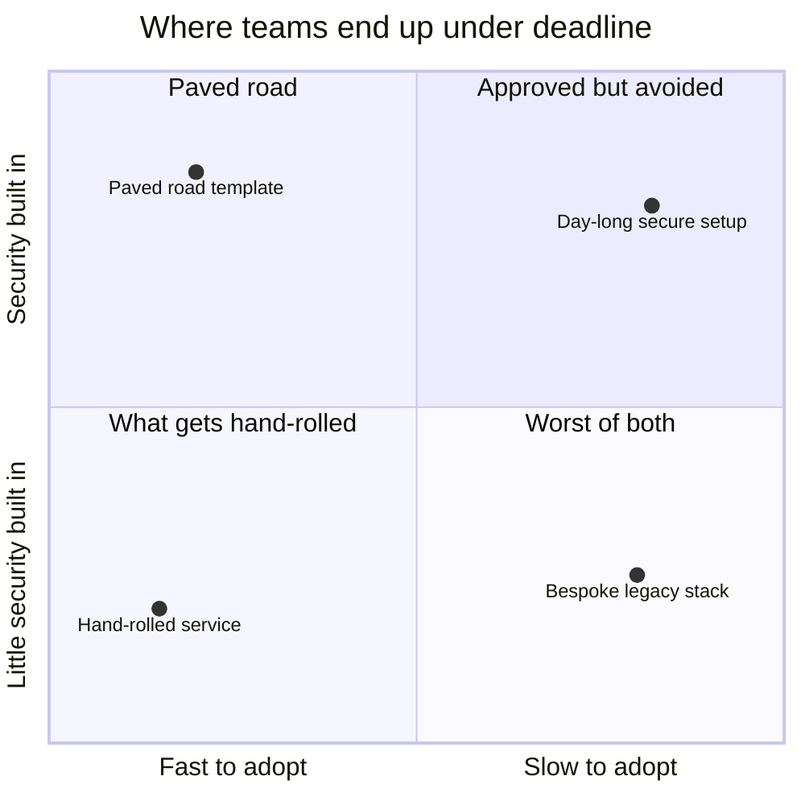
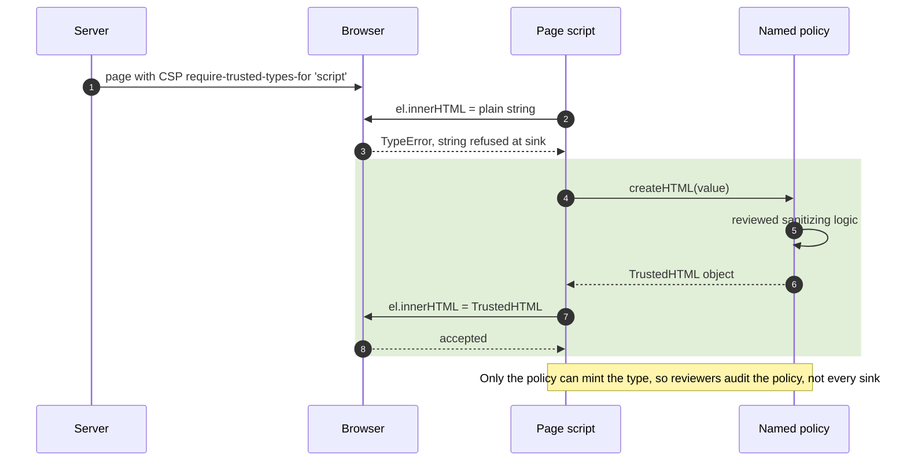
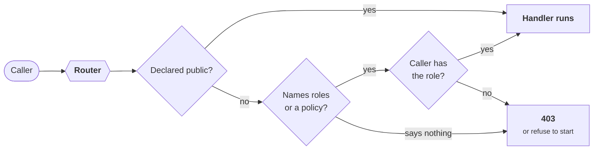
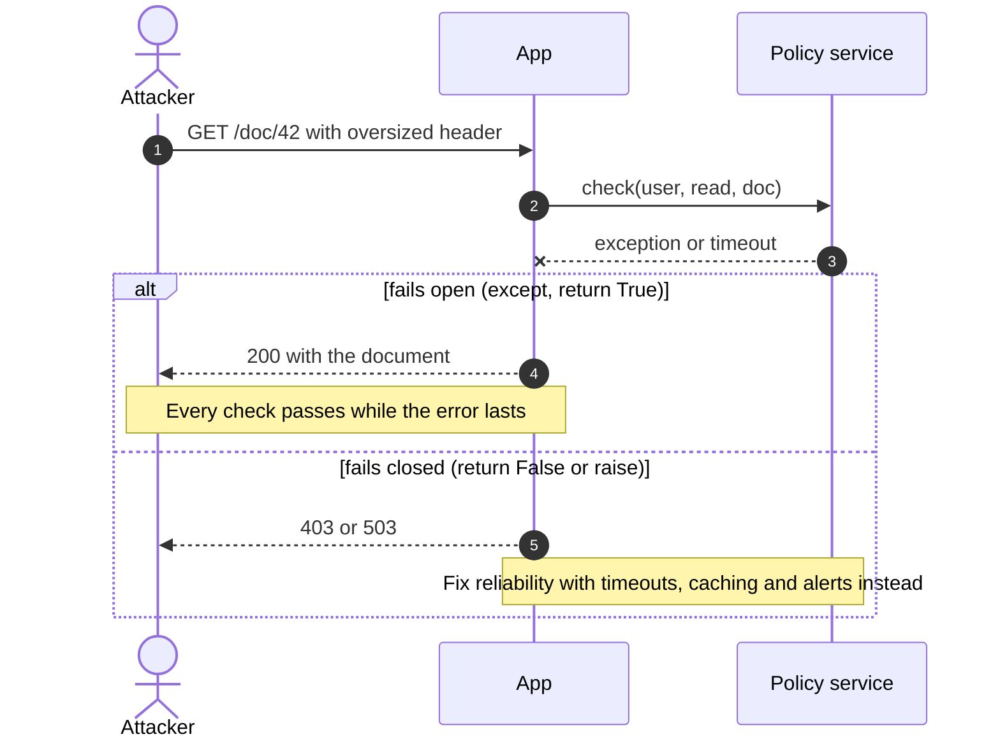
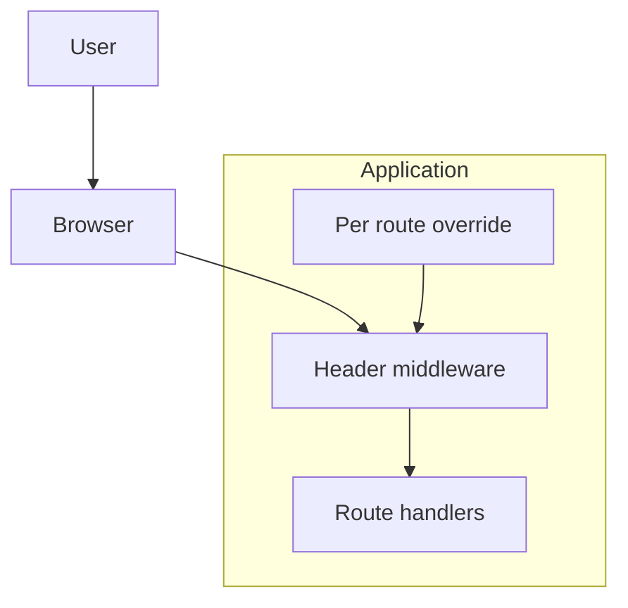

+++
title = 'Secure defaults'
description = 'Most vulnerabilities are a protection someone forgot to turn on. Build the platform so the protection is already on, the unsafe path is loud, and errors deny rather than allow.'
question = 'How do I make the secure way the easy way, so a forgotten step does not become a vulnerability?'
weight = 1
difficulty = 2
prerequisites = ['/notes/application-security/foundations/01-the-request-is-a-trust-boundary', '/notes/application-security/untrusted-input/02-xss-and-output-encoding']
date = 2026-06-18
lastmod = 2026-06-18
verified = 2026-06-18
+++

## The idea in one minute

Look back at the vulnerabilities in this course and a pattern appears. The
missing authorization check, the template that did not escape, the form without
a CSRF token, the cookie without `Secure`: in almost every case the fix existed
and the developer knew it. They forgot to apply it **on this one route**.
Training and checklists reduce that rate. They do not bring it to zero, because
people under deadline forget things.

A **secure default** inverts the burden. The framework escapes output unless
told otherwise, rejects state-changing requests without a CSRF token unless
told otherwise, and refuses to serve a route that does not say who may call
it. The developer who forgets gets the safe behavior. The developer who
genuinely needs the unsafe behavior can still have it, but has to ask in a way
that is **explicit, greppable, and visible in review**.

The consequence to act on: when the same bug class appears twice, stop fixing
instances and change the default that let it through.

## A picture



The same forgetful developer produces a vulnerability on the left and nothing
worse than a 403 on the right. The escape hatch still exists, but it leaves a
trail.

## How it really works

### Why defaults beat discipline

A web application has hundreds of routes, templates and queries. If each one
needs the developer to remember three protections, the chance that all of them
are present everywhere falls with every addition. Security that depends on
every engineer being careful on every line is security with a known failure
rate.

Assume, for illustration, that each route independently gets all its
protections right 99% of the time; the curve shows the chance that every route
in the application is right.



Saltzer and Schroeder named the principle in 1975 as **fail-safe defaults**:
base access decisions on permission rather than exclusion, so that a mistake
denies access instead of granting it. A default is the same idea applied to
APIs. Whatever the developer did not say should resolve to the safe answer.

This is also why secure defaults are an engineering investment rather than a
policy. A checklist item ("remember to escape") costs every developer attention
forever. A default costs one platform team some effort once, and then removes
the decision from everyone else.

### Paved roads

Many large engineering organizations describe this as a **paved road** (or
golden path): a supported, well-documented way to build a service that has
authentication, authorization hooks, logging, TLS, secret handling and safe
libraries already wired in. Teams are free to leave the road, but then they own
the security work the road would have done for them.

A paved road works when it is the **easiest** path, not merely the approved
one. If the secure service template takes a day to set up and the hand-rolled
one takes an hour, people will hand-roll under pressure. The platform team's
real job is to make the safe choice faster to adopt than the unsafe one.

Place the options by how long they take to adopt and how much security they
carry; under deadline, teams drift to the left of the chart whatever is on top.



### What safe-by-default looks like in real frameworks

Mature frameworks already make many of these choices. The pattern is the same
everywhere: safe unless you use a clearly named opt-out.

| Risk | Default | Explicit opt-out |
| --- | --- | --- |
| XSS in server templates | Django and Rails escape template output; Go's `html/template` escapes by context | Django `mark_safe` or `\|safe`; Rails `raw` or `html_safe`; Go `template.HTML` |
| XSS in client rendering | React escapes text inserted as JSX children | `dangerouslySetInnerHTML={{__html: ...}}` |
| XSS through Angular bindings | Angular sanitizes values bound into HTML | `bypassSecurityTrustHtml` and siblings |
| SQL injection | ORMs and query builders send parameters separately from SQL text | raw query methods such as Django `raw()` or `extra()` |
| CSRF | Django's generated settings include the CSRF middleware; Rails enables forgery protection | `@csrf_exempt`; `skip_forgery_protection` |
| DOM XSS sinks | Trusted Types, when enforced by CSP, blocks string assignment to `innerHTML` | a named Trusted Types policy that creates the value |

React's naming deserves a closer look. The prop that inserts raw HTML is not
called `html`. It is called `dangerouslySetInnerHTML`, and it takes an object
with a key named `__html` rather than a string. Nobody types that by accident,
anyone searching the codebase for it finds every use, and a reviewer who sees
it knows to ask where the string came from. That is what **making the unsafe
path loud** means: the unsafe option exists, but it is verbose, distinctive and
easy to audit.

Google's work on safe HTML types takes this further. Instead of passing strings
to dangerous sinks, code passes typed values (`SafeHtml`, `TrustedResourceUrl`)
that can only be produced by a small set of reviewed builders. Christoph Kern's
2014 article "Securing the Tangled Web" describes how this turned XSS from a
problem reviewed in every change into a property checked by the type system and
a few reviewed constructors. The browser-level form of the idea is **Trusted
Types**: with the CSP directive `require-trusted-types-for 'script'`, the
browser refuses plain strings at DOM sinks such as `innerHTML`.

Follow the two assignments: the plain string is refused at the sink, and only a
value minted by a named, reviewed policy gets through.



### Deny-by-default routing

Authorization is where opt-in hurts most. In many frameworks a new route is
public until someone adds a decorator. Forget it on one admin endpoint and you
have the broken authorization covered in
[Broken object level authorization](/notes/application-security/authorization/01-broken-object-level-authorization/).

The safer design inverts it. A route must **declare** its access rule: either
it is explicitly public, or it names the roles or policy that may call it. A
route that says nothing is unreachable, and ideally the application refuses to
start, so the mistake appears in development rather than production. Spring
Security's `authorizeHttpRequests` supports the same idea through a final
`anyRequest().authenticated()` or `denyAll()` rule that catches every path not
matched earlier.

Trace a request through the router: there are only two ways in, and a route
that declares nothing falls through to deny.



Deny-by-default extends beyond routes:

- **Network egress**: services reach only the hosts they are allowed to, which
  limits the server-side request forgery covered in
  [Server-side request forgery](/notes/application-security/untrusted-input/03-server-side-request-forgery/).
- **Serialization**: an API returns only fields on an explicit allowlist, so a
  new database column such as `password_hash` does not leak by appearing in a
  model.
- **Mass assignment**: a request may set only the fields the handler names, not
  every attribute of the object.
- **Permissions for tokens and keys**: new API keys start with no scopes.

### Fail closed

Every security check can fail in a third way besides "yes" and "no": it can
error. The policy service times out, the token parser throws, the database
returns nothing. **Failing closed** means an error in a security decision
resolves to deny.

The classic failure mode looks like this:

```python {title="fails open"}
def can_access(user, doc) -> bool:
    try:
        return policy_client.check(user, "read", doc)
    except Exception:
        log.warning("policy check failed")
        return True  # do not break the page for users
```

Under normal load this never matters. Under an outage, or under an attacker
who can make the policy call fail (a malformed ID, an oversized header), every
check passes. Fail-closed code returns `False` or raises, and lets the
framework turn that into a 403 or 503.

Watch what the attacker's malformed request does to each design once the
policy call throws.



The same rule covers error output. An unhandled exception should become a
generic error page, not a stack trace with file paths, SQL text and
configuration values. Django's `DEBUG = False` and equivalent production
settings exist for that reason. Leaving a debug mode on in production is one of
the most common misconfigurations, and a framework that refuses to start with
debug enabled on a public interface is choosing a secure default.

There is a real tension here. Failing closed on an availability-critical path
can turn a minor outage in the policy service into a total outage. The answer
is to make the dependency reliable (local caching of policy decisions,
timeouts with deny, clear alerting), not to make security optional when it is
inconvenient. Where the business truly needs fail-open, write the decision down
and scope it narrowly.

### Security headers as defaults

Browsers enforce several protections only when the server asks for them. These
belong in middleware that adds them to every response, not in individual
handlers:

| Header | What it does | Specification |
| --- | --- | --- |
| `Content-Security-Policy` | Restricts where scripts, frames and other resources may load from; `frame-ancestors` controls framing | W3C Content Security Policy Level 3 |
| `Strict-Transport-Security` | Tells the browser to use HTTPS only for this host for a period | RFC 6797 |
| `X-Content-Type-Options: nosniff` | Stops the browser guessing a script type from content | WHATWG Fetch standard |
| `Referrer-Policy` | Limits what URL is sent in the `Referer` header to other sites | W3C Referrer Policy |
| `Set-Cookie` attributes `Secure`, `HttpOnly`, `SameSite` | Cookie only over HTTPS, hidden from script, not sent on most cross-site requests | RFC 6265 and its revision in progress |

The point of the layout is where the headers are added: once, in middleware,
on the path every response takes back to the browser.



Headers are defense in depth. A strict CSP limits what an XSS bug can do; it
does not replace output encoding. A good default makes them present everywhere,
with a per-route override for the rare page that needs to be framed or to load
a third-party script.

### Secure by Design

In April 2023 CISA, together with the NSA, the FBI and cybersecurity agencies
of several other countries, published "Shifting the Balance of Cybersecurity
Risk: Principles and Approaches for Security-by-Design and -Default", expanded
in an October 2023 revision with more partner agencies. Its argument is aimed
at software makers rather than their customers: products should be safe out of
the box, and the burden of security should not fall on the customer reading a
hardening guide.

The document's three principles are that manufacturers should **take ownership
of customer security outcomes**, **embrace radical transparency and
accountability**, and **lead from the top**. Its examples of secure-by-default
practice include eliminating default passwords, enabling MFA by default for
privileged users, providing security logging at no extra charge, and moving
to memory-safe languages. The same reasoning applies inside a company: the
platform team is the "manufacturer" for application teams, and its defaults
determine how many of them ship secure code without thinking about it.

> [!IMPORTANT]
> A secure default is measured by what happens when someone forgets. If the
> forgetful path produces a vulnerability, the default is not secure, however
> good the documentation is.

## Code

The program defines two tiny web frameworks with the same routing API.
`OptInApp` applies authentication and CSRF checks only when a route asks for
them and never escapes. `SafeApp` escapes template values, requires an explicit
access rule on every route, requires a CSRF token on every non-GET request,
adds security headers to every response, and turns exceptions into a generic
500. The same application code, with the same four mistakes, is run against
both.

```python {title="secure_defaults.py"}
"""secure_defaults.py: the same four mistakes, made against two framework designs.

OptInApp makes every protection something the developer must remember to add.
SafeApp turns each protection on by default and makes the unsafe path loud.
Standard library only; the "requests" are simulated dictionaries.
"""

from __future__ import annotations

import hmac
from dataclasses import dataclass, field
from html import escape
from typing import Callable

SECURITY_HEADERS = {
    "Content-Security-Policy": "default-src 'self'",
    "X-Content-Type-Options": "nosniff",
    "Referrer-Policy": "no-referrer",
    "Strict-Transport-Security": "max-age=31536000",
}


class Raw(str):
    """A string the developer has explicitly declared safe HTML. Greppable."""


def dangerously_raw(html: str, reason: str) -> Raw:
    if not reason:
        raise ValueError("dangerously_raw needs a written reason")
    return Raw(html)


@dataclass
class Request:
    method: str
    path: str
    user: str | None = None
    roles: frozenset[str] = frozenset()
    form: dict[str, str] = field(default_factory=dict)
    session_csrf: str = "tok-7f3a"


@dataclass
class Response:
    status: int
    body: str = ""
    headers: dict[str, str] = field(default_factory=dict)


class OptInApp:
    """Everything is allowed unless the developer adds a protection."""

    def __init__(self) -> None:
        self.routes: dict[tuple[str, str], tuple[Callable, dict]] = {}

    def route(self, method: str, path: str, **opts) -> Callable:
        def register(fn: Callable) -> Callable:
            self.routes[(method, path)] = (fn, opts)
            return fn
        return register

    def render(self, template: str, **values: str) -> str:
        return template.format(**values)  # no escaping unless you call escape()

    def handle(self, req: Request) -> Response:
        fn, opts = self.routes[(req.method, req.path)]
        if opts.get("login_required") and req.user is None:
            return Response(401, "login required")
        if opts.get("csrf_protect") and req.form.get("csrf") != req.session_csrf:
            return Response(403, "bad csrf token")
        return Response(200, fn(self, req))


class SafeApp(OptInApp):
    """Deny by default, escape by default, CSRF by default, headers by default."""

    def render(self, template: str, **values: str) -> str:
        safe = {k: v if isinstance(v, Raw) else escape(v) for k, v in values.items()}
        return template.format(**safe)

    def authorize(self, req: Request, opts: dict) -> bool:
        if opts.get("public") is True:
            return True
        allowed = opts.get("roles")
        if not allowed:  # a route that says nothing about access is not reachable
            return False
        return req.user is not None and bool(req.roles & set(allowed))

    def handle(self, req: Request) -> Response:
        fn, opts = self.routes[(req.method, req.path)]
        try:
            if not self.authorize(req, opts):
                resp = Response(403, "forbidden")
            elif (req.method != "GET" and not opts.get("csrf_exempt")
                  and not hmac.compare_digest(req.form.get("csrf", ""), req.session_csrf)):
                resp = Response(403, "bad csrf token")
            else:
                resp = Response(200, fn(self, req))
        except Exception as exc:  # fail closed, and do not leak the exception text
            resp = Response(500, f"internal error ({type(exc).__name__})")
        resp.headers = {**SECURITY_HEADERS, **resp.headers}
        return resp


def build(app: OptInApp) -> OptInApp:
    """The same application code, with the same four developer mistakes."""

    @app.route("GET", "/admin/export")  # mistake 1: forgot to declare who may call it
    def export(app, req):
        return "all customer emails"

    @app.route("GET", "/comment", public=True)  # mistake 2: forgot to escape
    def comment(app, req):
        return app.render("<p>{c}</p>", c="<script>steal()</script>")

    @app.route("POST", "/transfer", roles=["user"], login_required=True)  # mistake 3: no CSRF
    def transfer(app, req):
        return "moved $500"

    @app.route("GET", "/report", roles=["user"], login_required=True)
    def report(app, req):  # mistake 4: a lookup that crashes on a missing record
        return {"q3": "ok"}[req.form.get("quarter", "q4")]

    return app


ATTACKS = [
    ("anonymous admin export", Request("GET", "/admin/export")),
    ("stored XSS in comment", Request("GET", "/comment")),
    ("cross-site POST", Request("POST", "/transfer", "alice", frozenset({"user"}))),
    ("handler raises", Request("GET", "/report", "alice", frozenset({"user"}))),
]

if __name__ == "__main__":
    for app in (build(OptInApp()), build(SafeApp())):
        print(type(app).__name__)
        for label, req in ATTACKS:
            try:
                r = app.handle(req)
                outcome = f"{r.status} {r.body[:44]:<44} headers={len(r.headers)}"
            except Exception as exc:
                outcome = f"unhandled {type(exc).__name__}: {exc}"
            print(f"  {label:<24} {outcome}")
    raw = SafeApp().render("<p>{c}</p>", c=dangerously_raw("<b>hi</b>", "static, reviewed"))
    print("explicit escape hatch:", raw)
```

Run it with `python3 secure_defaults.py`:

```text
OptInApp
  anonymous admin export   200 all customer emails                          headers=0
  stored XSS in comment    200 <p><script>steal()</script></p>              headers=0
  cross-site POST          200 moved $500                                   headers=0
  handler raises           unhandled KeyError: 'q4'
SafeApp
  anonymous admin export   403 forbidden                                    headers=4
  stored XSS in comment    200 <p>&lt;script&gt;steal()&lt;/script&gt;</p>  headers=4
  cross-site POST          403 bad csrf token                               headers=4
  handler raises           500 internal error (KeyError)                    headers=4
explicit escape hatch: <p><b>hi</b></p>
```

Three things to notice. Mistake 1 (`/admin/export` declared without any access
rule) is a full data leak under the opt-in design and a 403 under the safe one,
even though the developer wrote identical code. Mistake 3 passed
`login_required=True` and `roles` but not `csrf_protect`, which is exactly the
kind of partial remembering that opt-in designs punish. And the escape hatch
still works: `dangerously_raw` lets trusted HTML through, but only with a
written reason and a name a reviewer can search for.

## Where it breaks

- **Defaults can be turned off globally.** One line in a settings file
  (`autoescape=False`, removing the CSRF middleware, `DEBUG = True`) undoes the
  default for the whole application. Treat those settings as security-relevant
  configuration: code-owned, reviewed, and checked in CI.
- **The escape hatch gets normalized.** If `dangerously_raw` appears in two
  hundred places, nobody reviews any of them. Track the count, require a reason,
  and lint new uses so each one gets a second look.
- **Context matters more than escaping.** HTML-escaping a value is right in
  element content and wrong inside a `<script>` block, a URL or a CSS value. The
  toy `render` escapes for one context. Real template engines such as Go's
  `html/template` and Angular track the context; many others do not.
- **Deny-by-default only covers what goes through it.** A background job, a
  GraphQL resolver or a WebSocket handler that bypasses the router bypasses its
  default as well. List every entry point, not only HTTP routes.
- **Secure defaults do not fix logic.** The framework cannot know that user A
  must not read user B's invoice. Object-level authorization is still the
  application's job; the default only guarantees that someone had to write
  *some* rule.
- **Fail closed can become fail always.** A policy dependency without timeouts,
  caching and monitoring turns every hiccup into an outage, and teams under
  pressure then add the `return True` back. Reliability engineering is part of
  the control.

## Remember this

- Most vulnerabilities are a known protection someone forgot on one path.
- A secure default gives the forgetful developer the safe behavior.
- Make the unsafe path loud: verbose, distinctive names that reviewers and tools
  can find.
- Routes, fields, egress and scopes: deny unless declared.
- An error in a security decision means deny, and errors never leak internals.
- When a bug class recurs, change the default rather than fixing instances.

## Try it

1. Run `secure_defaults.py`. Add a fifth route to `build` that is meant to be
   public, such as a health check. What is the smallest change that makes it
   reachable under `SafeApp`, and how would a reviewer spot it?
2. Change `SafeApp.authorize` so that an exception inside it (for example, a
   `roles` value that is not a list) is caught and returns `True`. Add a route
   that triggers it and observe the result. Then restore fail-closed behavior.
3. Make `SafeApp` refuse to register a route with no `public` or `roles` key at
   all, raising at startup instead of returning 403 at request time. Which
   design is better, and why?
4. In a codebase you know, search for the escape hatches in the table above
   (`mark_safe`, `|safe`, `dangerouslySetInnerHTML`, `raw(`, `csrf_exempt`).
   For each hit, can you tell where the value comes from within a minute?

## Check yourself

1. Why is "train developers to remember to escape" a weaker control than
   autoescaping?

   
   Training lowers the rate of mistakes but cannot remove them, and the number
   of places that need escaping grows with the codebase. Autoescaping makes the
   forgetful path safe, so a mistake requires an explicit, visible opt-out
   rather than a silent omission.
   

2. What makes `dangerouslySetInnerHTML={{__html: value}}` a good escape hatch
   design?

   
   It is impossible to use by accident, its name states the risk, and it is
   trivially searchable. The odd object shape (`{__html: ...}`) adds friction
   and makes each use stand out in code review, so every raw-HTML insertion
   gets attention.
   

3. A route registered with no access rule returns 403 under deny-by-default.
   Why might refusing to start the application be even better?

   
   A 403 is safe but may go unnoticed until a user reports a broken page, and
   someone may "fix" it by marking the route public without thinking. Failing at
   startup surfaces the missing decision in development and forces the
   developer to choose public or a specific rule on purpose.
   

4. A permission check catches all exceptions and returns `True` to avoid
   breaking pages. What is the risk, and what should it do instead?

   
   It fails open: whenever the check errors, whether from an outage or from
   input an attacker crafted to cause an error, access is granted. It should
   deny (return `False` or raise) and let the framework return a 403 or 503,
   with the dependency made reliable through timeouts, caching and alerting.
   

5. Name two principles from CISA's 2023 Secure by Design guidance and one
   secure-by-default practice it recommends.

   
   The three principles are taking ownership of customer security outcomes,
   embracing radical transparency and accountability, and leading from the top.
   Example practices include eliminating default passwords, enabling MFA by
   default for privileged users, and providing security logs at no extra cost.
   

## Sources

- CISA, NSA, FBI and international partners, [Shifting the Balance of Cybersecurity Risk: Principles and Approaches for Security-by-Design and -Default](https://www.cisa.gov/resources-tools/resources/secure-by-design), April 2023; revised October 2023 as "...Principles and Approaches for Secure by Design Software".
- J. H. Saltzer and M. D. Schroeder, [The Protection of Information in Computer Systems](https://doi.org/10.1109/PROC.1975.9939), Proceedings of the IEEE 63(9), September 1975.
- C. Kern, Securing the Tangled Web, Communications of the ACM 57(9), September 2014.
- W3C, [Content Security Policy Level 3](https://www.w3.org/TR/CSP3/) and [Trusted Types](https://www.w3.org/TR/trusted-types/).
- J. Hodges, C. Jackson, A. Barth, [RFC 6797: HTTP Strict Transport Security (HSTS)](https://www.rfc-editor.org/rfc/rfc6797), IETF, November 2012.
- React documentation, [Dangerously setting the inner HTML](https://react.dev/reference/react-dom/components/common#dangerously-setting-the-inner-html).
- Django documentation, [Cross Site Request Forgery protection](https://docs.djangoproject.com/en/stable/ref/csrf/) and [Automatic HTML escaping](https://docs.djangoproject.com/en/stable/ref/templates/language/#automatic-html-escaping).
- Go standard library, [html/template](https://pkg.go.dev/html/template).
