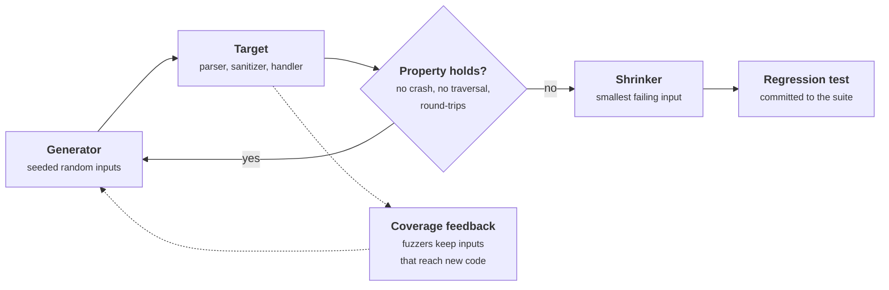
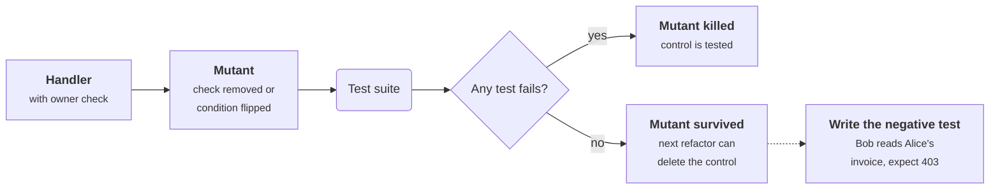
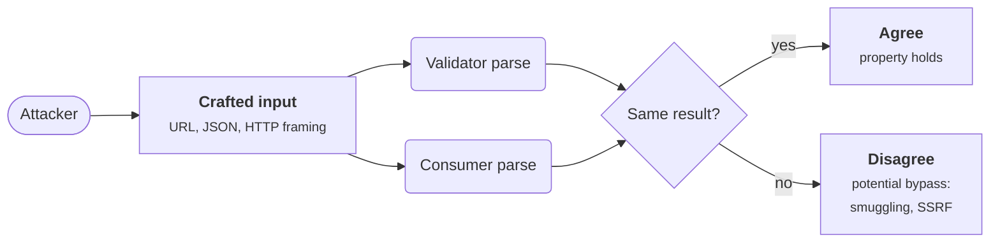
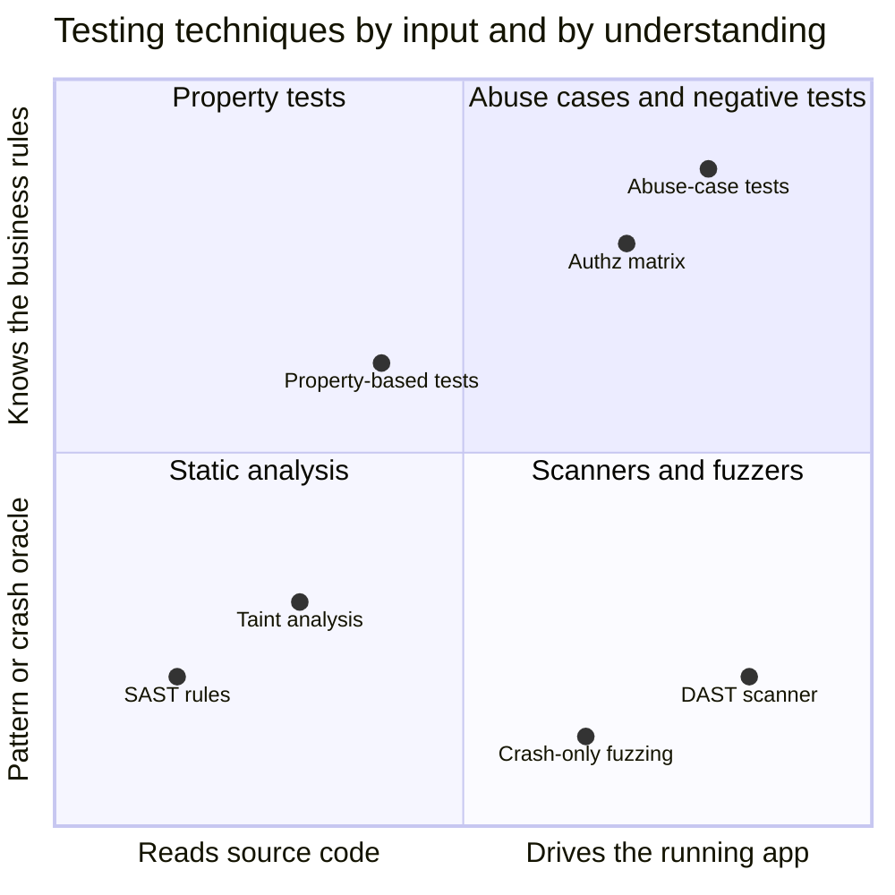
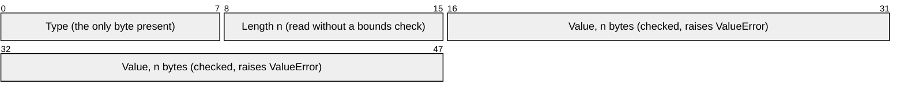

+++
title = 'Adversarial testing'
description = 'Ordinary tests check that the code does what it should. Security tests check that it refuses what it should, across inputs nobody thought to write down, which is where property-based testing and fuzzing come in.'
question = 'How do I test for what the code must never do, including inputs I did not think of?'
weight = 2
difficulty = 3
prerequisites = ['/notes/application-security/building-it-secure/01-secure-defaults', '/notes/application-security/untrusted-input/04-parsers-and-deserialization', '/notes/application-security/untrusted-input/05-files-and-paths']
date = 2026-06-20
lastmod = 2026-06-20
verified = 2026-06-20
+++

## The idea in one minute

Most test suites are written by the person who wrote the code, to show that it
works. They check the **happy path**: valid input produces the right output.
Vulnerabilities live elsewhere: in the request with someone else's object ID,
the path with an extra `../`, the length field that claims more bytes than
exist. An attacker does not try the inputs you thought of. They try the ones
you did not.

Adversarial testing closes that gap in layers. **Negative tests** assert that
specific bad requests are refused. **Abuse-case tests** encode what an attacker
would try against a feature. **Property-based tests** state a rule that must
hold for every input and let a generator search for a counterexample.
**Fuzzing** runs that search at scale, guided by code coverage, for hours or
continuously. **SAST** and **DAST** tools add automated scanning from the
source and from the outside.

The consequence to act on: every security control you add should come with a
test that proves the control refuses something, and every parser that touches
untrusted bytes should be fuzzed.

## A picture



A test case is a single point in the input space. A property plus a generator
searches the space; coverage feedback steers the search toward code it has not
yet reached; shrinking turns a messy failing input into a minimal one a person
can understand.

## How it really works

### Negative tests: prove the control refuses

A positive test says "Alice can read her invoice". A negative test says "Bob
cannot read Alice's invoice", and it is the one that catches broken object
level authorization. For every control in an application there is a negative
test that would fail if the control vanished:

| Control | Negative test |
| --- | --- |
| Object-level authorization | User B requests user A's resource by ID; expect 403 or 404 |
| Authentication | Expired, unsigned, wrong-audience and `alg: none` tokens; expect 401 |
| CSRF protection | POST without a token, and with another session's token; expect 403 |
| Input validation | Oversized body, wrong content type, negative quantity; expect 400 |
| Path handling | `../../etc/passwd`, absolute paths, encoded `%2e%2e%2f`; expect rejection |
| Rate limiting | The 101st login attempt in a minute; expect 429 |

A useful discipline: **delete the control and run the tests**. If nothing
fails, the control is untested, and the next refactor can remove it silently.
Mutation testing tools automate this by making small changes to the code (flip
a condition, remove a call) and checking that some test notices.

Each mutant is a control deleted on purpose; the outcome that matters is the
red one, where the suite stays green.



Authorization deserves a matrix rather than a handful of cases: every role
against every endpoint and action, with the expected decision in each cell.
Generated from the route table, it catches the new endpoint nobody added to the
policy. The lesson on
[RBAC, ABAC and relationships](/notes/application-security/authorization/02-rbac-abac-and-relationships/)
covers the models such a matrix tests.

### Abuse cases: test what the attacker wants

A use case describes what a legitimate user does with a feature. An **abuse
case**, a term from McDermott and Fox's 1999 paper on abuse case models, describes
what a hostile actor does with the same feature. Writing them is a short step
from a threat model (see
[Threat modeling an API](/notes/application-security/foundations/02-threat-modeling-an-api/)):
each threat becomes a scenario, and each scenario becomes an automated test.

For a password-reset feature, abuse cases include: request a reset for a
victim and guess the token; reuse a token after it has been used; use a token
issued for one account on another; change the `Host` header so the emailed link
points at the attacker's domain; enumerate which email addresses have accounts
from differences in the response. Each one becomes a test that sends that
request and asserts the refusal.

Here is the `Host` header abuse case as it plays out against a vulnerable
reset handler, and the assertion that turns it into a test.

```mermaid {title="Abuse case: a poisoned Host header steals a reset token"}
sequenceDiagram
  autonumber
  actor A as Attacker
  participant App as Reset endpoint
  participant M as Mail
  actor V as Victim
  A->>App: POST /reset email=victim, Host evil.example
  App->>M: link https://evil.example/reset?t=TOKEN
  M->>V: reset email
  V->>A: clicks link, token sent to attacker host
  A->>App: POST /reset/confirm t=TOKEN, new password
  App-->>A: 200, account taken over
  rect rgb(226, 239, 216)
    Note over A,App: The test sends step 1 and asserts the link uses the configured origin, never the Host header
  end
```

Abuse cases are valuable because they test **business logic**, which scanners
cannot understand. No tool knows that a coupon should apply once per order, or
that a refund must not exceed the original payment. Only a person who
understands the feature can write those tests.

### Property-based testing: rules instead of examples

An example test checks one input. A **property** is a statement that must be
true for all inputs, and a property-based testing library generates hundreds of
inputs looking for one that breaks it. The idea was popularized by Claessen and
Hughes's QuickCheck for Haskell in 2000; in Python the standard library is
Hypothesis.

Security properties tend to take a few recurring shapes:

| Shape | Example |
| --- | --- |
| **Never** | A path sanitizer's output never contains a `..` segment; an HTML encoder's output never contains `<` |
| **Only expected errors** | A parser returns a result or raises its documented error, never `IndexError`, `RecursionError` or a hang |
| **Round trip** | `decode(encode(x)) == x`; a canonicalizer is idempotent: `canon(canon(x)) == canon(x)` |
| **Agreement** | Two components parse the same input the same way (the proxy and the backend, the validator and the consumer) |
| **Authorization monotonicity** | Adding a permission never removes access; removing one never adds access |

The **agreement** property targets a whole family of bugs. When a validator and
a consumer parse the same input differently (two URL parsers, two JSON parsers
handling duplicate keys, a proxy and a server reading `Content-Length` and
`Transfer-Encoding`), an attacker crafts input that the validator approves and
the consumer interprets differently. Request smuggling and many SSRF filter
bypasses are parser disagreements. Differential testing feeds the same inputs
to both and asserts that they agree.

The bug lives in the gap between the two parsers, so the property is drawn
across that gap.



When a property fails, the library **shrinks** the counterexample: it tries
smaller and simpler variants and keeps any that still fail. A raw failure such
as `'..././.aa.a/'` becomes `'.../.'`, which points straight at the bug. Zeller
and Hildebrandt's delta debugging (2002) formalized this kind of input
minimization.

### Fuzzing: the search at scale

**Fuzzing** is automated generation of malformed or unexpected input to find
crashes and hangs. The idea dates back to Miller, Fredriksen and So's 1990 study
that fed random input to UNIX utilities and crashed a substantial fraction of
them. Modern fuzzers are far more effective because they are
**coverage-guided**:

1. The target is compiled or run with instrumentation that records which
   branches or edges each input exercises.
2. The fuzzer starts from a corpus of seed inputs, ideally valid examples of
   the format.
3. It mutates inputs (flip bits, insert bytes, splice two inputs, substitute
   interesting values like `0`, `-1`, `0xFFFFFFFF` or tokens from a dictionary).
4. Any mutated input that reaches new coverage is added to the corpus, so later
   mutations start from inputs that already get deeper into the code.
5. Crashes, sanitizer reports, timeouts and out-of-memory conditions are saved
   as findings.

The feedback loop is what matters. A random generator almost never produces a
valid header followed by a malformed length field, but a coverage-guided fuzzer
discovers the valid header once, keeps it, and spends its mutations on what
follows.

AFL and libFuzzer established the approach for C and C++. Atheris applies it to
Python code, Jazzer to the JVM, `cargo fuzz` to Rust, and Go has built-in
fuzzing in its `testing` package since Go 1.18. Google's OSS-Fuzz runs
continuous fuzzing for open source projects. In memory-unsafe languages,
fuzzers are paired with **sanitizers** such as AddressSanitizer, which turn
silent memory corruption into an immediate, reportable crash.

What counts as a bug depends on the oracle. Crashes are the default, but in
Python an unexpected exception is usually just an error response. Security
fuzzing of Python code is more productive with explicit oracles: the property
assertions from the previous section, a timeout for algorithmic complexity
(regular expressions with catastrophic backtracking, deep nesting), and checks
on resource use.

### SAST and DAST: roles and limits

Two automated families sit alongside tests:

| | SAST (static analysis) | DAST (dynamic scanning) |
| --- | --- | --- |
| Looks at | Source code or bytecode, without running it | The running application, from outside, over HTTP |
| Examples | Semgrep, CodeQL, language linters such as Bandit for Python | ZAP, Burp Suite's scanner, Nuclei templates |
| Good at | Known dangerous patterns, source-to-sink flows, every code path including unused ones | Configuration and deployment issues, missing headers, reflected injection, issues in components you have no source for |
| Weak at | Business logic, framework magic it does not model, false positives that erode trust | Authenticated, multi-step flows, coverage of endpoints it cannot discover, anything without a visible response |
| When | On every pull request, fast | Against a staging deployment, scheduled or per release |

Neither finds missing authorization reliably, because "Bob should not see
Alice's invoice" is a fact about the business, not the code. That is why the
negative tests and abuse cases above are not optional. NIST's Secure Software
Development Framework (SP 800-218) makes the division explicit: practice PW.7
covers reviewing and analyzing human-readable code, and PW.8 covers testing
executable code, and it expects both.

Place the techniques by what they need to run and whether they can judge
business rules; only the top half can catch "Bob reads Alice's invoice".



> [!TIP]
> Turn every security bug into a test before fixing it. The failing test proves
> you understood the bug, the passing test proves the fix, and the test stays
> in the suite so the bug cannot quietly return.

## Code

The program is a minimal property-based fuzzer: a seeded generator, a property
function, and a greedy shrinker that deletes chunks and simplifies characters
while the property still fails. It runs against two simulated targets with
planted bugs. `strip_traversal` removes `../` in a single pass, a classic
mistake. `parse_tlv` reads type-length-value records and promises to raise only
`ValueError` on malformed input, but reads the length byte without checking it
exists. A fixed sanitizer that rejects instead of repairing is checked last.

```python {title="fuzz_and_shrink.py"}
"""fuzz_and_shrink.py: a property-based fuzz loop, in miniature.

Two simulated targets with planted bugs. A seeded generator produces inputs,
a property decides pass or fail, and a shrinker reduces a failing input to a
minimal one. Standard library only; deterministic for a given seed.
"""

from __future__ import annotations

import random
from typing import Callable


def strip_traversal(path: str) -> str:
    """Planted bug: removes "../" in one pass, so overlapping input survives."""
    return path.replace("../", "").lstrip("/")


def parse_tlv(data: bytes) -> list[tuple[int, bytes]]:
    """Type-length-value records: 1-byte type, 1-byte length, then the value.
    Contract: return records, or raise ValueError for malformed input.
    Planted bug: the length byte is read without checking it exists."""
    out, i = [], 0
    while i < len(data):
        t, n = data[i], data[i + 1]
        value = data[i + 2:i + 2 + n]
        if len(value) != n:
            raise ValueError("truncated value")
        out.append((t, value))
        i += 2 + n
    return out


def no_traversal(d: str) -> bool:
    """Property: for any directory prefix d, the cleaned path has no '..' segment."""
    return ".." not in strip_traversal(d + "/report.txt").split("/")


def only_value_errors(b: bytes) -> bool:
    """Property: malformed input raises ValueError, never anything else."""
    try:
        parse_tlv(b)
    except ValueError:
        pass
    except Exception:
        return False
    return True


def gen_path(rng: random.Random) -> str:
    return "".join(rng.choice("./a") for _ in range(rng.randint(0, 12)))


def gen_tlv(rng: random.Random) -> bytes:
    data = bytearray()
    for _ in range(rng.randint(0, 3)):  # mostly well-formed records ...
        value = bytes(rng.randrange(256) for _ in range(rng.randint(0, 3)))
        data += bytes([rng.randrange(4), len(value)]) + value
    if rng.random() < 0.3:  # ... with an occasional stray byte appended
        data.append(rng.randrange(256))
    return bytes(data)


def shrink(x, holds: Callable[[object], bool], simplest):
    """Greedy shrinking: delete chunks (largest first), then simplify single
    elements, while the property still fails. Returns a locally minimal input."""
    improved = True
    while improved:
        improved = False
        for size in range(len(x), 0, -1):
            starts = range(0, len(x) - size + 1)
            smaller = next((x[:s] + x[s + size:] for s in starts
                            if not holds(x[:s] + x[s + size:])), None)
            if smaller is not None:
                x, improved = smaller, True
                break
        for i in range(len(x)):
            candidate = x[:i] + simplest + x[i + 1:]
            if candidate != x and not holds(candidate):
                x, improved = candidate, True
    return x


def check(name: str, gen, holds, simplest, seed: int = 2026, runs: int = 5000) -> None:
    rng = random.Random(seed)
    for n in range(1, runs + 1):
        x = gen(rng)
        if not holds(x):
            small = shrink(x, holds, simplest)
            print(f"{name}: FAILED after {n} inputs")
            print(f"  found   : {x!r}")
            print(f"  shrunk  : {small!r}")
            return
    print(f"{name}: passed {runs} inputs")


def strip_traversal_fixed(path: str) -> str:
    """Fix: reject instead of repair. Check segments after splitting."""
    parts = [p for p in path.split("/") if p not in ("", ".")]
    if ".." in parts:
        raise ValueError("path traversal")
    return "/".join(parts)


def no_traversal_fixed(d: str) -> bool:
    try:
        return ".." not in strip_traversal_fixed(d + "/report.txt").split("/")
    except ValueError:
        return True


if __name__ == "__main__":
    check("strip_traversal", gen_path, no_traversal, "a")
    check("parse_tlv", gen_tlv, only_value_errors, b"\x00")
    print("  error   :", end=" ")
    try:
        parse_tlv(b"\x00")
    except Exception as exc:
        print(f"{type(exc).__name__}: {exc}")
    check("strip_traversal_fixed", gen_path, no_traversal_fixed, "a")
```

Run it with `python3 fuzz_and_shrink.py`:

```text
strip_traversal: FAILED after 108 inputs
  found   : '..././.aa.a/'
  shrunk  : '.../.'
parse_tlv: FAILED after 3 inputs
  found   : b'\x00\x03\xe1z\x01\x02\x00\x03\x00\xfb'
  shrunk  : b'\x00'
  error   : IndexError: index out of range
strip_traversal_fixed: passed 5000 inputs
```

The bars compare each failing input as found with what the shrinker kept,
counted in characters for the path and bytes for the TLV data.

```mermaid {title="Shrinking keeps only the part that causes the failure"}
xychart-beta
  title "Failing input size, found versus shrunk"
  x-axis ["strip_traversal (chars)", "parse_tlv (bytes)"]
  y-axis "Size" 0 --> 14
  bar [12, 10]
  bar [5, 1]
```



The shrunk inputs explain the bugs on sight. With `/report.txt` appended, the
prefix `'.../.'` gives `.../.` + `/report.txt`, that is `..././report.txt`. The
single pass removes the `../` that starts at the second character, and the `.`
before it joins the `./` after it into a new `../`, leaving `../report.txt`. `b'\x00'` is a record with a type byte and no length
byte, and the parser indexes past the end. Both minimal inputs belong in the
regression suite as ordinary example tests.

The record layout shows why one byte is enough: `parse_tlv` reads the second
field before checking that it exists.



The fix for the sanitizer is also the general lesson: **reject, do not
repair**. Sanitizers that try to clean dangerous input are fragile because the
cleaning itself creates new input. Splitting into segments and refusing any `..`
segment has nothing to recombine.

## Where it breaks

- **A property is only as good as its statement.** A property that checked
  for the substring `../` instead would flag the correct sanitizer on the
  harmless name `a../a`. A wrong property produces
  false alarms or, worse, passes a broken function. Write properties about the
  security outcome (no `..` segment after resolution), not about the
  implementation.
- **Random search finds shallow bugs.** The generator here draws from three
  characters, which is why it finds the bug in a hundred tries. Real formats
  have checksums, magic numbers and nested structure that random bytes almost
  never satisfy. That is the gap coverage guidance, dictionaries and
  structure-aware generators close, and why seed corpora matter.
- **No crash is not no bug.** A fuzzer with only a crash oracle will not notice
  an authorization bypass, a wrong result, or data written to the wrong tenant.
  The oracle defines what can be found.
- **Coverage is not correctness.** Reaching a line once does not mean every
  input that reaches it was handled correctly. High coverage numbers can hide
  untested states.
- **Scanners do not understand your business.** SAST and DAST will not tell you
  that a refund can exceed the purchase price. Abuse-case tests written by
  people who know the feature are the only automated defense against logic
  bugs.
- **A fuzzing campaign is not a one-off.** New code adds new paths. Fuzzing that
  ran once at launch says nothing about the parser changed last month.
  Continuous fuzzing, or at least a short fuzz run in CI with the corpus kept
  between runs, keeps it relevant.

## Remember this

- Every control needs a negative test that fails if the control is removed.
- Abuse cases turn the threat model into tests for business logic.
- Properties state what must never happen; generators search for a
  counterexample; shrinking makes it readable.
- Coverage-guided fuzzing keeps inputs that reach new code, which is how it gets
  past the header to the bug.
- Sanitizers should reject, not repair; repair creates new input.
- SAST and DAST find patterns and misconfigurations, not missing authorization.

## Try it

1. Run `fuzz_and_shrink.py`. Change the seed and runs. Does the shrunk
   counterexample for `strip_traversal` change? Why is the shrunk input often
   the same even when the original failure differs?
2. Replace `strip_traversal` with a version that repeats the replacement until
   the string stops changing. Does the property pass now? Add `%2e%2e%2f` to
   the generator's vocabulary and URL-decode in the target. What happens?
3. Fix `parse_tlv` so the property holds, then add a second property: for any
   list of records with values under 256 bytes, `parse_tlv(encode(records))`
   returns the same records. Write `encode` and run both.
4. Pick one endpoint in an application you know and write three abuse cases in
   one sentence each. Which of them would a DAST scanner find?

## Check yourself

1. What is the difference between a negative test and an abuse-case test?

   
   A negative test checks that a specific control refuses a specific bad input,
   such as an expired token getting a 401. An abuse-case test starts from an
   attacker's goal against a feature, such as taking over an account through
   password reset, and may involve several requests and business rules. Abuse
   cases often uncover logic flaws that no single control covers.
   

2. Why does coverage guidance make fuzzing so much more effective than pure
   random input?

   
   Random inputs rarely get past the first validation step, such as a magic
   number or a header. A coverage-guided fuzzer keeps any input that reaches new
   code and mutates from there, so progress accumulates: once an input passes
   the header check, later mutations explore what lies behind it.
   

3. What does shrinking do, and why does it matter?

   
   It repeatedly tries smaller and simpler variants of a failing input and keeps
   those that still fail, ending with a locally minimal counterexample. A
   minimal input shows the cause directly, makes a clear regression test, and
   separates the relevant bytes from noise the generator happened to produce.
   

4. Give a property that would catch a parser disagreement between a security
   filter and the component behind it.

   
   An agreement property: for every generated input, the filter's parse and the
   backend's parse produce the same result (same host for a URL, same keys for a
   JSON object, same body length for an HTTP request). Any input where they
   differ is a potential bypass.
   

5. Why can neither SAST nor DAST be relied on to find broken object-level
   authorization?

   
   Whether user B may read object A is a business rule that does not appear as a
   recognizable code pattern or as an obvious error in a response. A scanner sees
   a successful 200 response and has no way to know it should have been a 403.
   Negative tests and authorization matrices written from the access policy are
   needed.
   

## Sources

- NIST, [SP 800-218: Secure Software Development Framework (SSDF) Version 1.1](https://csrc.nist.gov/pubs/sp/800/218/final), February 2022.
- J. McDermott and C. Fox, Using Abuse Case Models for Security Requirements Analysis, Proceedings of the 15th Annual Computer Security Applications Conference (ACSAC), 1999.
- K. Claessen and J. Hughes, QuickCheck: A Lightweight Tool for Random Testing of Haskell Programs, ICFP, 2000.
- A. Zeller and R. Hildebrandt, Simplifying and Isolating Failure-Inducing Input, IEEE Transactions on Software Engineering 28(2), 2002.
- B. P. Miller, L. Fredriksen, B. So, An Empirical Study of the Reliability of UNIX Utilities, Communications of the ACM 33(12), December 1990.
- LLVM project, [libFuzzer: a library for coverage-guided fuzz testing](https://llvm.org/docs/LibFuzzer.html).
- Google, [Atheris: a coverage-guided Python fuzzing engine](https://github.com/google/atheris) and [OSS-Fuzz](https://google.github.io/oss-fuzz/).
- Go documentation, [Go Fuzzing](https://go.dev/doc/security/fuzz/).
- Hypothesis documentation, [Hypothesis](https://hypothesis.readthedocs.io/).
- OWASP, [Web Security Testing Guide](https://owasp.org/www-project-web-security-testing-guide/).
