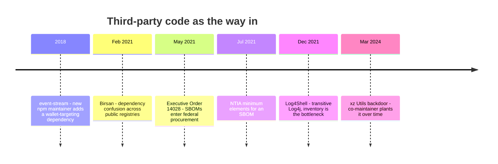
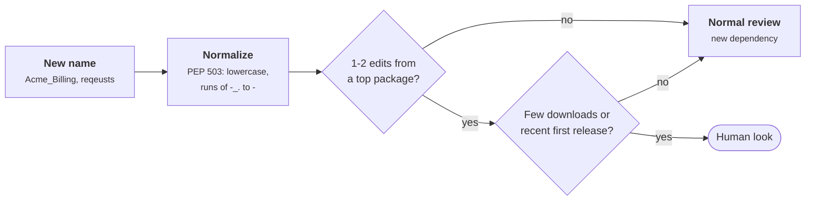
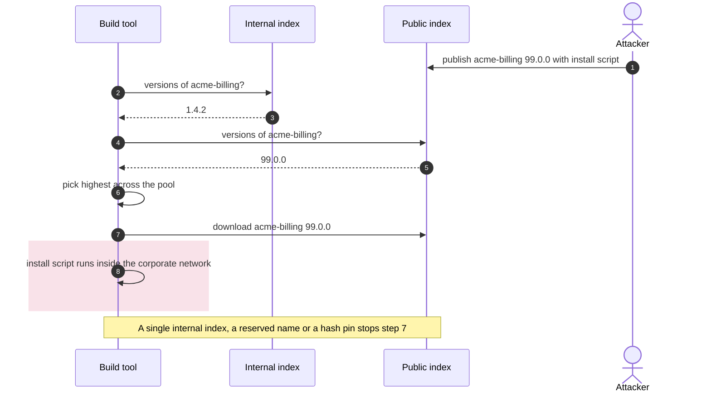
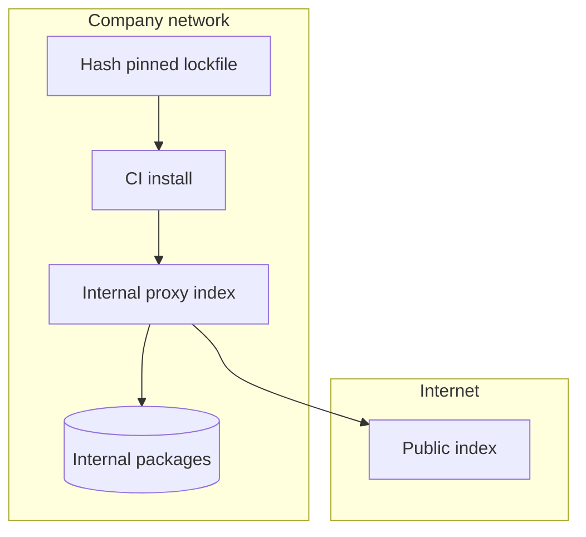
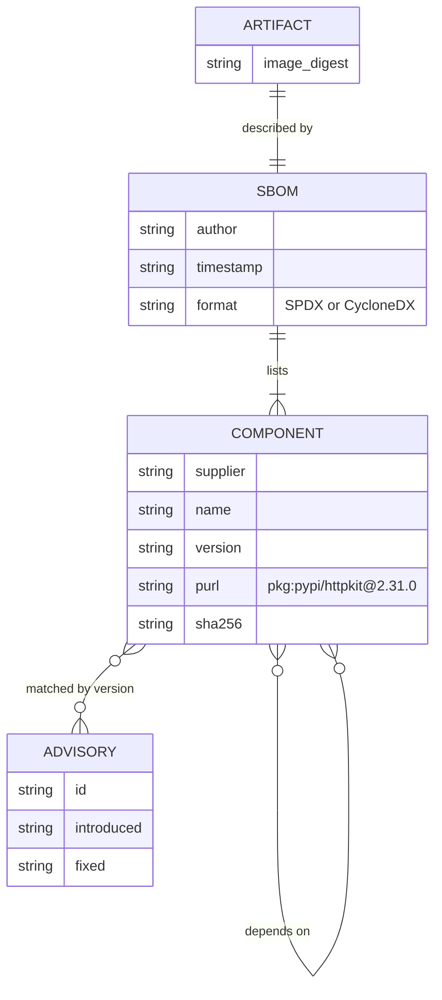

+++
title = 'Dependencies and supply chain'
description = 'Most of the code you deploy was written by someone else and chosen by a resolver. Pin it by hash, check the names, know what you ship, and match it against advisories with reachability in mind.'
question = 'How do I control the third-party code my application installs and runs?'
weight = 3
difficulty = 2
prerequisites = ['/notes/application-security/foundations/02-threat-modeling-an-api', '/notes/application-security/building-it-secure/01-secure-defaults']
date = 2026-06-22
lastmod = 2026-06-22
verified = 2026-06-22
+++

## The idea in one minute

A typical web service declares a few dozen dependencies and installs hundreds,
because each dependency brings its own. Every one of those packages runs with
your application's privileges, and many of them run code at install time,
before any test or review. You chose a handful by name. A **resolver** chose
the rest, from whatever an index served at the moment of installation.

That gives an attacker several ways in that never touch your code: publish a
package whose name is one keystroke away from a popular one (**typosquatting**);
publish a public package with the same name as your internal one and a higher
version (**dependency confusion**); take over a maintainer account and push a
malicious release; or simply wait for a vulnerability in a library you use.

The defenses are mechanical: **a lockfile with hash pins** so installs are
exact and repeatable, **name checks** before a new dependency is added,
**index configuration** that cannot be confused, an **SBOM** so you know what
you ship, and **advisory matching** with reachability so you fix what matters
first. The consequence to act on: no install in CI or production should
resolve anything; it should fetch exactly the artifacts recorded in the
lockfile and refuse anything whose hash differs.

## A picture

```mermaid {title="Where third-party code enters, and the check at each point"}
flowchart LR
  DEV["<b>Developer</b><br/><small>adds a dependency</small>"] --> NAME["<b>Name check</b><br/><small>typosquat, confusion</small>"]
  NAME --> LOCK["<b>Lockfile</b><br/><small>exact versions and<br/>sha256 pins</small>"]
  IDX["<b>Package index</b><br/><small>public or internal</small>"] --> INST["<b>Install</b><br/><small>hash-checking mode</small>"]
  LOCK --> INST
  INST --> SBOM["<b>SBOM</b><br/><small>what shipped</small>"]
  SBOM --> ADV["<b>Advisory match</b><br/><small>OSV, reachability</small>"]
  ATK["<b>Attacker</b><br/><small>typo name, same name,<br/>hijacked release</small>"] -.-> IDX
  class DEV neutral
  class NAME,INST good
  class LOCK,SBOM memory
  class IDX io
  class ADV compute
  class ATK warn
```

The lockfile is the hinge. Everything before it is a decision about which
packages to trust; everything after it is verifying that you got exactly
those packages and knowing when one of them turns out to be vulnerable.

## How it really works

### Transitive dependencies are most of your code

Your manifest (`pyproject.toml`, `package.json`, `go.mod`) lists **direct**
dependencies. Each of those has its own, and so on. The full set, the
**transitive closure**, is what actually runs. It is common for the
transitive set to be many times larger than the direct one, and for none of
your engineers to have chosen, or heard of, most of it.

Read the tree top-down: the manifest stops at the first row, and the library
that turned up in the Log4Shell response sits two levels further down.

```mermaid {title="The manifest lists the top row, the resolver installs the tree"}
flowchart TB
  APP("Your service")
  subgraph M["Manifest: direct dependencies"]
    W["<b>web framework</b>"]
    DB["<b>database driver</b>"]
    RPT["<b>reporting product</b>"]
  end
  subgraph TR["Resolver: transitive closure"]
    T1["<b>HTTP client</b>"]
    T2["<b>template engine</b>"]
    T3["<b>logging facade</b>"]
    L4J["<b>Log4j</b><br/><small>never named by you</small>"]
  end
  APP --> W
  APP --> DB
  APP --> RPT
  W --> T1
  W --> T2
  RPT --> T3
  T3 --> L4J
  class W,DB,RPT neutral
  class T1,T2,T3 memory
  class L4J warn
```

Log4Shell (CVE-2021-44228, December 2021) showed the cost. Many affected
organizations did not list Log4j as a dependency; it arrived transitively
through frameworks and products. The first problem in the response was not
patching but **finding out where Log4j was**. Teams with an accurate inventory
answered in hours; teams without one searched file systems for days.

Transitive dependencies also widen the set of people you trust. Every
maintainer with publish rights on any package in the closure can ship code into
your build. The 2018 `event-stream` incident in npm is a well-known example:
a new maintainer, given publish access to a popular package, added a dependency
that carried code targeting a specific cryptocurrency wallet application. The
xz Utils backdoor (CVE-2024-3094, March 2024) was inserted over a long period
by a contributor who had become a co-maintainer, and was caught by Andres
Freund after he noticed unusual SSH login latency on a test system.

Laid end to end, the incidents and the policy responses in this lesson cover
every route in: a new maintainer, a resolver, a transitive library, a
long-term insider.



### Typosquatting

Attackers publish packages whose names are close to popular ones: a swapped
pair of letters (`reqeusts`), a missing letter, a different separator
(`python-dateutil` versus `dateutil-python`), or a plausible extension
(`requests-toolbelt-pro`). A developer who mistypes an install command, or
copies a name from a blog post, gets the attacker's package. Package indexes
remove such packages when reported, but the window between publication and
removal is enough for install-time code to run.

Defenses work at the point a dependency is **added**, not at install:

- Compare new names against a list of popular packages with an edit distance.
  A distance of one or two from a top package, combined with low download
  counts or a recent first release, deserves a human look.
- Normalize names before comparing. In Python, PEP 503 says names differ only
  after lowercasing and collapsing runs of `-`, `_` and `.` to `-`, so
  `Acme_Billing` and `acme-billing` are the same package.
- Require review for any change that adds a new dependency, as distinct from
  updating an existing one.

The check runs once, when a name is added; each diamond is a reason to stop
and have a person look.



### Dependency confusion

In February 2021 Alex Birsan published research showing that build systems at
many large companies could be tricked into installing packages from the public
index instead of their internal one. The mechanism was simple. Companies used
internal package names (often leaked in public `package.json` files or
JavaScript bundles). Birsan published packages with those names on the public
npm, PyPI and RubyGems registries, with high version numbers. Build tools
configured to look at both indexes picked the higher version, which was the
public one, and ran its install script inside corporate networks.

The resolver asks both indexes and keeps the higher version; nothing in the
request says which index owns the name.



In pip, the dangerous configuration is `--extra-index-url`: pip treats all
configured indexes as one pool and picks the best version across them, with no
notion that the internal index should win. Defenses:

| Defense | How it helps |
| --- | --- |
| A single index URL pointing at an internal proxy that serves both internal and vetted public packages | Resolution never sees the public copy of an internal name |
| Reserve your internal names (or a prefix, or an npm scope you own) on the public registries | The attacker cannot publish the name |
| Scoped registries (`@acme/*` in npm mapped to the internal registry) | The name itself says which index serves it |
| Hash pinning | A package from the wrong index has a different hash and fails to install |

Put together, the first and last rows give a build that has exactly one place
to ask and one lockfile to obey; the public index is reachable only through the
proxy.



### Lockfiles and hash pinning

A **lockfile** records the exact version of every package in the transitive
closure, and ideally a cryptographic hash of each artifact. `package-lock.json`,
`poetry.lock`, `uv.lock`, `Cargo.lock` and Go's `go.sum` all serve this role.
For pip, a requirements file generated with hashes looks like this:

```text {title="requirements.txt with hash pins"}
httpkit==2.31.0 \
    --hash=sha256:3f1c...e9a0
yamlette==5.3.1 \
    --hash=sha256:9b02...41cd
```

When any requirement carries a `--hash`, pip switches into **hash-checking
mode** for the whole install, and `--require-hashes` forces that mode
explicitly. In this mode every requirement must be pinned with `==` and must
carry a hash, dependencies of dependencies included, and pip refuses any
downloaded file whose SHA-256 digest does not match. A tool such as
`pip-compile --generate-hashes` from pip-tools, or `uv pip compile
--generate-hashes`, produces the file from a short list of direct
requirements.

Hash pinning converts a whole class of attack into an install failure:

- **A compromised or malicious index** serving a modified file: hash mismatch.
- **Dependency confusion**: the public package has a different hash.
- **A maintainer re-releasing** a version with different contents: hash
  mismatch. (PyPI does not allow replacing a released file under the same
  name, but other indexes and mirrors may.)

What hash pinning does **not** do is judge the package you pinned. If the
lockfile was generated after someone typed `reqeusts`, the typosquat is pinned
faithfully, with a valid hash. Pins guarantee you get what you chose, which
makes **choosing** the part that needs review. Updates to the lockfile should
come through reviewed pull requests, typically opened by a bot such as
Dependabot or Renovate, rather than appearing as side effects of a local
install.

Install-time code execution is the other reason to control installs. npm runs
`preinstall` and `postinstall` scripts; pip building a package from a source
distribution runs its build backend. Preferring prebuilt wheels
(`pip install --only-binary :all:`) and disabling install scripts where
possible (`npm ci --ignore-scripts`) shrinks that surface.

### SBOMs: knowing what you ship

A **software bill of materials** is a machine-readable list of the components
in a piece of software: names, versions, identifiers such as package URLs
(`pkg:pypi/httpkit@2.31.0`), hashes, licenses, and relationships between
components. Two formats dominate:

- **SPDX**, a Linux Foundation project, published as ISO/IEC 5962:2021.
- **CycloneDX**, an OWASP project, later standardized by Ecma International as
  ECMA-424.

In the United States, Executive Order 14028 (May 2021) pushed SBOMs into
federal software procurement, and the NTIA's "Minimum Elements for a Software
Bill of Materials" (July 2021) defined a baseline: supplier, component name,
version, other unique identifiers, dependency relationship, author of the SBOM
data, and timestamp.

The NTIA elements map onto a small data model: each build produces an SBOM,
which lists components, which depend on each other and can be matched to
advisories.



The practical value is the Log4Shell question: **"are we affected?"** With an
SBOM generated at build time for every artifact you deploy, it becomes a query
instead of a search. Generate the SBOM from the build, not by scanning a
directory afterwards, so it describes what was actually assembled. The
mechanics of signing artifacts and attesting how they were built are covered
in [CI/CD and build provenance](/notes/infrastructure-security/delivery-and-operations/01-ci-cd-and-build-provenance/)
and [Signing and admission](/notes/infrastructure-security/delivery-and-operations/02-signing-and-admission/).

### Vulnerability databases and reachability

Knowing what you ship is half the job; the other half is knowing which of it
is vulnerable. Advisories are published in several databases: the National
Vulnerability Database keyed by CVE, the GitHub Advisory Database, ecosystem
databases such as the Python Packaging Advisory Database, and **OSV**
(osv.dev), which aggregates many of these into one open schema. An OSV record
names the package and ecosystem and describes affected versions as ranges of
`introduced` and `fixed` events, which tools can evaluate mechanically.
`pip-audit`, `npm audit`, `osv-scanner` and `govulncheck` all compare a
dependency set against such a database.

The result is often a long list, and treating every entry as urgent burns out
teams. **Reachability** cuts it down. A vulnerability in an XML parsing
function matters only if your code, directly or through other libraries,
actually calls that function with attacker-influenced input. `govulncheck`
does this for Go by analyzing the call graph and reporting only vulnerabilities
in functions your code can reach. Other ecosystems have commercial and
experimental equivalents. Reachability is a prioritization tool, not an
exemption: an unreachable vulnerable function can become reachable in next
week's change, so unreachable findings still get upgraded, just not tonight.

Sort the scanner's list on two axes; the examples are hypothetical, and the
top-right corner is tonight's work.

```mermaid {title="Reachability reorders the advisory list, it does not empty it"}
quadrantChart
  title Prioritizing matched advisories
  x-axis Not reachable --> Reachable with attacker input
  y-axis Low severity --> High severity
  quadrant-1 Fix now
  quadrant-2 Upgrade on the regular cadence
  quadrant-3 Batch with routine updates
  quadrant-4 Fix soon
  XML parser called on uploads: [0.85, 0.9]
  Template bug in a used path: [0.75, 0.4]
  RCE in an unused codec: [0.15, 0.85]
  Debug helper never imported: [0.2, 0.2]
```

> [!WARNING]
> "No known vulnerabilities" means no **published** vulnerabilities in the
> versions you pinned. It says nothing about malicious packages that have not
> been reported, or about the maintainer account that will be compromised
> tomorrow. Advisory scanning complements, and does not replace, pinning and
> review.

## Code

The program audits a simulated hash-pinned lockfile before installation. It
parses each line and rejects anything not pinned with `==` and a SHA-256 hash,
normalizes names per PEP 503, compares the digest of what the simulated index
serves against the pin, flags names one edit away from a popular package using
optimal string alignment distance (which counts a swap of adjacent letters as
one edit), flags internal names that also exist on the public index, and
matches versions against simulated OSV-style advisories with `introduced` and
`fixed` bounds. The packages and advisory IDs are invented.

```python {title="supply_chain.py"}
"""supply_chain.py: four checks on a lockfile before anything is installed.

1. every pinned artifact matches its sha256 pin (pip --require-hashes style)
2. no dependency name is one edit away from a popular package (typosquatting)
3. no internal package name also exists on the public index (dependency confusion)
4. no pinned version falls inside a known advisory's affected range (OSV style)

Everything is simulated: the "index", the advisories, and the packages are made
up, and so are the advisory IDs. Standard library only; runs offline.
"""

from __future__ import annotations

import hashlib
import re
from dataclasses import dataclass

# What the package index would serve for each name==version (simulated bytes).
INDEX = {
    ("httpkit", "2.31.0"): b"httpkit wheel 2.31.0",
    ("yamlette", "5.3.1"): b"yamlette wheel 5.3.1",
    ("reqeusts", "1.0.0"): b"reqeusts wheel 1.0.0",
    ("acme-billing", "1.4.2"): b"acme-billing wheel 1.4.2 (internal)",
    ("tarstream", "0.9.4"): b"tarstream wheel 0.9.4, modified in transit",
}
PUBLIC_NAMES = {"httpkit", "yamlette", "reqeusts", "tarstream", "acme-billing", "requests"}
INTERNAL_NAMES = {"acme-billing"}
POPULAR = ["requests", "urllib3", "numpy", "django", "cryptography", "httpkit"]

ADVISORIES = [  # (id, package, introduced, fixed); fixed=None means no fix yet
    ("SIM-2026-0007", "yamlette", "5.1.0", "5.4.0"),
    ("SIM-2026-0011", "httpkit", "1.0.0", "2.0.0"),
]


def sha(data: bytes) -> str:
    return hashlib.sha256(data).hexdigest()


# The lockfile as committed: the tarstream pin was recorded from the real artifact.
LOCKFILE = f"""\
httpkit==2.31.0 --hash=sha256:{sha(b"httpkit wheel 2.31.0")}
yamlette==5.3.1 --hash=sha256:{sha(b"yamlette wheel 5.3.1")}
reqeusts==1.0.0 --hash=sha256:{sha(b"reqeusts wheel 1.0.0")}
Acme_Billing==1.4.2 --hash=sha256:{sha(b"acme-billing wheel 1.4.2 (internal)")}
tarstream==0.9.4 --hash=sha256:{sha(b"tarstream wheel 0.9.4")}
"""


@dataclass
class Pin:
    name: str
    version: str
    sha256: str


def normalize(name: str) -> str:
    """PEP 503 name normalization: case and runs of -_. do not distinguish packages."""
    return re.sub(r"[-_.]+", "-", name).lower()


def parse_lockfile(text: str) -> list[Pin]:
    pins = []
    for line in text.splitlines():
        m = re.fullmatch(r"([A-Za-z0-9._-]+)==([0-9.]+) --hash=sha256:([0-9a-f]{64})", line)
        if not m:
            raise ValueError(f"unpinned or unhashed requirement: {line!r}")
        pins.append(Pin(normalize(m[1]), m[2], m[3]))
    return pins


def edit_distance(a: str, b: str) -> int:
    """Optimal string alignment distance: insert, delete, substitute, transpose."""
    d = [[i + j if i * j == 0 else 0 for j in range(len(b) + 1)] for i in range(len(a) + 1)]
    for i in range(1, len(a) + 1):
        for j in range(1, len(b) + 1):
            cost = a[i - 1] != b[j - 1]
            d[i][j] = min(d[i - 1][j] + 1, d[i][j - 1] + 1, d[i - 1][j - 1] + cost)
            if i > 1 and j > 1 and a[i - 1] == b[j - 2] and a[i - 2] == b[j - 1]:
                d[i][j] = min(d[i][j], d[i - 2][j - 2] + 1)
    return d[-1][-1]


def version(v: str) -> tuple[int, ...]:
    return tuple(int(part) for part in v.split("."))


def affected(v: str, introduced: str, fixed: str | None) -> bool:
    return version(introduced) <= version(v) and (fixed is None or version(v) < version(fixed))


def audit(pins: list[Pin]) -> list[str]:
    findings = []
    for p in pins:
        served = INDEX[(p.name, p.version)]
        if sha(served) != p.sha256:
            findings.append(f"HASH      {p.name}=={p.version}: got {sha(served)[:12]}..., "
                            f"pinned {p.sha256[:12]}...")
        for known in POPULAR:
            if p.name != known and edit_distance(p.name, known) == 1:
                findings.append(f"TYPOSQUAT {p.name}: one edit from popular package {known!r}")
        if p.name in INTERNAL_NAMES and p.name in PUBLIC_NAMES:
            findings.append(f"CONFUSION {p.name}: internal name is also on the public index")
        for adv_id, pkg, intro, fixed in ADVISORIES:
            if pkg == p.name and affected(p.version, intro, fixed):
                findings.append(f"ADVISORY  {p.name}=={p.version}: {adv_id}, "
                                f"affected >={intro},<{fixed}; upgrade to {fixed}")
    return findings


if __name__ == "__main__":
    pins = parse_lockfile(LOCKFILE)
    print(f"{len(pins)} pins parsed: {', '.join(p.name for p in pins)}")
    for line in audit(pins):
        print(line)
    try:
        parse_lockfile("httpkit>=2.0")
    except ValueError as exc:
        print("REJECTED ", exc)
```

Run it with `python3 supply_chain.py`:

```text
5 pins parsed: httpkit, yamlette, reqeusts, acme-billing, tarstream
ADVISORY  yamlette==5.3.1: SIM-2026-0007, affected >=5.1.0,<5.4.0; upgrade to 5.4.0
TYPOSQUAT reqeusts: one edit from popular package 'requests'
CONFUSION acme-billing: internal name is also on the public index
HASH      tarstream==0.9.4: got c009cb824604..., pinned a1ba109a4b30...
REJECTED  unpinned or unhashed requirement: 'httpkit>=2.0'
```

Each finding is caught by a different check, and each check would miss the
others. The hash check is the only one that catches the tampered `tarstream`
artifact. It does **not** catch `reqeusts`, because the lockfile was generated
after the typo and the hash is valid; only the name check finds it. The
`Acme_Billing` line is normalized to `acme-billing` before any comparison, so
the confusion check sees through the different spelling. Notice also that if a
build had fetched the public `acme-billing`, the hash check would have stopped
it: defenses overlap, which is the point.

## Where it breaks

- **Pinning freezes vulnerabilities too.** A lockfile that is never updated
  keeps every known vulnerability forever. Pinning has to be paired with
  automated, reviewed updates on a regular cadence.
- **Edit distance is a heuristic.** It flags legitimate packages with similar
  names (`urllib3` and a hypothetical `urllib4`) and misses squats that are
  further away (`requests-secure`, combo names, Unicode lookalikes on registries
  that allow them). Treat a match as a prompt for review, not a verdict.
- **The first pin is trust on first use.** Hashes prove the artifact has not
  changed since the lockfile was generated. If the package was malicious at
  that moment, it is pinned malicious. Provenance and signature checks address
  where an artifact came from; review addresses whether you want it.
- **Advisory data lags and varies.** Version ranges in advisories are sometimes
  wrong or incomplete, the same issue can appear under several IDs, and
  malicious packages are often removed before they get an advisory at all. The
  toy version comparison here also ignores pre-releases and epochs; real tools
  implement each ecosystem's version rules (PEP 440 for Python).
- **Reachability analysis is approximate.** Reflection, dynamic imports,
  plugins and native code defeat call-graph analysis. A "not reachable" result
  lowers priority; it does not prove safety.
- **Vendored and copied code is invisible.** Code pasted into your repository,
  or bundled inside another package, does not appear in the lockfile, and
  scanners driven by manifests miss it.

## Remember this

- You chose a few dependencies; the resolver chose the rest. All of them run
  with your privileges.
- Installs in CI and production fetch exactly the locked artifacts, verified by
  hash, and resolve nothing.
- Hash pins guarantee you get what you chose; they do not make the choice safe.
- Dependency confusion is an index configuration bug: one index, reserved
  names, scoped registries.
- An SBOM from every build turns "are we affected?" into a query.
- Match advisories by version, then prioritize by reachability, then upgrade
  anyway.

## Try it

1. Run `supply_chain.py`. Add a line for a package named `djnago` and confirm
   which check fires. Then add `django-rest-framework-jwt-auth`. Why is it not
   flagged, and should it be?
2. Change the `yamlette` pin to `5.4.0` (add the matching artifact to
   `INDEX`). Then add an advisory for `yamlette` with `fixed=None`. What should
   the finding text say when there is no fixed version?
3. Extend `parse_lockfile` to accept pip's multi-line format, where
   `--hash=...` options appear on continuation lines ending in a backslash, and
   multiple hashes per requirement (one per wheel).
4. For a project you work on, count direct dependencies and the full installed
   set (`pip list`, `npm ls --all`). How many of the transitive packages could
   you name before looking?

## Check yourself

1. Why does hash pinning stop dependency confusion but not typosquatting?

   
   In dependency confusion the attacker's public package replaces a package you
   already pinned, so its contents and hash differ and the install fails. In
   typosquatting the developer chose the attacker's package by name, so the
   lockfile records the attacker's artifact and its correct hash. Pins verify
   that you got what you chose, not that the choice was right.
   

2. What made Birsan's dependency confusion attack work against so many build
   systems?

   
   Build tools were configured to look at both an internal and a public index
   and to choose the highest version available across them. Publishing a public
   package with a leaked internal name and a higher version number made the
   tools prefer the attacker's copy and run its install script.
   

3. What does pip's hash-checking mode require of a requirements file?

   
   Every requirement, including transitive ones, must be pinned to an exact
   version with `==` and carry at least one `--hash`. pip then refuses to install
   any downloaded artifact whose digest does not match a listed hash. The mode
   turns on automatically when any requirement has a hash, and
   `--require-hashes` enforces it.
   

4. During a Log4Shell-style event, what does an SBOM give you that a manifest
   does not?

   
   The full transitive inventory of each deployed artifact, with versions and
   identifiers, as built. A manifest lists only direct dependencies, so a
   library that arrives through a framework is invisible in it. With SBOMs per
   artifact, "where do we run the affected version?" becomes a lookup.
   

5. A scanner reports a vulnerability in a library function your code never
   calls. What should you do?

   
   Lower its priority relative to reachable findings, but still schedule the
   upgrade. Reachability analysis is approximate, and a future change or a
   dynamic call path can make the function reachable. Record the reasoning so the
   decision can be revisited.
   

## Sources

- A. Birsan, [Dependency Confusion: How I Hacked Into Apple, Microsoft and Dozens of Other Companies](https://medium.com/@alex.birsan/dependency-confusion-4a5d60fec610), February 2021.
- pip documentation, [Secure installs (hash-checking mode)](https://pip.pypa.io/en/stable/topics/secure-installs/).
- D. Stufft, [PEP 503: Simple Repository API](https://peps.python.org/pep-0503/), 2015.
- NTIA, [The Minimum Elements For a Software Bill of Materials (SBOM)](https://www.ntia.gov/report/2021/minimum-elements-software-bill-materials-sbom), July 2021.
- The White House, Executive Order 14028, Improving the Nation's Cybersecurity, May 2021.
- SPDX project, [SPDX specifications](https://spdx.dev/use/specifications/); ISO/IEC 5962:2021.
- OWASP, [CycloneDX](https://cyclonedx.org/specification/overview/); Ecma International, ECMA-424.
- OpenSSF, [OSV schema](https://ossf.github.io/osv-schema/) and [osv.dev](https://osv.dev/).
- Go team, [govulncheck](https://pkg.go.dev/golang.org/x/vuln/cmd/govulncheck).
- NIST NVD, [CVE-2021-44228](https://nvd.nist.gov/vuln/detail/CVE-2021-44228) and [CVE-2024-3094](https://nvd.nist.gov/vuln/detail/CVE-2024-3094).
