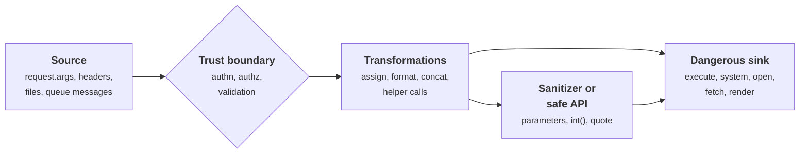
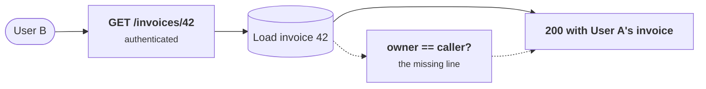
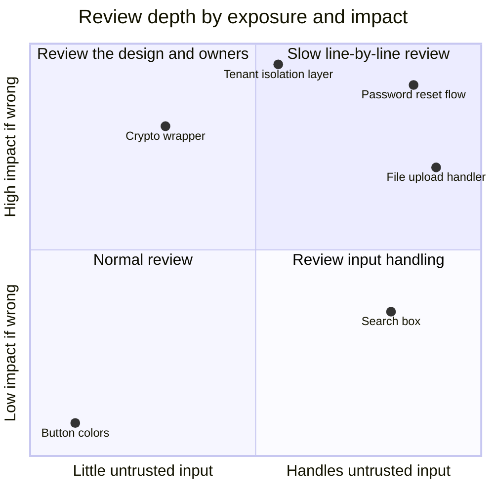
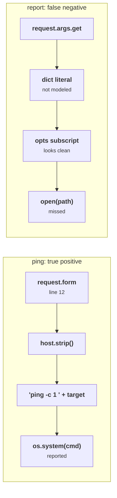

+++
title = 'Security code review'
description = 'A security review follows data, not files: from where untrusted input enters, across trust boundaries, to the sinks where it can do harm, with the threat model deciding where to look hardest.'
question = 'What should I look for when reviewing code for security, and how do I write findings that get fixed?'
weight = 4
difficulty = 3
prerequisites = ['/notes/application-security/foundations/02-threat-modeling-an-api', '/notes/application-security/untrusted-input/01-injection-and-parameterization', '/notes/application-security/authorization/01-broken-object-level-authorization']
date = 2026-06-24
lastmod = 2026-10-30
verified = 2026-06-24
+++

## The idea in one minute

An ordinary code review asks whether a change is correct, readable and
maintainable. A security review asks a narrower, harder question: **can
someone who controls the inputs make this code do something its owner did not
intend?** Answering it means reading the change the way data moves through it,
not the way the diff happens to be ordered.

Three things carry most of the weight. **Sources**: every place untrusted data
enters (request parameters, headers, uploaded files, messages from queues,
responses from other services). **Sinks**: every place data can cause an
effect (a SQL query, a shell command, a file path, an outbound URL, an HTML
response, a deserializer). **Checks**: the authentication, authorization and
validation that should sit on every path between them. Most vulnerabilities in
this course are a source reaching a sink with a check missing, wrong or in the
wrong place.

The consequence to act on: review by tracing each new or changed source to the
sinks it can reach, let the threat model tell you which paths deserve the most
time, and write each finding so that the author can reproduce it, understand
the impact, and fix it without a meeting.

## A picture



The review question for each sink is whether every path into it passes through
the green nodes. A path from the red node to a sink that skips both is a
finding.

## How it really works

### What to look for

Security review does not mean reading every line with equal suspicion. Some
code is far more likely to hold a vulnerability, and an experienced reviewer
goes there first:

| Look at | Questions to ask |
| --- | --- |
| **Trust boundaries** | Where does data cross from less trusted to more trusted? Is it validated on the trusted side, not only in the client? |
| **Authentication** | Is every new endpoint, job and message handler authenticated? Does the code trust a header or field that a client can set? |
| **Authorization** | Does each handler check that *this* user may act on *this* object, after loading it? Is the check on every path, including bulk, export and admin variants? |
| **Sinks** | Does any input reach SQL, shell, file paths, URLs fetched by the server, templates, deserializers, `eval`, regular expressions built from input, or logging of secrets? |
| **Secrets and crypto** | Are keys hard-coded, logged or compared with `==`? Is randomness from `secrets`, not `random`? Is the algorithm and mode a standard one, used through a vetted library? |
| **Error handling** | Does a failed check fail closed? Do errors leak stack traces or internal identifiers? |
| **Configuration** | Did the change touch security settings, CORS, cookie flags, CSP, debug flags or dependency lists? |
| **Concurrency** | Is there a check-then-act gap, such as a balance read and then written without a lock or transaction? |

The concurrency row is easiest to see over time: both requests pass the check
before either one writes.

```mermaid {title="Check-then-act: two withdrawals pass one balance check"}
sequenceDiagram
  autonumber
  actor A as Attacker
  participant H as Withdraw handler
  participant D as Accounts table
  par two requests sent at once
    A->>H: withdraw 80
  and
    A->>H: withdraw 80
  end
  H->>D: read balance (request 1)
  D-->>H: 100
  H->>D: read balance (request 2)
  D-->>H: 100
  Note over H: Both see 100, both pass the balance check
  H->>D: write 20 (request 1)
  H->>D: write 20 (request 2)
  Note over A,D: 160 paid out from 100. A transaction or row lock makes the check and the write one step
```

Missing code is the hardest thing to spot. An injection bug is visible: there
is a string concatenation into a query. A missing authorization check is
invisible: there is nothing there. The best defense is to ask, for each
handler, "where is the line that decides whether this caller may do this to
this object?" and refuse to approve until you can point at it. The lesson on
[Broken object level authorization](/notes/application-security/authorization/01-broken-object-level-authorization/)
shows why that line is so often absent.

The box on the dotted path is what the reviewer has to notice: a node that should exist
between loading the object and returning it.



### Reviewing a diff by data flow

A diff is ordered by file name, which is the least useful order for security.
A better procedure:

1. **List the entry points the change adds or modifies.** New routes, new
   fields on a request schema, new queue consumers, new parameters to an
   existing handler.
2. **For each entry point, follow the data forward.** Through assignments,
   helper functions, serializers and other services, until it reaches a sink or
   is discarded. Open files outside the diff when the flow goes there; the bug
   is often in the unchanged helper the new code calls.
3. **For each sink the change touches, follow the data backward.** A new
   `subprocess.run` or raw SQL query is worth tracing back to every caller, not
   only the one in this diff.
4. **Check the checks.** On each path, find the authentication, authorization
   and validation. Confirm they happen on the server, before the effect, using
   the right identity and the right object.
5. **Look at what the change removes.** Deleted validation, a relaxed regular
   expression, a dropped decorator, a test that was "flaky" and disabled.

Steps 2 and 3 in one picture: the forward trace leaves the diff through an
unchanged helper, and the backward trace from the sink finds a second caller
the diff never showed.

```mermaid {title="Tracing forward from entry points and backward from sinks"}
flowchart LR
  subgraph D["In the diff"]
    E["<b>New route</b><br/><small>POST /export</small>"]
    F["<b>New field</b><br/><small>filename</small>"]
  end
  subgraph O["Outside the diff"]
    H["<b>Unchanged helper</b><br/><small>build_path()</small>"]
    C2["<b>Old caller</b><br/><small>nightly job</small>"]
  end
  S@{ shape: hex, label: "<b>Sink</b><br/><small>open(path)</small>" }
  E -- "forward" --> F -- "forward" --> H -- "forward" --> S
  S -. "backward" .-> C2
  class E,F io
  class H,C2 compute
  class S warn
```

Step 2 is where tools help. Taint analysis automates the forward trace inside
a codebase: CodeQL models data flow across functions and files, and Semgrep's
taint mode lets you declare sources, sinks and sanitizers as rules. Both
produce paths that a reviewer then confirms or dismisses. The program below is
a deliberately tiny version of the same idea.

### Threat-model-driven review

Review time is limited, so spend it where the threat model says the risk is
(see [Threat modeling an API](/notes/application-security/foundations/02-threat-modeling-an-api/)).
A change to the password-reset flow, the tenant-isolation layer or the file
upload handler deserves a slow, line-by-line review by someone who knows that
area's threats. A change to button colors does not.

Place each change by how directly attackers reach it and how bad a mistake
would be; review depth follows the quadrant.



In practice teams make this routine with a few mechanisms:

- **Code owners for security-sensitive paths.** Authentication, authorization,
  crypto wrappers, the policy engine and dependency manifests list a security
  reviewer as a required approver.
- **A risk question in the pull request template.** "Does this change add an
  entry point, touch authn/authz, handle files or URLs, or change
  dependencies?" A yes routes it for security review.
- **Threats as review prompts.** If the threat model lists "tenant A reads
  tenant B's data", every change to a query in a multi-tenant table gets the
  question "where is the tenant filter?"

### Checklists, used well

Checklists help reviewers remember categories they might otherwise skip. They
hurt when they become a form to fill in. The OWASP Application Security
Verification Standard (ASVS) and the OWASP Code Review Guide are good sources
for building one. A useful checklist is short, specific to your stack and
framework, and lists what your own incidents and past findings have taught
you. "Every query on a tenant-scoped table goes through `TenantQuery`" is worth
more than "check for injection".

Anything a checklist item can state precisely should eventually become a lint
rule or a secure default, as described in
[Secure defaults](/notes/application-security/building-it-secure/01-secure-defaults/).
Human review time is too valuable to spend on what a machine can check.

### Writing findings that get fixed

A finding that is ignored has no value, however correct it is. Findings get
fixed when they are concrete, reproducible and proportionate:

| Part | What it contains |
| --- | --- |
| **Title** | The flaw and its location in one line: "SQL injection in `search()` via `q` parameter" |
| **Location** | File, function and line; the source and the sink |
| **Impact** | What an attacker gains, in the system's terms: "read any row in `items`, including other tenants' private listings" |
| **Reproduction** | A request, a test or a short script that demonstrates it against a test environment |
| **Severity** | A rating with the reasoning behind it, such as CVSS v4.0 or an internal scale that weighs impact and how easy it is to exploit |
| **Fix** | The specific change: "use a parameterized query", with the corrected line; and the class-level fix if there is one |
| **Reference** | The CWE identifier (CWE-89 for SQL injection, CWE-78 for OS command injection, CWE-22 for path traversal, CWE-862 for missing authorization) |

Two habits make a large difference. First, **separate the instance from the
class**. "Line 42 is injectable" gets one line fixed. "This module builds
queries by string formatting in six places; move them to the query builder and
add a Semgrep rule" removes the class. Second, **calibrate severity honestly**.
A reviewer who marks every finding critical teaches the team to ignore the
label. Say what you are unsure of, especially about exploitability.

Tone matters as well. The author wrote the code under constraints you may not
see. A finding that states facts, shows the path and proposes a fix reads as
help; one that reads as a verdict on the author tends to start an argument
about wording instead of a fix.

A finding is not done when the line is patched; follow it until the class is
closed and a test guards it.

```mermaid {title="A finding ends dismissed with a reason, or fixed with a regression test"}
stateDiagram-v2
  [*] --> Reported: title, location, impact
  Reported --> Dismissed: false positive, reason recorded
  Reported --> Confirmed: reproduction works
  Confirmed --> InstanceFixed: specific fix merged
  InstanceFixed --> RegressionTest: reproduction becomes a test
  RegressionTest --> ClassFixed: safe API, lint rule or default
  RegressionTest --> [*]: no class to fix
  ClassFixed --> [*]
  Dismissed --> [*]
```

> [!NOTE]
> Every confirmed finding should end with a test. The reproduction becomes a
> regression test, as in
> [Adversarial testing](/notes/application-security/building-it-secure/02-adversarial-testing/),
> so the same bug cannot come back in the next refactor.

## Code

The program is a source-to-sink taint tracker of about a hundred lines plus a sample application, built
on Python's `ast` module. It parses a small sample application, walks each
function's statements in order, and marks a variable tainted when it is
assigned from a source such as `request.args` or `request.form`. Taint flows
through assignment, f-strings, `+` and `%`, method calls on tainted values
(`host.strip()`), and calls whose arguments are tainted. Known sanitizers such
as `int()` and `shlex.quote()` clear it, and reassigning a variable to a clean
value clears it too. When a tainted value is the dangerous argument of a sink
such as `cursor.execute` or `os.system`, the tracker reports the sink, the line
and where the taint came from. A ground-truth set shows where it is right and
where it is wrong.

```python {title="taint.py"}
"""taint.py: a tiny source-to-sink taint tracker over Python's own AST.

It walks each function in order, marks variables assigned from request data as
tainted, propagates taint through assignments, f-strings, concatenation,
% formatting and .format(), clears it on known sanitizers, and reports tainted
values that reach a dangerous sink. Intraprocedural only. Standard library only.
"""

from __future__ import annotations

import ast

SOURCES = {"request.args", "request.form", "request.headers", "request.cookies"}
SANITIZERS = {"int", "shlex.quote", "html.escape", "secure_filename"}
SINKS = {  # call name -> index of the argument that must not be tainted
    "cursor.execute": 0, "os.system": 0, "eval": 0, "subprocess.run": 0, "open": 0,
}

APP = '''
def search(request, cursor):
    term = request.args.get("q")
    sql = f"SELECT * FROM items WHERE name = '{term}'"
    cursor.execute(sql)

def search_safe(request, cursor):
    term = request.args.get("q")
    cursor.execute("SELECT * FROM items WHERE name = ?", (term,))

def ping(request):
    host = request.form["host"]
    target = host.strip()
    cmd = "ping -c 1 " + target
    os.system(cmd)

def ping_allowlisted(request):
    host = request.form["host"]
    if host not in ("db1", "db2"):
        raise ValueError("unknown host")
    os.system("ping -c 1 " + host)

def page(request, cursor):
    n = int(request.args.get("page", "1"))
    cursor.execute("SELECT * FROM items LIMIT 10 OFFSET %d" % n)

def download(request):
    name = request.args.get("file")
    name = "default.txt"
    return open("/srv/files/" + name).read()

def report(request):
    opts = {"path": request.args.get("p")}
    return open(opts["path"]).read()
'''

# Ground truth, so the output shows where the tool is right and where it is not.
VULNERABLE = {"search", "ping", "report"}


def dotted(node: ast.AST) -> str:
    """'request.args.get' for request.args.get, '' if not a plain dotted name."""
    if isinstance(node, ast.Name):
        return node.id
    if isinstance(node, ast.Attribute):
        base = dotted(node.value)
        return f"{base}.{node.attr}" if base else ""
    return ""


class FunctionTaint(ast.NodeVisitor):
    def __init__(self, func: ast.FunctionDef) -> None:
        self.func = func
        self.tainted: dict[str, str] = {}  # variable -> where its taint came from
        self.findings: list[str] = []

    def origin(self, node: ast.AST) -> str | None:
        """Return the taint origin of an expression, or None if it is clean."""
        if isinstance(node, ast.Name):
            return self.tainted.get(node.id)
        if isinstance(node, (ast.Attribute, ast.Subscript)):
            name = dotted(node.value if isinstance(node, ast.Subscript) else node)
            if any(name == s or name.startswith(s + ".") for s in SOURCES):
                return f"{name} (line {node.lineno})"
            return self.origin(node.value)  # host.strip, request.form["host"]
        if isinstance(node, ast.Call):
            name = dotted(node.func)
            if name in SANITIZERS:
                return None
            parts = [node.func, *node.args, *(k.value for k in node.keywords)]
            return next(filter(None, map(self.origin, parts)), None)
        if isinstance(node, (ast.BinOp, ast.JoinedStr, ast.FormattedValue, ast.Tuple)):
            return next(filter(None, map(self.origin, ast.iter_child_nodes(node))), None)
        return None  # constants, and everything this toy does not model

    def visit_Assign(self, node: ast.Assign) -> None:
        self.generic_visit(node)
        src = self.origin(node.value)
        for target in node.targets:
            if isinstance(target, ast.Name):
                if src:
                    self.tainted[target.id] = src
                else:
                    self.tainted.pop(target.id, None)  # reassigned to a clean value

    def visit_Call(self, node: ast.Call) -> None:
        self.generic_visit(node)
        name = dotted(node.func)
        if name in SINKS and len(node.args) > SINKS[name]:
            src = self.origin(node.args[SINKS[name]])
            if src:
                self.findings.append(f"line {node.lineno}: {name}() receives {src}")


def scan(source: str) -> dict[str, list[str]]:
    results = {}
    for node in ast.parse(source).body:
        if isinstance(node, ast.FunctionDef):
            tracker = FunctionTaint(node)
            for stmt in node.body:
                tracker.visit(stmt)
            results[node.name] = tracker.findings
    return results


if __name__ == "__main__":
    verdict = {(True, True): "true positive", (False, False): "true negative",
               (True, False): "FALSE POSITIVE", (False, True): "FALSE NEGATIVE"}
    for func, findings in scan(APP).items():
        flagged, bad = bool(findings), func in VULNERABLE
        print(f"{func:<17} {verdict[(flagged, bad)]}")
        for f in findings:
            print(f"    {f}")
```

Run it with `python3 taint.py`:

```text
search            true positive
    line 5: cursor.execute() receives request.args.get (line 3)
search_safe       true negative
ping              true positive
    line 15: os.system() receives request.form (line 12)
ping_allowlisted  FALSE POSITIVE
    line 21: os.system() receives request.form (line 18)
page              true negative
download          true negative
report            FALSE NEGATIVE
```

The two true positives are the classic shapes: an f-string built into SQL, and
a value passed through two variables and a method call into a shell command.
The parameterized query in `search_safe` is clean because the tainted value is
the second argument, which the driver sends separately from the SQL text. The
`int()` call in `page` is a sanitizer, and `download` reassigns `name` to a
constant before use.

Follow the two paths: in `ping` the taint survives every hop to the sink, and
in `report` it goes into a dictionary the tracker does not model and is lost.



The two errors are the instructive part. `ping_allowlisted` is safe, because
the allowlist check guarantees `host` is one of two fixed strings, but the
tracker does not understand conditions and reports it anyway. `report` is
vulnerable, a path traversal, but the taint goes into a dictionary and comes
back out through a subscript the tracker does not model, so it is missed. Real
tools handle both cases better, and both kinds of mistake still occur in them.
A reviewer's job is to confirm each reported path and to know which flows the
tool cannot see.

## Where it breaks

- **Intraprocedural only.** Taint that passes through a helper function, a
  class attribute, a database row or another service is lost. Real
  vulnerabilities often span several of those. Production tools model calls
  across functions and files, and even they lose track at service boundaries.
- **No understanding of conditions.** The tracker treats an allowlist check and
  no check identically, producing false positives. It also visits branches in
  order, so a clean assignment in one branch of an `if` clears taint that
  survives on the other branch: a false negative.
- **Sanitizers are context-specific.** `html.escape` is a fine sanitizer for an
  HTML body and useless for a shell command, yet the toy treats any sanitizer
  as clearing all taint. Real taint configurations attach sanitizers to sink
  kinds.
- **Tools find flows, not missing checks.** No taint tracker will report that a
  handler forgot to verify the caller owns the object. Authorization review
  remains a human task, guided by the questions above and backed by negative
  tests.
- **Review does not scale to everything.** A reviewer reading a thousand-line
  diff will miss things. Keep security-relevant changes small, and push
  recurring checks into lint rules and secure defaults so human attention goes
  to logic.
- **Approval is not assurance.** A clean review means one person did not find a
  problem in the time they had. Defense in depth, testing and monitoring still
  matter.

## Remember this

- Review the data flow, not the diff order: sources, transformations, checks,
  sinks.
- Missing authorization is invisible; ask where the decision is made and refuse
  to approve until you can point at it.
- Follow flows outside the diff; the bug is often in the unchanged helper.
- Let the threat model and code owners decide where review is slow and deep.
- A good finding has location, impact, reproduction, severity with reasoning,
  a specific fix and a CWE, and it fixes the class where possible.
- Taint tools report candidate paths; humans confirm them and cover what tools
  cannot see.

## Try it

1. Run `taint.py`. Add `subprocess.run(cmd, shell=True)` to a new function fed
   by `request.headers["X-Host"]`. Is it reported? Then change it to
   `subprocess.run(["ping", "-c", "1", host])`. Why does the tracker stay
   silent, and is that the right answer?
2. Fix the false negative in `report` by teaching `origin` about dictionary
   literals (`ast.Dict`): a dictionary is tainted if any value is, and a
   subscript of a tainted dictionary is tainted. What new false positives might
   that create?
3. Make sanitizers sink-specific: `shlex.quote` clears taint only for
   `os.system` and `subprocess.run`, `int` clears it everywhere. Add a test
   where `html.escape` output reaches `os.system` and confirm it is reported.
4. Take a recent pull request you reviewed or wrote. List its entry points and
   sinks, then write one finding (real or hypothetical) in the seven-part format
   above.

## Check yourself

1. Why is reviewing a diff in file order a poor way to find security bugs?

   
   Vulnerabilities are paths from where input enters to where it has an effect,
   and those paths cross files, functions and often code outside the diff. Reading
   in file order shows fragments of many paths without connecting them. Starting
   from entry points and sinks and tracing between them reconstructs the paths
   that matter.
   

2. Why is missing authorization harder to find in review than injection?

   
   Injection leaves visible evidence, such as input concatenated into a query.
   A missing authorization check is an absence: the handler loads and returns the
   object with no line deciding whether this caller may access it. The reviewer
   must actively look for the decision rather than react to suspicious code.
   

3. The tracker flags `ping_allowlisted`. Is that a bug in the application, and
   what would a real reviewer do?

   
   It is not exploitable: the allowlist check ensures `host` is one of two fixed
   values before reaching the shell. It is a false positive. A reviewer confirms
   the guard, dismisses the finding with a recorded reason, and may still suggest
   avoiding the shell (`subprocess.run` with a list) so the code is safe without
   relying on the guard staying correct.
   

4. What turns a finding about one line into a fix for a class of bug?

   
   Identifying the pattern that produced it (for example, building queries with
   string formatting), fixing every instance, moving the code to a safe API, and
   adding a lint rule or secure default so new instances are caught
   automatically. The instance fix closes one hole; the class fix stops new ones.
   

5. Name four parts of a finding that make it likely to be fixed.

   
   Any four of: a precise title and location, the impact in the system's terms,
   a reproduction, a severity with its reasoning, a specific fix, and a CWE
   reference. Reproduction and a concrete fix matter most, because they remove
   the two usual reasons for delay: doubt that the bug is real and uncertainty
   about what to change.
   

## Sources

- NIST, [SP 800-218: Secure Software Development Framework (SSDF) Version 1.1](https://csrc.nist.gov/pubs/sp/800/218/final), February 2022 (practice PW.7, review and analyze human-readable code).
- OWASP, [Code Review Guide](https://owasp.org/www-project-code-review-guide/), version 2.0, 2017.
- OWASP, [Application Security Verification Standard](https://owasp.org/www-project-application-security-verification-standard/).
- MITRE, [Common Weakness Enumeration](https://cwe.mitre.org/): CWE-22, CWE-78, CWE-89, CWE-862.
- FIRST, [Common Vulnerability Scoring System v4.0 Specification](https://www.first.org/cvss/v4.0/specification-document), November 2023.
- GitHub, [CodeQL documentation: about data flow analysis](https://codeql.github.com/docs/writing-codeql-queries/about-data-flow-analysis/).
- Semgrep, [Taint analysis](https://semgrep.dev/docs/writing-rules/data-flow/taint-mode).
- Python documentation, [ast: Abstract Syntax Trees](https://docs.python.org/3/library/ast.html).
