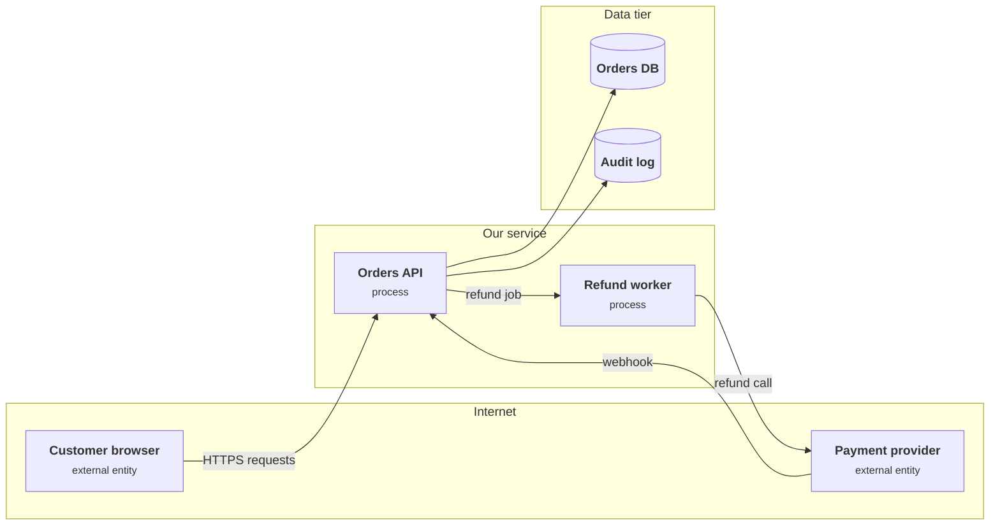

+++
title = 'Threat modeling an API'
description = 'Draw the data flows, ask what can go wrong at each element and each endpoint, rank the answers, and turn every threat you keep into a test.'
question = 'How do I find what can go wrong in an API before an attacker does?'
weight = 2
difficulty = 2
prerequisites = ['/notes/application-security/foundations/01-the-request-is-a-trust-boundary']
date = 2026-05-17
lastmod = 2026-10-30
verified = 2026-05-17
+++

## The idea in one minute

Threat modeling is a structured way to answer four questions about a system:
**what are we working on, what can go wrong, what are we going to do about it,
and did we do a good enough job?** For an API the method is concrete. Draw a
data-flow diagram with its trust boundaries. Walk each element with STRIDE, a
checklist of six kinds of threat, so that no kind of question is skipped. Then
walk each endpoint and ask what an attacker would try there. Rank what you
find, decide on a control for each threat worth keeping, and write a test that
fails if the control is missing.

The output is not a document that is read once. It is a short list of threats,
each tied to a control and a test, kept next to the code and updated when a
trust boundary moves. The consequence to act on: **a threat without a test is a
hope**, and a threat model that is not kept as data drifts away from the system
it describes.

## A picture



Every arrow that crosses a subgraph edge crosses a **trust boundary**. Those
crossings are where most threats live: data arrives from someone with less
authority, or leaves toward someone with less trust.

## How it really works

### The four questions

Adam Shostack's book *Threat Modeling: Designing for Security* (2014) organizes
the practice around four questions, and the Threat Modeling Manifesto (2020)
adopted them:

| Question | For an API, the artifact is |
| --- | --- |
| What are we working on? | A data-flow diagram, plus the endpoint list (often the OpenAPI document) |
| What can go wrong? | STRIDE per element, then abuse cases per endpoint |
| What are we going to do about it? | A control per threat: mitigate, eliminate, transfer, or accept with a named owner |
| Did we do a good enough job? | Tests that prove each control, and a review when the design changes |

None of these needs a tool. A whiteboard, an hour, and the people who build and
run the system are enough to start. The OWASP Threat Modeling Cheat Sheet gives
the same shape in more procedural detail.

The four questions are not a one-off sequence. Read the diagram as a loop that
reopens whenever the design changes.

```mermaid {title="The four questions form a loop that a moved trust boundary reopens"}
stateDiagram-v2
  direction LR
  [*] --> WorkingOn
  WorkingOn: What are we working on?
  WorkingOn --> GoWrong: DFD and endpoint list
  GoWrong: What can go wrong?
  GoWrong --> DoAbout: STRIDE and abuse cases
  DoAbout: What are we going to do about it?
  DoAbout --> GoodEnough: control and owner per threat
  GoodEnough: Did we do a good enough job?
  GoodEnough --> GoodEnough: tests run in CI
  GoodEnough --> WorkingOn: trust boundary changes
```

### Draw the data flows

A data-flow diagram (DFD) has four kinds of element and one kind of line:

- **External entities**: people and systems you do not control. Browsers,
  mobile apps, partners, the payment provider.
- **Processes**: code you run. The API, workers, a gateway.
- **Data stores**: anything that holds data at rest. Databases, caches, object
  storage, queues if they persist, log stores.
- **Data flows**: the arrows. A request, a webhook, a job on a queue, a SQL
  query.
- **Trust boundaries**: lines where the level of trust changes. Internet to
  service, service to database, tenant to tenant, your code to a third-party
  library that parses untrusted files.

Draw at the level where boundaries are visible. One box for "the API" is right
if all its routes share one process and one identity; split it if the admin
routes run separately or the file converter runs in a sandbox. The diagram
above is enough to find serious threats in a real orders service. The
discipline is to include the paths people forget: the webhook from the payment
provider, the admin console, the batch job that runs with more privilege than
the API, the read replica.

### STRIDE per element

STRIDE, which Loren Kohnfelder and Praerit Garg introduced at Microsoft in
1999, names six threat types. Each is the violation of a security property:

| Letter | Threat | Property violated | An API example |
| --- | --- | --- | --- |
| S | Spoofing | Authentication | A forged webhook claims to come from the payment provider |
| T | Tampering | Integrity | A client changes a field the server should own, such as `status` |
| R | Repudiation | Non-repudiation | A user denies requesting a refund and nothing proves otherwise |
| I | Information disclosure | Confidentiality | `GET /orders/{id}` returns another customer's order |
| D | Denial of service | Availability | `?limit=1000000` makes the server load a million rows |
| E | Elevation of privilege | Authorization | A customer reaches an admin-only route |

Not every threat type applies to every element. Shostack's **STRIDE per
element** chart narrows the questions:

| Element | S | T | R | I | D | E |
| --- | --- | --- | --- | --- | --- | --- |
| External entity | yes | | yes | | | |
| Process | yes | yes | yes | yes | yes | yes |
| Data store | | yes | if it holds logs | yes | yes | |
| Data flow | | yes | | yes | yes | |

The chart is a completeness check, not a classifier. Its value is the empty
cells it forces you to fill: for each element and each applicable letter, write
either a threat or a sentence explaining why there is none. A data flow cannot
be spoofed in this model; what looks like a spoofed flow is a spoofed external
entity at one end of it. That distinction matters when choosing the control:
you authenticate the **entity** (verify the webhook signature) and protect the
**flow** (TLS against tampering and disclosure in transit).

The webhook from the diagram above, split into the two things STRIDE asks about
separately. Each gets its own control.

```mermaid {title="Authenticate the entity, protect the flow: two threats, two controls"}
flowchart LR
  PSP("Payment provider")
  F["<b>Webhook flow</b><br/><small>POST /webhooks/payment</small>"]
  API("Orders API")
  S["<b>Spoofing</b><br/><small>anyone claims to be the provider</small>"]
  T["<b>Tampering, disclosure</b><br/><small>body changed or read in transit</small>"]
  SIG["<b>Verify signature and timestamp</b>"]
  TLS["<b>TLS</b>"]
  PSP --> F --> API
  S -.->|"threat to"| PSP
  T -.->|"threat to"| F
  SIG -->|"mitigates"| S
  TLS -->|"mitigates"| T
  class S,T warn
  class SIG,TLS good
  class F io
```

For systems with language models, the same method needs one more kind of flow,
the influence of text on a model's actions; that adaptation is covered in
[threat modeling an AI system](/notes/ai-security-engineering/threat-landscape/02-threat-modeling-ai-systems/).

### Endpoint by endpoint

STRIDE finds threats per element. Most API vulnerabilities, though, live in one
route's handling of one parameter, so the second pass walks the endpoint list.
For each route, ask the same short set of questions:

| Ask | The bug class it finds |
| --- | --- |
| Who may call this, and where is that checked? | Missing function-level authorization |
| Which object does it touch, and is the caller allowed that object? | Broken object-level authorization |
| Which fields can the caller set, and should they? | Mass assignment, broken property-level authorization |
| What does the server interpret: SQL, HTML, a path, a URL, a template, a serialized object? | Injection, XSS, path traversal, SSRF, deserialization |
| What if it is called 1,000 times, in parallel, or out of order? | Missing rate limits, races, double spending, workflow bypass |
| What does it reveal on error or by timing? | Information disclosure, account enumeration |
| What does it call outward, and with whose authority? | Confused deputy, token passthrough |

This is where the request-as-trust-boundary habit from
[the previous lesson](/notes/application-security/foundations/01-the-request-is-a-trust-boundary/)
pays off. Every parameter is a claim; for each one, ask what the handler does
if the claim is false.

### Abuse cases

A use case says what a legitimate user does. An **abuse case** says what an
adversary does with the same features, a framing John McDermott and Chris Fox
proposed in 1999. Write them as attacker goals against your business, not as
generic vulnerability names:

- "As a customer, I request a refund ten times in parallel so that I am refunded
  ten times."
- "As anyone on the internet, I post a fake payment-succeeded webhook so that my
  unpaid order ships."
- "As a customer, I change the `status` field in my order update so that it
  reads `refunded` without a refund being issued."
- "As a former employee, I keep using an API key that was never revoked."

The first abuse case, drawn. Every request is individually valid; the harm is
in the count.

```mermaid {title="Parallel refunds: ten valid requests, ten refunds, unless one key makes them one"}
sequenceDiagram
  autonumber
  actor C as Customer
  participant A as Orders API
  participant W as Refund worker
  participant P as Payment provider
  par ten requests at the same moment
    C->>A: POST /orders/42/refund
  and
    C->>A: POST /orders/42/refund
  and
    C->>A: eight more of the same
  end
  A->>W: ten refund jobs, no idempotency key
  W->>P: ten refund calls
  P-->>C: refunded ten times
  Note over A,W: control: idempotency key, one refund per order
```

Abuse cases find what STRIDE prompts miss: **business-logic threats** that
violate no generic security property and are visible only to someone who knows
what the money, the inventory, or the reputation depends on. They are also the
form that product owners understand, which matters when you need time to fix
one.

### Ranking

You will find more threats than you can address at once. Rank them with a
coarse, explainable scale rather than a precise-looking formula:

- **Likelihood**, mostly from who can reach the threat: anonymous internet (3),
  any authenticated user (2), an insider or someone who has already compromised
  something (1).
- **Impact**, from what is lost: money or all users' data (3), one user's data
  or account (2), nuisance (1).

Multiply, sort, and argue about the borderline cases; the argument is where the
team learns the system. Elaborate scoring schemes such as DREAD tend to give
different numbers from different raters, and the precision is false either
way. CVSS scores a vulnerability that exists; it is not built for a threat in a
design that has not shipped.

The eight threats from the program below, placed on the two coarse scales.
Reachability runs left to right; the top-right corner is where to start.

```mermaid {title="Likelihood is who can reach it; impact is what is lost"}
quadrantChart
  title Threats T1 to T8 on the 1 to 3 scales
  x-axis Insider only --> Anonymous internet
  y-axis Nuisance --> Money or all users
  quadrant-1 Fix first
  quadrant-2 Severe but hard to reach
  quadrant-3 Track
  quadrant-4 Easy to reach, limited harm
  T2 forged webhook: [0.86, 0.86]
  T3 status field: [0.44, 0.86]
  T4 parallel refunds: [0.56, 0.80]
  T6 credential stuffing: [0.86, 0.56]
  T1 other order: [0.44, 0.56]
  T8 huge page: [0.56, 0.50]
  T7 replica: [0.16, 0.86]
  T5 denied refund: [0.56, 0.16]
```

> [!TIP]
> Ask "who can trigger this?" before "how bad is it?". A medium-impact threat
> that any anonymous client can trigger with one request usually outranks a
> severe one that needs a compromised database administrator.

### From threats to tests

For every threat you keep, record three things: the control, the owner, and the
**test that fails if the control is missing**. The test is the part teams skip
and the part that matters, because controls regress. A refactor drops a
decorator; a new route copies an old one without its check; a library upgrade
changes a default.

Good threat-derived tests are negative: they assert that the attack fails.

| Threat | Control | Test |
| --- | --- | --- |
| Forged payment webhook | Verify provider signature and timestamp | Unsigned webhook gets 401 and the order stays unpaid |
| Parallel refunds | Idempotency key, one refund per order | Ten concurrent refund requests issue exactly one refund |
| `GET /orders/{id}` for another user | Owner check on every read | User A reading user B's order gets 404 |

Keep the model in the repository, next to the API specification, and review it
in the same pull request that changes a trust boundary: a new external
integration, a new data store, a new role, a route that fetches URLs. OWASP
pytm and OWASP Threat Dragon are two open-source tools that keep a model as
code or as a versioned file; a dataclass list, as below, works too.

The model lives in the same history as the code. A branch that moves a trust
boundary carries its threat and test; a branch that removes a control is
stopped by the test.

```mermaid {title="The threat model changes in the same pull request as the boundary it describes"}
gitGraph
  commit id: "threat model v1"
  commit id: "T1-T8 tests in CI"
  branch avatar-fetch
  checkout avatar-fetch
  commit id: "route fetches a URL"
  commit id: "model adds SSRF threat"
  commit id: "test internal URL refused"
  checkout main
  merge avatar-fetch
  branch refactor
  checkout refactor
  commit id: "drops owner check" type: REVERSE
  commit id: "T1 test fails, PR blocked" type: HIGHLIGHT
```

## Code

A threat model kept as data. The program enumerates the STRIDE questions for
each element, shows which have been answered, ranks the recorded threats, and
emits a test checklist. It also lints the model: threat T2 is deliberately
filed as "spoofing a data flow", which the STRIDE-per-element chart says cannot
happen.

```python {title="threat_model.py"}
"""threat_model.py: a threat model kept as data, not as a slide.

Elements of a data-flow diagram, STRIDE per element to generate the questions,
recorded threats ranked by likelihood x impact, and a test checklist generated
from the threats. Standard library only; offline.
"""

from __future__ import annotations

from dataclasses import dataclass

# STRIDE per element, after Shostack (2014): which threat types apply to which
# kind of element. Data stores add Repudiation only when they hold audit logs.
APPLIES = {"external": "SR", "process": "STRIDE", "store": "TID", "flow": "TID"}
NAMES = {"S": "spoofing", "T": "tampering", "R": "repudiation",
         "I": "information disclosure", "D": "denial of service",
         "E": "elevation of privilege"}


@dataclass(frozen=True)
class Element:
    key: str
    kind: str  # external | process | store | flow
    label: str
    holds_logs: bool = False

    def letters(self) -> str:
        return APPLIES[self.kind] + ("R" if self.kind == "store" and self.holds_logs else "")


@dataclass(frozen=True)
class Threat:
    tid: str
    element: str
    letter: str
    what: str  # the abuse case, stated as an attacker goal
    likelihood: int  # 1 = needs an insider, 2 = any user, 3 = anonymous internet
    impact: int  # 1 = nuisance, 2 = one user's data, 3 = all users or money
    control: str
    test: str  # the check that proves the control is present

    @property
    def risk(self) -> int:
        return self.likelihood * self.impact


DFD = [
    Element("browser", "external", "Customer browser"),
    Element("psp", "external", "Payment provider"),
    Element("api", "process", "Orders API"),
    Element("worker", "process", "Refund worker"),
    Element("db", "store", "Orders DB"),
    Element("audit", "store", "Audit log", holds_logs=True),
    Element("f_req", "flow", "browser -> api: HTTPS"),
    Element("f_hook", "flow", "psp -> api: webhook"),
    Element("f_job", "flow", "api -> worker: refund job"),
]

THREATS = [
    Threat("T1", "api", "I", "GET /orders/{id} returns another customer's order",
           2, 2, "owner check on every object read", "read order of user B as user A -> 404"),
    # T2 is misfiled on purpose; the check at the end of main() catches it.
    Threat("T2", "f_hook", "S", "forged POST /webhooks/payment marks an order paid",
           3, 3, "verify provider signature and timestamp", "unsigned webhook -> 401, order unpaid"),
    Threat("T3", "api", "E", "PATCH /orders/{id} sets status=refunded via extra field",
           2, 3, "allow-list writable fields", "PATCH with status field -> field ignored"),
    Threat("T4", "worker", "T", "POST /orders/{id}/refund sent 10x in parallel",
           2, 3, "idempotency key, one refund per order", "10 concurrent refunds -> 1 issued"),
    Threat("T5", "audit", "R", "customer denies requesting a refund",
           2, 1, "append-only audit entry with user and request ID", "refund writes audit row"),
    Threat("T6", "browser", "S", "credential stuffing on POST /login",
           3, 2, "rate limit per account and IP, MFA", "101st failed login in 1 min -> 429"),
    Threat("T7", "db", "I", "read replica accepts logins from the office network",
           1, 3, "replica on a private subnet, per-service credentials",
           "connect to replica from office VLAN -> refused"),
    Threat("T8", "api", "D", "GET /orders?limit=1000000 exhausts memory",
           2, 2, "cap page size server-side", "limit=1000000 -> at most 100 rows"),
]


def main() -> None:
    by_key = {e.key: e for e in DFD}
    questions = [(e, l) for e in DFD for l in e.letters()]
    print(f"{len(DFD)} elements -> {len(questions)} STRIDE questions\n")

    answered = {(t.element, t.letter) for t in THREATS}
    print("element                     applies  answered  open")
    for e in DFD:
        done = "".join(l for l in e.letters() if (e.key, l) in answered)
        todo = "".join(l for l in e.letters() if (e.key, l) not in answered)
        print(f"{e.label:<27} {e.letters():<8} {done or '-':<9} {todo or '-'}")

    print("\nranked threats (likelihood x impact)")
    ranked = sorted(THREATS, key=lambda t: (-t.risk, t.tid))
    for t in ranked:
        kind = NAMES[t.letter]
        print(f"  {t.risk}  {t.tid}  {kind:<22} {by_key[t.element].label}: {t.what}")

    print("\ntest checklist (highest risk first)")
    for t in ranked:
        print(f"  [ ] {t.tid} {t.test}")

    # A threat with no matching STRIDE slot means the model and the diagram disagree.
    bad = [t.tid for t in THREATS if t.letter not in by_key[t.element].letters()]
    print(f"\nthreats filed under a letter that does not apply: {bad or 'none'}")


if __name__ == "__main__":
    main()
```

Run it with `python3 threat_model.py`:

```text
9 elements -> 32 STRIDE questions

element                     applies  answered  open
Customer browser            SR       S         R
Payment provider            SR       -         SR
Orders API                  STRIDE   IDE       STR
Refund worker               STRIDE   T         SRIDE
Orders DB                   TID      I         TD
Audit log                   TIDR     R         TID
browser -> api: HTTPS       TID      -         TID
psp -> api: webhook         TID      -         TID
api -> worker: refund job   TID      -         TID

ranked threats (likelihood x impact)
  9  T2  spoofing               psp -> api: webhook: forged POST /webhooks/payment marks an order paid
  6  T3  elevation of privilege Orders API: PATCH /orders/{id} sets status=refunded via extra field
  6  T4  tampering              Refund worker: POST /orders/{id}/refund sent 10x in parallel
  6  T6  spoofing               Customer browser: credential stuffing on POST /login
  4  T1  information disclosure Orders API: GET /orders/{id} returns another customer's order
  4  T8  denial of service      Orders API: GET /orders?limit=1000000 exhausts memory
  3  T7  information disclosure Orders DB: read replica accepts logins from the office network
  2  T5  repudiation            Audit log: customer denies requesting a refund

test checklist (highest risk first)
  [ ] T2 unsigned webhook -> 401, order unpaid
  [ ] T3 PATCH with status field -> field ignored
  [ ] T4 10 concurrent refunds -> 1 issued
  [ ] T6 101st failed login in 1 min -> 429
  [ ] T1 read order of user B as user A -> 404
  [ ] T8 limit=1000000 -> at most 100 rows
  [ ] T7 connect to replica from office VLAN -> refused
  [ ] T5 refund writes audit row

threats filed under a letter that does not apply: ['T2']
```

Read the `open` column as homework, not as a list of vulnerabilities. Every
letter there is a question nobody has answered yet: can the refund worker be
reached by anything other than the API, can the job on the queue be tampered
with, what happens if the audit log fills its disk. The lint result says T2
belongs on the payment provider (spoofing an external entity), with a separate
tampering threat on the webhook flow if the transport is not protected.

The coverage table from the output as a chart. The taller bar is the number of
STRIDE questions that apply to each element; the bar drawn over it is how many
have a recorded threat. The gap is the homework.

```mermaid {title="32 STRIDE questions, 8 answered: the open cells are most of the model"}
xychart-beta
  title "Applicable vs answered STRIDE questions per element"
  x-axis ["browser", "psp", "api", "worker", "db", "audit", "f_req", "f_hook", "f_job"]
  y-axis "questions" 0 --> 6
  bar [2, 2, 6, 6, 3, 4, 3, 3, 3]
  bar [1, 0, 3, 1, 1, 1, 0, 0, 0]
```

## Where it breaks

- **STRIDE gives coverage of kinds, not of instances.** Answering "spoofing of
  the browser" with credential stuffing does not mean session fixation or
  token theft were considered. The chart guarantees you asked each kind of
  question once, nothing more.
- **The diagram drifts.** The model describes the system on the day it was
  drawn. A new queue consumer or an internal admin route that nobody added to
  the DFD has no threats, no controls, and no tests. Tie review of the model to
  changes in the code that create boundaries.
- **The scales are crude, and so is the ranking.** T1 scores 4 here because
  "any user" reads "one other user's order". If order IDs are sequential, the
  same bug lets one user read every order, which is impact 3 and a much higher
  rank. Scores are inputs to a conversation, not outputs.
- **A test proves the case you wrote.** "User A cannot read user B's order"
  passes while `GET /orders/{id}/invoice.pdf` still leaks. Threat-derived tests
  catch regressions of known controls; they do not find unknown routes.
  Adversarial testing, covered in
  [adversarial testing](/notes/application-security/building-it-secure/02-adversarial-testing/),
  fills that gap.
- **Business logic needs domain knowledge.** No checklist knows that a coupon
  should apply once, or that a refund must not exceed the amount paid. Abuse
  cases come from the people who know the business, which is why threat
  modeling is a team activity.
- **The model is only as honest as its inputs.** If the team believes the
  gateway strips identity headers and it does not, the model inherits the
  error. Verify the assumptions that carry the most weight.

## Remember this

- Four questions: what are we working on, what can go wrong, what will we do,
  did we do enough.
- A data-flow diagram with trust boundaries is the map; most threats sit where
  an arrow crosses a boundary.
- STRIDE per element tells you which questions to ask of each element; its
  value is the cells it forces you to fill.
- Walk every endpoint with the same questions: who, which object, which fields,
  what is interpreted, how many times, what leaks, what is called outward.
- Rank by who can trigger it, then by impact; keep the scale coarse.
- Every kept threat gets a control, an owner, and a negative test in CI.

## Try it

1. Run `threat_model.py`. Move T2 to the `psp` element and add a tampering
   threat on `f_hook`. Rerun until the lint reports none.
2. Fill the `open` cells for the refund worker. For each letter, write a threat
   or one sentence saying why none applies.
3. Change T1's impact to 3 on the assumption that order IDs are sequential.
   Where does it land in the ranking, and what control would move it back down?
4. Take three endpoints from an API you work on and write one abuse case for
   each as "As a ..., I ... so that ...". Turn the most damaging one into a
   test.
5. Add a field `owner` to `Threat` and make the program refuse to print the
   checklist while any threat with risk 6 or more lacks one.

## Check yourself

1. Why does the STRIDE-per-element chart not list spoofing for data flows?

   
   A flow carries data between elements; what can be spoofed is the identity of
   the entity at one end. A "spoofed webhook" is spoofing of the payment
   provider, mitigated by authenticating that entity (verifying the signature).
   The flow itself faces tampering, disclosure, and denial of service, which
   transport protection and capacity limits address.
   

2. What does an abuse case find that a STRIDE walk tends to miss?

   
   Business-logic threats: using features exactly as designed, but in an order,
   quantity, or timing that costs the business, such as stacking coupons or
   requesting the same refund in parallel. They violate no generic security
   property, so they surface only when someone who knows the business asks what
   an adversary would want.
   

3. Why rank by "who can trigger it" before impact?

   
   Reachability dominates real risk. A threat any anonymous client can trigger
   with one request will be found and exercised; a severe threat that requires
   a compromised insider has a much smaller pool of attackers and other layers
   in front of it. Impact still matters, but likelihood is the factor teams
   most often underrate.
   

4. A team writes a threat model at design time and never updates it. What
   specifically goes wrong?

   
   New elements and boundaries, such as a queue consumer, an admin route, or a
   third-party integration, appear in the system but not in the model. They get
   no threats, no controls, and no tests. Controls for the original threats can
   also regress silently if no test enforces them. The model gives false
   confidence about a system that no longer exists.
   

5. What makes a good threat-derived test?

   
   It is negative and specific: it performs the attack and asserts that it
   fails, for example "an unsigned webhook gets 401 and the order stays unpaid".
   It runs in CI, so a refactor that removes the control fails the build, and
   it is named after the threat so that a failure points back to the model.
   

## Sources

- Adam Shostack, *Threat Modeling: Designing for Security*, Wiley, 2014. Source of the four-question framing and the STRIDE-per-element chart.
- Zoe Braiterman, Adam Shostack, et al., [Threat Modeling Manifesto](https://www.threatmodelingmanifesto.org/), 2020.
- OWASP, [Threat Modeling Cheat Sheet](https://cheatsheetseries.owasp.org/cheatsheets/Threat_Modeling_Cheat_Sheet.html), OWASP Cheat Sheet Series.
- Loren Kohnfelder and Praerit Garg, "The threats to our products", Microsoft internal paper, 1999. The origin of STRIDE.
- John McDermott and Chris Fox, "Using Abuse Case Models for Security Requirements Analysis", *15th Annual Computer Security Applications Conference (ACSAC)*, December 1999.
- OWASP, [pytm](https://owasp.org/www-project-pytm/) and [Threat Dragon](https://owasp.org/www-project-threat-dragon/) projects.
