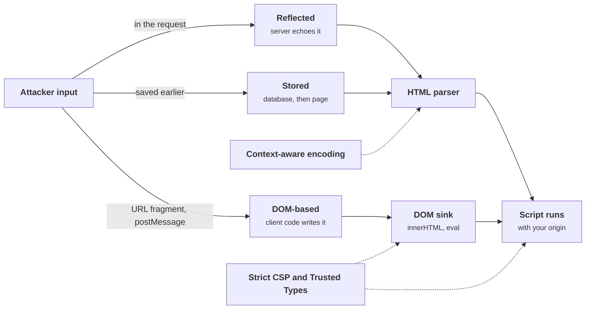
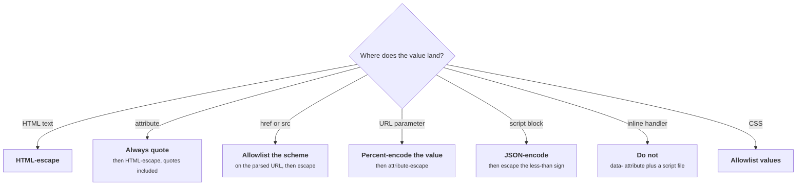
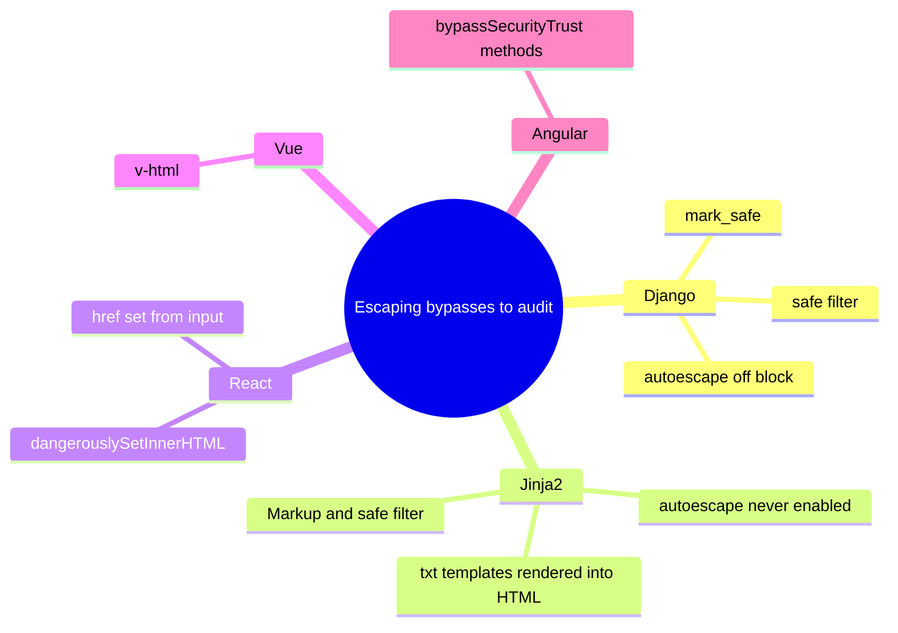

+++
title = 'XSS and output encoding'
description = 'Cross-site scripting is injection into the browser. Encoding must match the exact context where data lands, templates should do it automatically, and a strict Content Security Policy limits what slips through.'
question = 'How does untrusted text become script in a browser, and which layers stop it?'
weight = 2
difficulty = 2
prerequisites = ['/notes/application-security/untrusted-input/01-injection-and-parameterization']
date = 2026-06-10
lastmod = 2026-10-30
verified = 2026-06-10
+++

## The idea in one minute

**Cross-site scripting (XSS)** is injection where the interpreter is the
victim's browser. The application puts untrusted text into a page, and the
browser's HTML parser, then its JavaScript engine, read part of that text as
markup or code. Script that runs in your page runs with your origin's
authority: it can read the page, call your APIs with the user's cookies, and
change what the user sees.

The defense is the same as for SQL, with one complication. There is no
"parameterized HTML": the separate channel is **output encoding**, and HTML
pages contain several languages nested inside each other (HTML text,
attributes, URLs, JavaScript, CSS), each with different rules. An escape that
is correct in one context is useless or harmful in another.

So the practical stack is three layers: **a template engine that escapes by
default for the right context**, careful handling of the few places that
bypass it, and a **strict Content Security Policy** plus **Trusted Types** so
that a mistake does not automatically become script execution.

## A picture



Encoding stops text from becoming markup at the parser. CSP and Trusted Types
stand between a markup or DOM mistake and script execution.

## How it really works

### Three delivery paths, one result

| Type | Where the payload lives | Where the bug is | Example |
| --- | --- | --- | --- |
| **Reflected** | In the request (query string, form field) | Server template echoes input unencoded | `/search?q=<script>...</script>` shown as "Results for ..." |
| **Stored** | In your database | Server renders stored content unencoded, possibly to many users | A comment, a display name, a support ticket subject |
| **DOM-based** | Often never reaches the server (URL fragment, `postMessage`, `localStorage`) | Client-side JavaScript passes a source to a dangerous sink | `el.innerHTML = location.hash.slice(1)` |

Stored XSS has the largest blast radius: one payload runs for every viewer,
including administrators reviewing the content. DOM-based XSS is invisible to
server-side logging and scanning, because the vulnerable code path runs
entirely in the browser.

The stored case shows why output encoding is the control: the value is stored
once and the template decides, on every render, whether it stays text.

```mermaid {title="Stored XSS is decided at render time, for every viewer"}
sequenceDiagram
  autonumber
  actor A as Attacker
  participant S as Server
  participant DB as Database
  actor V as Viewer
  A->>S: submit a comment containing markup
  S->>DB: parameterized INSERT, value still untrusted
  V->>S: open the comments page
  S->>DB: read comments
  DB-->>S: the stored comment
  alt Template encodes for HTML text
    S-->>V: markup arrives as visible text
  else Template output is unencoded
    S-->>V: markup is parsed and script runs in your origin
  end
  Note over S,V: One stored value reaches every viewer, including admins
```

What an attacker does with script in your origin is limited mostly by
imagination: read anti-CSRF tokens and submit forms as the user, call your
JSON APIs (the browser attaches cookies), exfiltrate what is on the page,
replace the login form with one that posts elsewhere, or install a service
worker in some configurations. `HttpOnly` cookies stop script from **reading**
the session cookie, covered in
[sessions and cookies](/notes/application-security/authentication/02-sessions-and-cookies/),
but the script does not need to read the cookie to **use** it; requests it
makes from the page carry it anyway.

### Contexts and their encodings

The browser parses a page in layers. The HTML tokenizer runs first and decodes
character references (`&quot;`, `&#x27;`) inside attribute values. Then, for
an event-handler attribute or a `<script>` block, the JavaScript parser runs
on the result. For an `href`, the URL parser runs. Each layer needs its own
encoding, applied **innermost first**.

| Context | Example | Encoding that works | Common mistake |
| --- | --- | --- | --- |
| HTML text | `<p>{x}</p>` | Escape `& < >` (and quotes for safety) | None if escaped; this is the easy case |
| Quoted attribute | `<input value="{x}">` | Escape `& < > " '` | Using `quote=False`, so `"` closes the attribute |
| Unquoted attribute | `<input value={x}>` | Do not use; always quote | A space ends the value; no HTML escape covers it |
| URL attribute | `<a href="{x}">` | Allowlist the scheme (`https`, `mailto`), then attribute-escape | Escaping alone lets `javascript:` through |
| URL parameter | `<a href="/s?q={x}">` | Percent-encode the value (`urllib.parse.quote`), then attribute-escape | Percent-encoding the whole URL, or only HTML-escaping |
| JavaScript string | `<script>let q = "{x}"</script>` | JSON-encode, and escape `<` as `\u003c` | HTML escaping, which the JS parser never decodes |
| JS inside an attribute | `onclick="go('{x}')"` | JS-encode, then HTML-attribute-escape; better, do not do this | HTML escaping only, which the HTML parser undoes before JS runs |
| CSS | `style="color: {x}"` | Allowlist values | Escaping; CSS has its own escape and URL syntax |

The same table as a decision: ask where the value lands, then apply that
context's rule and nothing else.



Two rows deserve a closer look because they surprise people.

In a `<script>` block, HTML character references are **not** decoded, so
HTML-escaping corrupts the data without protecting it. The danger is the
sequence `</script>`: the HTML tokenizer ends the script element there, no
matter where it appears inside a JavaScript string. `json.dumps` produces a
valid JavaScript literal but does not escape `<`, so serialize, then replace
`<` with `\u003c`. Most frameworks have a helper for this (Django's
`json_script` filter, for example).

In an event-handler attribute, the browser HTML-decodes the attribute value
**before** the JavaScript parser sees it. `html.escape` turns `'` into
`&#x27;`, the HTML parser turns it back into `'`, and the attacker's quote
closes the JavaScript string. The code below shows exactly this. The robust
fix is to stop writing inline handlers: put the value in a `data-` attribute
(an ordinary quoted attribute) and attach the handler from a script file.

Read the encodings as a stack: the server applies them innermost first, and the
browser peels them off in the reverse order.

```mermaid {title="Encode innermost first, because the browser decodes outermost first"}
flowchart LR
  subgraph SRV["Server, safer template"]
    V["<b>Value</b>"] --> J["<b>JSON-encode</b><br/><small>for the JS string</small>"] --> H["<b>HTML-attribute-escape</b>"]
  end
  subgraph BR["Browser"]
    B("HTML tokenizer decodes references")
    B --> P["<b>JS parser</b><br/><small>sees one string literal</small>"]
  end
  H --> B
  X["<b>HTML-escape only</b>"] -.->|"tokenizer restores the quote"| Y["<b>JS parser</b><br/><small>sees a raw quote</small>"]
  class V neutral
  class J,H,P good
  class X,Y warn
```

### Templates that escape by default

Hand-encoding every value is not a strategy anyone sustains. Modern template
engines escape automatically, and the security question becomes "where does
this codebase turn that off?"

| Engine | Default | How it is bypassed |
| --- | --- | --- |
| Django templates | Autoescape on | `\|safe`, `mark_safe()`, `` |
| Jinja2 | **Off** unless enabled (`autoescape=select_autoescape()`); Flask enables it for `.html` templates | `\|safe`, `Markup()`, rendering `.txt` templates into HTML |
| React (JSX) | Text children escaped | `dangerouslySetInnerHTML`, `href` values set from input |
| Vue | Interpolation escaped | `v-html` |
| Angular | Contextual sanitization | `bypassSecurityTrust*` methods |

Most auto-escaping engines escape for **HTML text and quoted attributes
only**. They do not know that a value lands in an `href`, a `<script>` block or
a `style` attribute. Angular and Go's `html/template` are notable for being
context-aware: Go's package parses the template and picks the encoder for each
insertion point, including JavaScript and URL contexts. Elsewhere, URL scheme
checks and JavaScript-context encoding remain your job.

These are the switches to grep for in review; each one turns the engine's
default escaping off for one value or one template.



When users genuinely need to submit rich HTML (a comment editor, a CMS), no
encoding helps, because you want some markup to survive. That requires an
**HTML sanitizer** that parses the input and keeps an allowlist of elements
and attributes. Use a maintained one (DOMPurify in the browser; a library such
as `nh3` in Python) rather than a regex. Sanitizing on the server and then
letting the browser re-parse the result has its own failure class, mutation
XSS, where markup that looked safe to the sanitizer's parser is rewritten into
something dangerous by the browser's.

### DOM sources and sinks

For DOM-based XSS the vocabulary is **sources** (where attacker data enters
client code: `location`, `document.referrer`, `postMessage` events, storage,
API responses) and **sinks** (APIs that interpret strings as HTML or code:
`innerHTML`, `outerHTML`, `insertAdjacentHTML`, `document.write`, `eval`,
`new Function`, `setTimeout` with a string, assigning `javascript:` URLs to
`location` or `href`). The safe alternatives are the ones that treat strings
as text: `textContent`, `setAttribute` on non-URL attributes, `createElement`.

The server never appears in this picture, which is why server-side encoding
cannot help: the choice of API in client code is the control.

```mermaid {title="DOM XSS is a choice between a string-to-code sink and a text API"}
flowchart LR
  subgraph SRC["Sources"]
    L["<b>location, referrer</b>"]
    PM["<b>postMessage events</b>"]
    ST["<b>storage, API responses</b>"]
  end
  C("Client code in your page")
  subgraph SINK["String-to-code sinks"]
    IH["<b>innerHTML, document.write</b>"]
    EV["<b>eval, new Function</b><br/><small>string setTimeout</small>"]
  end
  subgraph SAFE["Text-only APIs"]
    TC["<b>textContent</b><br/><small>createElement, setAttribute</small>"]
  end
  L --> C
  PM --> C
  ST --> C
  C --> IH
  C --> EV
  C --> TC
  class L,PM,ST warn
  class IH,EV warn
  class TC good
```

### Content Security Policy

**Content Security Policy** is an HTTP response header that tells the browser
which scripts it may run. Older policies listed allowed hosts
(`script-src 'self' cdn.example.com`). Weichselbaum et al. analyzed real
deployments in 2016 and found that the large majority of host-allowlist
policies were bypassable, mostly because an allowed host served something an
attacker could reuse: a JSONP endpoint or an old library that evaluates
attribute values.

The current recommendation is a **strict CSP** based on nonces or hashes:

```http {title="a strict CSP, sent fresh with every response"}
Content-Security-Policy:
  script-src 'nonce-R4nd0mPerResp0nse' 'strict-dynamic' https: 'unsafe-inline';
  object-src 'none';
  base-uri 'none';
  require-trusted-types-for 'script'
```

- **`'nonce-...'`**: only `<script>` elements carrying this exact nonce run.
  The server generates a new unpredictable value per response (for example
  `secrets.token_urlsafe(16)`) and puts it on its own script tags. An injected
  `<script>` does not know the nonce. Inline event handlers and `javascript:`
  URLs never carry a nonce, so they are blocked.
- **`'strict-dynamic'`**: defined in CSP Level 3. Scripts that a nonced script
  loads programmatically (`document.createElement('script')`) are trusted too,
  and host allowlists are ignored. This makes strict policies deployable with
  tag managers and module loaders.
- **`https:` and `'unsafe-inline'`**: fallbacks for old browsers only. A browser
  that understands nonces ignores `'unsafe-inline'`, and one that understands
  `'strict-dynamic'` ignores `https:`.
- **`object-src 'none'`** blocks plugin content, and **`base-uri 'none'`**
  stops an injected `<base>` tag from redirecting relative script URLs.

Roll out with `Content-Security-Policy-Report-Only` first and collect
violation reports, because a strict policy breaks inline handlers your own
code may still use.

Follow one response: the nonce is created for it, rides on the server's own
script tags, and is the only thing the browser checks.

```mermaid {title="A nonce marks the server's own scripts on each response"}
sequenceDiagram
  autonumber
  participant S as Server
  participant B as Browser
  S->>S: generate a fresh unpredictable nonce
  S->>B: CSP header with the nonce, script tags carrying it
  B->>B: run the nonced script
  B->>B: run scripts it loads programmatically, strict-dynamic
  Note over B: Injected markup cannot know this response's nonce
  B--xB: injected script element blocked
  B--xB: inline handlers and javascript URLs blocked
  opt Report-Only rollout
    B->>S: violation report instead of blocking
  end
```

> [!IMPORTANT]
> CSP is a second layer. It limits what an injection can do; it does not stop
> injected markup from defacing the page, building a fake login form, or
> leaking data through CSS and dangling markup. Encoding is still the fix.

### Trusted Types

**Trusted Types** attacks DOM-based XSS at the sink. With
`require-trusted-types-for 'script'`, the browser refuses plain strings at
injection sinks such as `innerHTML` and `eval`; they accept only typed objects
(`TrustedHTML`, `TrustedScript`, `TrustedScriptURL`) created by a named policy.
The policy is where sanitization happens, so a codebase with thousands of
`innerHTML` calls has a handful of reviewable policy functions instead.

The policy is a funnel: many call sites, one reviewed place where strings
become typed values the sink accepts.

```mermaid {title="Trusted Types funnels every sink write through a named policy"}
flowchart LR
  C["<b>Many sink call sites</b><br/><small>innerHTML, eval</small>"]
  H@{ shape: doc, label: "CSP: require-trusted-types-for script" }
  C -->|"plain string"| X["<b>Browser refuses it</b>"]
  C -->|"string"| P@{ shape: hex, label: "Named policy sanitizes" }
  P -->|"TrustedHTML"| K["<b>Sink accepts</b>"]
  H -.-> X
  class C neutral
  class P,K,X good
```
Trusted Types has been supported in Chromium-based browsers for several years,
and other engines have been adding it; check current compatibility before
relying on it as more than defense in depth.

## Code

The program renders one payload per context with a vulnerable template and a
safer one, then parses the result with `html.parser`, which decodes character
references in attribute values the way a browser does, and reports what the
attacker gained. It renders nothing and runs no script.

```python {title="contexts.py"}
"""contexts.py: one escaping function, five HTML contexts.

html.escape is correct for HTML text and quoted attributes. Used anywhere else
it can pass attacker input straight through. A small checker parses the output
the way a browser's HTML parser would (entities decoded) and reports what the
attacker gained. Nothing is rendered or executed. Standard library only.
"""

from __future__ import annotations

import html
import json
import re
from html.parser import HTMLParser
from urllib.parse import urlsplit

EXPECTED_ATTRS = {"a": {"href", "title"}, "input": {"value"}, "button": {"onclick"}}
ONE_JS_STRING = re.compile(r"""^go\(('([^'\\]|\\.)*'|"([^"\\]|\\.)*")\)$""")


class Inspector(HTMLParser):
    """Collects findings; HTMLParser decodes entities in attribute values, as browsers do."""

    def __init__(self) -> None:
        super().__init__(convert_charrefs=True)
        self.findings: list[str] = []

    def handle_starttag(self, tag: str, attrs: list[tuple[str, str | None]]) -> None:
        if tag not in EXPECTED_ATTRS:
            self.findings.append(f"new <{tag}> element")
            return
        for name, value in attrs:
            value = value or ""
            if name not in EXPECTED_ATTRS[tag]:
                self.findings.append(f"new attribute {name}={value!r}")
            elif name == "href" and urlsplit(value.strip()).scheme.lower() == "javascript":
                self.findings.append(f"script URL {value!r}")
            elif name == "onclick" and not ONE_JS_STRING.match(value):
                self.findings.append(f"handler became {value!r}")


def inspect(markup: str) -> str:
    p = Inspector()
    p.feed(markup)
    p.close()
    return "EXPLOITED: " + "; ".join(p.findings) if p.findings else "ok"


def safe_url(url: str) -> str:
    return url if urlsplit(url).scheme.lower() in {"http", "https"} else "about:blank"


esc = html.escape  # escapes & < > " ' (quote=True is the default)

# context name -> (vulnerable template, safer template)
CONTEXTS = {
    "body text": (
        lambda x: f"<a href='/u'>{x}</a>",
        lambda x: f"<a href='/u'>{esc(x)}</a>",
    ),
    "unquoted attribute": (
        lambda x: f"<input value={esc(x)}>",
        lambda x: f'<input value="{esc(x)}">',
    ),
    "attribute, quote=False": (
        lambda x: f'<a href="/u" title="{html.escape(x, quote=False)}">profile</a>',
        lambda x: f'<a href="/u" title="{esc(x)}">profile</a>',
    ),
    "URL attribute": (
        lambda x: f'<a href="{esc(x)}">website</a>',
        lambda x: f'<a href="{esc(safe_url(x))}">website</a>',
    ),
    "JS inside attribute": (
        lambda x: f"<button onclick=\"go('{esc(x)}')\">go</button>",
        lambda x: f'<button onclick="{esc("go(" + json.dumps(x) + ")")}">go</button>',
    ),
}

PAYLOADS = {
    "body text": "",
    "unquoted attribute": "x onfocus=alert(1) autofocus",
    "attribute, quote=False": '" onmouseover="alert(1)',
    "URL attribute": "javascript:alert(document.cookie)",
    "JS inside attribute": "');alert(1);//",
}

if __name__ == "__main__":
    for context, (vulnerable, safer) in CONTEXTS.items():
        payload = PAYLOADS[context]
        print(f"[{context}] input: {payload}")
        for label, render in (("vulnerable", vulnerable), ("safer", safer)):
            markup = render(payload)
            print(f"  {label:<10} {markup}")
            print(f"  {'':<10} -> {inspect(markup)}")
```

Run it with `python3 contexts.py`:

```text
[body text] input: 
  vulnerable <a href='/u'></a>
             -> EXPLOITED: new  element
  safer      <a href='/u'>&lt;img src=x onerror=alert(1)&gt;</a>
             -> ok
[unquoted attribute] input: x onfocus=alert(1) autofocus
  vulnerable <input value=x onfocus=alert(1) autofocus>
             -> EXPLOITED: new attribute onfocus='alert(1)'; new attribute autofocus=''
  safer      <input value="x onfocus=alert(1) autofocus">
             -> ok
[attribute, quote=False] input: " onmouseover="alert(1)
  vulnerable <a href="/u" title="" onmouseover="alert(1)">profile</a>
             -> EXPLOITED: new attribute onmouseover='alert(1)'
  safer      <a href="/u" title="&quot; onmouseover=&quot;alert(1)">profile</a>
             -> ok
[URL attribute] input: javascript:alert(document.cookie)
  vulnerable <a href="javascript:alert(document.cookie)">website</a>
             -> EXPLOITED: script URL 'javascript:alert(document.cookie)'
  safer      <a href="about:blank">website</a>
             -> ok
[JS inside attribute] input: ');alert(1);//
  vulnerable <button onclick="go('&#x27;);alert(1);//')">go</button>
             -> EXPLOITED: handler became "go('');alert(1);//')"
  safer      <button onclick="go(&quot;&#x27;);alert(1);//&quot;)">go</button>
             -> ok
```

Look at the last case. The vulnerable template **did** call `html.escape`, and
the output contains `&#x27;`, which looks encoded. After HTML decoding, the
handler is `go('');alert(1);//')`: the call ends, `alert(1)` runs, and `//`
comments out the rest. The safer version JSON-encodes for JavaScript first and
HTML-escapes second, so after HTML decoding the JavaScript parser sees one
double-quoted string literal. The URL case is similar: escaping was applied
correctly and did nothing, because `javascript:alert(...)` contains no
character that HTML escaping changes.

## Where it breaks

- **The checker is a model.** `html.parser` is not a browser's HTML5 parser; it
  does not reproduce error recovery, foreign content (SVG, MathML) or the quirks
  behind mutation XSS. It demonstrates context, not completeness.
- **`safe_url` is deliberately blunt.** It rejects relative URLs and `mailto:`
  as well. Real code allowlists schemes after parsing with the same rules the
  browser uses; browsers strip tabs and newlines inside URLs, so naive string
  checks such as `startswith("javascript:")` are bypassable with
  `java\tscript:`.
- **Encoding in the wrong place.** Encoding on input (before storing) corrupts
  data, and only covers the one context you guessed. Encode at output, for the
  context where the value lands.
- **Double encoding and decoding.** A value encoded twice displays as
  `&amp;lt;`; a value decoded twice (a framework decodes, then your code
  decodes again) can turn `&lt;` back into `<`.
- **CSP that never got strict.** A policy containing `'unsafe-inline'` without
  a nonce, or `'unsafe-eval'`, or a broad host allowlist, provides little
  protection. Static nonces (the same value on every response) are equivalent
  to no nonce.
- **Non-HTML responses.** JSON served with `Content-Type: text/html`, or user
  uploads served from your origin, can be rendered as HTML. Correct
  `Content-Type`, `X-Content-Type-Options: nosniff`, and a separate origin for
  user content close that path, as the
  [files and paths lesson](/notes/application-security/untrusted-input/05-files-and-paths/)
  covers.

## Remember this

- XSS is injection into the browser; script in your page has your origin's
  authority.
- Encode at output for the exact context; HTML escaping is wrong for URLs,
  JavaScript and CSS.
- Quote every attribute, allowlist URL schemes, and avoid inline event
  handlers.
- Rely on auto-escaping templates and audit every `|safe`, `v-html` and
  `dangerouslySetInnerHTML`.
- Deploy a nonce-based CSP with `'strict-dynamic'`, `object-src 'none'` and
  `base-uri 'none'`; add Trusted Types for DOM sinks.

## Try it

1. Add a "script block" context to `contexts.py`:
   `<script>let q = {json.dumps(x)};</script>` with the payload
   `</script>`, and add `"script": set()` to
   `EXPECTED_ATTRS`. Does the checker see the new `` element? Fix it by replacing `<` with `\u003c` after `json.dumps`.
2. Add a "URL parameter" context, `<a href="/search?q={x}">`, and an input
   containing `&admin=1`. Compare HTML escaping alone with
   `urllib.parse.quote(x, safe="")` followed by HTML escaping.
3. Write a function that returns a CSP header with a fresh nonce from
   `secrets.token_urlsafe(16)` and a matching `<script nonce=...>` tag. What
   must never happen to that nonce between responses?
4. In a frontend codebase you know, search for `innerHTML`,
   `dangerouslySetInnerHTML`, `v-html` and `|safe`. For each, trace whether any
   part of the value can come from a user.

## Check yourself

1. Why does `html.escape` fail inside an `onclick` attribute?

   
   The browser parses the page in two layers. The HTML tokenizer decodes
   character references in the attribute value first, turning `&#x27;` back
   into `'`. The JavaScript parser then sees a raw quote that ends the string
   literal. The value must be encoded for JavaScript first and for HTML second,
   or, better, kept out of inline handlers entirely.
   

2. Escaping is applied correctly to an `href` value, and the page is still
   vulnerable. How?

   
   A `javascript:` URL contains no characters that HTML escaping changes, so it
   passes through intact and runs when the link is followed. URL attributes
   need a scheme allowlist (`https`, perhaps `mailto`) applied to the parsed
   URL, in addition to attribute escaping.
   

3. Why did host-allowlist CSPs perform poorly, and what replaced them?

   
   Allowed hosts, such as large CDNs or the application's own domain, often
   serve JSONP endpoints or libraries that can be abused to run attacker-chosen
   code, so the allowlist did not actually restrict script. Nonce- or
   hash-based policies with `'strict-dynamic'` replaced them: a script runs
   only if the server marked that specific element as its own.
   

4. `HttpOnly` is set on the session cookie. Why is XSS still serious?

   
   `HttpOnly` stops script from reading the cookie, but script running in the
   page can make requests that the browser sends with the cookie attached. The
   attacker acts as the user from inside the user's own browser for as long as
   the page is open, and can read whatever the page and its APIs return.
   

5. What problem does Trusted Types solve that output encoding on the server
   does not?

   
   DOM-based XSS, where client-side code passes a string from a source such as
   the URL fragment into a sink such as `innerHTML`. The server never sees or
   encodes that data. Trusted Types makes the browser reject plain strings at
   those sinks, so every value must pass through a small number of reviewed
   policy functions.
   

## Sources

- W3C, [Content Security Policy Level 3](https://www.w3.org/TR/CSP3/), Working Draft.
- W3C, [Trusted Types](https://www.w3.org/TR/trusted-types/), Working Draft.
- L. Weichselbaum, M. Spagnuolo, S. Lekies, A. Janc, [CSP Is Dead, Long Live CSP! On the Insecurity of Whitelists and the Future of Content Security Policy](https://research.google/pubs/csp-is-dead-long-live-csp-on-the-insecurity-of-whitelists-and-the-future-of-content-security-policy/), ACM CCS, 2016.
- WHATWG, [HTML Living Standard: Tokenization](https://html.spec.whatwg.org/multipage/parsing.html#tokenization).
- OWASP, [Cross Site Scripting Prevention Cheat Sheet](https://cheatsheetseries.owasp.org/cheatsheets/Cross_Site_Scripting_Prevention_Cheat_Sheet.html) and [DOM based XSS Prevention Cheat Sheet](https://cheatsheetseries.owasp.org/cheatsheets/DOM_based_XSS_Prevention_Cheat_Sheet.html).
- MITRE, [CWE-79: Improper Neutralization of Input During Web Page Generation](https://cwe.mitre.org/data/definitions/79.html).
- Go documentation, [html/template](https://pkg.go.dev/html/template) (contextual autoescaping).
- Python documentation, [html.escape](https://docs.python.org/3/library/html.html#html.escape) and [html.parser](https://docs.python.org/3/library/html.parser.html).
