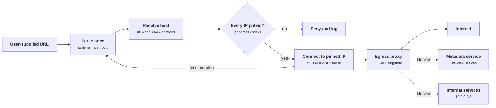
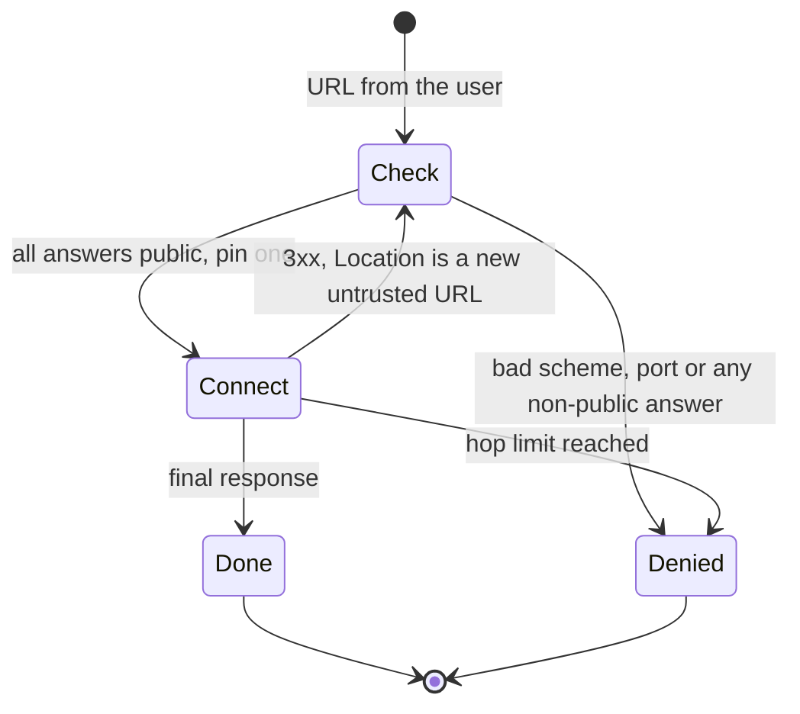
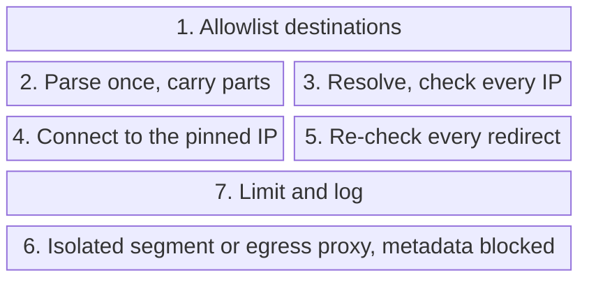

+++
title = 'Server-side request forgery'
description = "When a server fetches a URL that a user influenced, the user borrows the server's network position. The defense is to decide the destination by IP address, after resolution, on every hop, and to back that with a network that cannot reach what it should not."
question = 'How does a URL fetcher become a path into your internal network, and how do you design one that is not?'
weight = 3
difficulty = 3
prerequisites = ['/notes/application-security/foundations/01-the-request-is-a-trust-boundary', '/notes/application-security/untrusted-input/01-injection-and-parameterization']
date = 2026-06-12
lastmod = 2026-06-12
verified = 2026-06-12
+++

## The idea in one minute

Many features fetch a URL on the user's behalf: link previews, webhooks,
"import from URL", PDF renderers that load images, avatar uploads by URL,
integrations that call a customer-supplied endpoint. **Server-side request
forgery (SSRF)** is what happens when the user can influence where that
request goes. The request leaves from your server, inside your network, with
your server's routes, firewall exceptions and sometimes its credentials. The
attacker cannot reach your internal admin panel or the cloud provider's
instance metadata service directly; your fetcher can.

The interpreter in this lesson is the chain that turns a URL into a TCP
connection: a URL parser, a DNS resolver, an HTTP client that follows
redirects. Each one makes a decision about the destination, and they do not
always agree with each other or with the check you wrote. That is why
inspecting the URL string, however carefully, does not hold.

The consequence to act on: **decide by IP address, after resolution, at the
moment of connection, on every hop.** Allowlist destinations when the feature
permits it. Otherwise resolve the name yourself, reject any non-public answer,
connect to the exact address you validated, re-check every redirect, and run
the fetcher where the network itself refuses to route to internal targets.

## A picture



The redirect arrow goes back to the start: a redirect is a new, untrusted URL.
The egress proxy is the backstop if the application check has a bug.

## How it really works

### Why SSRF is worth an OWASP category of its own

SSRF is a confused deputy problem. The server is trusted by things the user is
not: services on private addresses, cloud control planes, a database admin
port that only accepts connections from the application subnet. OWASP made it
its own category in the 2021 Top 10 (A10) and in the API Security Top 10 2023
(API7:2023), because modern applications fetch URLs constantly and run in
environments where one internal request can be worth a lot. MITRE tracks it as
CWE-918.

Notice that the attacker has exactly one edge into this network, to the
fetcher; every internal target is reachable only through it.

```mermaid {title="The fetcher holds a network position the user does not"}
flowchart TB
  n_attacker["Attacker"]
  subgraph g_net["Your network"]
    n_fetcher["URL fetcher"]
    n_imds["Instance metadata"]
    n_admin["Internal admin API"]
    n_db[("DB admin port")]
  end
  n_attacker --> n_fetcher
  n_fetcher --> n_admin
  n_fetcher --> n_imds
  n_fetcher --> n_db
```

What an attacker can do with it depends on what the server can reach and what
the feature returns:

| What the fetcher can reach | What an attacker gains |
| --- | --- |
| Cloud instance metadata | Temporary credentials for the instance's role, configuration, user data |
| Internal HTTP services | Admin endpoints, unauthenticated internal APIs, health and debug pages |
| Other protocols on internal ports | Depends on the client: some libraries speak more than HTTP |
| Nothing internal, but responses are returned | A free proxy that launders traffic through your IP addresses |
| Nothing returned at all ("blind" SSRF) | Port and host discovery through timing and error differences |

Blind SSRF still matters. Even when the user only sees "fetch failed" or
"fetch succeeded", a request that triggers a state change (an internal
endpoint that deletes, restarts or reconfigures on GET) does damage without
returning anything.

### The metadata service problem

Every major cloud gives virtual machines a link-local HTTP endpoint that
describes the instance. On AWS EC2 it is `169.254.169.254` (and
`fd00:ec2::254` over IPv6 on supported instances). Among other things it
returns short-lived credentials for the IAM role attached to the instance.
Whoever can make the instance send an HTTP GET to the right path, and read
the response, holds those credentials.

The original protocol, now called **IMDSv1**, was a plain GET with no
authentication. AWS introduced **IMDSv2** in late 2019 as defense in depth,
specifically citing SSRF, open reverse proxies and misconfigured firewalls. As
described in the AWS documentation:

- A client first sends an HTTP **PUT** to `/latest/api/token` with an
  `X-aws-ec2-metadata-token-ttl-seconds` header (up to six hours) and receives
  a session token. Subsequent GETs must carry that token in the
  `X-aws-ec2-metadata-token` header. Most SSRF primitives let the attacker
  choose a URL but not the method or custom headers, so they cannot complete
  the first step.
- The token response is sent with a configurable IP **hop limit**
  (`HttpPutResponseHopLimit`). With a limit of 1, the response cannot cross a
  router hop, so a misconfigured forwarding proxy or a container behind an
  extra network hop does not receive it. AWS recommends a hop limit of 2 for
  workloads in containers that legitimately need the service, which is a
  trade-off worth deciding on purpose.
- Token requests that carry an `X-Forwarded-For` header are refused, which
  defeats the common reverse-proxy forwarding case.
- Setting `HttpTokens` to `required` turns off IMDSv1 for the instance. Until
  you do, IMDSv2 protects nothing, because the attacker simply uses v1.

The upper half is the legitimate IMDSv2 flow; the lower half shows which
property of it stops each kind of forwarded request.

```mermaid {title="IMDSv2 requires a PUT and a header that most SSRF cannot send"}
sequenceDiagram
  autonumber
  participant W as Workload on the instance
  participant F as Fetcher with an SSRF bug
  participant P as Forwarding proxy
  participant M as Metadata service
  W->>M: PUT /latest/api/token with a TTL header
  M-->>W: session token, response hop limit applies
  W->>M: GET credentials with X-aws-ec2-metadata-token
  M-->>W: temporary role credentials
  F->>M: GET credentials, no token header
  alt HttpTokens required
    M--xF: refused
  else IMDSv1 still enabled
    M-->>F: credentials returned
  end
  P->>M: PUT token request carrying X-Forwarded-For
  M--xP: refused
```

Other providers took a similar path with mandatory request headers (Google
Cloud's `Metadata-Flavor: Google`, Azure's `Metadata: true`). These raise the
bar; they do not replace fixing the fetcher. An SSRF that lets the attacker
set headers, or a feature that is effectively a general HTTP proxy, gets
through. Where a workload does not need the metadata service at all, disable
access to it, and keep instance roles narrow, as covered in
[cloud IAM fundamentals](/notes/infrastructure-security/foundations/03-cloud-iam-fundamentals/).

The best-known public example is the 2019 Capital One breach. The U.S.
Department of Justice criminal complaint (July 2019) alleges that the intruder
used a misconfigured web application firewall to obtain credentials for a
cloud role and then used them to list and copy data from storage buckets.
Public technical analyses widely described the path as SSRF against the
instance metadata service. In August 2020 the Office of the Comptroller of the
Currency assessed an $80 million civil money penalty, citing weaknesses in
risk management around the bank's cloud migration. The lesson for designers
is the chain: a request-forwarding component, a reachable credential endpoint,
and a role with broad storage access. Breaking any link would have contained
it.

The dates in this lesson line up into a short history: research, a breach,
platform controls, then recognition as its own category.

```mermaid {title="SSRF went from parser research to its own Top 10 category in six years"}
timeline
  2017 : Orange Tsai shows URL parser inconsistencies at Black Hat USA
  2019 : July, DOJ complaint in the Capital One breach
       : Late 2019, AWS introduces IMDSv2 citing SSRF
  2020 : August, OCC assesses an 80 million dollar penalty
  2021 : OWASP Top 10 lists SSRF as A10
  2023 : OWASP API Security Top 10 lists it as API7
```

### Why string filtering is fragile

The first fix most teams write inspects the URL text: reject it if the host
contains "localhost", "169.254" or "internal". This fails for structural
reasons, not because the list is incomplete.

- **The string is not the destination.** A hostname is a pointer. Any public
  name can be configured to resolve to a private address, and the attacker
  controls their own DNS records. Nothing in the URL text tells you where the
  connection will go.
- **Parsers disagree.** The validator, the HTTP library, and any proxy in
  between each parse the URL. RFC 3986, the WHATWG URL Standard and individual
  libraries differ on edge cases: which characters end the authority, how
  userinfo is separated, what numeric forms count as an IP address. If the
  check and the fetch use different parsers, they can extract different hosts
  from the same string. Orange Tsai's 2017 research on URL parser
  inconsistencies made this class widely known. The
  [parsers and deserialization lesson](/notes/application-security/untrusted-input/04-parsers-and-deserialization/)
  covers the general problem.
- **DNS can change between check and use.** A validator that resolves the name,
  approves the address, and then hands the URL to an HTTP client that resolves
  it **again** has a time-of-check to time-of-use gap. With a short TTL, the
  second answer can differ from the first. This is DNS rebinding, and it is
  the same check-then-act race described in
  [races and check-then-act](/notes/systems-design/concurrency-and-consistency/01-races-and-check-then-act/).
- **Redirects move the destination.** A public URL that returns `302` with a
  `Location` pointing inward passes the initial check. If the client follows
  redirects automatically, your validator never sees the second destination.

Every one of these is a case of validating one representation and acting on
another. The fix follows directly: validate the thing you act on.

The DNS case is the clearest: the check is correct, and the second lookup makes
it irrelevant unless the connection uses the checked address.

```mermaid {title="A second DNS lookup separates the check from the connection"}
sequenceDiagram
  autonumber
  participant V as Validator
  participant R as Resolver
  participant C as HTTP client
  V->>R: resolve host
  R-->>V: public address
  V->>V: every answer is public, approve
  alt Client is handed the URL string
    V->>C: fetch this URL
    C->>R: resolve host again
    R-->>C: short TTL expired, private address
    Note over C: Connects somewhere nobody checked
  else Client is handed the pinned IP
    V->>C: connect to the validated address, Host is the name
    Note over C: The second answer never matters
  end
```

### The design that holds

**1. Allowlist the destination when the feature allows it.** Many "fetch a URL"
features have a small set of legitimate targets: a payment provider's API,
your own CDN, a list of partner domains configured by an admin. Then the check
is an exact match on scheme, host and port against a configured set, and
SSRF largely disappears. OWASP's cheat sheet distinguishes this case from the
harder one where users can supply arbitrary public URLs (webhooks, link
previews), and recommends allowlists wherever possible.

**2. Parse once, with one parser, and carry the parts forward.** Extract
scheme, host and port into a structure and never re-derive them from the
string. Restrict the scheme to `https` (and `http` if you must) and the port
to the expected ones. Reject userinfo; it has no legitimate use in a server
fetch. Hand the HTTP client the structured parts, not the original text.

**3. Resolve the hostname yourself and validate every answer.** Call the
resolver (`socket.getaddrinfo` in Python), collect every A and AAAA record,
and check each with the `ipaddress` module. Reject the name if **any** answer
is unacceptable; an attacker who controls DNS can return one public and one
private address and hope the client picks the second.

| Check | What it catches |
| --- | --- |
| `is_loopback` | `127.0.0.0/8`, `::1` |
| `is_private` | RFC 1918 ranges, unique local IPv6 (`fc00::/7`), documentation and some special-purpose ranges |
| `is_link_local` | `169.254.0.0/16` (including metadata), `fe80::/10` |
| `is_multicast`, `is_reserved`, `is_unspecified` | Addresses that should never be a fetch target |
| `not is_global` | The catch-all, including shared address space `100.64.0.0/10` |
| `ipv4_mapped` | Normalize `::ffff:a.b.c.d` and judge it as the IPv4 address it denotes |

The IPv4-mapped step matters because a dual-stack socket connecting to
`::ffff:10.1.2.3` reaches `10.1.2.3`, and an IPv6-only check looks at the
wrong address family. Checking `is_global` as well as the specific properties
means a range you forgot to list still fails closed.

**4. Connect to the address you validated.** This is the step most
implementations skip. Do not pass the hostname to a client that resolves it
again. Open the TCP connection to the pinned IP, and send the original
hostname in the `Host` header and as the TLS server name, so virtual hosting
and certificate verification still work against the name. In Python's
standard library that means subclassing `http.client.HTTPSConnection` so
`connect()` calls `socket.create_connection((pinned_ip, port))` and wraps the
socket with `ssl.SSLContext.wrap_socket(sock, server_hostname=host)`. Many
higher-level clients offer a hook for custom resolution or a transport you
can replace; use it rather than racing the client's own resolver.

Two inputs feed the connection and they do different jobs: the IP chooses the
route, the name is what TLS verifies.

```mermaid {title="Pinning controls where packets go, the name controls who must prove identity"}
flowchart LR
  IP["<b>Validated IP</b>"] --> S["<b>TCP connect</b><br/><small>to the pinned IP</small>"]
  N["<b>Original hostname</b>"] --> T("TLS, server_hostname is the name")
  N --> H["<b>Host header</b><br/><small>set to the name</small>"]
  S --> T
  T --> C@{ shape: diam, label: "Certificate matches the name?" }
  C -->|"yes"| R["<b>Send the request</b>"]
  C -->|"no"| X["<b>Abort</b>"]
  H --> R
  class IP,N neutral
  class S,H compute
  class C,R good
  class X warn
```

**5. Disable automatic redirects, or re-validate each hop.** Turn off
redirect following in the client. If the feature needs redirects, follow them
in your own loop: resolve, validate and pin each `Location` exactly like the
first URL, with a small hop limit.

As a state machine, the loop has one rule: there is no path from a redirect to
a connection that does not pass through the full check again.



**6. Contain the fetcher in the network.** Application checks have bugs.
Run URL fetching in a separate service or worker in an isolated network
segment whose egress rules permit only the public internet, or send all
outbound fetches through an **egress proxy** that enforces the same address
policy independently. Block the metadata address from that segment entirely.
Do not give the fetcher credentials it does not need. The
[network segmentation lesson](/notes/infrastructure-security/isolation/04-network-segmentation-and-zero-trust/)
covers how to build that boundary.

**7. Limit and log.** Set connect and read timeouts, cap response size,
check the `Content-Type` you expect, and avoid returning raw upstream
responses or detailed error messages to the user, since those turn blind SSRF
into readable SSRF. Log every decision with the requested URL, resolved
addresses, pinned IP and verdict. A burst of denials toward private ranges
from one account is a clear signal.

Stacked together, the seven steps split into application checks and a network
layer that still holds when one of those checks has a bug.



> [!IMPORTANT]
> The unit of decision is the IP address you actually connect to, checked
> after resolution, on every hop. Anything decided earlier or about a
> different representation can be invalidated before the packet leaves.

## Code

The program implements steps 2 to 5 against a simulated resolver and a
simulated network. DNS is a dictionary in which each name maps to a sequence
of answers, so one name can answer differently on its second lookup. The
"network" maps the IP the fetcher connects to onto a canned response. No
socket is opened. A `pin` flag switches between connecting to the validated
address and letting the client resolve again, which is what most HTTP
libraries do by default.

```python {title="safe_fetch_policy.py"}
"""safe_fetch_policy.py: an outbound-request policy that resolves, validates and pins.

Everything is simulated: DNS is a dict, the "network" is a dict of responses keyed
by the IP the fetcher connects to. No sockets are opened. Standard library only.
"""

from __future__ import annotations

import ipaddress
from dataclasses import dataclass, field
from urllib.parse import urljoin, urlsplit

ALLOWED_SCHEMES = {"http": 80, "https": 443}
MAX_REDIRECTS = 3
IP = ipaddress.IPv4Address | ipaddress.IPv6Address


@dataclass
class SimulatedDNS:
    """Each name maps to a list of answers; every lookup returns the next one."""
    answers: dict[str, list[list[str]]]
    calls: dict[str, int] = field(default_factory=dict)

    def resolve(self, host: str) -> list[str]:
        n = self.calls.get(host, 0)
        self.calls[host] = n + 1
        seq = self.answers.get(host, [[]])
        return seq[min(n, len(seq) - 1)]


def ip_problem(raw: str) -> str | None:
    """Return why this address is not an acceptable destination, or None."""
    ip: IP = ipaddress.ip_address(raw)
    label = raw
    if isinstance(ip, ipaddress.IPv6Address) and ip.ipv4_mapped is not None:
        ip = ip.ipv4_mapped  # judge ::ffff:a.b.c.d by its IPv4 meaning
        label = f"{raw} (IPv4 {ip})"
    for prop in ("is_unspecified", "is_loopback", "is_link_local",
                 "is_multicast", "is_private", "is_reserved"):
        if getattr(ip, prop):
            return f"{label} {prop.removeprefix('is_').replace('_', '-')}"
    if not ip.is_global:
        return f"{label} not globally routable"
    return None


@dataclass
class Verdict:
    allowed: bool
    reason: str
    host: str = ""
    pinned_ip: str = ""


def check(url: str, dns: SimulatedDNS) -> Verdict:
    """Parse once, resolve once, validate every answer, pin one validated IP."""
    parts = urlsplit(url)
    if parts.scheme not in ALLOWED_SCHEMES:
        return Verdict(False, f"scheme {parts.scheme!r} not allowed")
    if parts.username or parts.password:
        return Verdict(False, "credentials in URL not allowed")
    host = parts.hostname or ""
    if not host:
        return Verdict(False, "no host")
    if (parts.port or ALLOWED_SCHEMES[parts.scheme]) != ALLOWED_SCHEMES[parts.scheme]:
        return Verdict(False, f"port {parts.port} not allowed")
    answers = dns.resolve(host)
    if not answers:
        return Verdict(False, f"{host} did not resolve")
    for raw in answers:  # one bad answer rejects the name
        if problem := ip_problem(raw):
            return Verdict(False, f"{host} -> {problem}", host)
    return Verdict(True, f"{host} -> {', '.join(answers)}", host, answers[0])


def fetch(url: str, dns: SimulatedDNS, net: dict[tuple[str, str], tuple[int, str]],
          pin: bool = True) -> list[str]:
    """Follow redirects manually, re-running the full check on every hop."""
    log = []
    for hop in range(MAX_REDIRECTS + 1):
        v = check(url, dns)
        log.append(f"hop {hop} {'ALLOW' if v.allowed else 'DENY '} {v.reason}")
        if not v.allowed:
            return log
        # Pinned: connect to the address we validated. Unpinned: let the HTTP
        # client resolve the name again, as most libraries do by default.
        ip = v.pinned_ip if pin else dns.resolve(v.host)[0]
        path = urlsplit(url).path or "/"
        status, body = net.get((ip, path), (502, "no route"))
        log.append(f"      connect {ip} (Host: {v.host}) {path} -> {status}")
        if status not in (301, 302, 303, 307, 308):
            log.append(f"      result: {body}")
            return log
        url = urljoin(url, body)  # body holds the Location header here
    log.append("      DENY too many redirects")
    return log


DNS_ANSWERS = {
    "docs.example.com": [["93.184.215.14"]],
    "wiki.corp.example": [["10.20.0.15"]],
    "meta.example.net": [["169.254.169.254"]],
    "mixed.example.org": [["93.184.215.14", "10.0.0.7"]],
    "mapped.example.org": [["::ffff:10.1.2.3"]],
    "flip.example.org": [["93.184.215.14"], ["169.254.169.254"]],
    "files.example.com": [["93.184.215.20"]],
    "admin.internal.example": [["10.0.0.5"]],
}
NETWORK = {
    ("93.184.215.14", "/guide"): (200, "public page"),
    ("93.184.215.14", "/"): (200, "public page"),
    ("93.184.215.20", "/report"): (302, "http://admin.internal.example/users"),
    ("169.254.169.254", "/"): (200, "INSTANCE CREDENTIALS"),
    ("10.0.0.5", "/users"): (200, "INTERNAL ADMIN DATA"),
}
CASES = [
    ("public host", "https://docs.example.com/guide", True),
    ("resolves to 10.x", "https://wiki.corp.example/", True),
    ("resolves to metadata IP", "https://meta.example.net/", True),
    ("one good, one bad answer", "https://mixed.example.org/", True),
    ("IPv4-mapped IPv6 answer", "https://mapped.example.org/", True),
    ("DNS changes, no pinning", "https://flip.example.org/", False),
    ("DNS changes, pinned", "https://flip.example.org/", True),
    ("redirect to internal", "https://files.example.com/report", True),
    ("scheme not allowed", "ftp://files.example.com/report", True),
]

if __name__ == "__main__":
    for label, url, pin in CASES:
        print(f"[{label}] {url}")
        for line in fetch(url, SimulatedDNS(DNS_ANSWERS), NETWORK, pin):
            print("  " + line)
```

Run it with `python3 safe_fetch_policy.py`:

```text
[public host] https://docs.example.com/guide
  hop 0 ALLOW docs.example.com -> 93.184.215.14
        connect 93.184.215.14 (Host: docs.example.com) /guide -> 200
        result: public page
[resolves to 10.x] https://wiki.corp.example/
  hop 0 DENY  wiki.corp.example -> 10.20.0.15 private
[resolves to metadata IP] https://meta.example.net/
  hop 0 DENY  meta.example.net -> 169.254.169.254 link-local
[one good, one bad answer] https://mixed.example.org/
  hop 0 DENY  mixed.example.org -> 10.0.0.7 private
[IPv4-mapped IPv6 answer] https://mapped.example.org/
  hop 0 DENY  mapped.example.org -> ::ffff:10.1.2.3 (IPv4 10.1.2.3) private
[DNS changes, no pinning] https://flip.example.org/
  hop 0 ALLOW flip.example.org -> 93.184.215.14
        connect 169.254.169.254 (Host: flip.example.org) / -> 200
        result: INSTANCE CREDENTIALS
[DNS changes, pinned] https://flip.example.org/
  hop 0 ALLOW flip.example.org -> 93.184.215.14
        connect 93.184.215.14 (Host: flip.example.org) / -> 200
        result: public page
[redirect to internal] https://files.example.com/report
  hop 0 ALLOW files.example.com -> 93.184.215.20
        connect 93.184.215.20 (Host: files.example.com) /report -> 302
  hop 1 DENY  admin.internal.example -> 10.0.0.5 private
[scheme not allowed] ftp://files.example.com/report
  hop 0 DENY  scheme 'ftp' not allowed
```

Compare the two `flip.example.org` runs. Both passed the same check, because
the first DNS answer was public. The unpinned fetcher then resolved the name a
second time, got the metadata address, and connected there: the check was
correct and still useless. The pinned fetcher connected to the address it had
validated, so the second answer never mattered. The redirect case shows the
other gap: the first hop was legitimately public, and only re-running the
whole check on the `Location` caught the internal target.

The "public" answers are arbitrary global unicast addresses. The
documentation ranges from RFC 5737 (such as `203.0.113.0/24`) would not work
here: Python's `ipaddress` reports them as not global, so the policy rejects
them, which is the behavior you want in production.

## Where it breaks

- **The simulation skips the hard part of pinning.** Real pinning means
  controlling the socket while keeping TLS verification against the hostname.
  Get that wrong (for example, by disabling certificate checks because the
  connection is "to an IP") and you have traded SSRF for a man-in-the-middle
  weakness.
- **Address checks only know about address ranges.** If your internal services
  sit on public IP space, or a partner's internal network is reachable over a
  VPN with public addresses, `is_global` approves them. Add your own deny list
  of known internal ranges, and lean on the network layer.
- **Transition mechanisms and odd paths.** IPv6 transition prefixes (6to4,
  NAT64, Teredo) can embed an IPv4 address in a way `ipv4_mapped` does not
  cover, and a proxy configured through environment variables can route the
  request somewhere your check never considered. Decide whether the fetcher
  ever needs IPv6, and make sure it does not silently inherit proxy settings.
- **Clients that do more than you asked.** Some libraries support schemes
  beyond HTTP, follow redirects by default, or retry against other resolved
  addresses. Read the client's documentation and turn off what you do not use.
- **The application is the only layer.** A single missed code path (an image
  library that fetches remote resources, an XML parser that resolves external
  entities, a headless browser rendering user HTML) bypasses a validator that
  lives in one helper function. An isolated egress segment covers paths you
  did not know existed; an application check cannot.
- **What the example does not prove.** It shows that pinning and per-hop
  validation close two specific gaps. It does not test URL parser
  differentials, real DNS behavior, or a real HTTP client's redirect logic.

## Remember this

- SSRF lets a user borrow your server's network position and, in the cloud,
  often its credentials.
- A URL string is not a destination; decide by the IP you connect to.
- Resolve once, reject if any answer is non-public, then connect to the
  validated IP with the hostname in `Host` and SNI.
- Treat every redirect as a new untrusted URL, or do not follow redirects.
- Require IMDSv2 with a low hop limit, and keep instance roles narrow.
- Put fetchers in an egress-restricted segment so a code bug is not a breach.

## Try it

1. Add a host to `DNS_ANSWERS` that resolves to `100.64.0.10`. Which branch
   of `ip_problem` rejects it, and why do the specific property checks not
   catch it first?
2. Add an `ALLOWED_HOSTS` set and a mode where `check` rejects any host not in
   it before resolving. Rerun the table. Which cases change, and which checks
   are still worth keeping in allowlist mode?
3. Make `files.example.com` redirect to itself and confirm the loop stops at
   `MAX_REDIRECTS`. Then change the redirect to a relative `Location` and
   check that `urljoin` resolves it against the current hop.
4. Write the real pinned connection: a subclass of
   `http.client.HTTPSConnection` whose `connect()` opens a socket to a given
   IP and wraps it with `server_hostname` set to the original name. Test it
   against a local `https` server you control, not a third party.
5. In a codebase you know, search for every outbound HTTP call that takes a
   URL from a request, a database field or a configuration value a customer
   can edit. For each, write down which of the seven design steps it already
   has.

## Check yourself

1. A validator resolves the hostname, confirms the address is public, and then
   calls `urllib.request.urlopen(url)`. What is wrong?

   
   `urlopen` resolves the name again, so the address that was validated is not
   necessarily the address that is connected to. An attacker who controls the
   DNS record can answer with a public address for the check and a private one
   for the fetch. The client also follows redirects by default, so a public
   URL can redirect inward without the validator ever seeing it. The fix is to
   connect to the validated IP and handle redirects in your own loop.
   

2. Why reject a name when only one of its several DNS answers is private?

   
   The client may connect to any of the answers, and some retry the next
   address when the first fails. An attacker who controls the record can
   include a private address alongside a public one. Rejecting the whole name
   removes the dependence on which answer the client happens to pick.
   

3. What do IMDSv2's PUT requirement and hop limit each defend against?

   
   The PUT-then-token flow defeats SSRF primitives that let an attacker choose
   the URL but not the method or headers, which is most of them. The hop limit
   on the token response stops the token from crossing an extra network hop,
   which covers misconfigured forwarding proxies and some container setups.
   Neither helps until IMDSv1 is disabled by requiring tokens.
   

4. Your fetcher connects to a pinned IP. Why must it still send the hostname
   in the `Host` header and as the TLS server name?

   
   Many servers host multiple sites on one address and choose the site from
   `Host` and SNI. More importantly, TLS certificate verification checks the
   certificate against the server name; verifying against the bare IP, or
   skipping verification, would let anyone on the path impersonate the site.
   Pinning controls where the packets go; the name still controls who the
   server must prove it is.
   

5. The application check is thorough and tested. Why also run the fetcher in
   an egress-restricted network segment?

   
   Because other code fetches URLs too: image processing libraries, document
   renderers, XML parsers and headless browsers can all make requests that
   never pass through your validator, and the validator itself may have a bug.
   A network that cannot route to internal ranges or the metadata address
   contains all of those cases at once.
   

## Sources

- OWASP, [Server-Side Request Forgery Prevention Cheat Sheet](https://cheatsheetseries.owasp.org/cheatsheets/Server_Side_Request_Forgery_Prevention_Cheat_Sheet.html).
- OWASP, [API7:2023 Server Side Request Forgery](https://owasp.org/API-Security/editions/2023/en/0xa7-server-side-request-forgery/), OWASP API Security Top 10, 2023.
- OWASP, [A10:2021 Server-Side Request Forgery](https://owasp.org/Top10/A10_2021-Server-Side_Request_Forgery_%28SSRF%29/), OWASP Top 10, 2021.
- MITRE, [CWE-918: Server-Side Request Forgery (SSRF)](https://cwe.mitre.org/data/definitions/918.html).
- Amazon Web Services, [Use the Instance Metadata Service to access instance metadata](https://docs.aws.amazon.com/AWSEC2/latest/UserGuide/configuring-instance-metadata-service.html) and [How Instance Metadata Service Version 2 works](https://docs.aws.amazon.com/AWSEC2/latest/UserGuide/instance-metadata-v2-how-it-works.html), Amazon EC2 User Guide.
- C. MacCárthaigh, [Add defense in depth against open firewalls, reverse proxies, and SSRF vulnerabilities with enhancements to the EC2 Instance Metadata Service](https://aws.amazon.com/blogs/security/defense-in-depth-open-firewalls-reverse-proxies-ssrf-vulnerabilities-ec2-instance-metadata-service/), AWS Security Blog, November 2019.
- United States v. Paige A. Thompson, criminal complaint, U.S. District Court for the Western District of Washington, July 2019.
- Office of the Comptroller of the Currency, consent order and civil money penalty against Capital One, August 2020.
- O. Tsai, A New Era of SSRF: Exploiting URL Parser in Trending Programming Languages, Black Hat USA, 2017.
- IETF, [RFC 3986: Uniform Resource Identifier (URI): Generic Syntax](https://www.rfc-editor.org/rfc/rfc3986), 2005; WHATWG, [URL Standard](https://url.spec.whatwg.org/).
- IETF, [RFC 6890: Special-Purpose IP Address Registries](https://www.rfc-editor.org/rfc/rfc6890), 2013.
- Python documentation, [ipaddress](https://docs.python.org/3/library/ipaddress.html), [urllib.parse](https://docs.python.org/3/library/urllib.parse.html) and [http.client](https://docs.python.org/3/library/http.client.html).
