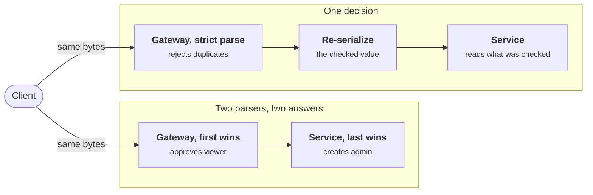
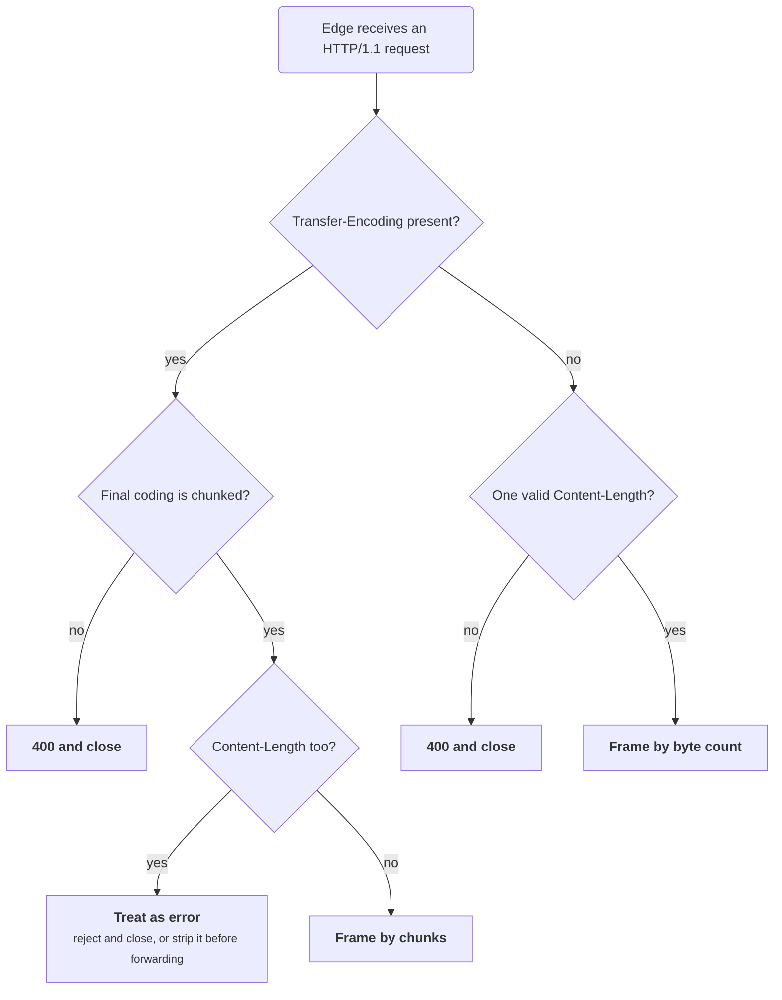

+++
title = 'Parsers and deserialization'
description = 'Native object deserializers turn bytes into live objects and can run code while doing it, so they must never read untrusted input. Accept data-only formats, parse strictly, validate against an allowlisted schema, and make sure every component reads the same bytes the same way.'
question = 'Why can parsing a request body run code or grant privileges, and how do you parse so that it cannot?'
weight = 4
difficulty = 3
prerequisites = ['/notes/application-security/untrusted-input/01-injection-and-parameterization', '/notes/application-security/authorization/01-broken-object-level-authorization']
date = 2026-06-14
lastmod = 2026-06-14
verified = 2026-06-14
+++

## The idea in one minute

A parser looks like the most passive code in an application: bytes go in, a
dictionary comes out. That holds only when the format can describe nothing but
data. **Native object serialization formats** (Python's `pickle`, Java's
`ObjectInputStream`, .NET's `BinaryFormatter`, YAML loaders that honor
language-specific tags) are built to rebuild arbitrary objects of arbitrary
types, and rebuilding an object means running its code. Whoever writes the
bytes chooses which code runs. No validation can happen afterwards, because
the damage is done during parsing, before your handler sees anything.

Data-only formats such as JSON remove that problem, but leave three others.
**Ambiguous input**: the JSON specification does not say what duplicate keys
mean, so two components can read different values from the same body, and the
same is true of HTTP message framing itself. **Loose parsing**: lenient parsers
accept non-standard input (NaN, other encodings, other content types) that
your validator never planned for. **Over-binding**: a perfectly parsed body can
still set fields the caller was never meant to touch, such as `is_admin`.

The consequence to act on: **never deserialize untrusted bytes into objects;
parse a data-only format strictly, validate it against a schema that lists
exactly the allowed fields, and copy only those fields into your model.**

## A picture

```mermaid {title="Where the request body becomes something more than data"}
flowchart LR
  B["<b>Request body</b><br/><small>attacker-chosen bytes</small>"]
  B --> N["<b>Native deserializer</b><br/><small>pickle, Java, unsafe YAML</small>"]
  N --> X["<b>Constructors run</b><br/><small>during parsing</small>"]
  B --> G["<b>Content-type gate</b><br/><small>JSON only, size cap</small>"]
  G --> S["<b>Strict JSON parse</b><br/><small>no duplicates, UTF-8</small>"]
  S --> V["<b>Schema</b><br/><small>types, lengths, allowlist</small>"]
  V --> M["<b>Model built</b><br/><small>named fields only</small>"]
  S -.->|"loose parse, bind all"| A["<b>is_admin set</b>"]
  class B warn
  class N,X,A warn
  class G,S,V good
  class M compute
```

The upper path executes before any check can run. The lower path keeps the
body as plain data at every step, and each stage narrows what the next one has
to trust.

## How it really works

### Why object deserialization runs code

A data format describes values: strings, numbers, lists, maps. An **object
serialization** format describes a graph of typed objects and promises to give
you back the same graph, with the same classes, after a round trip. To do that,
the decoder must look up a type named in the stream and then construct an
instance, which means calling code chosen by the stream.

Python's `pickle` makes this explicit. A pickle is a small program for a stack
machine. Its opcodes can import any importable name (`GLOBAL`,
`STACK_GLOBAL`) and call it with arguments (`REDUCE`). Classes customize their
own pickling with `__reduce__`, which returns "a callable and its arguments";
the unpickler simply calls them. The format has no notion of a "safe" callable.
The Python documentation opens the `pickle` page with a warning:

> [!WARNING] The pickle module is not secure
> "Only unpickle data you trust. It is possible to construct malicious pickle
> data which will execute arbitrary code during unpickling. Never unpickle data
> that could have come from an untrusted source, or that could have been
> tampered with." (Python documentation, `pickle`)

The same documentation recommends a safer format such as JSON for untrusted
data, and signing with `hmac` if you only need to detect tampering of data you
produced. The `marshal` and `shelve` modules carry similar warnings, and so do
the many formats built on pickle: `joblib` files, and the PyTorch checkpoint
formats covered in
[models and supply chain](/notes/ai-security-engineering/securing-each-stage/03-models-and-supply-chain/).

Look at where the code runs relative to your validator: inside the parse call,
before the handler gets anything back.

```mermaid {title="An unpickler calls code chosen by the stream before it returns"}
sequenceDiagram
  autonumber
  participant H as Handler
  participant U as Unpickler
  participant Py as Python runtime
  H->>U: pickle.loads on request bytes
  U->>Py: GLOBAL imports a name the stream chose
  U->>Py: REDUCE calls it with arguments the stream chose
  Note over Py: Code has run, inside the parse call
  U-->>H: some object
  H->>H: validate the result
  Note over H: Too late, there is nothing left to prevent
```

Java's built-in serialization works differently but fails the same way.
`ObjectInputStream.readObject` instantiates whatever serializable class the
stream names, then invokes that class's `readObject`, `readResolve` and related
hooks. The attacker does not need a "dangerous" class of their own; they need a
**gadget chain**, a sequence of ordinary library classes already on the
classpath whose deserialization hooks call each other until one of them does
something powerful. Frohoff and Lawrence's 2015 talk "Marshalling Pickles"
showed such chains in widely used libraries, which is why fixing one library
never closed the class. The weakness is CWE-502, deserialization of untrusted
data.

| Format | What it can construct | Status for untrusted input |
| --- | --- | --- |
| Python `pickle`, `marshal`, `shelve` | Any importable callable, called with chosen arguments | Never; the docs say so |
| Java `ObjectInputStream` | Any serializable class on the classpath, with its hooks | Avoid; if legacy code needs it, use serialization filters (JEP 290) as an allowlist |
| .NET `BinaryFormatter` | Arbitrary types | Deprecated by Microsoft, which tells developers not to use it at all |
| PHP `unserialize`, Ruby `Marshal` | Objects with magic methods | Avoid for untrusted input |
| YAML with full or unsafe loaders | Language objects through tags such as `!!python/object` | Use the safe loader |
| JSON, CSV, Protocol Buffers with generated classes | Values and declared message types only | Fine, with validation |

The table reduces to one question about each format: does it build objects, or
only values?

```mermaid {title="What a format can build decides whether it may read untrusted bytes"}
mindmap
  root((Serialization formats))
    Builds objects, never for untrusted input
      Python pickle, marshal, shelve
      Java ObjectInputStream
      DotNET BinaryFormatter
      PHP unserialize, Ruby Marshal
      YAML full or unsafe loader
    Builds values only, fine with validation
      JSON
      CSV
      Protocol Buffers
      YAML safe loader
```

### Mitigations that do not work

Teams that inherit an object deserializer reach for half-measures first. Each
one fails for a structural reason.

- **Validating after deserializing.** The exploit runs inside the parse call.
  There is no "after" for the attacker's payload.
- **Blocklisting dangerous classes.** Gadget chains are built from classes
  nobody thought of as dangerous, and every new dependency adds candidates.
  Allowlists are better, but they are hard to keep tight in a large codebase.
- **Restricting globals in pickle.** Overriding `Unpickler.find_class` to allow
  a short list of names is documented, and it does shrink the attack surface,
  but the documentation itself notes you must be careful about what you allow.
  It is a mitigation for files you already trust, not a parser for hostile
  input.
- **Encrypting or signing the blob.** This stops clients forging it only
  while the key stays secret; a leaked key turns every endpoint that accepts
  the blob into remote code execution.

The design that works is simpler: **untrusted bytes go to a data-only parser.**
If you need to round-trip server state through a client (a session, a "remember
me" cookie, a job payload), put plain data in it, authenticate it with an HMAC
or a signed token, and rebuild the objects yourself from known types.

### YAML: pick the safe loader

YAML is a data format with an escape hatch. The core schema covers maps,
sequences, strings, numbers, booleans and null, but the specification allows
application-specific tags, and PyYAML's full and unsafe loaders map tags like
`!!python/object/apply` onto Python constructors. PyYAML's history reflects
this: calling `yaml.load` without a `Loader` first produced a warning and, in
recent versions, is an error, and `FullLoader`, introduced as a middle ground,
has needed security fixes since.

The rule is short: **`yaml.safe_load` (or `Loader=yaml.SafeLoader`) for
anything you did not write yourself.** It builds only standard types. Treat
configuration files that tenants upload, CI files from pull requests, and
Kubernetes manifests from users as untrusted. YAML libraries in other
languages have the same split; check which constructor yours uses by default.

### JSON is data-only, but not unambiguous

RFC 8259 defines JSON. Section 4 says object names **SHOULD** be unique, and
then states plainly that when they are not, "the behavior of software that
receives such an object is unpredictable." It lists the observed behaviors:
many implementations report the last pair, some report an error, some report
all pairs. Python's `json` module keeps the last one, and its documentation
says so and points to `object_pairs_hook` for anyone who wants different
behavior.

On its own, that is a curiosity. It becomes a vulnerability when **two
components parse the same bytes**. A gateway that validates
`{"role": "viewer", "role": "admin"}` with a first-wins parser approves a
viewer; the service behind it, using a last-wins parser, creates an admin. The
same split appears with other places where JSON parsers disagree:

| Ambiguity | What can differ between parsers |
| --- | --- |
| Duplicate names | First wins, last wins, error, or all values |
| `NaN`, `Infinity`, comments, trailing commas | Accepted by lenient parsers, rejected by strict ones (RFC 8259 allows none of them) |
| Large numbers | Exact integer in one language, rounded double in another |
| Encoding and byte order mark | RFC 8259 requires UTF-8 between systems; some parsers guess |
| Nesting depth and size | RFC 8259 lets parsers set limits; a deep document can exhaust one component's stack |

The fix is to **parse strictly in the component that makes decisions, and pass
the parsed, re-serialized value onward** rather than the original bytes, so
that everything downstream reads the version that was checked. RFC 7493
(I-JSON) is a useful target profile: it forbids duplicate names, requires
UTF-8, and forbids numbers with more magnitude or precision than an IEEE 754
double can represent.

The same bytes go down both paths; only the lower one guarantees that the
service acts on the value the gateway approved.



### Content-Type confusion

Frameworks often choose a parser from the `Content-Type` header: JSON for
`application/json`, form decoding for `application/x-www-form-urlencoded`, an
XML parser for `application/xml`, sometimes YAML or a binary format through a
plugin. That means **the client chooses which parser runs.** An endpoint
written and tested for JSON may also accept XML (with its own entity-expansion
problems), or a format whose decoder builds objects, simply because a library
registered a handler.

Accept exactly the media types each endpoint is designed for, and reject the
rest with `415 Unsupported Media Type` before reading the body. This has a
second benefit. Browsers send cross-origin `POST` requests without a CORS
preflight only for a short list of "simple" content types (form encodings and
`text/plain`). An endpoint that parses the body as JSON regardless of the
header can be called from any web page by a plain HTML form; one that demands
`application/json` forces a preflight that your CORS policy can refuse.

Compare the two endpoints from the point of view of another site's page: only
the strict one gives the browser a reason to ask first.

```mermaid {title="Demanding application/json turns a cross-site form post into a preflight"}
sequenceDiagram
  autonumber
  participant P as Page on another site
  participant B as Browser
  participant API as Your endpoint
  alt Endpoint parses any body as JSON
    P->>B: plain HTML form, text/plain body
    B->>API: POST with cookies, no preflight
    API-->>B: body parsed and acted on
  else Endpoint demands application/json
    P->>B: fetch with application/json
    B->>API: OPTIONS preflight
    API-->>B: origin not allowed by CORS policy
    Note over B: The POST is never sent
    P->>B: plain HTML form, text/plain body
    B->>API: POST without preflight
    API-->>B: 415 Unsupported Media Type
  end
```

### HTTP request smuggling: a parser differential in the framing

The most consequential parser differential sits below the body, in HTTP/1.1
message framing. A request travels through a front end (a CDN, load balancer
or reverse proxy) and a back end, often over a shared, reused connection. Both
must agree where each request **ends**. RFC 9112, section 6.3, defines that
from two headers: `Content-Length` (a byte count) and `Transfer-Encoding:
chunked` (the body is split into length-prefixed chunks).

If the front end and the back end disagree about the length, the leftover
bytes of one request are read by the back end as the start of the next request
on the connection, which may belong to another user. That is **request
smuggling** (RFC 9112 section 11.2, CWE-444). It can bypass front-end access
controls, attach one user's response to another's request, or poison caches.

RFC 9112 removes the ambiguity if everyone follows it:

| Situation | What RFC 9112 requires |
| --- | --- |
| Both `Transfer-Encoding` and `Content-Length` present | `Transfer-Encoding` wins; the message "ought to be handled as an error"; an intermediary that forwards it must first remove `Content-Length`, and a server must close the connection after responding |
| `Transfer-Encoding` in a request whose final coding is not `chunked` | The server must respond `400` and close the connection |
| Invalid `Content-Length`, or several differing values | Unrecoverable framing error: respond `400` and close the connection |

Drawn as the check an edge component runs on every request, the table leaves
exactly two ways to frame a body and nothing to guess.



The defensive design follows directly: **reject ambiguous framing at the
edge** instead of repairing it, keep front end and back end on implementations
that enforce section 6.3, prefer HTTP/2 or HTTP/3 end to end (their framing
carries explicit lengths, though downgrading to HTTP/1.1 at a proxy brings the
problem back), and close the connection after any framing error so that
leftover bytes cannot be reused. Auditing for this needs no exploit syntax,
only a list of the components that parse HTTP and whether they all reject the
same malformed messages.

### Mass assignment: correct parsing, wrong binding

Suppose parsing is perfect. The handler receives a clean dictionary and writes
it to the model in one line: `User(**body)`, `user.update(body)`, a loop over
`setattr`, or an ORM helper that binds every matching column. The model has
fields the client should never set: `is_admin`, `tenant_id`, `email_verified`,
`balance`, `owner_id`. Adding one of them to the request is enough.

OWASP's API Security Top 10 (2023) files this under **API3:2023, Broken Object
Property Level Authorization**, which merges two 2019 categories: excessive
data exposure (returning fields the caller should not read) and mass
assignment (accepting fields the caller should not write). The weakness is
CWE-915. Authorization at the object level, covered in
[broken object level authorization](/notes/application-security/authorization/01-broken-object-level-authorization/),
asks "may this caller touch this record?"; API3 asks "may this caller touch
**this field** of it?"

The fix is an explicit allowlist per operation:

- **A separate input type for each operation.** A signup schema that lists
  `username`, `email`, `display_name` and nothing else. An admin-only schema,
  checked by authorization, for `is_admin`.
- **Reject unknown fields** rather than silently dropping them. Rejecting makes
  client bugs and probing visible. Pydantic's `extra="forbid"`, JSON Schema's
  `additionalProperties: false`, and an explicit `fields` list in a Django REST
  framework serializer (never `"__all__"`) all express this.
- **Copy, do not bind.** Build the model from the validated fields by name, so
  that server-controlled fields can only take server-chosen values.
- **Apply the same allowlist to responses.** Serialize an output type, not the
  database row, so a new column does not leak by default.

The model below uses the program's `Account`: each operation gets its own input
type, and only the admin type, behind an authorization check, carries
`is_admin`.

```mermaid {title="One input type per operation, one output type per response"}
erDiagram
  SIGNUP_INPUT ||--|| ACCOUNT : "fields copied by name"
  ADMIN_UPDATE ||--|| ACCOUNT : "authorized admin sets"
  ACCOUNT ||--|| ACCOUNT_OUTPUT : "serialized as"
  SIGNUP_INPUT {
    string username
    string email
    string display_name
    bool newsletter
  }
  ADMIN_UPDATE {
    bool is_admin
  }
  ACCOUNT {
    string username
    string email
    string display_name
    bool newsletter
    bool is_admin
  }
  ACCOUNT_OUTPUT {
    string username
    string display_name
  }
```

Around the allowlist, the schema checks **exact types** (in Python, `True` is
an instance of `int`, so `isinstance` lets a boolean pass as a number),
**required fields**, and **length and range limits**, with a **body size cap**
enforced before parsing.

## Code

The program runs a signup body through every stage above. It shows Python's
last-wins duplicate handling next to a first-wins parser, a strict loader that
refuses both duplicates and `NaN`, a schema validator that rejects an
`is_admin` field which a bind-everything handler happily accepts, and a
content-type gate under which no object format can reach a decoder. It builds
no pickle and imports no object deserializer; the binary bodies are placeholder
text.

```python {title="parse_safely.py"}
"""parse_safely.py: a request body pipeline that only ever produces plain data.

1. Python's json module keeps the last duplicate key; a strict loader refuses.
2. A small schema validator (types, required fields, allowlist, lengths)
   rejects a mass-assignment attempt.
3. Only JSON is accepted. There is no pickle, YAML or other object format to
   fall back to, so the content-type gate refuses everything else.
Standard library only; nothing touches a network or a real system.
"""

from __future__ import annotations

import json
from dataclasses import dataclass
from typing import Any

MAX_BODY = 4096


class Rejected(ValueError):
    pass


def strict_object(pairs: list[tuple[str, Any]]) -> dict[str, Any]:
    seen: dict[str, Any] = {}
    for key, value in pairs:
        if key in seen:
            raise Rejected(f"duplicate key {key!r}")
        seen[key] = value
    return seen


def no_constants(name: str) -> Any:
    raise Rejected(f"non-standard number {name}")  # NaN, Infinity are not JSON


def strict_loads(text: str) -> Any:
    return json.loads(text, object_pairs_hook=strict_object, parse_constant=no_constants)


def first_wins(pairs: list[tuple[str, Any]]) -> dict[str, Any]:
    out: dict[str, Any] = {}
    for key, value in pairs:
        out.setdefault(key, value)  # how some other parsers behave
    return out


@dataclass(frozen=True)
class Field:
    kind: type
    required: bool = False
    min_len: int = 0
    max_len: int = 10_000


SIGNUP = {
    "username": Field(str, required=True, min_len=3, max_len=32),
    "email": Field(str, required=True, min_len=3, max_len=254),
    "display_name": Field(str, max_len=64),
    "newsletter": Field(bool),
}


def validate(body: Any, schema: dict[str, Field]) -> dict[str, Any]:
    if type(body) is not dict:
        raise Rejected("body must be a JSON object")
    unknown = sorted(set(body) - set(schema))
    if unknown:
        raise Rejected(f"unknown fields {unknown}")
    for name, rule in schema.items():
        if name not in body:
            if rule.required:
                raise Rejected(f"missing required field {name!r}")
            continue
        value = body[name]
        if type(value) is not rule.kind:  # exact type: True is not an int here
            raise Rejected(f"{name!r} must be {rule.kind.__name__}")
        if rule.kind is str and not rule.min_len <= len(value) <= rule.max_len:
            raise Rejected(f"{name!r} length must be {rule.min_len}..{rule.max_len}")
    return {name: body[name] for name in schema if name in body}


@dataclass
class Account:
    username: str = ""
    email: str = ""
    display_name: str = ""
    newsletter: bool = False
    is_admin: bool = False


def bind_everything(body: dict[str, Any]) -> Account:
    acct = Account()
    for key, value in body.items():
        setattr(acct, key, value)  # the mass-assignment bug
    return acct


def handle_signup(content_type: str, raw: bytes) -> Account:
    media_type, _, params = content_type.partition(";")
    if media_type.strip().lower() != "application/json":
        raise Rejected(f"unsupported media type {media_type.strip()!r}")
    if params.strip() and params.strip().lower().replace(" ", "") != "charset=utf-8":
        raise Rejected(f"unsupported parameters {params.strip()!r}")
    if len(raw) > MAX_BODY:
        raise Rejected("body too large")
    try:
        text = raw.decode("utf-8")
    except UnicodeDecodeError:
        raise Rejected("body is not valid UTF-8") from None
    try:
        body = strict_loads(text)
    except json.JSONDecodeError as exc:
        raise Rejected(f"malformed JSON at offset {exc.pos}") from None
    return Account(**validate(body, SIGNUP))  # is_admin can only take its default


def attempt(label: str, content_type: str, raw: bytes) -> None:
    try:
        print(f"  {label:<22} accepted {handle_signup(content_type, raw)}")
    except Rejected as exc:
        print(f"  {label:<22} rejected: {exc}")


def main() -> None:
    dup = '{"username": "dana", "role": "viewer", "role": "admin"}'
    print("1. duplicate keys")
    print(f"  json.loads keeps last : {json.loads(dup)['role']}")
    print(f"  a first-wins parser   : {json.loads(dup, object_pairs_hook=first_wins)['role']}")
    for text in (dup, '{"limit": NaN}'):
        try:
            strict_loads(text)
        except Rejected as exc:
            print(f"  strict loader         : rejected: {exc}")

    signup = {"username": "dana", "email": "dana@example.test", "is_admin": True}
    print("2. mass assignment")
    print(f"  bind everything       : is_admin={bind_everything(signup).is_admin}")
    for body in (signup, {"username": "dana", "email": "d@x.test", "newsletter": 1},
                 {"username": "da", "email": "d@x.test"}, ["dana"]):
        try:
            validate(body, SIGNUP)
        except Rejected as exc:
            print(f"  schema                : rejected: {exc}")

    print("3. the full pipeline")
    good = b'{"username": "dana", "email": "dana@example.test", "newsletter": true}'
    attempt("json", "application/json", good)
    attempt("json with charset", "application/json; charset=UTF-8", good)
    attempt("json + is_admin", "application/json", json.dumps(signup).encode())
    attempt("pickle", "application/x-python-pickle", b"<opaque bytes>")
    attempt("java serialization", "application/x-java-serialized-object", b"<opaque bytes>")
    attempt("yaml", "application/yaml", b"username: dana")
    attempt("json as utf-16", "application/json; charset=utf-16", good)
    attempt("truncated json", "application/json", good[:30])
    attempt("oversized", "application/json", b" " * (MAX_BODY + 1))


if __name__ == "__main__":
    main()
```

Run it with `python3 parse_safely.py`:

```text
1. duplicate keys
  json.loads keeps last : admin
  a first-wins parser   : viewer
  strict loader         : rejected: duplicate key 'role'
  strict loader         : rejected: non-standard number NaN
2. mass assignment
  bind everything       : is_admin=True
  schema                : rejected: unknown fields ['is_admin']
  schema                : rejected: 'newsletter' must be bool
  schema                : rejected: 'username' length must be 3..32
  schema                : rejected: body must be a JSON object
3. the full pipeline
  json                   accepted Account(username='dana', email='dana@example.test', display_name='', newsletter=True, is_admin=False)
  json with charset      accepted Account(username='dana', email='dana@example.test', display_name='', newsletter=True, is_admin=False)
  json + is_admin        rejected: unknown fields ['is_admin']
  pickle                 rejected: unsupported media type 'application/x-python-pickle'
  java serialization     rejected: unsupported media type 'application/x-java-serialized-object'
  yaml                   rejected: unsupported media type 'application/yaml'
  json as utf-16         rejected: unsupported parameters 'charset=utf-16'
  truncated json         rejected: malformed JSON at offset 30
  oversized              rejected: body too large
```

Read the output by section. In part 1, the same bytes produce `admin` or
`viewer` depending on the parser: that is the differential a gateway and a
service can fall into. In part 2, the binding handler sets `is_admin=True`
while the validator names the extra field. Note that `newsletter: 1` is rejected
because the validator checks `type(value) is bool` exactly. In part 3, the
accepted `Account` always has `is_admin=False`, because `Account(**...)` only
ever receives allowlisted names, and the pickle, Java and YAML bodies are
refused on the header before a single byte is decoded.

Here is `handle_signup` as a state machine: every stage either narrows the body
or ends in a rejection, and only the last stage can produce an `Account`.

```mermaid {title="handle_signup reaches an Account only through every gate"}
stateDiagram-v2
  [*] --> MediaType
  MediaType --> Rejected: not application/json
  MediaType --> Charset
  Charset --> Rejected: parameter other than utf-8
  Charset --> Size
  Size --> Rejected: over MAX_BODY
  Size --> Decode
  Decode --> Rejected: invalid UTF-8
  Decode --> StrictParse
  StrictParse --> Rejected: duplicate, NaN or malformed
  StrictParse --> Schema
  Schema --> Rejected: unknown, missing, wrong type or length
  Schema --> Account: allowlisted names copied
  Account --> [*]
  Rejected --> [*]
```

## Where it breaks

**The schema is only as good as its allowlist.** If someone adds `role` to the
signup schema to support a new feature, the validator will faithfully accept
it. Authorization for privileged fields belongs in a separate check tied to
the caller, not in "the client probably will not send it".

**Strict parsing in one place does not fix a differential elsewhere.** The
program rejects duplicate keys, but if a gateway in front of it uses a
different parser and makes its own decision on the raw bytes, the two can still
disagree on other ambiguities. Decide once, then forward the re-serialized
value.

**Content-type checks are about choosing the parser, not trusting the body.**
A correct `application/json` header says nothing about whether the JSON is
hostile. The gate exists so that only one parser, a data-only one, can run.

**Size limits are not depth limits.** A 4 KB cap keeps memory bounded, but
Python's `json` parser recurses on nesting and raises `RecursionError` once a
document is deep enough (the exact depth varies by Python version and
platform). A real service should catch that or bound depth explicitly; the
program does not demonstrate it.

**Legacy object deserializers rarely disappear in one change.** Where a Java
service must keep reading serialized objects for a while, JEP 290 filters,
allowlisted classes, and moving the endpoint behind authentication reduce the
risk; they do not make the format safe. Plan the migration to a data format.

**Request smuggling is not tested by this program.** Auditing for it means
checking how each proxy and server in the path handles ambiguous framing, in a
test environment you own.

## Remember this

- Object deserializers run code during parsing; never feed them untrusted bytes.
- Use JSON (or another data-only format), `yaml.safe_load` for YAML, and HMAC
  for server state that round-trips through clients.
- Parse strictly: reject duplicate keys, non-standard numbers, wrong encodings
  and unexpected content types.
- Two parsers reading the same bytes is a vulnerability waiting for a
  disagreement; decide in one place and forward the parsed value.
- Validate exact types, lengths and an explicit field allowlist, then copy
  named fields into the model.

## Try it

1. Add an `age` field declared as `Field(int)` to `SIGNUP`, then change the
   type check to `isinstance(value, rule.kind)`. Send `"age": true`. What gets
   through, and why does the exact check exist?
2. Add a depth check: write a function that walks the parsed value and rejects
   nesting deeper than 20 levels. Then call `strict_loads` directly on
   `"[" * 1_000_000 + "]" * 1_000_000`, catch `RecursionError`, and note that
   the size cap in `handle_signup` would have refused it first.
3. Write a second schema, `ADMIN_UPDATE`, that allows `is_admin`, and a
   function that picks the schema from the caller's role. Show that a viewer
   sending `is_admin` is still rejected.
4. In a codebase you work on, search for `pickle.loads`, `yaml.load(`,
   `ObjectInputStream`, `BinaryFormatter`, `unserialize(`, `Marshal.load`,
   `**request` and `fields = "__all__"`. For each hit, write down where the
   input comes from.

## Check yourself

1. Why can validation not protect an endpoint that calls `pickle.loads` on the
   request body?

   
   Unpickling executes the callables named in the stream while it builds the
   objects. Any code the attacker chose has already run by the time
   `pickle.loads` returns, so a validator that inspects the result is too late.
   The only fix is not to unpickle untrusted bytes.
   

2. RFC 8259 says object names SHOULD be unique. Why is "our parser takes the
   last one" not a complete answer?

   
   Because behavior on duplicates is unspecified, other components (a gateway,
   a WAF, a logging pipeline, a service in another language) may take the first
   value, all values, or reject the document. If one component checks and
   another acts, they can see different values. Rejecting duplicates where you
   decide, and forwarding the re-serialized result, removes the disagreement.
   

3. An endpoint parses any body as JSON, regardless of `Content-Type`. Name two
   problems with that.

   
   First, a cross-site HTML form can send a `text/plain` body without a CORS
   preflight, so the endpoint is reachable from any page the user visits.
   Second, the opposite habit, choosing the parser from the header, lets the
   client pick XML, YAML or an object format if a handler is registered. The
   safe rule is one declared media type per endpoint, enforced before parsing.
   

4. What does RFC 9112 say a message with both `Transfer-Encoding` and
   `Content-Length` means, and what should a front-end proxy do with it?

   
   `Transfer-Encoding` overrides `Content-Length`, and the message ought to be
   treated as an error because it may be a smuggling attempt. An intermediary
   that forwards it anyway must remove `Content-Length` first. The safer design
   is to reject it and close the connection.
   

5. A handler does `Account(**validated)` and the schema rejects unknown fields.
   Is mass assignment fully solved?

   
   Only for fields outside the allowlist. If a privileged field is ever added
   to the schema, every caller can set it. Privileged fields need their own
   operation and schema, gated by an authorization check on the caller, and
   the response side needs an output allowlist too.
   

## Sources

- Python documentation, [pickle: Python object serialization](https://docs.python.org/3/library/pickle.html) (security warning, `__reduce__`, restricting globals).
- Python documentation, [json: JSON encoder and decoder](https://docs.python.org/3/library/json.html) (repeated names, `object_pairs_hook`, `parse_constant`).
- T. Bray, Ed., [RFC 8259: The JavaScript Object Notation (JSON) Data Interchange Format](https://www.rfc-editor.org/rfc/rfc8259), IETF, December 2017.
- T. Bray, [RFC 7493: The I-JSON Message Format](https://www.rfc-editor.org/rfc/rfc7493), IETF, March 2015.
- R. Fielding, M. Nottingham, J. Reschke, Eds., [RFC 9112: HTTP/1.1](https://www.rfc-editor.org/rfc/rfc9112), IETF, June 2022 (section 6.3, message body length; section 11.2, request smuggling).
- OWASP, [Deserialization Cheat Sheet](https://cheatsheetseries.owasp.org/cheatsheets/Deserialization_Cheat_Sheet.html) and [Mass Assignment Cheat Sheet](https://cheatsheetseries.owasp.org/cheatsheets/Mass_Assignment_Cheat_Sheet.html).
- OWASP, [API Security Top 10 2023: API3 Broken Object Property Level Authorization](https://owasp.org/API-Security/editions/2023/en/0xa3-broken-object-property-level-authorization/), 2023.
- OpenJDK, [JEP 290: Filter Incoming Serialization Data](https://openjdk.org/jeps/290).
- PyYAML, [PyYAML yaml.load(input) Deprecation](https://github.com/yaml/pyyaml/wiki/PyYAML-yaml.load(input)-Deprecation).
- C. Frohoff and G. Lawrence, "Marshalling Pickles: How deserializing objects can ruin your day", AppSec California, 2015.
- WHATWG, [Fetch Standard: CORS-safelisted request header](https://fetch.spec.whatwg.org/#cors-safelisted-request-header).
- MITRE, [CWE-502: Deserialization of Untrusted Data](https://cwe.mitre.org/data/definitions/502.html), [CWE-915: Improperly Controlled Modification of Dynamically-Determined Object Attributes](https://cwe.mitre.org/data/definitions/915.html), [CWE-444: Inconsistent Interpretation of HTTP Requests](https://cwe.mitre.org/data/definitions/444.html).
