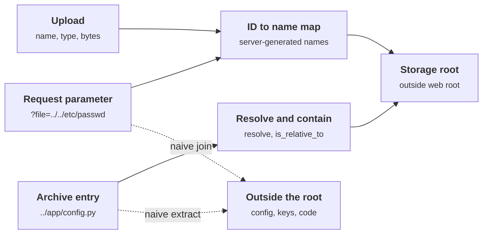
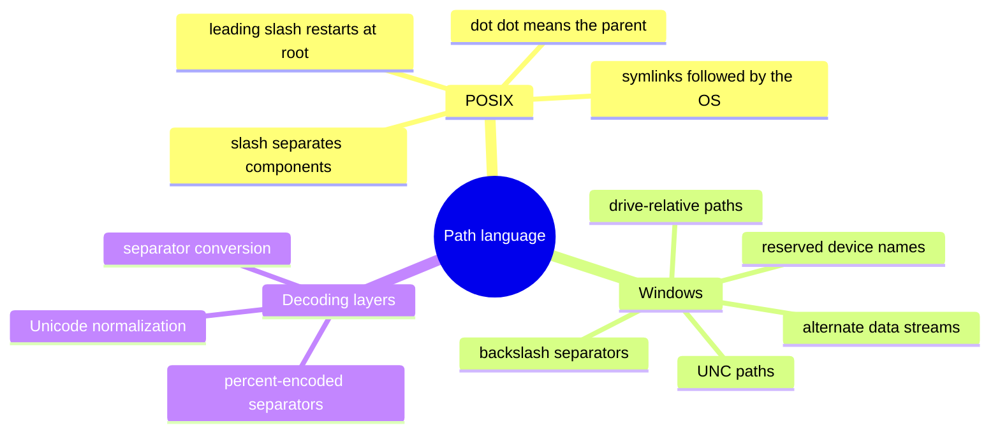
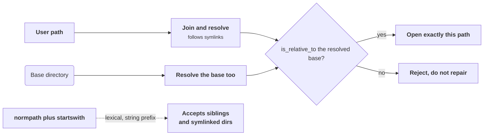
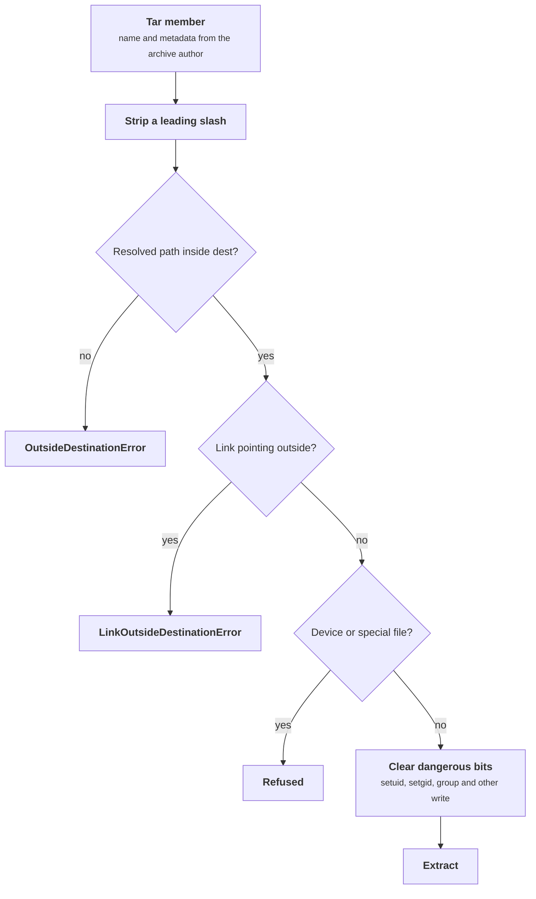

+++
title = 'Files and paths'
description = 'Path traversal happens when input chooses a location on the file system. The durable fix is to never let it: map identifiers to server-generated names, and where a path must be built, resolve it and check containment before touching the disk.'
question = 'How does a file name from a request reach files it should not, and how do you keep paths, archives and uploads contained?'
weight = 5
difficulty = 2
prerequisites = ['/notes/application-security/untrusted-input/01-injection-and-parameterization', '/notes/application-security/authorization/01-broken-object-level-authorization']
date = 2026-06-16
lastmod = 2026-06-16
verified = 2026-06-16
+++

## The idea in one minute

The file system is an interpreter too. Give it the string
`reports/../../etc/passwd` and it reads the separators, walks up two levels,
and opens a file the developer never meant to expose. **Path traversal**
(CWE-22) is what happens when **user input chooses a file system path**:
a download parameter, a template name, an avatar file name, or the entry names
inside an uploaded archive. The attacker does not need a bug in the operating
system. They only need the application to let their text decide where the
read or write lands.

The robust fix follows the pattern of the
[injection lesson](/notes/application-security/untrusted-input/01-injection-and-parameterization/):
take the input out of the structure. **Do not use user input as a path at
all.** Store files under names the server generates, keep a table that maps
an identifier (checked for ownership) to that name, and let the user pick an
identifier. Where a path really must be built from input, **resolve it to its
final form, following symlinks, and check that it is still inside the base
directory** before opening it. Filtering out `../` is not that check.

Archives and uploads are the same problem with more steps. Every entry name in
a zip or tar is a path chosen by whoever built the archive, and every upload
is a file whose name, type and size are all attacker-supplied. The consequence
to act on: **find every place where a request influences a path, and make sure
the server, not the request, decides the final location.**

## A picture



Solid arrows are the designs this lesson recommends. The dotted arrows are
what a plain `os.path.join` or a hand-written extraction loop does with the
same input.

## How it really works

### What the file system does with a string

A path is a small language. `/` (and `\` on Windows) separates components,
`..` means the parent, `.` means the current directory, and a leading `/` or a
drive letter means "start from the root, not from here". Two library behaviors
turn that language into vulnerabilities:

| Input | `os.path.join("/srv/files", input)` | What happened |
| --- | --- | --- |
| `report.pdf` | `/srv/files/report.pdf` | Intended |
| `../app/settings.py` | `/srv/files/../app/settings.py` | `..` climbs out when the OS walks the path |
| `/etc/passwd` | `/etc/passwd` | An absolute component **discards the base entirely** |
| `..%2f..%2fetc%2fpasswd` | depends on when decoding happens | Encoded separators pass a filter, then a later decode restores them |
| `uploads/link/secret` where `link` is a symlink | `/srv/files/uploads/link/secret` | The string looks contained; the OS follows the link elsewhere |

`pathlib` behaves the same way: `Path("/srv/files") / "/etc/passwd"` is
`/etc/passwd`. On Windows the language is larger: backslashes, drive-relative
paths like `C:secret`, UNC paths (`\\host\share`), alternate data streams
(`file.txt::$DATA`) and reserved device names such as `CON` and `NUL`. A check
written and tested on Linux can miss all of them.

A containment check has to account for every branch of this map, on the
platform you deploy to, after every decoding step has run.



The impact depends on the operation. A traversal in a **read** discloses
source code, credentials and keys. A traversal in a **write** is usually worse:
overwriting a configuration file, a startup script, an `authorized_keys`
file or a module the application imports turns a file upload into code
execution. A traversal in a **delete** can destroy data or remove a lock file
that a security control depended on.

### Do not let input be a path

Most applications that take a file name from a request do not need to. The
user wants "my invoice for March", not `/srv/invoices/2026/03/acme.pdf`. Design
the interface around identifiers:

1. On upload, generate the storage name yourself, for example
   `secrets.token_hex(16)` or a UUID, with no user-supplied part.
2. Store a row: `(file_id, owner_id, storage_name, original_name, media_type, size)`.
3. On download, look up `file_id`, **check that the caller may access it**
   (this is an object-level authorization check, covered in
   [broken object-level authorization](/notes/application-security/authorization/01-broken-object-level-authorization/)),
   then open `storage_root / storage_name`.

The row from step 2 is the whole design: the user knows `file_id`, the disk
knows `storage_name`, and only the server connects them.

```mermaid {title="The files table separates what the user names from what the disk stores"}
erDiagram
  USER ||--o{ FILE : owns
  USER {
    string user_id PK
  }
  FILE {
    string file_id PK
    string owner_id FK
    string storage_name "server-generated"
    string original_name "display only"
    string media_type
    int size
  }
```

Follow the download: the ownership check sits between the lookup and the open,
and the request contributes an identifier, never a path.

```mermaid {title="A download by identifier never lets the request touch the path"}
sequenceDiagram
  autonumber
  actor U as User
  participant A as App
  participant DB as Files table
  participant S as Storage root
  U->>A: GET file by file_id
  A->>DB: look up file_id
  DB-->>A: owner_id, storage_name, original_name
  alt Caller may not access this file
    A-->>U: refuse
  else Caller may access it
    A->>S: open storage_root / storage_name
    S-->>A: bytes
    A-->>U: bytes, Content-Disposition from original_name
  end
  Note over A,S: The path is built only from server-chosen parts
```

Now the request never contributes a single character to the path. There is no
`..` to filter because there is no user text in the path. The original file
name survives as metadata, used only for display and for the download's
`Content-Disposition` header (encoded properly for that header, never trusted
as a path).

When the set of files is fixed, such as templates, report types or language
packs, use an **allowlist mapping**: a dictionary from accepted keys to known
paths. It is the same move as mapping a sort key to a fixed column name in SQL.

### When a path must be built: resolve, then contain

Some features genuinely need user-shaped paths: a static file server, a
documentation viewer, a workspace where users organize their own folders. Here
the check has three parts, in this order:

1. **Join and resolve.** `target = (base / user_path).resolve()`. `resolve()`
   makes the path absolute, collapses `..` and `.`, and **follows symlinks**
   for every component that exists. The result is the location the OS would
   actually open.
2. **Resolve the base too.** On macOS `/tmp` is a symlink to `/private/tmp`;
   comparing a resolved target against an unresolved base rejects good paths
   or, with other layouts, accepts bad ones.
3. **Check containment by components.** `target.is_relative_to(base)`
   (Python 3.9+) compares path components. It accepts `/srv/files/a/b` and
   rejects `/srv/files_private/key.pem`.

Both sides are resolved before the comparison, and the comparison is by
components; the dotted path is the lexical check this replaces.



The classic broken version is `normpath(join(base, p)).startswith(base)`. It
fails twice: `normpath` is purely lexical, so it does not see symlinks, and a
string prefix test accepts any sibling directory whose name begins with the
base's name. The program below shows both failures.

Reject, do not repair. Code that strips `../` from the input is a filter, and
filters lose to inputs like `....//` (which becomes `../` after one pass of
stripping) and to encodings decoded later in the pipeline. Validate the final,
fully decoded value, then either accept it as is or refuse the request.

### Symlinks and the time between check and use

`resolve()` sees the file system **as it is when you call it**. If an
attacker can create or replace entries inside the base directory, for example
in a shared upload area or by extracting an archive that contains a symlink,
they can swap a checked directory for a link after the check and before the
`open`. That is a time-of-check to time-of-use race (CWE-367), and no string
check closes it.

Mitigations, from simplest to strongest:

- **Do not allow symlinks under the storage root.** Server-generated flat
  names in a directory only the application writes to leave nothing to swap.
- **Open with `O_NOFOLLOW`** (`os.open(path, os.O_RDONLY | os.O_NOFOLLOW)`) so
  the final component cannot be a link. It does not protect intermediate
  directories.
- **Resolve beneath a directory handle.** On Linux, `openat2(2)` with
  `RESOLVE_BENEATH` (or `RESOLVE_IN_ROOT`) makes the kernel refuse any
  resolution that leaves the starting directory, including through `..` and
  symlinks, atomically. Python's standard library does not expose `openat2`
  as of October 2026, so this means a small extension or a runtime that wraps
  it.
- **Contain the process.** A container or sandbox whose file system view only
  includes the storage directory turns a traversal into a read of nothing
  interesting. That is defense in depth, not a substitute for the check.

### Archives: every entry name is a path

A zip or tar file is a list of `(name, contents)` pairs, and the archive's
author picks the names. An entry called `../../app/config.py` or
`/etc/cron.d/job`, extracted by code that writes to `dest / entry.name`,
lands outside the destination. This was publicized widely in 2018 as
**zip slip**, after researchers found the same hand-written extraction loop in
many libraries across languages. It is CWE-22 again; the input just arrives
inside a file.

Python's two archive modules behave differently:

| Module | Default behavior with hostile names | What to do |
| --- | --- | --- |
| `zipfile` | `extract` and `extractall` strip absolute prefixes and drop `..` components, so the entry is written inside the destination under a different name. Zip entries are not extracted as symlinks. | Prefer `extractall` over hand-rolled loops. If you write your own loop, run each name through the containment check and decide whether to refuse the archive. |
| `tarfile` | Tar members can be symlinks, hard links, device files, and carry permission bits such as setuid. Before extraction filters, `extractall` trusted all of it. | Pass `filter="data"` (Python 3.12+, and backported to earlier security releases). Python 3.14 made `"data"` the default. |

**PEP 706** added extraction filters to `tarfile`. The `"data"` filter refuses
members whose resolved path would land outside the destination, refuses links
that point outside it, refuses device files and other special files, strips a
leading `/` from member names, and clears dangerous permission bits (setuid,
setgid, and write access for group and others). The `"tar"` filter keeps more
Unix semantics, and `"fully_trusted"` restores the old behavior.

Each member passes through these checks in turn; the name check is only one of
them, because tar members carry type and permission metadata too.



```python {title="tar extraction with the data filter"}
import tarfile

with tarfile.open(upload_path) as tf:
    tf.extractall(dest, filter="data")   # raises tarfile.FilterError subclasses
```

Run against an archive with a member named `../evil.txt`, this raises
`OutsideDestinationError`; with a symlink member pointing at `../../outside`,
it raises `LinkOutsideDestinationError`. The filters are code like any other:
in 2025, CPython security releases fixed several ways to bypass them, so the
interpreter's patch level is part of this control.

Names are not the only hazard. An archive is also a size claim, and that claim
can be false. A small zip can expand to gigabytes (a **decompression bomb**),
and the sizes recorded in headers are written by the attacker. Cap the number
of entries and count the bytes you actually write, aborting when a budget runs
out. The [parsers and deserialization lesson](/notes/application-security/untrusted-input/04-parsers-and-deserialization/)
treats resource limits for parsers in general.

### Uploads: name, type, size and where they live

An upload carries three attacker-chosen things: a file name, a declared type
(`Content-Type`), and bytes. Treat each as untrusted and decide everything
yourself. The OWASP File Upload Cheat Sheet's core recommendations line up as
follows:

| Concern | Do this | Why |
| --- | --- | --- |
| Size | Enforce a maximum at the proxy and in the application, before buffering the whole body | Disk and memory exhaustion; archive bombs |
| Name | Generate the storage name; keep the original only as escaped metadata | Removes traversal, overwrite, and reserved-name problems in one move |
| Extension | Allowlist the extensions the feature needs, after decoding the name; reject double extensions like `.php.jpg` where a server might honor either | Servers often pick a handler by extension |
| Type | Check the file's content (magic bytes, or better, a real parser for the format) against the allowlist; ignore the client's `Content-Type` | The header and extension are claims; `mimetypes.guess_type` only reads the extension |
| Content | For images and documents, re-encode or rebuild the file (content disarm and reconstruction); scan with antivirus where the files are shared onward | Polyglot files are valid in two formats at once, so a passing magic-byte check proves little |
| Location | Store outside the web root, ideally in object storage or a separate host, with no execute permission | A file the web server can execute or interpret is a web shell waiting for a URL |
| Serving | Send a fixed `Content-Type` from your metadata, `X-Content-Type-Options: nosniff`, and `Content-Disposition: attachment` for anything you do not need to render inline | Stops the browser from sniffing an "image" into HTML and running it as your origin |
| Origin | Serve user content from a separate domain with no cookies | Even if a file is rendered, script runs with no access to your application |

The serving rows connect directly to the
[XSS lesson](/notes/application-security/untrusted-input/02-xss-and-output-encoding/):
an uploaded `.svg` or `.html` served inline from your own origin is stored
XSS. An SVG is an XML document that can contain script, so "it is an image"
is not a safety property.

Put the location and serving rows together and you get a deployment: uploads
never live where the application runs, and they are served from an origin
that holds nothing worth stealing.

```mermaid {title="Uploads stored apart and served from a separate origin"}
flowchart TB
  n_user["User"]
  subgraph g_appo["Application origin"]
    n_app["Upload handler"]
    n_meta[("File metadata")]
  end
  subgraph g_store["Separate storage"]
    n_bucket[("Uploads no execute")]
  end
  subgraph g_uco["User content origin no cookies"]
    n_cdn["Fixed type and nosniff"]
  end
  n_user --> n_app
  n_app --> n_meta
  n_app --> n_bucket
  n_bucket --> n_cdn
  n_cdn --> n_user
```

> [!IMPORTANT]
> The pattern is identical across all three entry points: **the server picks
> the final location, and anything derived from input is checked in its
> final, resolved form.** Filters on the raw string are not a substitute.

## Code

The program builds a small directory tree inside a temporary directory,
including a sibling directory whose name shares a prefix with the base and a
symlink planted inside the base. It compares the naive `startswith` check with
`safe_join` on a table of names, then extracts in-memory zip archives with
`safe_extract`, which validates every entry before writing anything. It prints
only relative names, so the output is the same on every machine.

```python {title="contain.py"}
"""contain.py: keep user-chosen paths and archive entries inside one directory.

safe_join resolves the final path (following symlinks) and checks containment
by path components. safe_extract runs every zip entry through safe_join and
refuses the whole archive before writing a byte if any entry escapes. Runs
entirely inside a temporary directory and prints only relative names.
Standard library only.
"""

from __future__ import annotations

import io
import os
import tempfile
import zipfile
from pathlib import Path

MAX_TOTAL_BYTES = 1_000_000
MAX_ENTRIES = 100


def naive_check(base: Path, user_path: str) -> bool:
    """The common bug: lexical normalization plus a string prefix test."""
    joined = os.path.normpath(os.path.join(base, user_path))
    return joined.startswith(str(base))


def safe_join(base: Path, user_path: str) -> Path:
    """Return the resolved path under base, or raise ValueError."""
    if not user_path or "\x00" in user_path:
        raise ValueError("empty or NUL")
    root = base.resolve()
    target = (root / user_path).resolve()  # absolute input replaces root here
    if not target.is_relative_to(root):  # compares components, not strings
        raise ValueError("escapes base")
    return target


def safe_extract(zf: zipfile.ZipFile, dest: Path) -> list[str]:
    """Validate every entry first; write only if all of them are safe."""
    entries = zf.infolist()
    if len(entries) > MAX_ENTRIES:
        raise ValueError("too many entries")
    plan: list[tuple[zipfile.ZipInfo, Path]] = []
    bad = 0
    for info in entries:
        try:
            target = safe_join(dest, info.filename)
            plan.append((info, target))
            print(f"  ok      {info.filename}")
        except ValueError as err:
            bad += 1
            print(f"  REJECT  {info.filename}  ({err})")
    if bad:
        raise ValueError(f"{bad} unsafe entry; nothing written")
    budget = MAX_TOTAL_BYTES
    for info, target in plan:
        if info.is_dir():
            target.mkdir(parents=True, exist_ok=True)
            continue
        target.parent.mkdir(parents=True, exist_ok=True)
        with zf.open(info) as src, open(target, "xb") as out:
            while chunk := src.read(64 * 1024):
                budget -= len(chunk)  # count real bytes, not header sizes
                if budget < 0:
                    raise ValueError("archive expands past size limit")
                out.write(chunk)
    return [info.filename for info, _ in plan]


def build_zip(names: list[str]) -> zipfile.ZipFile:
    buf = io.BytesIO()
    with zipfile.ZipFile(buf, "w") as zf:
        for name in names:
            zf.writestr(name, f"contents of {name}\n")
    return zipfile.ZipFile(buf)


def listing(root: Path) -> list[str]:
    return sorted(p.relative_to(root).as_posix() for p in root.rglob("*") if p.is_file())


def main() -> None:
    with tempfile.TemporaryDirectory() as tmp:
        top = Path(tmp)
        base = top / "files"
        (base / "2026").mkdir(parents=True)
        (top / "files_private").mkdir()
        (top / "outside").mkdir()
        os.symlink(top / "outside", base / "shared")  # a link planted inside base

        print("1. user input chooses a path under files/")
        print(f"  {'input':<28} {'startswith':<11} safe_join")
        names = ["report.pdf", "2026/q3.csv", "2026/../report.pdf",
                 "../secrets.env", "2026/../../etc/passwd", "/etc/passwd",
                 "../files_private/key.pem", "shared/notes.txt"]
        for name in names:
            naive = "accept" if naive_check(base, name) else "reject"
            try:
                rel = safe_join(base, name).relative_to(base.resolve()).as_posix()
                verdict = f"accept -> {rel}"
            except ValueError as err:
                verdict = f"reject ({err})"
            print(f"  {name:<28} {naive:<11} {verdict}")

        print("\n2. safe_extract on an archive with a ../ entry")
        dest = top / "extract"
        dest.mkdir()
        evil = build_zip(["docs/readme.txt", "../evil.txt", "docs/img/logo.svg"])
        try:
            safe_extract(evil, dest)
        except ValueError as err:
            print(f"  refused: {err}")
        print(f"  files in extract/: {listing(dest)}")
        print(f"  evil.txt written beside extract/: {(top / 'evil.txt').exists()}")

        print("\n3. safe_extract on a clean archive")
        good = build_zip(["docs/readme.txt", "docs/img/logo.svg"])
        safe_extract(good, dest)
        print(f"  files in extract/: {listing(dest)}")

        print("\n4. stdlib ZipFile.extractall on the same ../ archive")
        lib_dest = top / "lib"
        evil.extractall(lib_dest)
        print(f"  files in lib/: {listing(lib_dest)}")


if __name__ == "__main__":
    main()
```

Run it with `python3 -I contain.py`:

```text
1. user input chooses a path under files/
  input                        startswith  safe_join
  report.pdf                   accept      accept -> report.pdf
  2026/q3.csv                  accept      accept -> 2026/q3.csv
  2026/../report.pdf           accept      accept -> report.pdf
  ../secrets.env               reject      reject (escapes base)
  2026/../../etc/passwd        reject      reject (escapes base)
  /etc/passwd                  reject      reject (escapes base)
  ../files_private/key.pem     accept      reject (escapes base)
  shared/notes.txt             accept      reject (escapes base)

2. safe_extract on an archive with a ../ entry
  ok      docs/readme.txt
  REJECT  ../evil.txt  (escapes base)
  ok      docs/img/logo.svg
  refused: 1 unsafe entry; nothing written
  files in extract/: []
  evil.txt written beside extract/: False

3. safe_extract on a clean archive
  ok      docs/readme.txt
  ok      docs/img/logo.svg
  files in extract/: ['docs/img/logo.svg', 'docs/readme.txt']

4. stdlib ZipFile.extractall on the same ../ archive
  files in lib/: ['docs/img/logo.svg', 'docs/readme.txt', 'evil.txt']
```

Read the first table from the bottom. `../files_private/key.pem` normalizes to
`<tmp>/files_private/key.pem`, which **does** start with the string
`<tmp>/files`, so the prefix check accepts a file in a different directory.
`shared/notes.txt` looks contained to `normpath` because `normpath` never
consults the disk; `resolve()` follows the `shared` link to `outside/` and
`is_relative_to` rejects it. `2026/../report.pdf` is accepted by both, which is
correct: `..` is not forbidden, leaving the base is.

In part 2, `safe_extract` sees `../evil.txt`, refuses the whole archive, and
writes nothing, not even the two good entries. All-or-nothing matters: a
partially extracted archive is a state nobody tested. Part 4 is the reason to
prefer the library: `ZipFile.extractall` quietly rewrote `../evil.txt` to
`evil.txt` inside the destination. That is safe, but silent; if your
application needs to know that an archive was hostile, it has to check
the names itself.

The states of `safe_extract` make the all-or-nothing rule visible: validation
finishes for every entry before the first write.

```mermaid {title="safe_extract validates everything before writing anything"}
stateDiagram-v2
  [*] --> CountEntries
  CountEntries --> Refused: more than MAX_ENTRIES
  CountEntries --> Validate
  Validate --> Refused: any entry escapes, nothing written
  Validate --> Write: every entry contained
  Write --> Aborted: real bytes exceed the budget
  Write --> Done: all entries written
  Refused --> [*]
  Aborted --> [*]
  Done --> [*]
```

## Where it breaks

- **The check runs once; the file system keeps changing.** `safe_join` is a
  snapshot. If an attacker can create symlinks under the base, they can win a
  race between the check and the open. Keep the storage root writable only by
  the application, or use kernel-enforced resolution such as `openat2` with
  `RESOLVE_BENEATH`.
- **Hard links are not visible to `resolve()`.** A hard link inside the base
  is just another name for the same inode, possibly a sensitive one. On
  Linux, `fs.protected_hardlinks` limits who can create them; tar's `"data"`
  filter refuses hard links that point outside the destination.
- **Platform rules differ.** The program tests POSIX paths. On Windows, drive
  letters, UNC paths, `\` separators, case-insensitivity, trailing dots and
  spaces, and reserved names all change what "contained" means. Test on the
  platform you deploy to.
- **Containment is not authorization.** A path inside the base can still be
  another user's file. `safe_join` answers "is this inside the directory",
  not "may this caller read it". Per-user subdirectories plus an ownership
  check, or the ID-to-name map, answer the second question.
- **Decoding after the check.** If any layer URL-decodes, Unicode-normalizes,
  or converts separators after your check, the value you checked is not the
  value that is opened. Check at the last moment, on exactly the value passed
  to `open`.
- **The size budget counts bytes, not cost.** The program limits written
  bytes and entry count. It does not limit CPU spent decompressing, nested
  archives, or a zip whose central directory lists the same data many times.
  Put time and memory limits on the worker that handles uploads.
- **Content checks are probabilistic.** Magic bytes and antivirus catch known
  shapes. A file that is valid as both a JPEG and something else passes both.
  The control that holds is how the file is stored and served, not how it was
  classified.

## Remember this

- Path traversal is input choosing a file system path; fix it by not letting
  input choose.
- Map checked identifiers to server-generated storage names; keep the
  original name as metadata only.
- If you must build a path, resolve both sides and test `is_relative_to`;
  never use a string prefix check or strip `../`.
- Every archive entry name is untrusted input; use `tarfile` with
  `filter="data"` and validate zip entries or use `extractall`.
- Serve uploads from outside the web root with a fixed type, `nosniff`, and
  `Content-Disposition: attachment`, ideally from a separate origin.

## Try it

1. Add `"files_backup/../files/report.pdf"` and `"./"` to the name table in
   `contain.py`. Predict both columns before running it.
2. Change `safe_extract` to skip unsafe entries instead of refusing the
   archive. Write down one way the partially extracted result could break an
   application that expects a complete archive.
3. Build a zip with 200 entries named `f0` to `f199`, and another with one
   entry of 2 MB of zeros. Confirm which limit each one trips, and note how
   small the second archive is on disk.
4. Build a tar archive containing a symlink `shared -> ..` followed by a
   regular file `shared/escape.txt`. Extract it with `filter="data"` and with
   `filter="fully_trusted"` into separate temporary directories and compare
   where the file lands.
5. In a codebase you work on, search for `send_file`, `open(`, `os.path.join`
   and `extractall` where an argument comes from a request or an archive. For
   each, write down who chooses the final path.

## Check yourself

1. Why does `os.path.join(base, user_input)` not keep a path inside `base`,
   even when the input contains no `..`?

   
   If the input is absolute (`/etc/passwd`, or a drive path on Windows),
   `join` discards everything before it and returns the input alone.
   `pathlib`'s `/` operator does the same. The base is a default, not a
   boundary.
   

2. A check does `os.path.normpath(os.path.join(base, p)).startswith(base)`.
   Give two inputs that pass it but leave the base.

   
   `../files_private/key.pem` when a sibling directory's name starts with the
   base's name, because `startswith` compares characters, not path
   components. And any path through a symlink inside the base, because
   `normpath` is lexical and never follows links. Resolving with
   `Path.resolve()` and testing `is_relative_to` fixes both.
   

3. What is zip slip, and why does `ZipFile.extractall` not suffer from it
   while many hand-written loops do?

   
   Zip slip is path traversal through archive entry names such as
   `../../app/config.py`: code that writes each entry to `dest / name`
   writes outside `dest`. `zipfile`'s extraction methods sanitize names by
   removing absolute prefixes and `..` components. A loop that calls
   `open(os.path.join(dest, info.filename), "wb")` skips that sanitization.
   

4. What does `tarfile`'s `"data"` filter add beyond checking member names?

   
   It refuses symlinks and hard links that point outside the destination,
   refuses device files and other special members, strips leading slashes,
   and removes dangerous permission bits such as setuid and group or world
   write. Tar members carry metadata that a name check alone does not cover.
   

5. An application checks uploaded images by magic bytes and stores them in
   the web root under their original names. Name three problems.

   
   The original name allows traversal, overwrites, and executable extensions
   (`shell.php`). Storing in the web root lets the server interpret or
   execute the file. Magic bytes do not rule out polyglots, and without
   `nosniff`, a fixed `Content-Type`, and `Content-Disposition: attachment`
   (or a separate origin), a file can be rendered as HTML or SVG with script
   on the application's origin.
   

## Sources

- MITRE, [CWE-22: Improper Limitation of a Pathname to a Restricted Directory ('Path Traversal')](https://cwe.mitre.org/data/definitions/22.html) and [CWE-367: Time-of-check Time-of-use (TOCTOU) Race Condition](https://cwe.mitre.org/data/definitions/367.html).
- OWASP, [File Upload Cheat Sheet](https://cheatsheetseries.owasp.org/cheatsheets/File_Upload_Cheat_Sheet.html).
- P. Viktorin, [PEP 706: Filter for tarfile.extractall](https://peps.python.org/pep-0706/), 2023.
- Python documentation, [tarfile: Extraction filters](https://docs.python.org/3/library/tarfile.html#tarfile-extraction-filter) and [zipfile: ZipFile.extract](https://docs.python.org/3/library/zipfile.html#zipfile.ZipFile.extract).
- Python documentation, [pathlib: Path.resolve and PurePath.is_relative_to](https://docs.python.org/3/library/pathlib.html).
- Linux man-pages, [openat2(2)](https://man7.org/linux/man-pages/man2/openat2.2.html).
- MDN Web Docs, [Content-Disposition](https://developer.mozilla.org/en-US/docs/Web/HTTP/Headers/Content-Disposition) and [X-Content-Type-Options](https://developer.mozilla.org/en-US/docs/Web/HTTP/Headers/X-Content-Type-Options).
