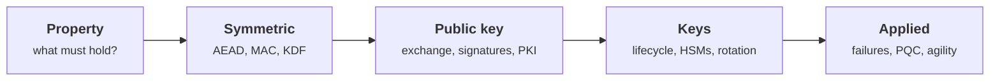

+++
title = 'Cryptography'
description = 'Keys, signatures, and encryption, connected to the assumptions that make them useful.'
weight = 4
tone = 'lilac'
group = 'security'
status = 'Course'
course = true
+++

Cryptography rarely fails because a cipher is broken. It fails because a nonce
was reused, a signature was checked against the wrong key, a key lived on a
laptop for six years, or the system needed integrity and got only
confidentiality. **Start from the property the system needs, then choose the
primitive, then protect the keys**, and most of the famous failures never happen.

The course builds that habit: security properties and their assumptions first,
then symmetric and public-key primitives, then the key lifecycle (where most
real risk lives), then the failure modes and the migration to post-quantum
algorithms. It assumes you can read Python. It does **not** assume a math
background beyond arithmetic.

## The path

## How each lesson works

1. **The idea in one minute.** The claim, before the detail.
2. **A picture** of the construction or the failure.
3. **How it really works**, with the standards (NIST, IETF RFCs) named.
4. **Code**: small Python programs using only the standard library (`hashlib`,
   `hmac`, `secrets`). Where the standard library has no primitive, the lesson
   builds a **toy** version to show the mechanism and says so plainly.
5. **Where it breaks.** The assumption that, once violated, defeats it.
6. **Remember this**, **Try it**, and **Check yourself**.

> [!WARNING] Toys are for understanding
> Toy implementations in these lessons are deliberately small and insecure. In
> real systems, use a vetted library such as `cryptography` (pyca), libsodium, or
> your platform's KMS.

## What you need

- Python 3.10 or newer and a terminal. Every program runs offline.
