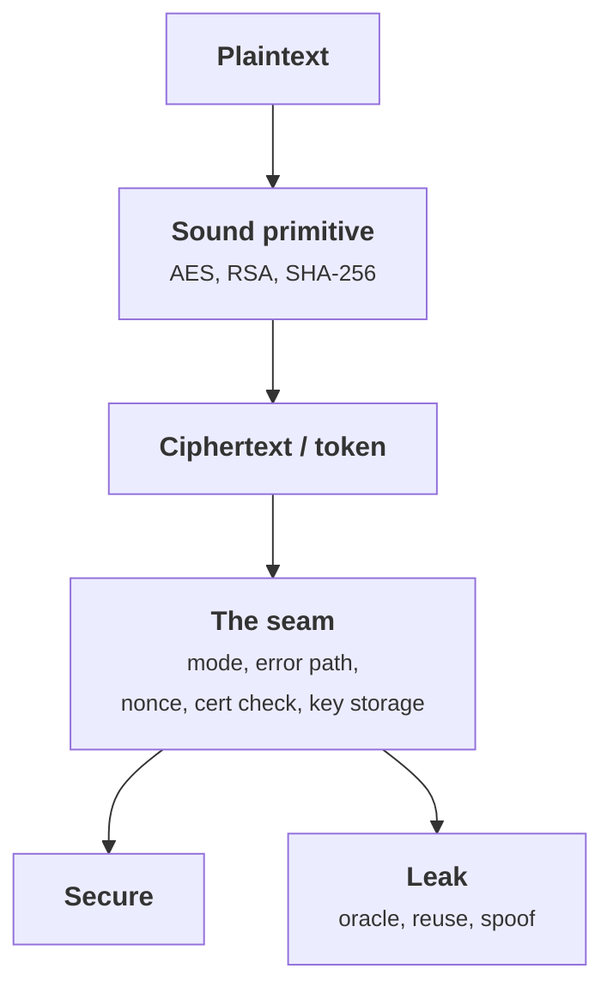

+++
title = 'How cryptography fails in practice'
description = 'Real cryptographic breaks almost never come from broken math. They come from a handful of recurring seams: oracles, reused nonces, unverified certificates, weak randomness, and keys in the wrong place.'
question = 'What are the recurring ways real systems leak secrets even with sound primitives?'
weight = 1
difficulty = 4
prerequisites = ['/notes/cryptography/symmetric-cryptography/01-block-ciphers-and-modes', '/notes/cryptography/symmetric-cryptography/02-authenticated-encryption']
date = 2026-09-04
lastmod = 2026-09-04
verified = 2026-09-04
+++

## The idea in one minute

The AES in your system is not going to be broken. The RSA is not going to be
factored this decade. Yet systems built from exactly those primitives leak their
secrets constantly, because the breaks live in the **seams**: the mode used
without integrity, the error message that distinguishes two failures, the
certificate that was never actually checked, the nonce reused once, the key
committed to a repository. These are not exotic. The same dozen failure classes
recur across two decades of postmortems.

The consequence to act on: **reviewing a cryptosystem means auditing the seams,
not the primitives.** Ask what an attacker learns from each error path, whether
anything the system treats as unique is really unique, whether every signature
is checked against the right key, and where the keys live. This lesson catalogues
the failure classes and then builds one of them in full: a CBC padding oracle
that recovers an entire message one byte at a time, using only a single bit of
feedback per query.

## A picture



## How it really works

### A catalogue of failure classes

Each row below is a class with at least one well-documented instance. The pattern
matters more than the instance: once you can name the class, you can look for it.

| Class | What goes wrong | Documented instance |
| --- | --- | --- |
| **Padding oracle** | The system reveals whether decryption produced valid padding, turning CBC into a decryption oracle | Vaudenay's CBC padding-oracle attack (2002); POODLE against SSL 3.0 (2014) |
| **Nonce / IV reuse** | A number that must be unique per key is repeated, collapsing the security of the mode | Reused IVs break CBC chaining and CTR keystreams; a repeated GCM nonce leaks the authentication key |
| **Unverified certificates** | TLS is used but the certificate chain or hostname is never actually checked | Georgiev et al., "The most dangerous code in the world" (2012), found this across many non-browser clients |
| **Weak randomness** | Keys, nonces, or IVs come from a predictable source | A seeded or low-entropy PRNG makes keys guessable; randomness is covered in the foundations module |
| **Key in source** | A key or credential is committed to a repository or shipped in a binary | Long-lived, unscoped, and impossible to rotate quietly once leaked |
| **Downgrade attack** | An active attacker forces the weakest mutually supported option | POODLE depended on forcing a downgrade to SSL 3.0; the general defense is to refuse weak options outright |
| **Compression oracle** | Compressing secret and attacker data together leaks the secret through ciphertext length | CRIME (2012) against TLS compression; BREACH (2013) against HTTP response compression |

Three observations tie the list together. First, most of these are **not**
confidentiality failures of the cipher; they are failures to provide integrity,
uniqueness, or authentication around it. Second, several are **oracles**: the
system answers a question it should not, one bit at a time, and the attacker
turns a stream of bits into the plaintext. Third, the fixes are mostly
structural, not mathematical: authenticate before you decrypt, make nonces
unique by construction, verify the whole chain, keep keys out of code.

Grouped by what the system got wrong around the primitive, the seven classes
fall into four families; none of them is "the cipher was weak".

```mermaid {title="Every failure class is a missing property around the cipher"}
mindmap
  root((Seams that leak))
    Oracles answer a question
      Padding oracle
      Compression oracle
    Uniqueness or unpredictability broken
      Nonce or IV reuse
      Weak randomness
    Authentication skipped or negotiable
      Unverified certificates
      Downgrade attack
    Key custody
      Key in source
```

> [!IMPORTANT]
> An oracle does not need to leak the plaintext. It only needs to leak one bit
> that depends on the plaintext, repeatably, under attacker-chosen input. That is
> enough to reconstruct the whole secret.

### Why padding oracles work

Recall CBC decryption: each ciphertext block is run through the block cipher's
decryption and then XORed with the previous ciphertext block (the IV for the
first block). Call the output of the block cipher the **intermediate** state
`I`. Then plaintext `P = I XOR C_prev`, where `C_prev` is the previous ciphertext
block. The attacker controls `C_prev` completely, because it is just bytes they
can send.

Look at which inputs the attacker controls: the key never leaves the server, but
one side of the final XOR is just bytes on the wire, and the padding verdict
travels back out.

```mermaid {title="The key stays inside, but one XOR input and the verdict cross the boundary"}
flowchart LR
  A(["Attacker"])
  subgraph S["Server: holds the key"]
    K("Key")
    D["<b>Block decrypt</b><br/><small>C_i to intermediate I</small>"]
    X["<b>XOR</b><br/><small>P = I XOR C_prev</small>"]
    U{"<b>Padding valid?</b>"}
  end
  K --> D
  A -->|"C_i"| D
  A -->|"C_prev, any bytes"| X
  D --> X
  X --> U
  U -->|"one bit back"| A
  class D good
  class X,U warn
```

PKCS#7 padding fills the final block so its last byte equals the number of
padding bytes: one byte of `0x01`, or two of `0x02`, and so on. If the attacker
sends a forged `C_prev` and the server reports "valid padding", then the
decrypted last byte equalled `0x01` (ignoring rarer longer-padding coincidences).
That gives one equation: `I_last XOR forged_last = 0x01`, so
`I_last = forged_last XOR 0x01`. The intermediate byte is recovered **without
the key**. XOR it with the real previous ciphertext byte and you have the real
plaintext byte. Repeat for `0x02 0x02`, then `0x03 0x03 0x03`, and you peel off
the whole block; repeat across blocks for the whole message.

The check the server runs is a check on this shape. In an 8-byte block whose
message ends five bytes in, the last three bytes all equal `0x03`, so the
padding describes itself, and "is this shape valid?" is a question about the
decrypted bytes.

```mermaid {title="Padding is self-describing: the last byte counts the pad"}
packet-beta
  0-39: "Last 5 message bytes"
  40-47: "0x03"
  48-55: "0x03"
  56-63: "0x03"
```

The only thing the attacker needs is the one-bit answer: valid padding or not.
That bit can leak through an explicit error, a different HTTP status, or even a
timing difference between "padding failed" and "padding passed but the MAC
failed". The defense is **authenticated encryption**: verify a MAC over the
ciphertext before you even attempt to decrypt and unpad, so a tampered ciphertext
is rejected with one indistinguishable error and never reaches the padding check.

### The order of operations matters

The padding oracle is really a symptom of MAC-then-encrypt or
encrypt-without-MAC. The robust construction is **encrypt-then-MAC** (or a
dedicated AEAD mode such as AES-GCM or ChaCha20-Poly1305): the MAC covers the
ciphertext, is checked first with a constant-time comparison, and only on success
does decryption happen. See
[/notes/cryptography/symmetric-cryptography/02-authenticated-encryption/](/notes/cryptography/symmetric-cryptography/02-authenticated-encryption/)
for the construction and
[/notes/cryptography/symmetric-cryptography/03-macs-and-hmac/](/notes/cryptography/symmetric-cryptography/03-macs-and-hmac/)
for the MAC itself. The timing side of the error path is the subject of the next
lesson.

Compare what the receiver says back in each order: decrypt-first has two
different failures to report, verify-first has only one.

```mermaid {title="Verify-first leaves only one answer, so there is no bit to leak"}
sequenceDiagram
  participant A as Sender of a modified ciphertext
  participant R as Receiver
  A->>R: Modified ciphertext
  alt Decrypt first (no MAC, or MAC-then-encrypt)
    R->>R: Decrypt and unpad
    R-->>A: "bad padding" or "bad MAC", two distinguishable answers
    Note over A,R: The difference between the answers is the oracle bit
  else Encrypt-then-MAC or AEAD
    R->>R: Verify tag over the ciphertext in constant time
    R-->>A: "decryption failed", the same answer for every modification
    Note over A,R: Padding is never reached, so nothing about it can leak
  end
```

## Code

The program below implements CBC with PKCS#7 over a **toy** block cipher so the
mechanism is visible end to end. The cipher is a three-round Feistel network
whose round function is HMAC-SHA256, labeled `TOY` in the source: it is not a
real cipher and must never be used as one. What is faithful is the **mode** and
the **oracle**. The attacker holds no key; it calls `server.oracle` and learns
one bit each time. That is enough to recover the message.

```python {title="padding_oracle.py"}
"""padding_oracle.py: a CBC padding oracle, end to end, against a toy cipher.

The block cipher is a toy: a 3-round Feistel whose round function is HMAC-SHA256
(labeled TOY, not a real cipher). The point is the *mode* and the *oracle*, which
behave exactly as a real CBC + PKCS#7 target would. The attacker has no key; it
only learns one bit per query: did the decrypted plaintext end in valid PKCS#7
padding? That single bit recovers the whole message, byte by byte.

Standard library only; offline; deterministic (fixed key and IV).
"""

from __future__ import annotations

import hashlib
import hmac

BLOCK = 8  # bytes per block for the toy Feistel
KEY = b"TOY-cipher-key; a real target would use AES in a vetted library"


def _f(half: bytes, rk: bytes) -> bytes:
    """Toy Feistel round function: HMAC-SHA256 truncated to half a block."""
    return hmac.new(rk, half + rk, hashlib.sha256).digest()[: BLOCK // 2]


def _round_keys() -> list[bytes]:
    return [hashlib.sha256(KEY + bytes([r])).digest()[:16] for r in range(3)]


def encrypt_block(block: bytes) -> bytes:
    left, right = block[: BLOCK // 2], block[BLOCK // 2 :]
    for rk in _round_keys():
        left, right = right, bytes(a ^ b for a, b in zip(left, _f(right, rk)))
    return left + right


def decrypt_block(block: bytes) -> bytes:
    left, right = block[: BLOCK // 2], block[BLOCK // 2 :]
    for rk in reversed(_round_keys()):
        right, left = left, bytes(a ^ b for a, b in zip(right, _f(left, rk)))
    return left + right


def xor(a: bytes, b: bytes) -> bytes:
    return bytes(x ^ y for x, y in zip(a, b))


def pkcs7_pad(data: bytes) -> bytes:
    n = BLOCK - (len(data) % BLOCK)
    return data + bytes([n]) * n


def pkcs7_unpad(data: bytes) -> bytes:
    n = data[-1]
    if n < 1 or n > BLOCK or data[-n:] != bytes([n]) * n:
        raise ValueError("bad padding")
    return data[:-n]


def cbc_encrypt(plaintext: bytes, iv: bytes) -> bytes:
    out, prev = b"", iv
    for i in range(0, len(plaintext), BLOCK):
        prev = encrypt_block(xor(plaintext[i : i + BLOCK], prev))
        out += prev
    return out


def cbc_decrypt(ciphertext: bytes, iv: bytes) -> bytes:
    out, prev = b"", iv
    for i in range(0, len(ciphertext), BLOCK):
        block = ciphertext[i : i + BLOCK]
        out += xor(decrypt_block(block), prev)
        prev = block
    return out


class Server:
    """The victim. It holds the key and leaks exactly one bit: valid padding?"""

    def __init__(self, iv: bytes) -> None:
        self.iv = iv
        self.queries = 0

    def oracle(self, iv: bytes, ciphertext: bytes) -> bool:
        self.queries += 1
        try:
            pkcs7_unpad(cbc_decrypt(ciphertext, iv))
            return True
        except ValueError:
            return False


def recover_block(server: Server, iv: bytes, block: bytes) -> bytes:
    """Recover one plaintext block using the padding oracle.

    For pad value p = 1..BLOCK we craft the preceding block so the target
    decrypts to ...p. That reveals the intermediate state byte, and XOR with the
    real preceding block gives the real plaintext byte.
    """
    inter = bytearray(BLOCK)  # decrypt_block(block), the pre-XOR intermediate
    for p in range(1, BLOCK + 1):
        forged = bytearray(BLOCK)
        for k in range(1, p):  # set already-known tail bytes to the pad value p
            forged[BLOCK - k] = inter[BLOCK - k] ^ p
        pos = BLOCK - p
        for guess in range(256):
            forged[pos] = guess
            if server.oracle(bytes(forged), block):
                # Guard against the false positive where the last byte is 0x02 0x02...
                if p == 1:
                    forged[pos - 1] ^= 0xFF
                    if not server.oracle(bytes(forged), block):
                        continue
                    forged[pos - 1] ^= 0xFF
                inter[pos] = guess ^ p
                break
        else:
            raise RuntimeError("oracle gave no valid byte")
    return xor(inter, iv)


def attack(server: Server, iv: bytes, ciphertext: bytes) -> bytes:
    blocks = [ciphertext[i : i + BLOCK] for i in range(0, len(ciphertext), BLOCK)]
    recovered, prev = b"", iv
    for block in blocks:
        recovered += recover_block(server, prev, block)
        prev = block
    return recovered


def main() -> None:
    iv = bytes(range(8))
    secret = b"transfer 500 to account 1234567"
    ciphertext = cbc_encrypt(pkcs7_pad(secret), iv)
    server = Server(iv)

    recovered_padded = attack(server, iv, ciphertext)
    recovered = pkcs7_unpad(recovered_padded)

    print(f"blocks:            {len(ciphertext) // BLOCK}")
    print(f"oracle queries:    {server.queries}")
    print(f"recovered == plain {recovered == secret}")
    print(f"recovered:         {recovered.decode()}")


if __name__ == "__main__":
    main()
```

Run it with `python3 padding_oracle.py`:

```text
blocks:            4
oracle queries:    3722
recovered == plain True
recovered:         transfer 500 to account 1234567
```

Four blocks, a few thousand one-bit queries, and the whole message falls out with
no knowledge of the key. The byte-guessing loop needs at most 256 tries per byte,
so cost grows linearly in message length, not exponentially. That linearity is
what makes oracle attacks practical against real services.

With at most 256 guesses per byte and 8 bytes per toy block, the worst case adds
roughly 2,048 queries per block; the demo's 3,722 queries for four blocks sit
under that line.

```mermaid {title="Oracle cost grows by a fixed amount per block, not exponentially"}
xychart-beta
  x-axis "Ciphertext blocks" [1, 2, 3, 4, 5, 6, 7, 8]
  y-axis "Worst-case oracle queries" 0 --> 17000
  bar [2048, 4096, 6144, 8192, 10240, 12288, 14336, 16384]
```

## Where it breaks

- **The toy cipher is not AES.** It is a labeled three-round Feistel built from
  HMAC; it would fall to standard cryptanalysis instantly. It is here only so the
  CBC mode and the oracle are visible. The attack shown does not depend on the
  cipher at all, which is exactly the point: it is a mode-and-error-path attack.
- **A real oracle may be noisier.** In the wild, the one-bit signal might come
  from a timing difference or a subtle behavioral change rather than a clean
  boolean, so an attacker needs statistics and more queries. The structure is
  identical.
- **AEAD closes this specific hole, not every seam.** Encrypt-then-MAC with a
  constant-time check stops the padding oracle, but nonce reuse, downgrade, and
  weak randomness are separate classes with separate defenses. There is no single
  switch.

  AEAD is one row of this map; each other class needs its own structural fix.

  ```mermaid {title="No single switch: each class has its own structural fix"}
  flowchart LR
    C1["<b>Padding oracle</b>"] --> F1("Encrypt-then-MAC or AEAD")
    C2["<b>Nonce / IV reuse</b>"] --> F2["<b>Unique by construction</b>"]
    C3["<b>Weak randomness</b>"] --> F3["<b>Unpredictable source</b>"]
    C4["<b>Unverified certificate</b>"] --> F4("Verify chain and hostname")
    C5["<b>Downgrade</b>"] --> F5["<b>Refuse weak options</b>"]
    C6["<b>Key in source</b>"] --> F6("Keys out of code")
    class C1,C2,C3,C4,C5,C6 warn
    class F2,F3,F5 good
  ```
- **This catalogue is not exhaustive.** It covers the recurring, well-documented
  classes. New seams appear with new protocols; the habit of auditing error
  paths and uniqueness assumptions is what transfers.

## Remember this

- Real breaks live in the seams around primitives, not in the primitives.
- An oracle that leaks one input-dependent bit per query can reconstruct a whole
  secret in linear time.
- CBC plus a padding-validity signal is a decryption oracle; authenticate the
  ciphertext first.
- Nonces and IVs that must be unique are a correctness assumption, not an
  optimization; reuse collapses the mode.
- Verify the entire certificate chain and the hostname, or TLS buys you nothing.
- Keep keys out of source and binaries, and refuse weak options rather than
  negotiating down to them.

## Try it

1. Run `padding_oracle.py`. Change the secret to a longer string and confirm the
   query count scales with length, not exponentially.
2. Make the oracle "constant": have it verify an encrypt-then-MAC tag before
   unpadding and return the same error on any failure. Show the attack now
   recovers nothing.
3. Add a timing-style oracle: instead of a boolean, return the count of valid
   padding bytes it saw. How much faster is recovery?
4. Pick a recent protocol you use and name, for each failure class in the table,
   whether it applies and what prevents it.

## Check yourself

1. Why can a padding oracle recover plaintext without ever recovering the key?

   
   CBC plaintext is `I XOR C_prev`, where `I` is the block cipher's output and
   `C_prev` is attacker-controlled. The padding-validity bit reveals bytes of `I`
   one at a time; XORing with the real `C_prev` yields the plaintext. The key is
   only used to produce `I`, which the oracle leaks indirectly, so it is never
   needed.
   

2. What single structural change defeats the padding oracle, and why?

   
   Encrypt-then-MAC (or an AEAD mode): check a MAC over the ciphertext with a
   constant-time comparison before decrypting. A tampered ciphertext fails the
   MAC and is rejected with one indistinguishable error, so the padding check is
   never reached and no padding-validity bit leaks.
   

3. Why is nonce or IV reuse classed as a cryptographic failure rather than a
   performance bug?

   
   Modes assume uniqueness for their security proofs. Reusing a CTR or GCM nonce
   under the same key reveals the XOR of two plaintexts and, for GCM, can leak the
   authentication key; a repeated CBC IV leaks equality of message prefixes.
   Uniqueness is a correctness precondition, not a tunable.
   

4. "The most dangerous code in the world" refers to what failure, and why was it
   so widespread?

   
   Georgiev et al. (2012) found that many non-browser TLS clients and libraries
   established encrypted connections but never properly validated the server
   certificate or hostname, so an active attacker could present any certificate.
   It was widespread because the validation was buried in confusing library APIs
   that failed open when misused.
   

## Sources

- S. Vaudenay, [Security Flaws Induced by CBC Padding](https://www.iacr.org/archive/eurocrypt2002/23320530/cbc02_e02d.pdf), EUROCRYPT 2002.
- B. Möller, T. Duong, K. Kotowicz, [This POODLE Bites: Exploiting the SSL 3.0 Fallback](https://www.openssl.org/~bodo/ssl-poodle.pdf), 2014.
- M. Georgiev et al., [The Most Dangerous Code in the World: Validating SSL Certificates in Non-Browser Software](https://crypto.stanford.edu/~dabo/pubs/abstracts/ssl-client-bugs.html), ACM CCS 2012.
- J. Rizzo, T. Duong, CRIME attack (presented at ekoparty 2012); Y. Gluck, N. Harris, A. Prado, [BREACH](http://breachattack.com/), 2013.
- R. Housley, [RFC 5652: Cryptographic Message Syntax (PKCS#7 padding)](https://www.rfc-editor.org/rfc/rfc5652), IETF, September 2009.
