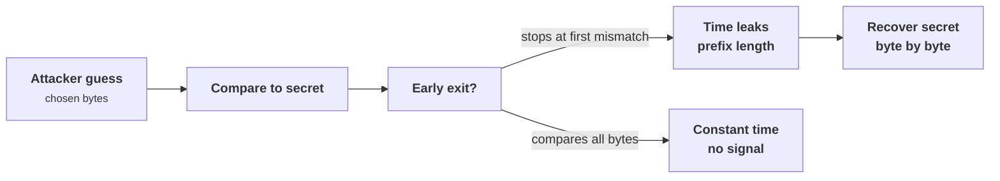
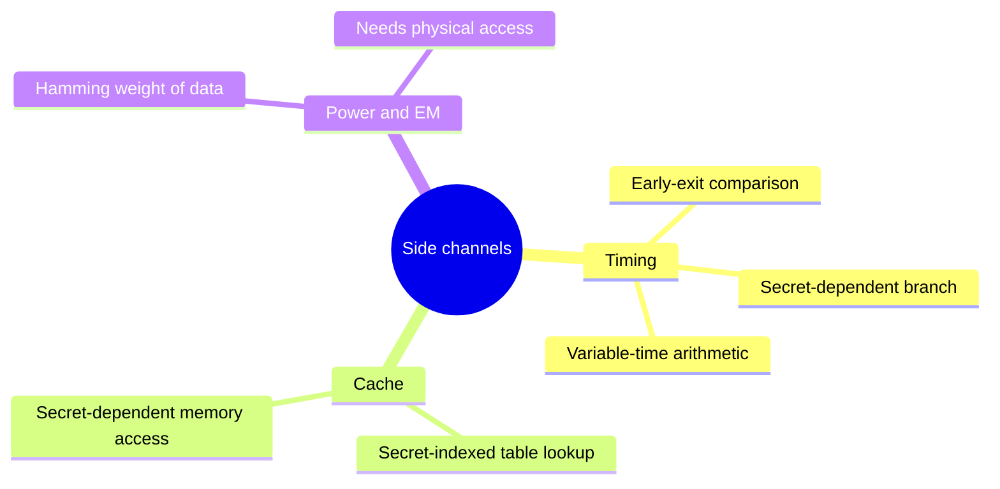
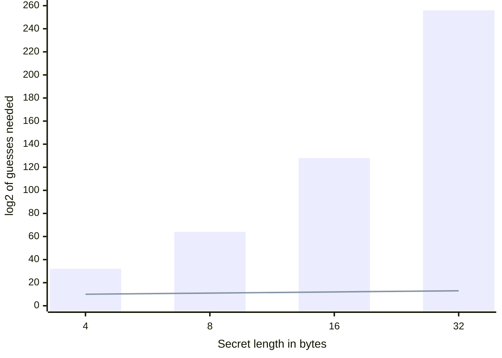
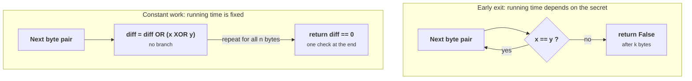

+++
title = 'Side channels and constant-time'
description = 'A comparison that exits early, a branch on a secret, or a table lookup by a secret index can leak a key without breaking any math. Constant-time code removes the channel.'
question = 'How does code leak secrets through timing and caches, and how do you write code that does not?'
weight = 2
difficulty = 3
prerequisites = ['/notes/cryptography/symmetric-cryptography/03-macs-and-hmac', '/notes/cryptography/applied-cryptography/01-how-cryptography-fails-in-practice']
date = 2026-09-06
lastmod = 2026-10-30
verified = 2026-09-06
+++

## The idea in one minute

A side channel leaks a secret through something other than the output: how long
an operation took, which cache lines it touched, how much power it drew. The
classic example is comparing a secret to attacker input with a loop that stops at
the first mismatch. Each extra byte compared takes measurably longer, so the
attacker who can time the comparison learns how long a matching prefix they
supplied, and extends it one byte at a time until the whole secret is recovered.
No cipher is broken; the code simply told the attacker the answer.

The consequence to act on: **any operation on a secret must take the same time
and touch the same memory regardless of the secret's value.** No early exit, no
branch whose direction depends on a secret, no array index that is a secret.
Compare MACs and tokens with `hmac.compare_digest`, not `==`. This lesson
simulates the leak with a deterministic operation counter, recovers a MAC tag
through it, and shows that constant-work comparison removes the signal entirely.

## A picture



## How it really works

### What leaks, and why

A side channel exists whenever a measurable physical or observable quantity
depends on a secret. The three that matter most for software:

| Channel | Carrier | Typical cause |
| --- | --- | --- |
| **Timing** | Wall-clock or cycle count of an operation | Early-exit comparison, secret-dependent branch, variable-time arithmetic (e.g. big-integer modular exponentiation) |
| **Cache** | Which cache lines are hot, observed by a co-resident process | Table lookup indexed by a secret (classic software AES S-box), secret-dependent memory access |
| **Power / EM** | Current draw or emissions, observed with physical access | Hamming weight of processed data; relevant to smart cards and embedded devices |

Each channel has a carrier and a typical coding cause; in software, the causes
are what you remove.



Kocher's 1996 paper opened this field by showing that the running time of modular
exponentiation in RSA and Diffie-Hellman depends on the secret exponent's bits,
so timing measurements recover the private key. The same year began a long line
of work: cache-timing attacks on software AES, Lucky Thirteen against the timing
of TLS CBC padding+MAC checks, and many others. The unifying lesson is that
**correctness is not enough**: two implementations that compute the identical
function can differ entirely in what they leak.

The cache channel shows why "same output" is not enough: a lookup whose index
depends on the key leaves a key-dependent footprint in hardware that another
process shares, and the fix is to stop the footprint from depending on the key.

```mermaid {title="A secret-indexed lookup writes the secret into shared cache state"}
flowchart LR
  subgraph V["Victim process"]
    SK("Secret key")
    T["<b>Table lookup</b><br/><small>index depends on the key</small>"]
  end
  CA("Shared CPU cache")
  AT(["Co-resident process"])
  FIX["<b>Bitslicing or AES-NI</b><br/><small>no data-dependent lookup</small>"]
  SK --> T
  T -->|"key-dependent lines turn hot"| CA
  AT -.->|"sees which lines are hot"| CA
  FIX -->|"same footprint for every key"| CA
  class T warn
  class FIX good
```

### The early-exit comparison

The most common and most avoidable instance is string or byte comparison that
returns as soon as it finds a difference. It is the right way to compare
non-secret data and the wrong way to compare a MAC tag, a password hash, or a
token. If the first byte is wrong the function returns after one step; if the
first byte is right and the second is wrong it returns after two. An attacker who
can measure the difference tries all 256 values for the first byte, keeps the one
that took longest (the match), then moves to the second, and so on. The work to
recover an `n`-byte secret drops from `256^n` guesses to about `256 * n`.

Plotted as powers of two, the blind search (bars) grows with every byte, while
the leaky comparison (line) barely moves: a 32-byte secret costs `2^256` guesses
blind and only about `2^13` with the leak.



This is the server-side mirror of the padding oracle from the previous lesson. In
[/notes/cryptography/applied-cryptography/01-how-cryptography-fails-in-practice/](/notes/cryptography/applied-cryptography/01-how-cryptography-fails-in-practice/)
the oracle leaked a padding-validity bit; here the oracle leaks a prefix length
through timing. Both turn a secret into a byte-at-a-time search.

### Measuring without a clock

Wall-clock timing is noisy and non-deterministic, which is bad for a teaching
example and bad for a test you want to be reliable. The honest way to model a
timing leak deterministically is to **count the operations** that an early-exit
comparison performs, because that count is exactly the quantity wall-clock time
is a proxy for. If the comparison advances one more byte for a correct guess, its
operation count rises by one, and that is the signal the attacker climbs. The
simulation below never reads a clock; it counts byte comparisons. The conclusion
transfers to real timing because the count and the time move together.

### Writing constant-time code

The rules are mechanical:

- **Compare in constant time.** Fold all byte differences into one accumulator
  with `OR` and `XOR`, then check the accumulator once. Compare every byte
  regardless of mismatches. In Python this is `hmac.compare_digest(a, b)`, which
  is written in C to avoid early exit and to resist length leaks; use it for
  every MAC, tag, and token comparison.
- **No secret-dependent branches.** Do not take a different code path based on a
  secret. Replace `if secret_bit: x = A else: x = B` with a branchless select
  that computes both and masks.
- **No secret-dependent memory indices.** Do not index a table with a secret, or
  the cache state leaks the index. Constant-time AES either uses bitslicing or
  hardware AES instructions (AES-NI) that do not use data-dependent lookups.
- **Blinding for asymmetric operations.** For RSA and ECC, randomize the secret
  computation so timing and power carry no usable signal. RSA blinding multiplies
  the input by `r^e` before decryption and divides by `r` after, with a fresh
  random `r`, so the exponentiation runs on a value the attacker cannot predict.
- **Use vetted primitives.** The standard library's `hmac` and `hashlib`, and
  libraries such as libsodium and pyca/cryptography, already implement these.
  This is another face of
  [/notes/cryptography/foundations/04-why-not-to-roll-your-own/](/notes/cryptography/foundations/04-why-not-to-roll-your-own/).

The first two rules side by side: in the early-exit loop the branch on each
byte decides when the function returns, while the constant-work loop has no
branch inside it and makes one decision after all `n` bytes.



Blinding applies the same idea to arithmetic that cannot easily be made
branch-free: the slow exponentiation still runs, but on a value the attacker
neither chose nor can predict, and the random factor is removed afterwards.

```mermaid {title="Blinding decouples the timed computation from the attacker's input"}
sequenceDiagram
  autonumber
  participant A as Caller, chooses c
  participant D as RSA private-key operation
  A->>D: Ciphertext c
  D->>D: Pick fresh random r, compute c times r^e mod N
  Note over D: The exponentiation now runs on a value the caller cannot predict
  D->>D: Raise to d, giving m times r
  D->>D: Divide by r
  D-->>A: Plaintext m, the same result as without blinding
```

> [!WARNING]
> `secret == attacker_input` on bytes or strings in most languages is an
> early-exit comparison. For anything secret, it is a bug, even when the logic is
> correct. Reach for a constant-time comparison every time.

## Code

The program models the leak with a shared operation counter instead of a clock,
so its output is deterministic. `insecure_equal` exits at the first mismatch;
`constant_equal` folds every byte difference into an accumulator. The attacker
calls a verification endpoint, observes the operation count, and recovers the MAC
tag byte by byte against the insecure comparison. Against the constant-time
comparison, every guess yields the same count, so the attack has no gradient to
follow and fails. The last tag byte is special: it compares the full length
whether or not it matches, so only the accept/reject result separates it, exactly
as in a real attack.

```python {title="timing_oracle.py"}
"""timing_oracle.py: a byte-by-byte comparison leak, and the constant-time fix.

We never measure wall-clock time (it is noisy and non-deterministic). Instead we
count the byte comparisons the equality check performs. An early-exit comparison
stops at the first mismatch, so its count is a clean proxy for exactly what a
timing attacker observes: more bytes compared means a longer prefix matched. The
attacker uses that signal to recover a secret MAC tag one byte at a time, without
ever knowing the key. Then a constant-work comparison removes the signal.

Standard library only; offline; deterministic (fixed key, fixed message).
"""

from __future__ import annotations

import hashlib
import hmac

KEY = b"server-mac-key; never leaves the server"
MESSAGE = b"amount=10;to=attacker"


def real_tag(message: bytes) -> bytes:
    return hmac.new(KEY, message, hashlib.sha256).digest()


class Counter:
    """Shared tally of byte comparisons: our deterministic stand-in for time."""

    def __init__(self) -> None:
        self.ops = 0


def insecure_equal(a: bytes, b: bytes, counter: Counter) -> bool:
    """Early-exit comparison. Leaks the matching-prefix length through op count."""
    if len(a) != len(b):
        return False
    for x, y in zip(a, b):
        counter.ops += 1
        if x != y:
            return False
    return True


def constant_equal(a: bytes, b: bytes, counter: Counter) -> bool:
    """Compares every byte regardless of mismatches: op count is constant."""
    if len(a) != len(b):
        return False
    diff = 0
    for x, y in zip(a, b):
        counter.ops += 1
        diff |= x ^ y
    return diff == 0


def make_verifier(compare):
    """A server endpoint: accepts (message, candidate_tag), returns accept/reject.
    The attacker may call it freely but never sees the key or the real tag."""
    def verify(message: bytes, candidate: bytes, counter: Counter) -> bool:
        return compare(real_tag(message), candidate, counter)
    return verify


def recover_tag(verify, length: int) -> tuple[bytes, int]:
    """Recover the tag byte by byte by maximizing the observed comparison count.
    For each position, the guess that pushes the comparison one byte further is
    the correct byte, because the server only advances past bytes that match."""
    recovered = bytearray(length)
    total = 0
    for pos in range(length):
        best_byte, best_signal = 0, (-1, False)
        for guess in range(256):
            recovered[pos] = guess
            counter = Counter()
            accepted = verify(MESSAGE, bytes(recovered), counter)
            total += counter.ops
            # Rank by ops, then by acceptance. The last byte compares the full
            # length whether it matches or not, so only the accept bit tells it
            # apart; earlier bytes are separated by the op count alone.
            signal = (counter.ops, accepted)
            if signal > best_signal:
                best_signal, best_byte = signal, guess
        recovered[pos] = best_byte
    return bytes(recovered), total


def leak_profile(verify) -> list[int]:
    """Op counts for guessing byte 0 as 0x00, with correct byte 0 vs a wrong one."""
    target = real_tag(MESSAGE)
    correct = bytearray(len(target))
    correct[0] = target[0]
    wrong = bytearray(len(target))
    wrong[0] = target[0] ^ 0xFF
    out = []
    for cand in (correct, wrong):
        counter = Counter()
        verify(MESSAGE, bytes(cand), counter)
        out.append(counter.ops)
    return out


def main() -> None:
    target = real_tag(MESSAGE)

    insecure = make_verifier(insecure_equal)
    secure = make_verifier(constant_equal)

    ins_correct, ins_wrong = leak_profile(insecure)
    sec_correct, sec_wrong = leak_profile(secure)
    print("single-byte probe (ops compared):")
    print(f"  early-exit:   correct-first-byte={ins_correct}  wrong={ins_wrong}  -> leaks")
    print(f"  constant:     correct-first-byte={sec_correct}  wrong={sec_wrong}  -> no signal")

    recovered, queries = recover_tag(insecure, len(target))
    print()
    print(f"attack on early-exit compare:")
    print(f"  tag length:   {len(target)} bytes")
    print(f"  recovered:    {recovered == target}")
    print(f"  oracle calls: {queries}")

    # Against the constant-time verifier, the same loop has no signal to follow:
    # every guess yields the same op count, so it cannot climb toward the tag.
    guess, _ = recover_tag(secure, len(target))
    print(f"attack on constant-time compare recovers tag: {guess == target}")


if __name__ == "__main__":
    main()
```

Run it with `python3 timing_oracle.py`:

```text
single-byte probe (ops compared):
  early-exit:   correct-first-byte=2  wrong=1  -> leaks
  constant:     correct-first-byte=32  wrong=32  -> no signal

attack on early-exit compare:
  tag length:   32 bytes
  recovered:    True
  oracle calls: 135199
attack on constant-time compare recovers tag: False
```

The early-exit probe shows the signal directly: a correct first byte costs two
operations, a wrong one costs a single operation, and the attacker recovers all
32 bytes in roughly `256 * 32` calls. The constant-time comparison always costs
32 operations, so the final line prints `False`: with no gradient to climb, the
same recovery loop cannot find the tag.

The single-byte probe is the whole story in four numbers: the early-exit counts
differ by one, which is the gradient, and the constant-time counts are identical.

```mermaid {title="Early exit separates right from wrong, constant work does not"}
xychart-beta
  x-axis ["Early-exit wrong", "Early-exit correct", "Constant wrong", "Constant correct"]
  y-axis "Byte comparisons per probe" 0 --> 35
  bar [1, 2, 32, 32]
```

## Where it breaks

- **Operation count is a model, not a measurement.** Real timing carries noise
  from the OS scheduler, other processes, and the CPU itself, so a real attacker
  averages many samples. The simulation shows the signal cleanly; it does not
  show the statistics needed to extract it from noise.
- **Constant-time in Python is only approximate.** The interpreter, garbage
  collector, and integer object allocation all introduce variation. Genuine
  constant-time guarantees need lower-level code and verification tools; treat
  Python-level constant-time as illustrative. Use `hmac.compare_digest`, which is
  implemented in C, for real comparisons.
- **A constant-time compare does not fix a variable-time computation.** If the
  code that *produces* the value branched on a secret, the leak already happened
  upstream. Constant-time must hold for the whole secret-dependent path.

  Follow the secret from left to right: a constant-time compare protects only
  its own step, so any variable-time step before or after it still reaches the
  observer.

  ```mermaid {title="Constant time must hold along the whole secret path"}
  flowchart LR
    K("Secret")
    C["<b>Compute</b><br/><small>modexp, S-box, branches</small>"]
    M["<b>Compare</b><br/><small>hmac.compare_digest</small>"]
    R["<b>Respond</b><br/><small>error path, reply timing</small>"]
    O(["Observer"])
    K --> C --> M --> R --> O
    C -.->|"variable time leaks here"| O
    R -.->|"early error return leaks here"| O
    class C,R warn
    class M good
  ```
- **This covers timing and cache conceptually, not power or fault attacks.**
  Those need hardware countermeasures and are out of scope for a software lesson.

## Remember this

- A side channel leaks a secret through time, cache state, or power, without
  breaking the math.
- Early-exit comparison turns an `n`-byte secret into about `256 * n` guesses.
- Compare secrets with `hmac.compare_digest`, never with `==`.
- Constant-time means same time and same memory access for every secret value:
  no secret-dependent branch, no secret array index.
- Blinding randomizes asymmetric operations so timing and power carry no signal.
- Prefer vetted libraries; constant-time code is hard to get right by hand.

## Try it

1. Run `timing_oracle.py`. Change `MESSAGE` and confirm a different tag is
   recovered, and that the call count stays near `256 * 32`.
2. Replace `insecure_equal` with Python's `==` and show the attack still works,
   since `==` on bytes also exits early.
3. Add a `length_leak` comparison that returns `False` immediately when lengths
   differ but compares content in constant time. What does it still leak?
4. Write a branchless constant-time select `ct_select(bit, a, b)` returning `a`
   when `bit` is 1 and `b` otherwise, using only arithmetic and masks.

## Check yourself

1. Why does an early-exit comparison reduce the cost of recovering a secret from
   exponential to linear?

   
   Because the time (or operation count) reveals the length of the matching
   prefix. The attacker fixes one byte at a time: try all 256 values, keep the one
   that advanced the comparison furthest, then move on. That is about `256`
   guesses per byte, `256 * n` total, instead of `256^n`.
   

2. What exactly does `hmac.compare_digest` provide that `==` does not?

   
   It compares all bytes without exiting early, so its running time does not
   depend on where the first difference is, removing the prefix-length timing
   signal. It is implemented in C and also avoids leaking through short-circuit
   behavior. `==` on bytes stops at the first differing byte.
   

3. Why is counting operations a legitimate stand-in for timing in a
   demonstration?

   
   Wall-clock time of an early-exit comparison is, to first order, proportional to
   the number of bytes compared before it returns. Counting those comparisons
   captures the same secret-dependent signal deterministically, without the noise
   of a real clock, so the attack's logic is shown without flaky measurements.
   

4. Your MAC comparison is constant-time, but key verification still leaks. Name
   one place the leak could remain.

   
   The computation that produced the value: variable-time modular exponentiation
   or a secret-indexed S-box lookup, a branch taken on a secret bit, or an
   error path that returns earlier in one case than another. Constant-time must
   hold across the entire secret-dependent path, not only the final comparison.
   

## Sources

- P. Kocher, [Timing Attacks on Implementations of Diffie-Hellman, RSA, DSS, and Other Systems](https://paulkocher.com/doc/TimingAttacks.pdf), CRYPTO 1996.
- D. J. Bernstein, [Cache-timing attacks on AES](https://cr.yp.to/antiforgery/cachetiming-20050414.pdf), 2005.
- N. AlFardan, K. Paterson, [Lucky Thirteen: Breaking the TLS and DTLS Record Protocols](https://www.ieee-security.org/TC/SP2013/papers/4977a526.pdf), IEEE S&P 2013.
- Python Software Foundation, [`hmac.compare_digest`](https://docs.python.org/3/library/hmac.html#hmac.compare_digest), Python documentation.
