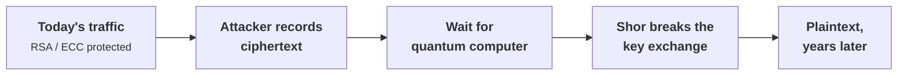
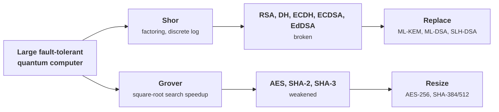
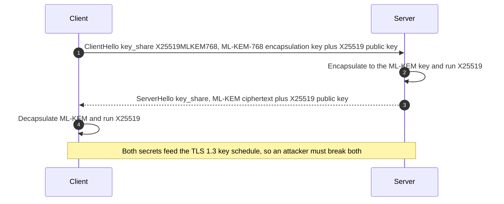
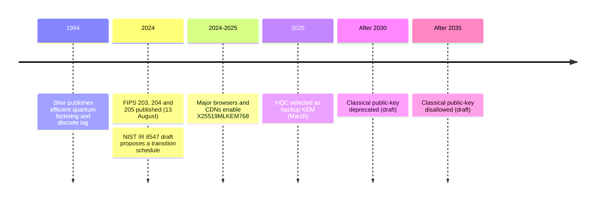

+++
title = 'Post-quantum migration'
description = 'A large quantum computer would break RSA and elliptic-curve cryptography. The standards exist now, the threat is "harvest now, decrypt later," and the question is which systems to migrate first.'
question = 'What does quantum computing break, and how do you decide what to migrate and when?'
weight = 3
difficulty = 3
prerequisites = ['/notes/cryptography/public-key-cryptography/01-key-exchange', '/notes/cryptography/public-key-cryptography/02-digital-signatures']
date = 2026-09-08
lastmod = 2026-09-08
verified = 2026-09-08
+++

## The idea in one minute

A large, fault-tolerant quantum computer running Shor's algorithm would factor
large integers and compute discrete logarithms efficiently, breaking RSA,
Diffie-Hellman, and elliptic-curve cryptography: the entire public-key layer of
today's internet. Grover's algorithm weakens symmetric primitives more gently,
halving the effective key length, which doubling the key size restores. No such
machine is known to exist as of 2026, but that does not make the threat distant,
because an attacker can **record encrypted traffic now and decrypt it later** once
the machine arrives. Anything that must stay secret for years is already exposed.

The consequence to act on: **start migrating now, worst-first.** The replacement
standards are published. Mosca's inequality turns the vague worry into a
prioritized list: if your data must stay secret for `x` years, migration takes
`y` years, and a quantum computer is `z` years away, you are already late whenever
`x + y > z`. This lesson computes that over an inventory and builds a hash-based
signature to show where post-quantum security comes from.

## A picture



## How it really works

### What quantum computing breaks, and what it does not

| Primitive | Quantum impact | Response |
| --- | --- | --- |
| **RSA, finite-field Diffie-Hellman** | Shor's algorithm factors / computes discrete logs in polynomial time: broken | Replace with post-quantum key encapsulation and signatures |
| **Elliptic-curve (ECDH, ECDSA, EdDSA)** | Shor applies to the elliptic-curve discrete log too: broken | Replace with post-quantum algorithms |
| **AES** | Grover's algorithm gives a square-root speedup on brute force: AES-128 falls to ~64-bit effort | Use AES-256; the margin is restored |
| **SHA-2, SHA-3** | Grover speeds up preimage search; collision resistance is less affected | Use longer digests (SHA-384/512) where margin matters |

Follow the two algorithms down: Shor's branch ends in replacement, Grover's
branch ends in a parameter change.



The asymmetry is the whole story. **Symmetric** cryptography survives with larger
parameters; **public-key** cryptography must be replaced with algorithms built on
different hard problems (lattices, hashes, codes) that no known quantum algorithm
solves efficiently.

For AES the arithmetic is simple: Grover halves the effective bits (line), so
AES-256 under attack still keeps the 128 bits AES-128 offers today.

```mermaid {title="Grover halves symmetric security, and doubling the key restores it"}
xychart-beta
  x-axis ["AES-128", "AES-256"]
  y-axis "Effective security bits" 0 --> 260
  bar [128, 256]
  line [64, 128]
```

### The standards exist now

The U.S. National Institute of Standards and Technology (NIST) ran a multi-year
post-quantum standardization process and, on 13 August 2024, published the first
three standards:

- **FIPS 203, ML-KEM** (Module-Lattice-Based Key-Encapsulation Mechanism),
  derived from CRYSTALS-Kyber. This is the key-establishment replacement.
- **FIPS 204, ML-DSA** (Module-Lattice-Based Digital Signature Algorithm),
  derived from CRYSTALS-Dilithium. A general-purpose signature.
- **FIPS 205, SLH-DSA** (Stateless Hash-Based Digital Signature Algorithm),
  derived from SPHINCS+. A signature whose security rests only on hash functions.

In March 2025 NIST announced the selection of **HQC**, a code-based KEM, as a
backup key-establishment algorithm to be standardized, chosen for its different
mathematical basis so that a future break of lattices would not take the whole
ecosystem with it. A standards draft for HQC is expected to follow.

### Hybrid key exchange is the pragmatic bridge

Because the post-quantum algorithms are newer and less battle-tested, the
near-term deployment pattern is **hybrid**: run a classical key exchange and a
post-quantum one together and combine both shared secrets, so the result is
secure if **either** holds. In TLS 1.3 the widely deployed hybrid, as of 2026,
is `X25519MLKEM768`, which combines the X25519 elliptic-curve exchange with
ML-KEM-768. Major browsers and CDNs enabled it during 2024–2025. Hybrid protects
against both a classical break of the new algorithm and the harvest-now threat to
the old one, at the cost of larger key-exchange messages.

In the handshake, each side sends one share for each algorithm, and both shared
secrets go into the key schedule.



See [/notes/cryptography/public-key-cryptography/01-key-exchange/](/notes/cryptography/public-key-cryptography/01-key-exchange/)
for the classical exchange a hybrid wraps, and
[/notes/cryptography/public-key-cryptography/04-the-tls-handshake/](/notes/cryptography/public-key-cryptography/04-the-tls-handshake/)
for where in the handshake it sits.

### The timeline and Mosca's inequality

NIST's draft internal report **NIST IR 8547**, "Transition to Post-Quantum
Cryptography Standards" (initial public draft, 2024), proposes a transition
schedule for the quantum-vulnerable algorithms. As of that draft, the proposed
milestones are to **deprecate** the classical public-key algorithms after 2030
and to **disallow** them after 2035. Treat the exact years as draft guidance that
may change; the direction is firm.

Put on one line, the dates in this lesson run from the algorithm that created
the threat to the proposed end of classical public-key cryptography.



**Mosca's inequality** makes the decision local to each system. Let `x` be how
many years the data must remain confidential, `y` the years it takes to migrate
that system, and `z` the years until a cryptographically relevant quantum
computer exists. If `x + y > z`, the data you protect today will still be secret
when it becomes readable, so you are already behind. The value of `z` is
genuinely unknown; the point of the inequality is that for large `x` (long-lived
secrets) and large `y` (hard migrations), you do not need to know `z` precisely to
conclude "start now."

Here is the health-records archive from the code below (`x = 25`, `y = 4`)
against an assumed `z = 15`, starting this year: the red bar is the 14 years in
which harvested traffic is readable while it is still meant to be secret.

```mermaid {title="Mosca: the part of x + y that runs past z is the exposure"}
gantt
  dateFormat YYYY
  axisFormat %Y
  section Health-records archive
  Migration y = 4 years :a1, 2026, 2030
  Must stay secret x = 25 years :a2, 2030, 2055
  section Quantum threat
  Quantum computer z = 15 years :milestone, m1, 2041, 0d
  Readable but still secret :crit, e1, 2041, 2055
```

> [!IMPORTANT]
> Harvest-now-decrypt-later means the clock already started for confidentiality.
> Long-lived secrets exchanged under classical key agreement today are exposed the
> day a quantum computer arrives, however far off that is.

### Where hash-based signatures get their security

SLH-DSA (FIPS 205) is built entirely from hash functions, which is reassuring
because hash functions are not threatened by Shor and are the best-understood
primitive we have. The intuition is a **Lamport one-time signature**: to sign a
message whose hash is `n` bits, the signer generates `n` pairs of random secrets
and publishes their hashes as the public key. To sign, they reveal one secret
from each pair, chosen by the corresponding message-hash bit. A verifier hashes
each revealed secret and checks it against the published public key. Forging a
signature for a different message would require revealing secrets the signer never
published, which means inverting the hash. It is "one-time" because signing a
second message reveals more secrets and eventually the whole key; real schemes
(SPHINCS+, and the hash trees behind it) layer many one-time keys under a Merkle
tree to sign many messages. The program below builds the one-time core.

The message hash picks which half of each pair is revealed, and the verifier
only ever hashes forward, so forging means producing a preimage.

```mermaid {title="Lamport: the message chooses which secrets are revealed"}
flowchart LR
  SK("256 secret pairs")
  PK("Public key = their hashes")
  M["<b>Message hash</b><br/><small>256 bits</small>"]
  SG("Signature = one secret per pair")
  V{"<b>Each part hashes<br/>to the public key?</b>"}
  OK["<b>Valid</b>"]
  NO["<b>Rejected</b><br/><small>forging needs unrevealed secrets</small>"]
  SK -->|"hash each"| PK
  SK --> SG
  M -->|"bit i picks secret 0 or 1"| SG
  SG --> V
  PK --> V
  V -->|"yes"| OK
  V -->|"no"| NO
  class OK good
  class NO warn
```

## Code

Two parts in one program. First, Mosca's inequality over a simulated inventory,
sorted worst-first. Second, a Lamport one-time signature from SHA-256 alone,
signed and verified, with a tamper and a forgery attempt both rejected. The
Lamport keys are seeded for a reproducible demo; a real key uses fresh
randomness from a secure source (see
[/notes/cryptography/foundations/02-randomness-and-entropy/](/notes/cryptography/foundations/02-randomness-and-entropy/)).

```python {title="pqc_migration.py"}
"""pqc_migration.py: Mosca's inequality over an inventory, and Lamport signatures.

Part 1 applies Mosca's inequality. If data must stay secret for x years, a system
takes y years to migrate to post-quantum algorithms, and a cryptographically
relevant quantum computer arrives in z years, then you are already late whenever
x + y > z. We score a simulated inventory and sort by urgency.

Part 2 builds a Lamport one-time signature from a hash function alone, to show
where hash-based post-quantum signatures (the family behind SLH-DSA / FIPS 205)
get their security: they need no number-theoretic assumption Shor's algorithm
could break, only a hash.

Standard library only; offline; deterministic (fixed seed).
"""

from __future__ import annotations

import hashlib
import secrets
from dataclasses import dataclass


# ---- Part 1: Mosca's inequality -------------------------------------------

@dataclass
class System:
    name: str
    secrecy_years: float   # x: how long the data must stay confidential
    migration_years: float  # y: how long to re-engineer this system


def mosca_gap(system: System, z_years: float) -> float:
    """x + y - z. Positive means exposure: data is still secret when a quantum
    adversary could read today's harvested ciphertext."""
    return system.secrecy_years + system.migration_years - z_years


def prioritize(inventory: list[System], z_years: float) -> list[tuple[System, float]]:
    scored = [(s, mosca_gap(s, z_years)) for s in inventory]
    scored.sort(key=lambda sg: sg[1], reverse=True)
    return scored


# ---- Part 2: Lamport one-time signature -----------------------------------

def _h(data: bytes) -> bytes:
    return hashlib.sha256(data).digest()


def lamport_keygen(rng: secrets.SystemRandom | None, seed: int) -> tuple[list, list]:
    """Return (private_key, public_key). Private key: 256 pairs of random
    32-byte secrets, one pair per message-hash bit. Public key: their hashes.
    Seeded here for a reproducible demo; a real key uses fresh randomness."""
    gen = _seeded_bytes(seed)
    private = [(gen(), gen()) for _ in range(256)]
    public = [(_h(a), _h(b)) for a, b in private]
    return private, public


def _seeded_bytes(seed: int):
    counter = {"n": 0}

    def gen() -> bytes:
        counter["n"] += 1
        return hashlib.sha256(f"seed:{seed}:{counter['n']}".encode()).digest()

    return gen


def _bits(digest: bytes) -> list[int]:
    out = []
    for byte in digest:
        for i in range(8):
            out.append((byte >> (7 - i)) & 1)
    return out


def lamport_sign(private: list, message: bytes) -> list[bytes]:
    bits = _bits(_h(message))
    return [private[i][bit] for i, bit in enumerate(bits)]


def lamport_verify(public: list, message: bytes, signature: list[bytes]) -> bool:
    bits = _bits(_h(message))
    for i, bit in enumerate(bits):
        if _h(signature[i]) != public[i][bit]:
            return False
    return True


def main() -> None:
    inventory = [
        System("health-records archive", secrecy_years=25, migration_years=4),
        System("TLS to public website", secrecy_years=0, migration_years=1),
        System("code-signing root", secrecy_years=15, migration_years=6),
        System("session cache", secrecy_years=0.1, migration_years=0.5),
    ]
    z = 15  # assumed years until a cryptographically relevant quantum computer

    print(f"Mosca's inequality (z = {z} years until quantum threat)")
    print(f"{'system':<26}{'x+y':>6}{'gap':>7}  status")
    for system, gap in prioritize(inventory, z):
        xy = system.secrecy_years + system.migration_years
        status = "MIGRATE NOW" if gap > 0 else "watch"
        print(f"{system.name:<26}{xy:>6.1f}{gap:>7.1f}  {status}")

    print()
    priv, pub = lamport_keygen(None, seed=42)
    msg = b"ml-kem rollout approved"
    sig = lamport_sign(priv, msg)
    print("Lamport one-time signature (hash-based)")
    print(f"  public key hashes: {len(pub)} pairs")
    print(f"  signature parts:   {len(sig)} x {len(sig[0])} bytes")
    print(f"  verifies:          {lamport_verify(pub, msg, sig)}")
    print(f"  tampered message:  {lamport_verify(pub, b'ml-kem rollout denied', sig)}")
    forged = list(sig)
    forged[0] = _h(b"guess")
    print(f"  forged part:       {lamport_verify(pub, msg, forged)}")


if __name__ == "__main__":
    main()
```

Run it with `python3 pqc_migration.py`:

```text
Mosca's inequality (z = 15 years until quantum threat)
system                       x+y    gap  status
health-records archive      29.0   14.0  MIGRATE NOW
code-signing root           21.0    6.0  MIGRATE NOW
TLS to public website        1.0  -14.0  watch
session cache                0.6  -14.4  watch

Lamport one-time signature (hash-based)
  public key hashes: 256 pairs
  signature parts:   256 x 32 bytes
  verifies:          True
  tampered message:  False
  forged part:       False
```

The archive of records that must stay secret for 25 years and takes 4 years to
migrate is the first priority, even though public-facing TLS feels more urgent;
the TLS session has nothing worth harvesting. The Lamport signature verifies, a
tampered message flips enough hash bits to select unpublished secrets, and a
guessed signature part fails because inverting SHA-256 is infeasible.

The inventory as a chart: bars are `x + y` for each system and the line is
`z = 15`; anything above the line is MIGRATE NOW.

```mermaid {title="Long-lived secrets clear the line, short-lived traffic does not"}
xychart-beta
  x-axis ["Health archive", "Code-signing root", "Public TLS", "Session cache"]
  y-axis "Years (x + y)" 0 --> 32
  bar [29, 21, 1, 0.6]
  line [15, 15, 15, 15]
```

## Where it breaks

- **`z` is a guess.** Nobody knows when, or whether, a cryptographically relevant
  quantum computer will exist. Mosca's inequality is useful precisely because it
  often resolves without a precise `z`: for long-lived secrets and slow
  migrations, you are late for almost any plausible `z`.
- **Lamport is one-time and huge.** The keys and signatures here are kilobytes,
  and a key signs exactly one message safely. Real hash-based schemes (SPHINCS+ /
  SLH-DSA) add Merkle trees and few-time signatures to sign many messages; this
  demo shows only the security intuition, not a usable scheme.
- **The post-quantum algorithms are newer.** Lattice schemes rest on hardness
  assumptions with less cryptanalytic history than RSA. That is exactly why
  hybrid deployment and a code-based backup (HQC) exist: to avoid a single point
  of failure.
- **Dates are draft and may change.** The 2030/2035 milestones come from a draft
  of NIST IR 8547; confirm the current version before planning around specific
  years.

## Remember this

- Shor breaks RSA and all elliptic-curve and discrete-log public-key crypto;
  Grover only weakens symmetric crypto, which larger keys restore.
- Harvest-now-decrypt-later means long-lived secrets are already exposed.
- FIPS 203 (ML-KEM), 204 (ML-DSA), and 205 (SLH-DSA) were published 13 August
  2024; HQC was selected as a code-based backup KEM in March 2025.
- Deploy hybrid key exchange, such as `X25519MLKEM768` in TLS, so security holds
  if either algorithm does.
- Mosca's inequality, `x + y > z`, prioritizes migration worst-first.
- Hash-based signatures get their security from hash functions alone, which Shor
  does not threaten.

## Try it

1. Run `pqc_migration.py`. Change `z` to 10 and to 30 and watch which systems
   cross into "MIGRATE NOW".
2. Add a system with a 50-year secrecy requirement and a short migration. Where
   does it land, and why?
3. Sign a second message with the same Lamport key and inspect how many secrets
   are now revealed across both signatures. Why is reuse unsafe?
4. Look up the current revision of NIST IR 8547 and compare its dates to the
   draft milestones cited here.

## Check yourself

1. Why does harvest-now-decrypt-later make the quantum threat urgent even if no
   quantum computer exists yet?

   
   An attacker can record today's encrypted traffic and store it. When a quantum
   computer later breaks the key exchange that protected it, the stored ciphertext
   becomes readable. So any secret that must remain confidential past the arrival
   of such a machine is effectively exposed the moment it is sent under classical
   key agreement.
   

2. Why is symmetric cryptography in much better shape than public-key against
   quantum attack?

   
   The best quantum attack on a symmetric key is Grover's search, a square-root
   speedup, so AES-128 drops to about 64-bit effort and AES-256 to 128-bit, which
   is still infeasible. Shor's algorithm, by contrast, breaks the hard problems
   behind RSA and elliptic curves outright, so those must be replaced rather than
   resized.
   

3. What does deploying hybrid key exchange (e.g. `X25519MLKEM768`) buy you?

   
   The session key is derived from both a classical and a post-quantum exchange,
   so it stays secure if either one holds. That protects against a future quantum
   break of X25519 and against a possible classical cryptanalytic break of the
   newer ML-KEM, while the ecosystem gains confidence in the new algorithm.
   

4. State Mosca's inequality and explain why a precise value of `z` is often
   unnecessary.

   
   If `x` (required secrecy lifetime) plus `y` (migration time) exceeds `z` (years
   until a quantum computer), you are already late. For long-lived secrets and
   slow migrations, `x + y` is large enough that the inequality holds for almost
   any plausible `z`, so the decision to start now does not depend on pinning down
   `z`.
   

## Sources

- NIST, [FIPS 203: Module-Lattice-Based Key-Encapsulation Mechanism Standard](https://csrc.nist.gov/pubs/fips/203/final), August 2024.
- NIST, [FIPS 204: Module-Lattice-Based Digital Signature Standard](https://csrc.nist.gov/pubs/fips/204/final), August 2024.
- NIST, [FIPS 205: Stateless Hash-Based Digital Signature Standard](https://csrc.nist.gov/pubs/fips/205/final), August 2024.
- NIST, [NIST Selects HQC as Fifth Algorithm for Post-Quantum Encryption](https://www.nist.gov/news-events/news/2025/03/nist-selects-hqc-fifth-algorithm-post-quantum-encryption), March 2025.
- NIST, [NIST IR 8547 (initial public draft): Transition to Post-Quantum Cryptography Standards](https://csrc.nist.gov/pubs/ir/8547/ipd), 2024.
- P. Shor, [Algorithms for Quantum Computation: Discrete Logarithms and Factoring](https://ieeexplore.ieee.org/document/365700), FOCS 1994.
- L. Lamport, [Constructing Digital Signatures from a One-Way Function](https://www.microsoft.com/en-us/research/publication/constructing-digital-signatures-one-way-function/), SRI technical report, 1979.
