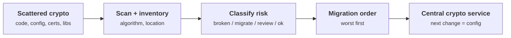
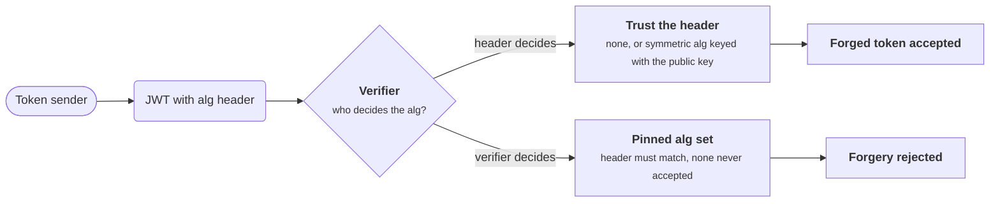
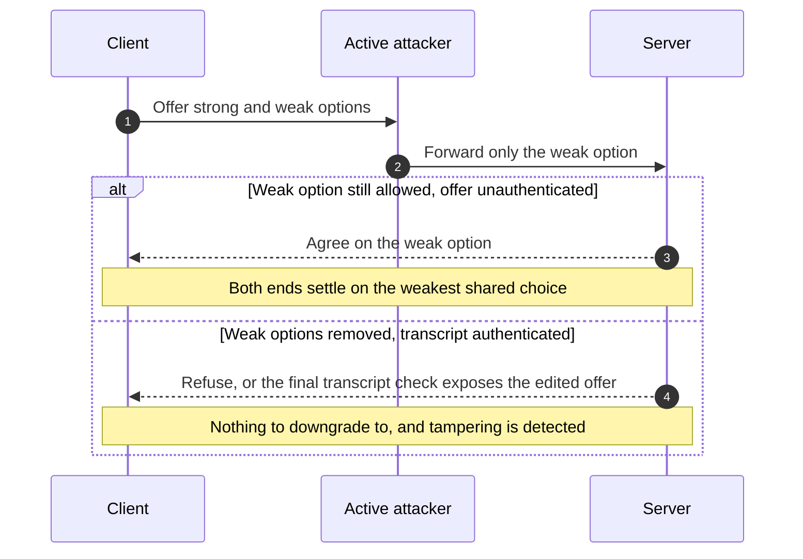
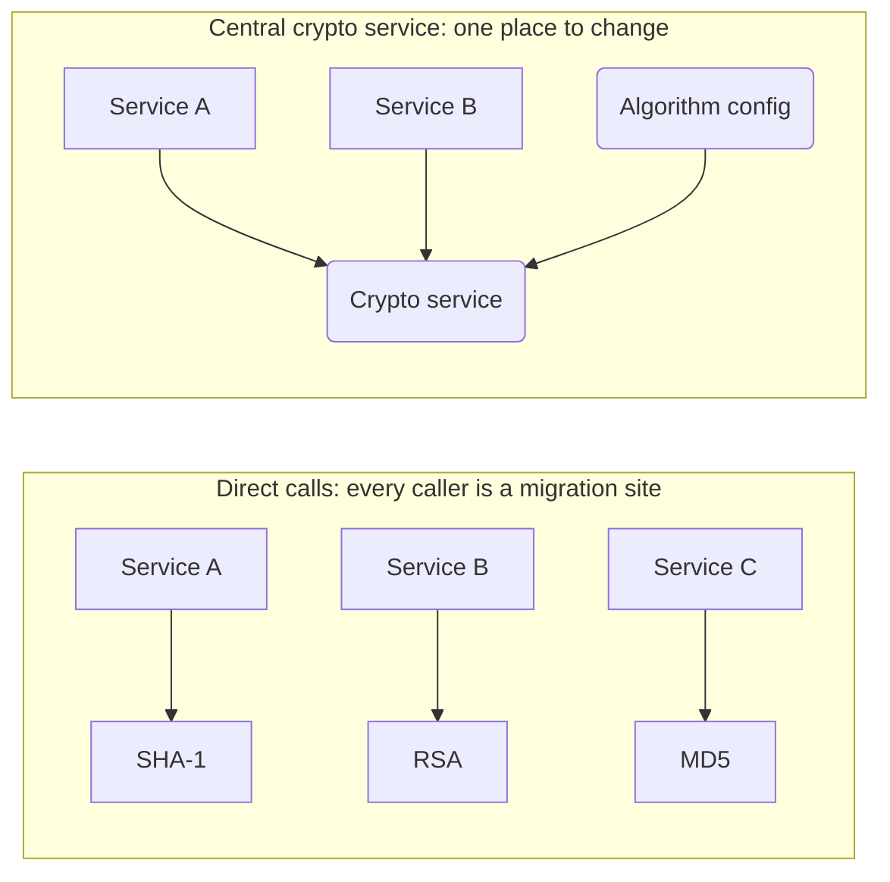
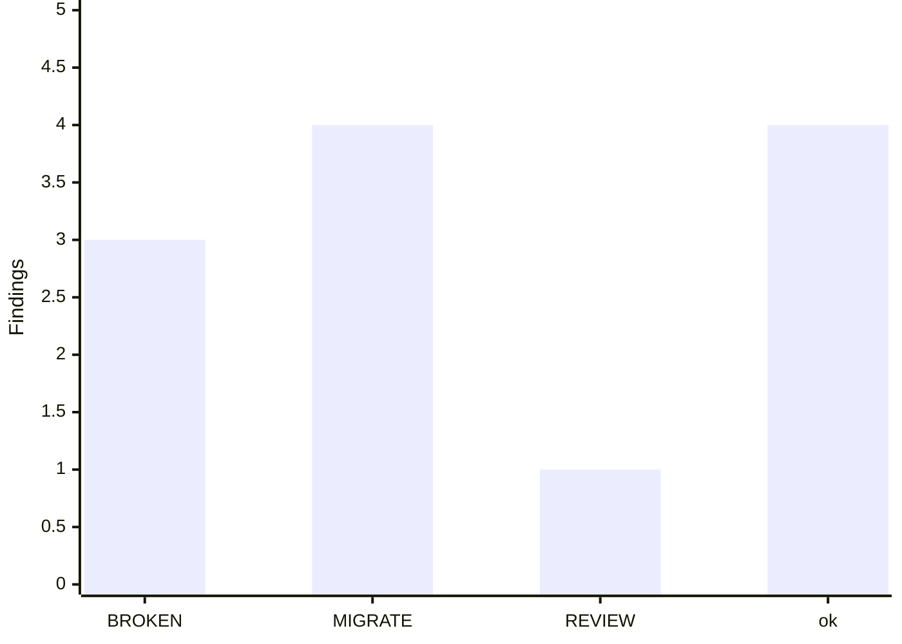

+++
title = 'Crypto-agility and inventory'
description = 'You cannot migrate what you cannot see. Crypto-agility is the ability to change algorithms without re-architecting, and it starts with an inventory of what you use and where.'
question = 'How do you find every algorithm you depend on and change it without breaking everything?'
weight = 4
difficulty = 2
prerequisites = ['/notes/cryptography/applied-cryptography/03-post-quantum-migration']
date = 2026-09-10
lastmod = 2026-10-30
verified = 2026-09-10
+++

## The idea in one minute

Every migration in the previous lesson assumes you know what you have. Most
organizations do not: cryptography is scattered across application code,
TLS configuration, firmware, certificates, and third-party libraries, with no
single list. **Crypto-agility** is the property that lets you change an algorithm
without re-architecting the system, and it rests on two things: a
**cryptographic inventory** of what you use and where, and a design where the
choice of algorithm is a parameter, not a hardcoded assumption baked into a
hundred call sites.

The consequence to act on: **build the inventory first, then centralize crypto
behind a service or library so the next change is a configuration edit, not a
code hunt.** This lesson scans simulated code and configuration for algorithm
identifiers, classifies each find by risk, and prints a migration order: the
skeleton of a cryptographic bill of materials (CBOM). It also covers the one real
hazard of agility: negotiating algorithms opens the door to downgrade attacks
unless you refuse the weak options outright.

## A picture



## How it really works

### Why you cannot migrate what you cannot see

The SHA-1 sunset is the cautionary tale. SHA-1 collisions moved from theory to a
public collision (the SHAttered result, 2017), and browsers and certificate
authorities spent years removing it. The hard part was never the replacement
algorithm; it was **finding every place SHA-1 was used**: certificate signatures,
code-signing, Git object IDs, legacy document formats, and countless internal
tools. Organizations without an inventory discovered usages the slow way, as
things broke. The post-quantum migration is the same problem at larger scale,
because public-key cryptography is even more deeply embedded than any one hash.

A **cryptographic inventory** answers, for every use of cryptography: which
algorithm and parameters, in which component, for what purpose, and how risky it
is. The CycloneDX **CBOM** (Cryptography Bill of Materials) is a standard format
for recording exactly this, extending the software bill of materials with
cryptographic assets and their dependencies so the inventory is machine-readable
and can be diffed over time.

### What an inventory records

| Field | Example | Why it matters |
| --- | --- | --- |
| **Algorithm** | RSA-2048, AES-128-ECB, SHA-1 | The thing you may have to change |
| **Location** | `pki/sign.py`, a TLS cipher string, a certificate | Where the change happens |
| **Purpose** | key exchange, signature, hashing, encryption | Determines the replacement and its urgency |
| **Risk class** | broken, migrate, review, ok | Sets the migration order |
| **Owner / dependency** | internal team, or a vendored library | Who can change it, and whether you can at all |

The record that matters is the **usage**: one algorithm appears in many
components, one component holds many algorithms, and the owner decides whether
a usage can be changed at all.

```mermaid {title="The inventory is per usage, linking algorithm, place, and owner"}
erDiagram
  OWNER ||--o{ COMPONENT : "can change"
  COMPONENT ||--o{ USAGE : contains
  ALGORITHM ||--o{ USAGE : "appears in"
  OWNER {
    string team_or_vendor
  }
  COMPONENT {
    string name
    string kind
  }
  USAGE {
    string location
    string purpose
  }
  ALGORITHM {
    string name
    string parameters
    string risk_class
  }
```

Risk is not binary. A useful scale separates **broken** (MD5, SHA-1, DES, RC4,
ECB mode: stop using now), **migrate** (RSA and elliptic-curve: sound today but
quantum-vulnerable, plan the move), **review** (acceptable with care, such as
PBKDF2 with a high iteration count), and **ok** (current AEAD, SHA-2/3, the
post-quantum standards).

### Algorithm identifiers and negotiation

Agility usually means protocols carry an **algorithm identifier** and the two
ends negotiate a common choice: TLS cipher suites, JOSE/JWT `alg` headers, SSH
key-exchange and cipher lists, X.509 signature-algorithm OIDs. This is what lets
a system add ML-KEM without replacing the protocol. It is also the attack surface.

### Agility versus downgrade risk

Negotiation introduces the **downgrade attack**: an active attacker strips the
strong options from the negotiation so both ends settle on the weakest one they
share. POODLE (from lesson 1) depended on forcing a fallback to SSL 3.0. The JWT
`alg` confusion attacks are a cousin: a token that says `alg: none`, or that
substitutes a symmetric `alg` so the public key is used as an HMAC secret, lets an
attacker forge tokens if the verifier trusts the attacker-supplied identifier.

The whole JWT question is who picks the algorithm: if the token's header does,
the sender does; if the verifier pins it, a swapped `alg` is simply rejected.



The defenses are specific:

- **Refuse weak options outright.** Do not merely prefer strong algorithms;
  remove the weak ones from the allowed set so there is nothing to downgrade to.
- **Pin the acceptable algorithm at the verifier.** For JWT, the verifier fixes
  which `alg` values it accepts rather than trusting the token's header; `alg:
  none` is never accepted.
- **Authenticate the negotiation.** TLS 1.3 includes the handshake transcript in
  the final authentication, so tampering with the offered parameters is detected.

A downgrade needs two things: a weak option both ends still accept, and an
offer the attacker can edit unnoticed. The first and third defenses each remove
one of them.



> [!CAUTION]
> Agility is the ability to change algorithms, not the obligation to accept every
> algorithm. A negotiation that includes a broken option is worse than no
> negotiation. Keep the allowed set narrow and current.

### Centralize so the next change is cheap

The reason SHA-1 took years and the next migration should not is architectural.
If every component calls a hash function directly, every component is a migration
site. If components call an internal crypto service or a single wrapper library
that selects the algorithm, the migration is one change behind a stable
interface. This is the same centralization argument as policy engines for
authorization: pull the decision out of a hundred call sites into one reviewed,
testable place. Key management benefits identically; see
[/notes/cryptography/key-management/04-rotation-and-revocation/](/notes/cryptography/key-management/04-rotation-and-revocation/)
for rotating keys behind such a boundary.

Count the migration sites in each half: three on the left, one on the right,
and on the right the change is an edit to configuration, not to callers.



A **deprecation playbook** then drives each algorithm to retirement: announce the
sunset date, stop new usage (fail the build on the identifier), migrate existing
usage worst-first by the inventory, and finally disallow the algorithm entirely.
The inventory measures progress at every step.

Each algorithm moves through the playbook as a lifecycle, and the inventory is
what tells you when it can move to the next state.

```mermaid {title="Deprecation playbook: an algorithm's path to retirement"}
stateDiagram-v2
  direction LR
  state "No new use" as NoNew
  [*] --> Allowed
  Allowed --> Announced: sunset date published
  Announced --> NoNew: build fails on the identifier
  NoNew --> Migrating: worst first, by inventory
  Migrating --> Disallowed: inventory shows no usage left
  Disallowed --> [*]
```

## Code

The scanner below holds a set of regex rules, each naming an algorithm, a risk
rank, and a reason. It scans a simulated repository of code and configuration
snippets, records every match as a finding, prints the inventory (a CBOM
skeleton), summarizes the risk counts, and emits a migration order with the
worst findings first. The rules and snippets are illustrative; a production
scanner would parse ASTs, certificates, and binaries, and emit CycloneDX CBOM
rather than text.

```python {title="crypto_inventory.py"}
"""crypto_inventory.py: scan code and config for crypto, classify risk, order work.

A cryptographic inventory is the first deliverable of crypto-agility: you cannot
migrate what you cannot see. This scans simulated source and configuration
snippets for algorithm identifiers, assigns each find a risk class and a reason,
and prints a migration order. The output is the skeleton of a CBOM (a
CycloneDX Cryptography Bill of Materials): component, location, and risk.

Standard library only; offline; deterministic (sorted output, no randomness).
"""

from __future__ import annotations

import re
from dataclasses import dataclass

# Each rule: a regex, the algorithm it names, a risk rank (higher = worse), and
# why. Ranks: 3 broken, 2 quantum-vulnerable or deprecated, 1 legacy, 0 ok.
RULES = [
    (re.compile(r"\bMD5\b", re.I), "MD5", 3, "collisions are practical; never for security"),
    (re.compile(r"\bSHA-?1\b", re.I), "SHA-1", 3, "collisions demonstrated (SHAttered, 2017)"),
    (re.compile(r"\bDES\b|\b3DES\b|DESede", re.I), "DES/3DES", 3, "64-bit block, small keys; retired by NIST"),
    (re.compile(r"\bRC4\b", re.I), "RC4", 3, "biased keystream; prohibited in TLS (RFC 7465)"),
    (re.compile(r"MODE_ECB|AES.?128.?ECB|\bECB\b", re.I), "AES-ECB", 2, "ECB mode leaks plaintext structure"),
    (re.compile(r"\bRSA\b|RSA-2048|RSA-4096", re.I), "RSA", 2, "quantum-vulnerable (Shor); plan PQC migration"),
    (re.compile(r"ECDSA|ECDH|P-256|secp256r1|X25519", re.I), "ECC", 2, "quantum-vulnerable (Shor); plan PQC migration"),
    (re.compile(r"PBKDF2", re.I), "PBKDF2", 1, "acceptable with high iteration count; prefer Argon2id/scrypt"),
    (re.compile(r"AES.?256.?GCM|AESGCM|ChaCha20-?Poly1305", re.I), "AEAD", 0, "modern authenticated encryption"),
    (re.compile(r"SHA-?256|SHA-?384|SHA-?512|SHA-?3", re.I), "SHA-2/3", 0, "current hash family"),
    (re.compile(r"ML-KEM|Kyber|ML-DSA|Dilithium|SLH-DSA", re.I), "PQC", 0, "NIST post-quantum standard"),
]

# Simulated repository: filename -> contents. Stand-ins for real code/config.
SNIPPETS = {
    "auth/session.py": "token = hmac.new(key, msg, hashlib.md5).digest()",
    "tls/legacy.conf": "ssl_ciphers = RC4-SHA:DES-CBC3-SHA;",
    "pki/sign.py": "signer = RSA.import_key(pem); ECDSA fallback for P-256",
    "store/blob.py": "cipher = AES.new(key, AES.MODE_ECB)",
    "pki/verify.py": "digest = hashlib.sha256(data).digest()",
    "kex/handshake.py": "shared = X25519(priv, peer_pub)  # hybrid with ML-KEM-768 planned",
    "pw/hash.py": "pwhash = pbkdf2_hmac('sha256', pw, salt, 600_000)",
    "data/vault.py": "box = ChaCha20-Poly1305(key)",
}


@dataclass(frozen=True)
class Finding:
    location: str
    algorithm: str
    risk: int
    reason: str


RISK_LABEL = {3: "BROKEN", 2: "MIGRATE", 1: "REVIEW", 0: "ok"}


def scan(snippets: dict[str, str]) -> list[Finding]:
    findings: list[Finding] = []
    for location, text in snippets.items():
        for pattern, algo, risk, reason in RULES:
            if pattern.search(text):
                findings.append(Finding(location, algo, risk, reason))
    return findings


def migration_order(findings: list[Finding]) -> list[Finding]:
    """Highest risk first; break ties by location for deterministic output."""
    actionable = [f for f in findings if f.risk > 0]
    actionable.sort(key=lambda f: (-f.risk, f.location))
    return actionable


def main() -> None:
    findings = scan(SNIPPETS)

    counts = {label: 0 for label in RISK_LABEL.values()}
    for f in findings:
        counts[RISK_LABEL[f.risk]] += 1

    print("Cryptographic inventory (CBOM skeleton)")
    print(f"{'location':<22}{'algorithm':<11}{'risk':<9}reason")
    for f in sorted(findings, key=lambda f: (-f.risk, f.location)):
        print(f"{f.location:<22}{f.algorithm:<11}{RISK_LABEL[f.risk]:<9}{f.reason}")

    print()
    print("summary: " + ", ".join(f"{label}={counts[label]}" for label in ("BROKEN", "MIGRATE", "REVIEW", "ok")))

    print()
    print("migration order (do these first):")
    for i, f in enumerate(migration_order(findings), 1):
        print(f"  {i}. [{RISK_LABEL[f.risk]}] {f.location} -> replace {f.algorithm}")


if __name__ == "__main__":
    main()
```

Run it with `python3 crypto_inventory.py`:

```text
Cryptographic inventory (CBOM skeleton)
location              algorithm  risk     reason
auth/session.py       MD5        BROKEN   collisions are practical; never for security
tls/legacy.conf       DES/3DES   BROKEN   64-bit block, small keys; retired by NIST
tls/legacy.conf       RC4        BROKEN   biased keystream; prohibited in TLS (RFC 7465)
kex/handshake.py      ECC        MIGRATE  quantum-vulnerable (Shor); plan PQC migration
pki/sign.py           RSA        MIGRATE  quantum-vulnerable (Shor); plan PQC migration
pki/sign.py           ECC        MIGRATE  quantum-vulnerable (Shor); plan PQC migration
store/blob.py         AES-ECB    MIGRATE  ECB mode leaks plaintext structure
pw/hash.py            PBKDF2     REVIEW   acceptable with high iteration count; prefer Argon2id/scrypt
data/vault.py         AEAD       ok       modern authenticated encryption
kex/handshake.py      PQC        ok       NIST post-quantum standard
pki/verify.py         SHA-2/3    ok       current hash family
pw/hash.py            SHA-2/3    ok       current hash family

summary: BROKEN=3, MIGRATE=4, REVIEW=1, ok=4

migration order (do these first):
  1. [BROKEN] auth/session.py -> replace MD5
  2. [BROKEN] tls/legacy.conf -> replace DES/3DES
  3. [BROKEN] tls/legacy.conf -> replace RC4
  4. [MIGRATE] kex/handshake.py -> replace ECC
  5. [MIGRATE] pki/sign.py -> replace RSA
  6. [MIGRATE] pki/sign.py -> replace ECC
  7. [MIGRATE] store/blob.py -> replace AES-ECB
  8. [REVIEW] pw/hash.py -> replace PBKDF2
```

The scan finds the broken primitives (MD5 in a token, RC4 and 3DES in a TLS
config) ahead of the quantum-vulnerable public-key usage, and leaves the modern
AEAD and SHA-2 usage alone. Note the same file can hold several algorithms, and
the same algorithm can appear in several files; the inventory is per-usage, which
is what a migration plan needs.

The summary line as a chart: eight of the twelve findings need action, and the
three broken ones go first.



## Where it breaks

- **Regex scanning is shallow.** Real inventory tools parse abstract syntax
  trees, inspect certificates and TLS handshakes, and read dependency manifests,
  because an algorithm can hide behind a library call, a configuration default, or
  a vendored binary that a text search never sees. This scanner would miss all of
  those.
- **The hardest usages are the ones you do not own.** A quantum-vulnerable
  algorithm inside a closed-source dependency or a hardware device cannot be
  changed by editing your code; the inventory surfaces it, but the fix is a vendor
  conversation.
- **An inventory is a snapshot.** It is accurate the day it is produced and stale
  the next commit. CBOM in CI, regenerated on every build and diffed, is how it
  stays honest.

  On a branch, that looks like this: the change that adds a sunset algorithm
  fails the CBOM diff in CI before it reaches main.

  ```mermaid {title="CBOM in CI catches a new sunset algorithm before merge"}
  gitGraph
    commit id: "CBOM baseline"
    branch feature
    checkout feature
    commit id: "add a SHA-1 call"
    commit id: "CBOM diff flags SHA-1" type: REVERSE
    commit id: "switch to SHA-256"
    checkout main
    merge feature id: "CBOM regenerated"
  ```
- **Risk classes are judgments.** "Acceptable with care" depends on parameters
  and context; a scanner can flag candidates but cannot replace review of how the
  algorithm is actually used.

## Remember this

- You cannot migrate what you cannot see; the inventory is the first deliverable.
- CycloneDX CBOM is a standard, machine-readable format for the inventory.
- Record algorithm, location, purpose, risk, and owner for every usage.
- Agility means algorithms are negotiated parameters, which also enables
  downgrade attacks: refuse weak options rather than ranking them.
- Pin acceptable algorithms at the verifier; never trust an attacker-supplied
  `alg`, and never accept `alg: none`.
- Centralize crypto behind a service or library so the next migration is a
  configuration change, and drive each sunset with a deprecation playbook.

## Try it

1. Run `crypto_inventory.py`. Add a snippet that uses SHA-1 in a certificate and
   confirm it lands in the BROKEN tier.
2. Add a rule for `Argon2id` at risk 0, and a snippet using it. Does the summary
   update correctly?
3. Add a file that calls a wrapper, such as `crypto.hash(data)`, with no
   algorithm name visible. Explain why the scanner cannot classify it and what a
   real tool would do.
4. Sketch a deprecation playbook for RSA in your own system: the sunset date, the
   build check, the migration order, and the final disallow step.

## Check yourself

1. Why is the inventory, not the replacement algorithm, usually the hard part of a
   migration?

   
   The replacement is standardized and available; the difficulty is finding every
   place the old algorithm is used. Cryptography hides in application code, config
   files, certificates, protocols, and third-party dependencies, often with no
   central list, so without an inventory you discover usages only when they break.
   

2. How can crypto-agility make a system less secure, and how do you prevent it?

   
   Negotiating algorithms lets an active attacker force a downgrade to the weakest
   mutually supported option, or, for JWT, substitute a weaker `alg`. Prevent it by
   removing weak options from the allowed set entirely, pinning acceptable
   algorithms at the verifier, and authenticating the negotiation transcript (as
   TLS 1.3 does).
   

3. What does centralizing cryptography behind a service or library buy you for the
   next migration?

   
   The algorithm choice lives in one place behind a stable interface, so changing
   it is a single configuration or code edit rather than a hunt through every call
   site. It also gives one reviewed, testable location for the logic, the same
   argument as centralizing authorization policy.
   

4. Why must an inventory be regenerated continuously rather than produced once?

   
   It is a snapshot that is correct only when produced; the next commit can add a
   new algorithm usage or a new dependency. Generating a CBOM in CI on every build
   and diffing it keeps the inventory accurate and catches regressions, such as a
   newly introduced use of a sunset algorithm.
   

## Sources

- OWASP CycloneDX, [Cryptography Bill of Materials (CBOM)](https://cyclonedx.org/capabilities/cbom/), specification capability page.
- M. Stevens et al., [The first collision for full SHA-1 (SHAttered)](https://shattered.io/static/shattered.pdf), CRYPTO 2017.
- A. Popov, [RFC 7465: Prohibiting RC4 Cipher Suites](https://www.rfc-editor.org/rfc/rfc7465), IETF, February 2015.
- T. McLean, [Critical vulnerabilities in JSON Web Token libraries](https://auth0.com/blog/critical-vulnerabilities-in-json-web-token-libraries/), 2015 (JWT `alg` confusion).
- NIST, [NIST IR 8547 (initial public draft): Transition to Post-Quantum Cryptography Standards](https://csrc.nist.gov/pubs/ir/8547/ipd), 2024.
