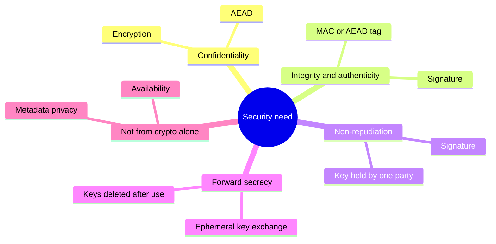
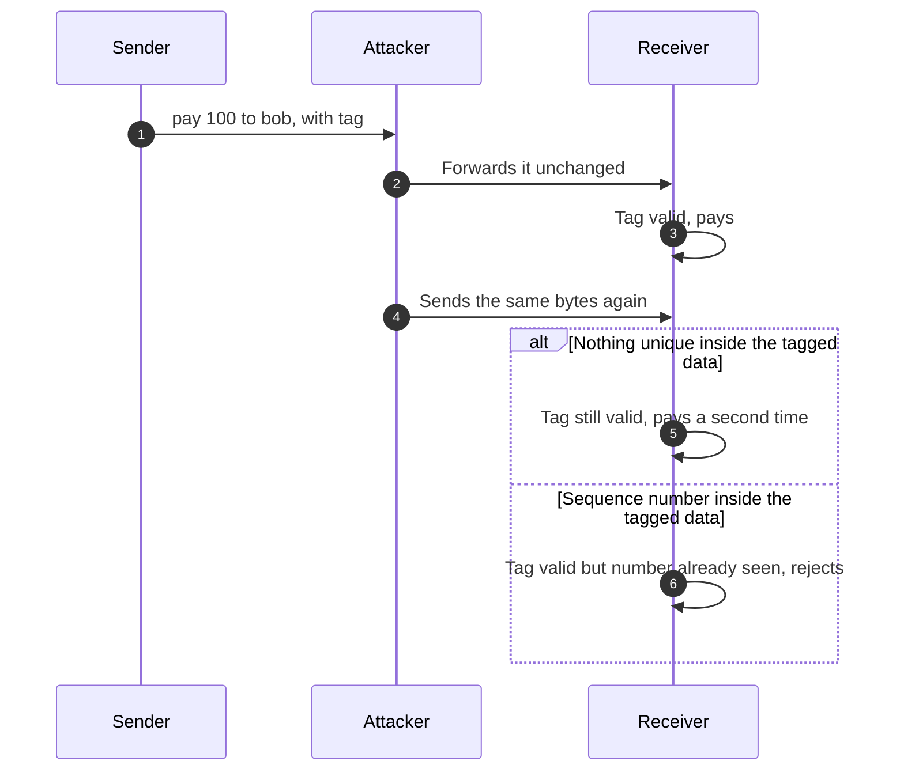
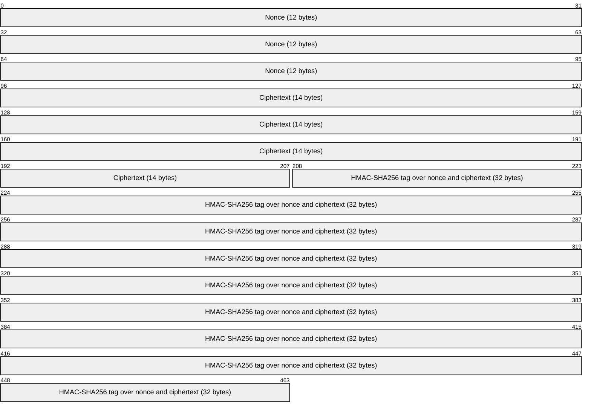

+++
title = 'Start from the property'
description = 'Cryptography delivers specific properties under specific assumptions. Name the property and the attacker first; encryption alone gives confidentiality and nothing else.'
question = 'Which security property does this system actually need, and against which attacker?'
weight = 1
difficulty = 1
date = 2026-08-03
lastmod = 2026-08-03
verified = 2026-08-03
+++

## The idea in one minute

"Encrypt it" is not a requirement. A requirement sounds like *"nobody but the
payroll service can read this file"*, *"nobody can change this payment
instruction in transit without being caught"*, or *"if the server is seized next
year, today's traffic stays private"*. Each sentence names a different
**security property**: confidentiality, integrity, authenticity, forward
secrecy. Each property is delivered by a different mechanism, and each holds
only under **assumptions** about who holds which keys and what the attacker can
see and touch.

The most common design mistake in applied cryptography is to reach for a
primitive before naming the property. The classic result is a system that
encrypts its messages, so nobody can read them, but does not authenticate them,
so anybody on the path can change them. This lesson shows that failure in a few
lines of Python: a ciphertext that turns "pay 100" into "pay 900" without the
attacker ever learning the key.

The consequence to act on: **write down the property and the attacker before
choosing anything**, and treat "encrypted" as a statement about confidentiality
only.

## A picture

```mermaid {title="Encryption hides the message; only a tag notices a change"}
flowchart LR
  S["<b>Sender</b><br/><small>pay 100 to bob</small>"] --> E["<b>Encrypt</b><br/><small>keystream XOR</small>"]
  E --> N["<b>Network</b><br/><small>attacker flips 1 bit</small>"]
  N --> V{"<b>Verify tag</b><br/><small>HMAC over ciphertext</small>"}
  V -->|valid| D["<b>Decrypt</b>"]
  V -->|invalid| R["<b>Reject</b><br/><small>never decrypted</small>"]
  N -.->|"without a tag"| X["<b>Receiver reads</b><br/><small>pay 900 to bob</small>"]
  class S,D compute
  class E neutral
  class N,X warn
  class V,R good
```

The dashed path is what happens when the system needed integrity and got only
confidentiality: the receiver decrypts attacker-chosen text and has no way to
know.

## How it really works

### The properties

| Property | The question it answers | Typical mechanism | What it does **not** give you |
| --- | --- | --- | --- |
| **Confidentiality** | Can anyone without the key learn the content? | Encryption (AES-GCM, ChaCha20-Poly1305) | Integrity, or hiding the length, timing, or who talks to whom |
| **Integrity** | Has the data changed since it was protected? | MAC (HMAC), AEAD tag, signature | Secrecy; also, a bare hash gives integrity only if the hash itself is delivered over a trusted channel |
| **Authenticity** | Did it come from who it claims? | MAC (shared key) or signature (private key) | Proof to a third party, when a shared key is used |
| **Non-repudiation** | Can the author later be held to it, in front of someone else? | Digital signature, with the private key held by one party only | Anything, if the key is shared, escrowed, or stolen |
| **Forward secrecy** | If long-term keys leak later, does past traffic stay private? | Ephemeral key exchange (ECDHE), keys deleted after use | Protection for traffic sent *after* the compromise |

A few distinctions in that table carry most of the weight.

**Integrity and authenticity travel together in practice.** A MAC computed with a
key that only you and I share proves that the message was not changed *and*
that one of us wrote it. A bare hash proves neither against an active
attacker, because whoever changes the message can recompute the hash. The
[hash functions](/notes/cryptography/foundations/03-hash-functions/) lesson
returns to this point.

**Authenticity is not non-repudiation.** With a MAC, both parties hold the same
key, so either could have produced any tag. That is fine between two services
that trust each other, but useless as evidence for a judge. A signature can
only have come from the holder of the private key, which is why signatures (and
not MACs) underlie code signing, certificates, and signed audit records. Even
then, non-repudiation is partly a legal and procedural claim: it holds only as
well as the story of who could have used the key. A signing key on a shared
build server repudiates itself.

**Forward secrecy is a property of the key exchange, not the cipher.** If a
server encrypts every session under keys derived from one long-term RSA key, an
attacker who records traffic today and steals that key in five years decrypts
all of it. If each session runs an ephemeral Diffie-Hellman exchange and the
ephemeral secrets are erased, the long-term key only *authenticates* the
exchange, and stealing it later reveals nothing about past sessions. TLS 1.3
(RFC 8446) removed static RSA and static Diffie-Hellman key exchange for this
reason: all its public-key-based exchanges provide forward secrecy.
[Key exchange](/notes/cryptography/public-key-cryptography/01-key-exchange/)
covers the mechanism.

Follow the same recorded traffic down both branches: the only difference is
whether the session secret was ever encrypted to the long-term key.

```mermaid {title="Forward secrecy decides what a key stolen later unlocks"}
sequenceDiagram
  autonumber
  participant C as Client
  participant S as Server
  participant A as Recorder
  alt Static RSA key exchange
    C->>S: Session secret, encrypted to the long-term RSA key
    Note over A: Records the handshake and all traffic
    Note over A: Years later, steals the RSA key
    A->>A: Decrypts the recorded secret, then every session
  else Ephemeral ECDHE as in TLS 1.3
    C->>S: Fresh ECDHE share
    S->>C: Fresh ECDHE share, signed with the long-term key
    Note over C,S: Both erase the ephemeral secrets after the session
    Note over A: Years later, steals the long-term key
    A->>A: Nothing recorded can be decrypted with it
  end
```

Some requirements are not on the list because cryptography alone does not
deliver them. **Availability** is one: an attacker who can drop packets wins
regardless of the cipher. **Metadata privacy** is another: encryption hides
contents, not the fact that two parties talked, when, or roughly how much they
said.

The map groups each property with the mechanism that delivers it, plus the two
needs that cryptography alone cannot meet.



### Threat assumptions

Every property is a conditional statement: *if* the attacker can do only these
things, *then* this holds. Writing the conditions down is the threat model,
and three questions cover most of it.

**Who holds the keys?** The answer defines who is *inside* the system. If a cloud
provider's KMS holds your data key, the provider is inside your confidentiality
boundary, whatever the marketing says. If ten engineers can read the HMAC key
from a configuration file, your authenticity property is "one of these ten
people or the service wrote this". Most real failures are found here, which is
why the course spends a whole module on key management.

**What can the attacker see?** A **passive** attacker reads traffic: a
compromised Wi-Fi access point, a tapped link, a log aggregator that stores
request bodies. Against a passive attacker, confidentiality is the main
question. Also consider what else leaks: message lengths, timing, error
messages, and whether the same plaintext always produces the same ciphertext.

**What can the attacker control?** An **active** attacker modifies, drops,
replays, reorders, and injects messages, and can often get the victim to
encrypt or decrypt data of the attacker's choosing. The standard formal model
of this attacker, from Dolev and Yao (1983), assumes the network *is* the
attacker: every message passes through their hands. That sounds pessimistic,
and it is the right default for anything that crosses a network you do not
operate. Against an active attacker, integrity is not optional, because
modifying ciphertext is something the attacker can simply do.

In the Dolev-Yao picture, every message passes through the active attacker,
while the passive one only taps the line; look at which property each one
threatens first.

```mermaid {title="Passive attackers read the path, active attackers own it"}
flowchart LR
  U("Sender")
  S("Receiver")
  subgraph NET["Network you do not operate"]
    P(["Passive: reads"])
    A(["Active: rewrites"])
  end
  U -->|"every message"| A
  A -->|"altered, dropped, replayed"| S
  U -.->|"tap"| P
  P --> T1["<b>Confidentiality at risk</b><br/><small>contents, lengths, timing</small>"]
  A --> T2["<b>Integrity at risk</b><br/><small>needs a tag checked first</small>"]
  class T1 io
  class T2 warn
```

| Attacker capability | Example | Property it threatens first |
| --- | --- | --- |
| Reads traffic or storage | Leaked backup, sniffed link | Confidentiality |
| Modifies messages in flight | Proxy, compromised router, malicious client | Integrity, authenticity |
| Replays old valid messages | Resending a captured "transfer funds" request | Freshness (needs nonces, counters, or timestamps inside the authenticated data) |
| Submits chosen inputs to your system | Any user of a public API | Everything: chosen-plaintext and chosen-ciphertext attacks |
| Steals a long-term key later | Server breach, seized disk | Forward secrecy |
| Holds a key legitimately | An insider, a vendor, a co-tenant with the same MAC key | Authenticity between key holders, non-repudiation |

**Replay** deserves its own sentence. A perfectly authenticated message is still
valid the second time it arrives. If repeating a message is harmful, the
authenticated data must include something that makes each message unique and
checkable: a sequence number, a nonce the receiver tracks, or an expiry time.

The second delivery below carries a perfectly valid tag; only a counter inside
the authenticated data lets the receiver tell it apart from the first.



### Encryption without authentication fails

Here is the failure the code below demonstrates. A **stream cipher** (and AES in
CTR mode, and the encryption half of GCM) works by generating a pseudorandom
**keystream** from the key and a nonce, then XORing it with the plaintext:

`ciphertext = plaintext XOR keystream`

XOR has a property that makes this fast and simple: flipping a bit in the
ciphertext flips exactly the same bit in the decrypted plaintext, and nothing
else. The attacker does not need the key. If they know or can guess the
plaintext at some position (message formats are rarely secret), they compute
`known XOR wanted` and XOR it into the ciphertext at that position. This is
called **malleability**: the ciphertext can be transformed into the encryption
of a related plaintext.

Other modes fail differently but just as badly. CBC mode without a MAC lets an
attacker flip chosen bits in one block at the cost of garbling the previous
one, and when the receiver reveals whether padding was valid, Vaudenay's 2002
padding-oracle attack decrypts the whole message one byte at a time. The 2018
EFAIL research showed that malleable CBC and CFB encryption in S/MIME and
OpenPGP email let an attacker modify encrypted mail so that the victim's own
client sent the plaintext to the attacker. None of these attacks breaks the
cipher. They exploit the missing integrity check.

The fix is to authenticate the ciphertext and **refuse to decrypt** anything
whose tag does not verify. Bellare and Namprempre (2000) analyzed the ways to
combine a cipher and a MAC and showed that **encrypt-then-MAC**, a MAC over
the ciphertext (and nonce), is the composition that is generically secure.
Today you rarely build it by hand: an **AEAD** (authenticated encryption with
associated data, RFC 5116) such as AES-GCM or ChaCha20-Poly1305 does both in
one call and fails closed on any modification.
[Authenticated encryption](/notes/cryptography/symmetric-cryptography/02-authenticated-encryption/)
covers AEADs in detail.

This is what the receiver works with in the program below (bit offsets): the
tag covers the nonce and the ciphertext, so changing either one breaks it.



> [!IMPORTANT]
> If an attacker can touch the ciphertext, confidentiality without integrity is
> not a weaker form of security. It is a different and often exploitable one.
> Default to authenticated encryption, every time.

### From property to primitive

Once the property and attacker are written down, the choice is usually short:

| You need | Against | Reach for |
| --- | --- | --- |
| Confidentiality and integrity between parties sharing a key | Active network attacker | An AEAD (AES-256-GCM, ChaCha20-Poly1305) via a high-level library |
| Integrity and authenticity, no secrecy, shared key | Active attacker; parties trust each other | HMAC-SHA256 |
| Authenticity that third parties can check | Anyone, including the recipient | A signature (Ed25519, ECDSA P-256) |
| Confidentiality of past sessions after key theft | Future server compromise | Ephemeral key exchange (TLS 1.3 does this) |
| Integrity of data you download, given a trusted digest | Mirror or CDN tampering | A hash (SHA-256) published over an authenticated channel |

Notice that the last row only works because *something else* is authenticated.
A hash next to a download on the same compromised server proves nothing.

## Code

The program builds a **toy** stream cipher from `hashlib.shake_256` (an
extendable-output function that will produce as many keystream bytes as asked)
and encrypts a payment instruction. An attacker who knows only the message
format flips one bit to change the amount. Then the same forgery is tried
against encrypt-then-MAC with HMAC-SHA256 and a separate MAC key.

```python {title="bitflip.py"}
"""bitflip.py: why encryption without authentication fails.

A TOY stream cipher (keystream = SHAKE-256(key || nonce)) hides the message
but does not protect it. An attacker who never learns the key turns
"pay 100" into "pay 900" by flipping bits in the ciphertext. An HMAC tag over
the ciphertext (encrypt-then-MAC) detects the change.
Standard library only; offline. Do not use this cipher for anything real.
"""

from __future__ import annotations

import hashlib
import hmac

# Fixed demo keys so the output is reproducible. Real keys come from secrets.token_bytes(32).
ENC_KEY = hashlib.sha256(b"demo encryption key").digest()
MAC_KEY = hashlib.sha256(b"demo MAC key").digest()
NONCE = bytes(12)  # fixed for the demo; a real nonce must never repeat under one key


def keystream(key: bytes, nonce: bytes, n: int) -> bytes:
    return hashlib.shake_256(key + nonce).digest(n)


def xor(a: bytes, b: bytes) -> bytes:
    return bytes(x ^ y for x, y in zip(a, b))


def encrypt(plaintext: bytes) -> bytes:
    return xor(plaintext, keystream(ENC_KEY, NONCE, len(plaintext)))


def decrypt(ciphertext: bytes) -> bytes:
    return encrypt(ciphertext)  # XOR with the same keystream undoes itself


def tag(ciphertext: bytes) -> bytes:
    return hmac.new(MAC_KEY, NONCE + ciphertext, hashlib.sha256).digest()


def flip(ciphertext: bytes, offset: int, known: bytes, wanted: bytes) -> bytes:
    """The attacker's whole trick: C' = C xor (known xor wanted) at the guessed offset."""
    delta = xor(known, wanted)
    out = bytearray(ciphertext)
    for i, d in enumerate(delta):
        out[offset + i] ^= d
    return bytes(out)


def main() -> None:
    message = b"pay 100 to bob"
    ct = encrypt(message)
    print(f"plaintext        {message.decode()!r}")
    print(f"ciphertext       {ct.hex()}")

    # The attacker knows the message format ("pay NNN to ...") but not the key.
    forged = flip(ct, offset=4, known=b"1", wanted=b"9")
    print(f"forged ct        {forged.hex()}")
    print(f"bits changed     {sum(bin(a ^ b).count('1') for a, b in zip(ct, forged))}")
    print(f"receiver reads   {decrypt(forged).decode()!r}  (no error, no warning)")

    print()
    print("now with encrypt-then-MAC (HMAC-SHA256 over nonce || ciphertext)")
    sent_tag = tag(ct)
    for label, body in (("original", ct), ("forged", forged)):
        ok = hmac.compare_digest(tag(body), sent_tag)
        verdict = f"accepted -> {decrypt(body).decode()!r}" if ok else "REJECTED before decryption"
        print(f"  {label:<9} tag valid={ok!s:<5}  {verdict}")


if __name__ == "__main__":
    main()
```

Run it with `python3 bitflip.py`:

```text
plaintext        'pay 100 to bob'
ciphertext       3aec79fc5d39b6f9cbddfa57080b
forged ct        3aec79fc5539b6f9cbddfa57080b
bits changed     1
receiver reads   'pay 900 to bob'  (no error, no warning)

now with encrypt-then-MAC (HMAC-SHA256 over nonce || ciphertext)
  original  tag valid=True   accepted -> 'pay 100 to bob'
  forged    tag valid=False  REJECTED before decryption
```

One bit of difference in the ciphertext produces a valid-looking, attacker-chosen
plaintext. The decryption function has no way to complain; there is nothing in
`ciphertext XOR keystream` that could fail. The tag check, done before
decryption with a constant-time comparison (`hmac.compare_digest`), is what
turns the attack into a rejected message.

## Where it breaks

- **The toy cipher is a toy.** SHAKE-256 as a keystream generator is a
  reasonable mental model, but this code has no key schedule review, no nonce
  management, and no specification behind it. Real systems use a standard AEAD
  from a vetted library.
- **The nonce is fixed.** With a stream cipher, encrypting two messages under the
  same key and nonce gives `C1 XOR C2 = P1 XOR P2`, which leaks both plaintexts
  to anyone who can guess part of one. The demo gets away with it because it
  encrypts one message. Nonce reuse is covered in the symmetric module.
- **The MAC does not stop replay.** The original ciphertext and tag are still
  valid if sent twice. "Pay 100 to bob" arriving ten times is a different attack
  that needs a sequence number or unique ID inside the authenticated data.
- **The MAC proves origin only up to key holders.** Anyone with `MAC_KEY` can
  forge a valid tag. That includes the receiver, so this gives no
  non-repudiation.
- **Decrypt-then-check is a common bug.** Code that decrypts first, parses or
  acts on the plaintext, and only then compares tags can leak information
  through errors or timing, or act on forged data before the check runs. Check
  first, then decrypt.

  The two orders differ in what the attacker learns from the reply:

  ```mermaid {title="Check the tag before any plaintext exists"}
  sequenceDiagram
    autonumber
    participant A as Attacker
    participant R as Receiver
    A->>R: Modified ciphertext with the old tag
    alt Check first
      R->>R: Recompute tag, compare_digest fails
      R-->>A: Rejected, nothing decrypted
    else Decrypt first
      R->>R: Decrypt and parse the forged plaintext
      R-->>A: Error or timing depends on the content
      Note over A,R: That difference is an oracle, and code may already have acted
    end
  ```
- **Keys from strings.** The demo derives keys from fixed strings so the output
  is reproducible. Real keys come from the operating system's secure generator
  (`secrets.token_bytes(32)`) or a proper key derivation function, which
  [key derivation](/notes/cryptography/symmetric-cryptography/04-key-derivation/)
  covers.

## Remember this

- Name the property (confidentiality, integrity, authenticity, non-repudiation,
  forward secrecy) before naming an algorithm.
- Every property holds only under assumptions about who holds keys and what the
  attacker sees and controls.
- Assume an active attacker on any network you do not operate.
- Encryption alone is malleable: an attacker can change plaintext without the key.
- Authenticate the ciphertext and refuse to decrypt on failure; in practice, use
  an AEAD.
- A MAC gives authenticity between key holders; only a signature can give
  non-repudiation.

## Try it

1. Run `bitflip.py`. Change the forgery so the message reads `pay 999 to bob`,
   then `pay 100 to eve`. How much of the plaintext did you need to know?
2. Encrypt two different messages with the same nonce, XOR the two ciphertexts,
   and compare the result with the XOR of the two plaintexts.
3. Change `main` so the receiver decrypts *before* checking the tag and prints
   the plaintext either way. Why is this worse even if the message is rejected
   afterwards?
4. Add a 64-bit sequence number to the authenticated data and make the receiver
   reject any number it has already seen. Replay the original message.
5. Pick a system you work on and fill in the threat table: who holds each key,
   what a passive attacker sees, what an active attacker controls.

## Check yourself

1. A team says their message queue is secure because every message is encrypted
   with AES-CTR. What question should you ask first?

   
   Who can write to the queue or modify messages, and how would a modified
   message be detected? AES-CTR provides confidentiality only. Anyone who can
   alter ciphertext can flip plaintext bits at known positions without the key,
   so if integrity matters (and for instructions it always does), the messages
   need an AEAD or a MAC over the ciphertext that is checked before decryption.
   

2. Why does an HMAC tag not provide non-repudiation?

   
   Both the sender and the receiver hold the same key, so either could have
   computed any valid tag. The tag convinces the receiver that the message came
   from someone holding the key, but it cannot convince a third party which of
   the key holders wrote it. Non-repudiation needs a signature made with a
   private key held by one party only.
   

3. An attacker records a year of TLS traffic and then steals the server's
   private key. Under what conditions can they decrypt the recordings?

   
   Only if the sessions did not have forward secrecy, for example TLS 1.2 with
   static RSA key exchange, where the session secret was encrypted to the
   server's long-term key. With ephemeral (EC)DHE, as required for public-key
   exchanges in TLS 1.3, the long-term key only signed the handshake; the
   session keys came from ephemeral secrets that were discarded, so the stolen
   key does not decrypt past traffic.
   

4. Why is "verify the tag, then decrypt" safer than "decrypt, then verify"?

   
   Decrypting first means attacker-controlled plaintext reaches parsing,
   padding checks, or business logic before anything has established that it
   is genuine. Differences in errors or timing on that path can become an
   oracle (as in padding-oracle attacks), and code may act on forged data
   before the check runs. Verifying first means forged input is rejected before
   any of that code sees it.
   

5. A download page lists a SHA-256 digest next to the file. Against which
   attacker does that help, and against which does it not?

   
   It detects accidental corruption and tampering by a mirror or CDN, provided
   the digest itself came from a trusted, authenticated source. It does not help
   against an attacker who controls the page, because they can replace the file
   and the digest together. A signature over the file, checked against a key
   you obtained separately, covers that case.
   

## Sources

- D. Dolev, A. Yao, "On the security of public key protocols", *IEEE Transactions on Information Theory* 29(2), 1983.
- M. Bellare, C. Namprempre, [Authenticated Encryption: Relations among notions and analysis of the generic composition paradigm](https://eprint.iacr.org/2000/025), ASIACRYPT 2000.
- S. Vaudenay, "Security Flaws Induced by CBC Padding: Applications to SSL, IPSEC, WTLS...", EUROCRYPT 2002.
- D. Poddebniak et al., [Efail: Breaking S/MIME and OpenPGP Email Encryption using Exfiltration Channels](https://www.usenix.org/conference/usenixsecurity18/presentation/poddebniak), USENIX Security 2018.
- D. McGrew, [RFC 5116: An Interface and Algorithms for Authenticated Encryption](https://www.rfc-editor.org/rfc/rfc5116), IETF, January 2008.
- E. Rescorla, [RFC 8446: The Transport Layer Security (TLS) Protocol Version 1.3](https://www.rfc-editor.org/rfc/rfc8446), IETF, August 2018.
- H. Krawczyk, M. Bellare, R. Canetti, [RFC 2104: HMAC: Keyed-Hashing for Message Authentication](https://www.rfc-editor.org/rfc/rfc2104), IETF, February 1997.
- NIST, [FIPS 202: SHA-3 Standard: Permutation-Based Hash and Extendable-Output Functions](https://csrc.nist.gov/pubs/fips/202/final), August 2015.
- Python Software Foundation, [hmac: Keyed-Hashing for Message Authentication](https://docs.python.org/3/library/hmac.html).
