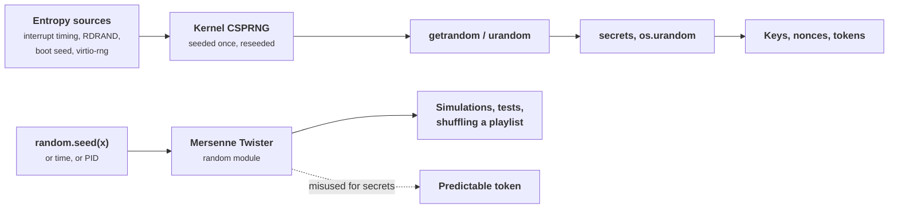
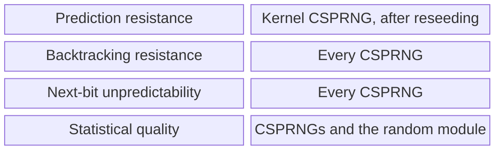
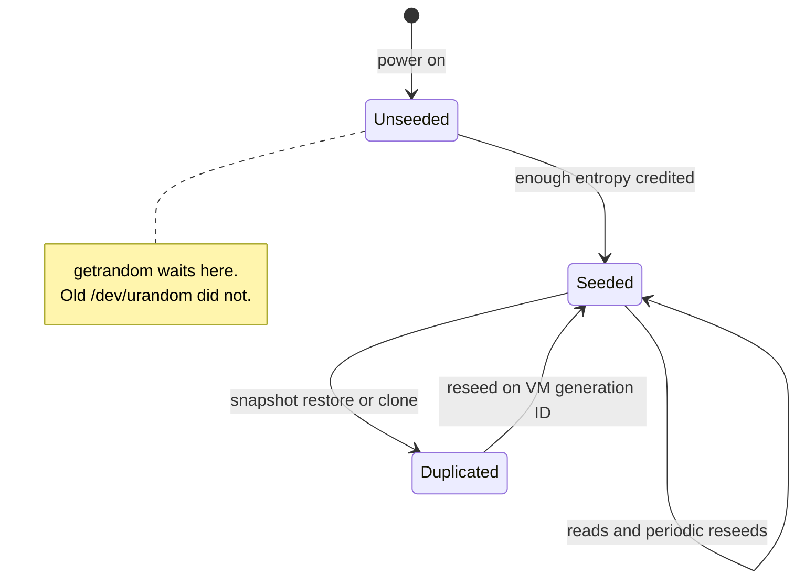
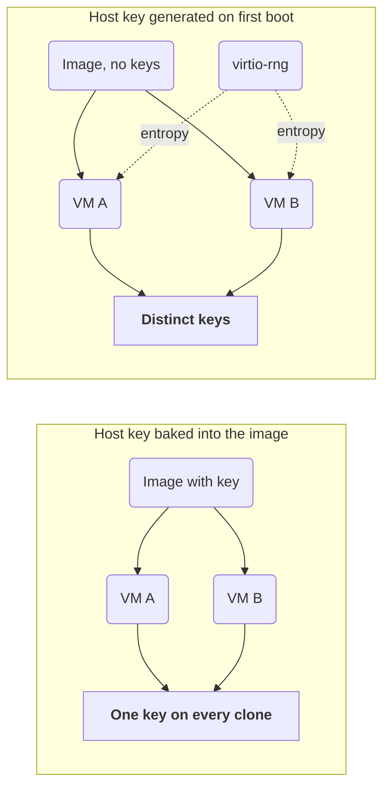
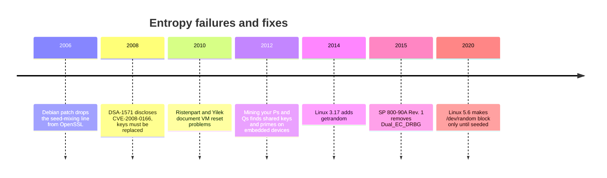
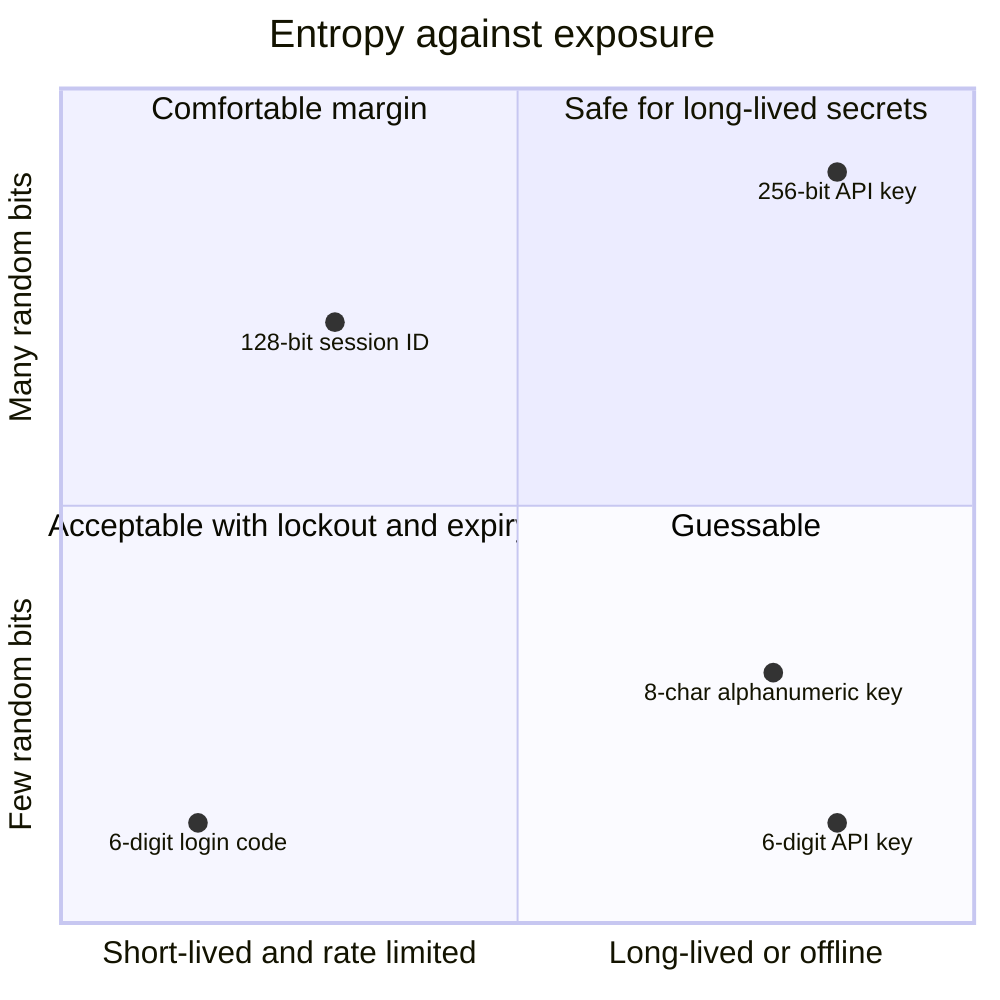

+++
title = 'Randomness and entropy'
description = 'Keys, nonces, and tokens are only as strong as the generator behind them. Security needs outputs nobody can predict, which means a CSPRNG seeded by the operating system, and enough bits to survive both guessing and collisions.'
question = 'Where should secret values come from, and how many random bits does a token need?'
weight = 2
difficulty = 2
prerequisites = ['/notes/cryptography/foundations/01-start-from-the-property']
date = 2026-08-05
lastmod = 2026-10-30
verified = 2026-08-05
+++

## The idea in one minute

Every cryptographic key, nonce, salt, session ID, and password-reset link
starts life as a random number. The algorithms built on top assume that number
was **unpredictable to the attacker**: drawn uniformly from a space too large
to search, with no way to work it out from anything the attacker can observe.
"Looks random" is not the same property. A generator can pass every
statistical test ever written and still be perfectly predictable to someone who
knows its seed or has seen some of its output.

That distinction splits generators in two. **General-purpose PRNGs** such as
Python's `random` module are built for simulations, games, and sampling: fast,
reproducible, statistically good, and predictable by design. **Cryptographically
secure PRNGs (CSPRNGs)** are built so that seeing past outputs tells you nothing
useful about future ones, and they are seeded from entropy the operating system
collects. Two real-world failures, the Debian OpenSSL bug and the weak keys
found across thousands of network devices in 2012, show what happens when a
system produces key material with too little entropy behind it.

The consequence to act on: **draw every secret from `secrets` or `os.urandom`,
never from `random`, and size tokens by doing the arithmetic** for guessing and
for collisions instead of picking a length that looks long.

## A picture



The top path is the only acceptable source of secret values. The bottom path is
fine for its intended job; the dashed edge is the bug this lesson is about.

## How it really works

### Unpredictable is the property, not "random-looking"

A **pseudorandom number generator** is a deterministic machine: it holds an
internal state, outputs a function of that state, and advances it. Give two
copies the same seed and they produce the same stream forever. That is a
feature for a Monte Carlo simulation (rerun with the same seed, get the same
answer) and the whole problem for a secret.

Two different questions get confused here:

| Question | Who asks it | Tool that answers it |
| --- | --- | --- |
| Are the outputs evenly distributed and free of obvious patterns? | A statistician running a simulation | Statistical test suites, period length |
| Can someone who knows the algorithm and sees some outputs predict the next one, or recover earlier ones? | An attacker holding a password-reset link | A security argument about the generator's design |

Python's `random` module uses the Mersenne Twister, which passes demanding
statistical tests and has an astronomically long period. It fails the second
question completely. Its internal state is a linear function of its outputs, so
an observer who collects enough consecutive outputs can compute the state and
from then on know every value the generator will produce. The Python
documentation says so directly: the generators in `random` "should not be used
for security purposes", and points to `secrets` instead.

A CSPRNG adds two guarantees on top of good statistics. **Next-bit
unpredictability**: given any prefix of the output, no efficient algorithm can
guess the next bit with probability meaningfully better than one half.
**Backtracking resistance**: if the current state leaks, earlier outputs stay
secret, because the state update is one-way. Good designs add **prediction
resistance** as well: after fresh entropy is mixed in, a past compromise stops
helping. Modern CSPRNGs get these properties from a block cipher, a stream
cipher, or a hash function used in a specific construction; Linux's kernel
generator is built on ChaCha20, and NIST's approved designs use HMAC, a hash, or
AES in counter mode.

Read the ladder from the bottom: statistical quality is the floor both kinds of
generator share, and every rung above it is what a secret actually needs.



> [!IMPORTANT]
> A CSPRNG does not create entropy. It stretches a seed that must itself be
> unpredictable. A perfect generator seeded with the process ID produces at most
> as many distinct streams as there are process IDs.

### Where the operating system gets its entropy

**Entropy**, in this sense, measures how many guesses an attacker needs. A
value with *n* bits of entropy takes on the order of 2^n guesses; a 128-bit
string chosen from 32,768 possibilities still has only 15 bits.

Operating systems gather unpredictability from events software cannot easily
foresee: the fine-grained timing of interrupts, disk and network activity, CPU
jitter, hardware random number instructions such as Intel's RDRAND and RDSEED,
seeds handed over by the bootloader or saved from the previous boot, and, in
virtual machines, a `virtio-rng` device fed by the host. The kernel mixes these
inputs into a pool, credits them conservatively, and uses the pool to seed its
CSPRNG. Once the CSPRNG has been seeded with a few hundred bits of real entropy, it
can produce effectively unlimited output; entropy is not "used up" by reading.

Programs reach that generator through a small set of interfaces:

| Platform | Interface | Behavior worth knowing |
| --- | --- | --- |
| Linux | `getrandom(2)` | Blocks only until the CSPRNG is first seeded, then never; the interface to prefer |
| Linux | `/dev/urandom` | Historically never blocks, even early in boot before seeding |
| Linux | `/dev/random` | Since Linux 5.6, blocks only until seeded, like `getrandom`; older kernels blocked on an entropy estimate for no security benefit |
| macOS, BSDs | `getentropy(2)`, `arc4random(3)` | Kernel CSPRNG; `arc4random` no longer uses RC4 on current systems |
| Windows | `BCryptGenRandom` | The system CSPRNG behind the CNG API |
| Python | `os.urandom`, `secrets`, `random.SystemRandom` | Thin wrappers over the above; on Linux, `os.urandom` uses `getrandom()` when available |

In Python, `secrets` is the high-level interface (added in Python 3.6 by PEP
506): `token_bytes`, `token_hex`, `token_urlsafe`, `randbelow`, and `choice`.
Its documentation suggests 32 bytes as a reasonable size for typical use.
`random.SystemRandom` exposes the full `random` API (shuffle, sample, choice)
backed by `os.urandom`, which is handy when you need a secure shuffle.

### Boot time, images, and cloned machines

The weak moment is **early boot on a fresh device**. A headless router or
camera has no keyboard, no mouse, often no disk, and a deterministic boot
sequence. Its first job after power-on may be to generate an SSH host key or a
TLS certificate. If that happens before the kernel has gathered real entropy,
and the program reads from an interface that does not wait, the key comes from
a state that thousands of identical devices share. `getrandom(2)` was added to
Linux in 3.17 precisely so programs can wait until the generator is seeded,
and recent kernels shorten that wait with CPU-jitter collection, which removes
most excuses for not waiting.

**Virtual machine images and snapshots** create the same problem from the
other direction. A golden image that already generated its host keys hands the
same keys to every instance cloned from it. A running VM restored from a
snapshot resumes with the exact CSPRNG state it had when the snapshot was
taken, so two clones can produce identical "random" values until fresh entropy
diverges them. Ristenpart and Yilek demonstrated this class of VM reset
problem against deployed software (NDSS 2010). The engineering fixes are
mundane: generate host keys on first boot rather than in the image, give guests
a `virtio-rng` device, and use hypervisor features that signal a snapshot
restore (the VM generation ID, which recent Linux kernels use to reseed) where
your platform offers them.

The generator's state over a machine's life shows the two weak moments: before
the first seeding, and after a restore duplicates a state another machine
already has.



The fix for images is to move key generation from build time to first boot, and
to give each guest its own entropy feed:



### Two documented failures

**Debian OpenSSL (CVE-2008-0166).** In 2006, a Debian maintainer removed two
lines from OpenSSL's random number code to silence warnings from the Valgrind
memory checker. One of them was the line that mixed caller-supplied seed data
into the pool. For almost two years after that, the only variable input left in
key generation on Debian and derived systems such as Ubuntu was the process ID,
which on Linux defaulted to at most 32,768 values. Every SSH key, OpenVPN key,
and TLS key generated with the affected package therefore came from a set small
enough to enumerate in advance. When the bug was announced in May 2008 (Debian
security advisory DSA-1571), the fix was not only to patch OpenSSL but to find
and replace every key generated in the interval, and DSA keys that had merely
*signed* on an affected machine were considered compromised too, because DSA
signatures leak the key when their per-signature random value is predictable.
The lesson is that **nothing in the output looked wrong**: the keys had the
right length and format and worked.

**"Mining your Ps and Qs" (Heninger, Durumeric, Wustrow, Halderman, USENIX
Security 2012).** The authors scanned the public IPv4 address space for TLS and
SSH hosts and analyzed the keys they collected. Large numbers of hosts shared
identical keys, and, worse, many distinct RSA moduli shared one prime factor,
which lets anyone compute both private keys with a greatest-common-divisor
calculation. They reported obtaining RSA private keys for 0.50% of TLS hosts
and 0.03% of SSH hosts, and DSA private keys for 1.03% of SSH hosts through
repeated signature randomness. They traced the overwhelming majority to
headless and embedded network devices that generated keys at first boot,
before the Linux kernel had gathered enough entropy, and the paper is a large
part of why `getrandom(2)` and better boot-time seeding exist. Lenstra et al.
reported overlapping findings in the same year.

The shape of both incidents is the same: a correct algorithm, a correct key
format, and a generator whose state had far fewer possibilities than its output
length suggested. Deeper failure stories, including signature nonce reuse,
belong to [how cryptography fails in practice](/notes/cryptography/applied-cryptography/01-how-cryptography-fails-in-practice/)
and [digital signatures](/notes/cryptography/public-key-cryptography/02-digital-signatures/).

Each incident pushed a fix into kernels and standards; the timeline puts them
side by side.



### How many bits a token needs

A token's strength is the number of equally likely values it could have taken,
expressed in bits: log2 of the space. A 6-digit PIN is log2(10^6) ≈ 19.9 bits.
An 8-character lowercase string is 8 · log2(26) ≈ 37.6 bits. A version 4 UUID
has 122 random bits, because 6 of its 128 bits are fixed version and variant
markers. `secrets.token_urlsafe(16)` encodes 128 random bits as 22 characters.
The encoded length is irrelevant; only the random bits count, and only if they
came from a CSPRNG.

Two separate budgets decide whether that is enough.

**Guessing.** An attacker who can submit *g* guesses against a system holding
*L* valid tokens out of a space of size 2^b wins with probability about
g · L / 2^b while that number is small. Note the *L*: when any valid token is a
win (any session, any reset link), every live token makes the attacker's job
easier. Rate limiting shrinks *g*; expiry shrinks *L* and the window. This is
why a 6-digit one-time code is acceptable at a login prompt that locks after a
handful of failures and expires in minutes, and hopeless as a long-lived API
key. NIST SP 800-63B also asks for at least 64 bits of entropy in session
secrets.

The same bit count can be fine or hopeless depending on how long the token
lives and whether the attacker's guesses are limited:



**Collisions.** If a system issues *n* tokens and two of them coincide, one user
may land in another's session or overwrite another's record. By the birthday
bound, a duplicate becomes likely once *n* approaches 2^(b/2), and the
probability is about n² / 2^(b+1) while small. The
[hash functions](/notes/cryptography/foundations/03-hash-functions/) lesson
derives this bound; for tokens, the point is that **collision resistance costs
twice the bits** of the issued count. A billion tokens is about 2^30, so 60 bits
gives even odds of a duplicate.

NIST's standards cover the generators themselves. **SP 800-90A Rev. 1** (2015)
specifies the approved deterministic random bit generators, Hash_DRBG,
HMAC_DRBG, and CTR_DRBG; that revision removed Dual_EC_DRBG after public
concern that it could contain a backdoor. **SP 800-90B** (2018) covers entropy
sources and how to test and estimate them. **SP 800-90C** describes how to
combine sources and DRBGs into complete random bit generators. You rarely
implement any of these, but FIPS-validated modules and HSMs are tested against
them, and they define the vocabulary vendors use.

## Code

The program computes the entropy of six token formats, the chance that a
rate-limited attacker hits any live token within 30 days, and the chance of a
duplicate after a million and a billion issued tokens. It then shows why a
seeded `random` stream is reproducible, and contrasts it with `secrets`. It
never prints a secret value, only lengths and comparisons, so the output is
deterministic.

```python {title="token_budget.py"}
"""token_budget.py: how many bits a token format really has, what that buys
against guessing and against collisions, and why a seeded PRNG is no source of
secrets. Standard library only; runs offline; prints no secret values."""

import math
import random
import secrets
from dataclasses import dataclass

GUESS_RATE = 1_000            # attacker guesses per second, after rate limiting
WINDOW_S = 30 * 24 * 3600     # attacker keeps going for 30 days
LIVE_TOKENS = 1_000_000       # valid tokens at any moment (any one is a win)
ISSUED = (10**6, 10**9)       # tokens issued over the system's lifetime


@dataclass(frozen=True)
class TokenFormat:
    name: str
    bits: float               # log2 of the number of equally likely values


def fmt_bits(symbols: int, length: int) -> float:
    return length * math.log2(symbols)


def p_guess(bits: float) -> float:
    """Chance that at least one guess in the window hits any live token."""
    guesses = GUESS_RATE * WINDOW_S
    p_each = min(1.0, LIVE_TOKENS / 2**bits)
    if p_each == 1.0:
        return 1.0
    return -math.expm1(guesses * math.log1p(-p_each))


def p_collision(bits: float, n: int) -> float:
    """Birthday bound: chance that n random tokens contain a duplicate."""
    return -math.expm1(-n * (n - 1) / (2 * 2**bits))


def show(p: float) -> str:
    return "~1" if p > 0.9999 else f"{p:.2e}"


def token_table() -> None:
    # Lengths come from the real generator; the values themselves are discarded.
    len16 = len(secrets.token_urlsafe(16))
    len32 = len(secrets.token_urlsafe(32))
    formats = [
        TokenFormat("6-digit PIN", fmt_bits(10, 6)),
        TokenFormat("8 chars a-z", fmt_bits(26, 8)),
        TokenFormat("8 chars a-zA-Z0-9", fmt_bits(62, 8)),
        TokenFormat("UUIDv4 (122 random bits)", 122.0),
        TokenFormat(f"token_urlsafe(16), {len16} chars", 128.0),
        TokenFormat(f"token_urlsafe(32), {len32} chars", 256.0),
    ]
    print(f"attacker: {GUESS_RATE} guesses/s for 30 days "
          f"= {GUESS_RATE * WINDOW_S:.2e} guesses, {LIVE_TOKENS:.0e} live tokens")
    print(f"{'format':<33}{'bits':>6}{'P(guess hit)':>14}"
          f"{'P(dup, 1e6)':>13}{'P(dup, 1e9)':>13}")
    for f in formats:
        print(f"{f.name:<33}{f.bits:>6.1f}{show(p_guess(f.bits)):>14}"
              f"{show(p_collision(f.bits, ISSUED[0])):>13}"
              f"{show(p_collision(f.bits, ISSUED[1])):>13}")


def bits_needed(target: float = 1e-9) -> None:
    """Smallest bit counts that keep each risk under the target."""
    guess = next(b for b in range(1, 257) if p_guess(b) < target)
    dup = next(b for b in range(1, 257) if p_collision(b, ISSUED[1]) < target)
    print(f"bits so P(guess hit) < {target:.0e}: {guess}")
    print(f"bits so P(dup among 1e9) < {target:.0e}: {dup}")


def seeded_vs_secrets() -> None:
    random.seed(2026)
    first = [random.randrange(10**6) for _ in range(3)]
    random.seed(2026)
    second = [random.randrange(10**6) for _ in range(3)]
    print(f"random.seed(2026) -> {first}")
    print(f"random.seed(2026) -> {second}")
    print(f"same seed, same 'PINs': {first == second}")

    a, b = secrets.token_bytes(16), secrets.token_bytes(16)
    print(f"secrets.token_bytes(16) twice: {len(a) * 8} bits each, "
          f"equal: {a == b}")
    print(f"secrets.randbelow(10**6) range: {math.log2(10**6):.1f} bits "
          f"(fine source, still a tiny space)")


def main() -> None:
    token_table()
    bits_needed()
    print()
    seeded_vs_secrets()


if __name__ == "__main__":
    main()
```

Run it with `python3 token_budget.py`:

```text
attacker: 1000 guesses/s for 30 days = 2.59e+09 guesses, 1e+06 live tokens
format                             bits  P(guess hit)  P(dup, 1e6)  P(dup, 1e9)
6-digit PIN                        19.9            ~1           ~1           ~1
8 chars a-z                        37.6            ~1     9.09e-01           ~1
8 chars a-zA-Z0-9                  47.6            ~1     2.29e-03           ~1
UUIDv4 (122 random bits)          122.0      4.88e-22     9.40e-26     9.40e-20
token_urlsafe(16), 22 chars       128.0      7.62e-24     1.47e-27     1.47e-21
token_urlsafe(32), 43 chars       256.0      2.24e-62     4.32e-66     4.32e-60
bits so P(guess hit) < 1e-09: 82
bits so P(dup among 1e9) < 1e-09: 89

random.seed(2026) -> [124906, 335003, 526925]
random.seed(2026) -> [124906, 335003, 526925]
same seed, same 'PINs': True
secrets.token_bytes(16) twice: 128 bits each, equal: False
secrets.randbelow(10**6) range: 19.9 bits (fine source, still a tiny space)
```

Read the table row by row. Against an attacker held to 1,000 guesses per second
(already a generous rate limit for a distributed attacker) with a million live
tokens, everything up to 8 alphanumeric characters falls within a month. Even
the collision column condemns the short formats: 8 lowercase characters give a
91% chance of a duplicate after only a million tokens. The 122-bit UUID and the
128-bit `token_urlsafe(16)` are both comfortable, and the two lines after the
table show where the threshold sits for these parameters: 82 bits for the
guessing budget, 89 for collisions at a billion tokens. Collisions dominate,
which is the usual result for systems that issue many tokens, and 128 bits
leaves a wide margin above both.

The bars are the random bits in each format; the line is the 89 bits that keep a
duplicate among a billion tokens below one in a billion, the stricter of the two
thresholds.

```mermaid {title="Only the 122-bit and larger formats clear both budgets"}
xychart-beta
  title "Random bits per token format"
  x-axis ["PIN 6", "a-z x8", "a-zA-Z0-9 x8", "UUIDv4", "urlsafe 16", "urlsafe 32"]
  y-axis "Random bits" 0 --> 260
  bar [19.9, 37.6, 47.6, 122, 128, 256]
  line [89, 89, 89, 89, 89, 89]
```

The second block is the core of the lesson in four lines. Seeding `random` with
2026 produces the same three "PINs" every time, on every machine running the
same Python. That reproducibility is exactly what a simulation wants and
exactly what makes the values worthless as secrets: anyone who knows or guesses
the seed has them too. Seeds chosen from the clock or the process ID do not fix
this; they shrink the search to the plausible clock values or PIDs. The
`secrets` calls give 128 bits from the operating system, and the last line is a
reminder that a perfect source does not rescue a small space: `randbelow(10**6)`
is still a 20-bit PIN.

## Where it breaks

- **A CSPRNG only multiplies the entropy it was seeded with.** Before the
  kernel is seeded, in a cloned VM, or after a snapshot restore, the generator's
  state may be shared with other machines. `secrets` cannot detect that; the
  platform has to prevent it.
- **The bit count assumes uniform, independent choices.** A "random" token
  built from a timestamp plus a counter plus a few random characters has only
  the entropy of the random characters. Hashing a low-entropy value does not
  add entropy: SHA-256 of a PID still has 15 bits.

  Trace where the bits come from in such a token:

  ```mermaid {title="Hashing changes the length, not the entropy"}
  flowchart LR
    T["<b>Timestamp</b><br/><small>guessable, about 0 bits</small>"] --> J["<b>Concatenate</b>"]
    C["<b>Counter</b><br/><small>guessable, about 0 bits</small>"] --> J
    R["<b>4 random a-z chars</b><br/><small>18.8 bits</small>"] --> J
    J --> H["<b>SHA-256</b>"]
    H --> O["<b>64 hex characters</b><br/><small>still 18.8 bits</small>"]
    class T,C neutral
    class R io
    class H compute
    class O warn
  ```
- **UUIDs are identifiers, not capabilities.** Python's `uuid.uuid4()` uses
  `os.urandom`, but RFC 9562 does not require other implementations to use a
  CSPRNG and advises against treating UUIDs as security capabilities. Other
  versions (v1, v6, v7) are mostly timestamp and counter by design.
- **Bias and leakage are separate bugs.** Reducing random bytes into a range
  with `% n` skews the distribution; `secrets.randbelow` and `secrets.choice`
  do it correctly. A secure token that is logged, put in a URL that ends up in
  a referrer header, or compared with a non-constant-time check loses its
  strength no matter how it was generated.
- **Rate limits are part of the guessing budget, so they are part of the
  security claim.** If a 6-digit code is safe only because of a lockout, the
  lockout belongs in the threat model, and offline guessing (where the
  attacker holds a hash of the code) has no lockout at all. See
  [a rate limiter](/notes/systems-design/worked-designs/01-a-rate-limiter/).
- **The program models an idealized attacker.** It assumes uniform tokens and a
  fixed guess rate, and ignores targeted attacks, token reuse across systems,
  and theft. It shows how big the space must be, not that a system is secure.

## Remember this

- Security needs outputs the attacker cannot predict; statistical randomness is
  not enough.
- Use `secrets`, `os.urandom`, or `random.SystemRandom` for anything secret;
  `random` is for simulations and is predictable by design.
- A CSPRNG stretches entropy but never creates it: watch first boot, golden
  images, and VM snapshots.
- Count only the random bits: 6 digits are 20 bits, a UUIDv4 is 122, 16 bytes
  from `secrets` are 128.
- Size tokens for both budgets: guesses times live tokens for brute force, and
  roughly twice the log2 of the issued count for collisions.
- When unsure, 128 bits from `secrets.token_bytes(16)` or more is the default
  that ends the discussion.

## Try it

1. Change `GUESS_RATE` to 10 and `LIVE_TOKENS` to 1. Which formats become
   acceptable against guessing, and why does the collision column not change?
2. Add a row for a 4-word passphrase drawn uniformly with `secrets.choice`
   from a 7,776-word list. How many bits is it, and where does it fall in the
   table?
3. Add a row for a token made of the current Unix time in seconds followed by
   4 random hex characters. What is its entropy against an attacker who knows
   the token was issued sometime in the last day?
4. Replace the seed 2026 with `int(time.time())` and run the program twice.
   Explain in one sentence why this is no better as a source of secrets.
5. On a Linux machine, read `man 2 getrandom` and `man 7 random`. Find the
   paragraph that explains when `getrandom` blocks and when `/dev/urandom`
   does not.

## Check yourself

1. A colleague says Python's `random` is fine for session IDs because its
   output passes statistical randomness tests. What is wrong with the argument?

   
   Statistical tests measure distribution, not predictability. The Mersenne
   Twister is deterministic and its state can be computed from enough observed
   outputs, after which every future session ID is known. The Python
   documentation explicitly says `random` must not be used for security
   purposes. Session IDs need a CSPRNG such as `secrets.token_urlsafe`.
   

2. Why did the Debian OpenSSL bug produce keys that looked normal and worked,
   yet were all compromised?

   
   The algorithm and key format were unchanged; only the seed was crippled. With
   the process ID as the only varying input, the generator could be in roughly
   32,768 states per architecture and key type, so every key came from a small
   set that could be listed in advance. Nothing about an individual key reveals
   how few alternatives there were.
   

3. A fleet of VMs is cloned from one image that was booted once to install
   software. What two randomness problems might it have, and how do you fix
   them?

   
   Any keys generated during that first boot (SSH host keys, TLS keys, machine
   IDs) are now shared by every clone. And if the image or a snapshot captured a
   running system, clones may start with identical CSPRNG state. Generate keys
   on each instance's first boot, provide a `virtio-rng` device, and use the
   platform's VM generation ID support so the kernel reseeds after a restore.
   

4. A system will issue 10^12 tokens over its life. Roughly how many random
   bits does it need to keep the chance of any duplicate below one in a
   million?

   
   The collision probability is about n² / 2^(b+1). With n = 10^12 ≈ 2^40,
   n² ≈ 2^80, and one in a million is about 2^-20, so 2^(b+1) must exceed
   2^100: about 99 bits. Use 128, which also covers the guessing budget.
   

5. Why can a 6-digit code be acceptable for login verification but not as a
   password-reset token that stays valid for a week?

   
   Its 20 bits are safe only when the guessing budget is tiny: a few attempts
   before lockout and a lifetime of minutes. A week-long reset token faces
   many more guesses, often across many accounts at once (every outstanding
   token is a target), so the expected number of hits becomes large. Long-lived
   tokens need around 128 bits.
   

## Sources

- NIST, [SP 800-90A Rev. 1: Recommendation for Random Number Generation Using Deterministic Random Bit Generators](https://csrc.nist.gov/pubs/sp/800/90/a/r1/final), June 2015.
- NIST, [SP 800-90B: Recommendation for the Entropy Sources Used for Random Bit Generation](https://csrc.nist.gov/pubs/sp/800/90/b/final), January 2018.
- NIST, SP 800-90C: Recommendation for Random Bit Generator (RBG) Constructions, [csrc.nist.gov](https://csrc.nist.gov/publications/sp800).
- NIST, [SP 800-63B (Revision 3): Digital Identity Guidelines, Authentication and Lifecycle Management](https://pages.nist.gov/800-63-3/sp800-63b.html).
- N. Heninger, Z. Durumeric, E. Wustrow, J. A. Halderman, [Mining Your Ps and Qs: Detection of Widespread Weak Keys in Network Devices](https://www.usenix.org/conference/usenixsecurity12/technical-sessions/presentation/heninger), USENIX Security 2012.
- A. K. Lenstra et al., [Ron was wrong, Whit is right](https://eprint.iacr.org/2012/064), IACR ePrint 2012/064.
- Debian, [DSA-1571-1 openssl: predictable random number generator](https://www.debian.org/security/2008/dsa-1571), May 2008; [CVE-2008-0166](https://nvd.nist.gov/vuln/detail/CVE-2008-0166).
- T. Ristenpart, S. Yilek, "When Good Randomness Goes Bad: Virtual Machine Reset Vulnerabilities and Hedging Deployed Cryptography", NDSS 2010.
- K. Davis, B. Peabody, P. Leach, [RFC 9562: Universally Unique IDentifiers (UUIDs)](https://www.rfc-editor.org/rfc/rfc9562), IETF, May 2024.
- Linux man-pages, [getrandom(2)](https://man7.org/linux/man-pages/man2/getrandom.2.html) and [random(7)](https://man7.org/linux/man-pages/man7/random.7.html).
- Python Software Foundation, [random: Generate pseudo-random numbers](https://docs.python.org/3/library/random.html), [secrets: Generate secure random numbers for managing secrets](https://docs.python.org/3/library/secrets.html), and [os.urandom](https://docs.python.org/3/library/os.html#os.urandom).
- S. D'Aprano, [PEP 506: Adding A Secrets Module To The Standard Library](https://peps.python.org/pep-0506/), 2015.
