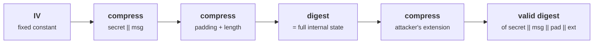
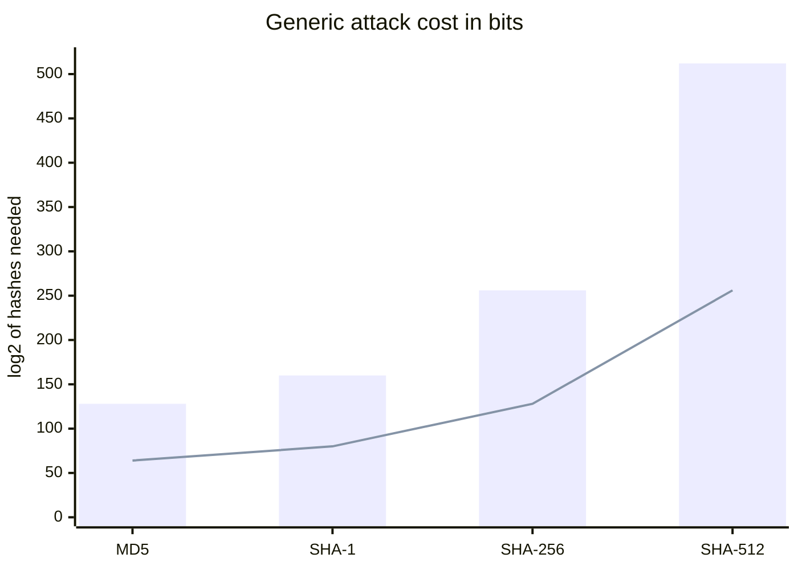
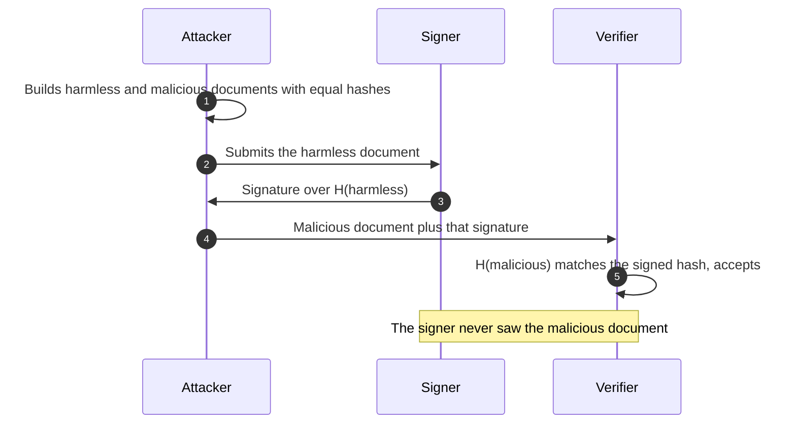
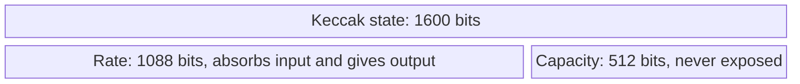
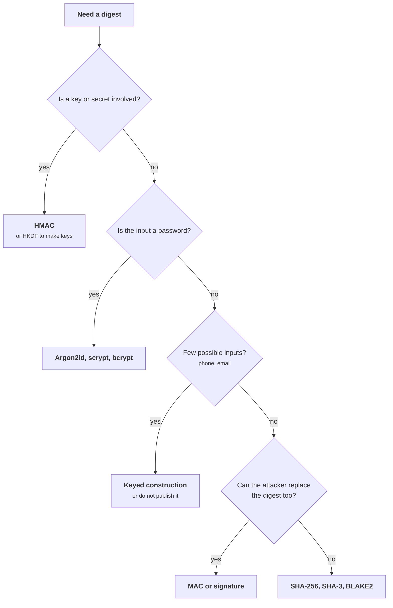
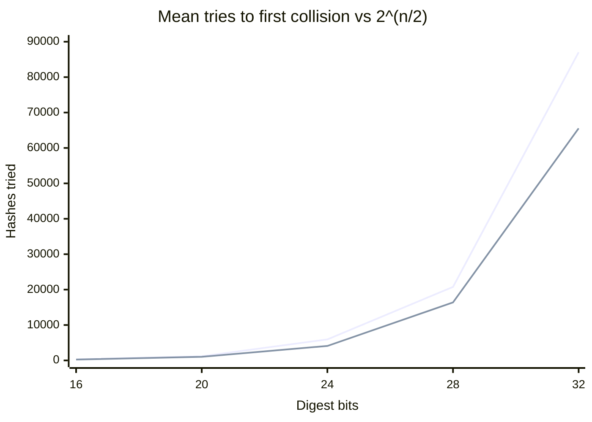

+++
title = 'Hash functions'
description = 'A cryptographic hash makes three separate promises, and collision resistance is always the first to go. An n-bit hash gives at most n/2 bits of collision security, and a bare hash is not a MAC.'
question = 'What exactly does a cryptographic hash guarantee, and where do people rely on guarantees it does not make?'
weight = 3
difficulty = 2
prerequisites = ['/notes/cryptography/foundations/01-start-from-the-property']
date = 2026-08-07
lastmod = 2026-08-07
verified = 2026-08-07
+++

## The idea in one minute

A cryptographic hash function maps input of any length to a short fixed-size
digest, such as the 256 bits of SHA-256. It is public, deterministic, and keyless:
anyone can compute it. Its value comes from three hardness promises.
**Preimage resistance**: given a digest, you cannot find any input that produces
it. **Second-preimage resistance**: given one input, you cannot find a different
input with the same digest. **Collision resistance**: you cannot find *any* two
inputs with the same digest.

Those promises are different in strength. Because of the **birthday bound**,
finding a collision in an n-bit hash takes about 2^(n/2) work, not 2^n. That is
why SHA-256 is rated at 128-bit collision security. In practice, collision
resistance is also the property that breaks first: MD5 and SHA-1 both fell to
practical collision attacks, and real certificate forgeries followed.

Two misuses cause most hash-related bugs. One is trusting a broken hash where an
attacker chooses the inputs. The other is treating `SHA-256(secret || message)`
as a MAC, which **length extension** defeats. The consequence to act on: **use
SHA-256, SHA-512, or SHA-3 for hashing, HMAC when a key is involved, and never
MD5 or SHA-1 for anything an attacker can influence.**

## A picture



The SHA-256 digest is the chaining state after the last block. Anyone holding it
can keep hashing from that point without knowing what came before.

## How it really works

### Three properties, three costs

For an ideal n-bit hash, the best generic attack against each property is
brute force, but the brute force costs differ:

| Property | Attacker is given | Attacker must find | Generic cost | What depends on it |
| --- | --- | --- | --- | --- |
| **Preimage resistance** | A digest `h` | Any `m` with `H(m) = h` | 2^n | Commitments, one-way derivations, password hashing (as one ingredient) |
| **Second-preimage resistance** | A message `m1` | `m2 ≠ m1` with `H(m2) = H(m1)` | 2^n | Integrity of files whose digest is published; you did not choose the file |
| **Collision resistance** | Nothing | Any `m1 ≠ m2` with `H(m1) = H(m2)` | 2^(n/2) | Signatures, certificates, anything where the attacker chooses what gets signed |

The gap between rows two and three matters. In a second-preimage attack the
target is fixed, so each try succeeds with probability 2^-n. In a collision
attack the attacker gets to pick *both* messages, so every new hash is compared
against every previous one. After k tries there are about k²/2 pairs, and a match
becomes likely once k²/2 approaches 2^n, that is, around k ≈ 2^(n/2). This is the
**birthday paradox**: 23 people suffice for even odds that two share a birthday,
though 183 would be needed for even odds that someone shares *yours*. The
expected number of tries until the first collision is about
√(π/2 · 2^n) ≈ 1.25 · 2^(n/2).

**Collision resistance implies second-preimage resistance**, so collisions are
the hardest property to keep and the first to fall. That is the history of both
MD5 and SHA-1.

For each digest size, the bar is the generic preimage cost and the line is the
generic collision cost, both in bits of work:



> [!IMPORTANT]
> An n-bit hash gives at most n/2 bits of security against collisions. For
> 128-bit security you need a 256-bit digest. Truncating SHA-256 to 64 bits
> leaves 32 bits of collision resistance, which a laptop exhausts in seconds.

### Why collisions matter when nobody signs garbage

It is tempting to think a collision between two random-looking blobs is harmless.
It is not, because signatures sign a hash. If an attacker can make two documents
with the same digest, one harmless and one malicious, they get the harmless one
signed and then present the signature on the other. Practical attacks build the
documents with a shared structure (a PDF, a certificate, an executable) so that
the colliding blocks are hidden in a field the viewer ignores.

Follow the signature: it is made over the harmless document and then verified
against the malicious one, and nothing in the check can tell them apart.



The record:

| Hash | Digest | Status | Landmark |
| --- | --- | --- | --- |
| MD5 | 128 bits | Broken: collisions in seconds, chosen-prefix collisions practical | Wang and Yu, 2005; rogue CA certificate (Sotirov, Stevens et al., 2008); Flame malware forged a Microsoft code-signing certificate with an MD5 chosen-prefix collision (2012) |
| SHA-1 | 160 bits | Broken for collisions; being retired | SHAttered, the first public SHA-1 collision, two different PDFs with the same digest (Stevens et al., February 2017, about 2^63 SHA-1 computations); practical chosen-prefix collision, "SHA-1 is a Shambles" (Leurent and Peyrin, 2020) |
| SHA-256, SHA-512 (SHA-2) | 256, 512 bits | No practical attack known as of October 2026 | FIPS 180-4 |
| SHA3-256, SHA3-512 | 256, 512 bits | No practical attack known as of October 2026 | FIPS 202 (2015) |
| BLAKE2b, BLAKE2s | up to 512 bits | No practical attack known as of October 2026 | RFC 7693 |

A **chosen-prefix collision** is the dangerous form: the attacker starts from two
*different* meaningful prefixes of their choice (two certificate requests with
different names, for instance) and computes suffixes that make the full documents
collide. NIST announced in December 2022 that SHA-1 should be phased out
completely by December 31, 2030. Do not wait: SHA-1 and MD5 still appear in
legacy protocols and file-integrity checks, and anything where an attacker can
influence the input should already have moved.

The record as a timeline, from the first MD5 collisions to the SHA-1 deadline:

```mermaid {title="Collision resistance falls first, then the forgeries follow"}
timeline
  title MD5 and SHA-1 in public
  2005 : MD5 collisions, Wang and Yu
  2008 : Rogue CA certificate from an MD5 collision
  2012 : Flame forges a Microsoft code-signing certificate with MD5
  2015 : SHA-3 standardized in FIPS 202
  2017 : SHAttered, first public SHA-1 collision
  2020 : Practical SHA-1 chosen-prefix collision
  2022 : NIST announces the SHA-1 phase-out
  2030 : SHA-1 retirement deadline
```

Note what was *not* broken. Neither MD5 nor SHA-1 has a practical preimage attack.
An HMAC-SHA1 tag is not affected by SHAttered, because HMAC's security rests on
different properties. But a team that keeps SHA-1 "because only collisions are
broken" is one design change away from relying on collision resistance, and
nobody will notice the moment it happens.

### How SHA-2 is built, and length extension

SHA-256 uses the **Merkle–Damgård** construction. The message is padded (a `1`
bit, zeros, then the message length in 64 bits) to a multiple of 512 bits. A
fixed initial value is fed with the first block into a **compression function**,
whose output is fed with the next block, and so on. The digest is simply the
final chaining value.

For the three-byte message `abc`, the single padded 512-bit block looks like
this (bit offsets):

```mermaid {title="SHA-256 padding: message, a 1 bit, zeros, then the length"}
packet-beta
  0-23: "abc (24 bits)"
  24-24: "1"
  25-447: "Zero bits up to 448"
  448-511: "Message length = 24 (64 bits)"
```

That design has a structural quirk. The digest is the complete internal state, so
anyone who knows `H(x)` and the length of `x` can continue hashing as if they
had processed `x` themselves. They can compute `H(x || padding || extension)` for
any extension they like, **without knowing `x`**.

This breaks the naive MAC `tag = SHA-256(secret || message)`. An attacker who
sees one valid `(message, tag)` pair can produce a valid tag for
`message || padding || "&amount=1000000"`, and the server, recomputing
`SHA-256(secret || that)`, will agree. The only thing the attacker must guess is
the length of the secret, and they can try every plausible length. Thai Duong and
Juliano Rizzo demonstrated exactly this against Flickr's API request signatures
in 2009.

Which hashes are affected:

| Affected by length extension | Not affected |
| --- | --- |
| MD5, SHA-1, SHA-256, SHA-512 | SHA-3 and SHAKE (sponge construction), BLAKE2, BLAKE3 |
| | SHA-384 and SHA-512/256 (truncated output hides part of the state) |
| | HMAC with any of the hashes on the left |

The fix is not to pick a hash from the right column and keep the homemade
construction. The fix is **HMAC** (RFC 2104), which wraps the hash in two keyed
passes and is the standard answer whenever a hash needs a key.
[MACs and HMAC](/notes/cryptography/symmetric-cryptography/03-macs-and-hmac/)
covers why HMAC is built the way it is.

### SHA-3 and the sponge

SHA-3 (Keccak, standardized in FIPS 202 in 2015) uses a different design, the
**sponge**. A large internal state (1600 bits) is split into a public "rate"
part, which absorbs message blocks, and a hidden "capacity" part that never
directly touches input or output. The digest is squeezed from the rate part
only, so it never reveals the full state, and length extension does not apply.
The same construction gives **extendable-output functions** (SHAKE128,
SHAKE256) that produce as many output bytes as you ask for; the first lesson
used SHAKE-256 as a toy keystream.

For SHA3-256 the 1600-bit state splits as shown; input and output only ever
touch the rate, so the digest cannot reveal the whole state.



SHA-3 was not standardized because SHA-2 was broken; it was chosen as a
structurally different backup. SHA-256 remains the default in most protocols, and
both are fine choices.

### What a hash is not

| Need | A bare hash is wrong because | Use instead |
| --- | --- | --- |
| Integrity against an active attacker | The attacker changes the data and recomputes the hash | HMAC, an AEAD, or a signature |
| A keyed tag | `H(key || msg)` is open to length extension on SHA-2 | HMAC |
| Storing passwords | SHA-256 is designed to be fast; guessing billions of passwords per second is the attack | A slow, salted password hash (Argon2id, scrypt, bcrypt); see [storing credentials](/notes/application-security/authentication/01-storing-credentials/) |
| Turning a password or shared secret into keys | No salt, no domain separation, no stretching | A KDF (HKDF for high-entropy secrets); see [key derivation](/notes/cryptography/symmetric-cryptography/04-key-derivation/) |
| Hiding a low-entropy value (a phone number, an email) | Anyone can hash every candidate and compare | A keyed construction, or do not publish it |

The last row catches many "anonymized" datasets. There are only about ten billion
ten-digit phone numbers, so a hashed phone number is a lookup away from the
original.

The table reduces to a few questions to ask before writing `sha256(`:



## Code

The program truncates SHA-256 to n bits and hashes `label-0`, `label-1`, … until
two messages share a digest, storing each digest in a dictionary. It shows one
24-bit collision, then averages the number of tries over 20 runs for several
widths and compares them with 2^(n/2) and the √(π/2 · 2^n) estimate. Finally it
spends the same budget on a second preimage, to show the gap between the two
attacks.

```python {title="birthday.py"}
"""birthday.py: the birthday bound on a truncated hash.

Truncate SHA-256 to n bits and hash distinct messages until two share a digest.
The number of tries tracks 2^(n/2), not 2^n: halving the exponent is why a
hash needs twice as many output bits as the security level you want.
Standard library only; offline; deterministic.
"""

from __future__ import annotations

import hashlib
import math


def h(message: bytes, bits: int) -> int:
    """SHA-256, keeping only the top `bits` bits."""
    digest = int.from_bytes(hashlib.sha256(message).digest(), "big")
    return digest >> (256 - bits)


def find_collision(bits: int, label: str) -> tuple[int, bytes, bytes]:
    """Hash label-0, label-1, ... until a digest repeats. Returns (tries, m1, m2)."""
    seen: dict[int, bytes] = {}
    i = 0
    while True:
        m = f"{label}-{i}".encode()
        d = h(m, bits)
        if d in seen:
            return i + 1, seen[d], m
        seen[d] = m
        i += 1


def find_second_preimage(target: bytes, bits: int, limit: int) -> int | None:
    """Try to match one fixed digest. Expected cost: 2^bits tries."""
    goal = h(target, bits)
    for i in range(limit):
        if h(f"forgery-{i}".encode(), bits) == goal:
            return i + 1
    return None


def main() -> None:
    tries, m1, m2 = find_collision(24, "invoice")
    print("one collision on SHA-256 truncated to 24 bits")
    print(f"  {m1.decode():<14} -> {h(m1, 24):06x}")
    print(f"  {m2.decode():<14} -> {h(m2, 24):06x}")
    print(f"  found after {tries} hashes; 2^12 = {2**12}; a second preimage needs ~2^24 = {2**24}")
    print()

    trials = 20
    print(f"average tries to first collision over {trials} runs")
    print(f"  {'bits':>4}  {'mean tries':>10}  {'2^(n/2)':>8}  {'sqrt(pi/2*2^n)':>14}  {'mean / 2^(n/2)':>14}")
    for bits in (16, 20, 24, 28, 32):
        mean = sum(find_collision(bits, f"t{bits}-{r}")[0] for r in range(trials)) / trials
        half = 2 ** (bits / 2)
        expected = math.sqrt(math.pi / 2 * 2**bits)
        print(f"  {bits:>4}  {mean:>10.0f}  {half:>8.0f}  {expected:>14.0f}  {mean / half:>14.2f}")
    print()

    budget = 2**14
    hit = find_second_preimage(m1, 24, budget)
    print(f"second preimage for {m1.decode()!r} with the same {budget} tries: "
          f"{'found at ' + str(hit) if hit else 'not found'}")


if __name__ == "__main__":
    main()
```

Run it with `python3 birthday.py`:

```text
one collision on SHA-256 truncated to 24 bits
  invoice-76     -> 77c621
  invoice-5575   -> 77c621
  found after 5576 hashes; 2^12 = 4096; a second preimage needs ~2^24 = 16777216

average tries to first collision over 20 runs
  bits  mean tries   2^(n/2)  sqrt(pi/2*2^n)  mean / 2^(n/2)
    16         317       256             321            1.24
    20        1189      1024            1283            1.16
    24        5939      4096            5134            1.45
    28       20766     16384           20534            1.27
    32       87011     65536           82137            1.33

second preimage for 'invoice-76' with the same 16384 tries: not found
```

The mean tries track 2^(n/2) within a small constant factor, and land close to
the √(π/2 · 2^n) estimate. Twenty runs is a small sample, so individual rows
wander by tens of percent. Each extra 4 bits of digest multiplies the work by
only 4, not 16. The same budget that found a collision in 24 bits finds nothing
when the target is fixed.

Plotted, the measured means (upper line) climb in step with 2^(n/2) (lower
line). A second preimage would need 2^n tries: about 4.3 billion at 32 bits,
far off this chart.



Scale the numbers up. A 64-bit hash, which sounds big, falls to about 2^32
tries, around five billion hashes and minutes of work on one machine. A
128-bit digest such as MD5 needs about 2^64 generically, which is within reach of
large organizations, even before MD5's structural weaknesses. A 256-bit digest
needs about 2^128, which is out of reach.

## Where it breaks

- **Generic bounds are upper bounds on security.** The birthday calculation
  assumes an ideal hash. MD5 and SHA-1 fell far faster than 2^64 and 2^80
  because of structural attacks, not because of the birthday bound.
- **The dictionary is the expensive part.** This program stores every digest.
  For larger widths, real collision searches use memory-light methods such as
  Pollard's rho and parallel collision search (van Oorschot and Wiener), which
  keep the 2^(n/2) time with little memory and split work across many machines.
- **Meaningless collisions.** `invoice-76` and `invoice-5575` collide, but the
  attacker did not choose their content. Real attacks make *meaningful*
  colliding documents by hiding collision blocks inside a file format, which
  needs structural weaknesses or chosen-prefix techniques.
- **Truncation is not always wrong.** SHA-512/256 truncates deliberately and is
  standard. The rule is that the remaining length must cover the property you
  need: 2× the security level for collisions, 1× for preimages.
- **Hashes say nothing about who.** A correct SHA-256 digest proves the data
  matches *that digest*. Whether the digest is the right one is a question of
  authentication, answered by a MAC, a signature, or a trusted channel.

## Remember this

- Three properties: preimage, second preimage, collision; collision is weakest
  and falls first.
- An n-bit hash gives at most n/2 bits of collision security.
- MD5 and SHA-1 are broken for collisions; use SHA-256, SHA-512, SHA-3, or
  BLAKE2.
- SHA-256 and SHA-512 are length-extendable, so `H(secret || msg)` is not a MAC;
  use HMAC.
- A bare hash gives no integrity against someone who can replace the hash too.
- Passwords need a slow, salted password hash, not SHA-256.

## Try it

1. Run `birthday.py`. Change the trial count to 200 and watch the ratio column
   settle near 1.25.
2. Raise `budget` in the second-preimage step until it succeeds for 24 bits. How
   does the number of tries compare with 2^24?
3. Compute the probability of at least one collision after k tries using
   `1 - exp(-k*k / 2**(n+1))`, and check it against the program for n = 24 and
   k = 4096.
4. Find a protocol or file format you use that still contains MD5 or SHA-1. Is
   the hash used where an attacker can choose the input?
5. Python's `hashlib` exposes `sha512_256` on some builds and always exposes
   `sha3_256`. Explain why neither needs HMAC to resist length extension, and
   why you would still use HMAC.

## Check yourself

1. Why does a 128-bit digest give only about 64 bits of collision resistance?

   
   In a collision search the attacker compares every new digest against all
   previous ones. After k hashes there are about k²/2 pairs, each matching with
   probability 2^-128, so a collision becomes likely once k is around 2^64. The
   attacker benefits from choosing both inputs; with a fixed target they would
   need about 2^128 tries.
   

2. SHAttered produced a SHA-1 collision. Does that break HMAC-SHA1 or allow
   inverting SHA-1 digests?

   
   No to both. SHAttered is a collision attack: the attacker built two
   colliding documents together. It gives no way to find an input for a given
   digest (a preimage), and HMAC's security does not rest on collision
   resistance of the hash. It does break any use that relies on SHA-1 collision
   resistance, such as signatures over attacker-influenced documents, and is a
   strong reason to migrate everything anyway.
   

3. An API signs requests as `SHA-256(api_secret || query_string)`. What can an
   attacker who has seen one signed request do?

   
   Use length extension. From the digest and a guess of the secret's length,
   they can compute a valid signature for `query_string || padding ||
   extra_parameters` without knowing the secret, so they can append parameters
   to a request someone else signed. The fix is HMAC-SHA256 with the secret as
   the key.
   

4. Why is a 64-bit truncated hash unsafe as a content identifier when users
   can upload files?

   
   Collision resistance is only about 32 bits, so an attacker can generate
   around 2^32 variants of two files and find a pair with the same identifier in
   minutes. They upload the harmless one and later swap in the other, or cause
   two users' files to be treated as identical. Content identifiers need the
   full 256-bit output of a modern hash.
   

5. Why does SHA-3 resist length extension when SHA-256 does not?

   
   SHA-256's digest is its entire final chaining state, so anyone holding it can
   continue the computation. SHA-3 is a sponge: the digest is squeezed from part
   of a 1600-bit state, and the capacity part is never output, so the digest
   does not give an attacker the state needed to keep absorbing input.
   

## Sources

- NIST, [FIPS 180-4: Secure Hash Standard (SHS)](https://csrc.nist.gov/pubs/fips/180-4/upd1/final), August 2015.
- NIST, [FIPS 202: SHA-3 Standard: Permutation-Based Hash and Extendable-Output Functions](https://csrc.nist.gov/pubs/fips/202/final), August 2015.
- NIST, [NIST Retires SHA-1 Cryptographic Algorithm](https://www.nist.gov/news-events/news/2022/12/nist-retires-sha-1-cryptographic-algorithm), December 2022.
- M. Stevens, E. Bursztein, P. Karpman, A. Albertini, Y. Markov, [The first collision for full SHA-1](https://shattered.io/static/shattered.pdf), CRYPTO 2017 (announced February 2017).
- G. Leurent, T. Peyrin, [SHA-1 is a Shambles](https://eprint.iacr.org/2020/014), USENIX Security 2020.
- X. Wang, H. Yu, "How to Break MD5 and Other Hash Functions", EUROCRYPT 2005.
- A. Sotirov, M. Stevens, J. Appelbaum, A. Lenstra, D. Molnar, D. A. Osvik, B. de Weger, [MD5 considered harmful today: Creating a rogue CA certificate](https://www.win.tue.nl/hashclash/rogue-ca/), December 2008.
- T. Duong, J. Rizzo, "Flickr's API Signature Forgery Vulnerability", September 2009.
- H. Krawczyk, M. Bellare, R. Canetti, [RFC 2104: HMAC: Keyed-Hashing for Message Authentication](https://www.rfc-editor.org/rfc/rfc2104), IETF, February 1997.
- M-J. Saarinen, J-P. Aumasson, [RFC 7693: The BLAKE2 Cryptographic Hash and Message Authentication Code](https://www.rfc-editor.org/rfc/rfc7693), IETF, November 2015.
- P. C. van Oorschot, M. J. Wiener, "Parallel Collision Search with Cryptanalytic Applications", *Journal of Cryptology* 12(1), 1999.
