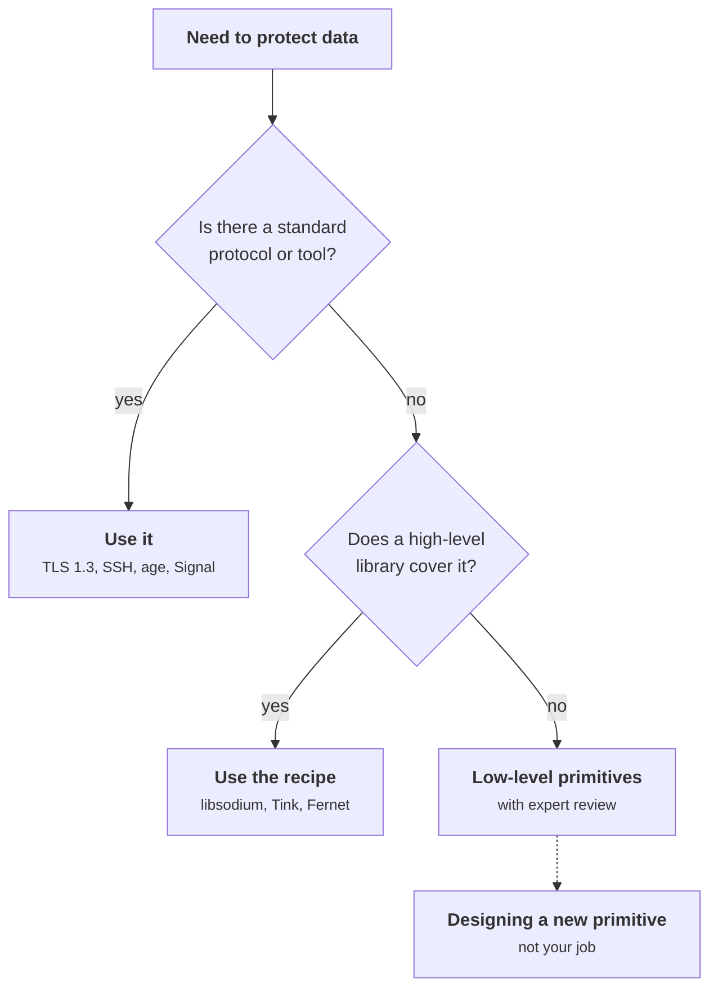
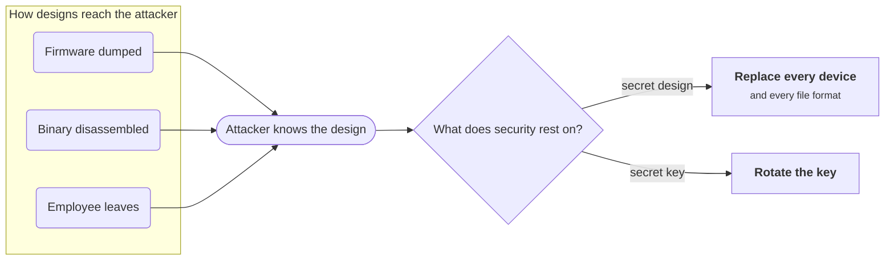
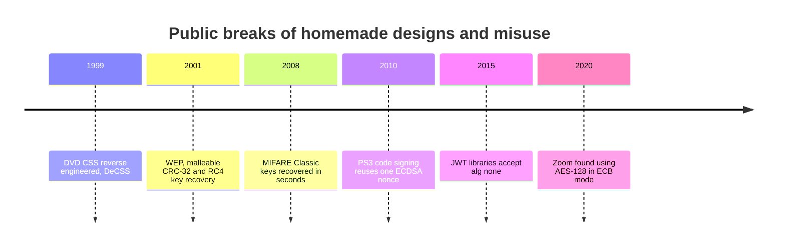
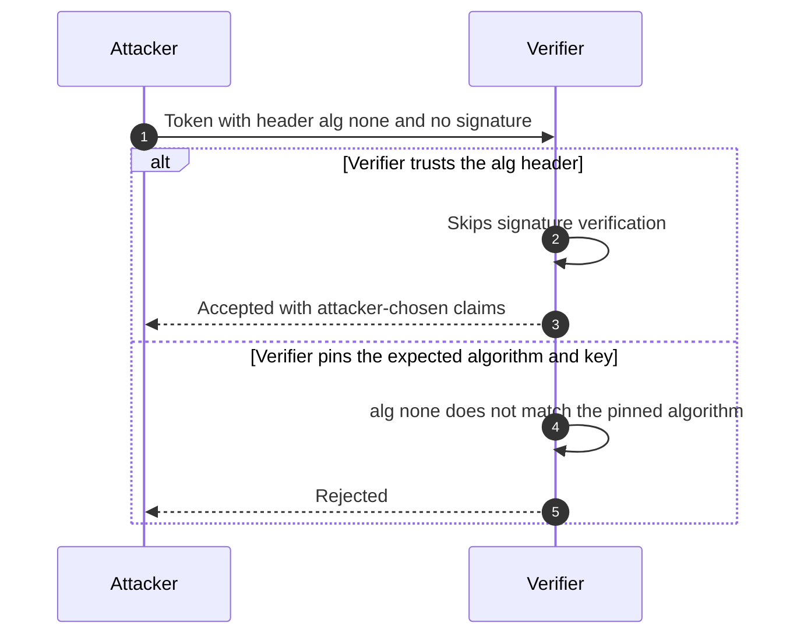
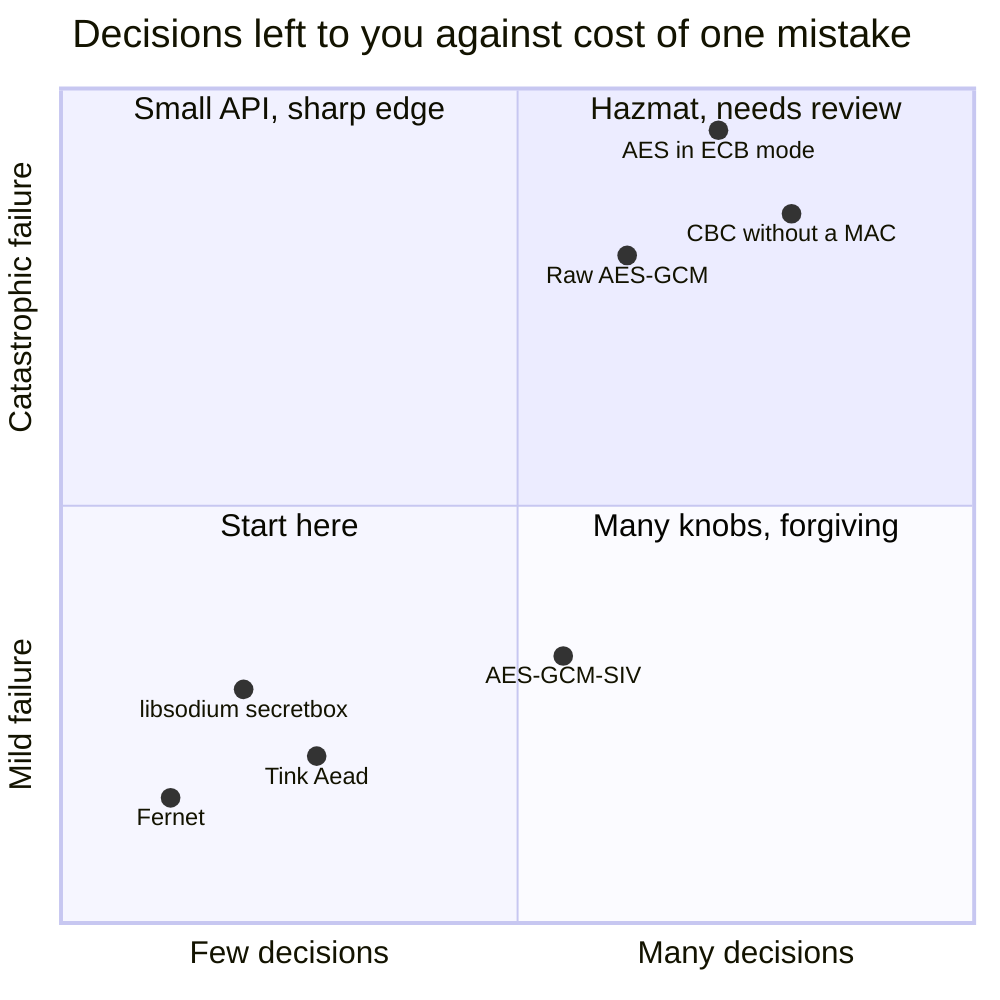
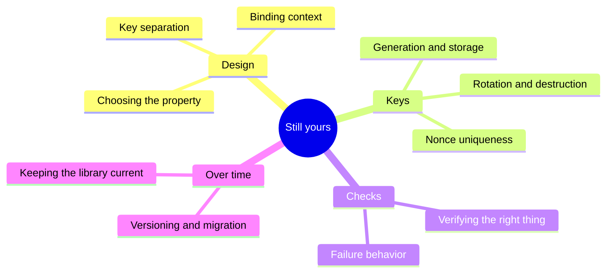
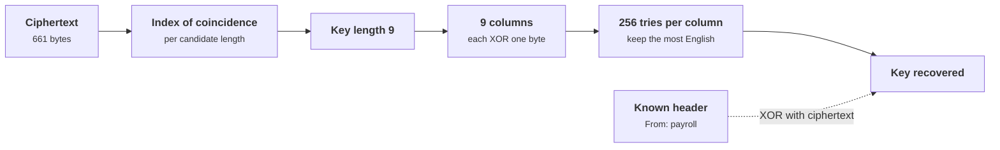
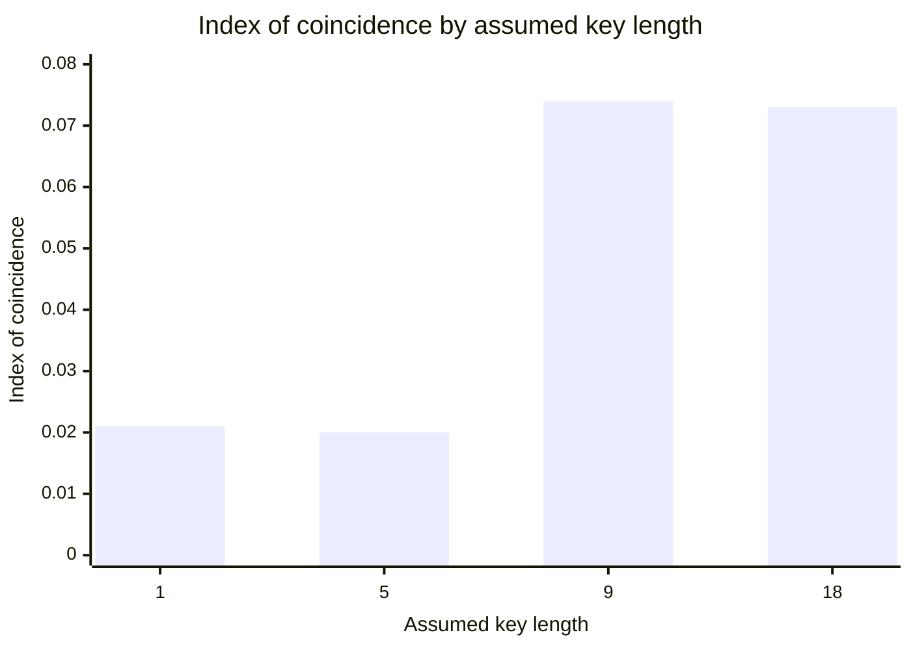

+++
title = 'Why not to roll your own'
description = 'Homemade cryptography fails in ways its author cannot see. Assume the attacker knows the design, use a misuse-resistant library, and spend your effort on the parts no library can do for you.'
question = 'Why do homemade schemes fail, and what is still your job once you use a vetted library?'
weight = 4
difficulty = 1
prerequisites = ['/notes/cryptography/foundations/01-start-from-the-property', '/notes/cryptography/foundations/03-hash-functions']
date = 2026-08-09
lastmod = 2026-08-09
verified = 2026-08-09
+++

## The idea in one minute

Anyone can design a cipher that they themselves cannot break. That is the trap.
The author of a homemade scheme tests it against the attacks they thought of, and
an attacker uses the ones they did not. Standard algorithms are trustworthy
not because their designers were smarter but because thousands of
cryptanalysts spent years trying to break them in public, and the survivors were
standardized.

**Kerckhoffs's principle** states the rule: a system must stay secure when
everything about it except the key is known to the enemy. A scheme whose
security depends on nobody learning how it works is already broken; the
attacker simply has not read the binary yet.

"Do not roll your own" applies to more than ciphers. It covers homemade
protocols, homemade constructions from good primitives (`SHA-256(secret ||
data)` from the [hash functions](/notes/cryptography/foundations/03-hash-functions/)
lesson), and hand-assembled modes. The consequence to act on: **use a
high-level, misuse-resistant library or an established protocol, and put your
own engineering into keys, inputs, and failure handling, which the library
cannot do for you.**

## A picture



Every step down the chart adds decisions you can get wrong. Go only as low as
you must.

## How it really works

### Kerckhoffs's principle

Auguste Kerckhoffs published six design principles for military ciphers in
1883. The second is the one that lasted: the system must not require secrecy,
and must be able to fall into the hands of the enemy without inconvenience.
Claude Shannon restated it in 1949 as "the enemy knows the system".

The reasoning is practical, not idealistic:

- **Designs leak.** Software ships to attackers. Firmware is dumped, binaries are
  disassembled, hardware is decapped, and employees change jobs. A secret
  algorithm has to stay secret for its whole deployment life, across every copy.
- **Keys are cheap to change; designs are not.** If security rests on the key, a
  leak means rotation. If it rests on the design, a leak means replacing every
  device and every file format.
- **Secrecy blocks review.** A public design gets attacked by people who publish
  what they find. A secret design gets attacked only by people who will not tell
  you.

Every route on the left ends with the attacker knowing the design; what the
leak costs you then depends only on what the security rests on.



Kerckhoffs does not forbid keeping a design private. It says the design must not
be what the security *depends on*. Obscurity can add a little cost for the
attacker; it cannot be the control.

### How homemade cryptography fails

Proprietary and homemade schemes have a long, consistent record:

| System | What was homemade | What happened |
| --- | --- | --- |
| **DVD Content Scramble System (CSS)** | A secret, proprietary cipher with 40-bit keys | Reverse engineered and broken in 1999; the DeCSS program decrypted DVDs on ordinary PCs |
| **WEP (802.11 Wi-Fi)** | A protocol built from RC4 and a CRC-32 checksum, designed without broad cryptographic review | Borisov, Goldberg, and Wagner (2001) showed that CRC-32 is linear, so encrypted packets could be modified undetectably (the lesson-one failure); Fluhrer, Mantin, and Shamir (2001) showed key recovery from RC4's key schedule as WEP used it |
| **MIFARE Classic (Crypto-1)** | A proprietary cipher in transit and access cards | Reverse engineered from the chip in 2007–2008; Garcia et al. (2008) recovered keys from cards in seconds |
| **Zoom meetings (as of April 2020)** | A custom scheme using AES-128 in ECB mode | Citizen Lab found that ECB preserved patterns in the encrypted media and that keys were sometimes distributed through servers outside the expected jurisdiction; Zoom moved to AES-GCM |

Two patterns repeat. First, **the cipher is rarely the only problem**: WEP used
a reasonable stream cipher of its day and failed on how keys and IVs were
combined and on using a checksum where a MAC belonged. Second, **secrecy delayed
review but did not prevent the break**: CSS and Crypto-1 were attacked as soon
as someone extracted the algorithm.

Placed on one line, the homemade schemes above and the misused standard
primitives below share a decade-long pattern:



Misusing *standard* primitives fails just as badly:

- **Nonce reuse in signatures.** ECDSA needs a fresh unpredictable value for every
  signature. In 2010 the fail0verflow group showed that Sony's PlayStation 3
  code-signing used the same value every time, which let them compute Sony's
  private signing key with high-school algebra. The algorithm was standard; the
  use was homemade.
- **Accepting the attacker's choice of algorithm.** Early JSON Web Token
  libraries trusted the `alg` header in the token. Tokens with `alg: none` were
  accepted unsigned, and in some libraries an attacker could make the verifier
  treat an RSA public key as an HMAC secret (Tim McLean, 2015).
- **Hand-assembled constructions.** ECB mode, unauthenticated CBC or CTR, and
  `hash(secret || data)` as a MAC are all built from sound parts and all broken.

The JWT case shows the difference between trusting the message's description of
itself and pinning the algorithm in the verifier:



### Misuse-resistant APIs

Modern libraries are designed around the observation that most failures are
misuse, not cryptanalysis. Their APIs remove the decisions that ordinary
developers get wrong.

| Library | Design idea | What it decides for you |
| --- | --- | --- |
| **NaCl / libsodium** | A small set of high-level operations named by intent: `crypto_secretbox`, `crypto_box`, `crypto_sign` | Algorithm choice, authenticated encryption by default, constant-time implementations; no mode or padding parameters |
| **Tink** (Google) | Primitives named by what you need (`Aead`, `Mac`, `DeterministicAead`, `PublicKeySign`) and **keysets** that carry their own algorithm and parameters | Algorithm parameters, key format, ciphertext prefixes that identify the key, and support for rotation within a keyset |
| **pyca/cryptography** | Two layers: **recipes** (Fernet for symmetric encryption) and a lower layer deliberately named **hazmat** | Recipes choose algorithms, IVs, and authentication; the name of the low layer warns you that you are now responsible |
| **Nonce-misuse-resistant AEADs** | Algorithms such as AES-GCM-SIV (RFC 8452) | Reusing a nonce leaks only whether two messages are identical, instead of the catastrophic leak of plain GCM |

Bernstein, Lange, and Schwabe described the reasoning in the 2012 NaCl paper:
give developers one obvious, safe function per task rather than a toolbox of
parts. The less you configure, the less you can configure wrong.

A rough map of the options in this section: the further right, the more
decisions the API leaves to you; the higher, the worse a single mistake is.



> [!TIP]
> If the library you are using makes you choose a block cipher mode, a padding
> scheme, or an IV, you are in its low-level layer. Look for a higher-level
> function before continuing.

### What "use a library" still leaves to you

A library gives you correct primitives. It cannot know your system. These remain
your job, and they are where most real-world cryptographic incidents happen:

| Still yours | Why the library cannot do it | Covered in |
| --- | --- | --- |
| **Choosing the property** | The library encrypts what you give it; it does not know you also needed integrity of the metadata, or forward secrecy | [Start from the property](/notes/cryptography/foundations/01-start-from-the-property/) |
| **Key generation, storage, rotation, and destruction** | A key in an environment variable on forty hosts is still a key on forty hosts | [The key lifecycle](/notes/cryptography/key-management/01-the-key-lifecycle/) |
| **Nonce uniqueness** when the API takes a nonce | The library cannot see your other processes, restarts, or VM clones | [Authenticated encryption](/notes/cryptography/symmetric-cryptography/02-authenticated-encryption/) |
| **Binding context** | Whether ciphertext for user A can be replayed as user B's depends on what you put in the associated data | [Authenticated encryption](/notes/cryptography/symmetric-cryptography/02-authenticated-encryption/) |
| **Key separation** | Using one key for encryption, MACs, and signing across purposes is a design decision | [Key derivation](/notes/cryptography/symmetric-cryptography/04-key-derivation/) |
| **Verifying what you think you verify** | Checking a certificate chain but not the hostname, or a signature but against a key from the same untrusted message | [Certificates and PKI](/notes/cryptography/public-key-cryptography/03-certificates-and-pki/) |
| **Failure behavior** | Distinct error messages for "bad padding" and "bad MAC", or acting on data before the check, create oracles | [How cryptography fails in practice](/notes/cryptography/applied-cryptography/01-how-cryptography-fails-in-practice/) |
| **Versioning and migration** | Ciphertexts outlive algorithms; you need a version field and a plan | [Crypto agility and inventory](/notes/cryptography/applied-cryptography/04-crypto-agility-and-inventory/) |
| **Keeping the library current** | Vulnerabilities are found and fixed in libraries too | Dependency management |

The honest version of "don't roll your own crypto" is: don't roll your own
*primitives, modes, or protocols*, and treat the integration as security-critical
code that deserves review.

Grouped by where they show up in a design, the jobs in the table look like
this:



## Code

A homemade scheme of the kind that appears in real codebases: XOR the data with
a secret password repeated end to end. It looks scrambled in a hex dump, and it
uses a "secret key". The program breaks it twice, never reading the key: once
from the ciphertext alone with frequency analysis, once with a few bytes of
known plaintext.

The ciphertext-only attack has two steps. First, guess the key length with the
**index of coincidence**, the probability that two randomly chosen bytes are
equal. English text repeats letters and spaces often, so its index is high.
Bytes XORed with a mix of key bytes look closer to uniform. When you split the
ciphertext into columns using the true key length, each column is English XORed
with *one* byte, and the index jumps back up. Second, each column is now a
single-byte XOR, so try all 256 values and keep the one whose output looks most
like English.

The program follows these steps; the dashed edge is the shortcut that
known plaintext gives.



```python {title="xor_break.py"}
"""xor_break.py: breaking a homemade cipher.

The "scheme": XOR the message with a secret password repeated end to end.
It looks scrambled, and it falls to two classic attacks: frequency analysis
(ciphertext only) and known plaintext. Standard library only; offline.
"""

from __future__ import annotations

from collections import Counter

SECRET_KEY = b"Tr0ub4dor"  # the defender's secret; the attacks never read it

MEMO = (
    "From: payroll operations\n"
    "The quarterly bonus file will move to the new storage bucket on Friday. "
    "Please do not email spreadsheets with salary data to anyone outside the "
    "finance group. If you need access to the shared drive, ask your manager to "
    "open a ticket and include the business reason. The old folder will stay "
    "readable for two weeks and then it will be removed. Reports that are "
    "generated after the move will carry the new header, and any report without "
    "it should be treated as suspect. Questions about the change can go to the "
    "operations channel, where the team will answer during business hours. "
    "Thank you for helping us keep this data where it belongs."
).encode()

# Rough relative frequency of English characters, space included (percent).
ENGLISH = dict(zip(" etaoinshrdlcumwfgypbvkjxqz",
                   (18, 10, 7.5, 6.5, 6.2, 5.7, 5.7, 5.3, 5, 5, 3.5, 3.3, 2.3, 2.3,
                    2, 1.9, 1.7, 1.6, 1.6, 1.4, 1.3, 0.8, 0.6, 0.2, 0.2, 0.1, 0.1)))


def xor_repeat(data: bytes, key: bytes) -> bytes:
    return bytes(b ^ key[i % len(key)] for i, b in enumerate(data))


def english_score(text: bytes) -> float:
    """Higher is more English-like; non-printable bytes are penalized hard."""
    score = 0.0
    for b in text:
        c = chr(b).lower()
        if c in ENGLISH:
            score += ENGLISH[c]
        elif not (32 <= b < 127 or b == 10):
            score -= 20
    return score


def best_single_byte(column: bytes) -> int:
    return max(range(256), key=lambda k: english_score(bytes(b ^ k for b in column)))


def coincidence(data: bytes) -> float:
    """Index of coincidence: chance two random positions hold the same byte."""
    n = len(data)
    return sum(c * (c - 1) for c in Counter(data).values()) / (n * (n - 1))


def guess_key_length(ct: bytes, max_len: int = 16) -> int:
    """English columns repeat bytes often; mixed-key columns look uniform."""
    scores = {}
    for k in range(1, max_len + 1):
        scores[k] = sum(coincidence(ct[i::k]) for i in range(k)) / k
    top = max(scores.values())
    # Multiples of the true length score as well; take the smallest near the top.
    return min(k for k, s in scores.items() if s > 0.9 * top)


def main() -> None:
    ct = xor_repeat(MEMO, SECRET_KEY)
    print(f"ciphertext ({len(ct)} bytes) starts {ct[:24].hex()}")
    print()

    print("attack 1: ciphertext only")
    for k in (1, 5, 9, 18):
        ic = sum(coincidence(ct[i::k]) for i in range(k)) / k
        print(f"  key length {k:>2}: index of coincidence {ic:.3f}")
    k = guess_key_length(ct)
    key = bytes(best_single_byte(ct[i::k]) for i in range(k))
    print(f"  guessed key length {k}, recovered key {key!r}")
    print(f"  plaintext: {xor_repeat(ct, key)[:60].decode()!r}")
    print()

    print("attack 2: known plaintext")
    crib = b"From: payroll"  # memos always start with a From: line
    stream = bytes(c ^ p for c, p in zip(ct, crib))
    print(f"  ciphertext xor crib = {stream!r}")
    print("  the key repeats inside it, so the key is the repeating unit")


if __name__ == "__main__":
    main()
```

Run it with `python3 xor_break.py`:

```text
ciphertext (661 bytes) starts 12005f185814140e0b261d5c19425b140a003506591a0c47

attack 1: ciphertext only
  key length  1: index of coincidence 0.021
  key length  5: index of coincidence 0.020
  key length  9: index of coincidence 0.074
  key length 18: index of coincidence 0.073
  guessed key length 9, recovered key b'Tr0ub4dor'
  plaintext: 'From: payroll operations\nThe quarterly bonus file will move '

attack 2: known plaintext
  ciphertext xor crib = b'Tr0ub4dorTr0u'
  the key repeats inside it, so the key is the repeating unit
```

The index of coincidence is about 0.02 for the wrong lengths and jumps to about
0.07 at 9 and its multiple 18, which is where English text sits. The
second attack is even simpler: memos have predictable headers, and
`ciphertext XOR known plaintext` returns the key itself, visibly repeating.
About 660 bytes of ordinary English were enough for the first attack; a dozen
known bytes were enough for the second.

The bars are the program's own measurements: wrong lengths sit near the uniform
level, while the true length and its multiple jump to the level of English.



Compare the scheme with the properties from the first lesson. It has no real
confidentiality, as shown. It has no integrity: flipping a ciphertext bit flips
the same plaintext bit. Its key is a memorable word, so it has little entropy.
It encrypts every message under the same keystream, so two messages XORed
together cancel the key entirely. Each flaw alone is fatal, and the author of
such a scheme typically sees none of them because the output "looks random".

## Where it breaks

- **This is the easy case.** Repeated-key XOR is the weakest homemade scheme. The
  point is not that every homemade cipher breaks in 60 lines of Python, but that
  its author has no way of knowing how many lines it takes. A scheme that
  resists *your* attack has been tested against one attacker.
- **The scorer needs enough text.** Frequency analysis needs roughly dozens of
  bytes per key byte. Short messages under a long key resist this particular
  attack, but they fall to the known-plaintext attack, to the XOR of two
  messages, or to any structure in the data.
- **A vetted library is not a guarantee.** Libraries have bugs, and a correct
  library used with a reused nonce, a hard-coded key, or an unchecked return
  value fails anyway. The library moves the risk from the primitive to the
  integration; it does not remove it.
- **"Use a library" can be applied too literally.** Picking AES from a library and
  calling it in ECB mode is rolling your own mode. The unit you should reuse is
  the highest-level construction that fits, ideally a whole protocol.
- **Rule exceptions exist, with conditions.** Cryptographers design new
  primitives and protocols, in public, with proofs, open competitions, and
  years of review. That process is the alternative to rolling your own; a
  private design reviewed by its own team is not.

## Remember this

- Kerckhoffs: assume the attacker knows everything except the key.
- Anyone can build a scheme they cannot break; only public review earns trust.
- Most failures are misuse of good primitives, not broken ciphers.
- Prefer, in order: an established protocol, a high-level library recipe, then
  low-level primitives with expert review.
- A library does not choose your property, manage your keys, keep nonces unique,
  or bind context; you do.
- If the API asks you for a mode, padding, or IV, you are in the hazmat layer.

## Try it

1. Run `xor_break.py`. Shorten the memo until frequency analysis recovers a wrong
   key. How many bytes per key byte did it need?
2. Encrypt a second memo under the same key, XOR the two ciphertexts, and check
   that the key has disappeared from the result.
3. Replace the repeated-key XOR with a "stronger" homemade idea, such as XOR with
   `SHA-256(password)` repeated. Which of the two attacks still works, and why?
4. Search a codebase you know for `ECB`, `md5`, `sha1`, `xor`, `Random(` and
   hand-written `encrypt` functions. Classify each hit with the library table.
5. Pick one place where your team uses a crypto library and fill in the "still
   yours" table for it. Which rows have no owner?

## Check yourself

1. What does Kerckhoffs's principle require, and what does it not forbid?

   
   It requires that the system remain secure even if the attacker knows
   everything about it except the key. It does not forbid keeping a design
   private; it forbids depending on that privacy for security, because designs
   leak and cannot be rotated the way keys can.
   

2. WEP used RC4, a well-known cipher. Why is it still an example of homemade
   cryptography?

   
   The protocol around the cipher was homemade. It combined a short IV with the
   key in a way that exposed RC4's key-schedule weaknesses, allowing key
   recovery, and it used CRC-32, a linear checksum, for integrity, so encrypted
   packets could be modified undetectably. Sound parts were assembled into an
   unsound construction.
   

3. Why does the index of coincidence reveal the key length of a repeated-key XOR
   cipher?

   
   Splitting the ciphertext into columns at the correct key length puts bytes
   encrypted with the same key byte together. XOR with one fixed byte is a
   relabeling, so each column keeps English's uneven frequencies and high index
   of coincidence. At wrong lengths each column mixes several key bytes, the
   frequencies flatten, and the index drops.
   

4. You use libsodium's `crypto_secretbox` correctly. Name three things that can
   still make the system insecure.

   
   Any three of: the key is stored or distributed badly (in source code, logs,
   or a widely readable config); the nonce is reused, for example by a counter
   reset after restart; the ciphertext is not bound to its context, so it can be
   replayed or swapped between users or records; failures are handled in a way
   that leaks information or acts on unverified data; the wrong property was
   chosen (for example, third-party verifiability was needed, which requires a
   signature); the library is never updated.
   

5. Why did libraries such as pyca/cryptography name their low-level layer
   "hazmat"?

   
   To signal that using it means making decisions the high-level recipes make
   for you: mode, IV or nonce handling, padding, and whether and how to
   authenticate. Each of those has well-known ways to go wrong, so the name
   pushes developers toward the recipe layer unless they know they need the
   primitives.
   

## Sources

- A. Kerckhoffs, "La cryptographie militaire", *Journal des sciences militaires*, vol. IX, 1883.
- C. E. Shannon, "Communication Theory of Secrecy Systems", *Bell System Technical Journal* 28(4), 1949.
- N. Borisov, I. Goldberg, D. Wagner, "Intercepting Mobile Communications: The Insecurity of 802.11", MobiCom 2001.
- S. Fluhrer, I. Mantin, A. Shamir, "Weaknesses in the Key Scheduling Algorithm of RC4", Selected Areas in Cryptography 2001.
- F. D. Garcia, G. de Koning Gans, R. Muijrers, P. van Rossum, R. Verdult, R. Wichers Schreur, B. Jacobs, "Dismantling MIFARE Classic", ESORICS 2008.
- B. Marczak, J. Scott-Railton, [Move Fast and Roll Your Own Crypto: A Quick Look at the Confidentiality of Zoom Meetings](https://citizenlab.ca/2020/04/move-fast-roll-your-own-crypto-a-quick-look-at-the-confidentiality-of-zoom-meetings/), Citizen Lab, April 2020.
- fail0verflow, "Console Hacking 2010: PS3 Epic Fail", 27th Chaos Communication Congress, December 2010.
- T. McLean, "Critical vulnerabilities in JSON Web Token libraries", March 2015.
- D. J. Bernstein, T. Lange, P. Schwabe, [The security impact of a new cryptographic library](https://cr.yp.to/highspeed/coolnacl-20120725.pdf), LATINCRYPT 2012.
- S. Gueron, A. Langley, Y. Lindell, [RFC 8452: AES-GCM-SIV: Nonce Misuse-Resistant Authenticated Encryption](https://www.rfc-editor.org/rfc/rfc8452), IETF, April 2019.
- libsodium, [documentation](https://doc.libsodium.org/).
- Google, [Tink cryptographic library](https://developers.google.com/tink).
- Python Cryptographic Authority, [cryptography documentation: Fernet](https://cryptography.io/en/latest/fernet/) and [Hazardous Materials layer](https://cryptography.io/en/latest/hazmat/primitives/).
