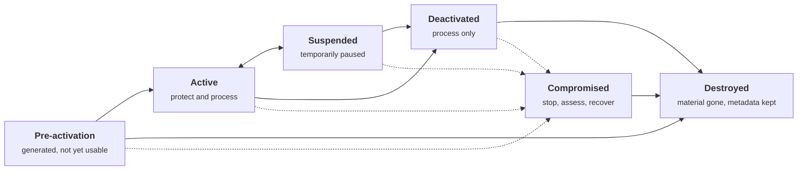
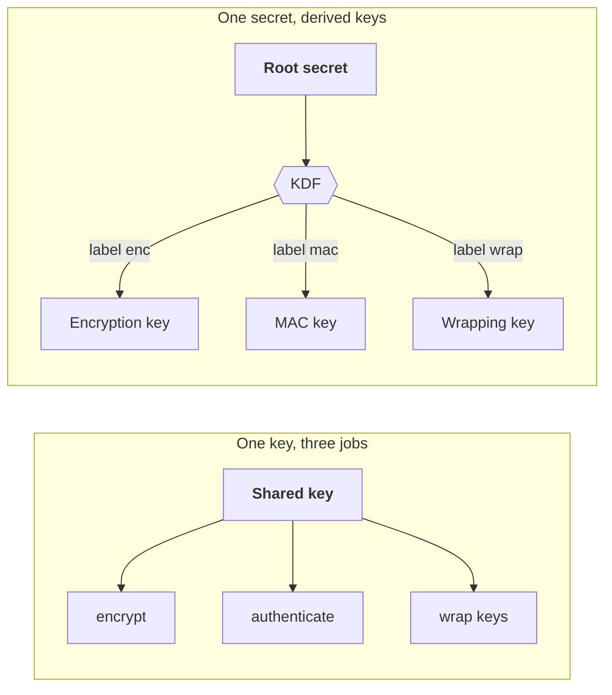
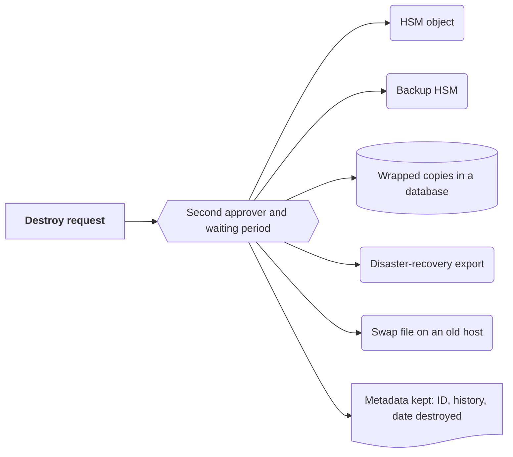

+++
title = 'The key lifecycle'
description = 'A key is not a value but a managed object with states, an owner, a purpose and an expiry. The state, not the caller, decides what the key may do.'
question = 'What states does a key pass through, and what is it allowed to do in each?'
weight = 1
difficulty = 2
prerequisites = ['/notes/cryptography/foundations/01-start-from-the-property']
date = 2026-08-27
lastmod = 2026-08-27
verified = 2026-08-27
+++

## The idea in one minute

Engineers tend to treat a key as a value: 32 random bytes in an environment
variable. Key management treats it as an **object with a life**. It is
generated, waits to be activated, protects data for a bounded time, is retired
from new work while it still decrypts old data, and is eventually destroyed.
At any moment it may be found to be compromised. NIST SP 800-57 Part 1 names
these states and says what a key may do in each.

Two rules carry most of the weight. First, **protecting** operations (encrypt,
sign, wrap) are allowed only while a key is active, but **processing**
operations (decrypt, verify, unwrap) may continue after it is retired, because
old data still has to be read. Second, **one key has one purpose**, one owner,
and one cryptoperiod. If you cannot say for each key in your estate what state
it is in, who owns it and when it stops encrypting, you are not managing keys.
You are storing them.

## A picture



Solid arrows are planned transitions. Dotted arrows are the one transition
nobody plans: compromise can be discovered in any state except destroyed.

## How it really works

### Six states and what each permits

SP 800-57 Part 1 Rev. 5 (May 2020) defines six states. The useful way to read
them is as a table of permissions:

| State | Apply protection (encrypt, sign, wrap) | Process (decrypt, verify, unwrap) | How a key gets here |
| --- | --- | --- | --- |
| **Pre-activation** | No | No | Generated (or received) but not yet authorized for use, for example awaiting distribution to all parties or an activation date |
| **Active** | Yes | Yes | Explicit activation, often at the end of a ceremony or deployment |
| **Suspended** | No | Policy may allow it | Paused while something is checked: suspected misuse, an owner unavailable, an audit question |
| **Deactivated** | No | Yes, as needed | Its originator-usage period ended, or it was replaced |
| **Compromised** | No | Only under tightly controlled conditions | Someone unauthorized may know or control it |
| **Destroyed** | No | No | Key material erased; metadata may be kept for audit |

The asymmetry between the two middle columns is the most important idea in the
lesson. When a data-encryption key is deactivated, every record it ever sealed
still exists. Refusing to decrypt them would destroy the data along with the
key. So retirement is a two-step process: **stop protecting first, stop
processing much later**, and only destroy once nothing still needs the key.

Read each row as the permission the key store enforces. Protection stops the moment a key leaves active; processing lasts until destruction.

```mermaid {title="Protect stops when a key leaves active, process continues until it is destroyed"}
block-beta
  columns 3
  H1["State"] H2["Protect: encrypt, sign, wrap"] H3["Process: decrypt, verify, unwrap"]
  S1["Pre-activation"] P1["No"] Q1["No"]
  S2["Active"] P2["Yes"] Q2["Yes"]
  S3["Suspended"] P3["No"] Q3["If policy allows"]
  S4["Deactivated"] P4["No"] Q4["Yes, as needed"]
  S5["Compromised"] P5["No"] Q5["Tightly controlled only"]
  S6["Destroyed"] P6["No"] Q6["No"]
```

The same split applies to signatures. A retired signing key must not sign new
documents, but its public key may need to verify old ones for years: firmware
images in the field, archived contracts, code signed before the rotation.

### Transitions are constrained

The diagram is also a list of moves that are **not** allowed:

- **Deactivated never returns to active.** A key whose time has run out does not
  get extended because a migration slipped. You generate a new key.
- **Suspended is the only reversible state.** It exists so you can pause a key
  without deciding yet whether it is compromised.
- **Compromised never returns to anything but destroyed.** A key that may be
  known to an attacker cannot be made trustworthy again. Whatever it protected
  is now judged by what the attacker could have done with it.
- **Destroyed is terminal.** There is no undo, which is the point of
  crypto-shredding (covered in
  [Envelope encryption and KMS](/notes/cryptography/key-management/02-envelope-encryption-and-kms/)).

Encoding these rules in the key store, rather than in a runbook, means the
mistakes are refused at the moment someone tries to make them.

### Cryptoperiods

A **cryptoperiod** is the time span during which a key is authorized for use.
SP 800-57 splits it in two for keys that protect stored data:

- **Originator-usage period (OUP):** how long the key may *apply* protection.
  After it ends, the key is deactivated.
- **Recipient-usage period (RUP):** how long the key may still be used to
  *process* what it protected. It usually extends past the OUP.

For a symmetric data-encryption key at the upper end of the SP 800-57 ranges, both periods start at activation and the recipient-usage period runs three years past the originator-usage period (dates are illustrative).

```mermaid {title="A data key encrypts for two years and stays readable for three more"}
gantt
  dateFormat YYYY-MM-DD
  axisFormat %Y
  section Data key v1
  Originator-usage period - protect and process :active, oup, 2026-01-01, 730d
  Recipient-usage period - process only          :rup, 2026-01-01, 1825d
  section Data key v2
  Takes over new encryptions                     :v2, after oup, 730d
```

The standard lists factors that should shorten or lengthen a cryptoperiod: the
strength of the algorithm and key length, the volume of data protected, the
operating environment (a key in an HSM in a locked facility versus a key in a
container on a shared host), staff turnover among those with access, and the
consequences of compromise. Its Table 1 then suggests ranges. A few examples:

| Key type | Suggested cryptoperiod in SP 800-57 Part 1 |
| --- | --- |
| Symmetric data-encryption key | OUP up to 2 years; RUP up to OUP + 3 years |
| Symmetric key-wrapping key | OUP up to 2 years; RUP up to OUP + 3 years |
| Private signature key | 1 to 3 years |

Treat these as defaults to justify deviations against, not as targets. Some
limits are not about calendar time at all. For AES-GCM with random 96-bit
nonces, NIST SP 800-38D caps the number of encryptions under a single key at
2^32, because beyond that the chance of a nonce collision becomes
unacceptable. A key that encrypts millions of messages a day can hit that
limit long before any calendar cryptoperiod ends. **Usage-based limits are
part of the cryptoperiod**, and a key store should count invocations, not just
days.

The bars show how many days a single AES-GCM key with random nonces lasts before it reaches 2^32 encryptions; the line is a two-year originator-usage period.

```mermaid {title="At ten million encryptions a day, the GCM limit arrives before a two-year cryptoperiod ends"}
xychart-beta
  title "Days until one key reaches 2^32 encryptions"
  x-axis "Encryptions per day" ["1 million", "5 million", "10 million", "50 million"]
  y-axis "Days" 0 --> 4500
  bar [4295, 859, 429, 86]
  line [730, 730, 730, 730]
```

### One key, one purpose

SP 800-57 is blunt: in general a single key shall be used for only one
purpose, such as encryption, integrity authentication, key wrapping, random
bit generation, or digital signatures. The reasons are concrete:

- **Cross-protocol attacks.** In textbook RSA, decryption and signing are the
  same modular exponentiation with the private key. A service that will
  "decrypt" an arbitrary value for you will also sign it. Padding schemes and
  separate keys keep the operations apart; one key for both invites the
  confusion back.
- **Conflicting lifecycles.** An encryption key needs a long recipient-usage
  period so archives stay readable. A signing key should stop signing promptly
  and has different revocation needs. One key cannot satisfy both.
- **Blast radius.** A key used everywhere is compromised everywhere at once.
- **Auditability.** If a key does exactly one job, any other use of it is an
  alert, not noise.

When one secret must feed several purposes, **derive** separate keys with a KDF
and distinct labels, as in
[Key derivation](/notes/cryptography/symmetric-cryptography/04-key-derivation/).
Separation is cheap; untangling a shared key after a compromise is not.

On the left one key does three jobs and shares one fate; on the right a KDF with distinct labels gives each job its own key from one secret.



### Inventory and ownership

You cannot rotate, revoke or destroy a key you do not know exists. SP 800-57
and the CKMS framework in SP 800-130 both describe the **metadata** that should
travel with every key. A practical minimum:

| Field | Why it matters |
| --- | --- |
| **Key ID** (stable, unique) | Ciphertexts and signatures can say which key made them |
| **Owner** (a team, with a named accountable person) | Someone must approve use, rotation and destruction |
| **Purpose** (exactly one) | Lets the store refuse other operations |
| **Algorithm and length** | Needed for deprecation and post-quantum planning |
| **State and state history** | Who moved it, when and why |
| **Activation date, OUP, RUP, usage count** | Drives automatic deactivation |
| **Location and protection** (HSM, KMS, file) | Determines exposure and whether it can be exported |
| **Parent key** (what wraps it) | Compromise of a parent compromises every child |
| **Dependents** (what data or certificates rely on it) | Tells you what breaks when it is retired |

The same fields as a data model: every key points to an owner, to the parent that wraps it, and to whatever depends on it.

```mermaid {title="Inventory links each key to an owner, a parent and its dependents"}
erDiagram
  OWNER ||--o{ KEY : "is accountable for"
  KEY |o--o{ KEY : "wraps"
  KEY ||--o{ DEPENDENT : "protects"
  KEY ||--o{ STATE_CHANGE : "records"
  OWNER {
    string team
    string accountable_person
  }
  KEY {
    string key_id PK
    string purpose
    string algorithm_and_length
    string state
    date activation_date
    int oup_days
    int rup_days
    int usage_count
    string location
    string parent_key_id FK
  }
  DEPENDENT {
    string kind
    string name
  }
  STATE_CHANGE {
    string from_state
    string to_state
    string who
    string why
  }
```

Ownership is the field that most often goes missing. Keys outlive the projects,
teams and people that created them. An unowned key is one nobody will rotate,
nobody will notice being misused, and nobody dares destroy. A good inventory
process runs both ways: from the key store outward ("who owns this?") and from
the systems inward ("what keys does this service touch?"), using KMS listings,
certificate transparency logs for your domains, secret scanners on
repositories, and HSM partition audits.

### Destruction is harder than it sounds

Destroying a key means destroying **every copy**: the HSM object, the backup
HSM, the wrapped copies in a database, the export taken for disaster recovery,
the swap file on the host that once held it in memory. Managed KMS services
make this tractable because the key material never left the service, and they
add a waiting period before deletion is final so a mistaken request can be
cancelled. Self-managed keys rarely get that guarantee. SP 800-57 also notes
that metadata (the key ID, its history, the fact that it was destroyed and
when) may be kept after the material is gone. That record is what lets you
answer an auditor, or prove that crypto-shredded data is unrecoverable.

A destroy request has to reach every place the material lives; only the metadata is meant to survive.



> [!IMPORTANT] Destroy is an access decision
> Treat "destroy key" as more dangerous than "decrypt". Decryption leaks one
> record; destruction can erase every record the key protected. It deserves
> the strongest authorization you have, such as a second approver or a quorum,
> and a waiting period.

### Where activation happens

The move from pre-activation to active is where the strongest controls belong
for keys high in a hierarchy. A root CA key or a KMS master key is typically
generated inside an HSM and activated in a scripted, witnessed ceremony that
needs several people to be present. Those mechanics are the subject of
[HSMs and key ceremonies](/notes/cryptography/key-management/03-hsms-and-key-ceremonies/).
For an ordinary data key, activation is the moment a service first receives
permission to encrypt with it.

## Code

The program models the state machine. The key record holds its own state,
purpose and originator-usage period, and refuses operations that the state does
not allow. It also deactivates itself when the cryptoperiod runs out, so no one
has to remember to.

```python {title="lifecycle.py"}
"""lifecycle.py: a key lifecycle state machine in the shape of NIST SP 800-57 Part 1.

The key record, not the caller, decides which operations are legal. Protecting
operations (encrypt, sign, wrap) need an Active key; processing operations
(decrypt, verify, unwrap) are also allowed while Suspended or Deactivated, so old
data stays readable. Standard library only; no real cryptography is performed.
"""

from __future__ import annotations

from dataclasses import dataclass, field
from enum import Enum


class State(Enum):
    PRE_ACTIVATION = "pre-activation"
    ACTIVE = "active"
    SUSPENDED = "suspended"
    DEACTIVATED = "deactivated"
    COMPROMISED = "compromised"
    DESTROYED = "destroyed"


S = State
TRANSITIONS: dict[State, set[State]] = {
    S.PRE_ACTIVATION: {S.ACTIVE, S.COMPROMISED, S.DESTROYED},
    S.ACTIVE: {S.SUSPENDED, S.DEACTIVATED, S.COMPROMISED},
    S.SUSPENDED: {S.ACTIVE, S.DEACTIVATED, S.COMPROMISED},
    S.DEACTIVATED: {S.COMPROMISED, S.DESTROYED},
    S.COMPROMISED: {S.DESTROYED},
    S.DESTROYED: set(),
}

# One key, one purpose: each purpose has a protect half and a process half.
PURPOSES = {
    "data-encryption": {"protect": "encrypt", "process": "decrypt"},
    "signing": {"protect": "sign", "process": "verify"},
    "key-wrapping": {"protect": "wrap", "process": "unwrap"},
}
PROCESS_OK = {S.ACTIVE, S.SUSPENDED, S.DEACTIVATED}  # compromised: special review only


class Refused(Exception):
    pass


@dataclass
class Key:
    key_id: str
    purpose: str
    owner: str
    oup_days: int  # originator-usage period: how long it may protect new data
    state: State = S.PRE_ACTIVATION
    activated_day: int | None = None
    history: list[str] = field(default_factory=list)

    def move(self, new: State, day: int, why: str) -> None:
        if new not in TRANSITIONS[self.state]:
            raise Refused(f"{self.state.value} -> {new.value} is not a legal transition")
        self.history.append(f"day {day:>3}: {self.state.value} -> {new.value} ({why})")
        self.state = new
        if new is S.ACTIVE and self.activated_day is None:
            self.activated_day = day

    def tick(self, day: int) -> None:
        """The cryptoperiod is enforced by the record, not by someone remembering."""
        if self.state in (S.ACTIVE, S.SUSPENDED) and self.activated_day is not None:
            if day - self.activated_day >= self.oup_days:
                self.move(S.DEACTIVATED, day, "originator-usage period ended")

    def use(self, op: str, day: int) -> str:
        self.tick(day)
        ops = PURPOSES[self.purpose]
        if op not in ops.values():
            raise Refused(f"{self.key_id} is a {self.purpose} key; {op!r} is another purpose")
        if op == ops["protect"] and self.state is not S.ACTIVE:
            raise Refused(f"{op} needs an active key; {self.key_id} is {self.state.value}")
        if op == ops["process"] and self.state not in PROCESS_OK:
            raise Refused(f"{op} not allowed while {self.state.value}")
        return f"{op} ok"


def attempt(key: Key, op: str, day: int) -> None:
    try:
        result = key.use(op, day)
    except Refused as e:
        result = f"REFUSED  {e}"
    print(f"day {day:>3}  {op:<8} [{key.state.value:<14}] {result}")


if __name__ == "__main__":
    k = Key("billing-dek-07", "data-encryption", owner="payments-team", oup_days=365)
    attempt(k, "encrypt", 0)
    k.move(S.ACTIVE, 1, "ceremony complete, owner signed off")
    attempt(k, "encrypt", 10)
    attempt(k, "sign", 10)
    k.move(S.SUSPENDED, 40, "unexplained use, under review")
    attempt(k, "encrypt", 41)
    attempt(k, "decrypt", 41)
    k.move(S.ACTIVE, 50, "investigation closed")
    attempt(k, "encrypt", 200)
    attempt(k, "encrypt", 366)  # the cryptoperiod has run out
    attempt(k, "decrypt", 400)
    for target in (S.ACTIVE, S.DESTROYED):
        try:
            k.move(target, 900, "requested")
            print(f"day 900  moved to {target.value}")
        except Refused as e:
            print(f"day 900  REFUSED  {e}")
    attempt(k, "decrypt", 901)
    w = Key("export-wrap-02", "key-wrapping", owner="platform-team", oup_days=730)
    w.move(S.ACTIVE, 5, "activated")
    w.move(S.COMPROMISED, 300, "key material found in a log bucket")
    attempt(w, "wrap", 301)
    attempt(w, "unwrap", 301)
    print("history:")
    for line in k.history:
        print(" ", line)
```

Run it with `python3 lifecycle.py`:

```text
day   0  encrypt  [pre-activation] REFUSED  encrypt needs an active key; billing-dek-07 is pre-activation
day  10  encrypt  [active        ] encrypt ok
day  10  sign     [active        ] REFUSED  billing-dek-07 is a data-encryption key; 'sign' is another purpose
day  41  encrypt  [suspended     ] REFUSED  encrypt needs an active key; billing-dek-07 is suspended
day  41  decrypt  [suspended     ] decrypt ok
day 200  encrypt  [active        ] encrypt ok
day 366  encrypt  [deactivated   ] REFUSED  encrypt needs an active key; billing-dek-07 is deactivated
day 400  decrypt  [deactivated   ] decrypt ok
day 900  REFUSED  deactivated -> active is not a legal transition
day 900  moved to destroyed
day 901  decrypt  [destroyed     ] REFUSED  decrypt not allowed while destroyed
day 301  wrap     [compromised   ] REFUSED  wrap needs an active key; export-wrap-02 is compromised
day 301  unwrap   [compromised   ] REFUSED  unwrap not allowed while compromised
history:
  day   1: pre-activation -> active (ceremony complete, owner signed off)
  day  40: active -> suspended (unexplained use, under review)
  day  50: suspended -> active (investigation closed)
  day 366: active -> deactivated (originator-usage period ended)
  day 900: deactivated -> destroyed (requested)
```

The key encrypts only while active. It keeps decrypting after its
originator-usage period ends on day 366. It refuses to be reactivated, and
after destruction it does nothing. The compromised wrapping key refuses both
directions, which is the safe default until someone has decided what the
attacker could have done.

This is the path `billing-dek-07` took in the run above, including the request the record refused.

```mermaid {title="billing-dek-07 in the run: one pause, one expiry, no way back"}
stateDiagram-v2
  direction LR
  state "Pre-activation" as Pre
  [*] --> Pre
  Pre --> Active: day 1, ceremony complete
  Active --> Suspended: day 40, unexplained use
  Suspended --> Active: day 50, cleared
  Active --> Deactivated: day 366, OUP ended
  Deactivated --> Destroyed: day 900, requested
  Destroyed --> [*]
  note right of Deactivated
    day 900 request to reactivate is refused
  end note
```

## Where it breaks

- **The state lives in one place; copies of the key do not.** The state machine
  works only if every use goes through the store that holds the state. A key
  copied into a config file, a developer's laptop, or a cached client library
  ignores deactivation entirely. This is the strongest argument for keys that
  cannot be exported, which the next two lessons build on.
- **Clocks and counters can be wrong.** Automatic deactivation relies on a
  trustworthy clock and usage counter. A replica that missed updates, or a
  counter reset on restore from backup, can keep a key active past its limit.
- **Compromise is discovered, not declared.** The program moves a key to
  compromised when told to. In reality the hard part is knowing: compromise is
  usually inferred from indirect evidence, long after the fact. The state
  machine helps only once someone acts.
- **Purpose checks stop accidents, not insiders.** An administrator who can edit
  the key's metadata can change its purpose. Metadata changes must themselves
  be authorized and logged.
- **The program performs no cryptography.** It shows policy enforcement, not
  key protection. A key that is enforced perfectly but stored in plaintext is
  still one file read from disclosure.

## Remember this

- A key is a managed object: state, owner, purpose, cryptoperiod, location,
  parent.
- Protect only while active; process (decrypt, verify) may continue after
  deactivation.
- Deactivated and compromised keys never become active again; make a new key.
- One key, one purpose; derive separate keys instead of sharing one.
- Cryptoperiods include usage limits, not just calendar dates.
- Destroy every copy, keep the metadata, and guard destruction like the most
  dangerous operation it is.

## Try it

1. Run `lifecycle.py`. Add a recipient-usage period to `Key` and make `decrypt`
   refuse after it ends. What should the program do with data still encrypted
   under the key at that point?
2. Add a usage counter and a `max_uses` limit (think of the 2^32 GCM limit) that
   deactivates the key when reached, whichever comes first with the OUP.
3. Make `destroy` require two different approvers by name, and refuse if the
   same person approves twice.
4. Inventory the keys of one system you know, using the metadata table. Mark
   every field you could not fill in. Those blanks are your risk list.

## Check yourself

1. Why may a deactivated key still decrypt, while it may not encrypt?

   
   Deactivation stops the key from protecting **new** data, which ends further
   exposure. The data it already protected still exists and must remain
   readable for its retention period. Refusing to decrypt would make that data
   unrecoverable, which is destruction, not retirement.
   

2. A migration is late and the team asks to reactivate last year's
   data-encryption key for three more months. What do you say?

   
   No. A deactivated key does not return to active; its cryptoperiod was set
   for reasons that have not changed. Generate a new key, encrypt new data under
   it, and let the old key keep decrypting until the migration finishes.
   

3. Give two reasons not to use one RSA key for both decryption and signing.

   
   In textbook RSA the two operations are the same private-key computation, so a
   decryption service can be abused as a signing service. The two uses also
   need different lifecycles: long recipient-usage periods for decryption,
   prompt retirement and revocation for signing. A shared key also enlarges the
   blast radius of a compromise.
   

4. What does the suspended state give you that deactivated does not?

   
   Reversibility. Suspension pauses protecting operations while something is
   investigated, and the key can return to active if the concern is cleared.
   Deactivation is one-way.
   

5. Why is "parent key" an important inventory field?

   
   Keys form hierarchies: a KEK wraps data keys, a root signs intermediates. If
   a parent is compromised, every child it protects must be treated as exposed.
   Without the parent recorded, you cannot compute the blast radius of a
   compromise or the order in which to rotate.
   

## Sources

- E. Barker, [NIST SP 800-57 Part 1 Rev. 5: Recommendation for Key Management, Part 1: General](https://csrc.nist.gov/pubs/sp/800/57/pt1/r5/final), NIST, May 2020. Lifecycle states (Section 7), cryptoperiods and Table 1 (Section 5.3), key usage (Section 5.2).
- E. Barker, M. Smid, D. Branstad, S. Chokhani, [NIST SP 800-130: A Framework for Designing Cryptographic Key Management Systems](https://csrc.nist.gov/pubs/sp/800/130/final), NIST, August 2013.
- M. Dworkin, [NIST SP 800-38D: Recommendation for Block Cipher Modes of Operation: Galois/Counter Mode (GCM) and GMAC](https://csrc.nist.gov/pubs/sp/800/38/d/final), NIST, November 2007. Invocation limits for random IVs (Section 8.3).
