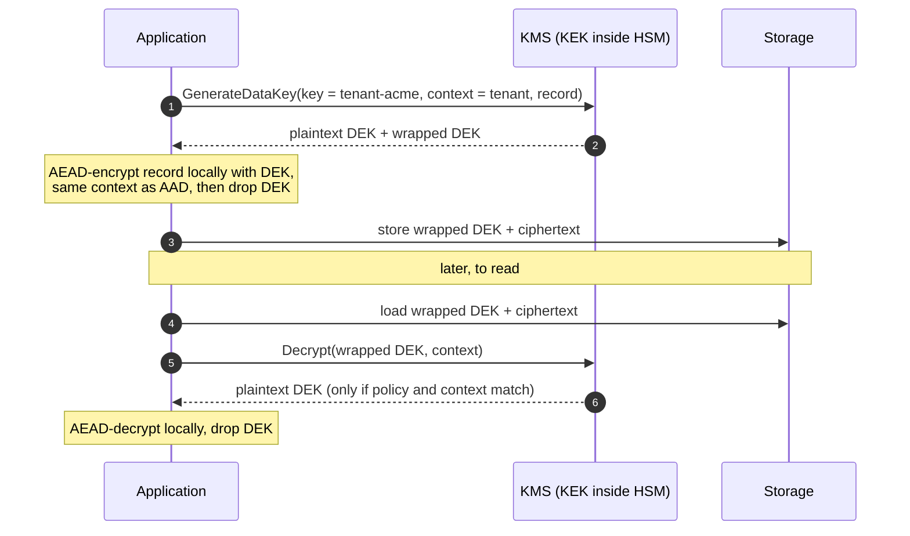
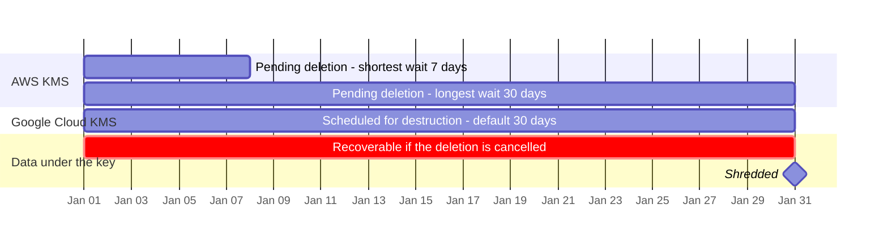
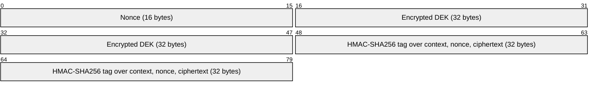

+++
title = 'Envelope encryption and KMS'
description = 'Encrypt data locally under a fresh data key, and let a KMS wrap that data key under a key that never leaves it. Rotation becomes rewrapping and deletion becomes destroying one key.'
question = 'How do you encrypt large amounts of data without ever exposing the master key?'
weight = 2
difficulty = 3
prerequisites = ['/notes/cryptography/key-management/01-the-key-lifecycle', '/notes/cryptography/symmetric-cryptography/02-authenticated-encryption']
date = 2026-08-29
lastmod = 2026-10-30
verified = 2026-08-29
+++

## The idea in one minute

You want your most important keys inside hardware that never lets them out, and
you want to encrypt terabytes at local speed. Those goals conflict if one key
does both jobs. **Envelope encryption** splits the job across two keys. A fresh
**data encryption key (DEK)** encrypts the data, locally, with an AEAD. A
**key encryption key (KEK)**, held by a key management service (KMS) backed by
HSMs, encrypts ("wraps") the DEK. The wrapped DEK is stored next to the
ciphertext; the plaintext DEK is used and dropped.

Three useful properties fall out. The KMS sees 32 bytes per object, not the
object. **Rotating the KEK means rewrapping small DEKs, not re-encrypting the
data.** And destroying a KEK makes everything under it unreadable at once,
including copies in backups you cannot reach. That last property, called
**crypto-shredding**, is also the main risk: the KEK becomes the single point
on which all of that data depends.

## A picture



The KEK never leaves the KMS. Every unwrap is an authorized, logged call.

## How it really works

### Two keys, two jobs

| | Data encryption key (DEK) | Key encryption key (KEK) |
| --- | --- | --- |
| Encrypts | Application data (records, files, objects) | Other keys (DEKs) |
| Where it lives | Briefly in application memory; stored only wrapped | Inside the KMS or HSM; not exportable |
| How many | Many: per object, per file, per tenant or per session | Few: per tenant, per service, per data class |
| Algorithm | An AEAD such as AES-256-GCM | AES-GCM, or a key-wrap mode (AES-KW, NIST SP 800-38F) |
| Exposure if leaked | The data it encrypted | Every DEK it wrapped, and so all their data |
| Rotation | Usually by writing new objects | By rewrapping DEKs under a new KEK version |

The hierarchy can be deeper. A KMS typically protects customer KEKs with its
own internal keys, which in turn sit under HSM-resident roots. Each layer is the
same pattern: a key that is used rarely and guarded heavily protects many keys
that are used often.

Read the stack from the top: each layer is fewer keys, used less often, guarded harder, and it wraps every key in the layer below.

```mermaid {title="Each layer of the hierarchy wraps the many keys below it"}
block-beta
  columns 1
  root["HSM-resident root keys: very few, rarely used"]
  internal["KMS internal keys"]
  kek["Customer KEKs: per tenant, service or data class"]
  dek["DEKs: per object, file, tenant or session, stored wrapped"]
  data["Application data: records, files, objects"]
```

### Why not just send the data to the KMS?

A KMS will encrypt small payloads directly, but it is the wrong tool for bulk
data:

- **Size limits.** As of October 2026, AWS KMS `Encrypt` accepts at most 4,096
  bytes of plaintext and Google Cloud KMS `Encrypt` at most 64 KiB. These
  limits exist because the services are meant to encrypt keys and small
  secrets.
- **Latency and cost.** Every byte would cross the network to an HSM-backed
  service. With envelopes, one KMS call covers an object of any size.
- **Exposure.** Sending data to the KMS gives the KMS operator's API the
  plaintext. Sending a DEK reveals nothing about the data.
- **Re-keying.** If the KEK directly encrypted the data, rotating it would mean
  re-encrypting everything. With envelopes, only the wrapped DEKs change: a
  few dozen bytes per object.
- **Blast radius.** A DEK per object or per tenant limits what one leaked DEK
  exposes, while the KEK stays inside hardware.

Compare what crosses the network in each design: the whole object, or one small key.

```mermaid {title="With an envelope, only a 32-byte key travels to the KMS"}
flowchart LR
  subgraph D1["Direct: data to the KMS"]
    A1("Application")
    K1("KMS")
    A1 -->|"every byte, at most 4,096 per AWS call"| K1
  end
  subgraph D2["Envelope: key to the KMS"]
    A2("Application")
    K2("KMS")
    S2[("Storage")]
    A2 -->|"32-byte DEK to wrap"| K2
    A2 -->|"object encrypted locally"| S2
  end
```

### The KMS API, conceptually

The major cloud KMS products differ in names and details but share a small
core. In AWS KMS terms:

| Call | Input | Output | Used for |
| --- | --- | --- | --- |
| `GenerateDataKey` | KEK ID, key spec, encryption context | Plaintext DEK **and** the same DEK wrapped under the KEK | Starting an envelope |
| `GenerateDataKeyWithoutPlaintext` | Same | Wrapped DEK only | A producer that stores keys for a consumer to unwrap later |
| `Encrypt` | KEK ID, small plaintext, context | Ciphertext blob | Wrapping a key you generated yourself, or a small secret |
| `Decrypt` | Ciphertext blob, context | Plaintext | Unwrapping a DEK |
| `ReEncrypt` | Ciphertext blob, source and destination keys | New ciphertext blob | Rewrapping under another key without exposing plaintext to the caller |

For symmetric KMS keys, the ciphertext blob AWS returns includes a reference to
the key that produced it, which is why `Decrypt` does not require a key ID.
Google Cloud KMS has no `GenerateDataKey`; its envelope documentation has you
generate the DEK locally with a cryptographically secure generator and call
`Encrypt` to wrap it. Both services keep earlier **key versions** usable for
decryption after rotation, so old wrapped DEKs still open. How the services
authorize these calls (key policies, IAM, grants) and where keys live (regions,
multi-region keys) is the subject of the infrastructure course; here the point
is the mechanism.

Client libraries such as the AWS Encryption SDK and Google's Tink implement the
whole envelope for you, including the message format that stores the wrapped
DEK, the algorithm identifiers and the nonce alongside the ciphertext. Prefer
them to hand-rolled formats.

### Encryption context and AAD

An AEAD can authenticate **associated data** that is not encrypted (RFC 5116).
Envelope systems use it to bind a ciphertext to where it belongs. AWS calls it
the **encryption context**: a set of non-secret key-value pairs such as
`tenant=acme, record=inv-1` passed on encrypt and required, exactly, on
decrypt. Google Cloud KMS exposes the same idea as `additionalAuthenticatedData`.

What it defeats is a **cut-and-paste attack**. Suppose an attacker can write to
your database but cannot call the KMS as your service. Without context, they can
copy tenant A's wrapped DEK and ciphertext into tenant B's row; your service
will happily unwrap and decrypt it, then show A's data to B, or treat a stale
record as current. With the tenant and record ID bound as context, the unwrap
fails because the context presented does not match the one used when the DEK
was wrapped.

The attacker here can write rows but cannot call the KMS. Follow both branches: the same copied row is served without context and refused with it.

```mermaid {title="A copied row fails to unwrap because its context names another record"}
sequenceDiagram
  autonumber
  actor Atk as Attacker with DB write access
  participant DB as Storage
  participant App as Service
  participant KMS as KMS
  Atk->>DB: copy tenant A row into tenant B row
  App->>DB: load the tenant B record
  alt no encryption context
    App->>KMS: Decrypt(wrapped DEK)
    KMS-->>App: plaintext DEK
    Note over App: decrypts A's data and serves it to B
  else context tenant=B, record=b-7
    App->>KMS: Decrypt(wrapped DEK, tenant=B, record=b-7)
    KMS-->>App: refused, DEK was wrapped with tenant=A, record=a-1
    Note over App: nothing is decrypted
  end
```

Two further uses make context more than an integrity check:

- **Policy.** AWS key policies can require a particular context
  (`kms:EncryptionContext:tenant`), so a service can be limited to unwrapping
  only its own tenant's keys.
- **Audit.** The context is recorded in the KMS audit log, so every unwrap says
  which tenant and record it was for.

Bind the same context as AAD on the **data** ciphertext as well, so that a
swapped data blob under the right DEK also fails. And remember the context is
not secret: it appears in logs, so never put personal data in it.

### Crypto-shredding

If each tenant (or each user) has its own KEK, then **destroying that KEK
makes all of that tenant's data unreadable**: primary storage, replicas,
snapshots and backup tapes, without touching any of them. This is the only
practical way to "delete" data that has been copied into systems you cannot
rewrite, and it is commonly used to implement tenant offboarding and erasure
requests.

It works only if several things are true:

- **No plaintext copies.** Search indexes, caches, analytics exports, logs and
  support tickets that hold plaintext are untouched by shredding.
- **No cached DEKs.** Services that cache unwrapped DEKs keep decrypting until
  the cache expires or the process restarts.
- **No exported KEK copies.** A KEK imported from outside the KMS (bring your
  own key) may still exist wherever it was generated.
- **The deletion actually completes.** Cloud KMS services delay destruction on
  purpose: AWS KMS schedules key deletion with a waiting period of 7 to 30 days,
  and Google Cloud KMS keeps a version in a scheduled-for-destruction state for
  a configurable period (30 days by default). That protects against mistakes, and
  it means "shredded" has a date attached.

Destroying the KEK reaches every encrypted copy at once, wherever it is. The copies on the right never depended on the KEK, so shredding does not touch them.

```mermaid {title="Shredding a tenant KEK erases encrypted copies, not plaintext ones"}
flowchart LR
  K(["Tenant KEK destroyed"])
  subgraph Gone["Unreadable"]
    P[("Primary store")]
    R("Replicas")
    B("Snapshots and backups")
  end
  subgraph Left["Still readable"]
    I["Plaintext in search indexes, caches, logs"]
    C["Service with a cached DEK"]
    E["Original of an imported KEK"]
  end
  K --> Gone
  K -.-x|"no effect"| Left
  class I,C,E warn
```

> [!WARNING] Shredding is also how you lose data by accident
> The property that makes crypto-shredding work makes a mistaken key deletion
> catastrophic and irreversible. Protect "schedule deletion" with stronger
> authorization than decrypt, alert on it, and use the waiting period.

The waiting period is both the safety net and the delay: until it ends, a deletion can be cancelled and the data is still recoverable (day counts from the services' documentation, dates illustrative).



### Choosing DEK granularity

| Granularity | Benefits | Costs |
| --- | --- | --- |
| Per object or record | Smallest blast radius; easy per-record shredding with per-record KEKs | One KMS call per object unless DEKs are cached |
| Per file or blob, with chunked AEAD | Efficient for large objects | Must handle chunk ordering and truncation (use a streaming AEAD format) |
| Per tenant (DEK cached) | Few KMS calls | A leaked DEK exposes the whole tenant; nonce limits apply across all of the tenant's writes |

Caching DEKs is a deliberate trade: fewer KMS calls and lower latency against
longer-lived plaintext keys in memory and weaker audit (one KMS log entry now
covers many decryptions). If you cache, bound the cache by time, by number of
messages, and by bytes.

Place each granularity by how many KMS calls it needs and how much one leaked DEK exposes. Positions are qualitative.

```mermaid {title="Finer DEKs shrink the blast radius and cost more KMS calls"}
quadrantChart
  title DEK granularity tradeoffs
  x-axis Few KMS calls --> Many KMS calls
  y-axis Small blast radius --> Large blast radius
  quadrant-1 Costly and exposed
  quadrant-2 Cheap but exposed
  quadrant-3 Cheap and contained
  quadrant-4 Costly but contained
  Per record: [0.85, 0.12]
  Per record with bounded cache: [0.5, 0.35]
  Per file with chunked AEAD: [0.4, 0.45]
  Per tenant with cached DEK: [0.12, 0.85]
```

## Code

A toy KMS holds per-tenant KEKs and exposes `generate_data_key`, `encrypt` and
`decrypt`. Each record gets its own DEK and binds `tenant` and `record` as
context. The program then rotates one tenant's KEK by rewrapping DEKs, checks
the data ciphertexts did not change, and crypto-shreds the other tenant.

```python {title="envelope.py"}
"""envelope.py: envelope encryption, KEK rotation by rewrapping, crypto-shredding.

Each record is encrypted under its own data key (DEK). The DEK is stored next to
the ciphertext, wrapped by a tenant key-encryption key (KEK) that never leaves
the toy KMS. TOY AEAD: SHAKE-256 keystream plus HMAC-SHA256 tag, built only to
show the mechanism. Real systems use AES-GCM or ChaCha20-Poly1305 from a vetted
library and a real KMS. Standard library only; offline; deterministic output.
"""

from __future__ import annotations

import hashlib
import hmac
from dataclasses import dataclass


class AuthError(Exception):
    pass


class Drbg:
    """Deterministic so the output is reproducible. Real code: secrets.token_bytes."""

    def __init__(self, seed: bytes) -> None:
        self.seed, self.n = seed, 0

    def bytes(self, k: int) -> bytes:
        self.n += 1
        return hashlib.shake_256(self.seed + self.n.to_bytes(8, "big")).digest(k)


def seal(key: bytes, nonce: bytes, msg: bytes, aad: bytes) -> bytes:
    enc_key = hmac.new(key, b"enc", hashlib.sha256).digest()
    mac_key = hmac.new(key, b"mac", hashlib.sha256).digest()
    stream = hashlib.shake_256(enc_key + nonce).digest(len(msg))
    ct = bytes(a ^ b for a, b in zip(msg, stream))
    tag = hmac.new(mac_key, len(aad).to_bytes(8, "big") + aad + nonce + ct, hashlib.sha256)
    return nonce + ct + tag.digest()


def open_(key: bytes, blob: bytes, aad: bytes) -> bytes:
    nonce, ct, tag = blob[:16], blob[16:-32], blob[-32:]
    mac_key = hmac.new(key, b"mac", hashlib.sha256).digest()
    want = hmac.new(mac_key, len(aad).to_bytes(8, "big") + aad + nonce + ct, hashlib.sha256)
    if not hmac.compare_digest(tag, want.digest()):
        raise AuthError("authentication failed")
    enc_key = hmac.new(key, b"enc", hashlib.sha256).digest()
    stream = hashlib.shake_256(enc_key + nonce).digest(len(ct))
    return bytes(a ^ b for a, b in zip(ct, stream))


class ToyKms:
    """KEKs live here and never leave. Callers see only key names and wrapped DEKs."""

    def __init__(self, rng: Drbg) -> None:
        self.rng, self.keks = rng, {}

    def create_key(self, name: str) -> None:
        self.keks[name] = self.rng.bytes(32)

    def generate_data_key(self, name: str, context: bytes) -> tuple[bytes, bytes]:
        dek = self.rng.bytes(32)
        return dek, self.encrypt(name, dek, context)

    def encrypt(self, name: str, plaintext: bytes, context: bytes) -> bytes:
        return seal(self.keks[name], self.rng.bytes(16), plaintext, context)

    def decrypt(self, name: str, blob: bytes, context: bytes) -> bytes:
        if name not in self.keks:
            raise AuthError(f"key {name} does not exist")
        return open_(self.keks[name], blob, context)


@dataclass
class Record:
    tenant: str
    kek_name: str
    wrapped_dek: bytes
    ciphertext: bytes


def put(kms: ToyKms, rng: Drbg, tenant: str, kek: str, rec_id: str, data: bytes) -> Record:
    ctx = f"tenant={tenant};record={rec_id}".encode()  # the encryption context / AAD
    dek, wrapped = kms.generate_data_key(kek, ctx)
    ct = seal(dek, rng.bytes(16), data, ctx)
    del dek  # the plaintext DEK is used once and dropped
    return Record(tenant, kek, wrapped, ct)


def get(kms: ToyKms, rec_id: str, r: Record) -> bytes:
    ctx = f"tenant={r.tenant};record={rec_id}".encode()
    return open_(kms.decrypt(r.kek_name, r.wrapped_dek, ctx), r.ciphertext, ctx)


def short(b: bytes) -> str:
    return hashlib.sha256(b).hexdigest()[:12]


if __name__ == "__main__":
    rng = Drbg(b"envelope-demo")
    kms = ToyKms(rng)
    kms.create_key("acme/kek-v1")
    kms.create_key("globex/kek-v1")
    db = {
        "inv-1": put(kms, rng, "acme", "acme/kek-v1", "inv-1", b"acme invoice 1: 4,200 USD"),
        "inv-2": put(kms, rng, "acme", "acme/kek-v1", "inv-2", b"acme invoice 2: 950 USD"),
        "inv-3": put(kms, rng, "globex", "globex/kek-v1", "inv-3", b"globex invoice 3: 77 USD"),
    }
    for rid, r in db.items():
        print(f"{rid} {r.tenant:<6} kek={r.kek_name:<14} data={short(r.ciphertext)} -> {get(kms, rid, r).decode()}")

    # A copied row presented as another record fails: the context is bound in.
    try:
        get(kms, "inv-3", db["inv-1"])
    except AuthError as e:
        print("inv-1 replayed as inv-3:", e)

    # KEK rotation: unwrap and rewrap each DEK. The data ciphertext is untouched.
    kms.create_key("acme/kek-v2")
    before = {rid: short(r.ciphertext) for rid, r in db.items()}
    for rid, r in db.items():
        if r.kek_name == "acme/kek-v1":
            ctx = f"tenant={r.tenant};record={rid}".encode()
            dek = kms.decrypt("acme/kek-v1", r.wrapped_dek, ctx)
            r.wrapped_dek, r.kek_name = kms.encrypt("acme/kek-v2", dek, ctx), "acme/kek-v2"
    del kms.keks["acme/kek-v1"]
    moved = sum(1 for r in db.values() if r.kek_name == "acme/kek-v2")
    same = all(short(r.ciphertext) == before[rid] for rid, r in db.items())
    size = len(db["inv-1"].wrapped_dek)
    print(f"rotated acme: {moved} DEKs rewrapped ({size} bytes each), data ciphertext unchanged: {same}")
    print("inv-1 after rotation:", get(kms, "inv-1", db["inv-1"]).decode())

    # Crypto-shredding: destroy globex's KEK and every globex record is gone,
    # including copies in backups and replicas we cannot reach.
    del kms.keks["globex/kek-v1"]
    for rid, r in db.items():
        try:
            print(f"{rid} after shredding globex:", get(kms, rid, r).decode())
        except AuthError as e:
            print(f"{rid} after shredding globex: unreadable ({e})")
```

Run it with `python3 envelope.py`:

```text
inv-1 acme   kek=acme/kek-v1    data=364455c181e3 -> acme invoice 1: 4,200 USD
inv-2 acme   kek=acme/kek-v1    data=8e7eddae030a -> acme invoice 2: 950 USD
inv-3 globex kek=globex/kek-v1  data=faba327e28ec -> globex invoice 3: 77 USD
inv-1 replayed as inv-3: authentication failed
rotated acme: 2 DEKs rewrapped (80 bytes each), data ciphertext unchanged: True
inv-1 after rotation: acme invoice 1: 4,200 USD
inv-1 after shredding globex: acme invoice 1: 4,200 USD
inv-2 after shredding globex: acme invoice 2: 950 USD
inv-3 after shredding globex: unreadable (key globex/kek-v1 does not exist)
```

Rotation rewrote two 80-byte wrapped DEKs and left every data ciphertext
byte-for-byte unchanged. Shredding one tenant left the other untouched. The
replayed row failed at the KMS, before any data was decrypted, because the
context it presented did not match the one bound when the DEK was wrapped.

Each wrapped DEK in the toy format is one `seal` output: a 16-byte nonce, the 32-byte DEK encrypted, and a 32-byte tag. Cells below are numbered by byte, not by bit.



## Where it breaks

- **The KMS permission is the real access control.** Anyone who can call
  `Decrypt` on the KEK with the right context can read the data. Envelope
  encryption moves the question from "who has the key" to "who may ask the KMS
  to use it". Review those permissions as you would review database access.
- **Plaintext DEKs live in memory.** The application holds each DEK while it
  works. A memory disclosure bug, a core dump or a debugger exposes the DEKs it
  was using at that moment, though never the KEK.
- **Rewrapping is not re-keying the data.** If a DEK itself leaked, rewrapping
  it under a new KEK changes nothing: the attacker already holds the DEK. A DEK
  compromise needs re-encryption under a new DEK (see
  [Rotation and revocation](/notes/cryptography/key-management/04-rotation-and-revocation/)).
- **Availability now depends on the KMS.** If the KMS is unreachable, nothing
  decrypts. If the KEK is deleted, nothing ever decrypts again. Plan for
  regional outages and treat KEK deletion as a disaster-recovery event.
- **Context is checked, not secret.** It prevents swapping, but it is visible
  in logs and policies. It also cannot help if the attacker can call the KMS as
  your service.
- **The toy AEAD is a toy.** The program builds encryption from SHAKE-256 and
  HMAC to stay within the standard library. It shows the envelope mechanism and
  nothing about AEAD design. Use AES-GCM or ChaCha20-Poly1305 from a vetted
  library.

## Remember this

- A DEK encrypts data locally; a KEK inside the KMS wraps the DEK; store the
  wrapped DEK with the ciphertext.
- The KEK never leaves the KMS; every unwrap is an authorized, logged call.
- Bind tenant and record as encryption context (AAD) on both the DEK and the
  data.
- KEK rotation is rewrapping; a leaked DEK still needs re-encryption.
- Crypto-shredding works only if no plaintext, cached DEK or exported KEK
  survives.
- Whoever may call `Decrypt` may read the data.

## Try it

1. Run `envelope.py`. Its `get` builds the context from fields of the stored
   record; a real service builds it from the request (the authenticated tenant
   and the record ID it was asked for). Change `get` to take the tenant as an
   argument and try serving `inv-3`'s row to an `acme` caller. Then remove the
   record ID from the context and show that swapping the `inv-1` and `inv-2`
   rows now goes unnoticed.
2. Add a DEK cache keyed by wrapped DEK, with a maximum number of uses. Shred
   `globex` while a `globex` DEK is cached and observe what still decrypts.
3. Implement a `re_encrypt` method on `ToyKms` that rewraps from one KEK to
   another without returning the plaintext DEK to the caller, and use it for
   the rotation.
4. Sketch a per-user KEK design for an application with ten million users.
   What does it cost in KMS keys and calls, and what does it buy you for
   erasure requests?

## Check yourself

1. Why does rotating a KEK not require re-encrypting the data?

   
   The KEK encrypts only the DEKs. Rotation unwraps each DEK with the old KEK
   version and wraps it with the new one; the data stays encrypted under the
   same DEK, so its ciphertext does not change. Only the small wrapped DEK is
   rewritten.
   

2. An attacker can write to your database but cannot call the KMS as your
   service. What can they do without encryption context, and what does context
   stop?

   
   They can move a wrapped DEK and its ciphertext into another row or tenant,
   and your service will decrypt it and serve it there: a cut-and-paste attack.
   With tenant and record bound as context, the unwrap or the data decryption
   fails because the context presented does not match the one used at
   encryption.
   

3. A DEK leaked from a crash dump. Is rewrapping it under a new KEK enough?

   
   No. The attacker holds the DEK itself, which decrypts the data regardless of
   how it is wrapped. The affected data must be re-encrypted under a new DEK,
   and the old ciphertexts (including backups) should be treated as exposed.
   

4. List three things that can defeat crypto-shredding.

   
   Plaintext copies outside the encrypted store (logs, caches, search indexes,
   exports); unwrapped DEKs cached in running services; copies of the KEK
   outside the KMS, such as an imported key's original. A pending deletion that
   has not yet completed also means the data is still recoverable.
   

5. Why put the encryption context in the KMS audit log?

   
   So that each unwrap records which tenant and record it was for. Without it,
   the log shows only that some DEK under the KEK was unwrapped, which cannot
   distinguish normal reads from an attacker walking through every tenant.
   

## Sources

- AWS, [AWS KMS cryptography essentials: envelope encryption](https://docs.aws.amazon.com/kms/latest/developerguide/kms-cryptography.html) and [Encryption context](https://docs.aws.amazon.com/kms/latest/developerguide/encrypt_context.html), AWS Key Management Service Developer Guide.
- AWS, [GenerateDataKey](https://docs.aws.amazon.com/kms/latest/APIReference/API_GenerateDataKey.html), [Encrypt](https://docs.aws.amazon.com/kms/latest/APIReference/API_Encrypt.html) and [ScheduleKeyDeletion](https://docs.aws.amazon.com/kms/latest/APIReference/API_ScheduleKeyDeletion.html), AWS KMS API Reference.
- Google Cloud, [Envelope encryption](https://cloud.google.com/kms/docs/envelope-encryption) and [Additional authenticated data](https://cloud.google.com/kms/docs/additional-authenticated-data), Cloud KMS documentation.
- D. McGrew, [RFC 5116: An Interface and Algorithms for Authenticated Encryption](https://www.rfc-editor.org/rfc/rfc5116), IETF, January 2008.
- M. Dworkin, [NIST SP 800-38F: Recommendation for Block Cipher Modes of Operation: Methods for Key Wrapping](https://csrc.nist.gov/pubs/sp/800/38/f/final), NIST, December 2012.
- E. Barker, [NIST SP 800-57 Part 1 Rev. 5: Recommendation for Key Management](https://csrc.nist.gov/pubs/sp/800/57/pt1/r5/final), NIST, May 2020.
