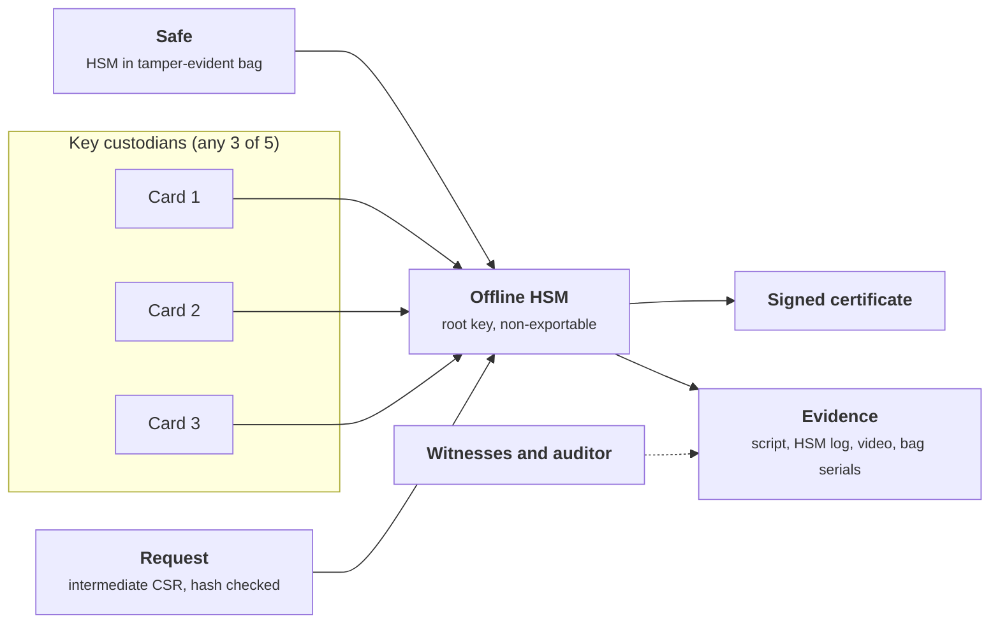
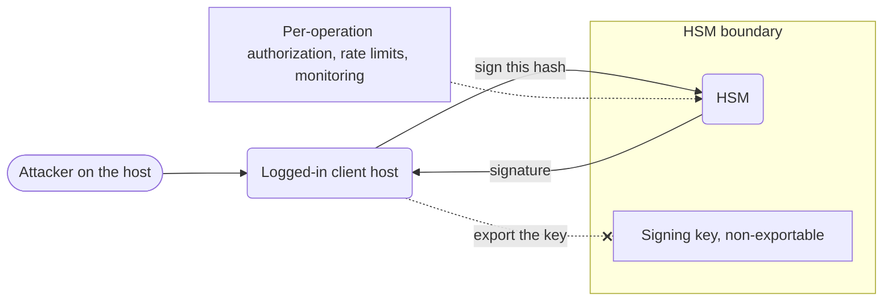
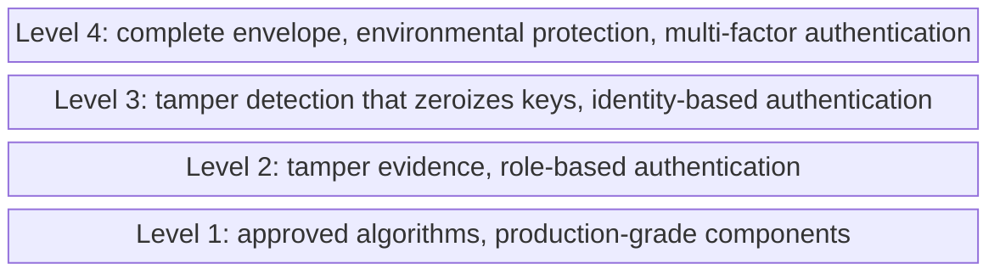
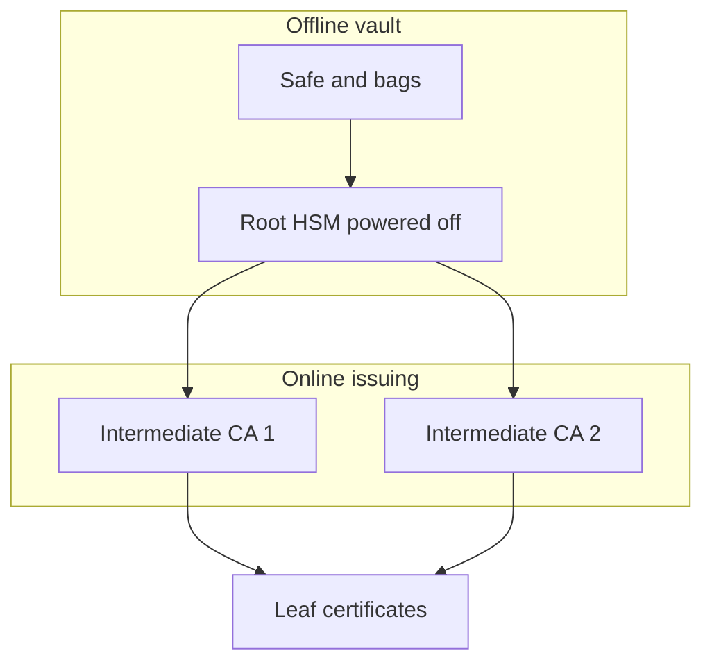

+++
title = 'HSMs and key ceremonies'
description = 'The keys at the top of a hierarchy should never exist outside dedicated hardware, and no single person should be able to use them. HSMs, quorum authorization, secret sharing and witnessed ceremonies are how that is made true and provable.'
question = 'How do you protect a key so important that no one person may ever hold it?'
weight = 3
difficulty = 3
prerequisites = ['/notes/cryptography/key-management/01-the-key-lifecycle', '/notes/cryptography/public-key-cryptography/03-certificates-and-pki']
date = 2026-08-31
lastmod = 2026-08-31
verified = 2026-08-31
+++

## The idea in one minute

Some keys are worth more than everything they protect combined: a root CA key,
a firmware-signing key, the master key of a KMS, the DNSSEC root key. For these
keys two things must be true. **The key never exists outside hardware built to
contain it**, and **no single person can use it, copy it, or destroy it**.

A hardware security module (HSM) makes the first true: the key is generated
inside a tamper-resistant boundary and is marked non-exportable, so software can
ask the HSM to use the key but never to reveal it. Quorum authorization and
secret sharing make the second true: M of N people must each present something
before the HSM will act, and backup material is split so that fewer than M
shares reveal nothing. A **key ceremony** binds it together: a scripted,
witnessed, recorded procedure whose output is not only a key but **evidence**
that the key was handled as claimed. The consequence: for your top keys, design
the ceremony and its records with the same care as the cryptography.

## A picture



The HSM refuses to use the root key until three custodians authenticate. The
ceremony produces the certificate and the record that proves how it was made.

## How it really works

### What an HSM is, and what it is not

An HSM is a dedicated computer whose job is to generate, store and use keys
inside a protected boundary. Applications send it requests ("sign this hash
with key 7", "unwrap this blob") through an API and get results back. The key
material stays inside. HSMs come as PCIe cards, network appliances, USB tokens
and smartcards, and as cloud services (dedicated cloud HSMs, or KMS products
that run on HSM fleets).

What an HSM adds:

- **Generation inside the boundary** with an approved random bit generator, so
  the key never existed anywhere else.
- **Non-exportable keys.** The key can be used but its value cannot be read out,
  even by an administrator.
- **Physical protection.** Depending on its level, tamper evidence, or active
  tamper detection that erases (zeroizes) keys when the enclosure is breached.
- **Role separation and quorum.** Separate roles for administering the device
  and using keys, with optional M-of-N authorization.
- **A tamper-resistant audit log** of key operations.

What an HSM does **not** do is decide whether a request is a good idea. If an
attacker controls a host that is logged in to the HSM, they cannot steal the
signing key, but they can ask the HSM to sign whatever they want for as long as
they have that access. **An HSM turns key theft into key misuse**, which is
easier to detect and to stop, but not impossible. Authorization of individual
operations, rate limits and monitoring of what gets signed still matter.

The attacker owns the host but not the key. Requests through the API succeed; the export path is refused by the token.



### FIPS 140-3 security levels

FIPS 140-3, which took effect in September 2019, is the US and Canadian standard
for validating cryptographic modules; it adopts the requirements of ISO/IEC
19790:2012 and its test methods from ISO/IEC 24759. The Cryptographic Module
Validation Program (CMVP) issues certificates for specific module versions. It
defines four increasing security levels:

| Level | What it adds (simplified) | Typical example |
| --- | --- | --- |
| **1** | Approved algorithms, production-grade components; no specific physical security | A software cryptographic library |
| **2** | **Tamper evidence** (seals, coatings, locks) and **role-based** authentication | Some USB tokens and network HSMs |
| **3** | **Tamper detection and response** that zeroizes keys, **identity-based** authentication, stronger separation of the interfaces through which keys enter and leave | Most enterprise and cloud HSMs |
| **4** | A complete protective envelope that responds to any physical intrusion, protection against environmental attacks (voltage, temperature), **multi-factor** authentication | Specialized HSMs for hostile physical environments |

The levels are cumulative: each one keeps everything below it and adds a stronger physical and authentication requirement.



Read a certificate carefully. It covers a specific hardware and firmware
version, in a specific approved mode, and lists which algorithms were
validated. A "FIPS-validated HSM" running unvalidated firmware, or with the
approved mode turned off, is not what the certificate describes. CMVP stopped
accepting new FIPS 140-2 submissions in 2021 and scheduled the remaining
FIPS 140-2 certificates to move to its historical list in September 2026, so as
of October 2026 new procurements should look for FIPS 140-3 certificates.

### Non-exportable keys and PKCS#11

Most HSMs speak **PKCS#11** (Cryptoki), an OASIS standard C API, alongside
vendor and cloud APIs. Its model is useful even if you never call it directly.
A session logs in as a role (the Security Officer, who administers the token,
or the User, who uses keys), and keys are objects with attributes that the
token enforces. A root signing key might be generated with a template like
this:

```c {title="PKCS#11 private key template (excerpt)"}
CK_BBOOL yes = CK_TRUE, no = CK_FALSE;
CK_ATTRIBUTE private_template[] = {
    {CKA_TOKEN,       &yes, sizeof(yes)},  /* persistent, not a session object   */
    {CKA_PRIVATE,     &yes, sizeof(yes)},  /* only visible after login           */
    {CKA_SENSITIVE,   &yes, sizeof(yes)},  /* value can never be read in clear   */
    {CKA_EXTRACTABLE, &no,  sizeof(no)},   /* cannot be wrapped out, even encrypted */
    {CKA_SIGN,        &yes, sizeof(yes)},  /* one purpose: signing               */
    {CKA_DECRYPT,     &no,  sizeof(no)},
    {CKA_LABEL,       "root-ca-2026", 12},
};
```

The token also maintains read-only attributes `CKA_ALWAYS_SENSITIVE` and
`CKA_NEVER_EXTRACTABLE`, which record whether the key has **always** had those
properties. An auditor can check them to confirm a key was born inside the
token and never left, rather than imported from somewhere else. Notice the
purpose attributes, too: the one-key-one-purpose rule from
[The key lifecycle](/notes/cryptography/key-management/01-the-key-lifecycle/)
is enforced by the token itself.

Non-exportable raises a real problem: **how do you back it up?** Vendors solve
it with proprietary cloning or backup schemes in which the key leaves only
encrypted under a key shared by HSMs of the same security domain, typically
under quorum control. The backup HSM, its location and its custodians are then
part of the key's exposure and must be inventoried as such.

### Quorum: splitting authority, splitting secrets

Two different mechanisms both get called "M of N":

- **Quorum authentication.** The HSM itself requires M of N credential holders
  (usually smartcards with PINs) to authenticate before it will activate a
  partition, use a key, or change policy. The key never leaves the HSM; what is
  split is the **authority** to use it.
- **Secret sharing.** A secret, often a backup key or the key that protects an
  HSM's backups, is split into N shares so that any M reconstruct it. What is
  split is the **secret** itself.

Many HSMs use both: the cards that form the quorum each hold a share of a
secret the HSM needs to unlock its keys.

Both use three of five, but what gets split differs: on the left the key never leaves the HSM; on the right the secret is rebuilt from its pieces.

```mermaid {title="Quorum splits the authority, secret sharing splits the secret"}
flowchart LR
  subgraph QA["Quorum authentication"]
    C1["Card 1"]
    C2["Card 2"]
    C3["Card 3"]
    H1("HSM uses the key inside")
    C1 --> H1
    C2 --> H1
    C3 --> H1
  end
  subgraph SS["Secret sharing"]
    S1["Share 1"]
    S2["Share 2"]
    S3["Share 3"]
    R1@{ shape: hex, label: "Combine" }
    B1["Backup key rebuilt"]
    S1 --> R1
    S2 --> R1
    S3 --> R1
    R1 --> B1
  end
  class C1,C2,C3,S1,S2,S3 memory
  class R1 compute
  class B1 io
```

### Shamir secret sharing

Adi Shamir's 1979 scheme is the standard construction. To split a secret `s`
with threshold `k`:

1. Work in a prime field: arithmetic modulo a prime `p` larger than any secret.
2. Choose a random polynomial of degree `k - 1` whose constant term is the
   secret: `f(x) = s + a1·x + ... + a(k-1)·x^(k-1)  (mod p)`.
3. Give share `i` the point `(i, f(i))` for `i = 1 .. n`. Never hand out `x = 0`;
   that is the secret.

Any `k` points determine a unique polynomial of degree `k - 1`, so `k` holders
recover `f` by Lagrange interpolation and evaluate it at zero. With `k - 1`
points, **every possible secret is equally consistent**: for each candidate
`s`, exactly one polynomial passes through the known points and has that
constant term. The security is information-theoretic: it does not rest on any
computational assumption, and no amount of computing power helps an attacker
with too few shares.

Drawn over ordinary integers for readability (the real scheme works modulo p): the three curves are all degree 2 and all pass through custodian 1's and custodian 2's shares, yet they meet x = 0 at 42, 38 and 36. Two shares cannot tell them apart; a third share at x = 3 would.

```mermaid {title="Two shares fit many curves, and each curve implies a different secret"}
xychart-beta
  title "Degree-2 curves through the shares at x = 1 and x = 2"
  x-axis "x" ["0 (secret)", "1", "2", "3", "4", "5"]
  y-axis "f(x)" 0 --> 160
  line [42, 52, 68, 90, 118, 152]
  line [38, 52, 68, 86, 106, 128]
  line [36, 52, 68, 84, 100, 116]
```

Properties worth knowing:

| Property | Consequence |
| --- | --- |
| Shares are the same size as the secret | Cheap to store on smartcards or paper |
| Fewer than `k` shares reveal nothing | Losing up to `k - 1` shares to an attacker is survivable |
| Up to `n - k` shares can be lost | Availability is designed in, not bolted on |
| New shares can be issued from the same polynomial | Adding a custodian does not disturb others, but old shares remain valid |
| Shares carry no integrity check | A wrong or malicious share silently produces a wrong secret |

That last row matters in practice. Verifiable secret sharing (Feldman, 1987)
adds public commitments so each share can be checked before use; failing that,
check the reconstructed secret against a known fingerprint before trusting it.

Choosing `k` and `n` is a trade between **collusion** and **availability**.
With 2 of 3, two people who know each other can act alone. With 5 of 5, one
illness halts everything. Common practice is a threshold above half (3 of 5,
4 of 7), custodians drawn from different teams and locations, and documented
succession when a custodian leaves.

Plot a threshold by how few people could act alone and how few absences would halt the ceremony. Positions are qualitative.

```mermaid {title="Choosing k and n trades collusion against availability"}
quadrantChart
  title Picking a threshold
  x-axis Low collusion risk --> High collusion risk
  y-axis Low availability risk --> High availability risk
  quadrant-1 Worst of both
  quadrant-2 One absence halts everything
  quadrant-3 Common practice
  quadrant-4 A pair can act alone
  2 of 3: [0.82, 0.2]
  3 of 5: [0.38, 0.3]
  4 of 7: [0.28, 0.25]
  5 of 5: [0.1, 0.92]
```

### Key ceremonies

A key ceremony is a **scripted, witnessed procedure** for a high-value key
operation: generation, activation of a root, signing an intermediate, rotating
a KSK, restoring from backup, or destruction. Its purpose is twofold: to carry
out the operation correctly, and to produce evidence that convinces someone who
was not in the room.

The roles are separated so that no one person can deviate unnoticed:

| Role | Responsibility |
| --- | --- |
| **Ceremony administrator** | Runs the script step by step; cannot use the key alone |
| **Key custodians** (crypto officers) | Each holds one quorum credential or share; presents it when the script says so and takes it back sealed |
| **Internal witness** | Follows the script, records each step, time and deviation, and signs the log |
| **External witnesses and auditors** | Observe independently and attest that the script was followed |
| **Safe or facility controllers** | Control physical access to the room, safes and equipment, separately from the custodians |

The artifacts are what make the ceremony checkable afterward:

- **The script.** Numbered steps, prepared and reviewed in advance, with the
  exact commands and expected outputs. Every step is initialed as it is done.
  Deviations are written down, not improvised.
- **Tamper-evident bags.** HSMs, smartcards and boot media are stored in
  serial-numbered bags. Serial numbers are read aloud and compared with the
  previous ceremony's log before opening, and recorded when resealing.
- **Video.** Continuous recording of the room and the screen, so steps can be
  checked later.
- **Logs.** The HSM's own audit log, the attendance log, the signed script, and
  hashes of every input (the CSR or key signing request) and output, verified
  against values supplied through a separate channel.
- **Clean equipment.** An air-gapped laptop, booted from known read-only media,
  with no network hardware enabled. The media's hash is checked before boot.

A dry run with test keys, a go/no-go checklist, and a rule that any
unexplained anomaly stops the ceremony are as much part of it as the
cryptography.

One ceremony as a schedule. Every check comes before the key is used, and the recording runs from the first step to the last (durations are illustrative).

```mermaid {title="A signing ceremony runs its checks before the key is touched"}
gantt
  dateFormat HH:mm
  axisFormat T+%H:%M
  section Record
  Video of room and screen                  :v1, 00:00, 150m
  section Setup
  Go or no-go checklist and attendance log  :s1, 00:00, 15m
  Read bag serials and compare with last log :s2, after s1, 20m
  Boot air-gapped laptop from hashed media  :s3, after s2, 20m
  section Key use
  Verify CSR hash from a separate channel   :k1, after s3, 10m
  Three of five custodians present cards    :crit, k2, after k1, 15m
  Sign the intermediate certificate         :crit, k3, after k2, 10m
  section Close
  Reseal HSM and cards and record serials   :c1, after k3, 25m
  Witnesses sign script and logs            :c2, after c1, 25m
```

> [!NOTE] A public example: the DNSSEC root KSK
> IANA runs ceremonies for the DNSSEC root zone's key signing key (KSK) at two
> key management facilities, in Culpeper, Virginia and El Segundo, California.
> The KSK lives in HSMs kept in safes. Trusted Community Representatives drawn
> from the Internet community serve as Crypto Officers, each holding a smartcard
> stored in a safe-deposit box; a quorum of them must be present to activate
> the HSM. Ceremonies follow published scripts, use tamper-evident bags, and are
> filmed, and IANA publishes the scripts, logs and recordings. The root KSK was
> rolled for the first time in October 2018, from KSK-2010 to KSK-2017. If you
> want to see what a well-run ceremony looks like, read one of those scripts.

### Offline roots

The common shape for a PKI or a signing hierarchy is an **offline root** above
**online intermediates**. The root key sits in an HSM that is powered off and
locked away between ceremonies. It signs only intermediate certificates and the
root's own revocation lists. Day-to-day issuance happens at the intermediates,
whose compromise can be repaired by revoking them under the root.

The root sits powered off in the vault and only ever signs the intermediates; everything online is one level down and can be revoked.



Offline roots trade convenience for containment, and the trade has
operational edges. The root's CRL has a `nextUpdate` date; if no ceremony
re-signs it before then, relying parties may start rejecting everything below
it. Ceremonies therefore sit on a calendar with margin, and the facility,
custodians and equipment must stay ready for an operation that happens a few
times a year. A root key may live for decades, so the people who generate it
are rarely the people who retire it. The ceremony records are how the second
group learns what the first one did.

## Code

The program implements Shamir secret sharing over the prime field of
`2^521 - 1`, splits a 32-byte key 3 of 5, rebuilds it from every subset of
three, and shows what goes wrong with two shares or a tampered share. It then
switches to a field of 31 elements, small enough to enumerate every degree-2
polynomial, and counts how many are consistent with two observed shares.

```python {title="shamir.py"}
"""shamir.py: Shamir secret sharing over a prime field (Shamir, 1979).

Split a 32-byte key into 5 shares so that any 3 rebuild it and 2 reveal nothing.
The secret is the constant term of a random degree-2 polynomial; each share is a
point on it. Standard library only; offline. Coefficients come from a seeded
random.Random so the output is reproducible. Real code must use the secrets
module and a reviewed implementation.
"""

from __future__ import annotations

import hashlib
import random
from itertools import combinations, product

P = 2**521 - 1  # a Mersenne prime, comfortably larger than any 32-byte secret


def split(secret: int, k: int, n: int, rng: random.Random, p: int = P) -> list[tuple[int, int]]:
    assert 0 <= secret < p and 1 < k <= n < p
    coeffs = [secret] + [rng.randrange(p) for _ in range(k - 1)]

    def f(x: int) -> int:
        y = 0
        for c in reversed(coeffs):  # Horner's rule, mod p
            y = (y * x + c) % p
        return y

    return [(x, f(x)) for x in range(1, n + 1)]  # x = 0 would be the secret itself


def combine(shares: list[tuple[int, int]], p: int = P) -> int:
    """Lagrange interpolation evaluated at x = 0."""
    total = 0
    for i, (xi, yi) in enumerate(shares):
        num = den = 1
        for j, (xj, _) in enumerate(shares):
            if i != j:
                num = num * -xj % p
                den = den * (xi - xj) % p
        total = (total + yi * num * pow(den, -1, p)) % p
    return total


def fp(value: int) -> str:
    return hashlib.sha256(value.to_bytes(66, "big")).hexdigest()[:12]


if __name__ == "__main__":
    rng = random.Random(1979)
    key = bytes(range(0xA0, 0xC0))  # stands in for a 32-byte root key
    secret = int.from_bytes(key, "big")
    shares = split(secret, k=3, n=5, rng=rng)
    print(f"secret fingerprint {fp(secret)}; 5 shares, threshold 3")
    for x, y in shares:
        print(f"  custodian {x}: share fingerprint {fp(y)}")

    rebuilt = [combine(list(c)) == secret for c in combinations(shares, 3)]
    print(f"any 3 of 5: {sum(rebuilt)}/{len(rebuilt)} subsets rebuild the key")
    two = combine(shares[:2])
    print(f"2 of 5 interpolated anyway: {fp(two)} (matches: {two == secret})")
    print("recovered bytes equal original:", combine(shares[2:]).to_bytes(32, "big") == key)
    bad = combine([shares[0], shares[1], (shares[2][0], shares[2][1] ^ 1)])
    print(f"one tampered share: rebuilt {fp(bad)} (matches: {bad == secret}), no error raised")

    # Why 2 shares reveal nothing: in a field small enough to enumerate, count
    # every degree-2 polynomial that passes through the observed shares, grouped
    # by the secret (constant term) each one would imply.
    q = 31
    small = split(19, k=3, n=5, rng=random.Random(7), p=q)
    for seen in (small[:2], small[:3]):
        fits = {}
        for s, a1, a2 in product(range(q), repeat=3):
            if all((s + a1 * x + a2 * x * x) % q == y for x, y in seen):
                fits[s] = fits.get(s, 0) + 1
        spread = sorted(set(fits.values()))
        print(f"GF({q}), shares {seen}: {len(fits):>2} candidate secrets, "
              f"{spread} polynomial each")
    print(f"three shares pin the secret to {sorted(fits)}")
```

Run it with `python3 shamir.py`:

```text
secret fingerprint be77c182b77b; 5 shares, threshold 3
  custodian 1: share fingerprint cc81a95959f4
  custodian 2: share fingerprint b1c305ffeff0
  custodian 3: share fingerprint f1289fd4db23
  custodian 4: share fingerprint affa00148298
  custodian 5: share fingerprint 96dd31666793
any 3 of 5: 10/10 subsets rebuild the key
2 of 5 interpolated anyway: 9d60f1046f57 (matches: False)
recovered bytes equal original: True
one tampered share: rebuilt 7f031d5f3b1d (matches: False), no error raised
GF(31), shares [(1, 28), (2, 4)]: 31 candidate secrets, [1] polynomial each
GF(31), shares [(1, 28), (2, 4), (3, 9)]:  1 candidate secrets, [1] polynomial each
three shares pin the secret to [19]
```

All ten 3-share subsets rebuild the key. Two shares interpolate to a line, not
the secret. A tampered share produces a wrong key **without any error**, which
is why a reconstructed key should be checked against a recorded fingerprint. In
the small field, two shares leave all 31 secrets possible, each explained by
exactly one polynomial, so the shares carry no information about which one is
right. The third share leaves exactly one.

## Where it breaks

- **The HSM is a signing oracle for whoever controls its client.** A
  compromised host with an authenticated session can sign arbitrary data. The
  key is safe; your trust in its signatures is not. Monitor what is signed,
  require per-operation authorization for root keys, and keep high-value HSMs
  offline.
- **Reconstruction puts the whole secret in one place.** Shamir protects the
  shares at rest. When `k` shares are combined on a laptop, the full secret
  exists in that laptop's memory. Prefer schemes where shares are combined
  inside an HSM, and run any software reconstruction on clean, air-gapped
  equipment that is wiped afterward.
- **Quorums can be coerced or colluded.** A threshold defends against one bad
  actor, not against `k` of them, nor against an organization that pressures
  its custodians. Draw custodians from different reporting lines and places.
- **Ceremonies fail socially.** Skipped steps "to save time", an unverified CSR
  hash, a bag serial nobody compared, a witness who was not watching: each
  turns the evidence into theater. The script is only as good as the discipline
  of following it.
- **Validation is not configuration.** A FIPS 140-3 certificate says the module
  can be operated securely, not that yours is. Default credentials, approved
  mode disabled, or overly broad partition access defeat it.
- **The program is a teaching toy.** It uses `random.Random` with a fixed seed so
  the output is reproducible, Python big integers that are not constant-time,
  and no share integrity. Use the `secrets` module and a reviewed implementation,
  or your HSM's built-in scheme.

## Remember this

- An HSM makes keys non-exportable; it turns theft into misuse, which you still
  must detect.
- FIPS 140-3 levels: 2 adds tamper evidence, 3 adds tamper response and identity
  authentication, 4 adds environmental protection and multi-factor.
- Quorum splits authority; Shamir splits the secret. Fewer than `k` shares
  reveal nothing.
- Shamir shares have no integrity: verify the rebuilt secret.
- A ceremony's product is evidence: script, bags, video, logs, witnesses.
- Offline roots sign only intermediates and CRLs; schedule ceremonies before the
  CRL expires.

## Try it

1. Run `shamir.py`. Change it to 4 of 7 and confirm every 4-subset rebuilds the
   key and no 3-subset does.
2. Add a fingerprint check: store `sha256(secret)` at split time and make
   `combine` raise if the result does not match. Use it to find which custodian
   submitted the tampered share by trying every 3-subset.
3. Replace `random.Random` with `secrets.randbelow` and explain why the output
   is no longer reproducible, and why that is correct.
4. Write the first fifteen steps of a ceremony script for generating an offline
   root key: who is present, what is checked before the HSM bag is opened, and
   what is recorded at each step.

## Check yourself

1. An attacker gains root on a server logged in to the HSM that holds your
   signing key. What can they do, and what can they not?

   
   They cannot extract a non-exportable key. They can ask the HSM to sign
   anything for as long as they control the session, so they can produce valid
   signatures on malicious artifacts. The response is to revoke trust in
   signatures made during the window, cut the session, and investigate, but the
   key itself may not need replacing.
   

2. Why do two shares of a 3-of-5 Shamir split reveal nothing about the secret?

   
   For any candidate secret, there is exactly one degree-2 polynomial through
   the two known points with that constant term. Every secret is therefore
   equally consistent with what the attacker holds; the shares do not favor
   any value.
   

3. What is the difference between quorum authentication and secret sharing?

   
   Quorum authentication splits the authority to use a key: the HSM refuses to
   act until M of N holders authenticate, and the key never leaves. Secret
   sharing splits the secret itself into shares that must be combined to
   recover it. Both are called M of N; they protect different things.
   

4. Why are tamper-evident bag serial numbers read aloud and compared with the
   previous ceremony's log?

   
   To detect whether anyone opened the bag between ceremonies. A bag can be
   replaced with a new one, but not with one carrying the same serial number.
   Recording the serial at sealing and checking it at opening links the two
   ceremonies into a chain of custody.
   

5. What operational risk does an offline root introduce that an online one does
   not?

   
   Its CRL must be re-signed before `nextUpdate`, which requires a ceremony.
   If the facility, custodians or equipment are not ready in time, relying
   parties may reject the whole hierarchy. Offline roots need a calendar with
   margin and a team ready to run a ceremony on short notice.
   

## Sources

- A. Shamir, [How to share a secret](https://doi.org/10.1145/359168.359176), Communications of the ACM 22(11), November 1979.
- P. Feldman, [A practical scheme for non-interactive verifiable secret sharing](https://doi.org/10.1109/SFCS.1987.4), 28th IEEE Symposium on Foundations of Computer Science, 1987.
- NIST, [FIPS 140-3: Security Requirements for Cryptographic Modules](https://csrc.nist.gov/pubs/fips/140-3/final), March 2019, and the [Cryptographic Module Validation Program](https://csrc.nist.gov/projects/cryptographic-module-validation-program).
- OASIS, [PKCS #11 Specification Version 3.1](https://docs.oasis-open.org/pkcs11/pkcs11-spec/v3.1/pkcs11-spec-v3.1.html), 2023.
- IANA, [DNSSEC root KSK ceremonies](https://www.iana.org/dnssec/ceremonies) (scripts, logs and recordings) and [DNSSEC practice statement for the root zone KSK operator](https://www.iana.org/dnssec).
- E. Barker, W. Barker, [NIST SP 800-57 Part 2 Rev. 1: Recommendation for Key Management, Part 2: Best Practices for Key Management Organizations](https://csrc.nist.gov/pubs/sp/800/57/pt2/r1/final), NIST, May 2019.
