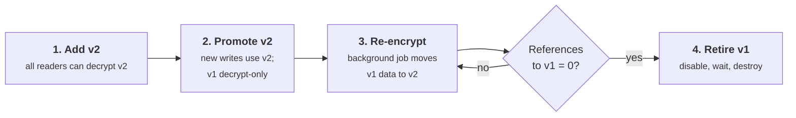
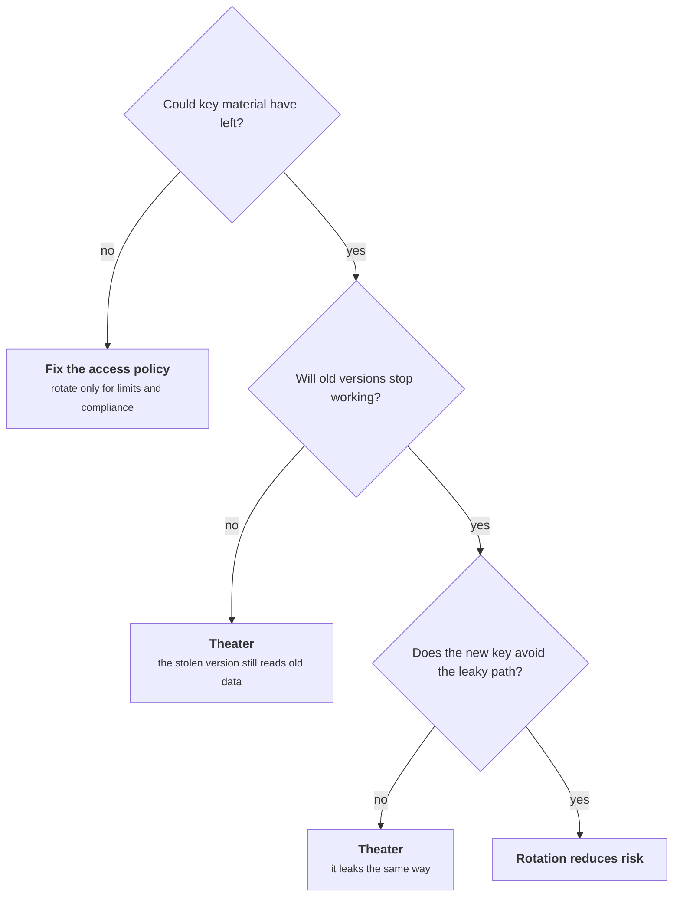
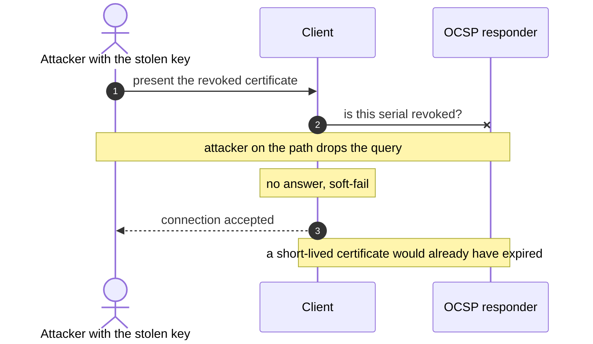
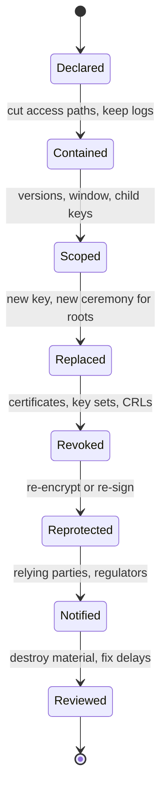

+++
title = 'Rotation and revocation'
description = 'Rotation bounds how much a key protects and how long a leak stays useful, but only if old versions actually stop working. Design for it with versioned key IDs, overlap windows and re-encryption, and rehearse it so an emergency rotation is routine.'
question = 'When does replacing a key actually reduce risk, and how do you do it without breaking anything?'
weight = 4
difficulty = 3
prerequisites = ['/notes/cryptography/key-management/02-envelope-encryption-and-kms', '/notes/cryptography/public-key-cryptography/03-certificates-and-pki']
date = 2026-09-02
lastmod = 2026-09-02
verified = 2026-09-02
+++

## The idea in one minute

Rotating a key means introducing a new version for new work and eventually
retiring the old one. Done well, it bounds how much data any one key protects
and how long a leaked key stays useful. Done badly, it is a calendar entry: a
new version appears every year while every old version keeps decrypting
everything forever, and the access that an attacker actually abuses is never
touched.

Rotation that reduces risk has four parts. **Every ciphertext and signature
names the key version that made it.** New writes switch to the new version only
after every reader has it. Old data is **re-encrypted** or ages out. And the
old version is **retired only when nothing references it**. Signing keys add a
fifth part, **revocation**, because the signatures they made live on in other
people's systems. The consequence: build rotation into the data format on day
one, and rehearse it until an emergency rotation is a routine one run quickly.

## A picture



The order matters. Promoting v2 before every reader has it breaks reads.
Destroying v1 while anything still references it, including a backup, destroys
data.

## How it really works

### Why rotate

Each reason for rotation fixes a specific problem. Knowing which one you are
solving tells you whether a given rotation helps.

| Reason | What rotation fixes | What it requires |
| --- | --- | --- |
| **Cryptoperiod or usage limit reached** | Keeps each key under its safe limits, such as the 2^32 random-nonce limit for AES-GCM in NIST SP 800-38D | New writes on a new version; old version decrypt-only |
| **Possible exposure of key material** | Stops new data being protected by a key an attacker may hold | Re-encryption of old data, or accepting it as exposed |
| **People with access have left** | Removes keys that departed staff, contractors or vendors could have copied | Keys that were ever exportable, or shares and cards held by those people |
| **Algorithm or key-size migration** | Moves to a stronger algorithm (for example to post-quantum signatures) | The format must name the algorithm, not just the key |
| **Proving you can** | Turns rotation into a practiced operation, so emergency rotation works | Automation and a runbook used regularly |

The last row is the one most often underrated. The main value of routine
rotation is that **the day you must rotate in an hour, you already know how**.
A team that has never rotated a key discovers on the worst day that a service
caches the old one, a partner has it hard-coded, and the re-encryption job does
not exist.

### When rotation is theater

Rotation is not a universal good. It does little or nothing in these cases:

- **The material never left a non-exportable store.** For a KMS or HSM key that
  no one ever held, scheduled rotation mainly serves cryptoperiod limits and
  compliance. It does nothing about the realistic threat, which is someone
  abusing **permission to call** `Decrypt` or `Sign`. Rotating the key leaves
  that permission in place. Fix the access policy instead.
- **Old versions stay usable forever.** If v1 still decrypts all data it ever
  protected, an attacker who stole v1 still reads all of it. Rotation limited
  only what is written from now on.
- **The new key travels the same leaky path.** If a secret leaked because it
  sits in an environment variable that ends up in crash reports, rotating it
  into the same environment variable buys time until the next crash.
- **Rotation so frequent it breaks things.** If rotation causes outages, teams
  learn to delay it, add exceptions, or extend old keys. A slower schedule that
  is followed beats a fast one that is routinely waived.

There is a precedent for this judgment. NIST SP 800-63B no longer recommends
forcing periodic password changes, because the forced changes produced weaker
passwords without addressing compromise; it calls for a change when there is
evidence of compromise. The same logic applies to keys: **rotate on schedule
where a limit demands it, rotate immediately on evidence, and do not mistake
the schedule for security**.

Before scheduling a rotation, walk the questions this section raises. Two of the three exits are theater.



### Versioned keys and key IDs

A system can rotate only if each ciphertext and signature says which key made
it. Without that, the reader must try every key (slow, and ambiguous with
non-authenticated modes) or the writer cannot change keys at all. Real formats
carry the identifier:

| System | How the key version is identified |
| --- | --- |
| AWS KMS | The ciphertext blob for a symmetric key includes a reference to the KMS key; after rotation the key ID stays the same and AWS keeps earlier key material for decryption |
| Google Cloud KMS | Each key has versions; one is **primary** for encryption, other enabled versions still decrypt, and the ciphertext records which version produced it |
| Tink | Ciphertexts and signatures in the default output format start with a 5-byte prefix: a format byte and a 4-byte key ID from the keyset |
| JOSE (JWS, JWT) | The `kid` header names the key; verifiers look it up in a JWK Set (RFC 7517) |
| X.509 | The Authority Key Identifier extension names the issuer's key |

Tink's prefix, bit by bit: one format byte, then a 4-byte key ID that the reader looks up in its keyset before touching the rest.

```mermaid {title="Five bytes at the front tell the reader which key to use"}
packet-beta
  0-7: "Format byte"
  8-39: "Key ID (4 bytes)"
  40-95: "Ciphertext or signature (primitive-specific, drawn short)"
```

As of October 2026, AWS KMS rotates customer-managed symmetric keys
automatically once a year when enabled, lets you choose a period between 90 and
2,560 days, and supports on-demand rotation. Google Cloud KMS lets you set a
rotation period and next rotation time, after which a new primary version is
created. Neither re-encrypts your data: they only change which version
**new** encryptions use.

Two rules for the identifier itself: **authenticate it** (bind it as associated
data, as the program below does, so an attacker cannot relabel a ciphertext to
point at a different key), and **never let it select an algorithm or a key
source that the verifier would not otherwise trust**. A `kid` that is used to
fetch a key from an attacker-supplied URL is a well-known JWT mistake.

### Overlap windows

At any moment some readers, writers and caches have not yet seen the latest
key. Rotation therefore runs in overlapping phases.

**Encryption keys: publish, then promote.**

1. Add v2 to the keyring everywhere as decrypt-capable. Wait until every reader
   has it (longer than the longest cache or config refresh).
2. Promote v2 to primary. New writes use v2; v1 becomes decrypt-only.
3. Re-encrypt or wait for v1 data to age out.
4. Disable v1, watch for errors from anything that still needed it, then
   destroy it after a waiting period.

**Signing keys: publish the verifier first, retire it last.**

| Step | Token signer with a JWK Set |
| --- | --- |
| Publish | Add the v2 public key to the JWK Set. Wait at least the JWK Set cache lifetime |
| Switch | Sign new tokens with v2 (`kid: v2`) |
| Overlap | Keep v1's public key published until every v1 token has expired: maximum token lifetime plus clock skew |
| Retire | Remove v1 from the JWK Set; destroy the v1 private key |

If you switch signing before verifiers have the new public key, valid tokens
are rejected. If you remove the old public key too early, unexpired tokens
fail. Both are outages caused by a security operation, which is exactly what
makes teams afraid of rotating.

Both procedures on one calendar. In each, the new version is published before it is used, and the old one outlives the switch (days are illustrative).

```mermaid {title="Publish first, switch, and keep the old version through the overlap"}
gantt
  dateFormat YYYY-MM-DD
  axisFormat Day %e
  section Encryption keyring
  v1 primary                                 :e1, 2026-03-01, 7d
  v2 added as decrypt-capable everywhere     :e2, 2026-03-03, 5d
  v2 primary for new writes                  :e3, 2026-03-08, 23d
  v1 decrypt-only while data is re-encrypted :e4, 2026-03-08, 14d
  v1 disabled then destroyed                 :crit, e5, 2026-03-22, 9d
  section Token signer
  v1 signs tokens                            :s1, 2026-03-01, 7d
  v2 public key in JWK Set before use        :s2, 2026-03-03, 5d
  v2 signs tokens                            :s3, 2026-03-08, 23d
  v1 public key kept for token life and skew :s4, 2026-03-08, 2d
  v1 removed from JWK Set                    :milestone, s5, 2026-03-10, 0d
```

### Re-encryption strategies

New versions protect new data. What happens to old data is a separate choice:

| Strategy | How it works | Fits when |
| --- | --- | --- |
| **Rewrap only** | Envelope encryption: unwrap each DEK with the old KEK, wrap with the new (see [Envelope encryption and KMS](/notes/cryptography/key-management/02-envelope-encryption-and-kms/)) | Routine KEK rotation; the DEKs themselves are not suspected |
| **Lazy** | Re-encrypt a record whenever it is read or written | Hot data; cold records may stay on the old version indefinitely |
| **Background sweep** | A batch job walks the store, re-encrypts in batches, and reports progress | You need a date by which the old version can be retired |
| **Age out** | Do nothing; data under the old version is deleted at the end of its retention | Short retention, such as logs or sessions |

Whatever the strategy, the retirement condition is the same: **no stored
ciphertext references the old version**. "Stored" includes replicas, caches,
exports, archives and backups. Backups are the usual surprise. Either the
reference scan covers them, or the old version stays decrypt-only until the
longest backup retention has passed, or you accept that restoring an old backup
will fail.

A sweep must also be safe alongside live traffic. Re-encrypt with a
compare-and-swap on the record version, so a sweep never overwrites a newer
write made between reading and writing back.

A live write lands between the sweep's read and its write. Compare the two endings.

```mermaid {title="Compare-and-swap keeps a sweep from overwriting a live update"}
sequenceDiagram
  autonumber
  participant Sw as Sweep job
  participant DB as Store
  participant App as Live writer
  Sw->>DB: read order-03 (row version 7, key v1)
  App->>DB: update order-03 under v2 (row version 8)
  Sw->>Sw: decrypt with v1, re-encrypt with v2
  alt blind write
    Sw->>DB: write the old contents back
    Note over DB: the live update is lost
  else compare-and-swap
    Sw->>DB: write only if row version is still 7
    DB-->>Sw: rejected, row version is 8
    Note over Sw: skip, the row is already on v2
  end
```

### Revocation for signing keys

A leaked encryption key is a problem of **your** data. A leaked signing key is
a problem of **everyone who trusts it**: the signatures it can now make will be
verified in systems you do not control. Destroying your copy changes nothing.
Revocation tells verifiers to stop trusting the key, and each mechanism has
different failure modes:

| Mechanism | How it works | Weakness |
| --- | --- | --- |
| **CRL** (RFC 5280) | The CA publishes a signed list of revoked serial numbers, refreshed on a schedule | Lists grow; clients download stale lists or skip them |
| **OCSP** (RFC 6960) | Clients ask the CA's responder about one certificate | Privacy (the CA learns what you visit), availability, and clients that **soft-fail** (accept when the responder is unreachable, which an attacker can arrange) |
| **OCSP stapling** | The server attaches a recent signed OCSP response to the handshake | Optional for servers; without a must-staple requirement, an attacker simply omits it |
| **Short-lived certificates** | Certificates expire in days, so revocation matters less | Requires fully automated issuance and renewal |
| **Removing from a key set** | Delete the `kid` from the JWK Set, or the key from a trust store | Only works for verifiers that refresh, and only after their cache expires |

Soft-fail in action: the attacker does not need to defeat revocation, only to stop the client from hearing about it.



The industry direction is toward short lifetimes. As of October 2026, Let's
Encrypt has ended its OCSP service and relies on CRLs, and the CA/Browser Forum
has adopted ballot SC-081, which steps the maximum lifetime of publicly trusted
TLS certificates down from 398 days to 200 days (from March 2026), 100 days
(from March 2027) and 47 days (from March 2029). How certificates and chains
are validated is covered in
[Certificates and PKI](/notes/cryptography/public-key-cryptography/03-certificates-and-pki/).

For code and document signing, timing matters as well as revocation. A
trusted timestamp (RFC 3161) on each signature proves it existed before a given
time. If a signing key is revoked with an accurate compromise date, signatures
timestamped before that date can remain valid while later ones are rejected.
Without timestamps, revocation forces a choice between distrusting every
signature the key ever made and distrusting none.

### A compromise response playbook

SP 800-57 Part 1 calls for a compromise-recovery plan to be written **before** it
is needed. A workable outline, which assumes the inventory from
[The key lifecycle](/notes/cryptography/key-management/01-the-key-lifecycle/)
exists:

1. **Declare and contain.** Mark the key compromised (or suspended while you
   confirm). Cut the access paths: revoke the credentials, sessions or roles
   that could use it. Preserve logs and evidence before anything rotates.
2. **Scope.** Which key, which versions, which time window? What did it encrypt
   or sign? Which child keys did it wrap (the "parent key" field)? Was key
   **material** exposed, or only **access** to a non-exportable key?
3. **Replace.** Generate a new key through the normal process, a new ceremony
   for root keys, and distribute it with the publish-then-promote overlap.
4. **Revoke.** Revoke certificates, remove public keys from key sets, publish
   CRLs with an accurate compromise date.
5. **Re-protect.** Re-encrypt data under new DEKs where material leaked;
   re-sign artifacts that must remain trusted.
6. **Notify.** Relying parties, customers, partners, and regulators where the
   law requires it.
7. **Retire and review.** Destroy the compromised material once nothing needs
   it for processing. Record what slowed you down and fix it before the next
   one.

The playbook as a sequence of states. Each step finishes before the next starts, and evidence is preserved before anything rotates.



The scope question decides most of the cost:

| What happened | Rotate key? | Re-encrypt data? | Revoke? |
| --- | --- | --- | --- |
| KMS permission abused; material never left | Usually no; fix the permission | Only data actually read is exposed; re-encryption does not undo that | No |
| KEK material leaked | Yes | Rewrap is not enough if wrapped DEKs were also taken; re-encrypt under new DEKs | No |
| A DEK leaked | Replace that DEK | Yes, for data under it | No |
| Signing session on an HSM abused | Often no | Not applicable | Distrust signatures from the window; consider revoking if you cannot bound it |
| Signing key material leaked | Yes | Not applicable | Yes, with the compromise date |

## Code

The program keeps a keyring with versioned key IDs. Each ciphertext starts with
`orders/vN`, bound into the authentication tag. Rotation adds a primary version
that new writes use immediately; old ciphertexts keep decrypting; a background
job re-encrypts in batches; and retiring the old version is refused until no
stored record references it. The last line shows the trap that remains.

```python {title="rotation.py"}
"""rotation.py: key rotation with versioned key IDs and background re-encryption.

Every ciphertext names the key version that sealed it. Rotation adds a new
primary version: new writes use it at once, old ciphertexts still decrypt, a
background job re-encrypts in batches, and the old version is retired only when
no stored ciphertext references it. TOY AEAD (SHAKE-256 keystream plus
HMAC-SHA256 tag) to show the mechanism; use a vetted AEAD and KMS in practice.
Standard library only; offline; deterministic output.
"""

from __future__ import annotations

import hashlib
import hmac
from collections import Counter


class KeyringError(Exception):
    pass


def keystream(key: bytes, nonce: bytes, n: int) -> bytes:
    return hashlib.shake_256(b"enc" + key + nonce).digest(n)


class Keyring:
    def __init__(self, name: str) -> None:
        self.name, self.versions, self.primary, self.counter = name, {}, 0, 0

    def rotate(self) -> str:
        self.primary += 1
        self.versions[self.primary] = hashlib.sha256(f"{self.name}:{self.primary}".encode()).digest()
        return f"{self.name}/v{self.primary}"  # deterministic toy keys; real ones are random

    def encrypt(self, msg: bytes) -> str:
        self.counter += 1
        v, key = self.primary, self.versions[self.primary]
        nonce = self.counter.to_bytes(12, "big")
        header = f"{self.name}/v{v}".encode()
        ct = bytes(a ^ b for a, b in zip(msg, keystream(key, nonce, len(msg))))
        tag = hmac.new(key, header + nonce + ct, hashlib.sha256).hexdigest()[:32]
        return f"{header.decode()}:{nonce.hex()}:{ct.hex()}:{tag}"

    def decrypt(self, blob: str) -> bytes:
        kid, nonce_hex, ct_hex, tag = blob.split(":")
        v = int(kid.rsplit("/v", 1)[1])
        if v not in self.versions:
            raise KeyringError(f"{kid} is retired")
        key, nonce, ct = self.versions[v], bytes.fromhex(nonce_hex), bytes.fromhex(ct_hex)
        want = hmac.new(key, kid.encode() + nonce + ct, hashlib.sha256).hexdigest()[:32]
        if not hmac.compare_digest(tag, want):
            raise KeyringError("authentication failed")
        return bytes(a ^ b for a, b in zip(ct, keystream(key, nonce, len(ct))))

    def retire(self, v: int, store: dict[str, str]) -> str:
        refs = references(store)[f"{self.name}/v{v}"]
        if v == self.primary:
            return f"refused: v{v} is the primary"
        if refs:
            return f"refused: {refs} records still reference v{v}"
        del self.versions[v]
        return f"v{v} retired and destroyed"


def references(store: dict[str, str]) -> Counter:
    return Counter(blob.split(":", 1)[0] for blob in store.values())


def show(label: str, store: dict[str, str]) -> None:
    refs = references(store)
    print(f"{label:<28} " + "  ".join(f"{k}={refs[k]}" for k in sorted(refs)))


if __name__ == "__main__":
    ring = Keyring("orders")
    ring.rotate()
    store = {f"order-{i:02}": ring.encrypt(f"order {i} for customer {100 + i}".encode()) for i in range(10)}
    backup = dict(store)  # last night's backup, still under v1
    show("before rotation", store)

    print("rotate ->", ring.rotate(), "(new writes use it; v1 still decrypts)")
    store["order-10"] = ring.encrypt(b"order 10 for customer 110")
    print("order-03 (old) decrypts:", ring.decrypt(store["order-03"]).decode())
    print("retire v1 now?", ring.retire(1, store))

    pending = sorted(k for k, b in store.items() if b.startswith("orders/v1:"))
    for start in range(0, len(pending), 4):  # the background re-encryption job
        for rid in pending[start:start + 4]:
            store[rid] = ring.encrypt(ring.decrypt(store[rid]))  # same id, new version
        show(f"re-encrypt batch {start // 4 + 1}", store)

    print("retire v1 now?", ring.retire(1, store))
    print("order-03 after retirement:", ring.decrypt(store["order-03"]).decode())
    try:
        ring.decrypt(backup["order-03"])
    except KeyringError as e:
        print("order-03 from last night's backup:", e)
```

Run it with `python3 rotation.py`:

```text
before rotation              orders/v1=10
rotate -> orders/v2 (new writes use it; v1 still decrypts)
order-03 (old) decrypts: order 3 for customer 103
retire v1 now? refused: 10 records still reference v1
re-encrypt batch 1           orders/v1=6  orders/v2=5
re-encrypt batch 2           orders/v1=2  orders/v2=9
re-encrypt batch 3           orders/v2=11
retire v1 now? v1 retired and destroyed
order-03 after retirement: order 3 for customer 103
order-03 from last night's backup: orders/v1 is retired
```

The new write (`order-10`) used v2 at once, which is why the first batch shows
five records under v2. Retirement was refused while ten records still needed v1
and allowed once the count reached zero. The live store kept working. Last
night's backup did not: it still referenced v1, and the reference scan never
looked at it.

The run as a chart: bars are records under v1, the line is records under v2. Retirement is allowed only when the bar reaches zero, and the ten v1 records in the backup are never counted.

```mermaid {title="The reference count gates retirement, but only for what it scans"}
xychart-beta
  title "Live records per key version during rotation.py"
  x-axis ["Before rotation", "After order-10", "Batch 1", "Batch 2", "Batch 3"]
  y-axis "Records" 0 --> 12
  bar [10, 10, 6, 2, 0]
  line [0, 1, 5, 9, 11]
```

## Where it breaks

- **Backups and copies outside the scan.** The program's retirement check sees
  only the live store. Any copy it does not scan (backups, replicas, exports, a
  partner's cache) becomes unreadable when v1 is destroyed. Scan them too, or
  keep v1 decrypt-only until their retention ends.
- **Rotation does not undo past exposure.** If an attacker copied ciphertexts
  and v1 while v1 was valid, re-encrypting your copies under v2 does not affect
  theirs. Re-encryption protects the future; the past is a disclosure question.
- **Stale writers.** A process that cached "primary = v1" keeps writing v1 after
  promotion, and those records can appear after the sweep has finished. Recount
  references immediately before retiring, and alert on any new v1 write.
- **Races in the sweep.** The program re-encrypts single-threaded. Real sweeps
  must use compare-and-swap so they do not overwrite concurrent updates.
- **Revocation depends on the verifier.** Clients that never check revocation,
  or soft-fail, keep trusting a revoked key. Short lifetimes are the only
  defense that does not rely on verifier behavior.
- **The toy AEAD is a toy.** As in the earlier lessons, the encryption is a
  SHAKE-256 keystream plus a truncated HMAC tag, with toy deterministic keys,
  to keep the program within the standard library. Only the rotation logic is
  the point.

## Remember this

- Rotation helps only if old versions eventually stop working.
- Every ciphertext and signature carries an authenticated key ID.
- Publish to readers first, promote for writers second, retire last.
- Retire a version only when nothing references it, backups included.
- Signing keys need revocation; prefer short lifetimes over trusting
  revocation checks.
- Rehearse rotation so the emergency version is just a faster routine.

## Try it

1. Run `rotation.py`. Add the backup to the reference scan in `retire`, and show
   that retirement is now refused until the backup is re-encrypted or expired.
2. Simulate a stale writer: after promotion, have a second `Keyring` object that
   still thinks v1 is primary write two records mid-sweep. Make `retire`
   recount just before destroying, and add an alert when a v1 write appears
   after promotion.
3. Change the sweep to a lazy strategy that re-encrypts only records that are
   read. Read three records at random (seeded) per round and report how many
   rounds pass before v1 can be retired.
4. Write a JWK Set rotation plan for a service that issues 15-minute access
   tokens and whose verifiers cache the JWK Set for 1 hour. Give the minimum
   time between each step.

## Check yourself

1. A KMS key is rotated every year automatically. An attacker has an IAM role
   that can call `Decrypt` with it. What does the next rotation change?

   
   Nothing useful against this attacker. Rotation changes the key material
   used for new encryptions, but old versions still decrypt and the attacker's
   permission to call `Decrypt` remains. The fix is revoking the role's access.
   

2. Why must readers receive a new encryption key before writers start using it?

   
   Otherwise a writer produces a v2 ciphertext that a reader without v2 cannot
   decrypt, causing an outage. Publishing to all readers first, waiting longer
   than the longest refresh interval, and then promoting the new version for
   writes avoids that window.
   

3. What is the retirement condition for an old key version, and what is commonly
   forgotten?

   
   No stored ciphertext anywhere references it. Backups, replicas, exports and
   archives are the usual omissions; destroying the key makes them unreadable.
   

4. Why is OCSP soft-fail a weak revocation check against an active attacker?

   
   An attacker who can intercept traffic can also block the client's request to
   the OCSP responder. A soft-failing client treats the missing response as
   acceptable and trusts the revoked certificate.
   

5. A code-signing key leaked, and you know roughly when. How do trusted
   timestamps change your options?

   
   Signatures with a trusted timestamp from before the compromise date can stay
   valid after revocation, because the timestamp proves when they were made.
   Signatures after that date are rejected. Without timestamps you must either
   distrust everything the key ever signed or accept the risk of forged
   signatures.
   

## Sources

- E. Barker, [NIST SP 800-57 Part 1 Rev. 5: Recommendation for Key Management](https://csrc.nist.gov/pubs/sp/800/57/pt1/r5/final), NIST, May 2020.
- D. Cooper et al., [RFC 5280: Internet X.509 Public Key Infrastructure Certificate and CRL Profile](https://www.rfc-editor.org/rfc/rfc5280), IETF, May 2008.
- S. Santesson et al., [RFC 6960: X.509 Internet PKI Online Certificate Status Protocol (OCSP)](https://www.rfc-editor.org/rfc/rfc6960), IETF, June 2013.
- C. Adams et al., [RFC 3161: Internet X.509 PKI Time-Stamp Protocol (TSP)](https://www.rfc-editor.org/rfc/rfc3161), IETF, August 2001.
- M. Jones, [RFC 7517: JSON Web Key (JWK)](https://www.rfc-editor.org/rfc/rfc7517), IETF, May 2015.
- CA/Browser Forum, [Ballot SC-081: Introduce schedule of reducing validity and data reuse periods](https://cabforum.org/2025/04/11/ballot-sc081v3-introduce-schedule-of-reducing-validity-and-data-reuse-periods/), April 2025.
- Let's Encrypt, [Ending OCSP support in 2025](https://letsencrypt.org/2024/12/05/ending-ocsp/), December 2024.
- AWS, [Rotate AWS KMS keys](https://docs.aws.amazon.com/kms/latest/developerguide/rotate-keys.html), AWS KMS Developer Guide; Google Cloud, [Key rotation](https://cloud.google.com/kms/docs/key-rotation), Cloud KMS documentation.
- Google, [Tink wire format](https://developers.google.com/tink/wire-format), Tink documentation.
- NIST, [SP 800-63B-4: Digital Identity Guidelines, Authentication and Authenticator Management](https://csrc.nist.gov/pubs/sp/800/63/b/4/final), August 2025.
