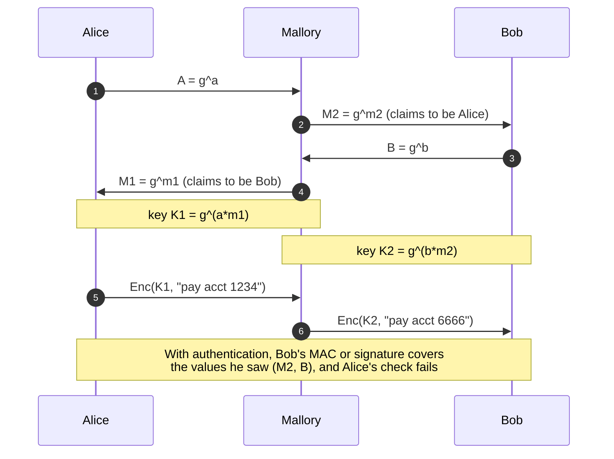
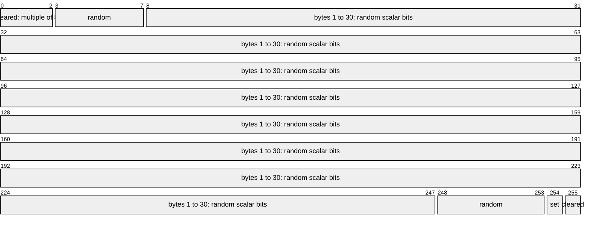
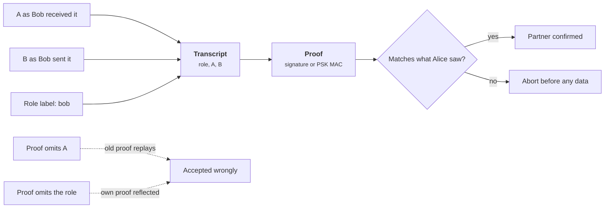

+++
title = 'Key exchange'
description = 'Diffie-Hellman lets two parties who share nothing agree on a secret over a public wire, but only authentication stops the party in the middle.'
question = 'How do two strangers agree on a key in public, and what does that key not prove?'
weight = 1
difficulty = 2
prerequisites = ['/notes/cryptography/foundations/01-start-from-the-property', '/notes/cryptography/symmetric-cryptography/03-macs-and-hmac']
date = 2026-08-19
lastmod = 2026-10-30
verified = 2026-08-19
+++

## The idea in one minute

Two parties who have never met can agree on a shared secret while an
eavesdropper records every byte. Each picks a private number, sends a public
value derived from it, and combines its own private number with the other's
public value. Both arrive at the same result; the eavesdropper, holding only
the public values, cannot compute it. This is **Diffie-Hellman** (DH), and its
modern form, **X25519**, runs at the start of nearly every TLS, SSH, Signal,
and WireGuard session.

The catch is in the word *eavesdropper*. Diffie-Hellman defeats someone who
listens. It does nothing against someone who **intercepts and replaces**: an
active attacker runs one exchange with each side and relays between them. The
math works perfectly; you just agreed a key with the wrong party. The
consequence to act on: **an unauthenticated key exchange gives you a secret,
not a partner**. Every real protocol binds the exchange to an identity, with a
signature, a certificate, or a pre-shared key, and the code below shows the
difference.

## A picture



Alice and Bob each completed a valid exchange. Neither exchange was with the
other.

## How it really works

### The math, with small numbers

Pick a large prime `p` and a generator `g` of a subgroup of prime order `q`.
These are public and shared by everyone.

1. Alice picks a secret `a` and sends `A = g^a mod p`.
2. Bob picks a secret `b` and sends `B = g^b mod p`.
3. Alice computes `B^a = g^(ab)`. Bob computes `A^b = g^(ab)`. Same value.

An eavesdropper sees `p`, `g`, `A`, and `B`. Computing `g^(ab)` from those is
the **computational Diffie-Hellman problem**, believed hard when `p` is large
and well chosen; the best known route goes through the **discrete logarithm**
(recovering `a` from `A`). Modular exponentiation is cheap in one direction and,
as far as anyone knows, infeasible to reverse at proper sizes. Python's
three-argument `pow(g, a, p)` computes it directly, which is why the toy below
needs no library.

Look at what crosses the wire: Eve records every public value, but neither `a` nor `b` ever leaves its owner.

```mermaid {title="Only public values cross the wire, yet both sides reach g^(ab)"}
flowchart LR
  A(["Alice, secret a"])
  B(["Bob, secret b"])
  W["<b>Public wire</b><br/><small>p, g, A = g^a, B = g^b</small>"]
  E(["Eve records everything"])
  KA["<b>B^a = g^(ab)</b>"]
  KB["<b>A^b = g^(ab)</b>"]
  K["<b>HKDF</b><br/><small>shared value + transcript</small>"]
  A -->|sends A| W
  B -->|sends B| W
  W -.->|"sees p, g, A, B only"| E
  W -->|B| KA
  W -->|A| KB
  A --> KA
  B --> KB
  KA --> K
  KB --> K
  class W io
  class KA,KB compute
  class K good
```

The shared value `g^(ab)` is not a key yet. It is a group element with
structure, so protocols feed it through a key derivation function (HKDF in TLS
1.3) along with context such as the transcript, as covered in
[key derivation](/notes/cryptography/symmetric-cryptography/04-key-derivation/).

### Choosing the group

Finite-field DH over a prime field needs large numbers: 2048 bits is the usual
floor today. The parameters matter as much as the size.

| Choice | Why it matters |
| --- | --- |
| **Safe prime**, `p = 2q + 1` with `q` prime | The only small subgroup has order 2, so a malicious public value can leak at most one bit |
| **Standard named groups** (RFC 7919 `ffdhe2048` and up, RFC 3526 MODP) | Reviewed parameters; no trust in a server's freshly "generated" prime |
| **No export-size or 1024-bit groups** | The 2015 Logjam work showed 512-bit export DH could be forced by downgrade and that precomputation against a few widely shared 1024-bit primes was within reach of a well-funded attacker |

Elliptic-curve Diffie-Hellman (**ECDH**) does the same thing in the group of
points on an elliptic curve: "exponentiation" becomes scalar multiplication
`a * G`. The best known attacks on good curves are generic, so a 256-bit curve
gives roughly 128-bit security with far smaller keys and faster math than
finite-field DH. TLS 1.3 still defines finite-field groups, but most
deployments negotiate elliptic-curve or hybrid groups.

The table and the paragraph above reduce to one decision: prefer a curve, and fall back only to a reviewed named group.

```mermaid {title="Choose a curve first and never a weak or home-made group"}
flowchart TB
  S["Choose a key exchange group"] --> Q1@{ shape: diam, label: "X25519 or a hybrid available?" }
  Q1 -->|yes| X["<b>X25519</b><br/><small>or X25519 + ML-KEM</small>"]
  Q1 -->|no| Q2@{ shape: diam, label: "Named group of 2048 bits or more?" }
  Q2 -->|"yes (RFC 7919, RFC 3526)"| F["<b>ffdhe2048 and up</b><br/><small>safe prime, reviewed</small>"]
  Q2 -->|no| R["<b>Refuse</b><br/><small>export-size, 1024-bit, server-generated prime</small>"]
  class S neutral
  class X,F,R good
```

### X25519 (RFC 7748)

X25519 is ECDH on Curve25519, specified with its sibling X448 in RFC 7748
(January 2016). Its design removes several ways implementations used to fail:

- **Every 32-byte string is a valid public key input.** The function works
  only on the `u`-coordinate with a Montgomery ladder, and the curve was
  chosen so that its "twist" is also secure. There is no "is this point on the
  curve?" check to forget.
- **Clamping.** The private scalar has its three low bits cleared (a multiple of
  the cofactor 8) and its top bits fixed. Clearing the low bits neutralizes
  small-subgroup components; fixing the top bit gives every scalar the same
  ladder length, which helps constant-time code.
- **A fixed, simple procedure.** One ladder, a handful of field operations per
  bit, no branches on secret data in a correct implementation.

Here is the 32-byte private scalar as 256 little-endian bits: clamping touches only the first and last byte, exactly as `decode_scalar` in the code below does.



One check remains. A handful of **low-order points** produce an all-zero output
whatever your private key. RFC 7748 says implementations *may* check for an
all-zero shared secret; TLS 1.3 (RFC 8446, section 7.4.2) says they *must*
check and abort. Protocols that need "contributory" behavior, where neither
side alone can force the key, depend on it.

### Small subgroups and invalid curves

The general lesson behind both checks: **never use a peer's public value
without validating it**, unless the primitive was designed so that every input
is safe.

- **Small-subgroup attacks** (Lim and Lee, 1997). In a finite-field group where
  `p - 1` has small factors, an attacker sends a value of small order `r`. Your
  "shared secret" then lands in a set of only `r` values, and anything you
  encrypt or MAC with it reveals your secret modulo `r`. Repeat for several
  small `r` against a reused static key and the Chinese remainder theorem
  assembles the whole key. Defense: use safe primes or check that
  `Y^q mod p == 1`, as NIST SP 800-56A requires for full public-key
  validation.
- **Invalid-curve attacks** (Biehl, Meyer, and Müller, 2000). Elliptic-curve
  formulas for addition often do not use one of the curve's coefficients, so a
  point that is *not on your curve* is processed as if it were on a different,
  weak curve. An implementation that skips the on-curve check leaks its key one
  small subgroup at a time. Jager, Schwenk, and Somorovsky demonstrated this
  against real TLS-ECDH implementations in 2015, and a 2018 Bluetooth pairing
  flaw found by Biham and Neumann came from validating only one coordinate.

Follow the loop: each probe against a reused static key leaks that key modulo one small number, and the pieces add up.

```mermaid {title="A small-subgroup attack recovers a reused key one residue at a time"}
sequenceDiagram
  autonumber
  participant M as Mallory
  participant V as Victim (static key x)
  loop for each small order r of p - 1
    M->>V: public value Y of order r, no subgroup check
    V->>M: data MACed under Y^x, one of only r values
    Note over M: try all r candidates, learn x mod r
  end
  Note over M: Chinese remainder theorem joins the residues into x
  rect rgb(226, 239, 216)
    Note over V: Defense: safe prime, or check Y^q mod p == 1
  end
```

Both attacks need the victim to reuse a private key across many exchanges.
That is one more argument for the next point.

### Ephemeral keys and forward secrecy

If each side generates a **fresh key pair for every session** and deletes the
private half afterward, then an attacker who records traffic today and steals
a server's long-term key next year still cannot decrypt the recording: the
secrets that produced the session keys no longer exist. That property is
**forward secrecy**.

Contrast the old **static RSA key transport** used by TLS 1.2 and earlier: the
client encrypted the session secret under the server's long-term RSA key. One
stolen key decrypted every recorded session, past and future. TLS 1.3 removed
static RSA and static DH entirely; every full handshake uses ephemeral (EC)DHE.

Compare the two lifecycles: the ephemeral private key is gone before an attacker can steal it, while the static key waits for a breach and then unlocks every recording.

```mermaid {title="Ephemeral keys are deleted, static keys wait to be stolen"}
stateDiagram-v2
  state "Static RSA key (TLS 1.2)" as Static
  state "Stolen in a later breach" as Stolen
  [*] --> Generated: fresh key pair per session
  Generated --> Shared: public half sent as key share
  Shared --> Combined: shared secret computed
  Combined --> Deleted: session keys derived
  Deleted --> [*]: nothing left to steal
  [*] --> Static: installed once, used for years
  Static --> Stolen
  Stolen --> [*]: every recorded session decrypts
```

Forward secrecy has limits worth knowing:

- It protects against **later** key theft, not an attacker who holds the
  long-term key during the handshake and can impersonate the server.
- **Session resumption** can quietly weaken it. A TLS session ticket encrypted
  under a long-lived ticket key lets anyone with that key recover resumed
  sessions; TLS 1.3's `psk_dhe_ke` mode runs a fresh DH during resumption to
  keep forward secrecy, and servers should rotate ticket keys.
- A **quantum computer** large enough to run Shor's algorithm would break the
  recorded DH exchanges themselves. This is why browsers and large servers now
  negotiate a hybrid group that combines X25519 with ML-KEM (FIPS 203), as
  [post-quantum migration](/notes/cryptography/applied-cryptography/03-post-quantum-migration/)
  covers.

### Authenticating the exchange

The man in the middle in the picture never broke anything. Alice simply had no
way to tell Mallory's public value from Bob's. The fix is to make each side
prove, over the values it actually saw, that it holds something the attacker
does not:

| Method | Proof of identity | Used by |
| --- | --- | --- |
| **Signature over the transcript** | Private signing key, bound to a name by a certificate | TLS 1.3 `CertificateVerify`, SSH host keys |
| **MAC under a pre-shared key** | A symmetric secret both sides hold | TLS 1.3 `psk_dhe_ke` (the PSK binder is an HMAC), IKEv2 with PSK authentication |
| **Static DH keys mixed in** | Knowledge of a long-term DH private key | Noise patterns (WireGuard), Signal's X3DH |
| **Out-of-band comparison** | Humans compare a short code or fingerprint | Signal safety numbers, Bluetooth numeric comparison |

The detail that matters: the proof must cover **both public values and the
roles**. A MAC over only your own value can be replayed from an older session;
a MAC without a role label can be reflected back at you. TLS 1.3 solves this
generally by signing and MACing a hash of the whole transcript, as
[the TLS handshake](/notes/cryptography/public-key-cryptography/04-the-tls-handshake/)
shows.

Trace what the proof covers: both public values as each side saw them, plus the sender's role. Drop either and an old or mirrored proof gets through.



If both sides share a key already, why run DH at all? Because the PSK
authenticates, while the ephemeral DH supplies forward secrecy: steal the PSK
later and the old sessions stay closed.

## Code

The first program runs a toy Diffie-Hellman exchange in a deliberately tiny
safe-prime group, lets an active attacker sit in the middle, then adds an HMAC
over both public values under a pre-shared key. It also shows what the
public-value check refuses.

```python {title="dh_mitm.py"}
"""dh_mitm.py: toy Diffie-Hellman, an active man in the middle, and the fix.

TOY PARAMETERS: p = 2039 is a safe prime (p = 2q + 1 with q = 1019 prime). It
is far too small to be secure; real systems use X25519 or an RFC 7919 group.
Standard library only; offline; seeded, so every run prints the same thing.
"""

from __future__ import annotations

import hashlib
import hmac
import random

P, Q, G = 2039, 1019, 4  # G = 2^2 is a square, so it generates the order-Q subgroup
rng = random.Random(7)


class Rejected(Exception):
    pass


class Party:
    def __init__(self, name: str) -> None:
        self.name = name
        self.secret = rng.randrange(2, Q)  # ephemeral: a fresh secret per session
        self.public = pow(G, self.secret, P)

    def key_with(self, peer_public: int) -> bytes:
        # Validate the peer's value: in range and inside the order-Q subgroup.
        if not 1 < peer_public < P - 1 or pow(peer_public, Q, P) != 1:
            raise Rejected(f"{self.name} rejects public value {peer_public}")
        z = pow(peer_public, self.secret, P)
        return hashlib.sha256(b"toy-dh|" + z.to_bytes(2, "big")).digest()


def xor(key: bytes, data: bytes) -> bytes:
    """Toy cipher (XOR with a hash of the key); enough to show who can read."""
    stream = hashlib.sha256(key + b"|stream").digest()
    return bytes(d ^ s for d, s in zip(data, stream))


def mac(psk: bytes, role: str, a: int, b: int) -> bytes:
    """Bind the sender's role and both public values, as each side saw them."""
    return hmac.new(psk, f"{role}|A={a}|B={b}".encode(), hashlib.sha256).digest()


def session(mitm: bool, psk: bytes | None) -> None:
    alice, bob = Party("alice"), Party("bob")
    mal_a, mal_b = Party("mallory"), Party("mallory")  # one key pair per victim
    a_at_bob = mal_b.public if mitm else alice.public  # what Bob receives as "A"
    b_at_alice = mal_a.public if mitm else bob.public  # what Alice receives as "B"

    if psk is not None:  # Bob MACs the values he saw; Alice checks against hers
        tag = mac(psk, "bob", a_at_bob, bob.public)
        if not hmac.compare_digest(tag, mac(psk, "bob", alice.public, b_at_alice)):
            print("   alice: bob's MAC does not match the values I saw -> abort")
            return

    k_alice, k_bob = alice.key_with(b_at_alice), bob.key_with(a_at_bob)
    wire = xor(k_alice, b"pay $500 to acct 1234")
    if mitm:  # Mallory decrypts with Alice's key, edits, re-encrypts for Bob
        plain = xor(mal_a.key_with(alice.public), wire)
        print(f"   mallory reads {plain.decode()!r}")
        wire = xor(mal_b.key_with(bob.public), plain.replace(b"1234", b"6666"))
    print(f"   keys equal: {k_alice == k_bob}; bob decrypts {xor(k_bob, wire).decode()!r}")


def main() -> None:
    print("1. honest, unauthenticated")
    session(mitm=False, psk=None)
    print("2. active MITM, unauthenticated")
    session(mitm=True, psk=None)
    psk = b"pre-shared key that mallory does not have"
    print("3. active MITM, exchange authenticated with HMAC(psk)")
    session(mitm=True, psk=psk)
    print("4. honest, exchange authenticated with HMAC(psk)")
    session(mitm=False, psk=psk)

    print("5. peer values that force the shared secret (validation on)")
    victim = Party("alice")
    for bad in (0, 1, P - 1):  # P-1 has order 2: the result is 1 or P-1
        try:
            victim.key_with(bad)
        except Rejected as e:
            forced = pow(bad, victim.secret, P)
            print(f"   {e}; unchecked, the shared value would be {forced}")

if __name__ == "__main__":
    main()
```

Run it with `python3 dh_mitm.py`:

```text
1. honest, unauthenticated
   keys equal: True; bob decrypts 'pay $500 to acct 1234'
2. active MITM, unauthenticated
   mallory reads 'pay $500 to acct 1234'
   keys equal: False; bob decrypts 'pay $500 to acct 6666'
3. active MITM, exchange authenticated with HMAC(psk)
   alice: bob's MAC does not match the values I saw -> abort
4. honest, exchange authenticated with HMAC(psk)
   keys equal: True; bob decrypts 'pay $500 to acct 1234'
5. peer values that force the shared secret (validation on)
   alice rejects public value 0; unchecked, the shared value would be 0
   alice rejects public value 1; unchecked, the shared value would be 1
   alice rejects public value 2038; unchecked, the shared value would be 1
```

Case 2 is the whole problem in two lines: Mallory read and rewrote the payment
while both victims saw a normal, working exchange. In case 3, Bob's MAC covers
the value he received (`M2`), Alice checks it against the value she sent (`A`),
and the mismatch ends the session before a byte of data flows. Case 5 shows
what an attacker could force without validation: a shared value of 0 or 1 is
public knowledge.

The second program is the real thing: X25519 transcribed from RFC 7748, run
against the RFC's own test vectors.

```python {title="x25519.py"}
"""x25519.py: X25519 from RFC 7748, checked against the RFC's own test vectors.

A readable, pure-Python transcription of RFC 7748 section 5. It is NOT constant
time and must not be used for real keys; use libsodium or pyca/cryptography.
Standard library only; offline.
"""

from __future__ import annotations

P = 2**255 - 19
A24 = 121665  # (486662 - 2) / 4


def decode_scalar(k: bytes) -> int:
    b = bytearray(k)
    b[0] &= 248  # clear the 3 low bits: the scalar is a multiple of the cofactor 8
    b[31] &= 127  # clear the top bit
    b[31] |= 64  # set bit 254: fixed ladder length
    return int.from_bytes(b, "little")


def decode_u(u: bytes) -> int:
    return int.from_bytes(u, "little") & ((1 << 255) - 1)  # mask the top bit


def x25519(k: bytes, u: bytes) -> bytes:
    """Montgomery ladder over the u-coordinate (RFC 7748, section 5)."""
    scalar, x1 = decode_scalar(k), decode_u(u)
    x2, z2, x3, z3, swap = 1, 0, x1, 1, 0
    for t in reversed(range(255)):
        bit = (scalar >> t) & 1
        swap ^= bit
        if swap:
            x2, x3, z2, z3 = x3, x2, z3, z2
        swap = bit
        a, b = (x2 + z2) % P, (x2 - z2) % P
        aa, bb = a * a % P, b * b % P
        e = (aa - bb) % P
        c, d = (x3 + z3) % P, (x3 - z3) % P
        da, cb = d * a % P, c * b % P
        x3 = (da + cb) ** 2 % P
        z3 = x1 * (da - cb) ** 2 % P
        x2 = aa * bb % P
        z2 = e * (aa + A24 * e) % P
    if swap:
        x2, z2 = x3, z3
    return (x2 * pow(z2, P - 2, P) % P).to_bytes(32, "little")


BASE = (9).to_bytes(32, "little")
h = bytes.fromhex

if __name__ == "__main__":
    # RFC 7748 section 5.2, first single-call vector.
    out = x25519(h("a546e36bf0527c9d3b16154b82465edd62144c0ac1fc5a18506a2244ba449ac4"),
                 h("e6db6867583030db3594c1a424b15f7c726624ec26b3353b10a903a6d0ab1c4c"))
    want = "c3da55379de9c6908e94ea4df28d084f32eccf03491c71f754b4075577a28552"
    print(f"5.2 vector matches:  {out.hex() == want}")

    # RFC 7748 section 6.1: Alice and Bob.
    a_priv = h("77076d0a7318a57d3c16c17251b26645df4c2f87ebc0992ab177fba51db92c2a")
    b_priv = h("5dab087e624a8a4b79e17f8b83800ee66f3bb1292618b6fd1c2f8b27ff88e0eb")
    a_pub, b_pub = x25519(a_priv, BASE), x25519(b_priv, BASE)
    print(f"alice public:        {a_pub.hex()}")
    print(f"bob public:          {b_pub.hex()}")
    k1, k2 = x25519(a_priv, b_pub), x25519(b_priv, a_pub)
    print(f"shared (alice side): {k1.hex()}")
    print(f"shared (bob side):   {k2.hex()}")
    want = "4a5d9d5ba4ce2de1728e3bf480350f25e07e21c947d19e3376f09b3c1e161742"
    print(f"6.1 shared matches:  {k1 == k2 == h(want)}")

    # A low-order peer value (u = 0) forces an all-zero output. RFC 7748
    # section 6.1 says implementations MAY check for it; TLS 1.3 says MUST.
    print(f"peer u=0 gives zero: {x25519(a_priv, bytes(32)) == bytes(32)}")
```

Run it with `python3 x25519.py`:

```text
5.2 vector matches:  True
alice public:        8520f0098930a754748b7ddcb43ef75a0dbf3a0d26381af4eba4a98eaa9b4e6a
bob public:          de9edb7d7b7dc1b4d35b61c2ece435373f8343c85b78674dadfc7e146f882b4f
shared (alice side): 4a5d9d5ba4ce2de1728e3bf480350f25e07e21c947d19e3376f09b3c1e161742
shared (bob side):   4a5d9d5ba4ce2de1728e3bf480350f25e07e21c947d19e3376f09b3c1e161742
6.1 shared matches:  True
peer u=0 gives zero: True
```

Matching all of the RFC's published values is strong evidence the ladder is
right. It is still not safe to use: Python integers do not run in constant
time, so the timing of the loop leaks information about the scalar. That is
the subject of
[side channels and constant time](/notes/cryptography/applied-cryptography/02-side-channels-and-constant-time/).

## Where it breaks

- **No authentication, no security against active attackers.** "Encrypted with
  a fresh DH key" says nothing about who holds the other end. Opportunistic
  encryption is still worth having against passive collection, but it is not
  a defense against interception.
- **Trust on first use moves the problem.** SSH's host-key prompt authenticates
  every connection after the first; the first one is a bare DH exchange. Pin or
  distribute host keys out of band for anything that matters.
- **Skipped validation.** Finite-field DH with an unchecked peer value, or
  ECDH on a Weierstrass curve without an on-curve check, leaks keys. X25519
  limits the damage by design, but the all-zero check still has to be written.
- **Reused "ephemeral" keys.** Some servers cache an ephemeral key for
  performance. That turns ephemeral keys back into static ones for the cache
  lifetime, enlarges the window for subgroup attacks, and shrinks forward
  secrecy to the cache lifetime.
- **Weak randomness.** A private exponent from a predictable generator is a
  public exponent. See
  [randomness and entropy](/notes/cryptography/foundations/02-randomness-and-entropy/).
- **What the toy does not show.** The group in `dh_mitm.py` has 1,019
  elements; a laptop finds any private key instantly. The XOR "cipher" exists
  only to show who can read the message; real sessions use an AEAD keyed by
  HKDF output. The PSK MAC is a minimal sketch, not a vetted protocol; use
  TLS, Noise, or another analyzed design rather than inventing one.

## Remember this

- Diffie-Hellman defeats listeners, not interceptors.
- Authenticate the exchange over both public values and the roles: signature,
  PSK MAC, or a verified static key.
- Validate peer public values, or use X25519 and check for an all-zero result.
- Ephemeral keys, deleted after use, give forward secrecy; static key transport
  does not.
- Feed the raw shared secret through a KDF with the transcript as context.

## Try it

1. In `dh_mitm.py`, change Bob's MAC to cover only his own public value
   (`mac(psk, "bob", 0, bob.public)` on both sides). Does case 3 still abort?
   Now imagine Mallory replays Bob's value and MAC from an earlier session.
   What does she gain, and what stops her from finishing the exchange?
2. Replace the safe prime with `p = 2311`, whose `p - 1 = 2 * 3 * 5 * 7 * 11`,
   and remove the subgroup check. Send a value of order 5 and print the
   possible shared values. How many bits of the private key does each probe
   reveal?
3. In `x25519.py`, feed the point `u = 1` as the peer value. What comes out,
   and why does that make the all-zero check necessary?
4. Find which key exchange groups a TLS server you operate negotiates (for
   example with `openssl s_client -connect host:443 -groups X25519MLKEM768`
   on a recent OpenSSL). Is a hybrid post-quantum group offered?

## Check yourself

1. An eavesdropper records `p`, `g`, `A`, and `B`. Why can she not compute the
   shared secret, and what changes if she can modify traffic?

   
   Computing `g^(ab)` from `g^a` and `g^b` is the computational Diffie-Hellman
   problem, which is infeasible at proper sizes. An active attacker does not
   need to solve it: she replaces `A` and `B` with her own values and completes
   a separate, valid exchange with each side, then relays and edits traffic.
   

2. What is forward secrecy, and why did TLS 1.3 remove static RSA key transport?

   
   Forward secrecy means compromising a long-term key later does not expose
   past sessions, because those sessions used ephemeral secrets that were
   deleted. With static RSA key transport, the session secret was encrypted to
   the server's long-term key, so one stolen key decrypted every recorded
   session. TLS 1.3 requires ephemeral (EC)DHE for every full handshake.
   

3. Why does an authenticating MAC need to cover both public values, not just
   the sender's?

   
   The receiver needs to know that the sender saw the same exchange it did. If
   the MAC covers only the sender's value, a MAC from an old session can be
   replayed, and the receiver learns nothing about whether its own value
   arrived unmodified. Covering both values (and the role) ties the proof to
   this exchange and this direction.
   

4. What does X25519's clamping protect against, and what check does it not
   replace?

   
   Clearing the three low bits makes the scalar a multiple of the cofactor 8,
   which wipes out any small-subgroup component of the peer's point, and
   fixing the high bit gives a constant ladder length. It does not stop a
   low-order peer point from forcing an all-zero shared secret, so
   implementations (TLS 1.3 requires it) must check the output and abort.
   

5. A team uses a pre-shared key to authenticate an exchange. Why still do
   Diffie-Hellman instead of deriving session keys from the PSK alone?

   
   Keys derived only from the PSK can be recomputed by anyone who later steals
   it, exposing every recorded session. With ephemeral DH, the PSK only
   authenticates; the session keys also depend on secrets that were deleted,
   so a later PSK theft does not open old traffic.
   

## Sources

- W. Diffie, M. Hellman, "New Directions in Cryptography", *IEEE Transactions on Information Theory* 22(6), November 1976.
- A. Langley, M. Hamburg, S. Turner, [RFC 7748: Elliptic Curves for Security](https://www.rfc-editor.org/rfc/rfc7748), IETF, January 2016.
- E. Rescorla, [RFC 8446: The Transport Layer Security (TLS) Protocol Version 1.3](https://www.rfc-editor.org/rfc/rfc8446), IETF, August 2018 (section 7.4 on (EC)DHE shared secrets).
- D. Gillmor, [RFC 7919: Negotiated Finite Field Diffie-Hellman Ephemeral Parameters for TLS](https://www.rfc-editor.org/rfc/rfc7919), IETF, August 2016.
- NIST, [SP 800-56A Rev. 3: Recommendation for Pair-Wise Key-Establishment Schemes Using Discrete Logarithm Cryptography](https://csrc.nist.gov/pubs/sp/800/56/a/r3/final), April 2018.
- D. Adrian et al., "Imperfect Forward Secrecy: How Diffie-Hellman Fails in Practice", ACM CCS 2015.
- C. H. Lim, P. J. Lee, "A Key Recovery Attack on Discrete Log-based Schemes Using a Prime Order Subgroup", CRYPTO 1997.
- T. Jager, J. Schwenk, J. Somorovsky, "Practical Invalid Curve Attacks on TLS-ECDH", ESORICS 2015.
- NIST, [FIPS 203: Module-Lattice-Based Key-Encapsulation Mechanism Standard](https://csrc.nist.gov/pubs/fips/203/final), August 2024.
